<!-- markdownlint-capture -->
<!-- markdownlint-disable -->

# Code Metrics

This file is dynamically maintained by a bot, *please do not* edit this by hand. It represents various [code metrics](https://aka.ms/dotnet/code-metrics), such as cyclomatic complexity, maintainability index, and so on.

<div id='dependencymodules-codefixes'></div>

## DependencyModules.CodeFixes :warning:

The *DependencyModules.CodeFixes.csproj* project file contains:

- 1 namespaces.
- 1 named types.
- 159 total lines of source code.
- Approximately 31 lines of executable code.
- The highest cyclomatic complexity is 8 :warning:.

<details>
<summary>
  <strong id="dependencymodules-codefixes">
    DependencyModules.CodeFixes :warning:
  </strong>
</summary>
<br>

The `DependencyModules.CodeFixes` namespace contains 1 named types.

- 1 named types.
- 159 total lines of source code.
- Approximately 31 lines of executable code.
- The highest cyclomatic complexity is 8 :warning:.

<details>
<summary>
  <strong id="servicetypecodefixprovider">
    ServiceTypeCodeFixProvider :warning:
  </strong>
</summary>
<br>

- The `ServiceTypeCodeFixProvider` contains 9 members.
- 156 total lines of source code.
- Approximately 31 lines of executable code.
- The highest cyclomatic complexity is 8 :warning:.

| Member kind | Line number | Maintainability index | Cyclomatic complexity | Depth of inheritance | Class coupling | Lines of source / executable code |
| :-: | :-: | :-: | :-: | :-: | :-: | :-: |
| Field | <a href='https://github.com/ipjohnson/DependencyModules/blob/main/src/DependencyModules.CodeFixes/ServiceTypeCodeFixProvider.cs#L33' title='string ServiceTypeCodeFixProvider.DiagnosticId'>33</a> | 93 | 0 :heavy_check_mark: | 0 | 0 | 1 / 1 |
| Field | <a href='https://github.com/ipjohnson/DependencyModules/blob/main/src/DependencyModules.CodeFixes/ServiceTypeCodeFixProvider.cs#L37' title='string ServiceTypeCodeFixProvider.EquivalenceKey'>37</a> | 93 | 0 :heavy_check_mark: | 0 | 0 | 1 / 1 |
| Property | <a href='https://github.com/ipjohnson/DependencyModules/blob/main/src/DependencyModules.CodeFixes/ServiceTypeCodeFixProvider.cs#L39' title='ImmutableArray<string> ServiceTypeCodeFixProvider.FixableDiagnosticIds'>39</a> | 100 | 1 :heavy_check_mark: | 0 | 2 | 2 / 1 |
| Method | <a href='https://github.com/ipjohnson/DependencyModules/blob/main/src/DependencyModules.CodeFixes/ServiceTypeCodeFixProvider.cs#L82' title='Task<Document> ServiceTypeCodeFixProvider.FixAsync(Document document, AttributeSyntax attribute, string serviceType, CancellationToken cancellationToken)'>82</a> | 78 | 1 :heavy_check_mark: | 0 | 5 | 17 / 3 |
| Method | <a href='https://github.com/ipjohnson/DependencyModules/blob/main/src/DependencyModules.CodeFixes/ServiceTypeCodeFixProvider.cs#L42' title='FixAllProvider ServiceTypeCodeFixProvider.GetFixAllProvider()'>42</a> | 100 | 1 :heavy_check_mark: | 0 | 2 | 1 / 1 |
| Method | <a href='https://github.com/ipjohnson/DependencyModules/blob/main/src/DependencyModules.CodeFixes/ServiceTypeCodeFixProvider.cs#L44' title='Task ServiceTypeCodeFixProvider.RegisterCodeFixesAsync(CodeFixContext context)'>44</a> | 64 | 8 :warning: | 0 | 6 | 37 / 8 |
| Field | <a href='https://github.com/ipjohnson/DependencyModules/blob/main/src/DependencyModules.CodeFixes/ServiceTypeCodeFixProvider.cs#L35' title='string ServiceTypeCodeFixProvider.ServiceTypeDisplayProperty'>35</a> | 93 | 0 :heavy_check_mark: | 0 | 0 | 1 / 1 |
| Field | <a href='https://github.com/ipjohnson/DependencyModules/blob/main/src/DependencyModules.CodeFixes/ServiceTypeCodeFixProvider.cs#L34' title='string ServiceTypeCodeFixProvider.ServiceTypeProperty'>34</a> | 93 | 0 :heavy_check_mark: | 0 | 0 | 1 / 1 |
| Method | <a href='https://github.com/ipjohnson/DependencyModules/blob/main/src/DependencyModules.CodeFixes/ServiceTypeCodeFixProvider.cs#L100' title='AttributeSyntax ServiceTypeCodeFixProvider.WithAs(AttributeSyntax attribute, TypeOfExpressionSyntax typeOf)'>100</a> | 57 | 6 :heavy_check_mark: | 0 | 3 | 67 / 14 |

<a href="#ServiceTypeCodeFixProvider-class-diagram">:link: to `ServiceTypeCodeFixProvider` class diagram</a>

<a href="#dependencymodules-codefixes">:top: back to DependencyModules.CodeFixes</a>

</details>

</details>

<a href="#dependencymodules-codefixes">:top: back to DependencyModules.CodeFixes</a>

<div id='dependencymodules-fakeiteasy'></div>

## DependencyModules.FakeItEasy :heavy_check_mark:

The *DependencyModules.FakeItEasy.csproj* project file contains:

- 1 namespaces.
- 1 named types.
- 41 total lines of source code.
- Approximately 3 lines of executable code.
- The highest cyclomatic complexity is 1 :heavy_check_mark:.

<details>
<summary>
  <strong id="dependencymodules-fakeiteasy">
    DependencyModules.FakeItEasy :heavy_check_mark:
  </strong>
</summary>
<br>

The `DependencyModules.FakeItEasy` namespace contains 1 named types.

- 1 named types.
- 41 total lines of source code.
- Approximately 3 lines of executable code.
- The highest cyclomatic complexity is 1 :heavy_check_mark:.

<details>
<summary>
  <strong id="fakeiteasysupportattribute">
    FakeItEasySupportAttribute :heavy_check_mark:
  </strong>
</summary>
<br>

- The `FakeItEasySupportAttribute` contains 1 members.
- 38 total lines of source code.
- Approximately 3 lines of executable code.
- The highest cyclomatic complexity is 1 :heavy_check_mark:.

| Member kind | Line number | Maintainability index | Cyclomatic complexity | Depth of inheritance | Class coupling | Lines of source / executable code |
| :-: | :-: | :-: | :-: | :-: | :-: | :-: |
| Method | <a href='https://github.com/ipjohnson/DependencyModules/blob/main/src/DependencyModules.FakeItEasy/FakeItEasySupportAttribute.cs#L38' title='object FakeItEasySupportAttribute.ProvideMock(Type type)'>38</a> | 100 | 1 :heavy_check_mark: | 0 | 2 | 13 / 1 |

<a href="#FakeItEasySupportAttribute-class-diagram">:link: to `FakeItEasySupportAttribute` class diagram</a>

<a href="#dependencymodules-fakeiteasy">:top: back to DependencyModules.FakeItEasy</a>

</details>

</details>

<a href="#dependencymodules-fakeiteasy">:top: back to DependencyModules.FakeItEasy</a>

<div id='dependencymodules-moq'></div>

## DependencyModules.Moq :heavy_check_mark:

The *DependencyModules.Moq.csproj* project file contains:

- 1 namespaces.
- 1 named types.
- 158 total lines of source code.
- Approximately 26 lines of executable code.
- The highest cyclomatic complexity is 5 :heavy_check_mark:.

<details>
<summary>
  <strong id="dependencymodules-moq">
    DependencyModules.Moq :heavy_check_mark:
  </strong>
</summary>
<br>

The `DependencyModules.Moq` namespace contains 1 named types.

- 1 named types.
- 158 total lines of source code.
- Approximately 26 lines of executable code.
- The highest cyclomatic complexity is 5 :heavy_check_mark:.

<details>
<summary>
  <strong id="moqsupportattribute">
    MoqSupportAttribute :heavy_check_mark:
  </strong>
</summary>
<br>

- The `MoqSupportAttribute` contains 5 members.
- 155 total lines of source code.
- Approximately 26 lines of executable code.
- The highest cyclomatic complexity is 5 :heavy_check_mark:.

| Member kind | Line number | Maintainability index | Cyclomatic complexity | Depth of inheritance | Class coupling | Lines of source / executable code |
| :-: | :-: | :-: | :-: | :-: | :-: | :-: |
| Method | <a href='https://github.com/ipjohnson/DependencyModules/blob/main/src/DependencyModules.Moq/MoqSupportAttribute.cs#L139' title='Mock MoqSupportAttribute.CreateMock(Type type)'>139</a> | 100 | 1 :heavy_check_mark: | 0 | 4 | 2 / 1 |
| Method | <a href='https://github.com/ipjohnson/DependencyModules/blob/main/src/DependencyModules.Moq/MoqSupportAttribute.cs#L101' title='object MoqSupportAttribute.ProvideMock(Type type)'>101</a> | 80 | 2 :heavy_check_mark: | 0 | 4 | 26 / 3 |
| Method | <a href='https://github.com/ipjohnson/DependencyModules/blob/main/src/DependencyModules.Moq/MoqSupportAttribute.cs#L121' title='bool MoqSupportAttribute.RegistersService(ITestMethodContext testMethod, Type serviceType)'>121</a> | 71 | 5 :heavy_check_mark: | 0 | 5 | 27 / 6 |
| Method | <a href='https://github.com/ipjohnson/DependencyModules/blob/main/src/DependencyModules.Moq/MoqSupportAttribute.cs#L58' title='void MoqSupportAttribute.SetupServiceCollection(ITestMethodContext testMethod, IServiceCollection serviceCollection)'>58</a> | 67 | 4 :heavy_check_mark: | 0 | 8 | 46 / 9 |
| Method | <a href='https://github.com/ipjohnson/DependencyModules/blob/main/src/DependencyModules.Moq/MoqSupportAttribute.cs#L145' title='bool MoqSupportAttribute.TryGetMockedType(Type parameterType, out Type? mockedType)'>145</a> | 72 | 3 :heavy_check_mark: | 0 | 5 | 20 / 5 |

<a href="#MoqSupportAttribute-class-diagram">:link: to `MoqSupportAttribute` class diagram</a>

<a href="#dependencymodules-moq">:top: back to DependencyModules.Moq</a>

</details>

</details>

<a href="#dependencymodules-moq">:top: back to DependencyModules.Moq</a>

<div id='dependencymodules-nsubstitute'></div>

## DependencyModules.NSubstitute :heavy_check_mark:

The *DependencyModules.NSubstitute.csproj* project file contains:

- 1 namespaces.
- 1 named types.
- 38 total lines of source code.
- Approximately 3 lines of executable code.
- The highest cyclomatic complexity is 1 :heavy_check_mark:.

<details>
<summary>
  <strong id="dependencymodules-nsubstitute">
    DependencyModules.NSubstitute :heavy_check_mark:
  </strong>
</summary>
<br>

The `DependencyModules.NSubstitute` namespace contains 1 named types.

- 1 named types.
- 38 total lines of source code.
- Approximately 3 lines of executable code.
- The highest cyclomatic complexity is 1 :heavy_check_mark:.

<details>
<summary>
  <strong id="nsubstitutesupportattribute">
    NSubstituteSupportAttribute :heavy_check_mark:
  </strong>
</summary>
<br>

- The `NSubstituteSupportAttribute` contains 1 members.
- 35 total lines of source code.
- Approximately 3 lines of executable code.
- The highest cyclomatic complexity is 1 :heavy_check_mark:.

| Member kind | Line number | Maintainability index | Cyclomatic complexity | Depth of inheritance | Class coupling | Lines of source / executable code |
| :-: | :-: | :-: | :-: | :-: | :-: | :-: |
| Method | <a href='https://github.com/ipjohnson/DependencyModules/blob/main/src/DependencyModules.NSubstitute/NSubstituteSupportAttribute.cs#L36' title='object NSubstituteSupportAttribute.ProvideMock(Type type)'>36</a> | 100 | 1 :heavy_check_mark: | 0 | 2 | 9 / 1 |

<a href="#NSubstituteSupportAttribute-class-diagram">:link: to `NSubstituteSupportAttribute` class diagram</a>

<a href="#dependencymodules-nsubstitute">:top: back to DependencyModules.NSubstitute</a>

</details>

</details>

<a href="#dependencymodules-nsubstitute">:top: back to DependencyModules.NSubstitute</a>

<div id='dependencymodules-nunit'></div>

## DependencyModules.NUnit :warning:

The *DependencyModules.NUnit.csproj* project file contains:

- 2 namespaces.
- 9 named types.
- 749 total lines of source code.
- Approximately 57 lines of executable code.
- The highest cyclomatic complexity is 8 :warning:.

<details>
<summary>
  <strong id="dependencymodules-nunit-attributes">
    DependencyModules.NUnit.Attributes :warning:
  </strong>
</summary>
<br>

The `DependencyModules.NUnit.Attributes` namespace contains 3 named types.

- 3 named types.
- 300 total lines of source code.
- Approximately 44 lines of executable code.
- The highest cyclomatic complexity is 8 :warning:.

<details>
<summary>
  <strong id="imoduletestdataattribute">
    IModuleTestDataAttribute :heavy_check_mark:
  </strong>
</summary>
<br>

- The `IModuleTestDataAttribute` contains 1 members.
- 17 total lines of source code.
- Approximately 0 lines of executable code.
- The highest cyclomatic complexity is 1 :heavy_check_mark:.

| Member kind | Line number | Maintainability index | Cyclomatic complexity | Depth of inheritance | Class coupling | Lines of source / executable code |
| :-: | :-: | :-: | :-: | :-: | :-: | :-: |
| Method | <a href='https://github.com/ipjohnson/DependencyModules/blob/main/src/DependencyModules.NUnit/Attributes/ModuleTestCaseAttribute.cs#L20' title='IEnumerable<object?[]> IModuleTestDataAttribute.GetRows(MethodInfo method)'>20</a> | 100 | 1 :heavy_check_mark: | 0 | 3 | 6 / 0 |

<a href="#IModuleTestDataAttribute-class-diagram">:link: to `IModuleTestDataAttribute` class diagram</a>

<a href="#dependencymodules-nunit-attributes">:top: back to DependencyModules.NUnit.Attributes</a>

</details>

<details>
<summary>
  <strong id="moduletestattribute">
    ModuleTestAttribute :warning:
  </strong>
</summary>
<br>

- The `ModuleTestAttribute` contains 11 members.
- 232 total lines of source code.
- Approximately 42 lines of executable code.
- The highest cyclomatic complexity is 8 :warning:.

| Member kind | Line number | Maintainability index | Cyclomatic complexity | Depth of inheritance | Class coupling | Lines of source / executable code |
| :-: | :-: | :-: | :-: | :-: | :-: | :-: |
| Method | <a href='https://github.com/ipjohnson/DependencyModules/blob/main/src/DependencyModules.NUnit/Attributes/ModuleTestAttribute.cs#L61' title='ModuleTestAttribute.ModuleTestAttribute()'>61</a> | 100 | 1 :heavy_check_mark: | 0 | 1 | 2 / 1 |
| Method | <a href='https://github.com/ipjohnson/DependencyModules/blob/main/src/DependencyModules.NUnit/Attributes/ModuleTestAttribute.cs#L73' title='ModuleTestAttribute.ModuleTestAttribute(params Type[] modules)'>73</a> | 96 | 1 :heavy_check_mark: | 0 | 1 | 14 / 1 |
| Method | <a href='https://github.com/ipjohnson/DependencyModules/blob/main/src/DependencyModules.NUnit/Attributes/ModuleTestAttribute.cs#L90' title='IEnumerable<TestMethod> ModuleTestAttribute.BuildFrom(IMethodInfo method, Test? suite)'>90</a> | 53 | 8 :warning: | 0 | 9 | 79 / 20 |
| Method | <a href='https://github.com/ipjohnson/DependencyModules/blob/main/src/DependencyModules.NUnit/Attributes/ModuleTestAttribute.cs#L202' title='TestMethod ModuleTestAttribute.BuildTestMethod(IMethodInfo method, Test? suite, object?[] arguments, object?[] row, string testName)'>202</a> | 75 | 1 :heavy_check_mark: | 0 | 7 | 16 / 4 |
| Method | <a href='https://github.com/ipjohnson/DependencyModules/blob/main/src/DependencyModules.NUnit/Attributes/ModuleTestAttribute.cs#L226' title='string ModuleTestAttribute.DisplayName(string methodName, object?[] row)'>226</a> | 94 | 1 :heavy_check_mark: | 0 | 2 | 9 / 1 |
| Method | <a href='https://github.com/ipjohnson/DependencyModules/blob/main/src/DependencyModules.NUnit/Attributes/ModuleTestAttribute.cs#L234' title='string ModuleTestAttribute.FormatArgument(object? argument)'>234</a> | 90 | 2 :heavy_check_mark: | 0 | 3 | 14 / 1 |
| Property | <a href='https://github.com/ipjohnson/DependencyModules/blob/main/src/DependencyModules.NUnit/Attributes/ModuleTestAttribute.cs#L79' title='Type[] ModuleTestAttribute.ModuleTypes'>79</a> | 100 | 1 :heavy_check_mark: | 0 | 1 | 2 / 0 |
| Method | <a href='https://github.com/ipjohnson/DependencyModules/blob/main/src/DependencyModules.NUnit/Attributes/ModuleTestAttribute.cs#L172' title='string? ModuleTestAttribute.NUnitDataMessage(MethodInfo method)'>172</a> | 64 | 2 :heavy_check_mark: | 0 | 3 | 32 / 9 |
| Field | <a href='https://github.com/ipjohnson/DependencyModules/blob/main/src/DependencyModules.NUnit/Attributes/ModuleTestAttribute.cs#L58' title='string ModuleTestAttribute.RowPropertyName'>58</a> | 93 | 0 :heavy_check_mark: | 0 | 0 | 1 / 1 |
| Method | <a href='https://github.com/ipjohnson/DependencyModules/blob/main/src/DependencyModules.NUnit/Attributes/ModuleTestAttribute.cs#L197' title='string ModuleTestAttribute.TrimAttributeSuffix(string name)'>197</a> | 91 | 2 :heavy_check_mark: | 0 | 1 | 4 / 1 |
| Method | <a href='https://github.com/ipjohnson/DependencyModules/blob/main/src/DependencyModules.NUnit/Attributes/ModuleTestAttribute.cs#L162' title='TestCommand ModuleTestAttribute.Wrap(TestCommand command)'>162</a> | 100 | 1 :heavy_check_mark: | 0 | 2 | 2 / 1 |

<a href="#ModuleTestAttribute-class-diagram">:link: to `ModuleTestAttribute` class diagram</a>

<a href="#dependencymodules-nunit-attributes">:top: back to DependencyModules.NUnit.Attributes</a>

</details>

<details>
<summary>
  <strong id="moduletestcaseattribute">
    ModuleTestCaseAttribute :question:
  </strong>
</summary>
<br>

- The `ModuleTestCaseAttribute` contains 0 members.
- 28 total lines of source code.
- Approximately 2 lines of executable code.
- The highest cyclomatic complexity is 0 :question:.

| Member kind | Line number | Maintainability index | Cyclomatic complexity | Depth of inheritance | Class coupling | Lines of source / executable code |
| :-: | :-: | :-: | :-: | :-: | :-: | :-: |

<a href="#ModuleTestCaseAttribute-class-diagram">:link: to `ModuleTestCaseAttribute` class diagram</a>

<a href="#dependencymodules-nunit-attributes">:top: back to DependencyModules.NUnit.Attributes</a>

</details>

</details>

<details>
<summary>
  <strong id="dependencymodules-nunit-impl">
    DependencyModules.NUnit.Impl :heavy_check_mark:
  </strong>
</summary>
<br>

The `DependencyModules.NUnit.Impl` namespace contains 6 named types.

- 6 named types.
- 449 total lines of source code.
- Approximately 13 lines of executable code.
- The highest cyclomatic complexity is 6 :heavy_check_mark:.

<details>
<summary>
  <strong id="inunittestmethodcontext">
    INUnitTestMethodContext :heavy_check_mark:
  </strong>
</summary>
<br>

- The `INUnitTestMethodContext` contains 1 members.
- 17 total lines of source code.
- Approximately 0 lines of executable code.
- The highest cyclomatic complexity is 1 :heavy_check_mark:.

| Member kind | Line number | Maintainability index | Cyclomatic complexity | Depth of inheritance | Class coupling | Lines of source / executable code |
| :-: | :-: | :-: | :-: | :-: | :-: | :-: |
| Property | <a href='https://github.com/ipjohnson/DependencyModules/blob/main/src/DependencyModules.NUnit/Impl/NUnitTestMethodContext.cs#L22' title='TestMethod INUnitTestMethodContext.NUnitTestMethod'>22</a> | 100 | 1 :heavy_check_mark: | 0 | 1 | 4 / 0 |

<a href="#INUnitTestMethodContext-class-diagram">:link: to `INUnitTestMethodContext` class diagram</a>

<a href="#dependencymodules-nunit-impl">:top: back to DependencyModules.NUnit.Impl</a>

</details>

<details>
<summary>
  <strong id="itestcaseinfo">
    ITestCaseInfo :heavy_check_mark:
  </strong>
</summary>
<br>

- The `ITestCaseInfo` contains 3 members.
- 30 total lines of source code.
- Approximately 0 lines of executable code.
- The highest cyclomatic complexity is 2 :heavy_check_mark:.

| Member kind | Line number | Maintainability index | Cyclomatic complexity | Depth of inheritance | Class coupling | Lines of source / executable code |
| :-: | :-: | :-: | :-: | :-: | :-: | :-: |
| Property | <a href='https://github.com/ipjohnson/DependencyModules/blob/main/src/DependencyModules.NUnit/Impl/TestCaseInfo.cs#L17' title='TestMethod ITestCaseInfo.TestMethod'>17</a> | 100 | 1 :heavy_check_mark: | 0 | 1 | 5 / 0 |
| Property | <a href='https://github.com/ipjohnson/DependencyModules/blob/main/src/DependencyModules.NUnit/Impl/TestCaseInfo.cs#L27' title='IReadOnlyList<object?> ITestCaseInfo.TestMethodArguments'>27</a> | 100 | 2 :heavy_check_mark: | 0 | 2 | 9 / 0 |
| Property | <a href='https://github.com/ipjohnson/DependencyModules/blob/main/src/DependencyModules.NUnit/Impl/TestCaseInfo.cs#L33' title='IReadOnlyList<Attribute> ITestCaseInfo.TestMethodAttributes'>33</a> | 100 | 1 :heavy_check_mark: | 0 | 2 | 5 / 0 |

<a href="#ITestCaseInfo-class-diagram">:link: to `ITestCaseInfo` class diagram</a>

<a href="#dependencymodules-nunit-impl">:top: back to DependencyModules.NUnit.Impl</a>

</details>

<details>
<summary>
  <strong id="moduletestcommand">
    ModuleTestCommand :question:
  </strong>
</summary>
<br>

- The `ModuleTestCommand` contains 0 members.
- 13 total lines of source code.
- Approximately 0 lines of executable code.
- The highest cyclomatic complexity is 0 :question:.

| Member kind | Line number | Maintainability index | Cyclomatic complexity | Depth of inheritance | Class coupling | Lines of source / executable code |
| :-: | :-: | :-: | :-: | :-: | :-: | :-: |

<a href="#ModuleTestCommand-class-diagram">:link: to `ModuleTestCommand` class diagram</a>

<a href="#dependencymodules-nunit-impl">:top: back to DependencyModules.NUnit.Impl</a>

</details>

<details>
<summary>
  <strong id="nunitcurrenttestprovider">
    NUnitCurrentTestProvider :heavy_check_mark:
  </strong>
</summary>
<br>

- The `NUnitCurrentTestProvider` contains 6 members.
- 42 total lines of source code.
- Approximately 13 lines of executable code.
- The highest cyclomatic complexity is 6 :heavy_check_mark:.

| Member kind | Line number | Maintainability index | Cyclomatic complexity | Depth of inheritance | Class coupling | Lines of source / executable code |
| :-: | :-: | :-: | :-: | :-: | :-: | :-: |
| Property | <a href='https://github.com/ipjohnson/DependencyModules/blob/main/src/DependencyModules.NUnit/Impl/NUnitCurrentTestProvider.cs#L29' title='Assembly? NUnitCurrentTestProvider.Assembly'>29</a> | 100 | 6 :heavy_check_mark: | 0 | 4 | 1 / 2 |
| Property | <a href='https://github.com/ipjohnson/DependencyModules/blob/main/src/DependencyModules.NUnit/Impl/NUnitCurrentTestProvider.cs#L27' title='string? NUnitCurrentTestProvider.DisplayName'>27</a> | 100 | 4 :heavy_check_mark: | 0 | 3 | 1 / 2 |
| Method | <a href='https://github.com/ipjohnson/DependencyModules/blob/main/src/DependencyModules.NUnit/Impl/NUnitCurrentTestProvider.cs#L43' title='void NUnitCurrentTestProvider.Install()'>43</a> | 100 | 1 :heavy_check_mark: | 0 | 1 | 1 / 1 |
| Property | <a href='https://github.com/ipjohnson/DependencyModules/blob/main/src/DependencyModules.NUnit/Impl/NUnitCurrentTestProvider.cs#L25' title='object? NUnitCurrentTestProvider.Key'>25</a> | 100 | 2 :heavy_check_mark: | 0 | 2 | 1 / 2 |
| Property | <a href='https://github.com/ipjohnson/DependencyModules/blob/main/src/DependencyModules.NUnit/Impl/NUnitCurrentTestProvider.cs#L46' title='Test? NUnitCurrentTestProvider.RunningTest'>46</a> | 100 | 4 :heavy_check_mark: | 0 | 3 | 5 / 2 |
| Method | <a href='https://github.com/ipjohnson/DependencyModules/blob/main/src/DependencyModules.NUnit/Impl/NUnitCurrentTestProvider.cs#L31' title='bool NUnitCurrentTestProvider.TryWriteLine(string message)'>31</a> | 77 | 2 :heavy_check_mark: | 0 | 3 | 11 / 4 |

<a href="#NUnitCurrentTestProvider-class-diagram">:link: to `NUnitCurrentTestProvider` class diagram</a>

<a href="#dependencymodules-nunit-impl">:top: back to DependencyModules.NUnit.Impl</a>

</details>

<details>
<summary>
  <strong id="nunittestmethodcontext">
    NUnitTestMethodContext :question:
  </strong>
</summary>
<br>

- The `NUnitTestMethodContext` contains 0 members.
- 9 total lines of source code.
- Approximately 0 lines of executable code.
- The highest cyclomatic complexity is 0 :question:.

| Member kind | Line number | Maintainability index | Cyclomatic complexity | Depth of inheritance | Class coupling | Lines of source / executable code |
| :-: | :-: | :-: | :-: | :-: | :-: | :-: |

<a href="#NUnitTestMethodContext-class-diagram">:link: to `NUnitTestMethodContext` class diagram</a>

<a href="#dependencymodules-nunit-impl">:top: back to DependencyModules.NUnit.Impl</a>

</details>

<details>
<summary>
  <strong id="testcaseinfo">
    TestCaseInfo :question:
  </strong>
</summary>
<br>

- The `TestCaseInfo` contains 0 members.
- 4 total lines of source code.
- Approximately 0 lines of executable code.
- The highest cyclomatic complexity is 0 :question:.

| Member kind | Line number | Maintainability index | Cyclomatic complexity | Depth of inheritance | Class coupling | Lines of source / executable code |
| :-: | :-: | :-: | :-: | :-: | :-: | :-: |

<a href="#TestCaseInfo-class-diagram">:link: to `TestCaseInfo` class diagram</a>

<a href="#dependencymodules-nunit-impl">:top: back to DependencyModules.NUnit.Impl</a>

</details>

</details>

<a href="#dependencymodules-nunit">:top: back to DependencyModules.NUnit</a>

<div id='dependencymodules-runtime'></div>

## DependencyModules.Runtime :radioactive:

The *DependencyModules.Runtime.csproj* project file contains:

- 7 namespaces.
- 54 named types.
- 3,596 total lines of source code.
- Approximately 375 lines of executable code.
- The highest cyclomatic complexity is 11 :radioactive:.

<details>
<summary>
  <strong id="dependencymodules-runtime-attributes">
    DependencyModules.Runtime.Attributes :heavy_check_mark:
  </strong>
</summary>
<br>

The `DependencyModules.Runtime.Attributes` namespace contains 16 named types.

- 16 named types.
- 694 total lines of source code.
- Approximately 57 lines of executable code.
- The highest cyclomatic complexity is 2 :heavy_check_mark:.

<details>
<summary>
  <strong id="baseserviceattribute">
    BaseServiceAttribute :heavy_check_mark:
  </strong>
</summary>
<br>

- The `BaseServiceAttribute` contains 7 members.
- 63 total lines of source code.
- Approximately 5 lines of executable code.
- The highest cyclomatic complexity is 2 :heavy_check_mark:.

| Member kind | Line number | Maintainability index | Cyclomatic complexity | Depth of inheritance | Class coupling | Lines of source / executable code |
| :-: | :-: | :-: | :-: | :-: | :-: | :-: |
| Property | <a href='https://github.com/ipjohnson/DependencyModules/blob/main/src/DependencyModules.Runtime/Attributes/BaseServiceAttribute.cs#L120' title='Type? BaseServiceAttribute.As'>120</a> | 100 | 2 :heavy_check_mark: | 0 | 2 | 2 / 0 |
| Property | <a href='https://github.com/ipjohnson/DependencyModules/blob/main/src/DependencyModules.Runtime/Attributes/BaseServiceAttribute.cs#L157' title='ServiceLifetime BaseServiceAttribute.Lifetime'>157</a> | 100 | 2 :heavy_check_mark: | 0 | 6 | 7 / 4 |
| Property | <a href='https://github.com/ipjohnson/DependencyModules/blob/main/src/DependencyModules.Runtime/Attributes/BaseServiceAttribute.cs#L117' title='object? BaseServiceAttribute.Key'>117</a> | 100 | 2 :heavy_check_mark: | 0 | 1 | 2 / 0 |
| Property | <a href='https://github.com/ipjohnson/DependencyModules/blob/main/src/DependencyModules.Runtime/Attributes/BaseServiceAttribute.cs#L169' title='ServiceLifetime BaseServiceAttribute.Lifetime'>169</a> | 100 | 1 :heavy_check_mark: | 0 | 1 | 7 / 0 |
| Property | <a href='https://github.com/ipjohnson/DependencyModules/blob/main/src/DependencyModules.Runtime/Attributes/BaseServiceAttribute.cs#L153' title='int BaseServiceAttribute.Order'>153</a> | 100 | 2 :heavy_check_mark: | 0 | 0 | 22 / 0 |
| Property | <a href='https://github.com/ipjohnson/DependencyModules/blob/main/src/DependencyModules.Runtime/Attributes/BaseServiceAttribute.cs#L130' title='Type? BaseServiceAttribute.Realm'>130</a> | 100 | 2 :heavy_check_mark: | 0 | 2 | 6 / 0 |
| Property | <a href='https://github.com/ipjohnson/DependencyModules/blob/main/src/DependencyModules.Runtime/Attributes/BaseServiceAttribute.cs#L123' title='RegistrationType BaseServiceAttribute.Using'>123</a> | 100 | 2 :heavy_check_mark: | 0 | 1 | 2 / 1 |

<a href="#BaseServiceAttribute-class-diagram">:link: to `BaseServiceAttribute` class diagram</a>

<a href="#dependencymodules-runtime-attributes">:top: back to DependencyModules.Runtime.Attributes</a>

</details>

<details>
<summary>
  <strong id="crosswireserviceattribute">
    CrossWireServiceAttribute :heavy_check_mark:
  </strong>
</summary>
<br>

- The `CrossWireServiceAttribute` contains 5 members.
- 32 total lines of source code.
- Approximately 5 lines of executable code.
- The highest cyclomatic complexity is 2 :heavy_check_mark:.

| Member kind | Line number | Maintainability index | Cyclomatic complexity | Depth of inheritance | Class coupling | Lines of source / executable code |
| :-: | :-: | :-: | :-: | :-: | :-: | :-: |
| Property | <a href='https://github.com/ipjohnson/DependencyModules/blob/main/src/DependencyModules.Runtime/Attributes/CrossWireServiceAttribute.cs#L23' title='Type? CrossWireServiceAttribute.As'>23</a> | 100 | 2 :heavy_check_mark: | 0 | 4 | 3 / 2 |
| Property | <a href='https://github.com/ipjohnson/DependencyModules/blob/main/src/DependencyModules.Runtime/Attributes/CrossWireServiceAttribute.cs#L19' title='object? CrossWireServiceAttribute.Key'>19</a> | 100 | 2 :heavy_check_mark: | 0 | 1 | 2 / 0 |
| Property | <a href='https://github.com/ipjohnson/DependencyModules/blob/main/src/DependencyModules.Runtime/Attributes/CrossWireServiceAttribute.cs#L26' title='ServiceLifetime CrossWireServiceAttribute.Lifetime'>26</a> | 100 | 2 :heavy_check_mark: | 0 | 1 | 2 / 0 |
| Property | <a href='https://github.com/ipjohnson/DependencyModules/blob/main/src/DependencyModules.Runtime/Attributes/CrossWireServiceAttribute.cs#L36' title='Type? CrossWireServiceAttribute.Realm'>36</a> | 100 | 2 :heavy_check_mark: | 0 | 2 | 4 / 0 |
| Property | <a href='https://github.com/ipjohnson/DependencyModules/blob/main/src/DependencyModules.Runtime/Attributes/CrossWireServiceAttribute.cs#L31' title='RegistrationType CrossWireServiceAttribute.Using'>31</a> | 100 | 2 :heavy_check_mark: | 0 | 1 | 4 / 1 |

<a href="#CrossWireServiceAttribute-class-diagram">:link: to `CrossWireServiceAttribute` class diagram</a>

<a href="#dependencymodules-runtime-attributes">:top: back to DependencyModules.Runtime.Attributes</a>

</details>

<details>
<summary>
  <strong id="decorateattribute">
    DecorateAttribute :question:
  </strong>
</summary>
<br>

- The `DecorateAttribute` contains 0 members.
- 22 total lines of source code.
- Approximately 2 lines of executable code.
- The highest cyclomatic complexity is 0 :question:.

| Member kind | Line number | Maintainability index | Cyclomatic complexity | Depth of inheritance | Class coupling | Lines of source / executable code |
| :-: | :-: | :-: | :-: | :-: | :-: | :-: |

<a href="#DecorateAttribute-class-diagram">:link: to `DecorateAttribute` class diagram</a>

<a href="#dependencymodules-runtime-attributes">:top: back to DependencyModules.Runtime.Attributes</a>

</details>

<details>
<summary>
  <strong id="decoratorattribute">
    DecoratorAttribute :heavy_check_mark:
  </strong>
</summary>
<br>

- The `DecoratorAttribute` contains 4 members.
- 63 total lines of source code.
- Approximately 2 lines of executable code.
- The highest cyclomatic complexity is 2 :heavy_check_mark:.

| Member kind | Line number | Maintainability index | Cyclomatic complexity | Depth of inheritance | Class coupling | Lines of source / executable code |
| :-: | :-: | :-: | :-: | :-: | :-: | :-: |
| Property | <a href='https://github.com/ipjohnson/DependencyModules/blob/main/src/DependencyModules.Runtime/Attributes/DecoratorAttribute.cs#L64' title='Type? DecoratorAttribute.Implementation'>64</a> | 100 | 2 :heavy_check_mark: | 0 | 2 | 19 / 0 |
| Property | <a href='https://github.com/ipjohnson/DependencyModules/blob/main/src/DependencyModules.Runtime/Attributes/DecoratorAttribute.cs#L32' title='int DecoratorAttribute.Order'>32</a> | 100 | 2 :heavy_check_mark: | 0 | 0 | 10 / 0 |
| Property | <a href='https://github.com/ipjohnson/DependencyModules/blob/main/src/DependencyModules.Runtime/Attributes/DecoratorAttribute.cs#L44' title='Type? DecoratorAttribute.Realm'>44</a> | 100 | 2 :heavy_check_mark: | 0 | 2 | 5 / 0 |
| Property | <a href='https://github.com/ipjohnson/DependencyModules/blob/main/src/DependencyModules.Runtime/Attributes/DecoratorAttribute.cs#L38' title='Type? DecoratorAttribute.Service'>38</a> | 100 | 2 :heavy_check_mark: | 0 | 2 | 5 / 0 |

<a href="#DecoratorAttribute-class-diagram">:link: to `DecoratorAttribute` class diagram</a>

<a href="#dependencymodules-runtime-attributes">:top: back to DependencyModules.Runtime.Attributes</a>

</details>

<details>
<summary>
  <strong id="dependencymoduleattribute">
    DependencyModuleAttribute :heavy_check_mark:
  </strong>
</summary>
<br>

- The `DependencyModuleAttribute` contains 6 members.
- 38 total lines of source code.
- Approximately 7 lines of executable code.
- The highest cyclomatic complexity is 2 :heavy_check_mark:.

| Member kind | Line number | Maintainability index | Cyclomatic complexity | Depth of inheritance | Class coupling | Lines of source / executable code |
| :-: | :-: | :-: | :-: | :-: | :-: | :-: |
| Property | <a href='https://github.com/ipjohnson/DependencyModules/blob/main/src/DependencyModules.Runtime/Attributes/DependencyModuleAttribute.cs#L22' title='bool DependencyModuleAttribute.GenerateAttribute'>22</a> | 100 | 2 :heavy_check_mark: | 0 | 0 | 4 / 1 |
| Property | <a href='https://github.com/ipjohnson/DependencyModules/blob/main/src/DependencyModules.Runtime/Attributes/DependencyModuleAttribute.cs#L39' title='bool DependencyModuleAttribute.GenerateFactories'>39</a> | 100 | 2 :heavy_check_mark: | 0 | 0 | 5 / 1 |
| Property | <a href='https://github.com/ipjohnson/DependencyModules/blob/main/src/DependencyModules.Runtime/Attributes/DependencyModuleAttribute.cs#L33' title='string? DependencyModuleAttribute.GenerateUseMethod'>33</a> | 100 | 2 :heavy_check_mark: | 0 | 1 | 5 / 0 |
| Property | <a href='https://github.com/ipjohnson/DependencyModules/blob/main/src/DependencyModules.Runtime/Attributes/DependencyModuleAttribute.cs#L12' title='bool DependencyModuleAttribute.OnlyRealm'>12</a> | 100 | 2 :heavy_check_mark: | 0 | 0 | 4 / 1 |
| Property | <a href='https://github.com/ipjohnson/DependencyModules/blob/main/src/DependencyModules.Runtime/Attributes/DependencyModuleAttribute.cs#L27' title='bool DependencyModuleAttribute.RegisterJsonSerializers'>27</a> | 100 | 2 :heavy_check_mark: | 0 | 0 | 4 / 1 |
| Property | <a href='https://github.com/ipjohnson/DependencyModules/blob/main/src/DependencyModules.Runtime/Attributes/DependencyModuleAttribute.cs#L17' title='RegistrationType DependencyModuleAttribute.Using'>17</a> | 100 | 2 :heavy_check_mark: | 0 | 1 | 4 / 1 |

<a href="#DependencyModuleAttribute-class-diagram">:link: to `DependencyModuleAttribute` class diagram</a>

<a href="#dependencymodules-runtime-attributes">:top: back to DependencyModules.Runtime.Attributes</a>

</details>

<details>
<summary>
  <strong id="ifenvironmentattribute">
    IfEnvironmentAttribute :heavy_check_mark:
  </strong>
</summary>
<br>

- The `IfEnvironmentAttribute` contains 2 members.
- 39 total lines of source code.
- Approximately 3 lines of executable code.
- The highest cyclomatic complexity is 1 :heavy_check_mark:.

| Member kind | Line number | Maintainability index | Cyclomatic complexity | Depth of inheritance | Class coupling | Lines of source / executable code |
| :-: | :-: | :-: | :-: | :-: | :-: | :-: |
| Method | <a href='https://github.com/ipjohnson/DependencyModules/blob/main/src/DependencyModules.Runtime/Attributes/IfEnvironmentAttribute.cs#L32' title='IfEnvironmentAttribute.IfEnvironmentAttribute(params string[] environmentNames)'>32</a> | 96 | 1 :heavy_check_mark: | 0 | 0 | 8 / 1 |
| Property | <a href='https://github.com/ipjohnson/DependencyModules/blob/main/src/DependencyModules.Runtime/Attributes/IfEnvironmentAttribute.cs#L40' title='string[] IfEnvironmentAttribute.EnvironmentNames'>40</a> | 100 | 1 :heavy_check_mark: | 0 | 0 | 4 / 0 |

<a href="#IfEnvironmentAttribute-class-diagram">:link: to `IfEnvironmentAttribute` class diagram</a>

<a href="#dependencymodules-runtime-attributes">:top: back to DependencyModules.Runtime.Attributes</a>

</details>

<details>
<summary>
  <strong id="ifenvironmentvalueattribute">
    IfEnvironmentValueAttribute :heavy_check_mark:
  </strong>
</summary>
<br>

- The `IfEnvironmentValueAttribute` contains 4 members.
- 55 total lines of source code.
- Approximately 5 lines of executable code.
- The highest cyclomatic complexity is 1 :heavy_check_mark:.

| Member kind | Line number | Maintainability index | Cyclomatic complexity | Depth of inheritance | Class coupling | Lines of source / executable code |
| :-: | :-: | :-: | :-: | :-: | :-: | :-: |
| Method | <a href='https://github.com/ipjohnson/DependencyModules/blob/main/src/DependencyModules.Runtime/Attributes/IfEnvironmentValueAttribute.cs#L31' title='IfEnvironmentValueAttribute.IfEnvironmentValueAttribute(string key)'>31</a> | 96 | 1 :heavy_check_mark: | 0 | 0 | 8 / 1 |
| Method | <a href='https://github.com/ipjohnson/DependencyModules/blob/main/src/DependencyModules.Runtime/Attributes/IfEnvironmentValueAttribute.cs#L42' title='IfEnvironmentValueAttribute.IfEnvironmentValueAttribute(string key, string value)'>42</a> | 85 | 1 :heavy_check_mark: | 0 | 1 | 11 / 2 |
| Property | <a href='https://github.com/ipjohnson/DependencyModules/blob/main/src/DependencyModules.Runtime/Attributes/IfEnvironmentValueAttribute.cs#L51' title='string IfEnvironmentValueAttribute.Key'>51</a> | 100 | 1 :heavy_check_mark: | 0 | 0 | 4 / 0 |
| Property | <a href='https://github.com/ipjohnson/DependencyModules/blob/main/src/DependencyModules.Runtime/Attributes/IfEnvironmentValueAttribute.cs#L56' title='string? IfEnvironmentValueAttribute.Value'>56</a> | 100 | 1 :heavy_check_mark: | 0 | 1 | 4 / 0 |

<a href="#IfEnvironmentValueAttribute-class-diagram">:link: to `IfEnvironmentValueAttribute` class diagram</a>

<a href="#dependencymodules-runtime-attributes">:top: back to DependencyModules.Runtime.Attributes</a>

</details>

<details>
<summary>
  <strong id="ifnotenvironmentattribute">
    IfNotEnvironmentAttribute :heavy_check_mark:
  </strong>
</summary>
<br>

- The `IfNotEnvironmentAttribute` contains 2 members.
- 31 total lines of source code.
- Approximately 3 lines of executable code.
- The highest cyclomatic complexity is 1 :heavy_check_mark:.

| Member kind | Line number | Maintainability index | Cyclomatic complexity | Depth of inheritance | Class coupling | Lines of source / executable code |
| :-: | :-: | :-: | :-: | :-: | :-: | :-: |
| Method | <a href='https://github.com/ipjohnson/DependencyModules/blob/main/src/DependencyModules.Runtime/Attributes/IfNotEnvironmentAttribute.cs#L24' title='IfNotEnvironmentAttribute.IfNotEnvironmentAttribute(params string[] environmentNames)'>24</a> | 96 | 1 :heavy_check_mark: | 0 | 0 | 8 / 1 |
| Property | <a href='https://github.com/ipjohnson/DependencyModules/blob/main/src/DependencyModules.Runtime/Attributes/IfNotEnvironmentAttribute.cs#L32' title='string[] IfNotEnvironmentAttribute.EnvironmentNames'>32</a> | 100 | 1 :heavy_check_mark: | 0 | 0 | 4 / 0 |

<a href="#IfNotEnvironmentAttribute-class-diagram">:link: to `IfNotEnvironmentAttribute` class diagram</a>

<a href="#dependencymodules-runtime-attributes">:top: back to DependencyModules.Runtime.Attributes</a>

</details>

<details>
<summary>
  <strong id="ifnotenvironmentvalueattribute">
    IfNotEnvironmentValueAttribute :heavy_check_mark:
  </strong>
</summary>
<br>

- The `IfNotEnvironmentValueAttribute` contains 4 members.
- 49 total lines of source code.
- Approximately 5 lines of executable code.
- The highest cyclomatic complexity is 1 :heavy_check_mark:.

| Member kind | Line number | Maintainability index | Cyclomatic complexity | Depth of inheritance | Class coupling | Lines of source / executable code |
| :-: | :-: | :-: | :-: | :-: | :-: | :-: |
| Method | <a href='https://github.com/ipjohnson/DependencyModules/blob/main/src/DependencyModules.Runtime/Attributes/IfNotEnvironmentValueAttribute.cs#L25' title='IfNotEnvironmentValueAttribute.IfNotEnvironmentValueAttribute(string key)'>25</a> | 96 | 1 :heavy_check_mark: | 0 | 0 | 9 / 1 |
| Method | <a href='https://github.com/ipjohnson/DependencyModules/blob/main/src/DependencyModules.Runtime/Attributes/IfNotEnvironmentValueAttribute.cs#L36' title='IfNotEnvironmentValueAttribute.IfNotEnvironmentValueAttribute(string key, string value)'>36</a> | 85 | 1 :heavy_check_mark: | 0 | 1 | 11 / 2 |
| Property | <a href='https://github.com/ipjohnson/DependencyModules/blob/main/src/DependencyModules.Runtime/Attributes/IfNotEnvironmentValueAttribute.cs#L45' title='string IfNotEnvironmentValueAttribute.Key'>45</a> | 100 | 1 :heavy_check_mark: | 0 | 0 | 4 / 0 |
| Property | <a href='https://github.com/ipjohnson/DependencyModules/blob/main/src/DependencyModules.Runtime/Attributes/IfNotEnvironmentValueAttribute.cs#L50' title='string? IfNotEnvironmentValueAttribute.Value'>50</a> | 100 | 1 :heavy_check_mark: | 0 | 1 | 4 / 0 |

<a href="#IfNotEnvironmentValueAttribute-class-diagram">:link: to `IfNotEnvironmentValueAttribute` class diagram</a>

<a href="#dependencymodules-runtime-attributes">:top: back to DependencyModules.Runtime.Attributes</a>

</details>

<details>
<summary>
  <strong id="interceptattribute">
    InterceptAttribute :question:
  </strong>
</summary>
<br>

- The `InterceptAttribute` contains 0 members.
- 19 total lines of source code.
- Approximately 2 lines of executable code.
- The highest cyclomatic complexity is 0 :question:.

| Member kind | Line number | Maintainability index | Cyclomatic complexity | Depth of inheritance | Class coupling | Lines of source / executable code |
| :-: | :-: | :-: | :-: | :-: | :-: | :-: |

<a href="#InterceptAttribute-class-diagram">:link: to `InterceptAttribute` class diagram</a>

<a href="#dependencymodules-runtime-attributes">:top: back to DependencyModules.Runtime.Attributes</a>

</details>

<details>
<summary>
  <strong id="interceptedmembers">
    InterceptedMembers :heavy_check_mark:
  </strong>
</summary>
<br>

- The `InterceptedMembers` contains 5 members.
- 38 total lines of source code.
- Approximately 2 lines of executable code.
- The highest cyclomatic complexity is 0 :heavy_check_mark:.

| Member kind | Line number | Maintainability index | Cyclomatic complexity | Depth of inheritance | Class coupling | Lines of source / executable code |
| :-: | :-: | :-: | :-: | :-: | :-: | :-: |
| Field | <a href='https://github.com/ipjohnson/DependencyModules/blob/main/src/DependencyModules.Runtime/Attributes/InterceptedMembers.cs#L39' title='InterceptedMembers.All'>39</a> | 84 | 0 :heavy_check_mark: | 0 | 1 | 2 / 1 |
| Field | <a href='https://github.com/ipjohnson/DependencyModules/blob/main/src/DependencyModules.Runtime/Attributes/InterceptedMembers.cs#L36' title='InterceptedMembers.Events'>36</a> | 93 | 0 :heavy_check_mark: | 0 | 0 | 2 / 1 |
| Field | <a href='https://github.com/ipjohnson/DependencyModules/blob/main/src/DependencyModules.Runtime/Attributes/InterceptedMembers.cs#L33' title='InterceptedMembers.Indexers'>33</a> | 93 | 0 :heavy_check_mark: | 0 | 0 | 2 / 1 |
| Field | <a href='https://github.com/ipjohnson/DependencyModules/blob/main/src/DependencyModules.Runtime/Attributes/InterceptedMembers.cs#L27' title='InterceptedMembers.Methods'>27</a> | 93 | 0 :heavy_check_mark: | 0 | 0 | 1 / 1 |
| Field | <a href='https://github.com/ipjohnson/DependencyModules/blob/main/src/DependencyModules.Runtime/Attributes/InterceptedMembers.cs#L30' title='InterceptedMembers.Properties'>30</a> | 93 | 0 :heavy_check_mark: | 0 | 0 | 2 / 1 |

<a href="#InterceptedMembers-class-diagram">:link: to `InterceptedMembers` class diagram</a>

<a href="#dependencymodules-runtime-attributes">:top: back to DependencyModules.Runtime.Attributes</a>

</details>

<details>
<summary>
  <strong id="iserviceregistrationattribute">
    IServiceRegistrationAttribute :heavy_check_mark:
  </strong>
</summary>
<br>

- The `IServiceRegistrationAttribute` contains 4 members.
- 72 total lines of source code.
- Approximately 4 lines of executable code.
- The highest cyclomatic complexity is 2 :heavy_check_mark:.

| Member kind | Line number | Maintainability index | Cyclomatic complexity | Depth of inheritance | Class coupling | Lines of source / executable code |
| :-: | :-: | :-: | :-: | :-: | :-: | :-: |
| Property | <a href='https://github.com/ipjohnson/DependencyModules/blob/main/src/DependencyModules.Runtime/Attributes/BaseServiceAttribute.cs#L78' title='Type? IServiceRegistrationAttribute.As'>78</a> | 100 | 2 :heavy_check_mark: | 0 | 2 | 9 / 1 |
| Property | <a href='https://github.com/ipjohnson/DependencyModules/blob/main/src/DependencyModules.Runtime/Attributes/BaseServiceAttribute.cs#L68' title='object? IServiceRegistrationAttribute.Key'>68</a> | 100 | 2 :heavy_check_mark: | 0 | 1 | 10 / 1 |
| Property | <a href='https://github.com/ipjohnson/DependencyModules/blob/main/src/DependencyModules.Runtime/Attributes/BaseServiceAttribute.cs#L89' title='ServiceLifetime IServiceRegistrationAttribute.Lifetime'>89</a> | 100 | 2 :heavy_check_mark: | 0 | 2 | 10 / 1 |
| Property | <a href='https://github.com/ipjohnson/DependencyModules/blob/main/src/DependencyModules.Runtime/Attributes/BaseServiceAttribute.cs#L101' title='RegistrationType IServiceRegistrationAttribute.Using'>101</a> | 100 | 2 :heavy_check_mark: | 0 | 1 | 11 / 1 |

<a href="#IServiceRegistrationAttribute-class-diagram">:link: to `IServiceRegistrationAttribute` class diagram</a>

<a href="#dependencymodules-runtime-attributes">:top: back to DependencyModules.Runtime.Attributes</a>

</details>

<details>
<summary>
  <strong id="registrationtype">
    RegistrationType :heavy_check_mark:
  </strong>
</summary>
<br>

- The `RegistrationType` contains 4 members.
- 28 total lines of source code.
- Approximately 0 lines of executable code.
- The highest cyclomatic complexity is 0 :heavy_check_mark:.

| Member kind | Line number | Maintainability index | Cyclomatic complexity | Depth of inheritance | Class coupling | Lines of source / executable code |
| :-: | :-: | :-: | :-: | :-: | :-: | :-: |
| Field | <a href='https://github.com/ipjohnson/DependencyModules/blob/main/src/DependencyModules.Runtime/Attributes/BaseServiceAttribute.cs#L14' title='RegistrationType.Add'>14</a> | 100 | 0 :heavy_check_mark: | 0 | 0 | 3 / 0 |
| Field | <a href='https://github.com/ipjohnson/DependencyModules/blob/main/src/DependencyModules.Runtime/Attributes/BaseServiceAttribute.cs#L32' title='RegistrationType.Replace'>32</a> | 100 | 0 :heavy_check_mark: | 0 | 0 | 5 / 0 |
| Field | <a href='https://github.com/ipjohnson/DependencyModules/blob/main/src/DependencyModules.Runtime/Attributes/BaseServiceAttribute.cs#L20' title='RegistrationType.Try'>20</a> | 100 | 0 :heavy_check_mark: | 0 | 0 | 5 / 0 |
| Field | <a href='https://github.com/ipjohnson/DependencyModules/blob/main/src/DependencyModules.Runtime/Attributes/BaseServiceAttribute.cs#L26' title='RegistrationType.TryEnumerable'>26</a> | 100 | 0 :heavy_check_mark: | 0 | 0 | 5 / 0 |

<a href="#RegistrationType-class-diagram">:link: to `RegistrationType` class diagram</a>

<a href="#dependencymodules-runtime-attributes">:top: back to DependencyModules.Runtime.Attributes</a>

</details>

<details>
<summary>
  <strong id="scopedserviceattribute">
    ScopedServiceAttribute :heavy_check_mark:
  </strong>
</summary>
<br>

- The `ScopedServiceAttribute` contains 1 members.
- 13 total lines of source code.
- Approximately 4 lines of executable code.
- The highest cyclomatic complexity is 2 :heavy_check_mark:.

| Member kind | Line number | Maintainability index | Cyclomatic complexity | Depth of inheritance | Class coupling | Lines of source / executable code |
| :-: | :-: | :-: | :-: | :-: | :-: | :-: |
| Property | <a href='https://github.com/ipjohnson/DependencyModules/blob/main/src/DependencyModules.Runtime/Attributes/ScopedServiceAttribute.cs#L16' title='ServiceLifetime ScopedServiceAttribute.Lifetime'>16</a> | 100 | 2 :heavy_check_mark: | 0 | 2 | 2 / 2 |

<a href="#ScopedServiceAttribute-class-diagram">:link: to `ScopedServiceAttribute` class diagram</a>

<a href="#dependencymodules-runtime-attributes">:top: back to DependencyModules.Runtime.Attributes</a>

</details>

<details>
<summary>
  <strong id="singletonserviceattribute">
    SingletonServiceAttribute :heavy_check_mark:
  </strong>
</summary>
<br>

- The `SingletonServiceAttribute` contains 1 members.
- 13 total lines of source code.
- Approximately 4 lines of executable code.
- The highest cyclomatic complexity is 2 :heavy_check_mark:.

| Member kind | Line number | Maintainability index | Cyclomatic complexity | Depth of inheritance | Class coupling | Lines of source / executable code |
| :-: | :-: | :-: | :-: | :-: | :-: | :-: |
| Property | <a href='https://github.com/ipjohnson/DependencyModules/blob/main/src/DependencyModules.Runtime/Attributes/SingletonServiceAttribute.cs#L16' title='ServiceLifetime SingletonServiceAttribute.Lifetime'>16</a> | 100 | 2 :heavy_check_mark: | 0 | 2 | 2 / 2 |

<a href="#SingletonServiceAttribute-class-diagram">:link: to `SingletonServiceAttribute` class diagram</a>

<a href="#dependencymodules-runtime-attributes">:top: back to DependencyModules.Runtime.Attributes</a>

</details>

<details>
<summary>
  <strong id="transientserviceattribute">
    TransientServiceAttribute :heavy_check_mark:
  </strong>
</summary>
<br>

- The `TransientServiceAttribute` contains 1 members.
- 13 total lines of source code.
- Approximately 4 lines of executable code.
- The highest cyclomatic complexity is 2 :heavy_check_mark:.

| Member kind | Line number | Maintainability index | Cyclomatic complexity | Depth of inheritance | Class coupling | Lines of source / executable code |
| :-: | :-: | :-: | :-: | :-: | :-: | :-: |
| Property | <a href='https://github.com/ipjohnson/DependencyModules/blob/main/src/DependencyModules.Runtime/Attributes/TransientServiceAttribute.cs#L16' title='ServiceLifetime TransientServiceAttribute.Lifetime'>16</a> | 100 | 2 :heavy_check_mark: | 0 | 2 | 2 / 2 |

<a href="#TransientServiceAttribute-class-diagram">:link: to `TransientServiceAttribute` class diagram</a>

<a href="#dependencymodules-runtime-attributes">:top: back to DependencyModules.Runtime.Attributes</a>

</details>

</details>

<details>
<summary>
  <strong id="dependencymodules-runtime-conventions">
    DependencyModules.Runtime.Conventions :heavy_check_mark:
  </strong>
</summary>
<br>

The `DependencyModules.Runtime.Conventions` namespace contains 3 named types.

- 3 named types.
- 430 total lines of source code.
- Approximately 0 lines of executable code.
- The highest cyclomatic complexity is 1 :heavy_check_mark:.

<details>
<summary>
  <strong id="iconventiondefinitions">
    IConventionDefinitions :heavy_check_mark:
  </strong>
</summary>
<br>

- The `IConventionDefinitions` contains 3 members.
- 63 total lines of source code.
- Approximately 0 lines of executable code.
- The highest cyclomatic complexity is 1 :heavy_check_mark:.

| Member kind | Line number | Maintainability index | Cyclomatic complexity | Depth of inheritance | Class coupling | Lines of source / executable code |
| :-: | :-: | :-: | :-: | :-: | :-: | :-: |
| Method | <a href='https://github.com/ipjohnson/DependencyModules/blob/main/src/DependencyModules.Runtime/Conventions/ConventionContracts.cs#L94' title='IConventionRegistration IConventionDefinitions.RegisterAll<TService>()'>94</a> | 100 | 1 :heavy_check_mark: | 0 | 1 | 18 / 0 |
| Method | <a href='https://github.com/ipjohnson/DependencyModules/blob/main/src/DependencyModules.Runtime/Conventions/ConventionContracts.cs#L107' title='IConventionRegistration IConventionDefinitions.RegisterAll(Type serviceType)'>107</a> | 100 | 1 :heavy_check_mark: | 0 | 3 | 12 / 0 |
| Method | <a href='https://github.com/ipjohnson/DependencyModules/blob/main/src/DependencyModules.Runtime/Conventions/ConventionContracts.cs#L130' title='IConventionRegistration IConventionDefinitions.RegisterAll()'>130</a> | 100 | 1 :heavy_check_mark: | 0 | 1 | 22 / 0 |

<a href="#IConventionDefinitions-class-diagram">:link: to `IConventionDefinitions` class diagram</a>

<a href="#dependencymodules-runtime-conventions">:top: back to DependencyModules.Runtime.Conventions</a>

</details>

<details>
<summary>
  <strong id="iconventionmodule">
    IConventionModule :heavy_check_mark:
  </strong>
</summary>
<br>

- The `IConventionModule` contains 1 members.
- 47 total lines of source code.
- Approximately 0 lines of executable code.
- The highest cyclomatic complexity is 1 :heavy_check_mark:.

| Member kind | Line number | Maintainability index | Cyclomatic complexity | Depth of inheritance | Class coupling | Lines of source / executable code |
| :-: | :-: | :-: | :-: | :-: | :-: | :-: |
| Method | <a href='https://github.com/ipjohnson/DependencyModules/blob/main/src/DependencyModules.Runtime/Conventions/ConventionContracts.cs#L66' title='void IConventionModule.Conventions(IConventionDefinitions conventions)'>66</a> | 100 | 1 :heavy_check_mark: | 0 | 1 | 5 / 0 |

<a href="#IConventionModule-class-diagram">:link: to `IConventionModule` class diagram</a>

<a href="#dependencymodules-runtime-conventions">:top: back to DependencyModules.Runtime.Conventions</a>

</details>

<details>
<summary>
  <strong id="iconventionregistration">
    IConventionRegistration :heavy_check_mark:
  </strong>
</summary>
<br>

- The `IConventionRegistration` contains 27 members.
- 297 total lines of source code.
- Approximately 0 lines of executable code.
- The highest cyclomatic complexity is 1 :heavy_check_mark:.

| Member kind | Line number | Maintainability index | Cyclomatic complexity | Depth of inheritance | Class coupling | Lines of source / executable code |
| :-: | :-: | :-: | :-: | :-: | :-: | :-: |
| Method | <a href='https://github.com/ipjohnson/DependencyModules/blob/main/src/DependencyModules.Runtime/Conventions/ConventionContracts.cs#L197' title='IConventionRegistration IConventionRegistration.AlsoAsSelf()'>197</a> | 100 | 1 :heavy_check_mark: | 0 | 0 | 27 / 0 |
| Method | <a href='https://github.com/ipjohnson/DependencyModules/blob/main/src/DependencyModules.Runtime/Conventions/ConventionContracts.cs#L384' title='IConventionRegistration IConventionRegistration.As<TService>()'>384</a> | 100 | 1 :heavy_check_mark: | 0 | 0 | 6 / 0 |
| Method | <a href='https://github.com/ipjohnson/DependencyModules/blob/main/src/DependencyModules.Runtime/Conventions/ConventionContracts.cs#L428' title='IConventionRegistration IConventionRegistration.AsMatchingInterface()'>428</a> | 100 | 1 :heavy_check_mark: | 0 | 0 | 9 / 0 |
| Method | <a href='https://github.com/ipjohnson/DependencyModules/blob/main/src/DependencyModules.Runtime/Conventions/ConventionContracts.cs#L146' title='IConventionRegistration IConventionRegistration.AsScoped()'>146</a> | 100 | 1 :heavy_check_mark: | 0 | 0 | 2 / 0 |
| Method | <a href='https://github.com/ipjohnson/DependencyModules/blob/main/src/DependencyModules.Runtime/Conventions/ConventionContracts.cs#L169' title='IConventionRegistration IConventionRegistration.AsSelf()'>169</a> | 100 | 1 :heavy_check_mark: | 0 | 0 | 8 / 0 |
| Method | <a href='https://github.com/ipjohnson/DependencyModules/blob/main/src/DependencyModules.Runtime/Conventions/ConventionContracts.cs#L208' title='IConventionRegistration IConventionRegistration.AsSelfWithInterfaces()'>208</a> | 100 | 1 :heavy_check_mark: | 0 | 0 | 10 / 0 |
| Method | <a href='https://github.com/ipjohnson/DependencyModules/blob/main/src/DependencyModules.Runtime/Conventions/ConventionContracts.cs#L143' title='IConventionRegistration IConventionRegistration.AsSingleton()'>143</a> | 100 | 1 :heavy_check_mark: | 0 | 0 | 2 / 0 |
| Method | <a href='https://github.com/ipjohnson/DependencyModules/blob/main/src/DependencyModules.Runtime/Conventions/ConventionContracts.cs#L149' title='IConventionRegistration IConventionRegistration.AsTransient()'>149</a> | 100 | 1 :heavy_check_mark: | 0 | 0 | 2 / 0 |
| Method | <a href='https://github.com/ipjohnson/DependencyModules/blob/main/src/DependencyModules.Runtime/Conventions/ConventionContracts.cs#L340' title='IConventionRegistration IConventionRegistration.IfEnvironment(params string[] environmentNames)'>340</a> | 100 | 1 :heavy_check_mark: | 0 | 0 | 22 / 0 |
| Method | <a href='https://github.com/ipjohnson/DependencyModules/blob/main/src/DependencyModules.Runtime/Conventions/ConventionContracts.cs#L354' title='IConventionRegistration IConventionRegistration.IfEnvironmentValue(string key)'>354</a> | 100 | 1 :heavy_check_mark: | 0 | 0 | 6 / 0 |
| Method | <a href='https://github.com/ipjohnson/DependencyModules/blob/main/src/DependencyModules.Runtime/Conventions/ConventionContracts.cs#L362' title='IConventionRegistration IConventionRegistration.IfEnvironmentValue(string key, string value)'>362</a> | 100 | 1 :heavy_check_mark: | 0 | 0 | 7 / 0 |
| Method | <a href='https://github.com/ipjohnson/DependencyModules/blob/main/src/DependencyModules.Runtime/Conventions/ConventionContracts.cs#L347' title='IConventionRegistration IConventionRegistration.IfNotEnvironment(params string[] environmentNames)'>347</a> | 100 | 1 :heavy_check_mark: | 0 | 0 | 6 / 0 |
| Method | <a href='https://github.com/ipjohnson/DependencyModules/blob/main/src/DependencyModules.Runtime/Conventions/ConventionContracts.cs#L369' title='IConventionRegistration IConventionRegistration.IfNotEnvironmentValue(string key)'>369</a> | 100 | 1 :heavy_check_mark: | 0 | 0 | 6 / 0 |
| Method | <a href='https://github.com/ipjohnson/DependencyModules/blob/main/src/DependencyModules.Runtime/Conventions/ConventionContracts.cs#L377' title='IConventionRegistration IConventionRegistration.IfNotEnvironmentValue(string key, string value)'>377</a> | 100 | 1 :heavy_check_mark: | 0 | 0 | 7 / 0 |
| Method | <a href='https://github.com/ipjohnson/DependencyModules/blob/main/src/DependencyModules.Runtime/Conventions/ConventionContracts.cs#L418' title='IConventionRegistration IConventionRegistration.InAssemblyOf<TMarker>()'>418</a> | 100 | 1 :heavy_check_mark: | 0 | 0 | 33 / 0 |
| Method | <a href='https://github.com/ipjohnson/DependencyModules/blob/main/src/DependencyModules.Runtime/Conventions/ConventionContracts.cs#L160' title='IConventionRegistration IConventionRegistration.IncludeBaseClasses()'>160</a> | 100 | 1 :heavy_check_mark: | 0 | 0 | 10 / 0 |
| Method | <a href='https://github.com/ipjohnson/DependencyModules/blob/main/src/DependencyModules.Runtime/Conventions/ConventionContracts.cs#L231' title='IConventionRegistration IConventionRegistration.InExactNamespaces(params string[] namespaces)'>231</a> | 100 | 1 :heavy_check_mark: | 0 | 0 | 5 / 0 |
| Method | <a href='https://github.com/ipjohnson/DependencyModules/blob/main/src/DependencyModules.Runtime/Conventions/ConventionContracts.cs#L219' title='IConventionRegistration IConventionRegistration.InNamespaceOf<TMarker>()'>219</a> | 100 | 1 :heavy_check_mark: | 0 | 0 | 10 / 0 |
| Method | <a href='https://github.com/ipjohnson/DependencyModules/blob/main/src/DependencyModules.Runtime/Conventions/ConventionContracts.cs#L225' title='IConventionRegistration IConventionRegistration.InNamespaces(params string[] namespaces)'>225</a> | 100 | 1 :heavy_check_mark: | 0 | 0 | 5 / 0 |
| Method | <a href='https://github.com/ipjohnson/DependencyModules/blob/main/src/DependencyModules.Runtime/Conventions/ConventionContracts.cs#L241' title='IConventionRegistration IConventionRegistration.NotInNamespaceOf<TMarker>()'>241</a> | 100 | 1 :heavy_check_mark: | 0 | 0 | 9 / 0 |
| Method | <a href='https://github.com/ipjohnson/DependencyModules/blob/main/src/DependencyModules.Runtime/Conventions/ConventionContracts.cs#L247' title='IConventionRegistration IConventionRegistration.NotInNamespaces(params string[] namespaces)'>247</a> | 100 | 1 :heavy_check_mark: | 0 | 0 | 5 / 0 |
| Method | <a href='https://github.com/ipjohnson/DependencyModules/blob/main/src/DependencyModules.Runtime/Conventions/ConventionContracts.cs#L259' title='IConventionRegistration IConventionRegistration.Using(RegistrationType registrationType)'>259</a> | 100 | 1 :heavy_check_mark: | 0 | 1 | 13 / 0 |
| Method | <a href='https://github.com/ipjohnson/DependencyModules/blob/main/src/DependencyModules.Runtime/Conventions/ConventionContracts.cs#L284' title='IConventionRegistration IConventionRegistration.WithAttribute<TAttribute>()'>284</a> | 100 | 1 :heavy_check_mark: | 0 | 2 | 11 / 0 |
| Method | <a href='https://github.com/ipjohnson/DependencyModules/blob/main/src/DependencyModules.Runtime/Conventions/ConventionContracts.cs#L273' title='IConventionRegistration IConventionRegistration.WithKey(object key)'>273</a> | 100 | 1 :heavy_check_mark: | 0 | 0 | 11 / 0 |
| Method | <a href='https://github.com/ipjohnson/DependencyModules/blob/main/src/DependencyModules.Runtime/Conventions/ConventionContracts.cs#L311' title='IConventionRegistration IConventionRegistration.WithName(params string[] patterns)'>311</a> | 100 | 1 :heavy_check_mark: | 0 | 0 | 18 / 0 |
| Method | <a href='https://github.com/ipjohnson/DependencyModules/blob/main/src/DependencyModules.Runtime/Conventions/ConventionContracts.cs#L291' title='IConventionRegistration IConventionRegistration.WithoutAttribute<TAttribute>()'>291</a> | 100 | 1 :heavy_check_mark: | 0 | 2 | 6 / 0 |
| Method | <a href='https://github.com/ipjohnson/DependencyModules/blob/main/src/DependencyModules.Runtime/Conventions/ConventionContracts.cs#L317' title='IConventionRegistration IConventionRegistration.WithoutName(params string[] patterns)'>317</a> | 100 | 1 :heavy_check_mark: | 0 | 0 | 5 / 0 |

<a href="#IConventionRegistration-class-diagram">:link: to `IConventionRegistration` class diagram</a>

<a href="#dependencymodules-runtime-conventions">:top: back to DependencyModules.Runtime.Conventions</a>

</details>

</details>

<details>
<summary>
  <strong id="dependencymodules-runtime-features">
    DependencyModules.Runtime.Features :heavy_check_mark:
  </strong>
</summary>
<br>

The `DependencyModules.Runtime.Features` namespace contains 4 named types.

- 4 named types.
- 124 total lines of source code.
- Approximately 3 lines of executable code.
- The highest cyclomatic complexity is 2 :heavy_check_mark:.

<details>
<summary>
  <strong id="featureapplicatortfeature">
    FeatureApplicator&lt;TFeature&gt; :question:
  </strong>
</summary>
<br>

- The `FeatureApplicator<TFeature>` contains 0 members.
- 10 total lines of source code.
- Approximately 0 lines of executable code.
- The highest cyclomatic complexity is 0 :question:.

| Member kind | Line number | Maintainability index | Cyclomatic complexity | Depth of inheritance | Class coupling | Lines of source / executable code |
| :-: | :-: | :-: | :-: | :-: | :-: | :-: |

<a href="#FeatureApplicator&lt;TFeature&gt;-class-diagram">:link: to `FeatureApplicator&lt;TFeature&gt;` class diagram</a>

<a href="#dependencymodules-runtime-features">:top: back to DependencyModules.Runtime.Features</a>

</details>

<details>
<summary>
  <strong id="idependencymoduleapplicatorprovider">
    IDependencyModuleApplicatorProvider :heavy_check_mark:
  </strong>
</summary>
<br>

- The `IDependencyModuleApplicatorProvider` contains 1 members.
- 19 total lines of source code.
- Approximately 1 lines of executable code.
- The highest cyclomatic complexity is 1 :heavy_check_mark:.

| Member kind | Line number | Maintainability index | Cyclomatic complexity | Depth of inheritance | Class coupling | Lines of source / executable code |
| :-: | :-: | :-: | :-: | :-: | :-: | :-: |
| Method | <a href='https://github.com/ipjohnson/DependencyModules/blob/main/src/DependencyModules.Runtime/Features/IDependencyModuleApplicatorProvider.cs#L19' title='IEnumerable<IFeatureApplicator> IDependencyModuleApplicatorProvider.FeatureApplicators()'>19</a> | 100 | 1 :heavy_check_mark: | 0 | 3 | 12 / 1 |

<a href="#IDependencyModuleApplicatorProvider-class-diagram">:link: to `IDependencyModuleApplicatorProvider` class diagram</a>

<a href="#dependencymodules-runtime-features">:top: back to DependencyModules.Runtime.Features</a>

</details>

<details>
<summary>
  <strong id="idependencymodulefeaturetfeature">
    IDependencyModuleFeature&lt;TFeature&gt; :heavy_check_mark:
  </strong>
</summary>
<br>

- The `IDependencyModuleFeature<TFeature>` contains 2 members.
- 34 total lines of source code.
- Approximately 2 lines of executable code.
- The highest cyclomatic complexity is 2 :heavy_check_mark:.

| Member kind | Line number | Maintainability index | Cyclomatic complexity | Depth of inheritance | Class coupling | Lines of source / executable code |
| :-: | :-: | :-: | :-: | :-: | :-: | :-: |
| Method | <a href='https://github.com/ipjohnson/DependencyModules/blob/main/src/DependencyModules.Runtime/Features/IDependencyModuleFeature.cs#L37' title='void IDependencyModuleFeature<TFeature>.HandleFeature(IServiceCollection collection, IEnumerable<TFeature> feature)'>37</a> | 100 | 1 :heavy_check_mark: | 0 | 2 | 14 / 0 |
| Property | <a href='https://github.com/ipjohnson/DependencyModules/blob/main/src/DependencyModules.Runtime/Features/IDependencyModuleFeature.cs#L22' title='int IDependencyModuleFeature<TFeature>.Order'>22</a> | 100 | 2 :heavy_check_mark: | 0 | 0 | 7 / 2 |

<a href="#IDependencyModuleFeature&lt;TFeature&gt;-class-diagram">:link: to `IDependencyModuleFeature&lt;TFeature&gt;` class diagram</a>

<a href="#dependencymodules-runtime-features">:top: back to DependencyModules.Runtime.Features</a>

</details>

<details>
<summary>
  <strong id="ifeatureapplicator">
    IFeatureApplicator :heavy_check_mark:
  </strong>
</summary>
<br>

- The `IFeatureApplicator` contains 2 members.
- 24 total lines of source code.
- Approximately 0 lines of executable code.
- The highest cyclomatic complexity is 1 :heavy_check_mark:.

| Member kind | Line number | Maintainability index | Cyclomatic complexity | Depth of inheritance | Class coupling | Lines of source / executable code |
| :-: | :-: | :-: | :-: | :-: | :-: | :-: |
| Method | <a href='https://github.com/ipjohnson/DependencyModules/blob/main/src/DependencyModules.Runtime/Features/IFeatureApplicator.cs#L28' title='void IFeatureApplicator.Apply(IServiceCollection serviceCollection, IReadOnlyList<IDependencyModule> modules)'>28</a> | 100 | 1 :heavy_check_mark: | 0 | 3 | 10 / 0 |
| Property | <a href='https://github.com/ipjohnson/DependencyModules/blob/main/src/DependencyModules.Runtime/Features/IFeatureApplicator.cs#L17' title='int IFeatureApplicator.Order'>17</a> | 100 | 1 :heavy_check_mark: | 0 | 0 | 6 / 0 |

<a href="#IFeatureApplicator-class-diagram">:link: to `IFeatureApplicator` class diagram</a>

<a href="#dependencymodules-runtime-features">:top: back to DependencyModules.Runtime.Features</a>

</details>

</details>

<details>
<summary>
  <strong id="dependencymodules-runtime-helpers">
    DependencyModules.Runtime.Helpers :radioactive:
  </strong>
</summary>
<br>

The `DependencyModules.Runtime.Helpers` namespace contains 7 named types.

- 7 named types.
- 1,402 total lines of source code.
- Approximately 241 lines of executable code.
- The highest cyclomatic complexity is 11 :radioactive:.

<details>
<summary>
  <strong id="decoratorhelper">
    DecoratorHelper :radioactive:
  </strong>
</summary>
<br>

- The `DecoratorHelper` contains 17 members.
- 597 total lines of source code.
- Approximately 82 lines of executable code.
- The highest cyclomatic complexity is 11 :radioactive:.

| Member kind | Line number | Maintainability index | Cyclomatic complexity | Depth of inheritance | Class coupling | Lines of source / executable code |
| :-: | :-: | :-: | :-: | :-: | :-: | :-: |
| Method | <a href='https://github.com/ipjohnson/DependencyModules/blob/main/src/DependencyModules.Runtime/Helpers/DecoratorHelper.cs#L240' title='bool DecoratorHelper.AlreadyApplied(ServiceDescriptor descriptor, Type? decoratorIdentity)'>240</a> | 89 | 3 :heavy_check_mark: | 0 | 7 | 4 / 1 |
| Field | <a href='https://github.com/ipjohnson/DependencyModules/blob/main/src/DependencyModules.Runtime/Helpers/DecoratorHelper.cs#L238' title='ConditionalWeakTable<ServiceDescriptor, HashSet<Type>> DecoratorHelper.Applied'>238</a> | 93 | 0 :heavy_check_mark: | 0 | 4 | 1 / 1 |
| Method | <a href='https://github.com/ipjohnson/DependencyModules/blob/main/src/DependencyModules.Runtime/Helpers/DecoratorHelper.cs#L464' title='Func<IServiceProvider, object?, object> DecoratorHelper.CaptureInner(IServiceCollection services, ServiceDescriptor descriptor, int ordinal)'>464</a> | 53 | 8 :warning: | 0 | 9 | 83 / 23 |
| Method | <a href='https://github.com/ipjohnson/DependencyModules/blob/main/src/DependencyModules.Runtime/Helpers/DecoratorHelper.cs#L129' title='void DecoratorHelper.Decorate(IServiceCollection services, Type serviceType, Func<IServiceProvider, object, object> decoratorFactory)'>129</a> | 92 | 1 :heavy_check_mark: | 0 | 5 | 23 / 1 |
| Method | <a href='https://github.com/ipjohnson/DependencyModules/blob/main/src/DependencyModules.Runtime/Helpers/DecoratorHelper.cs#L158' title='void DecoratorHelper.Decorate<TService>(IServiceCollection services, Type decoratorIdentity, Func<IServiceProvider, TService, TService> decoratorFactory)'>158</a> | 94 | 1 :heavy_check_mark: | 0 | 4 | 29 / 1 |
| Method | <a href='https://github.com/ipjohnson/DependencyModules/blob/main/src/DependencyModules.Runtime/Helpers/DecoratorHelper.cs#L199' title='void DecoratorHelper.Decorate<TService>(IServiceCollection services, Type decoratorIdentity, Func<IServiceProvider, TService, TService> decoratorFactory, Type? implementationType)'>199</a> | 83 | 1 :heavy_check_mark: | 0 | 7 | 48 / 2 |
| Method | <a href='https://github.com/ipjohnson/DependencyModules/blob/main/src/DependencyModules.Runtime/Helpers/DecoratorHelper.cs#L329' title='void DecoratorHelper.Decorate(IServiceCollection services, Type serviceType, Func<IServiceProvider, object, object> decoratorFactory, Type? decoratorType, Type? decoratorIdentity, Type? implementationType = null)'>329</a> | 53 | 8 :warning: | 0 | 7 | 73 / 20 |
| Method | <a href='https://github.com/ipjohnson/DependencyModules/blob/main/src/DependencyModules.Runtime/Helpers/DecoratorHelper.cs#L534' title='DisplacedImplementationKey DecoratorHelper.Displace(IServiceCollection services, Type serviceType, Type implementationType, int ordinal, ServiceLifetime lifetime)'>534</a> | 78 | 1 :heavy_check_mark: | 0 | 7 | 19 / 3 |
| Method | <a href='https://github.com/ipjohnson/DependencyModules/blob/main/src/DependencyModules.Runtime/Helpers/DecoratorHelper.cs#L568' title='void DecoratorHelper.GuardOpenGenericRegistration(ServiceDescriptor descriptor, Type? decoratorType)'>568</a> | 76 | 3 :heavy_check_mark: | 0 | 6 | 36 / 3 |
| Method | <a href='https://github.com/ipjohnson/DependencyModules/blob/main/src/DependencyModules.Runtime/Helpers/DecoratorHelper.cs#L109' title='Type? DecoratorHelper.ImplementationOf(ServiceDescriptor descriptor)'>109</a> | 100 | 2 :heavy_check_mark: | 0 | 4 | 11 / 1 |
| Method | <a href='https://github.com/ipjohnson/DependencyModules/blob/main/src/DependencyModules.Runtime/Helpers/DecoratorHelper.cs#L62' title='void DecoratorHelper.InterceptOpenGeneric(IServiceCollection services, Type serviceType, Type implementationType, Type wrapperType)'>62</a> | 66 | 5 :heavy_check_mark: | 0 | 6 | 72 / 7 |
| Method | <a href='https://github.com/ipjohnson/DependencyModules/blob/main/src/DependencyModules.Runtime/Helpers/DecoratorHelper.cs#L592' title='bool DecoratorHelper.Matches(Type registeredServiceType, Type decoratedServiceType)'>592</a> | 78 | 4 :heavy_check_mark: | 0 | 2 | 15 / 3 |
| Field | <a href='https://github.com/ipjohnson/DependencyModules/blob/main/src/DependencyModules.Runtime/Helpers/DecoratorHelper.cs#L280' title='ConditionalWeakTable<ServiceDescriptor, Type> DecoratorHelper.OriginImplementation'>280</a> | 93 | 0 :heavy_check_mark: | 0 | 3 | 1 / 1 |
| Method | <a href='https://github.com/ipjohnson/DependencyModules/blob/main/src/DependencyModules.Runtime/Helpers/DecoratorHelper.cs#L293' title='Type? DecoratorHelper.OriginImplementationOf(ServiceDescriptor descriptor)'>293</a> | 72 | 11 :radioactive: | 0 | 7 | 29 / 4 |
| Method | <a href='https://github.com/ipjohnson/DependencyModules/blob/main/src/DependencyModules.Runtime/Helpers/DecoratorHelper.cs#L245' title='void DecoratorHelper.RecordApplied(ServiceDescriptor original, ServiceDescriptor replacement, Type? decoratorIdentity)'>245</a> | 69 | 3 :heavy_check_mark: | 0 | 7 | 25 / 7 |
| Method | <a href='https://github.com/ipjohnson/DependencyModules/blob/main/src/DependencyModules.Runtime/Helpers/DecoratorHelper.cs#L318' title='void DecoratorHelper.RecordOrigin(ServiceDescriptor original, ServiceDescriptor replacement)'>318</a> | 79 | 2 :heavy_check_mark: | 0 | 5 | 10 / 3 |
| Method | <a href='https://github.com/ipjohnson/DependencyModules/blob/main/src/DependencyModules.Runtime/Helpers/DecoratorHelper.cs#L313' title='Type? DecoratorHelper.ReturnTypeOf(Delegate? factory)'>313</a> | 90 | 3 :heavy_check_mark: | 0 | 4 | 4 / 1 |

<a href="#DecoratorHelper-class-diagram">:link: to `DecoratorHelper` class diagram</a>

<a href="#dependencymodules-runtime-helpers">:top: back to DependencyModules.Runtime.Helpers</a>

</details>

<details>
<summary>
  <strong id="decoratorregistration">
    DecoratorRegistration :question:
  </strong>
</summary>
<br>

- The `DecoratorRegistration` contains 0 members.
- 18 total lines of source code.
- Approximately 0 lines of executable code.
- The highest cyclomatic complexity is 0 :question:.

| Member kind | Line number | Maintainability index | Cyclomatic complexity | Depth of inheritance | Class coupling | Lines of source / executable code |
| :-: | :-: | :-: | :-: | :-: | :-: | :-: |

<a href="#DecoratorRegistration-class-diagram">:link: to `DecoratorRegistration` class diagram</a>

<a href="#dependencymodules-runtime-helpers">:top: back to DependencyModules.Runtime.Helpers</a>

</details>

<details>
<summary>
  <strong id="dependencyregistryt">
    DependencyRegistry&lt;T&gt; :warning:
  </strong>
</summary>
<br>

- The `DependencyRegistry<T>` contains 30 members.
- 655 total lines of source code.
- Approximately 139 lines of executable code.
- The highest cyclomatic complexity is 9 :warning:.

| Member kind | Line number | Maintainability index | Cyclomatic complexity | Depth of inheritance | Class coupling | Lines of source / executable code |
| :-: | :-: | :-: | :-: | :-: | :-: | :-: |
| Method | <a href='https://github.com/ipjohnson/DependencyModules/blob/main/src/DependencyModules.Runtime/Helpers/DependencyRegistry.cs#L52' title='int DependencyRegistry<T>.Add(RegistryFunc registryFunc)'>52</a> | 77 | 1 :heavy_check_mark: | 0 | 5 | 14 / 4 |
| Method | <a href='https://github.com/ipjohnson/DependencyModules/blob/main/src/DependencyModules.Runtime/Helpers/DependencyRegistry.cs#L67' title='int DependencyRegistry<T>.Add(EnvironmentRegistryFunc registryFunc)'>67</a> | 81 | 1 :heavy_check_mark: | 0 | 4 | 14 / 3 |
| Method | <a href='https://github.com/ipjohnson/DependencyModules/blob/main/src/DependencyModules.Runtime/Helpers/DependencyRegistry.cs#L84' title='int DependencyRegistry<T>.Add<TInstance>(Func<IServiceProvider, TInstance> provider, ServiceLifetime lifetime = null)'>84</a> | 73 | 1 :heavy_check_mark: | 0 | 9 | 22 / 5 |
| Method | <a href='https://github.com/ipjohnson/DependencyModules/blob/main/src/DependencyModules.Runtime/Helpers/DependencyRegistry.cs#L113' title='int DependencyRegistry<T>.Add<TInstance>(Type implementationType, ServiceLifetime lifetime = null, object? serviceKey = null)'>113</a> | 69 | 1 :heavy_check_mark: | 0 | 9 | 37 / 6 |
| Method | <a href='https://github.com/ipjohnson/DependencyModules/blob/main/src/DependencyModules.Runtime/Helpers/DependencyRegistry.cs#L151' title='int DependencyRegistry<T>.AddDecorator(RegistryFunc registryFunc, int order = 0)'>151</a> | 75 | 1 :heavy_check_mark: | 0 | 5 | 22 / 4 |
| Method | <a href='https://github.com/ipjohnson/DependencyModules/blob/main/src/DependencyModules.Runtime/Helpers/DependencyRegistry.cs#L172' title='int DependencyRegistry<T>.AddDecorator(EnvironmentRegistryFunc registryFunc, int order = 0)'>172</a> | 75 | 1 :heavy_check_mark: | 0 | 5 | 20 / 4 |
| Method | <a href='https://github.com/ipjohnson/DependencyModules/blob/main/src/DependencyModules.Runtime/Helpers/DependencyRegistry.cs#L187' title='int DependencyRegistry<T>.AddModule(params IDependencyModule[] modules)'>187</a> | 81 | 1 :heavy_check_mark: | 0 | 4 | 14 / 3 |
| Method | <a href='https://github.com/ipjohnson/DependencyModules/blob/main/src/DependencyModules.Runtime/Helpers/DependencyRegistry.cs#L673' title='bool DependencyRegistry<T>.AlreadySeen(List<IDependencyModule> modules, IDependencyModule candidate)'>673</a> | 75 | 3 :heavy_check_mark: | 0 | 3 | 23 / 4 |
| Method | <a href='https://github.com/ipjohnson/DependencyModules/blob/main/src/DependencyModules.Runtime/Helpers/DependencyRegistry.cs#L256' title='void DependencyRegistry<T>.ApplyDecorators(IServiceCollection serviceCollection)'>256</a> | 95 | 1 :heavy_check_mark: | 0 | 2 | 8 / 1 |
| Method | <a href='https://github.com/ipjohnson/DependencyModules/blob/main/src/DependencyModules.Runtime/Helpers/DependencyRegistry.cs#L333' title='void DependencyRegistry<T>.ApplyDecorators(IServiceCollection serviceCollection, IModuleEnvironment environment)'>333</a> | 75 | 2 :heavy_check_mark: | 0 | 6 | 17 / 4 |
| Method | <a href='https://github.com/ipjohnson/DependencyModules/blob/main/src/DependencyModules.Runtime/Helpers/DependencyRegistry.cs#L400' title='void DependencyRegistry<T>.ApplyDecorators(IServiceCollection serviceCollection, IReadOnlyList<IDependencyModule> modules)'>400</a> | 55 | 8 :warning: | 0 | 10 | 62 / 17 |
| Method | <a href='https://github.com/ipjohnson/DependencyModules/blob/main/src/DependencyModules.Runtime/Helpers/DependencyRegistry.cs#L572' title='void DependencyRegistry<T>.ApplyFeatures(IServiceCollection serviceCollection, IReadOnlyList<IDependencyModule> modules)'>572</a> | 60 | 6 :heavy_check_mark: | 0 | 10 | 31 / 12 |
| Method | <a href='https://github.com/ipjohnson/DependencyModules/blob/main/src/DependencyModules.Runtime/Helpers/DependencyRegistry.cs#L220' title='void DependencyRegistry<T>.ApplyServices(IServiceCollection serviceCollection)'>220</a> | 95 | 1 :heavy_check_mark: | 0 | 2 | 8 / 1 |
| Method | <a href='https://github.com/ipjohnson/DependencyModules/blob/main/src/DependencyModules.Runtime/Helpers/DependencyRegistry.cs#L231' title='void DependencyRegistry<T>.ApplyServices(IServiceCollection serviceCollection, IModuleEnvironment environment)'>231</a> | 73 | 3 :heavy_check_mark: | 0 | 6 | 26 / 5 |
| Method | <a href='https://github.com/ipjohnson/DependencyModules/blob/main/src/DependencyModules.Runtime/Helpers/DependencyRegistry.cs#L463' title='void DependencyRegistry<T>.ApplyServices(IServiceCollection serviceCollection, IReadOnlyList<IDependencyModule> modules)'>463</a> | 64 | 5 :heavy_check_mark: | 0 | 7 | 43 / 9 |
| Method | <a href='https://github.com/ipjohnson/DependencyModules/blob/main/src/DependencyModules.Runtime/Helpers/DependencyRegistry.cs#L390' title='IEnumerable<object> DependencyRegistry<T>.CombineWithAddedModules(List<IDependencyModule> registered, object[] modules)'>390</a> | 80 | 2 :heavy_check_mark: | 0 | 5 | 19 / 3 |
| Field | <a href='https://github.com/ipjohnson/DependencyModules/blob/main/src/DependencyModules.Runtime/Helpers/DependencyRegistry.cs#L44' title='List<DecoratorRegistration>? DependencyRegistry<T>.Decorators'>44</a> | 100 | 0 :heavy_check_mark: | 0 | 3 | 1 / 0 |
| Method | <a href='https://github.com/ipjohnson/DependencyModules/blob/main/src/DependencyModules.Runtime/Helpers/DependencyRegistry.cs#L544' title='IModuleEnvironment? DependencyRegistry<T>.FindModuleEnvironment(IServiceCollection serviceCollection)'>544</a> | 66 | 4 :heavy_check_mark: | 0 | 4 | 38 / 8 |
| Method | <a href='https://github.com/ipjohnson/DependencyModules/blob/main/src/DependencyModules.Runtime/Helpers/DependencyRegistry.cs#L271' title='IModuleEnvironment DependencyRegistry<T>.FindOrCreateEnvironment(IServiceCollection serviceCollection)'>271</a> | 84 | 2 :heavy_check_mark: | 0 | 3 | 16 / 2 |
| Method | <a href='https://github.com/ipjohnson/DependencyModules/blob/main/src/DependencyModules.Runtime/Helpers/DependencyRegistry.cs#L604' title='IReadOnlyList<IDependencyModule> DependencyRegistry<T>.GetAllModules(IDependencyModule[] dependencyModules)'>604</a> | 79 | 2 :heavy_check_mark: | 0 | 3 | 13 / 4 |
| Method | <a href='https://github.com/ipjohnson/DependencyModules/blob/main/src/DependencyModules.Runtime/Helpers/DependencyRegistry.cs#L354' title='IReadOnlyList<DecoratorRegistration> DependencyRegistry<T>.GetDecorators()'>354</a> | 84 | 2 :heavy_check_mark: | 0 | 5 | 15 / 2 |
| Method | <a href='https://github.com/ipjohnson/DependencyModules/blob/main/src/DependencyModules.Runtime/Helpers/DependencyRegistry.cs#L367' title='IEnumerable<object> DependencyRegistry<T>.GetModules(params object[] modules)'>367</a> | 74 | 3 :heavy_check_mark: | 0 | 5 | 17 / 4 |
| Method | <a href='https://github.com/ipjohnson/DependencyModules/blob/main/src/DependencyModules.Runtime/Helpers/DependencyRegistry.cs#L618' title='void DependencyRegistry<T>.InternalGetModules(IDependencyModule dependencyModule, List<IDependencyModule> allDependencyModules)'>618</a> | 58 | 9 :warning: | 0 | 6 | 45 / 14 |
| Method | <a href='https://github.com/ipjohnson/DependencyModules/blob/main/src/DependencyModules.Runtime/Helpers/DependencyRegistry.cs#L202' title='void DependencyRegistry<T>.LoadModules(IServiceCollection serviceCollection, params IDependencyModule[] dependencyModules)'>202</a> | 77 | 1 :heavy_check_mark: | 0 | 3 | 18 / 4 |
| Field | <a href='https://github.com/ipjohnson/DependencyModules/blob/main/src/DependencyModules.Runtime/Helpers/DependencyRegistry.cs#L45' title='List<IDependencyModule>? DependencyRegistry<T>.Modules'>45</a> | 100 | 0 :heavy_check_mark: | 0 | 3 | 1 / 0 |
| Method | <a href='https://github.com/ipjohnson/DependencyModules/blob/main/src/DependencyModules.Runtime/Helpers/DependencyRegistry.cs#L518' title='void DependencyRegistry<T>.RefuseUnusableEnvironment(ServiceDescriptor descriptor)'>518</a> | 81 | 2 :heavy_check_mark: | 0 | 5 | 25 / 2 |
| Field | <a href='https://github.com/ipjohnson/DependencyModules/blob/main/src/DependencyModules.Runtime/Helpers/DependencyRegistry.cs#L43' title='List<EnvironmentRegistryFunc>? DependencyRegistry<T>.RegistryFuncs'>43</a> | 100 | 0 :heavy_check_mark: | 0 | 3 | 1 / 0 |
| Method | <a href='https://github.com/ipjohnson/DependencyModules/blob/main/src/DependencyModules.Runtime/Helpers/DependencyRegistry.cs#L309' title='IModuleEnvironment DependencyRegistry<T>.ResolveEnvironment(IServiceCollection serviceCollection)'>309</a> | 71 | 2 :heavy_check_mark: | 0 | 6 | 28 / 6 |
| Method | <a href='https://github.com/ipjohnson/DependencyModules/blob/main/src/DependencyModules.Runtime/Helpers/DependencyRegistry.cs#L282' title='void DependencyRegistry<T>.SortByOrder(List<DecoratorRegistration> list)'>282</a> | 66 | 4 :heavy_check_mark: | 0 | 3 | 20 / 7 |
| Field | <a href='https://github.com/ipjohnson/DependencyModules/blob/main/src/DependencyModules.Runtime/Helpers/DependencyRegistry.cs#L42' title='object DependencyRegistry<T>.SyncLock'>42</a> | 93 | 0 :heavy_check_mark: | 0 | 0 | 1 / 1 |

<a href="#DependencyRegistry&lt;T&gt;-class-diagram">:link: to `DependencyRegistry&lt;T&gt;` class diagram</a>

<a href="#dependencymodules-runtime-helpers">:top: back to DependencyModules.Runtime.Helpers</a>

</details>

<details>
<summary>
  <strong id="decoratorhelper-displacedimplementationkey">
    DecoratorHelper.DisplacedImplementationKey :heavy_check_mark:
  </strong>
</summary>
<br>

- The `DecoratorHelper.DisplacedImplementationKey` contains 8 members.
- 43 total lines of source code.
- Approximately 10 lines of executable code.
- The highest cyclomatic complexity is 4 :heavy_check_mark:.

| Member kind | Line number | Maintainability index | Cyclomatic complexity | Depth of inheritance | Class coupling | Lines of source / executable code |
| :-: | :-: | :-: | :-: | :-: | :-: | :-: |
| Field | <a href='https://github.com/ipjohnson/DependencyModules/blob/main/src/DependencyModules.Runtime/Helpers/DecoratorHelper.cs#L415' title='Type DisplacedImplementationKey._implementationType'>415</a> | 100 | 0 :heavy_check_mark: | 0 | 1 | 1 / 0 |
| Field | <a href='https://github.com/ipjohnson/DependencyModules/blob/main/src/DependencyModules.Runtime/Helpers/DecoratorHelper.cs#L416' title='int DisplacedImplementationKey._ordinal'>416</a> | 100 | 0 :heavy_check_mark: | 0 | 0 | 1 / 0 |
| Field | <a href='https://github.com/ipjohnson/DependencyModules/blob/main/src/DependencyModules.Runtime/Helpers/DecoratorHelper.cs#L414' title='Type DisplacedImplementationKey._serviceType'>414</a> | 100 | 0 :heavy_check_mark: | 0 | 1 | 1 / 0 |
| Method | <a href='https://github.com/ipjohnson/DependencyModules/blob/main/src/DependencyModules.Runtime/Helpers/DecoratorHelper.cs#L418' title='DisplacedImplementationKey.DisplacedImplementationKey(Type serviceType, Type implementationType, int ordinal)'>418</a> | 79 | 1 :heavy_check_mark: | 0 | 1 | 6 / 3 |
| Method | <a href='https://github.com/ipjohnson/DependencyModules/blob/main/src/DependencyModules.Runtime/Helpers/DecoratorHelper.cs#L425' title='bool DisplacedImplementationKey.Equals(DisplacedImplementationKey? other)'>425</a> | 86 | 4 :heavy_check_mark: | 0 | 1 | 5 / 1 |
| Method | <a href='https://github.com/ipjohnson/DependencyModules/blob/main/src/DependencyModules.Runtime/Helpers/DecoratorHelper.cs#L431' title='bool DisplacedImplementationKey.Equals(object? obj)'>431</a> | 96 | 1 :heavy_check_mark: | 0 | 1 | 1 / 1 |
| Method | <a href='https://github.com/ipjohnson/DependencyModules/blob/main/src/DependencyModules.Runtime/Helpers/DecoratorHelper.cs#L433' title='int DisplacedImplementationKey.GetHashCode()'>433</a> | 74 | 1 :heavy_check_mark: | 0 | 2 | 9 / 4 |
| Method | <a href='https://github.com/ipjohnson/DependencyModules/blob/main/src/DependencyModules.Runtime/Helpers/DecoratorHelper.cs#L443' title='string DisplacedImplementationKey.ToString()'>443</a> | 93 | 1 :heavy_check_mark: | 0 | 1 | 2 / 1 |

<a href="#DecoratorHelper.DisplacedImplementationKey-class-diagram">:link: to `DecoratorHelper.DisplacedImplementationKey` class diagram</a>

<a href="#dependencymodules-runtime-helpers">:top: back to DependencyModules.Runtime.Helpers</a>

</details>

<details>
<summary>
  <strong id="environmentconditions">
    EnvironmentConditions :heavy_check_mark:
  </strong>
</summary>
<br>

- The `EnvironmentConditions` contains 3 members.
- 75 total lines of source code.
- Approximately 10 lines of executable code.
- The highest cyclomatic complexity is 4 :heavy_check_mark:.

| Member kind | Line number | Maintainability index | Cyclomatic complexity | Depth of inheritance | Class coupling | Lines of source / executable code |
| :-: | :-: | :-: | :-: | :-: | :-: | :-: |
| Method | <a href='https://github.com/ipjohnson/DependencyModules/blob/main/src/DependencyModules.Runtime/Helpers/EnvironmentConditions.cs#L62' title='bool EnvironmentConditions.HasValue(IModuleEnvironment environment, string key)'>62</a> | 91 | 2 :heavy_check_mark: | 0 | 3 | 12 / 1 |
| Method | <a href='https://github.com/ipjohnson/DependencyModules/blob/main/src/DependencyModules.Runtime/Helpers/EnvironmentConditions.cs#L28' title='bool EnvironmentConditions.NameIs(IModuleEnvironment environment, params string[] names)'>28</a> | 69 | 4 :heavy_check_mark: | 0 | 2 | 34 / 6 |
| Method | <a href='https://github.com/ipjohnson/DependencyModules/blob/main/src/DependencyModules.Runtime/Helpers/EnvironmentConditions.cs#L78' title='bool EnvironmentConditions.ValueIs(IModuleEnvironment environment, string key, string value)'>78</a> | 92 | 2 :heavy_check_mark: | 0 | 3 | 15 / 1 |

<a href="#EnvironmentConditions-class-diagram">:link: to `EnvironmentConditions` class diagram</a>

<a href="#dependencymodules-runtime-helpers">:top: back to DependencyModules.Runtime.Helpers</a>

</details>

<details>
<summary>
  <strong id="environmentregistryfunc">
    EnvironmentRegistryFunc :question:
  </strong>
</summary>
<br>

- The `EnvironmentRegistryFunc` contains 0 members.
- 16 total lines of source code.
- Approximately 0 lines of executable code.
- The highest cyclomatic complexity is 0 :question:.

| Member kind | Line number | Maintainability index | Cyclomatic complexity | Depth of inheritance | Class coupling | Lines of source / executable code |
| :-: | :-: | :-: | :-: | :-: | :-: | :-: |

<a href="#EnvironmentRegistryFunc-class-diagram">:link: to `EnvironmentRegistryFunc` class diagram</a>

<a href="#dependencymodules-runtime-helpers">:top: back to DependencyModules.Runtime.Helpers</a>

</details>

<details>
<summary>
  <strong id="registryfunc">
    RegistryFunc :question:
  </strong>
</summary>
<br>

- The `RegistryFunc` contains 0 members.
- 6 total lines of source code.
- Approximately 0 lines of executable code.
- The highest cyclomatic complexity is 0 :question:.

| Member kind | Line number | Maintainability index | Cyclomatic complexity | Depth of inheritance | Class coupling | Lines of source / executable code |
| :-: | :-: | :-: | :-: | :-: | :-: | :-: |

<a href="#RegistryFunc-class-diagram">:link: to `RegistryFunc` class diagram</a>

<a href="#dependencymodules-runtime-helpers">:top: back to DependencyModules.Runtime.Helpers</a>

</details>

</details>

<details>
<summary>
  <strong id="dependencymodules-runtime-interception">
    DependencyModules.Runtime.Interception :heavy_check_mark:
  </strong>
</summary>
<br>

The `DependencyModules.Runtime.Interception` namespace contains 13 named types.

- 13 named types.
- 408 total lines of source code.
- Approximately 22 lines of executable code.
- The highest cyclomatic complexity is 2 :heavy_check_mark:.

<details>
<summary>
  <strong id="asyncinvocationcontexttresult">
    AsyncInvocationContext&lt;TResult&gt; :heavy_check_mark:
  </strong>
</summary>
<br>

- The `AsyncInvocationContext<TResult>` contains 6 members.
- 42 total lines of source code.
- Approximately 7 lines of executable code.
- The highest cyclomatic complexity is 2 :heavy_check_mark:.

| Member kind | Line number | Maintainability index | Cyclomatic complexity | Depth of inheritance | Class coupling | Lines of source / executable code |
| :-: | :-: | :-: | :-: | :-: | :-: | :-: |
| Field | <a href='https://github.com/ipjohnson/DependencyModules/blob/main/src/DependencyModules.Runtime/Interception/InvocationContext.cs#L62' title='int AsyncInvocationContext<TResult>._stage'>62</a> | 100 | 0 :heavy_check_mark: | 0 | 0 | 1 / 0 |
| Field | <a href='https://github.com/ipjohnson/DependencyModules/blob/main/src/DependencyModules.Runtime/Interception/InvocationContext.cs#L61' title='AsyncInvocationState<TResult> AsyncInvocationContext<TResult>._state'>61</a> | 100 | 0 :heavy_check_mark: | 0 | 1 | 1 / 0 |
| Method | <a href='https://github.com/ipjohnson/DependencyModules/blob/main/src/DependencyModules.Runtime/Interception/InvocationContext.cs#L69' title='AsyncInvocationContext<TResult>.AsyncInvocationContext(AsyncInvocationState<TResult> state, int stage)'>69</a> | 85 | 1 :heavy_check_mark: | 0 | 1 | 10 / 2 |
| Property | <a href='https://github.com/ipjohnson/DependencyModules/blob/main/src/DependencyModules.Runtime/Interception/InvocationContext.cs#L83' title='IArguments AsyncInvocationContext<TResult>.Arguments'>83</a> | 100 | 2 :heavy_check_mark: | 0 | 2 | 4 / 2 |
| Property | <a href='https://github.com/ipjohnson/DependencyModules/blob/main/src/DependencyModules.Runtime/Interception/InvocationContext.cs#L78' title='CallerInfo AsyncInvocationContext<TResult>.Caller'>78</a> | 96 | 2 :heavy_check_mark: | 0 | 2 | 4 / 2 |
| Method | <a href='https://github.com/ipjohnson/DependencyModules/blob/main/src/DependencyModules.Runtime/Interception/InvocationContext.cs#L89' title='ValueTask<TResult> AsyncInvocationContext<TResult>.ProceedAsync()'>89</a> | 92 | 1 :heavy_check_mark: | 0 | 3 | 5 / 1 |

<a href="#AsyncInvocationContext&lt;TResult&gt;-class-diagram">:link: to `AsyncInvocationContext&lt;TResult&gt;` class diagram</a>

<a href="#dependencymodules-runtime-interception">:top: back to DependencyModules.Runtime.Interception</a>

</details>

<details>
<summary>
  <strong id="asyncinvocationstatetresult">
    AsyncInvocationState&lt;TResult&gt; :heavy_check_mark:
  </strong>
</summary>
<br>

- The `AsyncInvocationState<TResult>` contains 1 members.
- 17 total lines of source code.
- Approximately 0 lines of executable code.
- The highest cyclomatic complexity is 1 :heavy_check_mark:.

| Member kind | Line number | Maintainability index | Cyclomatic complexity | Depth of inheritance | Class coupling | Lines of source / executable code |
| :-: | :-: | :-: | :-: | :-: | :-: | :-: |
| Method | <a href='https://github.com/ipjohnson/DependencyModules/blob/main/src/DependencyModules.Runtime/Interception/InvocationState.cs#L65' title='ValueTask<TResult> AsyncInvocationState<TResult>.Invoke(int stage)'>65</a> | 100 | 1 :heavy_check_mark: | 0 | 1 | 8 / 0 |

<a href="#AsyncInvocationState&lt;TResult&gt;-class-diagram">:link: to `AsyncInvocationState&lt;TResult&gt;` class diagram</a>

<a href="#dependencymodules-runtime-interception">:top: back to DependencyModules.Runtime.Interception</a>

</details>

<details>
<summary>
  <strong id="callerinfo">
    CallerInfo :question:
  </strong>
</summary>
<br>

- The `CallerInfo` contains 0 members.
- 15 total lines of source code.
- Approximately 0 lines of executable code.
- The highest cyclomatic complexity is 0 :question:.

| Member kind | Line number | Maintainability index | Cyclomatic complexity | Depth of inheritance | Class coupling | Lines of source / executable code |
| :-: | :-: | :-: | :-: | :-: | :-: | :-: |

<a href="#CallerInfo-class-diagram">:link: to `CallerInfo` class diagram</a>

<a href="#dependencymodules-runtime-interception">:top: back to DependencyModules.Runtime.Interception</a>

</details>

<details>
<summary>
  <strong id="iarguments">
    IArguments :heavy_check_mark:
  </strong>
</summary>
<br>

- The `IArguments` contains 3 members.
- 29 total lines of source code.
- Approximately 0 lines of executable code.
- The highest cyclomatic complexity is 2 :heavy_check_mark:.

| Member kind | Line number | Maintainability index | Cyclomatic complexity | Depth of inheritance | Class coupling | Lines of source / executable code |
| :-: | :-: | :-: | :-: | :-: | :-: | :-: |
| Property | <a href='https://github.com/ipjohnson/DependencyModules/blob/main/src/DependencyModules.Runtime/Interception/IArguments.cs#L17' title='int IArguments.Count'>17</a> | 100 | 1 :heavy_check_mark: | 0 | 0 | 4 / 0 |
| Method | <a href='https://github.com/ipjohnson/DependencyModules/blob/main/src/DependencyModules.Runtime/Interception/IArguments.cs#L30' title='string IArguments.NameAt(int index)'>30</a> | 100 | 1 :heavy_check_mark: | 0 | 0 | 5 / 0 |
| Property | <a href='https://github.com/ipjohnson/DependencyModules/blob/main/src/DependencyModules.Runtime/Interception/IArguments.cs#L24' title='object? IArguments.this[int index]'>24</a> | 100 | 2 :heavy_check_mark: | 0 | 1 | 6 / 0 |

<a href="#IArguments-class-diagram">:link: to `IArguments` class diagram</a>

<a href="#dependencymodules-runtime-interception">:top: back to DependencyModules.Runtime.Interception</a>

</details>

<details>
<summary>
  <strong id="iasyncenumerableinterceptor">
    IAsyncEnumerableInterceptor :heavy_check_mark:
  </strong>
</summary>
<br>

- The `IAsyncEnumerableInterceptor` contains 1 members.
- 33 total lines of source code.
- Approximately 0 lines of executable code.
- The highest cyclomatic complexity is 1 :heavy_check_mark:.

| Member kind | Line number | Maintainability index | Cyclomatic complexity | Depth of inheritance | Class coupling | Lines of source / executable code |
| :-: | :-: | :-: | :-: | :-: | :-: | :-: |
| Method | <a href='https://github.com/ipjohnson/DependencyModules/blob/main/src/DependencyModules.Runtime/Interception/IInterceptor.cs#L112' title='IAsyncEnumerable<TItem> IAsyncEnumerableInterceptor.InterceptStream<TItem>(StreamInvocationContext<TItem> context)'>112</a> | 100 | 1 :heavy_check_mark: | 0 | 2 | 7 / 0 |

<a href="#IAsyncEnumerableInterceptor-class-diagram">:link: to `IAsyncEnumerableInterceptor` class diagram</a>

<a href="#dependencymodules-runtime-interception">:top: back to DependencyModules.Runtime.Interception</a>

</details>

<details>
<summary>
  <strong id="iasyncinterceptor">
    IAsyncInterceptor :heavy_check_mark:
  </strong>
</summary>
<br>

- The `IAsyncInterceptor` contains 1 members.
- 31 total lines of source code.
- Approximately 0 lines of executable code.
- The highest cyclomatic complexity is 1 :heavy_check_mark:.

| Member kind | Line number | Maintainability index | Cyclomatic complexity | Depth of inheritance | Class coupling | Lines of source / executable code |
| :-: | :-: | :-: | :-: | :-: | :-: | :-: |
| Method | <a href='https://github.com/ipjohnson/DependencyModules/blob/main/src/DependencyModules.Runtime/Interception/IInterceptor.cs#L78' title='ValueTask<TResult> IAsyncInterceptor.InterceptAsync<TResult>(AsyncInvocationContext<TResult> context)'>78</a> | 100 | 1 :heavy_check_mark: | 0 | 2 | 10 / 0 |

<a href="#IAsyncInterceptor-class-diagram">:link: to `IAsyncInterceptor` class diagram</a>

<a href="#dependencymodules-runtime-interception">:top: back to DependencyModules.Runtime.Interception</a>

</details>

<details>
<summary>
  <strong id="iinterceptor">
    IInterceptor :heavy_check_mark:
  </strong>
</summary>
<br>

- The `IInterceptor` contains 1 members.
- 45 total lines of source code.
- Approximately 0 lines of executable code.
- The highest cyclomatic complexity is 1 :heavy_check_mark:.

| Member kind | Line number | Maintainability index | Cyclomatic complexity | Depth of inheritance | Class coupling | Lines of source / executable code |
| :-: | :-: | :-: | :-: | :-: | :-: | :-: |
| Method | <a href='https://github.com/ipjohnson/DependencyModules/blob/main/src/DependencyModules.Runtime/Interception/IInterceptor.cs#L46' title='TResult IInterceptor.Intercept<TResult>(InvocationContext<TResult> context)'>46</a> | 100 | 1 :heavy_check_mark: | 0 | 1 | 10 / 0 |

<a href="#IInterceptor-class-diagram">:link: to `IInterceptor` class diagram</a>

<a href="#dependencymodules-runtime-interception">:top: back to DependencyModules.Runtime.Interception</a>

</details>

<details>
<summary>
  <strong id="invocationcontexttresult">
    InvocationContext&lt;TResult&gt; :heavy_check_mark:
  </strong>
</summary>
<br>

- The `InvocationContext<TResult>` contains 6 members.
- 45 total lines of source code.
- Approximately 7 lines of executable code.
- The highest cyclomatic complexity is 2 :heavy_check_mark:.

| Member kind | Line number | Maintainability index | Cyclomatic complexity | Depth of inheritance | Class coupling | Lines of source / executable code |
| :-: | :-: | :-: | :-: | :-: | :-: | :-: |
| Field | <a href='https://github.com/ipjohnson/DependencyModules/blob/main/src/DependencyModules.Runtime/Interception/InvocationContext.cs#L19' title='int InvocationContext<TResult>._stage'>19</a> | 100 | 0 :heavy_check_mark: | 0 | 0 | 1 / 0 |
| Field | <a href='https://github.com/ipjohnson/DependencyModules/blob/main/src/DependencyModules.Runtime/Interception/InvocationContext.cs#L18' title='InvocationState<TResult> InvocationContext<TResult>._state'>18</a> | 100 | 0 :heavy_check_mark: | 0 | 1 | 1 / 0 |
| Method | <a href='https://github.com/ipjohnson/DependencyModules/blob/main/src/DependencyModules.Runtime/Interception/InvocationContext.cs#L26' title='InvocationContext<TResult>.InvocationContext(InvocationState<TResult> state, int stage)'>26</a> | 85 | 1 :heavy_check_mark: | 0 | 1 | 10 / 2 |
| Property | <a href='https://github.com/ipjohnson/DependencyModules/blob/main/src/DependencyModules.Runtime/Interception/InvocationContext.cs#L40' title='IArguments InvocationContext<TResult>.Arguments'>40</a> | 100 | 2 :heavy_check_mark: | 0 | 2 | 4 / 2 |
| Property | <a href='https://github.com/ipjohnson/DependencyModules/blob/main/src/DependencyModules.Runtime/Interception/InvocationContext.cs#L35' title='CallerInfo InvocationContext<TResult>.Caller'>35</a> | 96 | 2 :heavy_check_mark: | 0 | 2 | 4 / 2 |
| Method | <a href='https://github.com/ipjohnson/DependencyModules/blob/main/src/DependencyModules.Runtime/Interception/InvocationContext.cs#L46' title='TResult InvocationContext<TResult>.Proceed()'>46</a> | 92 | 1 :heavy_check_mark: | 0 | 2 | 5 / 1 |

<a href="#InvocationContext&lt;TResult&gt;-class-diagram">:link: to `InvocationContext&lt;TResult&gt;` class diagram</a>

<a href="#dependencymodules-runtime-interception">:top: back to DependencyModules.Runtime.Interception</a>

</details>

<details>
<summary>
  <strong id="invocationstate">
    InvocationState :heavy_check_mark:
  </strong>
</summary>
<br>

- The `InvocationState` contains 4 members.
- 28 total lines of source code.
- Approximately 0 lines of executable code.
- The highest cyclomatic complexity is 2 :heavy_check_mark:.

| Member kind | Line number | Maintainability index | Cyclomatic complexity | Depth of inheritance | Class coupling | Lines of source / executable code |
| :-: | :-: | :-: | :-: | :-: | :-: | :-: |
| Property | <a href='https://github.com/ipjohnson/DependencyModules/blob/main/src/DependencyModules.Runtime/Interception/InvocationState.cs#L20' title='CallerInfo InvocationState.Caller'>20</a> | 100 | 1 :heavy_check_mark: | 0 | 1 | 4 / 0 |
| Property | <a href='https://github.com/ipjohnson/DependencyModules/blob/main/src/DependencyModules.Runtime/Interception/InvocationState.cs#L23' title='int InvocationState.Count'>23</a> | 100 | 1 :heavy_check_mark: | 0 | 0 | 2 / 0 |
| Method | <a href='https://github.com/ipjohnson/DependencyModules/blob/main/src/DependencyModules.Runtime/Interception/InvocationState.cs#L29' title='string InvocationState.NameAt(int index)'>29</a> | 100 | 1 :heavy_check_mark: | 0 | 0 | 2 / 0 |
| Property | <a href='https://github.com/ipjohnson/DependencyModules/blob/main/src/DependencyModules.Runtime/Interception/InvocationState.cs#L26' title='object? InvocationState.this[int index]'>26</a> | 100 | 2 :heavy_check_mark: | 0 | 1 | 2 / 0 |

<a href="#InvocationState-class-diagram">:link: to `InvocationState` class diagram</a>

<a href="#dependencymodules-runtime-interception">:top: back to DependencyModules.Runtime.Interception</a>

</details>

<details>
<summary>
  <strong id="invocationstatetresult">
    InvocationState&lt;TResult&gt; :heavy_check_mark:
  </strong>
</summary>
<br>

- The `InvocationState<TResult>` contains 1 members.
- 17 total lines of source code.
- Approximately 0 lines of executable code.
- The highest cyclomatic complexity is 1 :heavy_check_mark:.

| Member kind | Line number | Maintainability index | Cyclomatic complexity | Depth of inheritance | Class coupling | Lines of source / executable code |
| :-: | :-: | :-: | :-: | :-: | :-: | :-: |
| Method | <a href='https://github.com/ipjohnson/DependencyModules/blob/main/src/DependencyModules.Runtime/Interception/InvocationState.cs#L47' title='TResult InvocationState<TResult>.Invoke(int stage)'>47</a> | 100 | 1 :heavy_check_mark: | 0 | 0 | 8 / 0 |

<a href="#InvocationState&lt;TResult&gt;-class-diagram">:link: to `InvocationState&lt;TResult&gt;` class diagram</a>

<a href="#dependencymodules-runtime-interception">:top: back to DependencyModules.Runtime.Interception</a>

</details>

<details>
<summary>
  <strong id="noresult">
    NoResult :heavy_check_mark:
  </strong>
</summary>
<br>

- The `NoResult` contains 1 members.
- 16 total lines of source code.
- Approximately 1 lines of executable code.
- The highest cyclomatic complexity is 1 :heavy_check_mark:.

| Member kind | Line number | Maintainability index | Cyclomatic complexity | Depth of inheritance | Class coupling | Lines of source / executable code |
| :-: | :-: | :-: | :-: | :-: | :-: | :-: |
| Method | <a href='https://github.com/ipjohnson/DependencyModules/blob/main/src/DependencyModules.Runtime/Interception/NoResult.cs#L17' title='string NoResult.ToString()'>17</a> | 100 | 1 :heavy_check_mark: | 0 | 0 | 4 / 1 |

<a href="#NoResult-class-diagram">:link: to `NoResult` class diagram</a>

<a href="#dependencymodules-runtime-interception">:top: back to DependencyModules.Runtime.Interception</a>

</details>

<details>
<summary>
  <strong id="streaminvocationcontexttitem">
    StreamInvocationContext&lt;TItem&gt; :heavy_check_mark:
  </strong>
</summary>
<br>

- The `StreamInvocationContext<TItem>` contains 6 members.
- 40 total lines of source code.
- Approximately 7 lines of executable code.
- The highest cyclomatic complexity is 2 :heavy_check_mark:.

| Member kind | Line number | Maintainability index | Cyclomatic complexity | Depth of inheritance | Class coupling | Lines of source / executable code |
| :-: | :-: | :-: | :-: | :-: | :-: | :-: |
| Field | <a href='https://github.com/ipjohnson/DependencyModules/blob/main/src/DependencyModules.Runtime/Interception/InvocationContext.cs#L103' title='int StreamInvocationContext<TItem>._stage'>103</a> | 100 | 0 :heavy_check_mark: | 0 | 0 | 1 / 0 |
| Field | <a href='https://github.com/ipjohnson/DependencyModules/blob/main/src/DependencyModules.Runtime/Interception/InvocationContext.cs#L102' title='StreamInvocationState<TItem> StreamInvocationContext<TItem>._state'>102</a> | 100 | 0 :heavy_check_mark: | 0 | 1 | 1 / 0 |
| Method | <a href='https://github.com/ipjohnson/DependencyModules/blob/main/src/DependencyModules.Runtime/Interception/InvocationContext.cs#L110' title='StreamInvocationContext<TItem>.StreamInvocationContext(StreamInvocationState<TItem> state, int stage)'>110</a> | 85 | 1 :heavy_check_mark: | 0 | 1 | 10 / 2 |
| Property | <a href='https://github.com/ipjohnson/DependencyModules/blob/main/src/DependencyModules.Runtime/Interception/InvocationContext.cs#L124' title='IArguments StreamInvocationContext<TItem>.Arguments'>124</a> | 100 | 2 :heavy_check_mark: | 0 | 2 | 4 / 2 |
| Property | <a href='https://github.com/ipjohnson/DependencyModules/blob/main/src/DependencyModules.Runtime/Interception/InvocationContext.cs#L119' title='CallerInfo StreamInvocationContext<TItem>.Caller'>119</a> | 96 | 2 :heavy_check_mark: | 0 | 2 | 4 / 2 |
| Method | <a href='https://github.com/ipjohnson/DependencyModules/blob/main/src/DependencyModules.Runtime/Interception/InvocationContext.cs#L130' title='IAsyncEnumerable<TItem> StreamInvocationContext<TItem>.Proceed()'>130</a> | 92 | 1 :heavy_check_mark: | 0 | 3 | 5 / 1 |

<a href="#StreamInvocationContext&lt;TItem&gt;-class-diagram">:link: to `StreamInvocationContext&lt;TItem&gt;` class diagram</a>

<a href="#dependencymodules-runtime-interception">:top: back to DependencyModules.Runtime.Interception</a>

</details>

<details>
<summary>
  <strong id="streaminvocationstatetitem">
    StreamInvocationState&lt;TItem&gt; :heavy_check_mark:
  </strong>
</summary>
<br>

- The `StreamInvocationState<TItem>` contains 1 members.
- 15 total lines of source code.
- Approximately 0 lines of executable code.
- The highest cyclomatic complexity is 1 :heavy_check_mark:.

| Member kind | Line number | Maintainability index | Cyclomatic complexity | Depth of inheritance | Class coupling | Lines of source / executable code |
| :-: | :-: | :-: | :-: | :-: | :-: | :-: |
| Method | <a href='https://github.com/ipjohnson/DependencyModules/blob/main/src/DependencyModules.Runtime/Interception/InvocationState.cs#L81' title='IAsyncEnumerable<TItem> StreamInvocationState<TItem>.Invoke(int stage)'>81</a> | 100 | 1 :heavy_check_mark: | 0 | 1 | 8 / 0 |

<a href="#StreamInvocationState&lt;TItem&gt;-class-diagram">:link: to `StreamInvocationState&lt;TItem&gt;` class diagram</a>

<a href="#dependencymodules-runtime-interception">:top: back to DependencyModules.Runtime.Interception</a>

</details>

</details>

<details>
<summary>
  <strong id="dependencymodules-runtime-interfaces">
    DependencyModules.Runtime.Interfaces :heavy_check_mark:
  </strong>
</summary>
<br>

The `DependencyModules.Runtime.Interfaces` namespace contains 6 named types.

- 6 named types.
- 195 total lines of source code.
- Approximately 11 lines of executable code.
- The highest cyclomatic complexity is 2 :heavy_check_mark:.

<details>
<summary>
  <strong id="idependencymodule">
    IDependencyModule :heavy_check_mark:
  </strong>
</summary>
<br>

- The `IDependencyModule` contains 8 members.
- 81 total lines of source code.
- Approximately 11 lines of executable code.
- The highest cyclomatic complexity is 2 :heavy_check_mark:.

| Member kind | Line number | Maintainability index | Cyclomatic complexity | Depth of inheritance | Class coupling | Lines of source / executable code |
| :-: | :-: | :-: | :-: | :-: | :-: | :-: |
| Method | <a href='https://github.com/ipjohnson/DependencyModules/blob/main/src/DependencyModules.Runtime/Interfaces/IDependencyModule.cs#L28' title='IEnumerable<IDependencyModule> IDependencyModule.GetModules()'>28</a> | 100 | 1 :heavy_check_mark: | 0 | 2 | 8 / 1 |
| Method | <a href='https://github.com/ipjohnson/DependencyModules/blob/main/src/DependencyModules.Runtime/Interfaces/IDependencyModule.cs#L73' title='void IDependencyModule.InternalApplyDecorators(IServiceCollection serviceCollection)'>73</a> | 100 | 1 :heavy_check_mark: | 0 | 3 | 6 / 1 |
| Method | <a href='https://github.com/ipjohnson/DependencyModules/blob/main/src/DependencyModules.Runtime/Interfaces/IDependencyModule.cs#L50' title='void IDependencyModule.InternalApplyServices(IServiceCollection serviceCollection)'>50</a> | 100 | 1 :heavy_check_mark: | 0 | 3 | 6 / 1 |
| Method | <a href='https://github.com/ipjohnson/DependencyModules/blob/main/src/DependencyModules.Runtime/Interfaces/IDependencyModule.cs#L63' title='void IDependencyModule.InternalApplyServices(IServiceCollection serviceCollection, IModuleEnvironment environment)'>63</a> | 93 | 1 :heavy_check_mark: | 0 | 4 | 15 / 2 |
| Method | <a href='https://github.com/ipjohnson/DependencyModules/blob/main/src/DependencyModules.Runtime/Interfaces/IDependencyModule.cs#L84' title='IEnumerable<DecoratorRegistration> IDependencyModule.InternalGetDecorators()'>84</a> | 93 | 1 :heavy_check_mark: | 0 | 4 | 13 / 2 |
| Method | <a href='https://github.com/ipjohnson/DependencyModules/blob/main/src/DependencyModules.Runtime/Interfaces/IDependencyModule.cs#L38' title='IEnumerable<object> IDependencyModule.InternalGetModules()'>38</a> | 93 | 1 :heavy_check_mark: | 0 | 3 | 11 / 2 |
| Property | <a href='https://github.com/ipjohnson/DependencyModules/blob/main/src/DependencyModules.Runtime/Interfaces/IDependencyModule.cs#L16' title='bool IDependencyModule.LoadModule'>16</a> | 100 | 2 :heavy_check_mark: | 0 | 0 | 4 / 2 |
| Method | <a href='https://github.com/ipjohnson/DependencyModules/blob/main/src/DependencyModules.Runtime/Interfaces/IDependencyModule.cs#L22' title='void IDependencyModule.PopulateServiceCollection(IServiceCollection serviceCollection)'>22</a> | 100 | 1 :heavy_check_mark: | 0 | 1 | 5 / 0 |

<a href="#IDependencyModule-class-diagram">:link: to `IDependencyModule` class diagram</a>

<a href="#dependencymodules-runtime-interfaces">:top: back to DependencyModules.Runtime.Interfaces</a>

</details>

<details>
<summary>
  <strong id="idependencymoduleprovider">
    IDependencyModuleProvider :heavy_check_mark:
  </strong>
</summary>
<br>

- The `IDependencyModuleProvider` contains 1 members.
- 13 total lines of source code.
- Approximately 0 lines of executable code.
- The highest cyclomatic complexity is 1 :heavy_check_mark:.

| Member kind | Line number | Maintainability index | Cyclomatic complexity | Depth of inheritance | Class coupling | Lines of source / executable code |
| :-: | :-: | :-: | :-: | :-: | :-: | :-: |
| Method | <a href='https://github.com/ipjohnson/DependencyModules/blob/main/src/DependencyModules.Runtime/Interfaces/IDependencyModuleProvider.cs#L14' title='IDependencyModule IDependencyModuleProvider.GetModule()'>14</a> | 100 | 1 :heavy_check_mark: | 0 | 1 | 7 / 0 |

<a href="#IDependencyModuleProvider-class-diagram">:link: to `IDependencyModuleProvider` class diagram</a>

<a href="#dependencymodules-runtime-interfaces">:top: back to DependencyModules.Runtime.Interfaces</a>

</details>

<details>
<summary>
  <strong id="ienvironmentservicecollectionconfiguration">
    IEnvironmentServiceCollectionConfiguration :heavy_check_mark:
  </strong>
</summary>
<br>

- The `IEnvironmentServiceCollectionConfiguration` contains 1 members.
- 19 total lines of source code.
- Approximately 0 lines of executable code.
- The highest cyclomatic complexity is 1 :heavy_check_mark:.

| Member kind | Line number | Maintainability index | Cyclomatic complexity | Depth of inheritance | Class coupling | Lines of source / executable code |
| :-: | :-: | :-: | :-: | :-: | :-: | :-: |
| Method | <a href='https://github.com/ipjohnson/DependencyModules/blob/main/src/DependencyModules.Runtime/Interfaces/IServiceCollectionConfiguration.cs#L40' title='void IEnvironmentServiceCollectionConfiguration.ConfigureServices(IServiceCollection services, IModuleEnvironment environment)'>40</a> | 100 | 1 :heavy_check_mark: | 0 | 2 | 13 / 0 |

<a href="#IEnvironmentServiceCollectionConfiguration-class-diagram">:link: to `IEnvironmentServiceCollectionConfiguration` class diagram</a>

<a href="#dependencymodules-runtime-interfaces">:top: back to DependencyModules.Runtime.Interfaces</a>

</details>

<details>
<summary>
  <strong id="imoduleenvironment">
    IModuleEnvironment :heavy_check_mark:
  </strong>
</summary>
<br>

- The `IModuleEnvironment` contains 2 members.
- 17 total lines of source code.
- Approximately 0 lines of executable code.
- The highest cyclomatic complexity is 1 :heavy_check_mark:.

| Member kind | Line number | Maintainability index | Cyclomatic complexity | Depth of inheritance | Class coupling | Lines of source / executable code |
| :-: | :-: | :-: | :-: | :-: | :-: | :-: |
| Property | <a href='https://github.com/ipjohnson/DependencyModules/blob/main/src/DependencyModules.Runtime/Interfaces/IModuleEnvironment.cs#L11' title='string IModuleEnvironment.EnvironmentName'>11</a> | 100 | 1 :heavy_check_mark: | 0 | 0 | 4 / 0 |
| Method | <a href='https://github.com/ipjohnson/DependencyModules/blob/main/src/DependencyModules.Runtime/Interfaces/IModuleEnvironment.cs#L18' title='string? IModuleEnvironment.Value(string name)'>18</a> | 100 | 1 :heavy_check_mark: | 0 | 1 | 6 / 0 |

<a href="#IModuleEnvironment-class-diagram">:link: to `IModuleEnvironment` class diagram</a>

<a href="#dependencymodules-runtime-interfaces">:top: back to DependencyModules.Runtime.Interfaces</a>

</details>

<details>
<summary>
  <strong id="imoduleenvironmentprovider">
    IModuleEnvironmentProvider :heavy_check_mark:
  </strong>
</summary>
<br>

- The `IModuleEnvironmentProvider` contains 1 members.
- 34 total lines of source code.
- Approximately 0 lines of executable code.
- The highest cyclomatic complexity is 1 :heavy_check_mark:.

| Member kind | Line number | Maintainability index | Cyclomatic complexity | Depth of inheritance | Class coupling | Lines of source / executable code |
| :-: | :-: | :-: | :-: | :-: | :-: | :-: |
| Method | <a href='https://github.com/ipjohnson/DependencyModules/blob/main/src/DependencyModules.Runtime/Interfaces/IModuleEnvironmentProvider.cs#L37' title='IModuleEnvironment? IModuleEnvironmentProvider.ProvideEnvironment(MethodInfo testMethod)'>37</a> | 100 | 1 :heavy_check_mark: | 0 | 2 | 6 / 0 |

<a href="#IModuleEnvironmentProvider-class-diagram">:link: to `IModuleEnvironmentProvider` class diagram</a>

<a href="#dependencymodules-runtime-interfaces">:top: back to DependencyModules.Runtime.Interfaces</a>

</details>

<details>
<summary>
  <strong id="iservicecollectionconfiguration">
    IServiceCollectionConfiguration :heavy_check_mark:
  </strong>
</summary>
<br>

- The `IServiceCollectionConfiguration` contains 2 members.
- 17 total lines of source code.
- Approximately 0 lines of executable code.
- The highest cyclomatic complexity is 1 :heavy_check_mark:.

| Member kind | Line number | Maintainability index | Cyclomatic complexity | Depth of inheritance | Class coupling | Lines of source / executable code |
| :-: | :-: | :-: | :-: | :-: | :-: | :-: |
| Method | <a href='https://github.com/ipjohnson/DependencyModules/blob/main/src/DependencyModules.Runtime/Interfaces/IServiceCollectionConfiguration.cs#L20' title='void IServiceCollectionConfiguration.ConfigureDecorators(IServiceCollection services)'>20</a> | 100 | 1 :heavy_check_mark: | 0 | 1 | 5 / 0 |
| Method | <a href='https://github.com/ipjohnson/DependencyModules/blob/main/src/DependencyModules.Runtime/Interfaces/IServiceCollectionConfiguration.cs#L14' title='void IServiceCollectionConfiguration.ConfigureServices(IServiceCollection services)'>14</a> | 100 | 1 :heavy_check_mark: | 0 | 1 | 5 / 0 |

<a href="#IServiceCollectionConfiguration-class-diagram">:link: to `IServiceCollectionConfiguration` class diagram</a>

<a href="#dependencymodules-runtime-interfaces">:top: back to DependencyModules.Runtime.Interfaces</a>

</details>

</details>

<details>
<summary>
  <strong id="dependencymodules-runtime">
    DependencyModules.Runtime :heavy_check_mark:
  </strong>
</summary>
<br>

The `DependencyModules.Runtime` namespace contains 5 named types.

- 5 named types.
- 343 total lines of source code.
- Approximately 41 lines of executable code.
- The highest cyclomatic complexity is 6 :heavy_check_mark:.

<details>
<summary>
  <strong id="moduleenvironment-emptymoduleenvironment">
    ModuleEnvironment.EmptyModuleEnvironment :heavy_check_mark:
  </strong>
</summary>
<br>

- The `ModuleEnvironment.EmptyModuleEnvironment` contains 2 members.
- 6 total lines of source code.
- Approximately 3 lines of executable code.
- The highest cyclomatic complexity is 2 :heavy_check_mark:.

| Member kind | Line number | Maintainability index | Cyclomatic complexity | Depth of inheritance | Class coupling | Lines of source / executable code |
| :-: | :-: | :-: | :-: | :-: | :-: | :-: |
| Property | <a href='https://github.com/ipjohnson/DependencyModules/blob/main/src/DependencyModules.Runtime/ModuleEnvironment.cs#L256' title='string EmptyModuleEnvironment.EnvironmentName'>256</a> | 100 | 2 :heavy_check_mark: | 0 | 0 | 1 / 2 |
| Method | <a href='https://github.com/ipjohnson/DependencyModules/blob/main/src/DependencyModules.Runtime/ModuleEnvironment.cs#L258' title='string? EmptyModuleEnvironment.Value(string name)'>258</a> | 100 | 1 :heavy_check_mark: | 0 | 1 | 1 / 1 |

<a href="#ModuleEnvironment.EmptyModuleEnvironment-class-diagram">:link: to `ModuleEnvironment.EmptyModuleEnvironment` class diagram</a>

<a href="#dependencymodules-runtime">:top: back to DependencyModules.Runtime</a>

</details>

<details>
<summary>
  <strong id="moduleenvironment">
    ModuleEnvironment :heavy_check_mark:
  </strong>
</summary>
<br>

- The `ModuleEnvironment` contains 12 members.
- 255 total lines of source code.
- Approximately 15 lines of executable code.
- The highest cyclomatic complexity is 3 :heavy_check_mark:.

| Member kind | Line number | Maintainability index | Cyclomatic complexity | Depth of inheritance | Class coupling | Lines of source / executable code |
| :-: | :-: | :-: | :-: | :-: | :-: | :-: |
| Field | <a href='https://github.com/ipjohnson/DependencyModules/blob/main/src/DependencyModules.Runtime/ModuleEnvironment.cs#L29' title='bool ModuleEnvironment._fallBackToEnvironmentVariables'>29</a> | 100 | 0 :heavy_check_mark: | 0 | 0 | 1 / 0 |
| Field | <a href='https://github.com/ipjohnson/DependencyModules/blob/main/src/DependencyModules.Runtime/ModuleEnvironment.cs#L37' title='Dictionary<string, string?>? ModuleEnvironment._processValues'>37</a> | 100 | 0 :heavy_check_mark: | 0 | 2 | 1 / 0 |
| Field | <a href='https://github.com/ipjohnson/DependencyModules/blob/main/src/DependencyModules.Runtime/ModuleEnvironment.cs#L28' title='Dictionary<string, string?> ModuleEnvironment._values'>28</a> | 100 | 0 :heavy_check_mark: | 0 | 2 | 1 / 0 |
| Method | <a href='https://github.com/ipjohnson/DependencyModules/blob/main/src/DependencyModules.Runtime/ModuleEnvironment.cs#L45' title='ModuleEnvironment.ModuleEnvironment(string environmentName, IReadOnlyDictionary<string, string?>? values = null)'>45</a> | 86 | 1 :heavy_check_mark: | 0 | 2 | 11 / 1 |
| Method | <a href='https://github.com/ipjohnson/DependencyModules/blob/main/src/DependencyModules.Runtime/ModuleEnvironment.cs#L68' title='ModuleEnvironment.ModuleEnvironment(bool fallBackToEnvironmentVariables, string environmentName, IReadOnlyDictionary<string, string?>? values = null)'>68</a> | 72 | 2 :heavy_check_mark: | 0 | 6 | 41 / 4 |
| Method | <a href='https://github.com/ipjohnson/DependencyModules/blob/main/src/DependencyModules.Runtime/ModuleEnvironment.cs#L141' title='void ModuleEnvironment.Add(string key, string? value)'>141</a> | 94 | 1 :heavy_check_mark: | 0 | 3 | 15 / 1 |
| Method | <a href='https://github.com/ipjohnson/DependencyModules/blob/main/src/DependencyModules.Runtime/ModuleEnvironment.cs#L177' title='IModuleEnvironment ModuleEnvironment.CreateDefault()'>177</a> | 100 | 1 :heavy_check_mark: | 0 | 2 | 22 / 1 |
| Property | <a href='https://github.com/ipjohnson/DependencyModules/blob/main/src/DependencyModules.Runtime/ModuleEnvironment.cs#L94' title='string ModuleEnvironment.EnvironmentName'>94</a> | 100 | 1 :heavy_check_mark: | 0 | 0 | 2 / 0 |
| Method | <a href='https://github.com/ipjohnson/DependencyModules/blob/main/src/DependencyModules.Runtime/ModuleEnvironment.cs#L152' title='IEnumerator<KeyValuePair<string, string?>> ModuleEnvironment.GetEnumerator()'>152</a> | 100 | 1 :heavy_check_mark: | 0 | 5 | 10 / 1 |
| Method | <a href='https://github.com/ipjohnson/DependencyModules/blob/main/src/DependencyModules.Runtime/ModuleEnvironment.cs#L154' title='IEnumerator ModuleEnvironment.GetEnumerator()'>154</a> | 100 | 1 :heavy_check_mark: | 0 | 4 | 1 / 1 |
| Property | <a href='https://github.com/ipjohnson/DependencyModules/blob/main/src/DependencyModules.Runtime/ModuleEnvironment.cs#L191' title='IModuleEnvironment ModuleEnvironment.None'>191</a> | 100 | 1 :heavy_check_mark: | 0 | 2 | 13 / 1 |
| Method | <a href='https://github.com/ipjohnson/DependencyModules/blob/main/src/DependencyModules.Runtime/ModuleEnvironment.cs#L109' title='string? ModuleEnvironment.Value(string name)'>109</a> | 73 | 3 :heavy_check_mark: | 0 | 5 | 30 / 5 |

<a href="#ModuleEnvironment-class-diagram">:link: to `ModuleEnvironment` class diagram</a>

<a href="#dependencymodules-runtime">:top: back to DependencyModules.Runtime</a>

</details>

<details>
<summary>
  <strong id="moduleenvironment-processmoduleenvironment">
    ModuleEnvironment.ProcessModuleEnvironment :heavy_check_mark:
  </strong>
</summary>
<br>

- The `ModuleEnvironment.ProcessModuleEnvironment` contains 3 members.
- 13 total lines of source code.
- Approximately 3 lines of executable code.
- The highest cyclomatic complexity is 6 :heavy_check_mark:.

| Member kind | Line number | Maintainability index | Cyclomatic complexity | Depth of inheritance | Class coupling | Lines of source / executable code |
| :-: | :-: | :-: | :-: | :-: | :-: | :-: |
| Field | <a href='https://github.com/ipjohnson/DependencyModules/blob/main/src/DependencyModules.Runtime/ModuleEnvironment.cs#L242' title='Dictionary<string, string?>? ProcessModuleEnvironment._values'>242</a> | 100 | 0 :heavy_check_mark: | 0 | 2 | 1 / 0 |
| Property | <a href='https://github.com/ipjohnson/DependencyModules/blob/main/src/DependencyModules.Runtime/ModuleEnvironment.cs#L246' title='string ProcessModuleEnvironment.EnvironmentName'>246</a> | 93 | 6 :heavy_check_mark: | 0 | 1 | 6 / 2 |
| Method | <a href='https://github.com/ipjohnson/DependencyModules/blob/main/src/DependencyModules.Runtime/ModuleEnvironment.cs#L251' title='string? ProcessModuleEnvironment.Value(string name)'>251</a> | 94 | 1 :heavy_check_mark: | 0 | 3 | 1 / 1 |

<a href="#ModuleEnvironment.ProcessModuleEnvironment-class-diagram">:link: to `ModuleEnvironment.ProcessModuleEnvironment` class diagram</a>

<a href="#dependencymodules-runtime">:top: back to DependencyModules.Runtime</a>

</details>

<details>
<summary>
  <strong id="moduleenvironment-processvaluecache">
    ModuleEnvironment.ProcessValueCache :heavy_check_mark:
  </strong>
</summary>
<br>

- The `ModuleEnvironment.ProcessValueCache` contains 1 members.
- 46 total lines of source code.
- Approximately 10 lines of executable code.
- The highest cyclomatic complexity is 4 :heavy_check_mark:.

| Member kind | Line number | Maintainability index | Cyclomatic complexity | Depth of inheritance | Class coupling | Lines of source / executable code |
| :-: | :-: | :-: | :-: | :-: | :-: | :-: |
| Method | <a href='https://github.com/ipjohnson/DependencyModules/blob/main/src/DependencyModules.Runtime/ModuleEnvironment.cs#L204' title='string? ProcessValueCache.Read(ref Dictionary<string, string?>? cache, string name)'>204</a> | 64 | 4 :heavy_check_mark: | 0 | 4 | 34 / 10 |

<a href="#ModuleEnvironment.ProcessValueCache-class-diagram">:link: to `ModuleEnvironment.ProcessValueCache` class diagram</a>

<a href="#dependencymodules-runtime">:top: back to DependencyModules.Runtime</a>

</details>

<details>
<summary>
  <strong id="servicecollectionextensions">
    ServiceCollectionExtensions :heavy_check_mark:
  </strong>
</summary>
<br>

- The `ServiceCollectionExtensions` contains 4 members.
- 82 total lines of source code.
- Approximately 10 lines of executable code.
- The highest cyclomatic complexity is 2 :heavy_check_mark:.

| Member kind | Line number | Maintainability index | Cyclomatic complexity | Depth of inheritance | Class coupling | Lines of source / executable code |
| :-: | :-: | :-: | :-: | :-: | :-: | :-: |
| Method | <a href='https://github.com/ipjohnson/DependencyModules/blob/main/src/DependencyModules.Runtime/ServiceCollectionExtensions.cs#L19' title='IServiceCollection ServiceCollectionExtensions.AddModule<T>(IServiceCollection services)'>19</a> | 95 | 1 :heavy_check_mark: | 0 | 2 | 11 / 1 |
| Method | <a href='https://github.com/ipjohnson/DependencyModules/blob/main/src/DependencyModules.Runtime/ServiceCollectionExtensions.cs#L32' title='IServiceCollection ServiceCollectionExtensions.AddModule(IServiceCollection services, IDependencyModule module)'>32</a> | 88 | 1 :heavy_check_mark: | 0 | 2 | 16 / 2 |
| Method | <a href='https://github.com/ipjohnson/DependencyModules/blob/main/src/DependencyModules.Runtime/ServiceCollectionExtensions.cs#L48' title='IServiceCollection ServiceCollectionExtensions.AddModules(IServiceCollection services, params IDependencyModule[] modules)'>48</a> | 88 | 1 :heavy_check_mark: | 0 | 3 | 15 / 2 |
| Method | <a href='https://github.com/ipjohnson/DependencyModules/blob/main/src/DependencyModules.Runtime/ServiceCollectionExtensions.cs#L73' title='IServiceCollection ServiceCollectionExtensions.AddModules(IServiceCollection services, IModuleEnvironment? environment, params IDependencyModule[] modules)'>73</a> | 75 | 2 :heavy_check_mark: | 0 | 5 | 31 / 5 |

<a href="#ServiceCollectionExtensions-class-diagram">:link: to `ServiceCollectionExtensions` class diagram</a>

<a href="#dependencymodules-runtime">:top: back to DependencyModules.Runtime</a>

</details>

</details>

<a href="#dependencymodules-runtime">:top: back to DependencyModules.Runtime</a>

<div id='dependencymodules-sourcegenerator-impl'></div>

## DependencyModules.SourceGenerator.Impl :exploding_head:

The *DependencyModules.SourceGenerator.Impl.csproj* project file contains:

- 5 namespaces.
- 106 named types.
- 13,320 total lines of source code.
- Approximately 2,556 lines of executable code.
- The highest cyclomatic complexity is 21 :exploding_head:.

<details>
<summary>
  <strong id="global+namespace">
    &lt;global namespace&gt; :exploding_head:
  </strong>
</summary>
<br>

The `<global namespace>` namespace contains 2 named types.

- 2 named types.
- 635 total lines of source code.
- Approximately 44 lines of executable code.
- The highest cyclomatic complexity is 21 :exploding_head:.

<details>
<summary>
  <strong id="program$">
    &lt;Program&gt;$ :exploding_head:
  </strong>
</summary>
<br>

- The `<Program>$` contains 1 members.
- 627 total lines of source code.
- Approximately 44 lines of executable code.
- The highest cyclomatic complexity is 21 :exploding_head:.

| Member kind | Line number | Maintainability index | Cyclomatic complexity | Depth of inheritance | Class coupling | Lines of source / executable code |
| :-: | :-: | :-: | :-: | :-: | :-: | :-: |
| Method | <a href='https://github.com/ipjohnson/DependencyModules/blob/main/src/DependencyModules.SourceGenerator.Impl/BaseSourceGenerator.cs#L1' title='<top-level-statements-entry-point>'>1</a> | 48 | 21 :exploding_head: | 0 | 7 | 627 / 22 |

<a href="#global+namespace">:top: back to &lt;global namespace&gt;</a>

</details>

<details>
<summary>
  <strong id="dependencyflags">
    DependencyFlags :heavy_check_mark:
  </strong>
</summary>
<br>

- The `DependencyFlags` contains 7 members.
- 8 total lines of source code.
- Approximately 0 lines of executable code.
- The highest cyclomatic complexity is 1 :heavy_check_mark:.

| Member kind | Line number | Maintainability index | Cyclomatic complexity | Depth of inheritance | Class coupling | Lines of source / executable code |
| :-: | :-: | :-: | :-: | :-: | :-: | :-: |
| Method | <a href='https://github.com/ipjohnson/DependencyModules/blob/main/src/DependencyModules.SourceGenerator.Impl/BaseSourceGenerator.cs#L506' title='DependencyFlags.DependencyFlags(bool OnlyRealm, RegistrationType? RegistrationType, bool? GenerateAttribute, bool? GenerateFactories, bool? RegisterGenerator, string? UseMethod)'>506</a> | 100 | 1 :heavy_check_mark: | 0 | 2 | 8 / 0 |
| Property | <a href='https://github.com/ipjohnson/DependencyModules/blob/main/src/DependencyModules.SourceGenerator.Impl/BaseSourceGenerator.cs#L509' title='bool? DependencyFlags.GenerateAttribute'>509</a> | 100 | 0 :heavy_check_mark: | 0 | 1 | 1 / 0 |
| Property | <a href='https://github.com/ipjohnson/DependencyModules/blob/main/src/DependencyModules.SourceGenerator.Impl/BaseSourceGenerator.cs#L510' title='bool? DependencyFlags.GenerateFactories'>510</a> | 100 | 0 :heavy_check_mark: | 0 | 1 | 1 / 0 |
| Property | <a href='https://github.com/ipjohnson/DependencyModules/blob/main/src/DependencyModules.SourceGenerator.Impl/BaseSourceGenerator.cs#L507' title='bool DependencyFlags.OnlyRealm'>507</a> | 100 | 0 :heavy_check_mark: | 0 | 0 | 1 / 0 |
| Property | <a href='https://github.com/ipjohnson/DependencyModules/blob/main/src/DependencyModules.SourceGenerator.Impl/BaseSourceGenerator.cs#L511' title='bool? DependencyFlags.RegisterGenerator'>511</a> | 100 | 0 :heavy_check_mark: | 0 | 1 | 1 / 0 |
| Property | <a href='https://github.com/ipjohnson/DependencyModules/blob/main/src/DependencyModules.SourceGenerator.Impl/BaseSourceGenerator.cs#L508' title='RegistrationType? DependencyFlags.RegistrationType'>508</a> | 100 | 0 :heavy_check_mark: | 0 | 2 | 1 / 0 |
| Property | <a href='https://github.com/ipjohnson/DependencyModules/blob/main/src/DependencyModules.SourceGenerator.Impl/BaseSourceGenerator.cs#L512' title='string? DependencyFlags.UseMethod'>512</a> | 100 | 0 :heavy_check_mark: | 0 | 1 | 1 / 0 |

<a href="#DependencyFlags-class-diagram">:link: to `DependencyFlags` class diagram</a>

<a href="#global+namespace">:top: back to &lt;global namespace&gt;</a>

</details>

</details>

<details>
<summary>
  <strong id="system-runtime-compilerservices">
    System.Runtime.CompilerServices :question:
  </strong>
</summary>
<br>

The `System.Runtime.CompilerServices` namespace contains 1 named types.

- 1 named types.
- 3 total lines of source code.
- Approximately 0 lines of executable code.
- The highest cyclomatic complexity is 0 :question:.

<details>
<summary>
  <strong id="isexternalinit">
    IsExternalInit :question:
  </strong>
</summary>
<br>

- The `IsExternalInit` contains 0 members.
- 1 total lines of source code.
- Approximately 0 lines of executable code.
- The highest cyclomatic complexity is 0 :question:.

| Member kind | Line number | Maintainability index | Cyclomatic complexity | Depth of inheritance | Class coupling | Lines of source / executable code |
| :-: | :-: | :-: | :-: | :-: | :-: | :-: |

<a href="#IsExternalInit-class-diagram">:link: to `IsExternalInit` class diagram</a>

<a href="#system-runtime-compilerservices">:top: back to System.Runtime.CompilerServices</a>

</details>

</details>

<details>
<summary>
  <strong id="dependencymodules-sourcegenerator-impl">
    DependencyModules.SourceGenerator.Impl :exploding_head:
  </strong>
</summary>
<br>

The `DependencyModules.SourceGenerator.Impl` namespace contains 25 named types.

- 25 named types.
- 4,839 total lines of source code.
- Approximately 832 lines of executable code.
- The highest cyclomatic complexity is 20 :exploding_head:.

<details>
<summary>
  <strong id="knowntypes-dependencymodules-attributes">
    KnownTypes.DependencyModules.Attributes :heavy_check_mark:
  </strong>
</summary>
<br>

- The `KnownTypes.DependencyModules.Attributes` contains 9 members.
- 52 total lines of source code.
- Approximately 3 lines of executable code.
- The highest cyclomatic complexity is 0 :heavy_check_mark:.

| Member kind | Line number | Maintainability index | Cyclomatic complexity | Depth of inheritance | Class coupling | Lines of source / executable code |
| :-: | :-: | :-: | :-: | :-: | :-: | :-: |
| Field | <a href='https://github.com/ipjohnson/DependencyModules/blob/main/src/DependencyModules.SourceGenerator.Impl/KnownTypes.cs#L116' title='ITypeDefinition Attributes.CrossWireServiceAttribute'>116</a> | 90 | 0 :heavy_check_mark: | 0 | 2 | 4 / 1 |
| Field | <a href='https://github.com/ipjohnson/DependencyModules/blob/main/src/DependencyModules.SourceGenerator.Impl/KnownTypes.cs#L104' title='ITypeDefinition Attributes.DecorateAttribute'>104</a> | 90 | 0 :heavy_check_mark: | 0 | 2 | 4 / 1 |
| Field | <a href='https://github.com/ipjohnson/DependencyModules/blob/main/src/DependencyModules.SourceGenerator.Impl/KnownTypes.cs#L98' title='ITypeDefinition Attributes.DecoratorAttribute'>98</a> | 90 | 0 :heavy_check_mark: | 0 | 2 | 4 / 1 |
| Field | <a href='https://github.com/ipjohnson/DependencyModules/blob/main/src/DependencyModules.SourceGenerator.Impl/KnownTypes.cs#L74' title='ITypeDefinition Attributes.DependencyModuleAttribute'>74</a> | 90 | 0 :heavy_check_mark: | 0 | 2 | 4 / 1 |
| Field | <a href='https://github.com/ipjohnson/DependencyModules/blob/main/src/DependencyModules.SourceGenerator.Impl/KnownTypes.cs#L110' title='ITypeDefinition Attributes.InterceptAttribute'>110</a> | 90 | 0 :heavy_check_mark: | 0 | 2 | 4 / 1 |
| Field | <a href='https://github.com/ipjohnson/DependencyModules/blob/main/src/DependencyModules.SourceGenerator.Impl/KnownTypes.cs#L72' title='string Attributes.Namespace'>72</a> | 93 | 0 :heavy_check_mark: | 0 | 0 | 1 / 1 |
| Field | <a href='https://github.com/ipjohnson/DependencyModules/blob/main/src/DependencyModules.SourceGenerator.Impl/KnownTypes.cs#L86' title='ITypeDefinition Attributes.ScopedServiceAttribute'>86</a> | 90 | 0 :heavy_check_mark: | 0 | 2 | 4 / 1 |
| Field | <a href='https://github.com/ipjohnson/DependencyModules/blob/main/src/DependencyModules.SourceGenerator.Impl/KnownTypes.cs#L92' title='ITypeDefinition Attributes.SingletonServiceAttribute'>92</a> | 90 | 0 :heavy_check_mark: | 0 | 2 | 4 / 1 |
| Field | <a href='https://github.com/ipjohnson/DependencyModules/blob/main/src/DependencyModules.SourceGenerator.Impl/KnownTypes.cs#L80' title='ITypeDefinition Attributes.TransientServiceAttribute'>80</a> | 90 | 0 :heavy_check_mark: | 0 | 2 | 4 / 1 |

<a href="#KnownTypes.DependencyModules.Attributes-class-diagram">:link: to `KnownTypes.DependencyModules.Attributes` class diagram</a>

<a href="#dependencymodules-sourcegenerator-impl">:top: back to DependencyModules.SourceGenerator.Impl</a>

</details>

<details>
<summary>
  <strong id="baseattributesourcegeneratort">
    BaseAttributeSourceGenerator&lt;T&gt; :heavy_check_mark:
  </strong>
</summary>
<br>

- The `BaseAttributeSourceGenerator<T>` contains 11 members.
- 157 total lines of source code.
- Approximately 16 lines of executable code.
- The highest cyclomatic complexity is 2 :heavy_check_mark:.

| Member kind | Line number | Maintainability index | Cyclomatic complexity | Depth of inheritance | Class coupling | Lines of source / executable code |
| :-: | :-: | :-: | :-: | :-: | :-: | :-: |
| Method | <a href='https://github.com/ipjohnson/DependencyModules/blob/main/src/DependencyModules.SourceGenerator.Impl/BaseAttributeSourceGenerator.cs#L151' title='IEnumerable<ITypeDefinition> BaseAttributeSourceGenerator<T>.AttributeTypes()'>151</a> | 100 | 1 :heavy_check_mark: | 0 | 2 | 1 / 0 |
| Method | <a href='https://github.com/ipjohnson/DependencyModules/blob/main/src/DependencyModules.SourceGenerator.Impl/BaseAttributeSourceGenerator.cs#L61' title='IncrementalValueProvider<ImmutableArray<T>> BaseAttributeSourceGenerator<T>.CollectModels(IncrementalGeneratorInitializationContext context, ITypeDefinition[] attributeTypes)'>61</a> | 92 | 1 :heavy_check_mark: | 0 | 5 | 14 / 1 |
| Method | <a href='https://github.com/ipjohnson/DependencyModules/blob/main/src/DependencyModules.SourceGenerator.Impl/BaseAttributeSourceGenerator.cs#L167' title='T BaseAttributeSourceGenerator<T>.GenerateAttributeModel(GeneratorAttributeSyntaxContext arg1, CancellationToken arg2)'>167</a> | 100 | 1 :heavy_check_mark: | 0 | 2 | 4 / 0 |
| Method | <a href='https://github.com/ipjohnson/DependencyModules/blob/main/src/DependencyModules.SourceGenerator.Impl/BaseAttributeSourceGenerator.cs#L153' title='void BaseAttributeSourceGenerator<T>.GenerateSourceOutput(SourceProductionContext arg1, (ImmutableArray<(ModuleEntryPointModel Left, DependencyModuleConfigurationModel Right)> Left, ImmutableArray<T> Right) valueTuple, FileLogger logger)'>153</a> | 100 | 1 :heavy_check_mark: | 0 | 6 | 11 / 0 |
| Method | <a href='https://github.com/ipjohnson/DependencyModules/blob/main/src/DependencyModules.SourceGenerator.Impl/BaseAttributeSourceGenerator.cs#L165' title='IEqualityComparer<T> BaseAttributeSourceGenerator<T>.GetComparer()'>165</a> | 100 | 1 :heavy_check_mark: | 0 | 1 | 1 / 0 |
| Property | <a href='https://github.com/ipjohnson/DependencyModules/blob/main/src/DependencyModules.SourceGenerator.Impl/BaseAttributeSourceGenerator.cs#L176' title='T BaseAttributeSourceGenerator<T>.IgnoredModel'>176</a> | 100 | 1 :heavy_check_mark: | 0 | 0 | 5 / 0 |
| Property | <a href='https://github.com/ipjohnson/DependencyModules/blob/main/src/DependencyModules.SourceGenerator.Impl/BaseAttributeSourceGenerator.cs#L149' title='string BaseAttributeSourceGenerator<T>.LoggerName'>149</a> | 100 | 2 :heavy_check_mark: | 0 | 1 | 1 / 2 |
| Method | <a href='https://github.com/ipjohnson/DependencyModules/blob/main/src/DependencyModules.SourceGenerator.Impl/BaseAttributeSourceGenerator.cs#L136' title='void BaseAttributeSourceGenerator<T>.ReportDiagnostics(SourceProductionContext context, (ImmutableArray<(ModuleEntryPointModel Left, DependencyModuleConfigurationModel Right)> Left, ImmutableArray<T> Right) data, SyntaxTreeLookup lookup, FileLogger logger)'>136</a> | 100 | 1 :heavy_check_mark: | 0 | 7 | 20 / 0 |
| Method | <a href='https://github.com/ipjohnson/DependencyModules/blob/main/src/DependencyModules.SourceGenerator.Impl/BaseAttributeSourceGenerator.cs#L23' title='void BaseAttributeSourceGenerator<T>.SetupGenerator(IncrementalGeneratorInitializationContext context, IncrementalValuesProvider<(ModuleEntryPointModel Left, DependencyModuleConfigurationModel Right)> incrementalValueProvider)'>23</a> | 73 | 2 :heavy_check_mark: | 0 | 10 | 34 / 5 |
| Method | <a href='https://github.com/ipjohnson/DependencyModules/blob/main/src/DependencyModules.SourceGenerator.Impl/BaseAttributeSourceGenerator.cs#L73' title='void BaseAttributeSourceGenerator<T>.WrapGenerateSourceOutput(SourceProductionContext context, (ImmutableArray<(ModuleEntryPointModel Left, DependencyModuleConfigurationModel Right)> Left, ImmutableArray<T> Right) data)'>73</a> | 76 | 2 :heavy_check_mark: | 0 | 6 | 26 / 4 |
| Method | <a href='https://github.com/ipjohnson/DependencyModules/blob/main/src/DependencyModules.SourceGenerator.Impl/BaseAttributeSourceGenerator.cs#L100' title='void BaseAttributeSourceGenerator<T>.WrapReportDiagnostics(SourceProductionContext context, ((ImmutableArray<(ModuleEntryPointModel Left, DependencyModuleConfigurationModel Right)> Left, ImmutableArray<T> Right) Left, Compilation Right) data)'>100</a> | 75 | 2 :heavy_check_mark: | 0 | 8 | 27 / 4 |

<a href="#BaseAttributeSourceGenerator&lt;T&gt;-class-diagram">:link: to `BaseAttributeSourceGenerator&lt;T&gt;` class diagram</a>

<a href="#dependencymodules-sourcegenerator-impl">:top: back to DependencyModules.SourceGenerator.Impl</a>

</details>

<details>
<summary>
  <strong id="baseattributewithconfigsourcegeneratortmodel,+tconfig">
    BaseAttributeWithConfigSourceGenerator&lt;TModel, TConfig&gt; :heavy_check_mark:
  </strong>
</summary>
<br>

- The `BaseAttributeWithConfigSourceGenerator<TModel, TConfig>` contains 7 members.
- 57 total lines of source code.
- Approximately 6 lines of executable code.
- The highest cyclomatic complexity is 1 :heavy_check_mark:.

| Member kind | Line number | Maintainability index | Cyclomatic complexity | Depth of inheritance | Class coupling | Lines of source / executable code |
| :-: | :-: | :-: | :-: | :-: | :-: | :-: |
| Method | <a href='https://github.com/ipjohnson/DependencyModules/blob/main/src/DependencyModules.SourceGenerator.Impl/BaseAttributeWithConfigSourceGenerator.cs#L41' title='IEnumerable<ITypeDefinition> BaseAttributeWithConfigSourceGenerator<TModel, TConfig>.AttributeTypes()'>41</a> | 100 | 1 :heavy_check_mark: | 0 | 2 | 1 / 0 |
| Method | <a href='https://github.com/ipjohnson/DependencyModules/blob/main/src/DependencyModules.SourceGenerator.Impl/BaseAttributeWithConfigSourceGenerator.cs#L61' title='TModel BaseAttributeWithConfigSourceGenerator<TModel, TConfig>.GenerateAttributeModel(GeneratorSyntaxContext arg1, CancellationToken arg2)'>61</a> | 100 | 1 :heavy_check_mark: | 0 | 2 | 4 / 0 |
| Method | <a href='https://github.com/ipjohnson/DependencyModules/blob/main/src/DependencyModules.SourceGenerator.Impl/BaseAttributeWithConfigSourceGenerator.cs#L54' title='TConfig BaseAttributeWithConfigSourceGenerator<TModel, TConfig>.GenerateConfigAttributeModel(AnalyzerConfigOptionsProvider arg1, CancellationToken arg2)'>54</a> | 100 | 1 :heavy_check_mark: | 0 | 2 | 4 / 0 |
| Method | <a href='https://github.com/ipjohnson/DependencyModules/blob/main/src/DependencyModules.SourceGenerator.Impl/BaseAttributeWithConfigSourceGenerator.cs#L43' title='void BaseAttributeWithConfigSourceGenerator<TModel, TConfig>.GenerateSourceOutput(SourceProductionContext arg1, (((ModuleEntryPointModel Left, DependencyModuleConfigurationModel Right) Left, TConfig Right) Left, ImmutableArray<TModel> Right) arg2)'>43</a> | 100 | 1 :heavy_check_mark: | 0 | 5 | 10 / 0 |
| Method | <a href='https://github.com/ipjohnson/DependencyModules/blob/main/src/DependencyModules.SourceGenerator.Impl/BaseAttributeWithConfigSourceGenerator.cs#L59' title='IEqualityComparer<TModel> BaseAttributeWithConfigSourceGenerator<TModel, TConfig>.GetComparer()'>59</a> | 100 | 1 :heavy_check_mark: | 0 | 1 | 1 / 0 |
| Method | <a href='https://github.com/ipjohnson/DependencyModules/blob/main/src/DependencyModules.SourceGenerator.Impl/BaseAttributeWithConfigSourceGenerator.cs#L66' title='IEqualityComparer<TConfig> BaseAttributeWithConfigSourceGenerator<TModel, TConfig>.GetConfigComparer()'>66</a> | 100 | 1 :heavy_check_mark: | 0 | 1 | 1 / 0 |
| Method | <a href='https://github.com/ipjohnson/DependencyModules/blob/main/src/DependencyModules.SourceGenerator.Impl/BaseAttributeWithConfigSourceGenerator.cs#L14' title='void BaseAttributeWithConfigSourceGenerator<TModel, TConfig>.SetupGenerator(IncrementalGeneratorInitializationContext context, IncrementalValuesProvider<(ModuleEntryPointModel Left, DependencyModuleConfigurationModel Right)> incrementalValueProvider)'>14</a> | 69 | 1 :heavy_check_mark: | 0 | 12 | 26 / 6 |

<a href="#BaseAttributeWithConfigSourceGenerator&lt;TModel, TConfig&gt;-class-diagram">:link: to `BaseAttributeWithConfigSourceGenerator&lt;TModel, TConfig&gt;` class diagram</a>

<a href="#dependencymodules-sourcegenerator-impl">:top: back to DependencyModules.SourceGenerator.Impl</a>

</details>

<details>
<summary>
  <strong id="basesourcegenerator">
    BaseSourceGenerator :radioactive:
  </strong>
</summary>
<br>

- The `BaseSourceGenerator` contains 13 members.
- 492 total lines of source code.
- Approximately 106 lines of executable code.
- The highest cyclomatic complexity is 11 :radioactive:.

| Member kind | Line number | Maintainability index | Cyclomatic complexity | Depth of inheritance | Class coupling | Lines of source / executable code |
| :-: | :-: | :-: | :-: | :-: | :-: | :-: |
| Method | <a href='https://github.com/ipjohnson/DependencyModules/blob/main/src/DependencyModules.SourceGenerator.Impl/BaseSourceGenerator.cs#L29' title='IEnumerable<IDependencyModuleSourceGenerator> BaseSourceGenerator.AttributeSourceGenerators()'>29</a> | 100 | 1 :heavy_check_mark: | 0 | 2 | 1 / 0 |
| Method | <a href='https://github.com/ipjohnson/DependencyModules/blob/main/src/DependencyModules.SourceGenerator.Impl/BaseSourceGenerator.cs#L40' title='IncrementalValueProvider<DependencyModuleConfigurationModel> BaseSourceGenerator.CreateConfigurationValueProvider(IncrementalGeneratorInitializationContext context)'>40</a> | 48 | 10 :radioactive: | 0 | 9 | 128 / 29 |
| Method | <a href='https://github.com/ipjohnson/DependencyModules/blob/main/src/DependencyModules.SourceGenerator.Impl/BaseSourceGenerator.cs#L264' title='IncrementalValuesProvider<ModuleEntryPointModel> BaseSourceGenerator.CreateSourceValueProvider(IncrementalGeneratorInitializationContext context)'>264</a> | 81 | 1 :heavy_check_mark: | 0 | 9 | 18 / 2 |
| Method | <a href='https://github.com/ipjohnson/DependencyModules/blob/main/src/DependencyModules.SourceGenerator.Impl/BaseSourceGenerator.cs#L283' title='ModuleEntryPointModel BaseSourceGenerator.GenerateEntryPointModel(GeneratorSyntaxContext context, CancellationToken cancellation)'>283</a> | 76 | 2 :heavy_check_mark: | 0 | 5 | 14 / 4 |
| Method | <a href='https://github.com/ipjohnson/DependencyModules/blob/main/src/DependencyModules.SourceGenerator.Impl/BaseSourceGenerator.cs#L298' title='ModuleEntryPointModel BaseSourceGenerator.GetClassEntryPointModel(GeneratorSyntaxContext context, CancellationToken cancellation, TypeDeclarationSyntax typeDeclarationSyntax)'>298</a> | 51 | 11 :radioactive: | 0 | 24 | 78 / 21 |
| Method | <a href='https://github.com/ipjohnson/DependencyModules/blob/main/src/DependencyModules.SourceGenerator.Impl/BaseSourceGenerator.cs#L377' title='ModuleEntryPointModel BaseSourceGenerator.GetCompilationUnitSyntaxEntry(GeneratorSyntaxContext context, CancellationToken cancellation)'>377</a> | 56 | 10 :radioactive: | 0 | 18 | 63 / 14 |
| Method | <a href='https://github.com/ipjohnson/DependencyModules/blob/main/src/DependencyModules.SourceGenerator.Impl/BaseSourceGenerator.cs#L449' title='ModuleEntryPointFeatures BaseSourceGenerator.GetEqualityFeatures(GeneratorSyntaxContext context, TypeDeclarationSyntax typeDeclarationSyntax, CancellationToken cancellation)'>449</a> | 55 | 7 :heavy_check_mark: | 0 | 7 | 58 / 18 |
| Method | <a href='https://github.com/ipjohnson/DependencyModules/blob/main/src/DependencyModules.SourceGenerator.Impl/BaseSourceGenerator.cs#L14' title='void BaseSourceGenerator.Initialize(IncrementalGeneratorInitializationContext context)'>14</a> | 70 | 2 :heavy_check_mark: | 0 | 9 | 14 / 6 |
| Method | <a href='https://github.com/ipjohnson/DependencyModules/blob/main/src/DependencyModules.SourceGenerator.Impl/BaseSourceGenerator.cs#L35' title='ITypeDefinition[] BaseSourceGenerator.ModuleAttributeTypes()'>35</a> | 100 | 1 :heavy_check_mark: | 0 | 2 | 8 / 1 |
| Method | <a href='https://github.com/ipjohnson/DependencyModules/blob/main/src/DependencyModules.SourceGenerator.Impl/BaseSourceGenerator.cs#L221' title='void BaseSourceGenerator.SetupRootGenerator(IncrementalGeneratorInitializationContext context, IncrementalValueProvider<ImmutableArray<(ModuleEntryPointModel Left, DependencyModuleConfigurationModel Right)>> valuesProvider)'>221</a> | 86 | 2 :heavy_check_mark: | 0 | 7 | 37 / 2 |
| Property | <a href='https://github.com/ipjohnson/DependencyModules/blob/main/src/DependencyModules.SourceGenerator.Impl/BaseSourceGenerator.cs#L249' title='bool BaseSourceGenerator.ShouldAutoApproveCompilationUnit'>249</a> | 100 | 2 :heavy_check_mark: | 0 | 0 | 14 / 2 |
| Method | <a href='https://github.com/ipjohnson/DependencyModules/blob/main/src/DependencyModules.SourceGenerator.Impl/BaseSourceGenerator.cs#L255' title='bool BaseSourceGenerator.TriggersOnDefaultModuleAttribute()'>255</a> | 82 | 2 :heavy_check_mark: | 0 | 3 | 12 / 2 |
| Method | <a href='https://github.com/ipjohnson/DependencyModules/blob/main/src/DependencyModules.SourceGenerator.Impl/BaseSourceGenerator.cs#L177' title='bool BaseSourceGenerator.TryGetBoolean(AnalyzerConfigOptionsProvider options, string propertyName, out bool value)'>177</a> | 72 | 3 :heavy_check_mark: | 0 | 3 | 28 / 5 |

<a href="#BaseSourceGenerator-class-diagram">:link: to `BaseSourceGenerator` class diagram</a>

<a href="#dependencymodules-sourcegenerator-impl">:top: back to DependencyModules.SourceGenerator.Impl</a>

</details>

<details>
<summary>
  <strong id="collectionsyntaxdeclaration">
    CollectionSyntaxDeclaration :heavy_check_mark:
  </strong>
</summary>
<br>

- The `CollectionSyntaxDeclaration` contains 5 members.
- 70 total lines of source code.
- Approximately 23 lines of executable code.
- The highest cyclomatic complexity is 5 :heavy_check_mark:.

| Member kind | Line number | Maintainability index | Cyclomatic complexity | Depth of inheritance | Class coupling | Lines of source / executable code |
| :-: | :-: | :-: | :-: | :-: | :-: | :-: |
| Field | <a href='https://github.com/ipjohnson/DependencyModules/blob/main/src/DependencyModules.SourceGenerator.Impl/Utilities/CollectionSyntaxDeclaration.cs#L7' title='List<object> CollectionSyntaxDeclaration._items'>7</a> | 93 | 0 :heavy_check_mark: | 0 | 1 | 1 / 1 |
| Method | <a href='https://github.com/ipjohnson/DependencyModules/blob/main/src/DependencyModules.SourceGenerator.Impl/Utilities/CollectionSyntaxDeclaration.cs#L9' title='void CollectionSyntaxDeclaration.Add(object item)'>9</a> | 97 | 1 :heavy_check_mark: | 0 | 2 | 4 / 1 |
| Method | <a href='https://github.com/ipjohnson/DependencyModules/blob/main/src/DependencyModules.SourceGenerator.Impl/Utilities/CollectionSyntaxDeclaration.cs#L47' title='bool CollectionSyntaxDeclaration.Equals(object? obj)'>47</a> | 65 | 5 :heavy_check_mark: | 0 | 3 | 22 / 8 |
| Method | <a href='https://github.com/ipjohnson/DependencyModules/blob/main/src/DependencyModules.SourceGenerator.Impl/Utilities/CollectionSyntaxDeclaration.cs#L70' title='int CollectionSyntaxDeclaration.GetHashCode()'>70</a> | 100 | 1 :heavy_check_mark: | 0 | 2 | 4 / 1 |
| Method | <a href='https://github.com/ipjohnson/DependencyModules/blob/main/src/DependencyModules.SourceGenerator.Impl/Utilities/CollectionSyntaxDeclaration.cs#L14' title='void CollectionSyntaxDeclaration.WriteComponentOutput(IOutputContext outputContext)'>14</a> | 62 | 5 :heavy_check_mark: | 0 | 5 | 32 / 12 |

<a href="#CollectionSyntaxDeclaration-class-diagram">:link: to `CollectionSyntaxDeclaration` class diagram</a>

<a href="#dependencymodules-sourcegenerator-impl">:top: back to DependencyModules.SourceGenerator.Impl</a>

</details>

<details>
<summary>
  <strong id="decoratorfilewriter">
    DecoratorFileWriter :heavy_check_mark:
  </strong>
</summary>
<br>

- The `DecoratorFileWriter` contains 7 members.
- 252 total lines of source code.
- Approximately 38 lines of executable code.
- The highest cyclomatic complexity is 4 :heavy_check_mark:.

| Member kind | Line number | Maintainability index | Cyclomatic complexity | Depth of inheritance | Class coupling | Lines of source / executable code |
| :-: | :-: | :-: | :-: | :-: | :-: | :-: |
| Method | <a href='https://github.com/ipjohnson/DependencyModules/blob/main/src/DependencyModules.SourceGenerator.Impl/DecoratorFileWriter.cs#L156' title='IOutputComponent DecoratorFileWriter.Decoration(DecoratorModel decorator, string servicesName, ITypeDefinition serviceType, ITypeDefinition decoratorType)'>156</a> | 66 | 2 :heavy_check_mark: | 0 | 12 | 73 / 6 |
| Field | <a href='https://github.com/ipjohnson/DependencyModules/blob/main/src/DependencyModules.SourceGenerator.Impl/DecoratorFileWriter.cs#L216' title='string DecoratorFileWriter.InnerParameterName'>216</a> | 93 | 0 :heavy_check_mark: | 0 | 0 | 1 / 1 |
| Field | <a href='https://github.com/ipjohnson/DependencyModules/blob/main/src/DependencyModules.SourceGenerator.Impl/DecoratorFileWriter.cs#L214' title='string DecoratorFileWriter.ProviderParameterName'>214</a> | 93 | 0 :heavy_check_mark: | 0 | 0 | 1 / 1 |
| Method | <a href='https://github.com/ipjohnson/DependencyModules/blob/main/src/DependencyModules.SourceGenerator.Impl/DecoratorFileWriter.cs#L211' title='string DecoratorFileWriter.ToCamel(string value)'>211</a> | 91 | 2 :heavy_check_mark: | 0 | 1 | 2 / 1 |
| Method | <a href='https://github.com/ipjohnson/DependencyModules/blob/main/src/DependencyModules.SourceGenerator.Impl/DecoratorFileWriter.cs#L23' title='string DecoratorFileWriter.Write(ModuleEntryPointModel entryPointModel, DependencyModuleConfigurationModel configurationModel, IReadOnlyList<DecoratorModel> decorators, string uniqueId = "")'>23</a> | 61 | 2 :heavy_check_mark: | 0 | 10 | 50 / 10 |
| Method | <a href='https://github.com/ipjohnson/DependencyModules/blob/main/src/DependencyModules.SourceGenerator.Impl/DecoratorFileWriter.cs#L69' title='void DecoratorFileWriter.WriteDecorator(ModuleEntryPointModel entryPointModel, ClassDefinition classDefinition, DecoratorModel decorator, int index, DependencyModuleConfigurationModel configurationModel, string uniqueId)'>69</a> | 57 | 4 :heavy_check_mark: | 0 | 12 | 67 / 14 |
| Method | <a href='https://github.com/ipjohnson/DependencyModules/blob/main/src/DependencyModules.SourceGenerator.Impl/DecoratorFileWriter.cs#L218' title='void DecoratorFileWriter.WriteRegistration(ModuleEntryPointModel entryPointModel, ClassDefinition classDefinition, DecoratorModel decorator, int index, string methodName, string uniqueId)'>218</a> | 69 | 1 :heavy_check_mark: | 0 | 11 | 41 / 5 |

<a href="#DecoratorFileWriter-class-diagram">:link: to `DecoratorFileWriter` class diagram</a>

<a href="#dependencymodules-sourcegenerator-impl">:top: back to DependencyModules.SourceGenerator.Impl</a>

</details>

<details>
<summary>
  <strong id="dependencyfilewriter">
    DependencyFileWriter :exploding_head:
  </strong>
</summary>
<br>

- The `DependencyFileWriter` contains 26 members.
- 969 total lines of source code.
- Approximately 184 lines of executable code.
- The highest cyclomatic complexity is 20 :exploding_head:.

| Member kind | Line number | Maintainability index | Cyclomatic complexity | Depth of inheritance | Class coupling | Lines of source / executable code |
| :-: | :-: | :-: | :-: | :-: | :-: | :-: |
| Field | <a href='https://github.com/ipjohnson/DependencyModules/blob/main/src/DependencyModules.SourceGenerator.Impl/DependencyFileWriter.cs#L458' title='HashSet<ITypeDefinition> DependencyFileWriter._interceptedServiceTypes'>458</a> | 93 | 0 :heavy_check_mark: | 0 | 2 | 1 / 1 |
| Field | <a href='https://github.com/ipjohnson/DependencyModules/blob/main/src/DependencyModules.SourceGenerator.Impl/DependencyFileWriter.cs#L13' title='FileLogger DependencyFileWriter._logger'>13</a> | 100 | 0 :heavy_check_mark: | 0 | 1 | 1 / 0 |
| Method | <a href='https://github.com/ipjohnson/DependencyModules/blob/main/src/DependencyModules.SourceGenerator.Impl/DependencyFileWriter.cs#L16' title='DependencyFileWriter.DependencyFileWriter(FileLogger logger)'>16</a> | 96 | 1 :heavy_check_mark: | 0 | 1 | 5 / 1 |
| Method | <a href='https://github.com/ipjohnson/DependencyModules/blob/main/src/DependencyModules.SourceGenerator.Impl/DependencyFileWriter.cs#L26' title='DependencyFileWriter.DependencyFileWriter(FileLogger logger, bool coverageAttributeOnMethod)'>26</a> | 97 | 1 :heavy_check_mark: | 0 | 2 | 7 / 1 |
| Method | <a href='https://github.com/ipjohnson/DependencyModules/blob/main/src/DependencyModules.SourceGenerator.Impl/DependencyFileWriter.cs#L959' title='bool DependencyFileWriter.ActsOnExistingRegistration(ServiceModel serviceModel, DependencyModuleConfigurationModel configurationModel)'>959</a> | 72 | 4 :heavy_check_mark: | 0 | 7 | 28 / 5 |
| Method | <a href='https://github.com/ipjohnson/DependencyModules/blob/main/src/DependencyModules.SourceGenerator.Impl/DependencyFileWriter.cs#L719' title='void DependencyFileWriter.AddCrossWireParameter(ServiceModel serviceModel, ServiceRegistrationModel registrationModel, List<object> parameters)'>719</a> | 71 | 3 :heavy_check_mark: | 0 | 10 | 40 / 4 |
| Method | <a href='https://github.com/ipjohnson/DependencyModules/blob/main/src/DependencyModules.SourceGenerator.Impl/DependencyFileWriter.cs#L751' title='void DependencyFileWriter.AddFactoryParameter(ServiceModel serviceModel, ServiceRegistrationModel registrationModel, ClassDefinition classDefinition, List<object> parameters, string uniqueId)'>751</a> | 62 | 6 :heavy_check_mark: | 0 | 14 | 47 / 8 |
| Method | <a href='https://github.com/ipjohnson/DependencyModules/blob/main/src/DependencyModules.SourceGenerator.Impl/DependencyFileWriter.cs#L303' title='string DependencyFileWriter.BuildCondition(IReadOnlyList<EnvironmentConditionModel> conditions, string environmentParameter)'>303</a> | 94 | 1 :heavy_check_mark: | 0 | 3 | 6 / 1 |
| Method | <a href='https://github.com/ipjohnson/DependencyModules/blob/main/src/DependencyModules.SourceGenerator.Impl/DependencyFileWriter.cs#L116' title='void DependencyFileWriter.CreateInvokeStatement(ModuleEntryPointModel entryPointModel, string methodName, ClassDefinition classDefinition, string uniqueId)'>116</a> | 66 | 1 :heavy_check_mark: | 0 | 10 | 35 / 7 |
| Method | <a href='https://github.com/ipjohnson/DependencyModules/blob/main/src/DependencyModules.SourceGenerator.Impl/DependencyFileWriter.cs#L308' title='void DependencyFileWriter.CrossWireRegisterImplementation(DependencyModuleConfigurationModel configurationModel, ModuleEntryPointModel entryPointModel, ClassDefinition classDefinition, BaseBlockDefinition block, ParameterDefinition services, ServiceModel serviceModel, string uniqueId)'>308</a> | 53 | 11 :radioactive: | 0 | 21 | 90 / 16 |
| Method | <a href='https://github.com/ipjohnson/DependencyModules/blob/main/src/DependencyModules.SourceGenerator.Impl/DependencyFileWriter.cs#L79' title='void DependencyFileWriter.GenerateClass(ModuleEntryPointModel entryPointModel, DependencyModuleConfigurationModel configurationModel, IEnumerable<ServiceModel> serviceModels, CSharpFileDefinition csharpFile, string uniqueId)'>79</a> | 70 | 1 :heavy_check_mark: | 0 | 7 | 36 / 6 |
| Method | <a href='https://github.com/ipjohnson/DependencyModules/blob/main/src/DependencyModules.SourceGenerator.Impl/DependencyFileWriter.cs#L152' title='string DependencyFileWriter.GenerateDependencyMethod(ModuleEntryPointModel entryPointModel, DependencyModuleConfigurationModel configurationModel, IEnumerable<ServiceModel> serviceModels, ClassDefinition classDefinition, string uniqueId)'>152</a> | 44 | 20 :exploding_head: | 0 | 17 | 148 / 31 |
| Method | <a href='https://github.com/ipjohnson/DependencyModules/blob/main/src/DependencyModules.SourceGenerator.Impl/DependencyFileWriter.cs#L799' title='MethodDefinition DependencyFileWriter.GenerateGlueFactory(ServiceModel serviceModel, ServiceFactoryModel factory, ClassDefinition classDefinition, string uniqueId)'>799</a> | 64 | 1 :heavy_check_mark: | 0 | 9 | 24 / 8 |
| Method | <a href='https://github.com/ipjohnson/DependencyModules/blob/main/src/DependencyModules.SourceGenerator.Impl/DependencyFileWriter.cs#L468' title='object DependencyFileWriter.GenerateNewFactory(ServiceModel serviceModel, ServiceRegistrationModel registrationModel)'>468</a> | 69 | 2 :heavy_check_mark: | 0 | 12 | 33 / 5 |
| Method | <a href='https://github.com/ipjohnson/DependencyModules/blob/main/src/DependencyModules.SourceGenerator.Impl/DependencyFileWriter.cs#L824' title='object[] DependencyFileWriter.GetArgumentsForParameterList(ParameterDefinition serviceProvider, IReadOnlyList<ParameterInfoModel> parameterList)'>824</a> | 94 | 1 :heavy_check_mark: | 0 | 4 | 4 / 1 |
| Method | <a href='https://github.com/ipjohnson/DependencyModules/blob/main/src/DependencyModules.SourceGenerator.Impl/DependencyFileWriter.cs#L829' title='RegistrationType DependencyFileWriter.GetRegistrationType(ModuleEntryPointModel entryPointModel, DependencyModuleConfigurationModel configurationModel, ServiceRegistrationModel registrationModel)'>829</a> | 73 | 3 :heavy_check_mark: | 0 | 6 | 18 / 5 |
| Method | <a href='https://github.com/ipjohnson/DependencyModules/blob/main/src/DependencyModules.SourceGenerator.Impl/DependencyFileWriter.cs#L878' title='List<ServiceModel> DependencyFileWriter.GetSortedServiceModels(IEnumerable<ServiceModel> serviceModels, DependencyModuleConfigurationModel configurationModel)'>878</a> | 62 | 4 :heavy_check_mark: | 0 | 5 | 74 / 11 |
| Method | <a href='https://github.com/ipjohnson/DependencyModules/blob/main/src/DependencyModules.SourceGenerator.Impl/DependencyFileWriter.cs#L619' title='void DependencyFileWriter.HandleTryAndAddRegistrationTypes(DependencyModuleConfigurationModel configurationModel, ModuleEntryPointModel entryPointModel, ClassDefinition classDefinition, StringBuilder stringBuilder, RegistrationType registrationType, ServiceRegistrationModel registrationModel, ServiceModel serviceModel, BaseBlockDefinition block, ParameterDefinition services, string uniqueId)'>619</a> | 49 | 14 :x: | 0 | 18 | 90 / 22 |
| Method | <a href='https://github.com/ipjohnson/DependencyModules/blob/main/src/DependencyModules.SourceGenerator.Impl/DependencyFileWriter.cs#L533' title='void DependencyFileWriter.HandleTryEnumerableAndReplaceRegistrationType(DependencyModuleConfigurationModel configurationModel, ModuleEntryPointModel entryPointModel, ClassDefinition classDefinition, RegistrationType registrationType, ServiceRegistrationModel registrationModel, ServiceModel serviceModel, BaseBlockDefinition block, ParameterDefinition services, string uniqueId)'>533</a> | 51 | 14 :x: | 0 | 20 | 85 / 18 |
| Method | <a href='https://github.com/ipjohnson/DependencyModules/blob/main/src/DependencyModules.SourceGenerator.Impl/DependencyFileWriter.cs#L436' title='HashSet<ITypeDefinition> DependencyFileWriter.InterceptedServiceTypes(IEnumerable<ServiceModel> serviceModels)'>436</a> | 71 | 4 :heavy_check_mark: | 0 | 7 | 21 / 7 |
| Method | <a href='https://github.com/ipjohnson/DependencyModules/blob/main/src/DependencyModules.SourceGenerator.Impl/DependencyFileWriter.cs#L948' title='bool DependencyFileWriter.IsConditional(ServiceModel serviceModel)'>948</a> | 94 | 1 :heavy_check_mark: | 0 | 4 | 2 / 1 |
| Method | <a href='https://github.com/ipjohnson/DependencyModules/blob/main/src/DependencyModules.SourceGenerator.Impl/DependencyFileWriter.cs#L431' title='bool DependencyFileWriter.IsInterceptedServiceType(ServiceModel serviceModel)'>431</a> | 86 | 1 :heavy_check_mark: | 0 | 6 | 12 / 2 |
| Method | <a href='https://github.com/ipjohnson/DependencyModules/blob/main/src/DependencyModules.SourceGenerator.Impl/DependencyFileWriter.cs#L931' title='int DependencyFileWriter.OrderOf(ServiceModel serviceModel)'>931</a> | 68 | 4 :heavy_check_mark: | 0 | 5 | 24 / 7 |
| Method | <a href='https://github.com/ipjohnson/DependencyModules/blob/main/src/DependencyModules.SourceGenerator.Impl/DependencyFileWriter.cs#L413' title='bool DependencyFileWriter.ShouldGenerateFactory(ServiceModel serviceModel, ModuleEntryPointModel entryPointModel, DependencyModuleConfigurationModel configurationModel)'>413</a> | 89 | 2 :heavy_check_mark: | 0 | 5 | 23 / 1 |
| Method | <a href='https://github.com/ipjohnson/DependencyModules/blob/main/src/DependencyModules.SourceGenerator.Impl/DependencyFileWriter.cs#L503' title='IOutputComponent DependencyFileWriter.TypedFactory(ITypeDefinition implementationType, ServiceRegistrationModel registrationModel, IOutputComponent factory)'>503</a> | 75 | 2 :heavy_check_mark: | 0 | 9 | 38 / 3 |
| Method | <a href='https://github.com/ipjohnson/DependencyModules/blob/main/src/DependencyModules.SourceGenerator.Impl/DependencyFileWriter.cs#L29' title='string DependencyFileWriter.Write(ModuleEntryPointModel entryPointModel, DependencyModuleConfigurationModel configurationModel, IEnumerable<ServiceModel> serviceModels, string uniqueId)'>29</a> | 59 | 3 :heavy_check_mark: | 0 | 14 | 49 / 12 |

<a href="#DependencyFileWriter-class-diagram">:link: to `DependencyFileWriter` class diagram</a>

<a href="#dependencymodules-sourcegenerator-impl">:top: back to DependencyModules.SourceGenerator.Impl</a>

</details>

<details>
<summary>
  <strong id="knowntypes-microsoft-dependencyinjection">
    KnownTypes.Microsoft.DependencyInjection :heavy_check_mark:
  </strong>
</summary>
<br>

- The `KnownTypes.Microsoft.DependencyInjection` contains 6 members.
- 38 total lines of source code.
- Approximately 3 lines of executable code.
- The highest cyclomatic complexity is 0 :heavy_check_mark:.

| Member kind | Line number | Maintainability index | Cyclomatic complexity | Depth of inheritance | Class coupling | Lines of source / executable code |
| :-: | :-: | :-: | :-: | :-: | :-: | :-: |
| Field | <a href='https://github.com/ipjohnson/DependencyModules/blob/main/src/DependencyModules.SourceGenerator.Impl/KnownTypes.cs#L32' title='ITypeDefinition DependencyInjection.FromKeyedServicesAttribute'>32</a> | 90 | 0 :heavy_check_mark: | 0 | 2 | 4 / 1 |
| Field | <a href='https://github.com/ipjohnson/DependencyModules/blob/main/src/DependencyModules.SourceGenerator.Impl/KnownTypes.cs#L14' title='ITypeDefinition DependencyInjection.IServiceCollection'>14</a> | 90 | 0 :heavy_check_mark: | 0 | 2 | 4 / 1 |
| Field | <a href='https://github.com/ipjohnson/DependencyModules/blob/main/src/DependencyModules.SourceGenerator.Impl/KnownTypes.cs#L20' title='ITypeDefinition DependencyInjection.IServiceProvider'>20</a> | 91 | 0 :heavy_check_mark: | 0 | 2 | 4 / 1 |
| Field | <a href='https://github.com/ipjohnson/DependencyModules/blob/main/src/DependencyModules.SourceGenerator.Impl/KnownTypes.cs#L12' title='string DependencyInjection.Namespace'>12</a> | 93 | 0 :heavy_check_mark: | 0 | 0 | 1 / 1 |
| Field | <a href='https://github.com/ipjohnson/DependencyModules/blob/main/src/DependencyModules.SourceGenerator.Impl/KnownTypes.cs#L41' title='ITypeDefinition DependencyInjection.ServiceCollectionDescriptorExtensions'>41</a> | 86 | 0 :heavy_check_mark: | 0 | 2 | 5 / 1 |
| Field | <a href='https://github.com/ipjohnson/DependencyModules/blob/main/src/DependencyModules.SourceGenerator.Impl/KnownTypes.cs#L26' title='ITypeDefinition DependencyInjection.ServiceDescriptor'>26</a> | 90 | 0 :heavy_check_mark: | 0 | 2 | 4 / 1 |

<a href="#KnownTypes.Microsoft.DependencyInjection-class-diagram">:link: to `KnownTypes.Microsoft.DependencyInjection` class diagram</a>

<a href="#dependencymodules-sourcegenerator-impl">:top: back to DependencyModules.SourceGenerator.Impl</a>

</details>

<details>
<summary>
  <strong id="dependencymodulediagnostics">
    DependencyModuleDiagnostics :heavy_check_mark:
  </strong>
</summary>
<br>

- The `DependencyModuleDiagnostics` contains 27 members.
- 541 total lines of source code.
- Approximately 6 lines of executable code.
- The highest cyclomatic complexity is 1 :heavy_check_mark:.

| Member kind | Line number | Maintainability index | Cyclomatic complexity | Depth of inheritance | Class coupling | Lines of source / executable code |
| :-: | :-: | :-: | :-: | :-: | :-: | :-: |
| Field | <a href='https://github.com/ipjohnson/DependencyModules/blob/main/src/DependencyModules.SourceGenerator.Impl/DependencyModuleDiagnostics.cs#L229' title='DiagnosticDescriptor DependencyModuleDiagnostics.AmbiguousConventionMatch'>229</a> | 84 | 0 :heavy_check_mark: | 0 | 2 | 8 / 1 |
| Field | <a href='https://github.com/ipjohnson/DependencyModules/blob/main/src/DependencyModules.SourceGenerator.Impl/DependencyModuleDiagnostics.cs#L276' title='DiagnosticDescriptor DependencyModuleDiagnostics.AmbiguousDecoratorOrder'>276</a> | 84 | 0 :heavy_check_mark: | 0 | 2 | 8 / 1 |
| Field | <a href='https://github.com/ipjohnson/DependencyModules/blob/main/src/DependencyModules.SourceGenerator.Impl/DependencyModuleDiagnostics.cs#L174' title='DiagnosticDescriptor DependencyModuleDiagnostics.AssemblyModuleAttributeNotComposed'>174</a> | 83 | 0 :heavy_check_mark: | 0 | 2 | 9 / 1 |
| Field | <a href='https://github.com/ipjohnson/DependencyModules/blob/main/src/DependencyModules.SourceGenerator.Impl/DependencyModuleDiagnostics.cs#L297' title='DiagnosticDescriptor DependencyModuleDiagnostics.CannotIntercept'>297</a> | 83 | 0 :heavy_check_mark: | 0 | 2 | 9 / 1 |
| Field | <a href='https://github.com/ipjohnson/DependencyModules/blob/main/src/DependencyModules.SourceGenerator.Impl/DependencyModuleDiagnostics.cs#L14' title='string DependencyModuleDiagnostics.Category'>14</a> | 93 | 0 :heavy_check_mark: | 0 | 0 | 1 / 1 |
| Field | <a href='https://github.com/ipjohnson/DependencyModules/blob/main/src/DependencyModules.SourceGenerator.Impl/DependencyModuleDiagnostics.cs#L316' title='DiagnosticDescriptor DependencyModuleDiagnostics.ConventionCannotBeRead'>316</a> | 85 | 0 :heavy_check_mark: | 0 | 2 | 7 / 1 |
| Field | <a href='https://github.com/ipjohnson/DependencyModules/blob/main/src/DependencyModules.SourceGenerator.Impl/DependencyModuleDiagnostics.cs#L244' title='DiagnosticDescriptor DependencyModuleDiagnostics.ConventionMatchedNothing'>244</a> | 85 | 0 :heavy_check_mark: | 0 | 2 | 11 / 1 |
| Field | <a href='https://github.com/ipjohnson/DependencyModules/blob/main/src/DependencyModules.SourceGenerator.Impl/DependencyModuleDiagnostics.cs#L262' title='DiagnosticDescriptor DependencyModuleDiagnostics.ConventionMatchNotConstructable'>262</a> | 84 | 0 :heavy_check_mark: | 0 | 2 | 8 / 1 |
| Field | <a href='https://github.com/ipjohnson/DependencyModules/blob/main/src/DependencyModules.SourceGenerator.Impl/DependencyModuleDiagnostics.cs#L492' title='DiagnosticDescriptor DependencyModuleDiagnostics.CrossWireCannotBeGeneric'>492</a> | 83 | 0 :heavy_check_mark: | 0 | 2 | 9 / 1 |
| Field | <a href='https://github.com/ipjohnson/DependencyModules/blob/main/src/DependencyModules.SourceGenerator.Impl/DependencyModuleDiagnostics.cs#L507' title='DiagnosticDescriptor DependencyModuleDiagnostics.CrossWireInheritedInterfaces'>507</a> | 84 | 0 :heavy_check_mark: | 0 | 2 | 8 / 1 |
| Field | <a href='https://github.com/ipjohnson/DependencyModules/blob/main/src/DependencyModules.SourceGenerator.Impl/DependencyModuleDiagnostics.cs#L450' title='DiagnosticDescriptor DependencyModuleDiagnostics.DecoratorIgnored'>450</a> | 85 | 0 :heavy_check_mark: | 0 | 2 | 7 / 1 |
| Field | <a href='https://github.com/ipjohnson/DependencyModules/blob/main/src/DependencyModules.SourceGenerator.Impl/DependencyModuleDiagnostics.cs#L377' title='DiagnosticDescriptor DependencyModuleDiagnostics.EmptyEnvironmentCondition'>377</a> | 85 | 0 :heavy_check_mark: | 0 | 2 | 7 / 1 |
| Field | <a href='https://github.com/ipjohnson/DependencyModules/blob/main/src/DependencyModules.SourceGenerator.Impl/DependencyModuleDiagnostics.cs#L338' title='DiagnosticDescriptor DependencyModuleDiagnostics.ExposedByConvention'>338</a> | 85 | 0 :heavy_check_mark: | 0 | 2 | 7 / 1 |
| Field | <a href='https://github.com/ipjohnson/DependencyModules/blob/main/src/DependencyModules.SourceGenerator.Impl/DependencyModuleDiagnostics.cs#L61' title='DiagnosticDescriptor DependencyModuleDiagnostics.FactoryMethodCannotBeCalled'>61</a> | 84 | 0 :heavy_check_mark: | 0 | 2 | 8 / 1 |
| Field | <a href='https://github.com/ipjohnson/DependencyModules/blob/main/src/DependencyModules.SourceGenerator.Impl/DependencyModuleDiagnostics.cs#L21' title='DiagnosticDescriptor DependencyModuleDiagnostics.GeneratorFailure'>21</a> | 83 | 0 :heavy_check_mark: | 0 | 2 | 9 / 1 |
| Method | <a href='https://github.com/ipjohnson/DependencyModules/blob/main/src/DependencyModules.SourceGenerator.Impl/DependencyModuleDiagnostics.cs#L35' title='Diagnostic DependencyModuleDiagnostics.GeneratorFailureFrom(Exception exception)'>35</a> | 95 | 1 :heavy_check_mark: | 0 | 4 | 9 / 1 |
| Field | <a href='https://github.com/ipjohnson/DependencyModules/blob/main/src/DependencyModules.SourceGenerator.Impl/DependencyModuleDiagnostics.cs#L162' title='DiagnosticDescriptor DependencyModuleDiagnostics.InterceptionAppliedByNoModule'>162</a> | 82 | 0 :heavy_check_mark: | 0 | 2 | 10 / 1 |
| Field | <a href='https://github.com/ipjohnson/DependencyModules/blob/main/src/DependencyModules.SourceGenerator.Impl/DependencyModuleDiagnostics.cs#L403' title='DiagnosticDescriptor DependencyModuleDiagnostics.InterceptorCannotServeMembers'>403</a> | 84 | 0 :heavy_check_mark: | 0 | 2 | 8 / 1 |
| Field | <a href='https://github.com/ipjohnson/DependencyModules/blob/main/src/DependencyModules.SourceGenerator.Impl/DependencyModuleDiagnostics.cs#L136' title='DiagnosticDescriptor DependencyModuleDiagnostics.MockAndTestExportOnOneMethod'>136</a> | 82 | 0 :heavy_check_mark: | 0 | 2 | 10 / 1 |
| Field | <a href='https://github.com/ipjohnson/DependencyModules/blob/main/src/DependencyModules.SourceGenerator.Impl/DependencyModuleDiagnostics.cs#L535' title='DiagnosticDescriptor DependencyModuleDiagnostics.ModuleAttributeNamespaceNotImported'>535</a> | 83 | 0 :heavy_check_mark: | 0 | 2 | 9 / 1 |
| Field | <a href='https://github.com/ipjohnson/DependencyModules/blob/main/src/DependencyModules.SourceGenerator.Impl/DependencyModuleDiagnostics.cs#L95' title='DiagnosticDescriptor DependencyModuleDiagnostics.ModuleCannotBeNested'>95</a> | 83 | 0 :heavy_check_mark: | 0 | 2 | 9 / 1 |
| Field | <a href='https://github.com/ipjohnson/DependencyModules/blob/main/src/DependencyModules.SourceGenerator.Impl/DependencyModuleDiagnostics.cs#L75' title='DiagnosticDescriptor DependencyModuleDiagnostics.ModuleMustBePartial'>75</a> | 84 | 0 :heavy_check_mark: | 0 | 2 | 8 / 1 |
| Field | <a href='https://github.com/ipjohnson/DependencyModules/blob/main/src/DependencyModules.SourceGenerator.Impl/DependencyModuleDiagnostics.cs#L196' title='DiagnosticDescriptor DependencyModuleDiagnostics.ModuleWithPropertiesShouldImplementEquals'>196</a> | 82 | 0 :heavy_check_mark: | 0 | 2 | 16 / 1 |
| Field | <a href='https://github.com/ipjohnson/DependencyModules/blob/main/src/DependencyModules.SourceGenerator.Impl/DependencyModuleDiagnostics.cs#L433' title='DiagnosticDescriptor DependencyModuleDiagnostics.OpenGenericCannotBeDecorated'>433</a> | 82 | 0 :heavy_check_mark: | 0 | 2 | 10 / 1 |
| Field | <a href='https://github.com/ipjohnson/DependencyModules/blob/main/src/DependencyModules.SourceGenerator.Impl/DependencyModuleDiagnostics.cs#L359' title='DiagnosticDescriptor DependencyModuleDiagnostics.RegisteredConditionally'>359</a> | 85 | 0 :heavy_check_mark: | 0 | 2 | 7 / 1 |
| Field | <a href='https://github.com/ipjohnson/DependencyModules/blob/main/src/DependencyModules.SourceGenerator.Impl/DependencyModuleDiagnostics.cs#L46' title='DiagnosticDescriptor DependencyModuleDiagnostics.ServiceCannotBeConstructed'>46</a> | 84 | 0 :heavy_check_mark: | 0 | 2 | 8 / 1 |
| Field | <a href='https://github.com/ipjohnson/DependencyModules/blob/main/src/DependencyModules.SourceGenerator.Impl/DependencyModuleDiagnostics.cs#L467' title='DiagnosticDescriptor DependencyModuleDiagnostics.ServiceTypeNotNamed'>467</a> | 85 | 0 :heavy_check_mark: | 0 | 2 | 7 / 1 |

<a href="#DependencyModuleDiagnostics-class-diagram">:link: to `DependencyModuleDiagnostics` class diagram</a>

<a href="#dependencymodules-sourcegenerator-impl">:top: back to DependencyModules.SourceGenerator.Impl</a>

</details>

<details>
<summary>
  <strong id="knowntypes-dependencymodules">
    KnownTypes.DependencyModules :question:
  </strong>
</summary>
<br>

- The `KnownTypes.DependencyModules` contains 0 members.
- 207 total lines of source code.
- Approximately 0 lines of executable code.
- The highest cyclomatic complexity is 0 :question:.

| Member kind | Line number | Maintainability index | Cyclomatic complexity | Depth of inheritance | Class coupling | Lines of source / executable code |
| :-: | :-: | :-: | :-: | :-: | :-: | :-: |

<a href="#KnownTypes.DependencyModules-class-diagram">:link: to `KnownTypes.DependencyModules` class diagram</a>

<a href="#dependencymodules-sourcegenerator-impl">:top: back to DependencyModules.SourceGenerator.Impl</a>

</details>

<details>
<summary>
  <strong id="dependencymodulewriter">
    DependencyModuleWriter :heavy_check_mark:
  </strong>
</summary>
<br>

- The `DependencyModuleWriter` contains 22 members.
- 625 total lines of source code.
- Approximately 143 lines of executable code.
- The highest cyclomatic complexity is 5 :heavy_check_mark:.

| Member kind | Line number | Maintainability index | Cyclomatic complexity | Depth of inheritance | Class coupling | Lines of source / executable code |
| :-: | :-: | :-: | :-: | :-: | :-: | :-: |
| Field | <a href='https://github.com/ipjohnson/DependencyModules/blob/main/src/DependencyModules.SourceGenerator.Impl/DependencyModuleWriter.cs#L13' title='bool DependencyModuleWriter._generateAttribute'>13</a> | 100 | 0 :heavy_check_mark: | 0 | 0 | 1 / 0 |
| Method | <a href='https://github.com/ipjohnson/DependencyModules/blob/main/src/DependencyModules.SourceGenerator.Impl/DependencyModuleWriter.cs#L15' title='DependencyModuleWriter.DependencyModuleWriter(bool generateAttribute)'>15</a> | 96 | 1 :heavy_check_mark: | 0 | 0 | 4 / 1 |
| Method | <a href='https://github.com/ipjohnson/DependencyModules/blob/main/src/DependencyModules.SourceGenerator.Impl/DependencyModuleWriter.cs#L546' title='void DependencyModuleWriter.ApplyServicesOverload(ClassDefinition classDefinition, ITypeDefinition closedType, bool withEnvironment)'>546</a> | 67 | 2 :heavy_check_mark: | 0 | 8 | 37 / 7 |
| Method | <a href='https://github.com/ipjohnson/DependencyModules/blob/main/src/DependencyModules.SourceGenerator.Impl/DependencyModuleWriter.cs#L382' title='void DependencyModuleWriter.EqualMethod(ClassDefinition classDefinition, ModuleEntryPointModel model)'>382</a> | 71 | 2 :heavy_check_mark: | 0 | 6 | 15 / 5 |
| Method | <a href='https://github.com/ipjohnson/DependencyModules/blob/main/src/DependencyModules.SourceGenerator.Impl/DependencyModuleWriter.cs#L299' title='void DependencyModuleWriter.FeatureMethod(ClassDefinition classDefinition, ModuleEntryPointModel model)'>299</a> | 64 | 3 :heavy_check_mark: | 0 | 9 | 45 / 9 |
| Method | <a href='https://github.com/ipjohnson/DependencyModules/blob/main/src/DependencyModules.SourceGenerator.Impl/DependencyModuleWriter.cs#L494' title='List<AttributeModel> DependencyModuleWriter.FilterAttributes(IReadOnlyList<AttributeModel> modelAttributeModels)'>494</a> | 73 | 3 :heavy_check_mark: | 0 | 5 | 18 / 6 |
| Method | <a href='https://github.com/ipjohnson/DependencyModules/blob/main/src/DependencyModules.SourceGenerator.Impl/DependencyModuleWriter.cs#L209' title='void DependencyModuleWriter.GenerateAttribute(ModuleEntryPointModel moduleEntryPoint, CSharpFileDefinition csharpFile)'>209</a> | 74 | 3 :heavy_check_mark: | 0 | 4 | 13 / 4 |
| Method | <a href='https://github.com/ipjohnson/DependencyModules/blob/main/src/DependencyModules.SourceGenerator.Impl/DependencyModuleWriter.cs#L269' title='void DependencyModuleWriter.GenerateModuleClass(ModuleEntryPointModel model, CSharpFileDefinition csharpFile)'>269</a> | 61 | 3 :heavy_check_mark: | 0 | 5 | 29 / 13 |
| Method | <a href='https://github.com/ipjohnson/DependencyModules/blob/main/src/DependencyModules.SourceGenerator.Impl/DependencyModuleWriter.cs#L81' title='void DependencyModuleWriter.GenerateModules(SourceProductionContext context, ImmutableArray<(ModuleEntryPointModel Left, DependencyModuleConfigurationModel Right)> allEntryPoints, FileLogger logger)'>81</a> | 68 | 2 :heavy_check_mark: | 0 | 13 | 39 / 7 |
| Method | <a href='https://github.com/ipjohnson/DependencyModules/blob/main/src/DependencyModules.SourceGenerator.Impl/DependencyModuleWriter.cs#L60' title='void DependencyModuleWriter.GenerateSource(SourceProductionContext context, ImmutableArray<(ModuleEntryPointModel Left, DependencyModuleConfigurationModel Right)> allEntryPoints)'>60</a> | 79 | 2 :heavy_check_mark: | 0 | 6 | 20 / 3 |
| Method | <a href='https://github.com/ipjohnson/DependencyModules/blob/main/src/DependencyModules.SourceGenerator.Impl/DependencyModuleWriter.cs#L223' title='void DependencyModuleWriter.GenerateUseMethod(ModuleEntryPointModel entryPointModel, DependencyModuleConfigurationModel configurationModel, CSharpFileDefinition csharpFile)'>223</a> | 57 | 3 :heavy_check_mark: | 0 | 11 | 45 / 15 |
| Method | <a href='https://github.com/ipjohnson/DependencyModules/blob/main/src/DependencyModules.SourceGenerator.Impl/DependencyModuleWriter.cs#L360' title='int DependencyModuleWriter.GetStableHashCode(string str)'>360</a> | 62 | 4 :heavy_check_mark: | 0 | 1 | 21 / 9 |
| Method | <a href='https://github.com/ipjohnson/DependencyModules/blob/main/src/DependencyModules.SourceGenerator.Impl/DependencyModuleWriter.cs#L345' title='void DependencyModuleWriter.HashMethod(ClassDefinition classDefinition, ModuleEntryPointModel model)'>345</a> | 69 | 2 :heavy_check_mark: | 0 | 5 | 14 / 6 |
| Method | <a href='https://github.com/ipjohnson/DependencyModules/blob/main/src/DependencyModules.SourceGenerator.Impl/DependencyModuleWriter.cs#L630' title='void DependencyModuleWriter.HideFromIntelliSense(MethodDefinition method)'>630</a> | 94 | 1 :heavy_check_mark: | 0 | 2 | 9 / 1 |
| Method | <a href='https://github.com/ipjohnson/DependencyModules/blob/main/src/DependencyModules.SourceGenerator.Impl/DependencyModuleWriter.cs#L530' title='void DependencyModuleWriter.InternalApplyServicesMethod(ClassDefinition classDefinition, ModuleEntryPointModel model)'>530</a> | 78 | 1 :heavy_check_mark: | 0 | 6 | 32 / 3 |
| Method | <a href='https://github.com/ipjohnson/DependencyModules/blob/main/src/DependencyModules.SourceGenerator.Impl/DependencyModuleWriter.cs#L403' title='void DependencyModuleWriter.InternalGetDecoratorsMethod(ClassDefinition classDefinition, ModuleEntryPointModel model)'>403</a> | 69 | 1 :heavy_check_mark: | 0 | 11 | 36 / 6 |
| Method | <a href='https://github.com/ipjohnson/DependencyModules/blob/main/src/DependencyModules.SourceGenerator.Impl/DependencyModuleWriter.cs#L435' title='void DependencyModuleWriter.InternalGetModulesMethod(ClassDefinition classDefinition, ModuleEntryPointModel model)'>435</a> | 55 | 5 :heavy_check_mark: | 0 | 14 | 58 / 18 |
| Method | <a href='https://github.com/ipjohnson/DependencyModules/blob/main/src/DependencyModules.SourceGenerator.Impl/DependencyModuleWriter.cs#L584' title='void DependencyModuleWriter.PopulateServiceCollectionMethod(ClassDefinition classDefinition, ModuleEntryPointModel model)'>584</a> | 70 | 1 :heavy_check_mark: | 0 | 11 | 36 / 5 |
| Method | <a href='https://github.com/ipjohnson/DependencyModules/blob/main/src/DependencyModules.SourceGenerator.Impl/DependencyModuleWriter.cs#L155' title='void DependencyModuleWriter.ProcessEntryPoint(SourceProductionContext context, ModuleEntryPointModel entryPointModel, DependencyModuleConfigurationModel configurationModel)'>155</a> | 60 | 3 :heavy_check_mark: | 0 | 13 | 53 / 12 |
| Method | <a href='https://github.com/ipjohnson/DependencyModules/blob/main/src/DependencyModules.SourceGenerator.Impl/DependencyModuleWriter.cs#L30' title='void DependencyModuleWriter.Register(IncrementalGeneratorInitializationContext context, IncrementalValueProvider<ImmutableArray<(ModuleEntryPointModel Left, DependencyModuleConfigurationModel Right)>> valuesProvider, bool generateAttribute)'>30</a> | 72 | 2 :heavy_check_mark: | 0 | 7 | 39 / 5 |
| Method | <a href='https://github.com/ipjohnson/DependencyModules/blob/main/src/DependencyModules.SourceGenerator.Impl/DependencyModuleWriter.cs#L621' title='void DependencyModuleWriter.SetupStaticConstructor(ClassDefinition classDefinition)'>621</a> | 100 | 1 :heavy_check_mark: | 0 | 2 | 4 / 1 |
| Method | <a href='https://github.com/ipjohnson/DependencyModules/blob/main/src/DependencyModules.SourceGenerator.Impl/DependencyModuleWriter.cs#L130' title='ModuleEntryPointModel DependencyModuleWriter.WithDelegateTarget(ModuleEntryPointModel entryPointModel, IList<ModuleEntryPointModel> entryPointList)'>130</a> | 68 | 3 :heavy_check_mark: | 0 | 7 | 33 / 7 |

<a href="#DependencyModuleWriter-class-diagram">:link: to `DependencyModuleWriter` class diagram</a>

<a href="#dependencymodules-sourcegenerator-impl">:top: back to DependencyModules.SourceGenerator.Impl</a>

</details>

<details>
<summary>
  <strong id="knowntypes-dependencymodules-features">
    KnownTypes.DependencyModules.Features :heavy_check_mark:
  </strong>
</summary>
<br>

- The `KnownTypes.DependencyModules.Features` contains 4 members.
- 26 total lines of source code.
- Approximately 3 lines of executable code.
- The highest cyclomatic complexity is 0 :heavy_check_mark:.

| Member kind | Line number | Maintainability index | Cyclomatic complexity | Depth of inheritance | Class coupling | Lines of source / executable code |
| :-: | :-: | :-: | :-: | :-: | :-: | :-: |
| Field | <a href='https://github.com/ipjohnson/DependencyModules/blob/main/src/DependencyModules.SourceGenerator.Impl/KnownTypes.cs#L191' title='ITypeDefinition Features.FeatureApplicator'>191</a> | 90 | 0 :heavy_check_mark: | 0 | 2 | 4 / 1 |
| Field | <a href='https://github.com/ipjohnson/DependencyModules/blob/main/src/DependencyModules.SourceGenerator.Impl/KnownTypes.cs#L183' title='ITypeDefinition Features.IDependencyModuleApplicatorProvider'>183</a> | 90 | 0 :heavy_check_mark: | 0 | 2 | 5 / 1 |
| Field | <a href='https://github.com/ipjohnson/DependencyModules/blob/main/src/DependencyModules.SourceGenerator.Impl/KnownTypes.cs#L176' title='ITypeDefinition Features.IFeatureApplicator'>176</a> | 90 | 0 :heavy_check_mark: | 0 | 2 | 4 / 1 |
| Field | <a href='https://github.com/ipjohnson/DependencyModules/blob/main/src/DependencyModules.SourceGenerator.Impl/KnownTypes.cs#L173' title='string Features.Namespace'>173</a> | 93 | 0 :heavy_check_mark: | 0 | 0 | 1 / 1 |

<a href="#KnownTypes.DependencyModules.Features-class-diagram">:link: to `KnownTypes.DependencyModules.Features` class diagram</a>

<a href="#dependencymodules-sourcegenerator-impl">:top: back to DependencyModules.SourceGenerator.Impl</a>

</details>

<details>
<summary>
  <strong id="knowntypes-dependencymodules-helpers">
    KnownTypes.DependencyModules.Helpers :heavy_check_mark:
  </strong>
</summary>
<br>

- The `KnownTypes.DependencyModules.Helpers` contains 4 members.
- 26 total lines of source code.
- Approximately 3 lines of executable code.
- The highest cyclomatic complexity is 0 :heavy_check_mark:.

| Member kind | Line number | Maintainability index | Cyclomatic complexity | Depth of inheritance | Class coupling | Lines of source / executable code |
| :-: | :-: | :-: | :-: | :-: | :-: | :-: |
| Field | <a href='https://github.com/ipjohnson/DependencyModules/blob/main/src/DependencyModules.SourceGenerator.Impl/KnownTypes.cs#L202' title='ITypeDefinition Helpers.DecoratorHelper'>202</a> | 90 | 0 :heavy_check_mark: | 0 | 2 | 4 / 1 |
| Field | <a href='https://github.com/ipjohnson/DependencyModules/blob/main/src/DependencyModules.SourceGenerator.Impl/KnownTypes.cs#L208' title='ITypeDefinition Helpers.DecoratorRegistration'>208</a> | 90 | 0 :heavy_check_mark: | 0 | 2 | 4 / 1 |
| Field | <a href='https://github.com/ipjohnson/DependencyModules/blob/main/src/DependencyModules.SourceGenerator.Impl/KnownTypes.cs#L218' title='ITypeDefinition Helpers.EnvironmentConditions'>218</a> | 90 | 0 :heavy_check_mark: | 0 | 2 | 4 / 1 |
| Field | <a href='https://github.com/ipjohnson/DependencyModules/blob/main/src/DependencyModules.SourceGenerator.Impl/KnownTypes.cs#L200' title='string Helpers.Namespace'>200</a> | 93 | 0 :heavy_check_mark: | 0 | 0 | 1 / 1 |

<a href="#KnownTypes.DependencyModules.Helpers-class-diagram">:link: to `KnownTypes.DependencyModules.Helpers` class diagram</a>

<a href="#dependencymodules-sourcegenerator-impl">:top: back to DependencyModules.SourceGenerator.Impl</a>

</details>

<details>
<summary>
  <strong id="idependencymodulesourcegenerator">
    IDependencyModuleSourceGenerator :heavy_check_mark:
  </strong>
</summary>
<br>

- The `IDependencyModuleSourceGenerator` contains 1 members.
- 10 total lines of source code.
- Approximately 0 lines of executable code.
- The highest cyclomatic complexity is 1 :heavy_check_mark:.

| Member kind | Line number | Maintainability index | Cyclomatic complexity | Depth of inheritance | Class coupling | Lines of source / executable code |
| :-: | :-: | :-: | :-: | :-: | :-: | :-: |
| Method | <a href='https://github.com/ipjohnson/DependencyModules/blob/main/src/DependencyModules.SourceGenerator.Impl/BaseAttributeSourceGenerator.cs#L12' title='void IDependencyModuleSourceGenerator.SetupGenerator(IncrementalGeneratorInitializationContext context, IncrementalValuesProvider<(ModuleEntryPointModel Left, DependencyModuleConfigurationModel Right)> incrementalValueProvider)'>12</a> | 100 | 1 :heavy_check_mark: | 0 | 5 | 7 / 0 |

<a href="#IDependencyModuleSourceGenerator-class-diagram">:link: to `IDependencyModuleSourceGenerator` class diagram</a>

<a href="#dependencymodules-sourcegenerator-impl">:top: back to DependencyModules.SourceGenerator.Impl</a>

</details>

<details>
<summary>
  <strong id="knowntypes-dependencymodules-interception">
    KnownTypes.DependencyModules.Interception :heavy_check_mark:
  </strong>
</summary>
<br>

- The `KnownTypes.DependencyModules.Interception` contains 10 members.
- 49 total lines of source code.
- Approximately 9 lines of executable code.
- The highest cyclomatic complexity is 1 :heavy_check_mark:.

| Member kind | Line number | Maintainability index | Cyclomatic complexity | Depth of inheritance | Class coupling | Lines of source / executable code |
| :-: | :-: | :-: | :-: | :-: | :-: | :-: |
| Method | <a href='https://github.com/ipjohnson/DependencyModules/blob/main/src/DependencyModules.SourceGenerator.Impl/KnownTypes.cs#L260' title='ITypeDefinition Interception.AsyncInvocationContext(ITypeDefinition result)'>260</a> | 94 | 1 :heavy_check_mark: | 0 | 1 | 2 / 1 |
| Method | <a href='https://github.com/ipjohnson/DependencyModules/blob/main/src/DependencyModules.SourceGenerator.Impl/KnownTypes.cs#L251' title='ITypeDefinition Interception.AsyncInvocationState(ITypeDefinition result)'>251</a> | 94 | 1 :heavy_check_mark: | 0 | 1 | 2 / 1 |
| Field | <a href='https://github.com/ipjohnson/DependencyModules/blob/main/src/DependencyModules.SourceGenerator.Impl/KnownTypes.cs#L236' title='ITypeDefinition Interception.CallerInfo'>236</a> | 90 | 0 :heavy_check_mark: | 0 | 2 | 4 / 1 |
| Method | <a href='https://github.com/ipjohnson/DependencyModules/blob/main/src/DependencyModules.SourceGenerator.Impl/KnownTypes.cs#L266' title='ITypeDefinition Interception.Close(string name, ITypeDefinition argument)'>266</a> | 93 | 1 :heavy_check_mark: | 0 | 3 | 7 / 1 |
| Method | <a href='https://github.com/ipjohnson/DependencyModules/blob/main/src/DependencyModules.SourceGenerator.Impl/KnownTypes.cs#L257' title='ITypeDefinition Interception.InvocationContext(ITypeDefinition result)'>257</a> | 94 | 1 :heavy_check_mark: | 0 | 1 | 2 / 1 |
| Method | <a href='https://github.com/ipjohnson/DependencyModules/blob/main/src/DependencyModules.SourceGenerator.Impl/KnownTypes.cs#L248' title='ITypeDefinition Interception.InvocationState(ITypeDefinition result)'>248</a> | 94 | 1 :heavy_check_mark: | 0 | 1 | 2 / 1 |
| Field | <a href='https://github.com/ipjohnson/DependencyModules/blob/main/src/DependencyModules.SourceGenerator.Impl/KnownTypes.cs#L234' title='string Interception.Namespace'>234</a> | 93 | 0 :heavy_check_mark: | 0 | 0 | 1 / 1 |
| Field | <a href='https://github.com/ipjohnson/DependencyModules/blob/main/src/DependencyModules.SourceGenerator.Impl/KnownTypes.cs#L242' title='ITypeDefinition Interception.NoResult'>242</a> | 90 | 0 :heavy_check_mark: | 0 | 2 | 4 / 1 |
| Method | <a href='https://github.com/ipjohnson/DependencyModules/blob/main/src/DependencyModules.SourceGenerator.Impl/KnownTypes.cs#L263' title='ITypeDefinition Interception.StreamInvocationContext(ITypeDefinition item)'>263</a> | 94 | 1 :heavy_check_mark: | 0 | 1 | 2 / 1 |
| Method | <a href='https://github.com/ipjohnson/DependencyModules/blob/main/src/DependencyModules.SourceGenerator.Impl/KnownTypes.cs#L254' title='ITypeDefinition Interception.StreamInvocationState(ITypeDefinition item)'>254</a> | 94 | 1 :heavy_check_mark: | 0 | 1 | 2 / 1 |

<a href="#KnownTypes.DependencyModules.Interception-class-diagram">:link: to `KnownTypes.DependencyModules.Interception` class diagram</a>

<a href="#dependencymodules-sourcegenerator-impl">:top: back to DependencyModules.SourceGenerator.Impl</a>

</details>

<details>
<summary>
  <strong id="interceptorfilewriter">
    InterceptorFileWriter :x:
  </strong>
</summary>
<br>

- The `InterceptorFileWriter` contains 30 members.
- 917 total lines of source code.
- Approximately 212 lines of executable code.
- The highest cyclomatic complexity is 12 :x:.

| Member kind | Line number | Maintainability index | Cyclomatic complexity | Depth of inheritance | Class coupling | Lines of source / executable code |
| :-: | :-: | :-: | :-: | :-: | :-: | :-: |
| Method | <a href='https://github.com/ipjohnson/DependencyModules/blob/main/src/DependencyModules.SourceGenerator.Impl/InterceptorFileWriter.cs#L925' title='string InterceptorFileWriter.ArgumentField(int index)'>925</a> | 100 | 1 :heavy_check_mark: | 0 | 0 | 1 / 1 |
| Method | <a href='https://github.com/ipjohnson/DependencyModules/blob/main/src/DependencyModules.SourceGenerator.Impl/InterceptorFileWriter.cs#L923' title='string InterceptorFileWriter.CallerField(int index)'>923</a> | 100 | 1 :heavy_check_mark: | 0 | 0 | 1 / 1 |
| Method | <a href='https://github.com/ipjohnson/DependencyModules/blob/main/src/DependencyModules.SourceGenerator.Impl/InterceptorFileWriter.cs#L120' title='ITypeDefinition InterceptorFileWriter.Closed(ITypeDefinition type, IReadOnlyList<TypeParameterModel> typeParameters)'>120</a> | 74 | 2 :heavy_check_mark: | 0 | 6 | 25 / 4 |
| Method | <a href='https://github.com/ipjohnson/DependencyModules/blob/main/src/DependencyModules.SourceGenerator.Impl/InterceptorFileWriter.cs#L909' title='string InterceptorFileWriter.ClosedStateName(InterceptedMemberModel member, int index)'>909</a> | 73 | 2 :heavy_check_mark: | 0 | 4 | 15 / 4 |
| Method | <a href='https://github.com/ipjohnson/DependencyModules/blob/main/src/DependencyModules.SourceGenerator.Impl/InterceptorFileWriter.cs#L824' title='string InterceptorFileWriter.InnerCall(InterceptedMemberModel member, string? passThroughTarget = null)'>824</a> | 54 | 12 :x: | 0 | 8 | 75 / 12 |
| Field | <a href='https://github.com/ipjohnson/DependencyModules/blob/main/src/DependencyModules.SourceGenerator.Impl/InterceptorFileWriter.cs#L28' title='string InterceptorFileWriter.InnerField'>28</a> | 93 | 0 :heavy_check_mark: | 0 | 0 | 1 / 1 |
| Method | <a href='https://github.com/ipjohnson/DependencyModules/blob/main/src/DependencyModules.SourceGenerator.Impl/InterceptorFileWriter.cs#L111' title='ITypeDefinition InterceptorFileWriter.InnerType(InterceptorModel model)'>111</a> | 90 | 2 :heavy_check_mark: | 0 | 5 | 16 / 1 |
| Method | <a href='https://github.com/ipjohnson/DependencyModules/blob/main/src/DependencyModules.SourceGenerator.Impl/InterceptorFileWriter.cs#L921' title='string InterceptorFileWriter.InterceptorField(int index)'>921</a> | 100 | 1 :heavy_check_mark: | 0 | 0 | 1 / 1 |
| Method | <a href='https://github.com/ipjohnson/DependencyModules/blob/main/src/DependencyModules.SourceGenerator.Impl/InterceptorFileWriter.cs#L884' title='bool InterceptorFileWriter.IsIntercepted(InterceptorModel model, InterceptedMemberModel member)'>884</a> | 71 | 4 :heavy_check_mark: | 0 | 7 | 21 / 6 |
| Method | <a href='https://github.com/ipjohnson/DependencyModules/blob/main/src/DependencyModules.SourceGenerator.Impl/InterceptorFileWriter.cs#L150' title='ITypeDefinition InterceptorFileWriter.SelfType(InterceptorModel model, string wrapperName, string namespaceName)'>150</a> | 90 | 2 :heavy_check_mark: | 0 | 6 | 16 / 1 |
| Method | <a href='https://github.com/ipjohnson/DependencyModules/blob/main/src/DependencyModules.SourceGenerator.Impl/InterceptorFileWriter.cs#L903' title='string InterceptorFileWriter.StateName(int index)'>903</a> | 100 | 1 :heavy_check_mark: | 0 | 0 | 1 / 1 |
| Method | <a href='https://github.com/ipjohnson/DependencyModules/blob/main/src/DependencyModules.SourceGenerator.Impl/InterceptorFileWriter.cs#L30' title='string InterceptorFileWriter.Write(InterceptorModel model, string wrapperName, string namespaceName, DependencyModuleConfigurationModel configurationModel)'>30</a> | 52 | 7 :heavy_check_mark: | 0 | 14 | 68 / 21 |
| Method | <a href='https://github.com/ipjohnson/DependencyModules/blob/main/src/DependencyModules.SourceGenerator.Impl/InterceptorFileWriter.cs#L400' title='void InterceptorFileWriter.WriteAccessorBody(PropertyMethodDefinition accessor, InterceptorModel model, InterceptedMemberModel member, int index)'>400</a> | 63 | 3 :heavy_check_mark: | 0 | 8 | 37 / 10 |
| Method | <a href='https://github.com/ipjohnson/DependencyModules/blob/main/src/DependencyModules.SourceGenerator.Impl/InterceptorFileWriter.cs#L655' title='void InterceptorFileWriter.WriteArgumentsIndexer(ClassDefinition state, InterceptedMemberModel member)'>655</a> | 57 | 3 :heavy_check_mark: | 0 | 8 | 35 / 14 |
| Method | <a href='https://github.com/ipjohnson/DependencyModules/blob/main/src/DependencyModules.SourceGenerator.Impl/InterceptorFileWriter.cs#L630' title='void InterceptorFileWriter.WriteCallerAndCount(ClassDefinition state, InterceptedMemberModel member, int index)'>630</a> | 63 | 1 :heavy_check_mark: | 0 | 8 | 20 / 10 |
| Method | <a href='https://github.com/ipjohnson/DependencyModules/blob/main/src/DependencyModules.SourceGenerator.Impl/InterceptorFileWriter.cs#L181' title='void InterceptorFileWriter.WriteConstraint(ConstraintDefinition constraint, TypeParameterModel typeParameter)'>181</a> | 70 | 8 :warning: | 0 | 7 | 41 / 5 |
| Method | <a href='https://github.com/ipjohnson/DependencyModules/blob/main/src/DependencyModules.SourceGenerator.Impl/InterceptorFileWriter.cs#L163' title='void InterceptorFileWriter.WriteConstraints(InterceptedMemberModel member, Func<string, ConstraintDefinition> addConstraint)'>163</a> | 86 | 2 :heavy_check_mark: | 0 | 7 | 14 / 2 |
| Method | <a href='https://github.com/ipjohnson/DependencyModules/blob/main/src/DependencyModules.SourceGenerator.Impl/InterceptorFileWriter.cs#L252' title='void InterceptorFileWriter.WriteConstructor(ClassDefinition wrapper, InterceptorModel model)'>252</a> | 68 | 2 :heavy_check_mark: | 0 | 6 | 13 / 6 |
| Method | <a href='https://github.com/ipjohnson/DependencyModules/blob/main/src/DependencyModules.SourceGenerator.Impl/InterceptorFileWriter.cs#L269' title='void InterceptorFileWriter.WriteDeclaration(ClassDefinition wrapper, InterceptorModel model, InterceptedDeclarationModel declaration)'>269</a> | 85 | 5 :heavy_check_mark: | 0 | 7 | 33 / 1 |
| Method | <a href='https://github.com/ipjohnson/DependencyModules/blob/main/src/DependencyModules.SourceGenerator.Impl/InterceptorFileWriter.cs#L377' title='void InterceptorFileWriter.WriteEvent(ClassDefinition wrapper, InterceptorModel model, InterceptedDeclarationModel declaration)'>377</a> | 72 | 1 :heavy_check_mark: | 0 | 8 | 18 / 4 |
| Method | <a href='https://github.com/ipjohnson/DependencyModules/blob/main/src/DependencyModules.SourceGenerator.Impl/InterceptorFileWriter.cs#L216' title='void InterceptorFileWriter.WriteFields(ClassDefinition wrapper, InterceptorModel model)'>216</a> | 59 | 4 :heavy_check_mark: | 0 | 8 | 35 / 11 |
| Method | <a href='https://github.com/ipjohnson/DependencyModules/blob/main/src/DependencyModules.SourceGenerator.Impl/InterceptorFileWriter.cs#L460' title='void InterceptorFileWriter.WriteForwardingMethod(ClassDefinition wrapper, InterceptorModel model, InterceptedMemberModel member, int index)'>460</a> | 51 | 12 :x: | 0 | 14 | 87 / 21 |
| Method | <a href='https://github.com/ipjohnson/DependencyModules/blob/main/src/DependencyModules.SourceGenerator.Impl/InterceptorFileWriter.cs#L337' title='void InterceptorFileWriter.WriteIndexer(ClassDefinition wrapper, InterceptorModel model, InterceptedDeclarationModel declaration)'>337</a> | 62 | 4 :heavy_check_mark: | 0 | 10 | 39 / 9 |
| Method | <a href='https://github.com/ipjohnson/DependencyModules/blob/main/src/DependencyModules.SourceGenerator.Impl/InterceptorFileWriter.cs#L709' title='void InterceptorFileWriter.WriteInvoke(ClassDefinition state, InterceptorModel model, InterceptedMemberModel member, string wrapperName)'>709</a> | 49 | 9 :warning: | 0 | 15 | 99 / 21 |
| Method | <a href='https://github.com/ipjohnson/DependencyModules/blob/main/src/DependencyModules.SourceGenerator.Impl/InterceptorFileWriter.cs#L687' title='void InterceptorFileWriter.WriteNameAt(ClassDefinition state, InterceptedMemberModel member)'>687</a> | 65 | 2 :heavy_check_mark: | 0 | 8 | 17 / 8 |
| Method | <a href='https://github.com/ipjohnson/DependencyModules/blob/main/src/DependencyModules.SourceGenerator.Impl/InterceptorFileWriter.cs#L443' title='void InterceptorFileWriter.WritePassThrough(BaseBlockDefinition block, InterceptedMemberModel member)'>443</a> | 75 | 2 :heavy_check_mark: | 0 | 4 | 22 / 4 |
| Method | <a href='https://github.com/ipjohnson/DependencyModules/blob/main/src/DependencyModules.SourceGenerator.Impl/InterceptorFileWriter.cs#L300' title='void InterceptorFileWriter.WriteProperty(ClassDefinition wrapper, InterceptorModel model, InterceptedDeclarationModel declaration)'>300</a> | 65 | 3 :heavy_check_mark: | 0 | 8 | 36 / 7 |
| Method | <a href='https://github.com/ipjohnson/DependencyModules/blob/main/src/DependencyModules.SourceGenerator.Impl/InterceptorFileWriter.cs#L553' title='void InterceptorFileWriter.WriteState(ClassDefinition wrapper, InterceptorModel model, InterceptedMemberModel member, int index, string wrapperName, string namespaceName)'>553</a> | 57 | 2 :heavy_check_mark: | 0 | 10 | 45 / 14 |
| Method | <a href='https://github.com/ipjohnson/DependencyModules/blob/main/src/DependencyModules.SourceGenerator.Impl/InterceptorFileWriter.cs#L611' title='void InterceptorFileWriter.WriteStateConstructor(ClassDefinition state, InterceptedMemberModel member, int index, ITypeDefinition selfType)'>611</a> | 69 | 2 :heavy_check_mark: | 0 | 6 | 22 / 6 |
| Method | <a href='https://github.com/ipjohnson/DependencyModules/blob/main/src/DependencyModules.SourceGenerator.Impl/InterceptorFileWriter.cs#L591' title='void InterceptorFileWriter.WriteStateFields(ClassDefinition state, InterceptedMemberModel member, ITypeDefinition selfType)'>591</a> | 70 | 2 :heavy_check_mark: | 0 | 6 | 15 / 5 |

<a href="#InterceptorFileWriter-class-diagram">:link: to `InterceptorFileWriter` class diagram</a>

<a href="#dependencymodules-sourcegenerator-impl">:top: back to DependencyModules.SourceGenerator.Impl</a>

</details>

<details>
<summary>
  <strong id="interceptorregistrationwriter">
    InterceptorRegistrationWriter :heavy_check_mark:
  </strong>
</summary>
<br>

- The `InterceptorRegistrationWriter` contains 4 members.
- 237 total lines of source code.
- Approximately 39 lines of executable code.
- The highest cyclomatic complexity is 6 :heavy_check_mark:.

| Member kind | Line number | Maintainability index | Cyclomatic complexity | Depth of inheritance | Class coupling | Lines of source / executable code |
| :-: | :-: | :-: | :-: | :-: | :-: | :-: |
| Method | <a href='https://github.com/ipjohnson/DependencyModules/blob/main/src/DependencyModules.SourceGenerator.Impl/InterceptorRegistrationWriter.cs#L237' title='string InterceptorRegistrationWriter.TryAddMethodFor(ServiceLifestyle lifestyle)'>237</a> | 92 | 1 :heavy_check_mark: | 0 | 1 | 16 / 1 |
| Method | <a href='https://github.com/ipjohnson/DependencyModules/blob/main/src/DependencyModules.SourceGenerator.Impl/InterceptorRegistrationWriter.cs#L56' title='ITypeDefinition InterceptorRegistrationWriter.Unbound(ITypeDefinition type, int arity)'>56</a> | 74 | 2 :heavy_check_mark: | 0 | 3 | 25 / 4 |
| Method | <a href='https://github.com/ipjohnson/DependencyModules/blob/main/src/DependencyModules.SourceGenerator.Impl/InterceptorRegistrationWriter.cs#L14' title='string InterceptorRegistrationWriter.Write(ModuleEntryPointModel entryPointModel, DependencyModuleConfigurationModel configurationModel, IReadOnlyList<InterceptorModel> models)'>14</a> | 64 | 2 :heavy_check_mark: | 0 | 10 | 32 / 9 |
| Method | <a href='https://github.com/ipjohnson/DependencyModules/blob/main/src/DependencyModules.SourceGenerator.Impl/InterceptorRegistrationWriter.cs#L73' title='void InterceptorRegistrationWriter.WriteInterceptor(ModuleEntryPointModel entryPointModel, ClassDefinition classDefinition, InterceptorModel model, int index, DependencyModuleConfigurationModel configurationModel)'>73</a> | 48 | 6 :heavy_check_mark: | 0 | 21 | 154 / 25 |

<a href="#InterceptorRegistrationWriter-class-diagram">:link: to `InterceptorRegistrationWriter` class diagram</a>

<a href="#dependencymodules-sourcegenerator-impl">:top: back to DependencyModules.SourceGenerator.Impl</a>

</details>

<details>
<summary>
  <strong id="knowntypes-dependencymodules-interfaces">
    KnownTypes.DependencyModules.Interfaces :heavy_check_mark:
  </strong>
</summary>
<br>

- The `KnownTypes.DependencyModules.Interfaces` contains 4 members.
- 25 total lines of source code.
- Approximately 3 lines of executable code.
- The highest cyclomatic complexity is 0 :heavy_check_mark:.

| Member kind | Line number | Maintainability index | Cyclomatic complexity | Depth of inheritance | Class coupling | Lines of source / executable code |
| :-: | :-: | :-: | :-: | :-: | :-: | :-: |
| Field | <a href='https://github.com/ipjohnson/DependencyModules/blob/main/src/DependencyModules.SourceGenerator.Impl/KnownTypes.cs#L150' title='ITypeDefinition Interfaces.IDependencyModule'>150</a> | 90 | 0 :heavy_check_mark: | 0 | 2 | 4 / 1 |
| Field | <a href='https://github.com/ipjohnson/DependencyModules/blob/main/src/DependencyModules.SourceGenerator.Impl/KnownTypes.cs#L157' title='ITypeDefinition Interfaces.IDependencyModuleProvider'>157</a> | 90 | 0 :heavy_check_mark: | 0 | 2 | 4 / 1 |
| Field | <a href='https://github.com/ipjohnson/DependencyModules/blob/main/src/DependencyModules.SourceGenerator.Impl/KnownTypes.cs#L164' title='ITypeDefinition Interfaces.IModuleEnvironment'>164</a> | 90 | 0 :heavy_check_mark: | 0 | 2 | 4 / 1 |
| Field | <a href='https://github.com/ipjohnson/DependencyModules/blob/main/src/DependencyModules.SourceGenerator.Impl/KnownTypes.cs#L147' title='string Interfaces.Namespace'>147</a> | 93 | 0 :heavy_check_mark: | 0 | 0 | 1 / 1 |

<a href="#KnownTypes.DependencyModules.Interfaces-class-diagram">:link: to `KnownTypes.DependencyModules.Interfaces` class diagram</a>

<a href="#dependencymodules-sourcegenerator-impl">:top: back to DependencyModules.SourceGenerator.Impl</a>

</details>

<details>
<summary>
  <strong id="knowntypes">
    KnownTypes :question:
  </strong>
</summary>
<br>

- The `KnownTypes` contains 0 members.
- 296 total lines of source code.
- Approximately 0 lines of executable code.
- The highest cyclomatic complexity is 0 :question:.

| Member kind | Line number | Maintainability index | Cyclomatic complexity | Depth of inheritance | Class coupling | Lines of source / executable code |
| :-: | :-: | :-: | :-: | :-: | :-: | :-: |

<a href="#KnownTypes-class-diagram">:link: to `KnownTypes` class diagram</a>

<a href="#dependencymodules-sourcegenerator-impl">:top: back to DependencyModules.SourceGenerator.Impl</a>

</details>

<details>
<summary>
  <strong id="knowntypes-microsoft">
    KnownTypes.Microsoft :question:
  </strong>
</summary>
<br>

- The `KnownTypes.Microsoft` contains 0 members.
- 59 total lines of source code.
- Approximately 0 lines of executable code.
- The highest cyclomatic complexity is 0 :question:.

| Member kind | Line number | Maintainability index | Cyclomatic complexity | Depth of inheritance | Class coupling | Lines of source / executable code |
| :-: | :-: | :-: | :-: | :-: | :-: | :-: |

<a href="#KnownTypes.Microsoft-class-diagram">:link: to `KnownTypes.Microsoft` class diagram</a>

<a href="#dependencymodules-sourcegenerator-impl">:top: back to DependencyModules.SourceGenerator.Impl</a>

</details>

<details>
<summary>
  <strong id="moduleattributewriter">
    ModuleAttributeWriter :heavy_check_mark:
  </strong>
</summary>
<br>

- The `ModuleAttributeWriter` contains 1 members.
- 48 total lines of source code.
- Approximately 10 lines of executable code.
- The highest cyclomatic complexity is 3 :heavy_check_mark:.

| Member kind | Line number | Maintainability index | Cyclomatic complexity | Depth of inheritance | Class coupling | Lines of source / executable code |
| :-: | :-: | :-: | :-: | :-: | :-: | :-: |
| Method | <a href='https://github.com/ipjohnson/DependencyModules/blob/main/src/DependencyModules.SourceGenerator.Impl/ModuleAttributeWriter.cs#L11' title='void ModuleAttributeWriter.CustomImplementation(IConstructContainer container, ClassDefinition attributeClass, ModuleEntryPointModel model)'>11</a> | 63 | 3 :heavy_check_mark: | 0 | 9 | 45 / 10 |

<a href="#ModuleAttributeWriter-class-diagram">:link: to `ModuleAttributeWriter` class diagram</a>

<a href="#dependencymodules-sourcegenerator-impl">:top: back to DependencyModules.SourceGenerator.Impl</a>

</details>

<details>
<summary>
  <strong id="moduleentrypointdiagnostics">
    ModuleEntryPointDiagnostics :heavy_check_mark:
  </strong>
</summary>
<br>

- The `ModuleEntryPointDiagnostics` contains 5 members.
- 128 total lines of source code.
- Approximately 18 lines of executable code.
- The highest cyclomatic complexity is 6 :heavy_check_mark:.

| Member kind | Line number | Maintainability index | Cyclomatic complexity | Depth of inheritance | Class coupling | Lines of source / executable code |
| :-: | :-: | :-: | :-: | :-: | :-: | :-: |
| Method | <a href='https://github.com/ipjohnson/DependencyModules/blob/main/src/DependencyModules.SourceGenerator.Impl/ModuleEntryPointDiagnostics.cs#L46' title='bool ModuleEntryPointDiagnostics.IsNestedInType(ModuleEntryPointModel model)'>46</a> | 94 | 1 :heavy_check_mark: | 0 | 3 | 6 / 1 |
| Method | <a href='https://github.com/ipjohnson/DependencyModules/blob/main/src/DependencyModules.SourceGenerator.Impl/ModuleEntryPointDiagnostics.cs#L39' title='bool ModuleEntryPointDiagnostics.IsNotPartial(ModuleEntryPointModel model)'>39</a> | 94 | 1 :heavy_check_mark: | 0 | 3 | 6 / 1 |
| Method | <a href='https://github.com/ipjohnson/DependencyModules/blob/main/src/DependencyModules.SourceGenerator.Impl/ModuleEntryPointDiagnostics.cs#L58' title='bool ModuleEntryPointDiagnostics.ReliesOnGeneratedEquality(ModuleEntryPointModel model)'>58</a> | 81 | 3 :heavy_check_mark: | 0 | 5 | 13 / 2 |
| Method | <a href='https://github.com/ipjohnson/DependencyModules/blob/main/src/DependencyModules.SourceGenerator.Impl/ModuleEntryPointDiagnostics.cs#L63' title='void ModuleEntryPointDiagnostics.Report(SourceProductionContext context, (ImmutableArray<(ModuleEntryPointModel Left, DependencyModuleConfigurationModel Right)> Models, Compilation Compilation) input)'>63</a> | 61 | 6 :heavy_check_mark: | 0 | 12 | 59 / 13 |
| Method | <a href='https://github.com/ipjohnson/DependencyModules/blob/main/src/DependencyModules.SourceGenerator.Impl/ModuleEntryPointDiagnostics.cs#L123' title='void ModuleEntryPointDiagnostics.Report(SourceProductionContext context, DiagnosticDescriptor descriptor, ModuleEntryPointModel entryPointModel, SyntaxTreeLookup lookup)'>123</a> | 89 | 1 :heavy_check_mark: | 0 | 8 | 13 / 1 |

<a href="#ModuleEntryPointDiagnostics-class-diagram">:link: to `ModuleEntryPointDiagnostics` class diagram</a>

<a href="#dependencymodules-sourcegenerator-impl">:top: back to DependencyModules.SourceGenerator.Impl</a>

</details>

<details>
<summary>
  <strong id="knowntypes-system">
    KnownTypes.System :heavy_check_mark:
  </strong>
</summary>
<br>

- The `KnownTypes.System` contains 3 members.
- 24 total lines of source code.
- Approximately 3 lines of executable code.
- The highest cyclomatic complexity is 1 :heavy_check_mark:.

| Member kind | Line number | Maintainability index | Cyclomatic complexity | Depth of inheritance | Class coupling | Lines of source / executable code |
| :-: | :-: | :-: | :-: | :-: | :-: | :-: |
| Field | <a href='https://github.com/ipjohnson/DependencyModules/blob/main/src/DependencyModules.SourceGenerator.Impl/KnownTypes.cs#L278' title='ITypeDefinition System.ArgumentOutOfRangeException'>278</a> | 91 | 0 :heavy_check_mark: | 0 | 2 | 4 / 1 |
| Method | <a href='https://github.com/ipjohnson/DependencyModules/blob/main/src/DependencyModules.SourceGenerator.Impl/KnownTypes.cs#L292' title='ITypeDefinition System.AsyncEnumerable(ITypeDefinition item)'>292</a> | 94 | 1 :heavy_check_mark: | 0 | 3 | 7 / 1 |
| Method | <a href='https://github.com/ipjohnson/DependencyModules/blob/main/src/DependencyModules.SourceGenerator.Impl/KnownTypes.cs#L284' title='ITypeDefinition System.ValueTask(ITypeDefinition result)'>284</a> | 94 | 1 :heavy_check_mark: | 0 | 3 | 7 / 1 |

<a href="#KnownTypes.System-class-diagram">:link: to `KnownTypes.System` class diagram</a>

<a href="#dependencymodules-sourcegenerator-impl">:top: back to DependencyModules.SourceGenerator.Impl</a>

</details>

<details>
<summary>
  <strong id="knowntypes-dependencymodules-testing">
    KnownTypes.DependencyModules.Testing :heavy_check_mark:
  </strong>
</summary>
<br>

- The `KnownTypes.DependencyModules.Testing` contains 3 members.
- 21 total lines of source code.
- Approximately 2 lines of executable code.
- The highest cyclomatic complexity is 0 :heavy_check_mark:.

| Member kind | Line number | Maintainability index | Cyclomatic complexity | Depth of inheritance | Class coupling | Lines of source / executable code |
| :-: | :-: | :-: | :-: | :-: | :-: | :-: |
| Field | <a href='https://github.com/ipjohnson/DependencyModules/blob/main/src/DependencyModules.SourceGenerator.Impl/KnownTypes.cs#L132' title='ITypeDefinition Testing.MockAttribute'>132</a> | 90 | 0 :heavy_check_mark: | 0 | 2 | 4 / 1 |
| Field | <a href='https://github.com/ipjohnson/DependencyModules/blob/main/src/DependencyModules.SourceGenerator.Impl/KnownTypes.cs#L130' title='string Testing.Namespace'>130</a> | 93 | 0 :heavy_check_mark: | 0 | 0 | 1 / 1 |
| Field | <a href='https://github.com/ipjohnson/DependencyModules/blob/main/src/DependencyModules.SourceGenerator.Impl/KnownTypes.cs#L138' title='ITypeDefinition Testing.TestExportAttribute'>138</a> | 90 | 0 :heavy_check_mark: | 0 | 2 | 4 / 1 |

<a href="#KnownTypes.DependencyModules.Testing-class-diagram">:link: to `KnownTypes.DependencyModules.Testing` class diagram</a>

<a href="#dependencymodules-sourcegenerator-impl">:top: back to DependencyModules.SourceGenerator.Impl</a>

</details>

<details>
<summary>
  <strong id="knowntypes-microsoft-textjson">
    KnownTypes.Microsoft.TextJson :heavy_check_mark:
  </strong>
</summary>
<br>

- The `KnownTypes.Microsoft.TextJson` contains 3 members.
- 17 total lines of source code.
- Approximately 2 lines of executable code.
- The highest cyclomatic complexity is 0 :heavy_check_mark:.

| Member kind | Line number | Maintainability index | Cyclomatic complexity | Depth of inheritance | Class coupling | Lines of source / executable code |
| :-: | :-: | :-: | :-: | :-: | :-: | :-: |
| Field | <a href='https://github.com/ipjohnson/DependencyModules/blob/main/src/DependencyModules.SourceGenerator.Impl/KnownTypes.cs#L60' title='ITypeDefinition TextJson.IJsonTypeInfoResolver'>60</a> | 86 | 0 :heavy_check_mark: | 0 | 2 | 4 / 1 |
| Field | <a href='https://github.com/ipjohnson/DependencyModules/blob/main/src/DependencyModules.SourceGenerator.Impl/KnownTypes.cs#L53' title='ITypeDefinition TextJson.JsonSourceGenerationOptionsAttribute'>53</a> | 90 | 0 :heavy_check_mark: | 0 | 2 | 5 / 1 |
| Field | <a href='https://github.com/ipjohnson/DependencyModules/blob/main/src/DependencyModules.SourceGenerator.Impl/KnownTypes.cs#L51' title='string TextJson.Namespace'>51</a> | 93 | 0 :heavy_check_mark: | 0 | 0 | 1 / 1 |

<a href="#KnownTypes.Microsoft.TextJson-class-diagram">:link: to `KnownTypes.Microsoft.TextJson` class diagram</a>

<a href="#dependencymodules-sourcegenerator-impl">:top: back to DependencyModules.SourceGenerator.Impl</a>

</details>

</details>

<details>
<summary>
  <strong id="dependencymodules-sourcegenerator-impl-models">
    DependencyModules.SourceGenerator.Impl.Models :exploding_head:
  </strong>
</summary>
<br>

The `DependencyModules.SourceGenerator.Impl.Models` namespace contains 45 named types.

- 45 named types.
- 1,880 total lines of source code.
- Approximately 422 lines of executable code.
- The highest cyclomatic complexity is 17 :exploding_head:.

<details>
<summary>
  <strong id="accessmodifier">
    AccessModifier :heavy_check_mark:
  </strong>
</summary>
<br>

- The `AccessModifier` contains 4 members.
- 7 total lines of source code.
- Approximately 0 lines of executable code.
- The highest cyclomatic complexity is 0 :heavy_check_mark:.

| Member kind | Line number | Maintainability index | Cyclomatic complexity | Depth of inheritance | Class coupling | Lines of source / executable code |
| :-: | :-: | :-: | :-: | :-: | :-: | :-: |
| Field | <a href='https://github.com/ipjohnson/DependencyModules/blob/main/src/DependencyModules.SourceGenerator.Impl/Models/MethodInfoModel.cs#L10' title='AccessModifier.InternalModifier'>10</a> | 100 | 0 :heavy_check_mark: | 0 | 0 | 1 / 0 |
| Field | <a href='https://github.com/ipjohnson/DependencyModules/blob/main/src/DependencyModules.SourceGenerator.Impl/Models/MethodInfoModel.cs#L8' title='AccessModifier.PrivateModifier'>8</a> | 100 | 0 :heavy_check_mark: | 0 | 0 | 1 / 0 |
| Field | <a href='https://github.com/ipjohnson/DependencyModules/blob/main/src/DependencyModules.SourceGenerator.Impl/Models/MethodInfoModel.cs#L9' title='AccessModifier.ProtectedModifier'>9</a> | 100 | 0 :heavy_check_mark: | 0 | 0 | 1 / 0 |
| Field | <a href='https://github.com/ipjohnson/DependencyModules/blob/main/src/DependencyModules.SourceGenerator.Impl/Models/MethodInfoModel.cs#L7' title='AccessModifier.PublicModifier'>7</a> | 100 | 0 :heavy_check_mark: | 0 | 0 | 1 / 0 |

<a href="#AccessModifier-class-diagram">:link: to `AccessModifier` class diagram</a>

<a href="#dependencymodules-sourcegenerator-impl-models">:top: back to DependencyModules.SourceGenerator.Impl.Models</a>

</details>

<details>
<summary>
  <strong id="accessorform">
    AccessorForm :heavy_check_mark:
  </strong>
</summary>
<br>

- The `AccessorForm` contains 7 members.
- 17 total lines of source code.
- Approximately 0 lines of executable code.
- The highest cyclomatic complexity is 0 :heavy_check_mark:.

| Member kind | Line number | Maintainability index | Cyclomatic complexity | Depth of inheritance | Class coupling | Lines of source / executable code |
| :-: | :-: | :-: | :-: | :-: | :-: | :-: |
| Field | <a href='https://github.com/ipjohnson/DependencyModules/blob/main/src/DependencyModules.SourceGenerator.Impl/Models/InterceptorModel.cs#L60' title='AccessorForm.EventAdd'>60</a> | 100 | 0 :heavy_check_mark: | 0 | 0 | 1 / 0 |
| Field | <a href='https://github.com/ipjohnson/DependencyModules/blob/main/src/DependencyModules.SourceGenerator.Impl/Models/InterceptorModel.cs#L61' title='AccessorForm.EventRemove'>61</a> | 100 | 0 :heavy_check_mark: | 0 | 0 | 1 / 0 |
| Field | <a href='https://github.com/ipjohnson/DependencyModules/blob/main/src/DependencyModules.SourceGenerator.Impl/Models/InterceptorModel.cs#L58' title='AccessorForm.IndexerGet'>58</a> | 100 | 0 :heavy_check_mark: | 0 | 0 | 1 / 0 |
| Field | <a href='https://github.com/ipjohnson/DependencyModules/blob/main/src/DependencyModules.SourceGenerator.Impl/Models/InterceptorModel.cs#L59' title='AccessorForm.IndexerSet'>59</a> | 100 | 0 :heavy_check_mark: | 0 | 0 | 1 / 0 |
| Field | <a href='https://github.com/ipjohnson/DependencyModules/blob/main/src/DependencyModules.SourceGenerator.Impl/Models/InterceptorModel.cs#L55' title='AccessorForm.Method'>55</a> | 100 | 0 :heavy_check_mark: | 0 | 0 | 1 / 0 |
| Field | <a href='https://github.com/ipjohnson/DependencyModules/blob/main/src/DependencyModules.SourceGenerator.Impl/Models/InterceptorModel.cs#L56' title='AccessorForm.PropertyGet'>56</a> | 100 | 0 :heavy_check_mark: | 0 | 0 | 1 / 0 |
| Field | <a href='https://github.com/ipjohnson/DependencyModules/blob/main/src/DependencyModules.SourceGenerator.Impl/Models/InterceptorModel.cs#L57' title='AccessorForm.PropertySet'>57</a> | 100 | 0 :heavy_check_mark: | 0 | 0 | 1 / 0 |

<a href="#AccessorForm-class-diagram">:link: to `AccessorForm` class diagram</a>

<a href="#dependencymodules-sourcegenerator-impl-models">:top: back to DependencyModules.SourceGenerator.Impl.Models</a>

</details>

<details>
<summary>
  <strong id="attributeargumentvalue">
    AttributeArgumentValue :heavy_check_mark:
  </strong>
</summary>
<br>

- The `AttributeArgumentValue` contains 5 members.
- 15 total lines of source code.
- Approximately 3 lines of executable code.
- The highest cyclomatic complexity is 3 :heavy_check_mark:.

| Member kind | Line number | Maintainability index | Cyclomatic complexity | Depth of inheritance | Class coupling | Lines of source / executable code |
| :-: | :-: | :-: | :-: | :-: | :-: | :-: |
| Method | <a href='https://github.com/ipjohnson/DependencyModules/blob/main/src/DependencyModules.SourceGenerator.Impl/Models/AttributeModel.cs#L7' title='AttributeArgumentValue.AttributeArgumentValue(string Name, object? Value)'>7</a> | 100 | 1 :heavy_check_mark: | 0 | 1 | 15 / 0 |
| Method | <a href='https://github.com/ipjohnson/DependencyModules/blob/main/src/DependencyModules.SourceGenerator.Impl/Models/AttributeModel.cs#L11' title='bool AttributeArgumentValue.Equals(AttributeArgumentValue? other)'>11</a> | 87 | 3 :heavy_check_mark: | 0 | 2 | 4 / 1 |
| Method | <a href='https://github.com/ipjohnson/DependencyModules/blob/main/src/DependencyModules.SourceGenerator.Impl/Models/AttributeModel.cs#L14' title='int AttributeArgumentValue.GetHashCode()'>14</a> | 83 | 1 :heavy_check_mark: | 0 | 3 | 7 / 2 |
| Property | <a href='https://github.com/ipjohnson/DependencyModules/blob/main/src/DependencyModules.SourceGenerator.Impl/Models/AttributeModel.cs#L7' title='string AttributeArgumentValue.Name'>7</a> | 100 | 0 :heavy_check_mark: | 0 | 0 | 1 / 0 |
| Property | <a href='https://github.com/ipjohnson/DependencyModules/blob/main/src/DependencyModules.SourceGenerator.Impl/Models/AttributeModel.cs#L7' title='object? AttributeArgumentValue.Value'>7</a> | 100 | 0 :heavy_check_mark: | 0 | 1 | 1 / 0 |

<a href="#AttributeArgumentValue-class-diagram">:link: to `AttributeArgumentValue` class diagram</a>

<a href="#dependencymodules-sourcegenerator-impl-models">:top: back to DependencyModules.SourceGenerator.Impl.Models</a>

</details>

<details>
<summary>
  <strong id="attributeclassinfo">
    AttributeClassInfo :heavy_check_mark:
  </strong>
</summary>
<br>

- The `AttributeClassInfo` contains 3 members.
- 4 total lines of source code.
- Approximately 0 lines of executable code.
- The highest cyclomatic complexity is 1 :heavy_check_mark:.

| Member kind | Line number | Maintainability index | Cyclomatic complexity | Depth of inheritance | Class coupling | Lines of source / executable code |
| :-: | :-: | :-: | :-: | :-: | :-: | :-: |
| Method | <a href='https://github.com/ipjohnson/DependencyModules/blob/main/src/DependencyModules.SourceGenerator.Impl/Models/AttributeModel.cs#L174' title='AttributeClassInfo.AttributeClassInfo(ConstructorInfoModel ConstructorInfo, IReadOnlyList<PropertyInfoModel> Properties)'>174</a> | 100 | 1 :heavy_check_mark: | 0 | 3 | 4 / 0 |
| Property | <a href='https://github.com/ipjohnson/DependencyModules/blob/main/src/DependencyModules.SourceGenerator.Impl/Models/AttributeModel.cs#L175' title='ConstructorInfoModel AttributeClassInfo.ConstructorInfo'>175</a> | 100 | 0 :heavy_check_mark: | 0 | 1 | 1 / 0 |
| Property | <a href='https://github.com/ipjohnson/DependencyModules/blob/main/src/DependencyModules.SourceGenerator.Impl/Models/AttributeModel.cs#L176' title='IReadOnlyList<PropertyInfoModel> AttributeClassInfo.Properties'>176</a> | 100 | 0 :heavy_check_mark: | 0 | 2 | 1 / 0 |

<a href="#AttributeClassInfo-class-diagram">:link: to `AttributeClassInfo` class diagram</a>

<a href="#dependencymodules-sourcegenerator-impl-models">:top: back to DependencyModules.SourceGenerator.Impl.Models</a>

</details>

<details>
<summary>
  <strong id="attributemodel">
    AttributeModel :x:
  </strong>
</summary>
<br>

- The `AttributeModel` contains 9 members.
- 150 total lines of source code.
- Approximately 57 lines of executable code.
- The highest cyclomatic complexity is 12 :x:.

| Member kind | Line number | Maintainability index | Cyclomatic complexity | Depth of inheritance | Class coupling | Lines of source / executable code |
| :-: | :-: | :-: | :-: | :-: | :-: | :-: |
| Method | <a href='https://github.com/ipjohnson/DependencyModules/blob/main/src/DependencyModules.SourceGenerator.Impl/Models/AttributeModel.cs#L23' title='AttributeModel.AttributeModel(ITypeDefinition TypeDefinition, IReadOnlyList<AttributeArgumentValue> Arguments, IReadOnlyList<AttributeArgumentValue> Properties, IReadOnlyList<ITypeDefinition> ImplementedInterfaces)'>23</a> | 100 | 1 :heavy_check_mark: | 0 | 3 | 150 / 0 |
| Property | <a href='https://github.com/ipjohnson/DependencyModules/blob/main/src/DependencyModules.SourceGenerator.Impl/Models/AttributeModel.cs#L25' title='IReadOnlyList<AttributeArgumentValue> AttributeModel.Arguments'>25</a> | 100 | 0 :heavy_check_mark: | 0 | 2 | 1 / 0 |
| Method | <a href='https://github.com/ipjohnson/DependencyModules/blob/main/src/DependencyModules.SourceGenerator.Impl/Models/AttributeModel.cs#L31' title='bool AttributeModel.Equals(AttributeModel? other)'>31</a> | 86 | 5 :heavy_check_mark: | 0 | 4 | 7 / 1 |
| Method | <a href='https://github.com/ipjohnson/DependencyModules/blob/main/src/DependencyModules.SourceGenerator.Impl/Models/AttributeModel.cs#L50' title='IList<IOutputComponent> AttributeModel.GetArguments()'>50</a> | 51 | 12 :x: | 0 | 11 | 58 / 25 |
| Method | <a href='https://github.com/ipjohnson/DependencyModules/blob/main/src/DependencyModules.SourceGenerator.Impl/Models/AttributeModel.cs#L38' title='int AttributeModel.GetHashCode()'>38</a> | 69 | 1 :heavy_check_mark: | 0 | 4 | 11 / 6 |
| Property | <a href='https://github.com/ipjohnson/DependencyModules/blob/main/src/DependencyModules.SourceGenerator.Impl/Models/AttributeModel.cs#L27' title='IReadOnlyList<ITypeDefinition> AttributeModel.ImplementedInterfaces'>27</a> | 100 | 0 :heavy_check_mark: | 0 | 2 | 1 / 0 |
| Property | <a href='https://github.com/ipjohnson/DependencyModules/blob/main/src/DependencyModules.SourceGenerator.Impl/Models/AttributeModel.cs#L26' title='IReadOnlyList<AttributeArgumentValue> AttributeModel.Properties'>26</a> | 100 | 0 :heavy_check_mark: | 0 | 2 | 1 / 0 |
| Method | <a href='https://github.com/ipjohnson/DependencyModules/blob/main/src/DependencyModules.SourceGenerator.Impl/Models/AttributeModel.cs#L109' title='IList<IOutputComponent> AttributeModel.PropertyValues()'>109</a> | 51 | 12 :x: | 0 | 12 | 63 / 25 |
| Property | <a href='https://github.com/ipjohnson/DependencyModules/blob/main/src/DependencyModules.SourceGenerator.Impl/Models/AttributeModel.cs#L24' title='ITypeDefinition AttributeModel.TypeDefinition'>24</a> | 100 | 0 :heavy_check_mark: | 0 | 1 | 1 / 0 |

<a href="#AttributeModel-class-diagram">:link: to `AttributeModel` class diagram</a>

<a href="#dependencymodules-sourcegenerator-impl-models">:top: back to DependencyModules.SourceGenerator.Impl.Models</a>

</details>

<details>
<summary>
  <strong id="constructorinfomodel">
    ConstructorInfoModel :heavy_check_mark:
  </strong>
</summary>
<br>

- The `ConstructorInfoModel` contains 4 members.
- 8 total lines of source code.
- Approximately 2 lines of executable code.
- The highest cyclomatic complexity is 2 :heavy_check_mark:.

| Member kind | Line number | Maintainability index | Cyclomatic complexity | Depth of inheritance | Class coupling | Lines of source / executable code |
| :-: | :-: | :-: | :-: | :-: | :-: | :-: |
| Method | <a href='https://github.com/ipjohnson/DependencyModules/blob/main/src/DependencyModules.SourceGenerator.Impl/Models/ConstructorInfoModel.cs#L3' title='ConstructorInfoModel.ConstructorInfoModel(IReadOnlyList<ParameterInfoModel> Parameters)'>3</a> | 100 | 1 :heavy_check_mark: | 0 | 2 | 8 / 0 |
| Method | <a href='https://github.com/ipjohnson/DependencyModules/blob/main/src/DependencyModules.SourceGenerator.Impl/Models/ConstructorInfoModel.cs#L6' title='bool ConstructorInfoModel.Equals(ConstructorInfoModel? other)'>6</a> | 91 | 2 :heavy_check_mark: | 0 | 2 | 3 / 1 |
| Method | <a href='https://github.com/ipjohnson/DependencyModules/blob/main/src/DependencyModules.SourceGenerator.Impl/Models/ConstructorInfoModel.cs#L9' title='int ConstructorInfoModel.GetHashCode()'>9</a> | 100 | 1 :heavy_check_mark: | 0 | 2 | 1 / 1 |
| Property | <a href='https://github.com/ipjohnson/DependencyModules/blob/main/src/DependencyModules.SourceGenerator.Impl/Models/ConstructorInfoModel.cs#L3' title='IReadOnlyList<ParameterInfoModel> ConstructorInfoModel.Parameters'>3</a> | 100 | 0 :heavy_check_mark: | 0 | 2 | 1 / 0 |

<a href="#ConstructorInfoModel-class-diagram">:link: to `ConstructorInfoModel` class diagram</a>

<a href="#dependencymodules-sourcegenerator-impl-models">:top: back to DependencyModules.SourceGenerator.Impl.Models</a>

</details>

<details>
<summary>
  <strong id="declarationkind">
    DeclarationKind :heavy_check_mark:
  </strong>
</summary>
<br>

- The `DeclarationKind` contains 4 members.
- 14 total lines of source code.
- Approximately 0 lines of executable code.
- The highest cyclomatic complexity is 0 :heavy_check_mark:.

| Member kind | Line number | Maintainability index | Cyclomatic complexity | Depth of inheritance | Class coupling | Lines of source / executable code |
| :-: | :-: | :-: | :-: | :-: | :-: | :-: |
| Field | <a href='https://github.com/ipjohnson/DependencyModules/blob/main/src/DependencyModules.SourceGenerator.Impl/Models/InterceptorModel.cs#L294' title='DeclarationKind.Event'>294</a> | 100 | 0 :heavy_check_mark: | 0 | 0 | 1 / 0 |
| Field | <a href='https://github.com/ipjohnson/DependencyModules/blob/main/src/DependencyModules.SourceGenerator.Impl/Models/InterceptorModel.cs#L293' title='DeclarationKind.Indexer'>293</a> | 100 | 0 :heavy_check_mark: | 0 | 0 | 1 / 0 |
| Field | <a href='https://github.com/ipjohnson/DependencyModules/blob/main/src/DependencyModules.SourceGenerator.Impl/Models/InterceptorModel.cs#L291' title='DeclarationKind.Method'>291</a> | 100 | 0 :heavy_check_mark: | 0 | 0 | 1 / 0 |
| Field | <a href='https://github.com/ipjohnson/DependencyModules/blob/main/src/DependencyModules.SourceGenerator.Impl/Models/InterceptorModel.cs#L292' title='DeclarationKind.Property'>292</a> | 100 | 0 :heavy_check_mark: | 0 | 0 | 1 / 0 |

<a href="#DeclarationKind-class-diagram">:link: to `DeclarationKind` class diagram</a>

<a href="#dependencymodules-sourcegenerator-impl-models">:top: back to DependencyModules.SourceGenerator.Impl.Models</a>

</details>

<details>
<summary>
  <strong id="decoratormodel">
    DecoratorModel :heavy_check_mark:
  </strong>
</summary>
<br>

- The `DecoratorModel` contains 17 members.
- 108 total lines of source code.
- Approximately 39 lines of executable code.
- The highest cyclomatic complexity is 6 :heavy_check_mark:.

| Member kind | Line number | Maintainability index | Cyclomatic complexity | Depth of inheritance | Class coupling | Lines of source / executable code |
| :-: | :-: | :-: | :-: | :-: | :-: | :-: |
| Method | <a href='https://github.com/ipjohnson/DependencyModules/blob/main/src/DependencyModules.SourceGenerator.Impl/Models/DecoratorModel.cs#L37' title='DecoratorModel.DecoratorModel(ITypeDefinition ServiceType, ITypeDefinition DecoratorType, int Order, ITypeDefinition? Realm, IReadOnlyList<EnvironmentConditionModel>? Conditions = null, ConstructorInfoModel? Constructor = null, int InnerParameterIndex = null, bool TypeParametersMatchService = true, ITypeDefinition? Implementation = null, LocationModel? Location = null, string? IgnoredReason = null)'>37</a> | 59 | 1 :heavy_check_mark: | 0 | 7 | 108 / 14 |
| Property | <a href='https://github.com/ipjohnson/DependencyModules/blob/main/src/DependencyModules.SourceGenerator.Impl/Models/DecoratorModel.cs#L73' title='bool DecoratorModel.CanMonomorphise'>73</a> | 88 | 6 :heavy_check_mark: | 0 | 1 | 11 / 2 |
| Property | <a href='https://github.com/ipjohnson/DependencyModules/blob/main/src/DependencyModules.SourceGenerator.Impl/Models/DecoratorModel.cs#L42' title='IReadOnlyList<EnvironmentConditionModel>? DecoratorModel.Conditions'>42</a> | 100 | 0 :heavy_check_mark: | 0 | 3 | 1 / 1 |
| Property | <a href='https://github.com/ipjohnson/DependencyModules/blob/main/src/DependencyModules.SourceGenerator.Impl/Models/DecoratorModel.cs#L43' title='ConstructorInfoModel? DecoratorModel.Constructor'>43</a> | 100 | 0 :heavy_check_mark: | 0 | 1 | 1 / 1 |
| Property | <a href='https://github.com/ipjohnson/DependencyModules/blob/main/src/DependencyModules.SourceGenerator.Impl/Models/DecoratorModel.cs#L39' title='ITypeDefinition DecoratorModel.DecoratorType'>39</a> | 100 | 0 :heavy_check_mark: | 0 | 1 | 1 / 0 |
| Property | <a href='https://github.com/ipjohnson/DependencyModules/blob/main/src/DependencyModules.SourceGenerator.Impl/Models/DecoratorModel.cs#L93' title='bool DecoratorModel.HasUnboundServiceType'>93</a> | 86 | 4 :heavy_check_mark: | 0 | 3 | 13 / 4 |
| Field | <a href='https://github.com/ipjohnson/DependencyModules/blob/main/src/DependencyModules.SourceGenerator.Impl/Models/DecoratorModel.cs#L101' title='DecoratorModel DecoratorModel.Ignore'>101</a> | 86 | 0 :heavy_check_mark: | 0 | 1 | 5 / 1 |
| Property | <a href='https://github.com/ipjohnson/DependencyModules/blob/main/src/DependencyModules.SourceGenerator.Impl/Models/DecoratorModel.cs#L61' title='string? DecoratorModel.IgnoredReason'>61</a> | 100 | 0 :heavy_check_mark: | 0 | 1 | 5 / 1 |
| Property | <a href='https://github.com/ipjohnson/DependencyModules/blob/main/src/DependencyModules.SourceGenerator.Impl/Models/DecoratorModel.cs#L50' title='ITypeDefinition? DecoratorModel.Implementation'>50</a> | 100 | 0 :heavy_check_mark: | 0 | 2 | 4 / 1 |
| Property | <a href='https://github.com/ipjohnson/DependencyModules/blob/main/src/DependencyModules.SourceGenerator.Impl/Models/DecoratorModel.cs#L44' title='int DecoratorModel.InnerParameterIndex'>44</a> | 100 | 0 :heavy_check_mark: | 0 | 1 | 1 / 1 |
| Property | <a href='https://github.com/ipjohnson/DependencyModules/blob/main/src/DependencyModules.SourceGenerator.Impl/Models/DecoratorModel.cs#L112' title='bool DecoratorModel.IsIgnored'>112</a> | 91 | 4 :heavy_check_mark: | 0 | 2 | 5 / 2 |
| Property | <a href='https://github.com/ipjohnson/DependencyModules/blob/main/src/DependencyModules.SourceGenerator.Impl/Models/DecoratorModel.cs#L80' title='bool DecoratorModel.IsOpenGeneric'>80</a> | 96 | 2 :heavy_check_mark: | 0 | 2 | 6 / 2 |
| Property | <a href='https://github.com/ipjohnson/DependencyModules/blob/main/src/DependencyModules.SourceGenerator.Impl/Models/DecoratorModel.cs#L56' title='LocationModel? DecoratorModel.Location'>56</a> | 100 | 0 :heavy_check_mark: | 0 | 1 | 5 / 1 |
| Property | <a href='https://github.com/ipjohnson/DependencyModules/blob/main/src/DependencyModules.SourceGenerator.Impl/Models/DecoratorModel.cs#L40' title='int DecoratorModel.Order'>40</a> | 100 | 0 :heavy_check_mark: | 0 | 0 | 1 / 0 |
| Property | <a href='https://github.com/ipjohnson/DependencyModules/blob/main/src/DependencyModules.SourceGenerator.Impl/Models/DecoratorModel.cs#L41' title='ITypeDefinition? DecoratorModel.Realm'>41</a> | 100 | 0 :heavy_check_mark: | 0 | 2 | 1 / 0 |
| Property | <a href='https://github.com/ipjohnson/DependencyModules/blob/main/src/DependencyModules.SourceGenerator.Impl/Models/DecoratorModel.cs#L38' title='ITypeDefinition DecoratorModel.ServiceType'>38</a> | 100 | 0 :heavy_check_mark: | 0 | 1 | 1 / 0 |
| Property | <a href='https://github.com/ipjohnson/DependencyModules/blob/main/src/DependencyModules.SourceGenerator.Impl/Models/DecoratorModel.cs#L45' title='bool DecoratorModel.TypeParametersMatchService'>45</a> | 100 | 0 :heavy_check_mark: | 0 | 0 | 1 / 1 |

<a href="#DecoratorModel-class-diagram">:link: to `DecoratorModel` class diagram</a>

<a href="#dependencymodules-sourcegenerator-impl-models">:top: back to DependencyModules.SourceGenerator.Impl.Models</a>

</details>

<details>
<summary>
  <strong id="decoratormodelcomparer">
    DecoratorModelComparer :x:
  </strong>
</summary>
<br>

- The `DecoratorModelComparer` contains 3 members.
- 58 total lines of source code.
- Approximately 17 lines of executable code.
- The highest cyclomatic complexity is 13 :x:.

| Member kind | Line number | Maintainability index | Cyclomatic complexity | Depth of inheritance | Class coupling | Lines of source / executable code |
| :-: | :-: | :-: | :-: | :-: | :-: | :-: |
| Method | <a href='https://github.com/ipjohnson/DependencyModules/blob/main/src/DependencyModules.SourceGenerator.Impl/Models/DecoratorModel.cs#L150' title='bool DecoratorModelComparer.ConditionsEqual(IReadOnlyList<EnvironmentConditionModel>? x, IReadOnlyList<EnvironmentConditionModel>? y)'>150</a> | 87 | 7 :heavy_check_mark: | 0 | 4 | 6 / 1 |
| Method | <a href='https://github.com/ipjohnson/DependencyModules/blob/main/src/DependencyModules.SourceGenerator.Impl/Models/DecoratorModel.cs#L121' title='bool DecoratorModelComparer.Equals(DecoratorModel? x, DecoratorModel? y)'>121</a> | 65 | 13 :x: | 0 | 7 | 26 / 5 |
| Method | <a href='https://github.com/ipjohnson/DependencyModules/blob/main/src/DependencyModules.SourceGenerator.Impl/Models/DecoratorModel.cs#L155' title='int DecoratorModelComparer.GetHashCode(DecoratorModel obj)'>155</a> | 58 | 9 :warning: | 0 | 7 | 17 / 11 |

<a href="#DecoratorModelComparer-class-diagram">:link: to `DecoratorModelComparer` class diagram</a>

<a href="#dependencymodules-sourcegenerator-impl-models">:top: back to DependencyModules.SourceGenerator.Impl.Models</a>

</details>

<details>
<summary>
  <strong id="dependencymoduleconfigurationmodel">
    DependencyModuleConfigurationModel :heavy_check_mark:
  </strong>
</summary>
<br>

- The `DependencyModuleConfigurationModel` contains 11 members.
- 16 total lines of source code.
- Approximately 8 lines of executable code.
- The highest cyclomatic complexity is 1 :heavy_check_mark:.

| Member kind | Line number | Maintainability index | Cyclomatic complexity | Depth of inheritance | Class coupling | Lines of source / executable code |
| :-: | :-: | :-: | :-: | :-: | :-: | :-: |
| Method | <a href='https://github.com/ipjohnson/DependencyModules/blob/main/src/DependencyModules.SourceGenerator.Impl/Models/DependencyModuleConfigurationModel.cs#L18' title='DependencyModuleConfigurationModel.DependencyModuleConfigurationModel(RegistrationType RegistrationType, bool RegisterSourceGenerator, string RootNamespace, string ProjectDir, bool AutoGenerateEntry, string LogOutputFolder, LogOutputLevel LogOutputLevel, bool GenerateFactories, bool ExcludeGeneratedCodeFromCoverage = true, BraceStyle GeneratedCodeStyle = null)'>18</a> | 80 | 1 :heavy_check_mark: | 0 | 4 | 16 / 4 |
| Property | <a href='https://github.com/ipjohnson/DependencyModules/blob/main/src/DependencyModules.SourceGenerator.Impl/Models/DependencyModuleConfigurationModel.cs#L23' title='bool DependencyModuleConfigurationModel.AutoGenerateEntry'>23</a> | 100 | 0 :heavy_check_mark: | 0 | 0 | 1 / 0 |
| Property | <a href='https://github.com/ipjohnson/DependencyModules/blob/main/src/DependencyModules.SourceGenerator.Impl/Models/DependencyModuleConfigurationModel.cs#L27' title='bool DependencyModuleConfigurationModel.ExcludeGeneratedCodeFromCoverage'>27</a> | 100 | 0 :heavy_check_mark: | 0 | 0 | 1 / 1 |
| Property | <a href='https://github.com/ipjohnson/DependencyModules/blob/main/src/DependencyModules.SourceGenerator.Impl/Models/DependencyModuleConfigurationModel.cs#L28' title='BraceStyle DependencyModuleConfigurationModel.GeneratedCodeStyle'>28</a> | 100 | 0 :heavy_check_mark: | 0 | 2 | 1 / 1 |
| Property | <a href='https://github.com/ipjohnson/DependencyModules/blob/main/src/DependencyModules.SourceGenerator.Impl/Models/DependencyModuleConfigurationModel.cs#L26' title='bool DependencyModuleConfigurationModel.GenerateFactories'>26</a> | 100 | 0 :heavy_check_mark: | 0 | 0 | 1 / 0 |
| Property | <a href='https://github.com/ipjohnson/DependencyModules/blob/main/src/DependencyModules.SourceGenerator.Impl/Models/DependencyModuleConfigurationModel.cs#L24' title='string DependencyModuleConfigurationModel.LogOutputFolder'>24</a> | 100 | 0 :heavy_check_mark: | 0 | 0 | 1 / 0 |
| Property | <a href='https://github.com/ipjohnson/DependencyModules/blob/main/src/DependencyModules.SourceGenerator.Impl/Models/DependencyModuleConfigurationModel.cs#L25' title='LogOutputLevel DependencyModuleConfigurationModel.LogOutputLevel'>25</a> | 100 | 0 :heavy_check_mark: | 0 | 1 | 1 / 0 |
| Property | <a href='https://github.com/ipjohnson/DependencyModules/blob/main/src/DependencyModules.SourceGenerator.Impl/Models/DependencyModuleConfigurationModel.cs#L22' title='string DependencyModuleConfigurationModel.ProjectDir'>22</a> | 100 | 0 :heavy_check_mark: | 0 | 0 | 1 / 0 |
| Property | <a href='https://github.com/ipjohnson/DependencyModules/blob/main/src/DependencyModules.SourceGenerator.Impl/Models/DependencyModuleConfigurationModel.cs#L20' title='bool DependencyModuleConfigurationModel.RegisterSourceGenerator'>20</a> | 100 | 0 :heavy_check_mark: | 0 | 0 | 1 / 0 |
| Property | <a href='https://github.com/ipjohnson/DependencyModules/blob/main/src/DependencyModules.SourceGenerator.Impl/Models/DependencyModuleConfigurationModel.cs#L19' title='RegistrationType DependencyModuleConfigurationModel.RegistrationType'>19</a> | 100 | 0 :heavy_check_mark: | 0 | 1 | 1 / 0 |
| Property | <a href='https://github.com/ipjohnson/DependencyModules/blob/main/src/DependencyModules.SourceGenerator.Impl/Models/DependencyModuleConfigurationModel.cs#L21' title='string DependencyModuleConfigurationModel.RootNamespace'>21</a> | 100 | 0 :heavy_check_mark: | 0 | 0 | 1 / 0 |

<a href="#DependencyModuleConfigurationModel-class-diagram">:link: to `DependencyModuleConfigurationModel` class diagram</a>

<a href="#dependencymodules-sourcegenerator-impl-models">:top: back to DependencyModules.SourceGenerator.Impl.Models</a>

</details>

<details>
<summary>
  <strong id="dependencymoduleconfigurationmodelcomparer">
    DependencyModuleConfigurationModelComparer :x:
  </strong>
</summary>
<br>

- The `DependencyModuleConfigurationModelComparer` contains 2 members.
- 30 total lines of source code.
- Approximately 6 lines of executable code.
- The highest cyclomatic complexity is 14 :x:.

| Member kind | Line number | Maintainability index | Cyclomatic complexity | Depth of inheritance | Class coupling | Lines of source / executable code |
| :-: | :-: | :-: | :-: | :-: | :-: | :-: |
| Method | <a href='https://github.com/ipjohnson/DependencyModules/blob/main/src/DependencyModules.SourceGenerator.Impl/Models/DependencyModuleConfigurationModel.cs#L34' title='bool DependencyModuleConfigurationModelComparer.Equals(DependencyModuleConfigurationModel? x, DependencyModuleConfigurationModel? y)'>34</a> | 64 | 14 :x: | 0 | 5 | 21 / 5 |
| Method | <a href='https://github.com/ipjohnson/DependencyModules/blob/main/src/DependencyModules.SourceGenerator.Impl/Models/DependencyModuleConfigurationModel.cs#L56' title='int DependencyModuleConfigurationModelComparer.GetHashCode(DependencyModuleConfigurationModel obj)'>56</a> | 96 | 1 :heavy_check_mark: | 0 | 1 | 4 / 1 |

<a href="#DependencyModuleConfigurationModelComparer-class-diagram">:link: to `DependencyModuleConfigurationModelComparer` class diagram</a>

<a href="#dependencymodules-sourcegenerator-impl-models">:top: back to DependencyModules.SourceGenerator.Impl.Models</a>

</details>

<details>
<summary>
  <strong id="diagnosticreporter">
    DiagnosticReporter :heavy_check_mark:
  </strong>
</summary>
<br>

- The `DiagnosticReporter` contains 8 members.
- 75 total lines of source code.
- Approximately 9 lines of executable code.
- The highest cyclomatic complexity is 4 :heavy_check_mark:.

| Member kind | Line number | Maintainability index | Cyclomatic complexity | Depth of inheritance | Class coupling | Lines of source / executable code |
| :-: | :-: | :-: | :-: | :-: | :-: | :-: |
| Field | <a href='https://github.com/ipjohnson/DependencyModules/blob/main/src/DependencyModules.SourceGenerator.Impl/Models/DiagnosticReporter.cs#L27' title='SyntaxTreeLookup DiagnosticReporter._lookup'>27</a> | 100 | 0 :heavy_check_mark: | 0 | 1 | 1 / 0 |
| Field | <a href='https://github.com/ipjohnson/DependencyModules/blob/main/src/DependencyModules.SourceGenerator.Impl/Models/DiagnosticReporter.cs#L26' title='Action<Diagnostic>? DiagnosticReporter._sink'>26</a> | 100 | 0 :heavy_check_mark: | 0 | 3 | 1 / 0 |
| Method | <a href='https://github.com/ipjohnson/DependencyModules/blob/main/src/DependencyModules.SourceGenerator.Impl/Models/DiagnosticReporter.cs#L32' title='DiagnosticReporter.DiagnosticReporter(Action<Diagnostic>? sink, SyntaxTreeLookup lookup)'>32</a> | 85 | 1 :heavy_check_mark: | 0 | 4 | 5 / 2 |
| Property | <a href='https://github.com/ipjohnson/DependencyModules/blob/main/src/DependencyModules.SourceGenerator.Impl/Models/DiagnosticReporter.cs#L39' title='bool DiagnosticReporter.IsSilent'>39</a> | 94 | 2 :heavy_check_mark: | 0 | 3 | 2 / 2 |
| Method | <a href='https://github.com/ipjohnson/DependencyModules/blob/main/src/DependencyModules.SourceGenerator.Impl/Models/DiagnosticReporter.cs#L78' title='Location DiagnosticReporter.LocationFor(LocationModel? location)'>78</a> | 92 | 3 :heavy_check_mark: | 0 | 4 | 6 / 1 |
| Method | <a href='https://github.com/ipjohnson/DependencyModules/blob/main/src/DependencyModules.SourceGenerator.Impl/Models/DiagnosticReporter.cs#L41' title='void DiagnosticReporter.Report(DiagnosticDescriptor descriptor, LocationModel? location, params object?[] messageArgs)'>41</a> | 81 | 4 :heavy_check_mark: | 0 | 8 | 19 / 2 |
| Method | <a href='https://github.com/ipjohnson/DependencyModules/blob/main/src/DependencyModules.SourceGenerator.Impl/Models/DiagnosticReporter.cs#L65' title='void DiagnosticReporter.Report(DiagnosticDescriptor descriptor, Location location, params object?[] messageArgs)'>65</a> | 92 | 2 :heavy_check_mark: | 0 | 6 | 12 / 1 |
| Field | <a href='https://github.com/ipjohnson/DependencyModules/blob/main/src/DependencyModules.SourceGenerator.Impl/Models/DiagnosticReporter.cs#L30' title='DiagnosticReporter DiagnosticReporter.Silent'>30</a> | 87 | 0 :heavy_check_mark: | 0 | 4 | 1 / 1 |

<a href="#DiagnosticReporter-class-diagram">:link: to `DiagnosticReporter` class diagram</a>

<a href="#dependencymodules-sourcegenerator-impl-models">:top: back to DependencyModules.SourceGenerator.Impl.Models</a>

</details>

<details>
<summary>
  <strong id="environmentconditionkind">
    EnvironmentConditionKind :heavy_check_mark:
  </strong>
</summary>
<br>

- The `EnvironmentConditionKind` contains 2 members.
- 15 total lines of source code.
- Approximately 0 lines of executable code.
- The highest cyclomatic complexity is 0 :heavy_check_mark:.

| Member kind | Line number | Maintainability index | Cyclomatic complexity | Depth of inheritance | Class coupling | Lines of source / executable code |
| :-: | :-: | :-: | :-: | :-: | :-: | :-: |
| Field | <a href='https://github.com/ipjohnson/DependencyModules/blob/main/src/DependencyModules.SourceGenerator.Impl/Models/EnvironmentConditionModel.cs#L11' title='EnvironmentConditionKind.Name'>11</a> | 100 | 0 :heavy_check_mark: | 0 | 0 | 3 / 0 |
| Field | <a href='https://github.com/ipjohnson/DependencyModules/blob/main/src/DependencyModules.SourceGenerator.Impl/Models/EnvironmentConditionModel.cs#L16' title='EnvironmentConditionKind.Value'>16</a> | 100 | 0 :heavy_check_mark: | 0 | 0 | 4 / 0 |

<a href="#EnvironmentConditionKind-class-diagram">:link: to `EnvironmentConditionKind` class diagram</a>

<a href="#dependencymodules-sourcegenerator-impl-models">:top: back to DependencyModules.SourceGenerator.Impl.Models</a>

</details>

<details>
<summary>
  <strong id="environmentconditionmodel">
    EnvironmentConditionModel :heavy_check_mark:
  </strong>
</summary>
<br>

- The `EnvironmentConditionModel` contains 7 members.
- 49 total lines of source code.
- Approximately 7 lines of executable code.
- The highest cyclomatic complexity is 5 :heavy_check_mark:.

| Member kind | Line number | Maintainability index | Cyclomatic complexity | Depth of inheritance | Class coupling | Lines of source / executable code |
| :-: | :-: | :-: | :-: | :-: | :-: | :-: |
| Method | <a href='https://github.com/ipjohnson/DependencyModules/blob/main/src/DependencyModules.SourceGenerator.Impl/Models/EnvironmentConditionModel.cs#L41' title='EnvironmentConditionModel.EnvironmentConditionModel(EnvironmentConditionKind Kind, bool Negate, string? Key, IReadOnlyList<string> Values)'>41</a> | 100 | 1 :heavy_check_mark: | 0 | 3 | 49 / 0 |
| Method | <a href='https://github.com/ipjohnson/DependencyModules/blob/main/src/DependencyModules.SourceGenerator.Impl/Models/EnvironmentConditionModel.cs#L49' title='bool EnvironmentConditionModel.Equals(EnvironmentConditionModel? other)'>49</a> | 85 | 5 :heavy_check_mark: | 0 | 3 | 7 / 1 |
| Method | <a href='https://github.com/ipjohnson/DependencyModules/blob/main/src/DependencyModules.SourceGenerator.Impl/Models/EnvironmentConditionModel.cs#L56' title='int EnvironmentConditionModel.GetHashCode()'>56</a> | 68 | 3 :heavy_check_mark: | 0 | 4 | 11 / 6 |
| Property | <a href='https://github.com/ipjohnson/DependencyModules/blob/main/src/DependencyModules.SourceGenerator.Impl/Models/EnvironmentConditionModel.cs#L44' title='string? EnvironmentConditionModel.Key'>44</a> | 100 | 0 :heavy_check_mark: | 0 | 1 | 1 / 0 |
| Property | <a href='https://github.com/ipjohnson/DependencyModules/blob/main/src/DependencyModules.SourceGenerator.Impl/Models/EnvironmentConditionModel.cs#L42' title='EnvironmentConditionKind EnvironmentConditionModel.Kind'>42</a> | 100 | 0 :heavy_check_mark: | 0 | 1 | 1 / 0 |
| Property | <a href='https://github.com/ipjohnson/DependencyModules/blob/main/src/DependencyModules.SourceGenerator.Impl/Models/EnvironmentConditionModel.cs#L43' title='bool EnvironmentConditionModel.Negate'>43</a> | 100 | 0 :heavy_check_mark: | 0 | 0 | 1 / 0 |
| Property | <a href='https://github.com/ipjohnson/DependencyModules/blob/main/src/DependencyModules.SourceGenerator.Impl/Models/EnvironmentConditionModel.cs#L45' title='IReadOnlyList<string> EnvironmentConditionModel.Values'>45</a> | 100 | 0 :heavy_check_mark: | 0 | 1 | 1 / 0 |

<a href="#EnvironmentConditionModel-class-diagram">:link: to `EnvironmentConditionModel` class diagram</a>

<a href="#dependencymodules-sourcegenerator-impl-models">:top: back to DependencyModules.SourceGenerator.Impl.Models</a>

</details>

<details>
<summary>
  <strong id="factoryoutputdelegate">
    FactoryOutputDelegate :question:
  </strong>
</summary>
<br>

- The `FactoryOutputDelegate` contains 0 members.
- 4 total lines of source code.
- Approximately 0 lines of executable code.
- The highest cyclomatic complexity is 0 :question:.

| Member kind | Line number | Maintainability index | Cyclomatic complexity | Depth of inheritance | Class coupling | Lines of source / executable code |
| :-: | :-: | :-: | :-: | :-: | :-: | :-: |

<a href="#FactoryOutputDelegate-class-diagram">:link: to `FactoryOutputDelegate` class diagram</a>

<a href="#dependencymodules-sourcegenerator-impl-models">:top: back to DependencyModules.SourceGenerator.Impl.Models</a>

</details>

<details>
<summary>
  <strong id="iclassmodel">
    IClassModel :heavy_check_mark:
  </strong>
</summary>
<br>

- The `IClassModel` contains 4 members.
- 8 total lines of source code.
- Approximately 0 lines of executable code.
- The highest cyclomatic complexity is 1 :heavy_check_mark:.

| Member kind | Line number | Maintainability index | Cyclomatic complexity | Depth of inheritance | Class coupling | Lines of source / executable code |
| :-: | :-: | :-: | :-: | :-: | :-: | :-: |
| Property | <a href='https://github.com/ipjohnson/DependencyModules/blob/main/src/DependencyModules.SourceGenerator.Impl/Models/IClassModel.cs#L11' title='IReadOnlyList<AttributeModel> IClassModel.AttributeModels'>11</a> | 100 | 1 :heavy_check_mark: | 0 | 2 | 1 / 0 |
| Property | <a href='https://github.com/ipjohnson/DependencyModules/blob/main/src/DependencyModules.SourceGenerator.Impl/Models/IClassModel.cs#L7' title='ITypeDefinition IClassModel.ClassType'>7</a> | 100 | 1 :heavy_check_mark: | 0 | 1 | 1 / 0 |
| Property | <a href='https://github.com/ipjohnson/DependencyModules/blob/main/src/DependencyModules.SourceGenerator.Impl/Models/IClassModel.cs#L9' title='IReadOnlyList<ParameterInfoModel> IClassModel.Parameters'>9</a> | 100 | 1 :heavy_check_mark: | 0 | 2 | 1 / 0 |
| Property | <a href='https://github.com/ipjohnson/DependencyModules/blob/main/src/DependencyModules.SourceGenerator.Impl/Models/IClassModel.cs#L10' title='IReadOnlyList<PropertyInfoModel> IClassModel.PropertyInfoModels'>10</a> | 100 | 1 :heavy_check_mark: | 0 | 2 | 1 / 0 |

<a href="#IClassModel-class-diagram">:link: to `IClassModel` class diagram</a>

<a href="#dependencymodules-sourcegenerator-impl-models">:top: back to DependencyModules.SourceGenerator.Impl.Models</a>

</details>

<details>
<summary>
  <strong id="intercepteddeclarationmodel">
    InterceptedDeclarationModel :warning:
  </strong>
</summary>
<br>

- The `InterceptedDeclarationModel` contains 9 members.
- 64 total lines of source code.
- Approximately 13 lines of executable code.
- The highest cyclomatic complexity is 8 :warning:.

| Member kind | Line number | Maintainability index | Cyclomatic complexity | Depth of inheritance | Class coupling | Lines of source / executable code |
| :-: | :-: | :-: | :-: | :-: | :-: | :-: |
| Method | <a href='https://github.com/ipjohnson/DependencyModules/blob/main/src/DependencyModules.SourceGenerator.Impl/Models/InterceptorModel.cs#L316' title='InterceptedDeclarationModel.InterceptedDeclarationModel(DeclarationKind Kind, string Identifier, ITypeDefinition? Type, IReadOnlyList<InterceptedParameterModel> Indices, int First, int Second)'>316</a> | 100 | 1 :heavy_check_mark: | 0 | 5 | 64 / 0 |
| Method | <a href='https://github.com/ipjohnson/DependencyModules/blob/main/src/DependencyModules.SourceGenerator.Impl/Models/InterceptorModel.cs#L325' title='bool InterceptedDeclarationModel.Equals(InterceptedDeclarationModel? other)'>325</a> | 68 | 8 :warning: | 0 | 6 | 19 / 5 |
| Property | <a href='https://github.com/ipjohnson/DependencyModules/blob/main/src/DependencyModules.SourceGenerator.Impl/Models/InterceptorModel.cs#L321' title='int InterceptedDeclarationModel.First'>321</a> | 100 | 0 :heavy_check_mark: | 0 | 0 | 1 / 0 |
| Method | <a href='https://github.com/ipjohnson/DependencyModules/blob/main/src/DependencyModules.SourceGenerator.Impl/Models/InterceptorModel.cs#L345' title='int InterceptedDeclarationModel.GetHashCode()'>345</a> | 64 | 3 :heavy_check_mark: | 0 | 6 | 15 / 8 |
| Property | <a href='https://github.com/ipjohnson/DependencyModules/blob/main/src/DependencyModules.SourceGenerator.Impl/Models/InterceptorModel.cs#L318' title='string InterceptedDeclarationModel.Identifier'>318</a> | 100 | 0 :heavy_check_mark: | 0 | 0 | 1 / 0 |
| Property | <a href='https://github.com/ipjohnson/DependencyModules/blob/main/src/DependencyModules.SourceGenerator.Impl/Models/InterceptorModel.cs#L320' title='IReadOnlyList<InterceptedParameterModel> InterceptedDeclarationModel.Indices'>320</a> | 100 | 0 :heavy_check_mark: | 0 | 2 | 1 / 0 |
| Property | <a href='https://github.com/ipjohnson/DependencyModules/blob/main/src/DependencyModules.SourceGenerator.Impl/Models/InterceptorModel.cs#L317' title='DeclarationKind InterceptedDeclarationModel.Kind'>317</a> | 100 | 0 :heavy_check_mark: | 0 | 1 | 1 / 0 |
| Property | <a href='https://github.com/ipjohnson/DependencyModules/blob/main/src/DependencyModules.SourceGenerator.Impl/Models/InterceptorModel.cs#L322' title='int InterceptedDeclarationModel.Second'>322</a> | 100 | 0 :heavy_check_mark: | 0 | 0 | 1 / 0 |
| Property | <a href='https://github.com/ipjohnson/DependencyModules/blob/main/src/DependencyModules.SourceGenerator.Impl/Models/InterceptorModel.cs#L319' title='ITypeDefinition? InterceptedDeclarationModel.Type'>319</a> | 100 | 0 :heavy_check_mark: | 0 | 2 | 1 / 0 |

<a href="#InterceptedDeclarationModel-class-diagram">:link: to `InterceptedDeclarationModel` class diagram</a>

<a href="#dependencymodules-sourcegenerator-impl-models">:top: back to DependencyModules.SourceGenerator.Impl.Models</a>

</details>

<details>
<summary>
  <strong id="interceptedmemberkinds">
    InterceptedMemberKinds :heavy_check_mark:
  </strong>
</summary>
<br>

- The `InterceptedMemberKinds` contains 6 members.
- 18 total lines of source code.
- Approximately 2 lines of executable code.
- The highest cyclomatic complexity is 0 :heavy_check_mark:.

| Member kind | Line number | Maintainability index | Cyclomatic complexity | Depth of inheritance | Class coupling | Lines of source / executable code |
| :-: | :-: | :-: | :-: | :-: | :-: | :-: |
| Field | <a href='https://github.com/ipjohnson/DependencyModules/blob/main/src/DependencyModules.SourceGenerator.Impl/Models/InterceptedMemberKinds.cs#L19' title='InterceptedMemberKinds.All'>19</a> | 84 | 0 :heavy_check_mark: | 0 | 1 | 1 / 1 |
| Field | <a href='https://github.com/ipjohnson/DependencyModules/blob/main/src/DependencyModules.SourceGenerator.Impl/Models/InterceptedMemberKinds.cs#L18' title='InterceptedMemberKinds.Events'>18</a> | 93 | 0 :heavy_check_mark: | 0 | 0 | 1 / 1 |
| Field | <a href='https://github.com/ipjohnson/DependencyModules/blob/main/src/DependencyModules.SourceGenerator.Impl/Models/InterceptedMemberKinds.cs#L17' title='InterceptedMemberKinds.Indexers'>17</a> | 93 | 0 :heavy_check_mark: | 0 | 0 | 1 / 1 |
| Field | <a href='https://github.com/ipjohnson/DependencyModules/blob/main/src/DependencyModules.SourceGenerator.Impl/Models/InterceptedMemberKinds.cs#L15' title='InterceptedMemberKinds.Methods'>15</a> | 93 | 0 :heavy_check_mark: | 0 | 0 | 1 / 1 |
| Field | <a href='https://github.com/ipjohnson/DependencyModules/blob/main/src/DependencyModules.SourceGenerator.Impl/Models/InterceptedMemberKinds.cs#L14' title='InterceptedMemberKinds.None'>14</a> | 93 | 0 :heavy_check_mark: | 0 | 0 | 1 / 1 |
| Field | <a href='https://github.com/ipjohnson/DependencyModules/blob/main/src/DependencyModules.SourceGenerator.Impl/Models/InterceptedMemberKinds.cs#L16' title='InterceptedMemberKinds.Properties'>16</a> | 93 | 0 :heavy_check_mark: | 0 | 0 | 1 / 1 |

<a href="#InterceptedMemberKinds-class-diagram">:link: to `InterceptedMemberKinds` class diagram</a>

<a href="#dependencymodules-sourcegenerator-impl-models">:top: back to DependencyModules.SourceGenerator.Impl.Models</a>

</details>

<details>
<summary>
  <strong id="interceptedmembermodel">
    InterceptedMemberModel :radioactive:
  </strong>
</summary>
<br>

- The `InterceptedMemberModel` contains 13 members.
- 98 total lines of source code.
- Approximately 21 lines of executable code.
- The highest cyclomatic complexity is 10 :radioactive:.

| Member kind | Line number | Maintainability index | Cyclomatic complexity | Depth of inheritance | Class coupling | Lines of source / executable code |
| :-: | :-: | :-: | :-: | :-: | :-: | :-: |
| Method | <a href='https://github.com/ipjohnson/DependencyModules/blob/main/src/DependencyModules.SourceGenerator.Impl/Models/InterceptorModel.cs#L207' title='InterceptedMemberModel.InterceptedMemberModel(string Name, string Identifier, AccessorForm Form, ITypeDefinition? ReturnType, ITypeDefinition ResultType, IReadOnlyList<InterceptedParameterModel> Parameters, IReadOnlyList<TypeParameterModel> TypeParameters, ReturnShape ReturnShape, bool Excluded = false)'>207</a> | 87 | 1 :heavy_check_mark: | 0 | 7 | 98 / 2 |
| Method | <a href='https://github.com/ipjohnson/DependencyModules/blob/main/src/DependencyModules.SourceGenerator.Impl/Models/InterceptorModel.cs#L241' title='bool InterceptedMemberModel.Equals(InterceptedMemberModel? other)'>241</a> | 67 | 10 :radioactive: | 0 | 8 | 25 / 5 |
| Property | <a href='https://github.com/ipjohnson/DependencyModules/blob/main/src/DependencyModules.SourceGenerator.Impl/Models/InterceptorModel.cs#L220' title='bool InterceptedMemberModel.Excluded'>220</a> | 100 | 0 :heavy_check_mark: | 0 | 0 | 5 / 1 |
| Property | <a href='https://github.com/ipjohnson/DependencyModules/blob/main/src/DependencyModules.SourceGenerator.Impl/Models/InterceptorModel.cs#L210' title='AccessorForm InterceptedMemberModel.Form'>210</a> | 100 | 0 :heavy_check_mark: | 0 | 1 | 1 / 0 |
| Method | <a href='https://github.com/ipjohnson/DependencyModules/blob/main/src/DependencyModules.SourceGenerator.Impl/Models/InterceptorModel.cs#L263' title='int InterceptedMemberModel.GetHashCode()'>263</a> | 61 | 3 :heavy_check_mark: | 0 | 8 | 17 / 10 |
| Property | <a href='https://github.com/ipjohnson/DependencyModules/blob/main/src/DependencyModules.SourceGenerator.Impl/Models/InterceptorModel.cs#L209' title='string InterceptedMemberModel.Identifier'>209</a> | 100 | 0 :heavy_check_mark: | 0 | 0 | 1 / 0 |
| Property | <a href='https://github.com/ipjohnson/DependencyModules/blob/main/src/DependencyModules.SourceGenerator.Impl/Models/InterceptorModel.cs#L226' title='InterceptorKind InterceptedMemberModel.Kind'>226</a> | 90 | 2 :heavy_check_mark: | 0 | 2 | 13 / 2 |
| Property | <a href='https://github.com/ipjohnson/DependencyModules/blob/main/src/DependencyModules.SourceGenerator.Impl/Models/InterceptorModel.cs#L208' title='string InterceptedMemberModel.Name'>208</a> | 100 | 0 :heavy_check_mark: | 0 | 0 | 1 / 0 |
| Property | <a href='https://github.com/ipjohnson/DependencyModules/blob/main/src/DependencyModules.SourceGenerator.Impl/Models/InterceptorModel.cs#L213' title='IReadOnlyList<InterceptedParameterModel> InterceptedMemberModel.Parameters'>213</a> | 100 | 0 :heavy_check_mark: | 0 | 2 | 1 / 0 |
| Property | <a href='https://github.com/ipjohnson/DependencyModules/blob/main/src/DependencyModules.SourceGenerator.Impl/Models/InterceptorModel.cs#L212' title='ITypeDefinition InterceptedMemberModel.ResultType'>212</a> | 100 | 0 :heavy_check_mark: | 0 | 1 | 1 / 0 |
| Property | <a href='https://github.com/ipjohnson/DependencyModules/blob/main/src/DependencyModules.SourceGenerator.Impl/Models/InterceptorModel.cs#L215' title='ReturnShape InterceptedMemberModel.ReturnShape'>215</a> | 100 | 0 :heavy_check_mark: | 0 | 1 | 1 / 0 |
| Property | <a href='https://github.com/ipjohnson/DependencyModules/blob/main/src/DependencyModules.SourceGenerator.Impl/Models/InterceptorModel.cs#L211' title='ITypeDefinition? InterceptedMemberModel.ReturnType'>211</a> | 100 | 0 :heavy_check_mark: | 0 | 2 | 1 / 0 |
| Property | <a href='https://github.com/ipjohnson/DependencyModules/blob/main/src/DependencyModules.SourceGenerator.Impl/Models/InterceptorModel.cs#L214' title='IReadOnlyList<TypeParameterModel> InterceptedMemberModel.TypeParameters'>214</a> | 100 | 0 :heavy_check_mark: | 0 | 2 | 1 / 0 |

<a href="#InterceptedMemberModel-class-diagram">:link: to `InterceptedMemberModel` class diagram</a>

<a href="#dependencymodules-sourcegenerator-impl-models">:top: back to DependencyModules.SourceGenerator.Impl.Models</a>

</details>

<details>
<summary>
  <strong id="interceptedparametermodel">
    InterceptedParameterModel :heavy_check_mark:
  </strong>
</summary>
<br>

- The `InterceptedParameterModel` contains 6 members.
- 27 total lines of source code.
- Approximately 4 lines of executable code.
- The highest cyclomatic complexity is 1 :heavy_check_mark:.

| Member kind | Line number | Maintainability index | Cyclomatic complexity | Depth of inheritance | Class coupling | Lines of source / executable code |
| :-: | :-: | :-: | :-: | :-: | :-: | :-: |
| Method | <a href='https://github.com/ipjohnson/DependencyModules/blob/main/src/DependencyModules.SourceGenerator.Impl/Models/InterceptorModel.cs#L84' title='InterceptedParameterModel.InterceptedParameterModel(string Name, string Identifier, ITypeDefinition Type, string? DefaultValue, bool IsParams = false)'>84</a> | 87 | 1 :heavy_check_mark: | 0 | 2 | 27 / 2 |
| Property | <a href='https://github.com/ipjohnson/DependencyModules/blob/main/src/DependencyModules.SourceGenerator.Impl/Models/InterceptorModel.cs#L88' title='string? InterceptedParameterModel.DefaultValue'>88</a> | 100 | 0 :heavy_check_mark: | 0 | 1 | 1 / 0 |
| Property | <a href='https://github.com/ipjohnson/DependencyModules/blob/main/src/DependencyModules.SourceGenerator.Impl/Models/InterceptorModel.cs#L86' title='string InterceptedParameterModel.Identifier'>86</a> | 100 | 0 :heavy_check_mark: | 0 | 0 | 1 / 0 |
| Property | <a href='https://github.com/ipjohnson/DependencyModules/blob/main/src/DependencyModules.SourceGenerator.Impl/Models/InterceptorModel.cs#L89' title='bool InterceptedParameterModel.IsParams'>89</a> | 100 | 0 :heavy_check_mark: | 0 | 0 | 1 / 1 |
| Property | <a href='https://github.com/ipjohnson/DependencyModules/blob/main/src/DependencyModules.SourceGenerator.Impl/Models/InterceptorModel.cs#L85' title='string InterceptedParameterModel.Name'>85</a> | 100 | 0 :heavy_check_mark: | 0 | 0 | 1 / 0 |
| Property | <a href='https://github.com/ipjohnson/DependencyModules/blob/main/src/DependencyModules.SourceGenerator.Impl/Models/InterceptorModel.cs#L87' title='ITypeDefinition InterceptedParameterModel.Type'>87</a> | 100 | 0 :heavy_check_mark: | 0 | 1 | 1 / 0 |

<a href="#InterceptedParameterModel-class-diagram">:link: to `InterceptedParameterModel` class diagram</a>

<a href="#dependencymodules-sourcegenerator-impl-models">:top: back to DependencyModules.SourceGenerator.Impl.Models</a>

</details>

<details>
<summary>
  <strong id="interceptionrefusal">
    InterceptionRefusal :heavy_check_mark:
  </strong>
</summary>
<br>

- The `InterceptionRefusal` contains 2 members.
- 5 total lines of source code.
- Approximately 0 lines of executable code.
- The highest cyclomatic complexity is 1 :heavy_check_mark:.

| Member kind | Line number | Maintainability index | Cyclomatic complexity | Depth of inheritance | Class coupling | Lines of source / executable code |
| :-: | :-: | :-: | :-: | :-: | :-: | :-: |
| Method | <a href='https://github.com/ipjohnson/DependencyModules/blob/main/src/DependencyModules.SourceGenerator.Impl/Models/InterceptorModel.cs#L44' title='InterceptionRefusal.InterceptionRefusal(string Message)'>44</a> | 100 | 1 :heavy_check_mark: | 0 | 0 | 5 / 0 |
| Property | <a href='https://github.com/ipjohnson/DependencyModules/blob/main/src/DependencyModules.SourceGenerator.Impl/Models/InterceptorModel.cs#L44' title='string InterceptionRefusal.Message'>44</a> | 100 | 0 :heavy_check_mark: | 0 | 0 | 1 / 0 |

<a href="#InterceptionRefusal-class-diagram">:link: to `InterceptionRefusal` class diagram</a>

<a href="#dependencymodules-sourcegenerator-impl-models">:top: back to DependencyModules.SourceGenerator.Impl.Models</a>

</details>

<details>
<summary>
  <strong id="interceptorkind">
    InterceptorKind :heavy_check_mark:
  </strong>
</summary>
<br>

- The `InterceptorKind` contains 3 members.
- 14 total lines of source code.
- Approximately 0 lines of executable code.
- The highest cyclomatic complexity is 0 :heavy_check_mark:.

| Member kind | Line number | Maintainability index | Cyclomatic complexity | Depth of inheritance | Class coupling | Lines of source / executable code |
| :-: | :-: | :-: | :-: | :-: | :-: | :-: |
| Field | <a href='https://github.com/ipjohnson/DependencyModules/blob/main/src/DependencyModules.SourceGenerator.Impl/Models/InterceptorModel.cs#L36' title='InterceptorKind.Async'>36</a> | 100 | 0 :heavy_check_mark: | 0 | 0 | 1 / 0 |
| Field | <a href='https://github.com/ipjohnson/DependencyModules/blob/main/src/DependencyModules.SourceGenerator.Impl/Models/InterceptorModel.cs#L37' title='InterceptorKind.Stream'>37</a> | 100 | 0 :heavy_check_mark: | 0 | 0 | 1 / 0 |
| Field | <a href='https://github.com/ipjohnson/DependencyModules/blob/main/src/DependencyModules.SourceGenerator.Impl/Models/InterceptorModel.cs#L35' title='InterceptorKind.Sync'>35</a> | 100 | 0 :heavy_check_mark: | 0 | 0 | 1 / 0 |

<a href="#InterceptorKind-class-diagram">:link: to `InterceptorKind` class diagram</a>

<a href="#dependencymodules-sourcegenerator-impl-models">:top: back to DependencyModules.SourceGenerator.Impl.Models</a>

</details>

<details>
<summary>
  <strong id="interceptormodel">
    InterceptorModel :heavy_check_mark:
  </strong>
</summary>
<br>

- The `InterceptorModel` contains 15 members.
- 64 total lines of source code.
- Approximately 23 lines of executable code.
- The highest cyclomatic complexity is 2 :heavy_check_mark:.

| Member kind | Line number | Maintainability index | Cyclomatic complexity | Depth of inheritance | Class coupling | Lines of source / executable code |
| :-: | :-: | :-: | :-: | :-: | :-: | :-: |
| Method | <a href='https://github.com/ipjohnson/DependencyModules/blob/main/src/DependencyModules.SourceGenerator.Impl/Models/InterceptorModel.cs#L377' title='InterceptorModel.InterceptorModel(ITypeDefinition ServiceType, ITypeDefinition ImplementationType, IReadOnlyList<InterceptorTypeModel> Interceptors, IReadOnlyList<InterceptedMemberModel> Members, IReadOnlyList<InterceptedDeclarationModel> Declarations, int Order, InterceptionRefusal? Refusal = null, IReadOnlyList<TypeParameterModel>? TypeParameters = null, ITypeDefinition? Realm = null, LocationModel? Location = null)'>377</a> | 74 | 1 :heavy_check_mark: | 0 | 9 | 64 / 8 |
| Property | <a href='https://github.com/ipjohnson/DependencyModules/blob/main/src/DependencyModules.SourceGenerator.Impl/Models/InterceptorModel.cs#L382' title='IReadOnlyList<InterceptedDeclarationModel> InterceptorModel.Declarations'>382</a> | 100 | 0 :heavy_check_mark: | 0 | 2 | 1 / 0 |
| Field | <a href='https://github.com/ipjohnson/DependencyModules/blob/main/src/DependencyModules.SourceGenerator.Impl/Models/InterceptorModel.cs#L404' title='InterceptorModel InterceptorModel.Ignore'>404</a> | 87 | 0 :heavy_check_mark: | 0 | 1 | 7 / 1 |
| Property | <a href='https://github.com/ipjohnson/DependencyModules/blob/main/src/DependencyModules.SourceGenerator.Impl/Models/InterceptorModel.cs#L379' title='ITypeDefinition InterceptorModel.ImplementationType'>379</a> | 100 | 0 :heavy_check_mark: | 0 | 1 | 1 / 0 |
| Property | <a href='https://github.com/ipjohnson/DependencyModules/blob/main/src/DependencyModules.SourceGenerator.Impl/Models/InterceptorModel.cs#L380' title='IReadOnlyList<InterceptorTypeModel> InterceptorModel.Interceptors'>380</a> | 100 | 0 :heavy_check_mark: | 0 | 2 | 1 / 0 |
| Property | <a href='https://github.com/ipjohnson/DependencyModules/blob/main/src/DependencyModules.SourceGenerator.Impl/Models/InterceptorModel.cs#L424' title='bool InterceptorModel.IsIgnored'>424</a> | 100 | 2 :heavy_check_mark: | 0 | 1 | 1 / 2 |
| Property | <a href='https://github.com/ipjohnson/DependencyModules/blob/main/src/DependencyModules.SourceGenerator.Impl/Models/InterceptorModel.cs#L398' title='bool InterceptorModel.IsOpenGeneric'>398</a> | 96 | 2 :heavy_check_mark: | 0 | 3 | 5 / 2 |
| Property | <a href='https://github.com/ipjohnson/DependencyModules/blob/main/src/DependencyModules.SourceGenerator.Impl/Models/InterceptorModel.cs#L391' title='LocationModel? InterceptorModel.Location'>391</a> | 100 | 0 :heavy_check_mark: | 0 | 1 | 5 / 1 |
| Property | <a href='https://github.com/ipjohnson/DependencyModules/blob/main/src/DependencyModules.SourceGenerator.Impl/Models/InterceptorModel.cs#L381' title='IReadOnlyList<InterceptedMemberModel> InterceptorModel.Members'>381</a> | 100 | 0 :heavy_check_mark: | 0 | 2 | 1 / 0 |
| Property | <a href='https://github.com/ipjohnson/DependencyModules/blob/main/src/DependencyModules.SourceGenerator.Impl/Models/InterceptorModel.cs#L383' title='int InterceptorModel.Order'>383</a> | 100 | 0 :heavy_check_mark: | 0 | 0 | 1 / 0 |
| Property | <a href='https://github.com/ipjohnson/DependencyModules/blob/main/src/DependencyModules.SourceGenerator.Impl/Models/InterceptorModel.cs#L386' title='ITypeDefinition? InterceptorModel.Realm'>386</a> | 100 | 0 :heavy_check_mark: | 0 | 2 | 1 / 1 |
| Property | <a href='https://github.com/ipjohnson/DependencyModules/blob/main/src/DependencyModules.SourceGenerator.Impl/Models/InterceptorModel.cs#L384' title='InterceptionRefusal? InterceptorModel.Refusal'>384</a> | 100 | 0 :heavy_check_mark: | 0 | 1 | 1 / 1 |
| Method | <a href='https://github.com/ipjohnson/DependencyModules/blob/main/src/DependencyModules.SourceGenerator.Impl/Models/InterceptorModel.cs#L417' title='InterceptorModel InterceptorModel.Refused(string message, LocationModel? location = null)'>417</a> | 79 | 1 :heavy_check_mark: | 0 | 2 | 10 / 2 |
| Property | <a href='https://github.com/ipjohnson/DependencyModules/blob/main/src/DependencyModules.SourceGenerator.Impl/Models/InterceptorModel.cs#L378' title='ITypeDefinition InterceptorModel.ServiceType'>378</a> | 100 | 0 :heavy_check_mark: | 0 | 1 | 1 / 0 |
| Property | <a href='https://github.com/ipjohnson/DependencyModules/blob/main/src/DependencyModules.SourceGenerator.Impl/Models/InterceptorModel.cs#L385' title='IReadOnlyList<TypeParameterModel>? InterceptorModel.TypeParameters'>385</a> | 100 | 0 :heavy_check_mark: | 0 | 3 | 1 / 1 |

<a href="#InterceptorModel-class-diagram">:link: to `InterceptorModel` class diagram</a>

<a href="#dependencymodules-sourcegenerator-impl-models">:top: back to DependencyModules.SourceGenerator.Impl.Models</a>

</details>

<details>
<summary>
  <strong id="interceptormodelcomparer">
    InterceptorModelComparer :x:
  </strong>
</summary>
<br>

- The `InterceptorModelComparer` contains 2 members.
- 52 total lines of source code.
- Approximately 16 lines of executable code.
- The highest cyclomatic complexity is 12 :x:.

| Member kind | Line number | Maintainability index | Cyclomatic complexity | Depth of inheritance | Class coupling | Lines of source / executable code |
| :-: | :-: | :-: | :-: | :-: | :-: | :-: |
| Method | <a href='https://github.com/ipjohnson/DependencyModules/blob/main/src/DependencyModules.SourceGenerator.Impl/Models/InterceptorModel.cs#L432' title='bool InterceptorModelComparer.Equals(InterceptorModel? x, InterceptorModel? y)'>432</a> | 66 | 12 :x: | 0 | 10 | 27 / 5 |
| Method | <a href='https://github.com/ipjohnson/DependencyModules/blob/main/src/DependencyModules.SourceGenerator.Impl/Models/InterceptorModel.cs#L460' title='int InterceptorModelComparer.GetHashCode(InterceptorModel obj)'>460</a> | 59 | 5 :heavy_check_mark: | 0 | 10 | 18 / 11 |

<a href="#InterceptorModelComparer-class-diagram">:link: to `InterceptorModelComparer` class diagram</a>

<a href="#dependencymodules-sourcegenerator-impl-models">:top: back to DependencyModules.SourceGenerator.Impl.Models</a>

</details>

<details>
<summary>
  <strong id="interceptortypemodel">
    InterceptorTypeModel :heavy_check_mark:
  </strong>
</summary>
<br>

- The `InterceptorTypeModel` contains 7 members.
- 31 total lines of source code.
- Approximately 5 lines of executable code.
- The highest cyclomatic complexity is 1 :heavy_check_mark:.

| Member kind | Line number | Maintainability index | Cyclomatic complexity | Depth of inheritance | Class coupling | Lines of source / executable code |
| :-: | :-: | :-: | :-: | :-: | :-: | :-: |
| Method | <a href='https://github.com/ipjohnson/DependencyModules/blob/main/src/DependencyModules.SourceGenerator.Impl/Models/InterceptorModel.cs#L159' title='InterceptorTypeModel.InterceptorTypeModel(ITypeDefinition Type, bool Sync, bool Async, bool Stream, ServiceLifestyle Lifestyle = ServiceLifestyle.Singleton)'>159</a> | 87 | 1 :heavy_check_mark: | 0 | 2 | 31 / 2 |
| Property | <a href='https://github.com/ipjohnson/DependencyModules/blob/main/src/DependencyModules.SourceGenerator.Impl/Models/InterceptorModel.cs#L162' title='bool InterceptorTypeModel.Async'>162</a> | 100 | 0 :heavy_check_mark: | 0 | 0 | 1 / 0 |
| Method | <a href='https://github.com/ipjohnson/DependencyModules/blob/main/src/DependencyModules.SourceGenerator.Impl/Models/InterceptorModel.cs#L173' title='bool InterceptorTypeModel.CanServe(InterceptorKind kind)'>173</a> | 89 | 1 :heavy_check_mark: | 0 | 1 | 11 / 1 |
| Property | <a href='https://github.com/ipjohnson/DependencyModules/blob/main/src/DependencyModules.SourceGenerator.Impl/Models/InterceptorModel.cs#L167' title='ServiceLifestyle InterceptorTypeModel.Lifestyle'>167</a> | 100 | 0 :heavy_check_mark: | 0 | 1 | 4 / 1 |
| Property | <a href='https://github.com/ipjohnson/DependencyModules/blob/main/src/DependencyModules.SourceGenerator.Impl/Models/InterceptorModel.cs#L163' title='bool InterceptorTypeModel.Stream'>163</a> | 100 | 0 :heavy_check_mark: | 0 | 0 | 1 / 0 |
| Property | <a href='https://github.com/ipjohnson/DependencyModules/blob/main/src/DependencyModules.SourceGenerator.Impl/Models/InterceptorModel.cs#L161' title='bool InterceptorTypeModel.Sync'>161</a> | 100 | 0 :heavy_check_mark: | 0 | 0 | 1 / 0 |
| Property | <a href='https://github.com/ipjohnson/DependencyModules/blob/main/src/DependencyModules.SourceGenerator.Impl/Models/InterceptorModel.cs#L160' title='ITypeDefinition InterceptorTypeModel.Type'>160</a> | 100 | 0 :heavy_check_mark: | 0 | 1 | 1 / 0 |

<a href="#InterceptorTypeModel-class-diagram">:link: to `InterceptorTypeModel` class diagram</a>

<a href="#dependencymodules-sourcegenerator-impl-models">:top: back to DependencyModules.SourceGenerator.Impl.Models</a>

</details>

<details>
<summary>
  <strong id="locationmodel">
    LocationModel :heavy_check_mark:
  </strong>
</summary>
<br>

- The `LocationModel` contains 16 members.
- 119 total lines of source code.
- Approximately 13 lines of executable code.
- The highest cyclomatic complexity is 3 :heavy_check_mark:.

| Member kind | Line number | Maintainability index | Cyclomatic complexity | Depth of inheritance | Class coupling | Lines of source / executable code |
| :-: | :-: | :-: | :-: | :-: | :-: | :-: |
| Method | <a href='https://github.com/ipjohnson/DependencyModules/blob/main/src/DependencyModules.SourceGenerator.Impl/Models/LocationModel.cs#L17' title='LocationModel.LocationModel(string FilePath, int SpanStart, int SpanLength, int StartLine, int StartCharacter, int EndLine, int EndCharacter)'>17</a> | 100 | 1 :heavy_check_mark: | 0 | 0 | 119 / 0 |
| Property | <a href='https://github.com/ipjohnson/DependencyModules/blob/main/src/DependencyModules.SourceGenerator.Impl/Models/LocationModel.cs#L24' title='int LocationModel.EndCharacter'>24</a> | 100 | 0 :heavy_check_mark: | 0 | 0 | 1 / 0 |
| Property | <a href='https://github.com/ipjohnson/DependencyModules/blob/main/src/DependencyModules.SourceGenerator.Impl/Models/LocationModel.cs#L23' title='int LocationModel.EndLine'>23</a> | 100 | 0 :heavy_check_mark: | 0 | 0 | 1 / 0 |
| Property | <a href='https://github.com/ipjohnson/DependencyModules/blob/main/src/DependencyModules.SourceGenerator.Impl/Models/LocationModel.cs#L18' title='string LocationModel.FilePath'>18</a> | 100 | 0 :heavy_check_mark: | 0 | 0 | 1 / 0 |
| Method | <a href='https://github.com/ipjohnson/DependencyModules/blob/main/src/DependencyModules.SourceGenerator.Impl/Models/LocationModel.cs#L73' title='LocationModel LocationModel.From(SyntaxNode node)'>73</a> | 94 | 1 :heavy_check_mark: | 0 | 2 | 1 / 1 |
| Method | <a href='https://github.com/ipjohnson/DependencyModules/blob/main/src/DependencyModules.SourceGenerator.Impl/Models/LocationModel.cs#L100' title='LocationModel LocationModel.From(SyntaxNodeOrToken nodeOrToken)'>100</a> | 86 | 1 :heavy_check_mark: | 0 | 2 | 14 / 2 |
| Method | <a href='https://github.com/ipjohnson/DependencyModules/blob/main/src/DependencyModules.SourceGenerator.Impl/Models/LocationModel.cs#L92' title='SyntaxNodeOrToken LocationModel.NarrowToName(SyntaxNode node)'>92</a> | 94 | 1 :heavy_check_mark: | 0 | 5 | 24 / 1 |
| Field | <a href='https://github.com/ipjohnson/DependencyModules/blob/main/src/DependencyModules.SourceGenerator.Impl/Models/LocationModel.cs#L118' title='LocationModel LocationModel.None'>118</a> | 85 | 0 :heavy_check_mark: | 0 | 0 | 1 / 1 |
| Property | <a href='https://github.com/ipjohnson/DependencyModules/blob/main/src/DependencyModules.SourceGenerator.Impl/Models/LocationModel.cs#L20' title='int LocationModel.SpanLength'>20</a> | 100 | 0 :heavy_check_mark: | 0 | 0 | 1 / 0 |
| Property | <a href='https://github.com/ipjohnson/DependencyModules/blob/main/src/DependencyModules.SourceGenerator.Impl/Models/LocationModel.cs#L19' title='int LocationModel.SpanStart'>19</a> | 100 | 0 :heavy_check_mark: | 0 | 0 | 1 / 0 |
| Property | <a href='https://github.com/ipjohnson/DependencyModules/blob/main/src/DependencyModules.SourceGenerator.Impl/Models/LocationModel.cs#L22' title='int LocationModel.StartCharacter'>22</a> | 100 | 0 :heavy_check_mark: | 0 | 0 | 1 / 0 |
| Property | <a href='https://github.com/ipjohnson/DependencyModules/blob/main/src/DependencyModules.SourceGenerator.Impl/Models/LocationModel.cs#L21' title='int LocationModel.StartLine'>21</a> | 100 | 0 :heavy_check_mark: | 0 | 0 | 1 / 0 |
| Method | <a href='https://github.com/ipjohnson/DependencyModules/blob/main/src/DependencyModules.SourceGenerator.Impl/Models/LocationModel.cs#L37' title='Location LocationModel.ToLocation()'>37</a> | 89 | 1 :heavy_check_mark: | 0 | 5 | 19 / 1 |
| Method | <a href='https://github.com/ipjohnson/DependencyModules/blob/main/src/DependencyModules.SourceGenerator.Impl/Models/LocationModel.cs#L59' title='Location LocationModel.ToLocation(SyntaxTreeLookup lookup)'>59</a> | 70 | 3 :heavy_check_mark: | 0 | 6 | 25 / 5 |
| Method | <a href='https://github.com/ipjohnson/DependencyModules/blob/main/src/DependencyModules.SourceGenerator.Impl/Models/LocationModel.cs#L120' title='Location LocationModel.ToLocationOrNone()'>120</a> | 93 | 2 :heavy_check_mark: | 0 | 2 | 1 / 1 |
| Method | <a href='https://github.com/ipjohnson/DependencyModules/blob/main/src/DependencyModules.SourceGenerator.Impl/Models/LocationModel.cs#L123' title='Location LocationModel.ToLocationOrNone(SyntaxTreeLookup lookup)'>123</a> | 92 | 2 :heavy_check_mark: | 0 | 3 | 3 / 1 |

<a href="#LocationModel-class-diagram">:link: to `LocationModel` class diagram</a>

<a href="#dependencymodules-sourcegenerator-impl-models">:top: back to DependencyModules.SourceGenerator.Impl.Models</a>

</details>

<details>
<summary>
  <strong id="logoutputlevel">
    LogOutputLevel :heavy_check_mark:
  </strong>
</summary>
<br>

- The `LogOutputLevel` contains 5 members.
- 8 total lines of source code.
- Approximately 2 lines of executable code.
- The highest cyclomatic complexity is 0 :heavy_check_mark:.

| Member kind | Line number | Maintainability index | Cyclomatic complexity | Depth of inheritance | Class coupling | Lines of source / executable code |
| :-: | :-: | :-: | :-: | :-: | :-: | :-: |
| Field | <a href='https://github.com/ipjohnson/DependencyModules/blob/main/src/DependencyModules.SourceGenerator.Impl/Models/DependencyModuleConfigurationModel.cs#L7' title='LogOutputLevel.Debug'>7</a> | 93 | 0 :heavy_check_mark: | 0 | 0 | 1 / 1 |
| Field | <a href='https://github.com/ipjohnson/DependencyModules/blob/main/src/DependencyModules.SourceGenerator.Impl/Models/DependencyModuleConfigurationModel.cs#L10' title='LogOutputLevel.Error'>10</a> | 93 | 0 :heavy_check_mark: | 0 | 0 | 1 / 1 |
| Field | <a href='https://github.com/ipjohnson/DependencyModules/blob/main/src/DependencyModules.SourceGenerator.Impl/Models/DependencyModuleConfigurationModel.cs#L11' title='LogOutputLevel.Fatal'>11</a> | 93 | 0 :heavy_check_mark: | 0 | 0 | 1 / 1 |
| Field | <a href='https://github.com/ipjohnson/DependencyModules/blob/main/src/DependencyModules.SourceGenerator.Impl/Models/DependencyModuleConfigurationModel.cs#L8' title='LogOutputLevel.Info'>8</a> | 93 | 0 :heavy_check_mark: | 0 | 0 | 1 / 1 |
| Field | <a href='https://github.com/ipjohnson/DependencyModules/blob/main/src/DependencyModules.SourceGenerator.Impl/Models/DependencyModuleConfigurationModel.cs#L9' title='LogOutputLevel.Warning'>9</a> | 93 | 0 :heavy_check_mark: | 0 | 0 | 1 / 1 |

<a href="#LogOutputLevel-class-diagram">:link: to `LogOutputLevel` class diagram</a>

<a href="#dependencymodules-sourcegenerator-impl-models">:top: back to DependencyModules.SourceGenerator.Impl.Models</a>

</details>

<details>
<summary>
  <strong id="methodinfomodel">
    MethodInfoModel :heavy_check_mark:
  </strong>
</summary>
<br>

- The `MethodInfoModel` contains 6 members.
- 7 total lines of source code.
- Approximately 0 lines of executable code.
- The highest cyclomatic complexity is 1 :heavy_check_mark:.

| Member kind | Line number | Maintainability index | Cyclomatic complexity | Depth of inheritance | Class coupling | Lines of source / executable code |
| :-: | :-: | :-: | :-: | :-: | :-: | :-: |
| Method | <a href='https://github.com/ipjohnson/DependencyModules/blob/main/src/DependencyModules.SourceGenerator.Impl/Models/MethodInfoModel.cs#L13' title='MethodInfoModel.MethodInfoModel(AccessModifier AccessModifier, string MethodName, ITypeDefinition ReturnType, IReadOnlyList<ParameterInfoModel> Parameters, IReadOnlyList<ITypeDefinition> GenericArguments)'>13</a> | 100 | 1 :heavy_check_mark: | 0 | 4 | 7 / 0 |
| Property | <a href='https://github.com/ipjohnson/DependencyModules/blob/main/src/DependencyModules.SourceGenerator.Impl/Models/MethodInfoModel.cs#L14' title='AccessModifier MethodInfoModel.AccessModifier'>14</a> | 100 | 0 :heavy_check_mark: | 0 | 1 | 1 / 0 |
| Property | <a href='https://github.com/ipjohnson/DependencyModules/blob/main/src/DependencyModules.SourceGenerator.Impl/Models/MethodInfoModel.cs#L18' title='IReadOnlyList<ITypeDefinition> MethodInfoModel.GenericArguments'>18</a> | 100 | 0 :heavy_check_mark: | 0 | 2 | 1 / 0 |
| Property | <a href='https://github.com/ipjohnson/DependencyModules/blob/main/src/DependencyModules.SourceGenerator.Impl/Models/MethodInfoModel.cs#L15' title='string MethodInfoModel.MethodName'>15</a> | 100 | 0 :heavy_check_mark: | 0 | 0 | 1 / 0 |
| Property | <a href='https://github.com/ipjohnson/DependencyModules/blob/main/src/DependencyModules.SourceGenerator.Impl/Models/MethodInfoModel.cs#L17' title='IReadOnlyList<ParameterInfoModel> MethodInfoModel.Parameters'>17</a> | 100 | 0 :heavy_check_mark: | 0 | 2 | 1 / 0 |
| Property | <a href='https://github.com/ipjohnson/DependencyModules/blob/main/src/DependencyModules.SourceGenerator.Impl/Models/MethodInfoModel.cs#L16' title='ITypeDefinition MethodInfoModel.ReturnType'>16</a> | 100 | 0 :heavy_check_mark: | 0 | 1 | 1 / 0 |

<a href="#MethodInfoModel-class-diagram">:link: to `MethodInfoModel` class diagram</a>

<a href="#dependencymodules-sourcegenerator-impl-models">:top: back to DependencyModules.SourceGenerator.Impl.Models</a>

</details>

<details>
<summary>
  <strong id="modelequality">
    ModelEquality :radioactive:
  </strong>
</summary>
<br>

- The `ModelEquality` contains 4 members.
- 128 total lines of source code.
- Approximately 43 lines of executable code.
- The highest cyclomatic complexity is 10 :radioactive:.

| Member kind | Line number | Maintainability index | Cyclomatic complexity | Depth of inheritance | Class coupling | Lines of source / executable code |
| :-: | :-: | :-: | :-: | :-: | :-: | :-: |
| Method | <a href='https://github.com/ipjohnson/DependencyModules/blob/main/src/DependencyModules.SourceGenerator.Impl/Models/ModelEquality.cs#L16' title='bool ModelEquality.ListEquals<T>(IReadOnlyList<T>? x, IReadOnlyList<T>? y)'>16</a> | 65 | 7 :heavy_check_mark: | 0 | 3 | 22 / 8 |
| Method | <a href='https://github.com/ipjohnson/DependencyModules/blob/main/src/DependencyModules.SourceGenerator.Impl/Models/ModelEquality.cs#L39' title='int ModelEquality.ListHashCode<T>(IReadOnlyList<T>? list)'>39</a> | 67 | 5 :heavy_check_mark: | 0 | 3 | 18 / 7 |
| Method | <a href='https://github.com/ipjohnson/DependencyModules/blob/main/src/DependencyModules.SourceGenerator.Impl/Models/ModelEquality.cs#L61' title='bool ModelEquality.ValueEquals(object? x, object? y)'>61</a> | 56 | 10 :radioactive: | 0 | 3 | 44 / 17 |
| Method | <a href='https://github.com/ipjohnson/DependencyModules/blob/main/src/DependencyModules.SourceGenerator.Impl/Models/ModelEquality.cs#L103' title='int ModelEquality.ValueHashCode(object? value)'>103</a> | 63 | 5 :heavy_check_mark: | 0 | 4 | 29 / 11 |

<a href="#ModelEquality-class-diagram">:link: to `ModelEquality` class diagram</a>

<a href="#dependencymodules-sourcegenerator-impl-models">:top: back to DependencyModules.SourceGenerator.Impl.Models</a>

</details>

<details>
<summary>
  <strong id="moduleentrypointfeatures">
    ModuleEntryPointFeatures :heavy_check_mark:
  </strong>
</summary>
<br>

- The `ModuleEntryPointFeatures` contains 9 members.
- 35 total lines of source code.
- Approximately 2 lines of executable code.
- The highest cyclomatic complexity is 0 :heavy_check_mark:.

| Member kind | Line number | Maintainability index | Cyclomatic complexity | Depth of inheritance | Class coupling | Lines of source / executable code |
| :-: | :-: | :-: | :-: | :-: | :-: | :-: |
| Field | <a href='https://github.com/ipjohnson/DependencyModules/blob/main/src/DependencyModules.SourceGenerator.Impl/Models/ModuleEntryPointModel.cs#L9' title='ModuleEntryPointFeatures.AutoGenerateModule'>9</a> | 93 | 0 :heavy_check_mark: | 0 | 0 | 1 / 1 |
| Field | <a href='https://github.com/ipjohnson/DependencyModules/blob/main/src/DependencyModules.SourceGenerator.Impl/Models/ModuleEntryPointModel.cs#L38' title='ModuleEntryPointFeatures.DeclaresTypedEquals'>38</a> | 93 | 0 :heavy_check_mark: | 0 | 0 | 5 / 1 |
| Field | <a href='https://github.com/ipjohnson/DependencyModules/blob/main/src/DependencyModules.SourceGenerator.Impl/Models/ModuleEntryPointModel.cs#L12' title='ModuleEntryPointFeatures.IsRecord'>12</a> | 93 | 0 :heavy_check_mark: | 0 | 0 | 1 / 1 |
| Field | <a href='https://github.com/ipjohnson/DependencyModules/blob/main/src/DependencyModules.SourceGenerator.Impl/Models/ModuleEntryPointModel.cs#L27' title='ModuleEntryPointFeatures.NestedInType'>27</a> | 93 | 0 :heavy_check_mark: | 0 | 0 | 9 / 1 |
| Field | <a href='https://github.com/ipjohnson/DependencyModules/blob/main/src/DependencyModules.SourceGenerator.Impl/Models/ModuleEntryPointModel.cs#L8' title='ModuleEntryPointFeatures.None'>8</a> | 100 | 0 :heavy_check_mark: | 0 | 0 | 1 / 0 |
| Field | <a href='https://github.com/ipjohnson/DependencyModules/blob/main/src/DependencyModules.SourceGenerator.Impl/Models/ModuleEntryPointModel.cs#L17' title='ModuleEntryPointFeatures.NotPartial'>17</a> | 93 | 0 :heavy_check_mark: | 0 | 0 | 4 / 1 |
| Field | <a href='https://github.com/ipjohnson/DependencyModules/blob/main/src/DependencyModules.SourceGenerator.Impl/Models/ModuleEntryPointModel.cs#L10' title='ModuleEntryPointFeatures.OnlyRealm'>10</a> | 93 | 0 :heavy_check_mark: | 0 | 0 | 1 / 1 |
| Field | <a href='https://github.com/ipjohnson/DependencyModules/blob/main/src/DependencyModules.SourceGenerator.Impl/Models/ModuleEntryPointModel.cs#L11' title='ModuleEntryPointFeatures.ShouldImplementEquals'>11</a> | 93 | 0 :heavy_check_mark: | 0 | 0 | 1 / 1 |
| Field | <a href='https://github.com/ipjohnson/DependencyModules/blob/main/src/DependencyModules.SourceGenerator.Impl/Models/ModuleEntryPointModel.cs#L32' title='ModuleEntryPointFeatures.ShouldImplementGetHashCode'>32</a> | 93 | 0 :heavy_check_mark: | 0 | 0 | 4 / 1 |

<a href="#ModuleEntryPointFeatures-class-diagram">:link: to `ModuleEntryPointFeatures` class diagram</a>

<a href="#dependencymodules-sourcegenerator-impl-models">:top: back to DependencyModules.SourceGenerator.Impl.Models</a>

</details>

<details>
<summary>
  <strong id="moduleentrypointmodel">
    ModuleEntryPointModel :heavy_check_mark:
  </strong>
</summary>
<br>

- The `ModuleEntryPointModel` contains 16 members.
- 19 total lines of source code.
- Approximately 2 lines of executable code.
- The highest cyclomatic complexity is 2 :heavy_check_mark:.

| Member kind | Line number | Maintainability index | Cyclomatic complexity | Depth of inheritance | Class coupling | Lines of source / executable code |
| :-: | :-: | :-: | :-: | :-: | :-: | :-: |
| Method | <a href='https://github.com/ipjohnson/DependencyModules/blob/main/src/DependencyModules.SourceGenerator.Impl/Models/ModuleEntryPointModel.cs#L41' title='ModuleEntryPointModel.ModuleEntryPointModel(ModuleEntryPointFeatures ModuleFeatures, string FileLocation, LocationModel Location, ITypeDefinition EntryPointType, RegistrationType? RegistrationType, bool? GenerateAttribute, bool? RegisterJsonSerializers, string? UseMethod, bool? GenerateFactories, IReadOnlyList<ParameterInfoModel> Parameters, IReadOnlyList<PropertyInfoModel> PropertyInfoModels, IReadOnlyList<AttributeModel> AttributeModels, IReadOnlyList<ITypeDefinition> AdditionalModules, IReadOnlyList<ITypeDefinition> Features)'>41</a> | 100 | 1 :heavy_check_mark: | 0 | 10 | 19 / 0 |
| Property | <a href='https://github.com/ipjohnson/DependencyModules/blob/main/src/DependencyModules.SourceGenerator.Impl/Models/ModuleEntryPointModel.cs#L54' title='IReadOnlyList<ITypeDefinition> ModuleEntryPointModel.AdditionalModules'>54</a> | 100 | 0 :heavy_check_mark: | 0 | 2 | 1 / 0 |
| Property | <a href='https://github.com/ipjohnson/DependencyModules/blob/main/src/DependencyModules.SourceGenerator.Impl/Models/ModuleEntryPointModel.cs#L53' title='IReadOnlyList<AttributeModel> ModuleEntryPointModel.AttributeModels'>53</a> | 100 | 0 :heavy_check_mark: | 0 | 2 | 1 / 0 |
| Property | <a href='https://github.com/ipjohnson/DependencyModules/blob/main/src/DependencyModules.SourceGenerator.Impl/Models/ModuleEntryPointModel.cs#L58' title='ITypeDefinition ModuleEntryPointModel.ClassType'>58</a> | 100 | 2 :heavy_check_mark: | 0 | 1 | 1 / 2 |
| Property | <a href='https://github.com/ipjohnson/DependencyModules/blob/main/src/DependencyModules.SourceGenerator.Impl/Models/ModuleEntryPointModel.cs#L45' title='ITypeDefinition ModuleEntryPointModel.EntryPointType'>45</a> | 100 | 0 :heavy_check_mark: | 0 | 1 | 1 / 0 |
| Property | <a href='https://github.com/ipjohnson/DependencyModules/blob/main/src/DependencyModules.SourceGenerator.Impl/Models/ModuleEntryPointModel.cs#L55' title='IReadOnlyList<ITypeDefinition> ModuleEntryPointModel.Features'>55</a> | 100 | 0 :heavy_check_mark: | 0 | 2 | 1 / 0 |
| Property | <a href='https://github.com/ipjohnson/DependencyModules/blob/main/src/DependencyModules.SourceGenerator.Impl/Models/ModuleEntryPointModel.cs#L43' title='string ModuleEntryPointModel.FileLocation'>43</a> | 100 | 0 :heavy_check_mark: | 0 | 0 | 1 / 0 |
| Property | <a href='https://github.com/ipjohnson/DependencyModules/blob/main/src/DependencyModules.SourceGenerator.Impl/Models/ModuleEntryPointModel.cs#L47' title='bool? ModuleEntryPointModel.GenerateAttribute'>47</a> | 100 | 0 :heavy_check_mark: | 0 | 1 | 1 / 0 |
| Property | <a href='https://github.com/ipjohnson/DependencyModules/blob/main/src/DependencyModules.SourceGenerator.Impl/Models/ModuleEntryPointModel.cs#L50' title='bool? ModuleEntryPointModel.GenerateFactories'>50</a> | 100 | 0 :heavy_check_mark: | 0 | 1 | 1 / 0 |
| Property | <a href='https://github.com/ipjohnson/DependencyModules/blob/main/src/DependencyModules.SourceGenerator.Impl/Models/ModuleEntryPointModel.cs#L44' title='LocationModel ModuleEntryPointModel.Location'>44</a> | 100 | 0 :heavy_check_mark: | 0 | 1 | 1 / 0 |
| Property | <a href='https://github.com/ipjohnson/DependencyModules/blob/main/src/DependencyModules.SourceGenerator.Impl/Models/ModuleEntryPointModel.cs#L42' title='ModuleEntryPointFeatures ModuleEntryPointModel.ModuleFeatures'>42</a> | 100 | 0 :heavy_check_mark: | 0 | 1 | 1 / 0 |
| Property | <a href='https://github.com/ipjohnson/DependencyModules/blob/main/src/DependencyModules.SourceGenerator.Impl/Models/ModuleEntryPointModel.cs#L51' title='IReadOnlyList<ParameterInfoModel> ModuleEntryPointModel.Parameters'>51</a> | 100 | 0 :heavy_check_mark: | 0 | 2 | 1 / 0 |
| Property | <a href='https://github.com/ipjohnson/DependencyModules/blob/main/src/DependencyModules.SourceGenerator.Impl/Models/ModuleEntryPointModel.cs#L52' title='IReadOnlyList<PropertyInfoModel> ModuleEntryPointModel.PropertyInfoModels'>52</a> | 100 | 0 :heavy_check_mark: | 0 | 2 | 1 / 0 |
| Property | <a href='https://github.com/ipjohnson/DependencyModules/blob/main/src/DependencyModules.SourceGenerator.Impl/Models/ModuleEntryPointModel.cs#L48' title='bool? ModuleEntryPointModel.RegisterJsonSerializers'>48</a> | 100 | 0 :heavy_check_mark: | 0 | 1 | 1 / 0 |
| Property | <a href='https://github.com/ipjohnson/DependencyModules/blob/main/src/DependencyModules.SourceGenerator.Impl/Models/ModuleEntryPointModel.cs#L46' title='RegistrationType? ModuleEntryPointModel.RegistrationType'>46</a> | 100 | 0 :heavy_check_mark: | 0 | 2 | 1 / 0 |
| Property | <a href='https://github.com/ipjohnson/DependencyModules/blob/main/src/DependencyModules.SourceGenerator.Impl/Models/ModuleEntryPointModel.cs#L49' title='string? ModuleEntryPointModel.UseMethod'>49</a> | 100 | 0 :heavy_check_mark: | 0 | 1 | 1 / 0 |

<a href="#ModuleEntryPointModel-class-diagram">:link: to `ModuleEntryPointModel` class diagram</a>

<a href="#dependencymodules-sourcegenerator-impl-models">:top: back to DependencyModules.SourceGenerator.Impl.Models</a>

</details>

<details>
<summary>
  <strong id="moduleentrypointmodelcomparer">
    ModuleEntryPointModelComparer :exploding_head:
  </strong>
</summary>
<br>

- The `ModuleEntryPointModelComparer` contains 3 members.
- 71 total lines of source code.
- Approximately 25 lines of executable code.
- The highest cyclomatic complexity is 17 :exploding_head:.

| Member kind | Line number | Maintainability index | Cyclomatic complexity | Depth of inheritance | Class coupling | Lines of source / executable code |
| :-: | :-: | :-: | :-: | :-: | :-: | :-: |
| Method | <a href='https://github.com/ipjohnson/DependencyModules/blob/main/src/DependencyModules.SourceGenerator.Impl/Models/ModuleEntryPointModel.cs#L63' title='bool ModuleEntryPointModelComparer.Equals(ModuleEntryPointModel? x, ModuleEntryPointModel? y)'>63</a> | 68 | 17 :exploding_head: | 0 | 10 | 27 / 3 |
| Method | <a href='https://github.com/ipjohnson/DependencyModules/blob/main/src/DependencyModules.SourceGenerator.Impl/Models/ModuleEntryPointModel.cs#L91' title='int ModuleEntryPointModelComparer.GetHashCode(ModuleEntryPointModel obj)'>91</a> | 53 | 9 :warning: | 0 | 10 | 27 / 17 |
| Method | <a href='https://github.com/ipjohnson/DependencyModules/blob/main/src/DependencyModules.SourceGenerator.Impl/Models/ModuleEntryPointModel.cs#L119' title='int ModuleEntryPointModelComparer.GetListHashCode<T>(IEnumerable<T> list, int hashSeed)'>119</a> | 72 | 4 :heavy_check_mark: | 0 | 3 | 12 / 5 |

<a href="#ModuleEntryPointModelComparer-class-diagram">:link: to `ModuleEntryPointModelComparer` class diagram</a>

<a href="#dependencymodules-sourcegenerator-impl-models">:top: back to DependencyModules.SourceGenerator.Impl.Models</a>

</details>

<details>
<summary>
  <strong id="moduleentrypointmodelextensions">
    ModuleEntryPointModelExtensions :heavy_check_mark:
  </strong>
</summary>
<br>

- The `ModuleEntryPointModelExtensions` contains 1 members.
- 14 total lines of source code.
- Approximately 4 lines of executable code.
- The highest cyclomatic complexity is 2 :heavy_check_mark:.

| Member kind | Line number | Maintainability index | Cyclomatic complexity | Depth of inheritance | Class coupling | Lines of source / executable code |
| :-: | :-: | :-: | :-: | :-: | :-: | :-: |
| Method | <a href='https://github.com/ipjohnson/DependencyModules/blob/main/src/DependencyModules.SourceGenerator.Impl/Models/ModuleEntryPointModel.cs#L135' title='string ModuleEntryPointModelExtensions.UniqueId(ModuleEntryPointModel model)'>135</a> | 74 | 2 :heavy_check_mark: | 0 | 4 | 11 / 4 |

<a href="#ModuleEntryPointModelExtensions-class-diagram">:link: to `ModuleEntryPointModelExtensions` class diagram</a>

<a href="#dependencymodules-sourcegenerator-impl-models">:top: back to DependencyModules.SourceGenerator.Impl.Models</a>

</details>

<details>
<summary>
  <strong id="parameterinfomodel">
    ParameterInfoModel :heavy_check_mark:
  </strong>
</summary>
<br>

- The `ParameterInfoModel` contains 7 members.
- 27 total lines of source code.
- Approximately 7 lines of executable code.
- The highest cyclomatic complexity is 5 :heavy_check_mark:.

| Member kind | Line number | Maintainability index | Cyclomatic complexity | Depth of inheritance | Class coupling | Lines of source / executable code |
| :-: | :-: | :-: | :-: | :-: | :-: | :-: |
| Method | <a href='https://github.com/ipjohnson/DependencyModules/blob/main/src/DependencyModules.SourceGenerator.Impl/Models/ParameterInfoModel.cs#L5' title='ParameterInfoModel.ParameterInfoModel(string ParameterName, ITypeDefinition ParameterType, object? DefaultValue, IReadOnlyList<AttributeModel> Attributes)'>5</a> | 100 | 1 :heavy_check_mark: | 0 | 4 | 27 / 0 |
| Property | <a href='https://github.com/ipjohnson/DependencyModules/blob/main/src/DependencyModules.SourceGenerator.Impl/Models/ParameterInfoModel.cs#L9' title='IReadOnlyList<AttributeModel> ParameterInfoModel.Attributes'>9</a> | 100 | 0 :heavy_check_mark: | 0 | 2 | 1 / 0 |
| Property | <a href='https://github.com/ipjohnson/DependencyModules/blob/main/src/DependencyModules.SourceGenerator.Impl/Models/ParameterInfoModel.cs#L8' title='object? ParameterInfoModel.DefaultValue'>8</a> | 100 | 0 :heavy_check_mark: | 0 | 1 | 1 / 0 |
| Method | <a href='https://github.com/ipjohnson/DependencyModules/blob/main/src/DependencyModules.SourceGenerator.Impl/Models/ParameterInfoModel.cs#L13' title='bool ParameterInfoModel.Equals(ParameterInfoModel? other)'>13</a> | 86 | 5 :heavy_check_mark: | 0 | 5 | 7 / 1 |
| Method | <a href='https://github.com/ipjohnson/DependencyModules/blob/main/src/DependencyModules.SourceGenerator.Impl/Models/ParameterInfoModel.cs#L20' title='int ParameterInfoModel.GetHashCode()'>20</a> | 68 | 3 :heavy_check_mark: | 0 | 5 | 11 / 6 |
| Property | <a href='https://github.com/ipjohnson/DependencyModules/blob/main/src/DependencyModules.SourceGenerator.Impl/Models/ParameterInfoModel.cs#L6' title='string ParameterInfoModel.ParameterName'>6</a> | 100 | 0 :heavy_check_mark: | 0 | 0 | 1 / 0 |
| Property | <a href='https://github.com/ipjohnson/DependencyModules/blob/main/src/DependencyModules.SourceGenerator.Impl/Models/ParameterInfoModel.cs#L7' title='ITypeDefinition ParameterInfoModel.ParameterType'>7</a> | 100 | 0 :heavy_check_mark: | 0 | 1 | 1 / 0 |

<a href="#ParameterInfoModel-class-diagram">:link: to `ParameterInfoModel` class diagram</a>

<a href="#dependencymodules-sourcegenerator-impl-models">:top: back to DependencyModules.SourceGenerator.Impl.Models</a>

</details>

<details>
<summary>
  <strong id="propertyinfomodel">
    PropertyInfoModel :heavy_check_mark:
  </strong>
</summary>
<br>

- The `PropertyInfoModel` contains 7 members.
- 30 total lines of source code.
- Approximately 2 lines of executable code.
- The highest cyclomatic complexity is 6 :heavy_check_mark:.

| Member kind | Line number | Maintainability index | Cyclomatic complexity | Depth of inheritance | Class coupling | Lines of source / executable code |
| :-: | :-: | :-: | :-: | :-: | :-: | :-: |
| Method | <a href='https://github.com/ipjohnson/DependencyModules/blob/main/src/DependencyModules.SourceGenerator.Impl/Models/PropertyInfoModel.cs#L16' title='PropertyInfoModel.PropertyInfoModel(ITypeDefinition PropertyType, string PropertyName, bool IsReadOnly, bool IsStatic, bool IsVisibleToAttribute)'>16</a> | 100 | 1 :heavy_check_mark: | 0 | 1 | 30 / 0 |
| Property | <a href='https://github.com/ipjohnson/DependencyModules/blob/main/src/DependencyModules.SourceGenerator.Impl/Models/PropertyInfoModel.cs#L33' title='bool PropertyInfoModel.IsModuleParameter'>33</a> | 90 | 6 :heavy_check_mark: | 0 | 1 | 10 / 2 |
| Property | <a href='https://github.com/ipjohnson/DependencyModules/blob/main/src/DependencyModules.SourceGenerator.Impl/Models/PropertyInfoModel.cs#L19' title='bool PropertyInfoModel.IsReadOnly'>19</a> | 100 | 0 :heavy_check_mark: | 0 | 0 | 1 / 0 |
| Property | <a href='https://github.com/ipjohnson/DependencyModules/blob/main/src/DependencyModules.SourceGenerator.Impl/Models/PropertyInfoModel.cs#L20' title='bool PropertyInfoModel.IsStatic'>20</a> | 100 | 0 :heavy_check_mark: | 0 | 0 | 1 / 0 |
| Property | <a href='https://github.com/ipjohnson/DependencyModules/blob/main/src/DependencyModules.SourceGenerator.Impl/Models/PropertyInfoModel.cs#L21' title='bool PropertyInfoModel.IsVisibleToAttribute'>21</a> | 100 | 0 :heavy_check_mark: | 0 | 0 | 1 / 0 |
| Property | <a href='https://github.com/ipjohnson/DependencyModules/blob/main/src/DependencyModules.SourceGenerator.Impl/Models/PropertyInfoModel.cs#L18' title='string PropertyInfoModel.PropertyName'>18</a> | 100 | 0 :heavy_check_mark: | 0 | 0 | 1 / 0 |
| Property | <a href='https://github.com/ipjohnson/DependencyModules/blob/main/src/DependencyModules.SourceGenerator.Impl/Models/PropertyInfoModel.cs#L17' title='ITypeDefinition PropertyInfoModel.PropertyType'>17</a> | 100 | 0 :heavy_check_mark: | 0 | 1 | 1 / 0 |

<a href="#PropertyInfoModel-class-diagram">:link: to `PropertyInfoModel` class diagram</a>

<a href="#dependencymodules-sourcegenerator-impl-models">:top: back to DependencyModules.SourceGenerator.Impl.Models</a>

</details>

<details>
<summary>
  <strong id="registrationfeature">
    RegistrationFeature :heavy_check_mark:
  </strong>
</summary>
<br>

- The `RegistrationFeature` contains 9 members.
- 58 total lines of source code.
- Approximately 2 lines of executable code.
- The highest cyclomatic complexity is 0 :heavy_check_mark:.

| Member kind | Line number | Maintainability index | Cyclomatic complexity | Depth of inheritance | Class coupling | Lines of source / executable code |
| :-: | :-: | :-: | :-: | :-: | :-: | :-: |
| Field | <a href='https://github.com/ipjohnson/DependencyModules/blob/main/src/DependencyModules.SourceGenerator.Impl/Models/ServiceModel.cs#L30' title='RegistrationFeature.AbstractImplementation'>30</a> | 93 | 0 :heavy_check_mark: | 0 | 0 | 5 / 1 |
| Field | <a href='https://github.com/ipjohnson/DependencyModules/blob/main/src/DependencyModules.SourceGenerator.Impl/Models/ServiceModel.cs#L24' title='RegistrationFeature.AutoRegisterSourceGenerator'>24</a> | 93 | 0 :heavy_check_mark: | 0 | 0 | 1 / 1 |
| Field | <a href='https://github.com/ipjohnson/DependencyModules/blob/main/src/DependencyModules.SourceGenerator.Impl/Models/ServiceModel.cs#L70' title='RegistrationFeature.CrossWireInheritedInterfaces'>70</a> | 93 | 0 :heavy_check_mark: | 0 | 0 | 5 / 1 |
| Field | <a href='https://github.com/ipjohnson/DependencyModules/blob/main/src/DependencyModules.SourceGenerator.Impl/Models/ServiceModel.cs#L64' title='RegistrationFeature.FactoryMethodInaccessible'>64</a> | 93 | 0 :heavy_check_mark: | 0 | 0 | 5 / 1 |
| Field | <a href='https://github.com/ipjohnson/DependencyModules/blob/main/src/DependencyModules.SourceGenerator.Impl/Models/ServiceModel.cs#L58' title='RegistrationFeature.FactoryMethodNotStatic'>58</a> | 93 | 0 :heavy_check_mark: | 0 | 0 | 5 / 1 |
| Field | <a href='https://github.com/ipjohnson/DependencyModules/blob/main/src/DependencyModules.SourceGenerator.Impl/Models/ServiceModel.cs#L76' title='RegistrationFeature.FactoryReturnsClass'>76</a> | 93 | 0 :heavy_check_mark: | 0 | 0 | 5 / 1 |
| Field | <a href='https://github.com/ipjohnson/DependencyModules/blob/main/src/DependencyModules.SourceGenerator.Impl/Models/ServiceModel.cs#L52' title='RegistrationFeature.Intercepted'>52</a> | 93 | 0 :heavy_check_mark: | 0 | 0 | 16 / 1 |
| Field | <a href='https://github.com/ipjohnson/DependencyModules/blob/main/src/DependencyModules.SourceGenerator.Impl/Models/ServiceModel.cs#L23' title='RegistrationFeature.None'>23</a> | 93 | 0 :heavy_check_mark: | 0 | 0 | 1 / 1 |
| Field | <a href='https://github.com/ipjohnson/DependencyModules/blob/main/src/DependencyModules.SourceGenerator.Impl/Models/ServiceModel.cs#L35' title='RegistrationFeature.StaticImplementation'>35</a> | 93 | 0 :heavy_check_mark: | 0 | 0 | 4 / 1 |

<a href="#RegistrationFeature-class-diagram">:link: to `RegistrationFeature` class diagram</a>

<a href="#dependencymodules-sourcegenerator-impl-models">:top: back to DependencyModules.SourceGenerator.Impl.Models</a>

</details>

<details>
<summary>
  <strong id="registrationtype">
    RegistrationType :heavy_check_mark:
  </strong>
</summary>
<br>

- The `RegistrationType` contains 4 members.
- 7 total lines of source code.
- Approximately 0 lines of executable code.
- The highest cyclomatic complexity is 0 :heavy_check_mark:.

| Member kind | Line number | Maintainability index | Cyclomatic complexity | Depth of inheritance | Class coupling | Lines of source / executable code |
| :-: | :-: | :-: | :-: | :-: | :-: | :-: |
| Field | <a href='https://github.com/ipjohnson/DependencyModules/blob/main/src/DependencyModules.SourceGenerator.Impl/Models/ServiceModel.cs#L14' title='RegistrationType.Add'>14</a> | 100 | 0 :heavy_check_mark: | 0 | 0 | 1 / 0 |
| Field | <a href='https://github.com/ipjohnson/DependencyModules/blob/main/src/DependencyModules.SourceGenerator.Impl/Models/ServiceModel.cs#L17' title='RegistrationType.Replace'>17</a> | 100 | 0 :heavy_check_mark: | 0 | 0 | 1 / 0 |
| Field | <a href='https://github.com/ipjohnson/DependencyModules/blob/main/src/DependencyModules.SourceGenerator.Impl/Models/ServiceModel.cs#L15' title='RegistrationType.Try'>15</a> | 100 | 0 :heavy_check_mark: | 0 | 0 | 1 / 0 |
| Field | <a href='https://github.com/ipjohnson/DependencyModules/blob/main/src/DependencyModules.SourceGenerator.Impl/Models/ServiceModel.cs#L16' title='RegistrationType.TryEnumerable'>16</a> | 100 | 0 :heavy_check_mark: | 0 | 0 | 1 / 0 |

<a href="#RegistrationType-class-diagram">:link: to `RegistrationType` class diagram</a>

<a href="#dependencymodules-sourcegenerator-impl-models">:top: back to DependencyModules.SourceGenerator.Impl.Models</a>

</details>

<details>
<summary>
  <strong id="returnshape">
    ReturnShape :heavy_check_mark:
  </strong>
</summary>
<br>

- The `ReturnShape` contains 7 members.
- 19 total lines of source code.
- Approximately 0 lines of executable code.
- The highest cyclomatic complexity is 0 :heavy_check_mark:.

| Member kind | Line number | Maintainability index | Cyclomatic complexity | Depth of inheritance | Class coupling | Lines of source / executable code |
| :-: | :-: | :-: | :-: | :-: | :-: | :-: |
| Field | <a href='https://github.com/ipjohnson/DependencyModules/blob/main/src/DependencyModules.SourceGenerator.Impl/Models/InterceptorModel.cs#L22' title='ReturnShape.AsyncEnumerable'>22</a> | 100 | 0 :heavy_check_mark: | 0 | 0 | 1 / 0 |
| Field | <a href='https://github.com/ipjohnson/DependencyModules/blob/main/src/DependencyModules.SourceGenerator.Impl/Models/InterceptorModel.cs#L18' title='ReturnShape.Task'>18</a> | 100 | 0 :heavy_check_mark: | 0 | 0 | 1 / 0 |
| Field | <a href='https://github.com/ipjohnson/DependencyModules/blob/main/src/DependencyModules.SourceGenerator.Impl/Models/InterceptorModel.cs#L19' title='ReturnShape.TaskOfValue'>19</a> | 100 | 0 :heavy_check_mark: | 0 | 0 | 1 / 0 |
| Field | <a href='https://github.com/ipjohnson/DependencyModules/blob/main/src/DependencyModules.SourceGenerator.Impl/Models/InterceptorModel.cs#L17' title='ReturnShape.Value'>17</a> | 100 | 0 :heavy_check_mark: | 0 | 0 | 1 / 0 |
| Field | <a href='https://github.com/ipjohnson/DependencyModules/blob/main/src/DependencyModules.SourceGenerator.Impl/Models/InterceptorModel.cs#L20' title='ReturnShape.ValueTask'>20</a> | 100 | 0 :heavy_check_mark: | 0 | 0 | 1 / 0 |
| Field | <a href='https://github.com/ipjohnson/DependencyModules/blob/main/src/DependencyModules.SourceGenerator.Impl/Models/InterceptorModel.cs#L21' title='ReturnShape.ValueTaskOfValue'>21</a> | 100 | 0 :heavy_check_mark: | 0 | 0 | 1 / 0 |
| Field | <a href='https://github.com/ipjohnson/DependencyModules/blob/main/src/DependencyModules.SourceGenerator.Impl/Models/InterceptorModel.cs#L16' title='ReturnShape.Void'>16</a> | 100 | 0 :heavy_check_mark: | 0 | 0 | 1 / 0 |

<a href="#ReturnShape-class-diagram">:link: to `ReturnShape` class diagram</a>

<a href="#dependencymodules-sourcegenerator-impl-models">:top: back to DependencyModules.SourceGenerator.Impl.Models</a>

</details>

<details>
<summary>
  <strong id="servicefactorymodel">
    ServiceFactoryModel :heavy_check_mark:
  </strong>
</summary>
<br>

- The `ServiceFactoryModel` contains 6 members.
- 24 total lines of source code.
- Approximately 6 lines of executable code.
- The highest cyclomatic complexity is 4 :heavy_check_mark:.

| Member kind | Line number | Maintainability index | Cyclomatic complexity | Depth of inheritance | Class coupling | Lines of source / executable code |
| :-: | :-: | :-: | :-: | :-: | :-: | :-: |
| Method | <a href='https://github.com/ipjohnson/DependencyModules/blob/main/src/DependencyModules.SourceGenerator.Impl/Models/ServiceModel.cs#L79' title='ServiceFactoryModel.ServiceFactoryModel(ITypeDefinition TypeDefinition, string MethodName, IReadOnlyList<ParameterInfoModel> Parameters)'>79</a> | 100 | 1 :heavy_check_mark: | 0 | 3 | 24 / 0 |
| Method | <a href='https://github.com/ipjohnson/DependencyModules/blob/main/src/DependencyModules.SourceGenerator.Impl/Models/ServiceModel.cs#L86' title='bool ServiceFactoryModel.Equals(ServiceFactoryModel? other)'>86</a> | 87 | 4 :heavy_check_mark: | 0 | 4 | 6 / 1 |
| Method | <a href='https://github.com/ipjohnson/DependencyModules/blob/main/src/DependencyModules.SourceGenerator.Impl/Models/ServiceModel.cs#L92' title='int ServiceFactoryModel.GetHashCode()'>92</a> | 72 | 1 :heavy_check_mark: | 0 | 4 | 10 / 5 |
| Property | <a href='https://github.com/ipjohnson/DependencyModules/blob/main/src/DependencyModules.SourceGenerator.Impl/Models/ServiceModel.cs#L81' title='string ServiceFactoryModel.MethodName'>81</a> | 100 | 0 :heavy_check_mark: | 0 | 0 | 1 / 0 |
| Property | <a href='https://github.com/ipjohnson/DependencyModules/blob/main/src/DependencyModules.SourceGenerator.Impl/Models/ServiceModel.cs#L82' title='IReadOnlyList<ParameterInfoModel> ServiceFactoryModel.Parameters'>82</a> | 100 | 0 :heavy_check_mark: | 0 | 2 | 1 / 0 |
| Property | <a href='https://github.com/ipjohnson/DependencyModules/blob/main/src/DependencyModules.SourceGenerator.Impl/Models/ServiceModel.cs#L80' title='ITypeDefinition ServiceFactoryModel.TypeDefinition'>80</a> | 100 | 0 :heavy_check_mark: | 0 | 1 | 1 / 0 |

<a href="#ServiceFactoryModel-class-diagram">:link: to `ServiceFactoryModel` class diagram</a>

<a href="#dependencymodules-sourcegenerator-impl-models">:top: back to DependencyModules.SourceGenerator.Impl.Models</a>

</details>

<details>
<summary>
  <strong id="servicelifestyle">
    ServiceLifestyle :heavy_check_mark:
  </strong>
</summary>
<br>

- The `ServiceLifestyle` contains 3 members.
- 6 total lines of source code.
- Approximately 0 lines of executable code.
- The highest cyclomatic complexity is 0 :heavy_check_mark:.

| Member kind | Line number | Maintainability index | Cyclomatic complexity | Depth of inheritance | Class coupling | Lines of source / executable code |
| :-: | :-: | :-: | :-: | :-: | :-: | :-: |
| Field | <a href='https://github.com/ipjohnson/DependencyModules/blob/main/src/DependencyModules.SourceGenerator.Impl/Models/ServiceModel.cs#L8' title='ServiceLifestyle.Scoped'>8</a> | 100 | 0 :heavy_check_mark: | 0 | 0 | 1 / 0 |
| Field | <a href='https://github.com/ipjohnson/DependencyModules/blob/main/src/DependencyModules.SourceGenerator.Impl/Models/ServiceModel.cs#L9' title='ServiceLifestyle.Singleton'>9</a> | 100 | 0 :heavy_check_mark: | 0 | 0 | 1 / 0 |
| Field | <a href='https://github.com/ipjohnson/DependencyModules/blob/main/src/DependencyModules.SourceGenerator.Impl/Models/ServiceModel.cs#L7' title='ServiceLifestyle.Transient'>7</a> | 100 | 0 :heavy_check_mark: | 0 | 0 | 1 / 0 |

<a href="#ServiceLifestyle-class-diagram">:link: to `ServiceLifestyle` class diagram</a>

<a href="#dependencymodules-sourcegenerator-impl-models">:top: back to DependencyModules.SourceGenerator.Impl.Models</a>

</details>

<details>
<summary>
  <strong id="servicemodel">
    ServiceModel :heavy_check_mark:
  </strong>
</summary>
<br>

- The `ServiceModel` contains 10 members.
- 32 total lines of source code.
- Approximately 9 lines of executable code.
- The highest cyclomatic complexity is 1 :heavy_check_mark:.

| Member kind | Line number | Maintainability index | Cyclomatic complexity | Depth of inheritance | Class coupling | Lines of source / executable code |
| :-: | :-: | :-: | :-: | :-: | :-: | :-: |
| Method | <a href='https://github.com/ipjohnson/DependencyModules/blob/main/src/DependencyModules.SourceGenerator.Impl/Models/ServiceModel.cs#L125' title='ServiceModel.ServiceModel(ITypeDefinition ImplementationType, ConstructorInfoModel? Constructor, ServiceFactoryModel? Factory, FactoryOutputDelegate? FactoryOutput, IReadOnlyList<ServiceRegistrationModel> Registrations, RegistrationFeature Features, IReadOnlyList<EnvironmentConditionModel>? Conditions = null, LocationModel? Location = null)'>125</a> | 80 | 1 :heavy_check_mark: | 0 | 10 | 32 / 4 |
| Property | <a href='https://github.com/ipjohnson/DependencyModules/blob/main/src/DependencyModules.SourceGenerator.Impl/Models/ServiceModel.cs#L138' title='IReadOnlyList<EnvironmentConditionModel>? ServiceModel.Conditions'>138</a> | 100 | 0 :heavy_check_mark: | 0 | 3 | 6 / 1 |
| Property | <a href='https://github.com/ipjohnson/DependencyModules/blob/main/src/DependencyModules.SourceGenerator.Impl/Models/ServiceModel.cs#L127' title='ConstructorInfoModel? ServiceModel.Constructor'>127</a> | 100 | 0 :heavy_check_mark: | 0 | 1 | 1 / 0 |
| Property | <a href='https://github.com/ipjohnson/DependencyModules/blob/main/src/DependencyModules.SourceGenerator.Impl/Models/ServiceModel.cs#L128' title='ServiceFactoryModel? ServiceModel.Factory'>128</a> | 100 | 0 :heavy_check_mark: | 0 | 1 | 1 / 0 |
| Property | <a href='https://github.com/ipjohnson/DependencyModules/blob/main/src/DependencyModules.SourceGenerator.Impl/Models/ServiceModel.cs#L129' title='FactoryOutputDelegate? ServiceModel.FactoryOutput'>129</a> | 100 | 0 :heavy_check_mark: | 0 | 1 | 1 / 0 |
| Property | <a href='https://github.com/ipjohnson/DependencyModules/blob/main/src/DependencyModules.SourceGenerator.Impl/Models/ServiceModel.cs#L131' title='RegistrationFeature ServiceModel.Features'>131</a> | 100 | 0 :heavy_check_mark: | 0 | 1 | 1 / 0 |
| Field | <a href='https://github.com/ipjohnson/DependencyModules/blob/main/src/DependencyModules.SourceGenerator.Impl/Models/ServiceModel.cs#L148' title='ServiceModel ServiceModel.Ignore'>148</a> | 85 | 0 :heavy_check_mark: | 0 | 2 | 7 / 1 |
| Property | <a href='https://github.com/ipjohnson/DependencyModules/blob/main/src/DependencyModules.SourceGenerator.Impl/Models/ServiceModel.cs#L126' title='ITypeDefinition ServiceModel.ImplementationType'>126</a> | 100 | 0 :heavy_check_mark: | 0 | 1 | 1 / 0 |
| Property | <a href='https://github.com/ipjohnson/DependencyModules/blob/main/src/DependencyModules.SourceGenerator.Impl/Models/ServiceModel.cs#L145' title='LocationModel? ServiceModel.Location'>145</a> | 100 | 0 :heavy_check_mark: | 0 | 1 | 7 / 1 |
| Property | <a href='https://github.com/ipjohnson/DependencyModules/blob/main/src/DependencyModules.SourceGenerator.Impl/Models/ServiceModel.cs#L130' title='IReadOnlyList<ServiceRegistrationModel> ServiceModel.Registrations'>130</a> | 100 | 0 :heavy_check_mark: | 0 | 2 | 1 / 0 |

<a href="#ServiceModel-class-diagram">:link: to `ServiceModel` class diagram</a>

<a href="#dependencymodules-sourcegenerator-impl-models">:top: back to DependencyModules.SourceGenerator.Impl.Models</a>

</details>

<details>
<summary>
  <strong id="servicemodelcomparer">
    ServiceModelComparer :radioactive:
  </strong>
</summary>
<br>

- The `ServiceModelComparer` contains 9 members.
- 126 total lines of source code.
- Approximately 32 lines of executable code.
- The highest cyclomatic complexity is 11 :radioactive:.

| Member kind | Line number | Maintainability index | Cyclomatic complexity | Depth of inheritance | Class coupling | Lines of source / executable code |
| :-: | :-: | :-: | :-: | :-: | :-: | :-: |
| Method | <a href='https://github.com/ipjohnson/DependencyModules/blob/main/src/DependencyModules.SourceGenerator.Impl/Models/ServiceModel.cs#L207' title='bool ServiceModelComparer.CompareConditions(IReadOnlyList<EnvironmentConditionModel>? xConditions, IReadOnlyList<EnvironmentConditionModel>? yConditions)'>207</a> | 77 | 7 :heavy_check_mark: | 0 | 4 | 16 / 3 |
| Method | <a href='https://github.com/ipjohnson/DependencyModules/blob/main/src/DependencyModules.SourceGenerator.Impl/Models/ServiceModel.cs#L179' title='bool ServiceModelComparer.CompareConstructor(ConstructorInfoModel? xConstructor, ConstructorInfoModel? yConstructor)'>179</a> | 76 | 5 :heavy_check_mark: | 0 | 4 | 11 / 3 |
| Method | <a href='https://github.com/ipjohnson/DependencyModules/blob/main/src/DependencyModules.SourceGenerator.Impl/Models/ServiceModel.cs#L220' title='bool ServiceModelComparer.CompareFactory(ServiceFactoryModel? xFactory, ServiceFactoryModel? yFactory)'>220</a> | 73 | 5 :heavy_check_mark: | 0 | 1 | 10 / 4 |
| Method | <a href='https://github.com/ipjohnson/DependencyModules/blob/main/src/DependencyModules.SourceGenerator.Impl/Models/ServiceModel.cs#L191' title='bool ServiceModelComparer.CompareFactoryOutput(FactoryOutputDelegate? xFactoryOutput, FactoryOutputDelegate? yFactoryOutput)'>191</a> | 76 | 5 :heavy_check_mark: | 0 | 1 | 11 / 3 |
| Method | <a href='https://github.com/ipjohnson/DependencyModules/blob/main/src/DependencyModules.SourceGenerator.Impl/Models/ServiceModel.cs#L270' title='bool ServiceModelComparer.CompareNamespaces(IReadOnlyList<string>? xNamespaces, IReadOnlyList<string>? yNamespaces)'>270</a> | 73 | 6 :heavy_check_mark: | 0 | 3 | 13 / 4 |
| Method | <a href='https://github.com/ipjohnson/DependencyModules/blob/main/src/DependencyModules.SourceGenerator.Impl/Models/ServiceModel.cs#L260' title='bool ServiceModelComparer.CompareRegistration(ServiceRegistrationModel x, ServiceRegistrationModel y)'>260</a> | 84 | 6 :heavy_check_mark: | 0 | 7 | 9 / 1 |
| Method | <a href='https://github.com/ipjohnson/DependencyModules/blob/main/src/DependencyModules.SourceGenerator.Impl/Models/ServiceModel.cs#L236' title='bool ServiceModelComparer.CompareRegistrations(IReadOnlyList<ServiceRegistrationModel> xRegistrations, IReadOnlyList<ServiceRegistrationModel> yRegistrations)'>236</a> | 66 | 4 :heavy_check_mark: | 0 | 3 | 23 / 8 |
| Method | <a href='https://github.com/ipjohnson/DependencyModules/blob/main/src/DependencyModules.SourceGenerator.Impl/Models/ServiceModel.cs#L160' title='bool ServiceModelComparer.Equals(ServiceModel? x, ServiceModel? y)'>160</a> | 65 | 11 :radioactive: | 0 | 11 | 18 / 5 |
| Method | <a href='https://github.com/ipjohnson/DependencyModules/blob/main/src/DependencyModules.SourceGenerator.Impl/Models/ServiceModel.cs#L231' title='int ServiceModelComparer.GetHashCode(ServiceModel obj)'>231</a> | 96 | 1 :heavy_check_mark: | 0 | 3 | 4 / 1 |

<a href="#ServiceModelComparer-class-diagram">:link: to `ServiceModelComparer` class diagram</a>

<a href="#dependencymodules-sourcegenerator-impl-models">:top: back to DependencyModules.SourceGenerator.Impl.Models</a>

</details>

<details>
<summary>
  <strong id="serviceregistrationmodel">
    ServiceRegistrationModel :heavy_check_mark:
  </strong>
</summary>
<br>

- The `ServiceRegistrationModel` contains 9 members.
- 15 total lines of source code.
- Approximately 24 lines of executable code.
- The highest cyclomatic complexity is 1 :heavy_check_mark:.

| Member kind | Line number | Maintainability index | Cyclomatic complexity | Depth of inheritance | Class coupling | Lines of source / executable code |
| :-: | :-: | :-: | :-: | :-: | :-: | :-: |
| Method | <a href='https://github.com/ipjohnson/DependencyModules/blob/main/src/DependencyModules.SourceGenerator.Impl/Models/ServiceModel.cs#L104' title='ServiceRegistrationModel.ServiceRegistrationModel(ITypeDefinition ServiceType, ServiceLifestyle Lifestyle, RegistrationType? RegistrationType = null, ITypeDefinition? Realm = null, object? Key = null, bool? CrossWire = false, IReadOnlyList<string>? Namespaces = null, int Order = 0)'>104</a> | 61 | 1 :heavy_check_mark: | 0 | 5 | 15 / 12 |
| Property | <a href='https://github.com/ipjohnson/DependencyModules/blob/main/src/DependencyModules.SourceGenerator.Impl/Models/ServiceModel.cs#L110' title='bool? ServiceRegistrationModel.CrossWire'>110</a> | 100 | 0 :heavy_check_mark: | 0 | 1 | 1 / 1 |
| Property | <a href='https://github.com/ipjohnson/DependencyModules/blob/main/src/DependencyModules.SourceGenerator.Impl/Models/ServiceModel.cs#L109' title='object? ServiceRegistrationModel.Key'>109</a> | 100 | 0 :heavy_check_mark: | 0 | 1 | 1 / 1 |
| Property | <a href='https://github.com/ipjohnson/DependencyModules/blob/main/src/DependencyModules.SourceGenerator.Impl/Models/ServiceModel.cs#L106' title='ServiceLifestyle ServiceRegistrationModel.Lifestyle'>106</a> | 100 | 0 :heavy_check_mark: | 0 | 1 | 1 / 0 |
| Property | <a href='https://github.com/ipjohnson/DependencyModules/blob/main/src/DependencyModules.SourceGenerator.Impl/Models/ServiceModel.cs#L111' title='IReadOnlyList<string>? ServiceRegistrationModel.Namespaces'>111</a> | 100 | 0 :heavy_check_mark: | 0 | 2 | 1 / 1 |
| Property | <a href='https://github.com/ipjohnson/DependencyModules/blob/main/src/DependencyModules.SourceGenerator.Impl/Models/ServiceModel.cs#L117' title='int ServiceRegistrationModel.Order'>117</a> | 100 | 0 :heavy_check_mark: | 0 | 0 | 6 / 1 |
| Property | <a href='https://github.com/ipjohnson/DependencyModules/blob/main/src/DependencyModules.SourceGenerator.Impl/Models/ServiceModel.cs#L108' title='ITypeDefinition? ServiceRegistrationModel.Realm'>108</a> | 100 | 0 :heavy_check_mark: | 0 | 2 | 1 / 1 |
| Property | <a href='https://github.com/ipjohnson/DependencyModules/blob/main/src/DependencyModules.SourceGenerator.Impl/Models/ServiceModel.cs#L107' title='RegistrationType? ServiceRegistrationModel.RegistrationType'>107</a> | 100 | 0 :heavy_check_mark: | 0 | 2 | 1 / 1 |
| Property | <a href='https://github.com/ipjohnson/DependencyModules/blob/main/src/DependencyModules.SourceGenerator.Impl/Models/ServiceModel.cs#L105' title='ITypeDefinition ServiceRegistrationModel.ServiceType'>105</a> | 100 | 0 :heavy_check_mark: | 0 | 1 | 1 / 0 |

<a href="#ServiceRegistrationModel-class-diagram">:link: to `ServiceRegistrationModel` class diagram</a>

<a href="#dependencymodules-sourcegenerator-impl-models">:top: back to DependencyModules.SourceGenerator.Impl.Models</a>

</details>

<details>
<summary>
  <strong id="syntaxtreelookup">
    SyntaxTreeLookup :warning:
  </strong>
</summary>
<br>

- The `SyntaxTreeLookup` contains 5 members.
- 50 total lines of source code.
- Approximately 10 lines of executable code.
- The highest cyclomatic complexity is 8 :warning:.

| Member kind | Line number | Maintainability index | Cyclomatic complexity | Depth of inheritance | Class coupling | Lines of source / executable code |
| :-: | :-: | :-: | :-: | :-: | :-: | :-: |
| Field | <a href='https://github.com/ipjohnson/DependencyModules/blob/main/src/DependencyModules.SourceGenerator.Impl/Models/SyntaxTreeLookup.cs#L21' title='Dictionary<string, SyntaxTree>? SyntaxTreeLookup._byPath'>21</a> | 100 | 0 :heavy_check_mark: | 0 | 3 | 1 / 0 |
| Field | <a href='https://github.com/ipjohnson/DependencyModules/blob/main/src/DependencyModules.SourceGenerator.Impl/Models/SyntaxTreeLookup.cs#L20' title='Compilation? SyntaxTreeLookup._compilation'>20</a> | 100 | 0 :heavy_check_mark: | 0 | 2 | 1 / 0 |
| Method | <a href='https://github.com/ipjohnson/DependencyModules/blob/main/src/DependencyModules.SourceGenerator.Impl/Models/SyntaxTreeLookup.cs#L26' title='SyntaxTreeLookup.SyntaxTreeLookup(Compilation? compilation)'>26</a> | 96 | 1 :heavy_check_mark: | 0 | 2 | 4 / 1 |
| Method | <a href='https://github.com/ipjohnson/DependencyModules/blob/main/src/DependencyModules.SourceGenerator.Impl/Models/SyntaxTreeLookup.cs#L31' title='SyntaxTree? SyntaxTreeLookup.Find(string filePath)'>31</a> | 65 | 8 :warning: | 0 | 6 | 24 / 8 |
| Field | <a href='https://github.com/ipjohnson/DependencyModules/blob/main/src/DependencyModules.SourceGenerator.Impl/Models/SyntaxTreeLookup.cs#L24' title='SyntaxTreeLookup SyntaxTreeLookup.None'>24</a> | 90 | 0 :heavy_check_mark: | 0 | 2 | 1 / 1 |

<a href="#SyntaxTreeLookup-class-diagram">:link: to `SyntaxTreeLookup` class diagram</a>

<a href="#dependencymodules-sourcegenerator-impl-models">:top: back to DependencyModules.SourceGenerator.Impl.Models</a>

</details>

<details>
<summary>
  <strong id="typeparametermodel">
    TypeParameterModel :heavy_check_mark:
  </strong>
</summary>
<br>

- The `TypeParameterModel` contains 7 members.
- 58 total lines of source code.
- Approximately 7 lines of executable code.
- The highest cyclomatic complexity is 5 :heavy_check_mark:.

| Member kind | Line number | Maintainability index | Cyclomatic complexity | Depth of inheritance | Class coupling | Lines of source / executable code |
| :-: | :-: | :-: | :-: | :-: | :-: | :-: |
| Method | <a href='https://github.com/ipjohnson/DependencyModules/blob/main/src/DependencyModules.SourceGenerator.Impl/Models/InterceptorModel.cs#L117' title='TypeParameterModel.TypeParameterModel(string Name, string? Primary, IReadOnlyList<ITypeDefinition> ConstraintTypes, bool DefaultConstructor)'>117</a> | 100 | 1 :heavy_check_mark: | 0 | 3 | 58 / 0 |
| Property | <a href='https://github.com/ipjohnson/DependencyModules/blob/main/src/DependencyModules.SourceGenerator.Impl/Models/InterceptorModel.cs#L120' title='IReadOnlyList<ITypeDefinition> TypeParameterModel.ConstraintTypes'>120</a> | 100 | 0 :heavy_check_mark: | 0 | 2 | 1 / 0 |
| Property | <a href='https://github.com/ipjohnson/DependencyModules/blob/main/src/DependencyModules.SourceGenerator.Impl/Models/InterceptorModel.cs#L121' title='bool TypeParameterModel.DefaultConstructor'>121</a> | 100 | 0 :heavy_check_mark: | 0 | 0 | 1 / 0 |
| Method | <a href='https://github.com/ipjohnson/DependencyModules/blob/main/src/DependencyModules.SourceGenerator.Impl/Models/InterceptorModel.cs#L129' title='bool TypeParameterModel.Equals(TypeParameterModel? other)'>129</a> | 85 | 5 :heavy_check_mark: | 0 | 3 | 11 / 1 |
| Method | <a href='https://github.com/ipjohnson/DependencyModules/blob/main/src/DependencyModules.SourceGenerator.Impl/Models/InterceptorModel.cs#L136' title='int TypeParameterModel.GetHashCode()'>136</a> | 68 | 3 :heavy_check_mark: | 0 | 4 | 13 / 6 |
| Property | <a href='https://github.com/ipjohnson/DependencyModules/blob/main/src/DependencyModules.SourceGenerator.Impl/Models/InterceptorModel.cs#L118' title='string TypeParameterModel.Name'>118</a> | 100 | 0 :heavy_check_mark: | 0 | 0 | 1 / 0 |
| Property | <a href='https://github.com/ipjohnson/DependencyModules/blob/main/src/DependencyModules.SourceGenerator.Impl/Models/InterceptorModel.cs#L119' title='string? TypeParameterModel.Primary'>119</a> | 100 | 0 :heavy_check_mark: | 0 | 1 | 1 / 0 |

<a href="#TypeParameterModel-class-diagram">:link: to `TypeParameterModel` class diagram</a>

<a href="#dependencymodules-sourcegenerator-impl-models">:top: back to DependencyModules.SourceGenerator.Impl.Models</a>

</details>

</details>

<details>
<summary>
  <strong id="dependencymodules-sourcegenerator-impl-utilities">
    DependencyModules.SourceGenerator.Impl.Utilities :exploding_head:
  </strong>
</summary>
<br>

The `DependencyModules.SourceGenerator.Impl.Utilities` namespace contains 33 named types.

- 33 named types.
- 5,963 total lines of source code.
- Approximately 1,258 lines of executable code.
- The highest cyclomatic complexity is 18 :exploding_head:.

<details>
<summary>
  <strong id="attributemodelcollector">
    AttributeModelCollector :heavy_check_mark:
  </strong>
</summary>
<br>

- The `AttributeModelCollector` contains 5 members.
- 125 total lines of source code.
- Approximately 21 lines of executable code.
- The highest cyclomatic complexity is 5 :heavy_check_mark:.

| Member kind | Line number | Maintainability index | Cyclomatic complexity | Depth of inheritance | Class coupling | Lines of source / executable code |
| :-: | :-: | :-: | :-: | :-: | :-: | :-: |
| Method | <a href='https://github.com/ipjohnson/DependencyModules/blob/main/src/DependencyModules.SourceGenerator.Impl/Utilities/AttributeModelCollector.cs#L34' title='IncrementalValueProvider<ImmutableArray<TModel>> AttributeModelCollector.Collect<TModel>(IncrementalGeneratorInitializationContext context, ITypeDefinition[] attributeTypes, Func<GeneratorAttributeSyntaxContext, CancellationToken, TModel> generate, IEqualityComparer<TModel> comparer, TModel ignored)'>34</a> | 64 | 3 :heavy_check_mark: | 0 | 10 | 45 / 9 |
| Method | <a href='https://github.com/ipjohnson/DependencyModules/blob/main/src/DependencyModules.SourceGenerator.Impl/Utilities/AttributeModelCollector.cs#L106' title='bool AttributeModelCollector.IsPresent(ImmutableArray<AttributeData> present, ITypeDefinition candidate)'>106</a> | 74 | 5 :heavy_check_mark: | 0 | 5 | 16 / 4 |
| Method | <a href='https://github.com/ipjohnson/DependencyModules/blob/main/src/DependencyModules.SourceGenerator.Impl/Utilities/AttributeModelCollector.cs#L128' title='string AttributeModelCollector.MetadataName(ITypeDefinition attributeType)'>128</a> | 92 | 2 :heavy_check_mark: | 0 | 2 | 4 / 1 |
| Method | <a href='https://github.com/ipjohnson/DependencyModules/blob/main/src/DependencyModules.SourceGenerator.Impl/Utilities/AttributeModelCollector.cs#L123' title='string AttributeModelCollector.NamespaceOf(INamedTypeSymbol symbol)'>123</a> | 93 | 2 :heavy_check_mark: | 0 | 2 | 4 / 1 |
| Method | <a href='https://github.com/ipjohnson/DependencyModules/blob/main/src/DependencyModules.SourceGenerator.Impl/Utilities/AttributeModelCollector.cs#L82' title='TModel AttributeModelCollector.Owned<TModel>(GeneratorAttributeSyntaxContext context, CancellationToken cancellation, ITypeDefinition[] attributeTypes, ITypeDefinition owner, Func<GeneratorAttributeSyntaxContext, CancellationToken, TModel> generate, TModel ignored)'>82</a> | 70 | 4 :heavy_check_mark: | 0 | 7 | 33 / 6 |

<a href="#AttributeModelCollector-class-diagram">:link: to `AttributeModelCollector` class diagram</a>

<a href="#dependencymodules-sourcegenerator-impl-utilities">:top: back to DependencyModules.SourceGenerator.Impl.Utilities</a>

</details>

<details>
<summary>
  <strong id="attributemodelhelper">
    AttributeModelHelper :warning:
  </strong>
</summary>
<br>

- The `AttributeModelHelper` contains 10 members.
- 298 total lines of source code.
- Approximately 89 lines of executable code.
- The highest cyclomatic complexity is 9 :warning:.

| Member kind | Line number | Maintainability index | Cyclomatic complexity | Depth of inheritance | Class coupling | Lines of source / executable code |
| :-: | :-: | :-: | :-: | :-: | :-: | :-: |
| Method | <a href='https://github.com/ipjohnson/DependencyModules/blob/main/src/DependencyModules.SourceGenerator.Impl/Utilities/AttributeModelHelper.cs#L147' title='AttributeModel? AttributeModelHelper.GetAttribute(SyntaxTransformContext context, AttributeSyntax attribute)'>147</a> | 82 | 2 :heavy_check_mark: | 0 | 5 | 11 / 2 |
| Method | <a href='https://github.com/ipjohnson/DependencyModules/blob/main/src/DependencyModules.SourceGenerator.Impl/Utilities/AttributeModelHelper.cs#L39' title='AttributeClassInfo AttributeModelHelper.GetAttributeClassInfo(SyntaxTransformContext context, CancellationToken cancellationToken)'>39</a> | 60 | 8 :warning: | 0 | 11 | 48 / 11 |
| Method | <a href='https://github.com/ipjohnson/DependencyModules/blob/main/src/DependencyModules.SourceGenerator.Impl/Utilities/AttributeModelHelper.cs#L11' title='IReadOnlyList<AttributeModel> AttributeModelHelper.GetAttributeModels(SyntaxTransformContext context, SyntaxNode node, CancellationToken cancellationToken, Func<AttributeSyntax, bool>? filter = null)'>11</a> | 63 | 4 :heavy_check_mark: | 0 | 14 | 27 / 10 |
| Method | <a href='https://github.com/ipjohnson/DependencyModules/blob/main/src/DependencyModules.SourceGenerator.Impl/Utilities/AttributeModelHelper.cs#L121' title='IEnumerable<AttributeModel> AttributeModelHelper.GetAttributes(SyntaxTransformContext context, SyntaxList<AttributeListSyntax> attributeListSyntax, CancellationToken cancellationToken, Func<AttributeSyntax, bool>? filter = null)'>121</a> | 65 | 7 :heavy_check_mark: | 0 | 12 | 25 / 8 |
| Method | <a href='https://github.com/ipjohnson/DependencyModules/blob/main/src/DependencyModules.SourceGenerator.Impl/Utilities/AttributeModelHelper.cs#L277' title='IReadOnlyList<ITypeDefinition> AttributeModelHelper.GetInterfaces(SyntaxTransformContext context, AttributeSyntax attribute)'>277</a> | 71 | 3 :heavy_check_mark: | 0 | 9 | 19 / 6 |
| Method | <a href='https://github.com/ipjohnson/DependencyModules/blob/main/src/DependencyModules.SourceGenerator.Impl/Utilities/AttributeModelHelper.cs#L223' title='object? AttributeModelHelper.GetOperationValue(SyntaxTransformContext context, IOperation operationValue)'>223</a> | 84 | 2 :heavy_check_mark: | 0 | 4 | 12 / 3 |
| Method | <a href='https://github.com/ipjohnson/DependencyModules/blob/main/src/DependencyModules.SourceGenerator.Impl/Utilities/AttributeModelHelper.cs#L236' title='object AttributeModelHelper.GetOperationValue(SyntaxTransformContext context, SyntaxNode syntaxNode)'>236</a> | 59 | 9 :warning: | 0 | 9 | 40 / 14 |
| Method | <a href='https://github.com/ipjohnson/DependencyModules/blob/main/src/DependencyModules.SourceGenerator.Impl/Utilities/AttributeModelHelper.cs#L159' title='AttributeModel AttributeModelHelper.InternalAttributeModel(SyntaxTransformContext context, AttributeSyntax attribute, TypeInfo operation)'>159</a> | 53 | 8 :warning: | 0 | 13 | 63 / 20 |
| Method | <a href='https://github.com/ipjohnson/DependencyModules/blob/main/src/DependencyModules.SourceGenerator.Impl/Utilities/AttributeModelHelper.cs#L300' title='bool AttributeModelHelper.IsUnboundGeneric(TypeSyntax type)'>300</a> | 83 | 3 :heavy_check_mark: | 0 | 3 | 9 / 2 |
| Method | <a href='https://github.com/ipjohnson/DependencyModules/blob/main/src/DependencyModules.SourceGenerator.Impl/Utilities/AttributeModelHelper.cs#L101' title='bool AttributeModelHelper.IsVisibleToAttribute(SyntaxTokenList modifiers)'>101</a> | 61 | 4 :heavy_check_mark: | 0 | 2 | 32 / 13 |

<a href="#AttributeModelHelper-class-diagram">:link: to `AttributeModelHelper` class diagram</a>

<a href="#dependencymodules-sourcegenerator-impl-utilities">:top: back to DependencyModules.SourceGenerator.Impl.Utilities</a>

</details>

<details>
<summary>
  <strong id="attributetypematcher">
    AttributeTypeMatcher :heavy_check_mark:
  </strong>
</summary>
<br>

- The `AttributeTypeMatcher` contains 4 members.
- 106 total lines of source code.
- Approximately 16 lines of executable code.
- The highest cyclomatic complexity is 5 :heavy_check_mark:.

| Member kind | Line number | Maintainability index | Cyclomatic complexity | Depth of inheritance | Class coupling | Lines of source / executable code |
| :-: | :-: | :-: | :-: | :-: | :-: | :-: |
| Method | <a href='https://github.com/ipjohnson/DependencyModules/blob/main/src/DependencyModules.SourceGenerator.Impl/Utilities/AttributeTypeMatcher.cs#L39' title='bool AttributeTypeMatcher.Matches(SemanticModel semanticModel, AttributeSyntax attributeSyntax, ITypeDefinition attributeType, CancellationToken cancellationToken)'>39</a> | 73 | 3 :heavy_check_mark: | 0 | 7 | 24 / 4 |
| Method | <a href='https://github.com/ipjohnson/DependencyModules/blob/main/src/DependencyModules.SourceGenerator.Impl/Utilities/AttributeTypeMatcher.cs#L92' title='bool AttributeTypeMatcher.MatchesAsWritten(AttributeSyntax attributeSyntax, ITypeDefinition attributeType)'>92</a> | 70 | 3 :heavy_check_mark: | 0 | 3 | 18 / 5 |
| Method | <a href='https://github.com/ipjohnson/DependencyModules/blob/main/src/DependencyModules.SourceGenerator.Impl/Utilities/AttributeTypeMatcher.cs#L108' title='string AttributeTypeMatcher.NamespaceOf(INamedTypeSymbol symbol)'>108</a> | 93 | 2 :heavy_check_mark: | 0 | 2 | 4 / 1 |
| Method | <a href='https://github.com/ipjohnson/DependencyModules/blob/main/src/DependencyModules.SourceGenerator.Impl/Utilities/AttributeTypeMatcher.cs#L64' title='INamedTypeSymbol? AttributeTypeMatcher.Resolve(SemanticModel semanticModel, AttributeSyntax attributeSyntax, CancellationToken cancellationToken)'>64</a> | 69 | 5 :heavy_check_mark: | 0 | 6 | 32 / 6 |

<a href="#AttributeTypeMatcher-class-diagram">:link: to `AttributeTypeMatcher` class diagram</a>

<a href="#dependencymodules-sourcegenerator-impl-utilities">:top: back to DependencyModules.SourceGenerator.Impl.Utilities</a>

</details>

<details>
<summary>
  <strong id="baseattributewritert">
    BaseAttributeWriter&lt;T&gt; :heavy_check_mark:
  </strong>
</summary>
<br>

- The `BaseAttributeWriter<T>` contains 6 members.
- 117 total lines of source code.
- Approximately 29 lines of executable code.
- The highest cyclomatic complexity is 4 :heavy_check_mark:.

| Member kind | Line number | Maintainability index | Cyclomatic complexity | Depth of inheritance | Class coupling | Lines of source / executable code |
| :-: | :-: | :-: | :-: | :-: | :-: | :-: |
| Method | <a href='https://github.com/ipjohnson/DependencyModules/blob/main/src/DependencyModules.SourceGenerator.Impl/Utilities/BaseAttributeWriter.cs#L23' title='void BaseAttributeWriter<T>.AddClassTraits(ClassDefinition attributeClass)'>23</a> | 78 | 1 :heavy_check_mark: | 0 | 3 | 16 / 3 |
| Method | <a href='https://github.com/ipjohnson/DependencyModules/blob/main/src/DependencyModules.SourceGenerator.Impl/Utilities/BaseAttributeWriter.cs#L46' title='ClassDefinition BaseAttributeWriter<T>.ConstructClassDefinition(IConstructContainer container, T model)'>46</a> | 72 | 1 :heavy_check_mark: | 0 | 5 | 12 / 5 |
| Method | <a href='https://github.com/ipjohnson/DependencyModules/blob/main/src/DependencyModules.SourceGenerator.Impl/Utilities/BaseAttributeWriter.cs#L10' title='void BaseAttributeWriter<T>.CreateAttributeClass(IConstructContainer container, T model)'>10</a> | 73 | 1 :heavy_check_mark: | 0 | 2 | 12 / 5 |
| Method | <a href='https://github.com/ipjohnson/DependencyModules/blob/main/src/DependencyModules.SourceGenerator.Impl/Utilities/BaseAttributeWriter.cs#L97' title='void BaseAttributeWriter<T>.CreateConstructor(IConstructContainer container, ClassDefinition attributeClass, T model)'>97</a> | 69 | 3 :heavy_check_mark: | 0 | 6 | 26 / 6 |
| Method | <a href='https://github.com/ipjohnson/DependencyModules/blob/main/src/DependencyModules.SourceGenerator.Impl/Utilities/BaseAttributeWriter.cs#L59' title='void BaseAttributeWriter<T>.CreateProperties(IConstructContainer container, ClassDefinition attributeClass, T model)'>59</a> | 64 | 4 :heavy_check_mark: | 0 | 8 | 37 / 10 |
| Method | <a href='https://github.com/ipjohnson/DependencyModules/blob/main/src/DependencyModules.SourceGenerator.Impl/Utilities/BaseAttributeWriter.cs#L40' title='void BaseAttributeWriter<T>.CustomImplementation(IConstructContainer container, ClassDefinition attributeClass, T model)'>40</a> | 100 | 1 :heavy_check_mark: | 0 | 2 | 5 / 0 |

<a href="#BaseAttributeWriter&lt;T&gt;-class-diagram">:link: to `BaseAttributeWriter&lt;T&gt;` class diagram</a>

<a href="#dependencymodules-sourcegenerator-impl-utilities">:top: back to DependencyModules.SourceGenerator.Impl.Utilities</a>

</details>

<details>
<summary>
  <strong id="basemethodhelper">
    BaseMethodHelper :heavy_check_mark:
  </strong>
</summary>
<br>

- The `BaseMethodHelper` contains 2 members.
- 47 total lines of source code.
- Approximately 9 lines of executable code.
- The highest cyclomatic complexity is 5 :heavy_check_mark:.

| Member kind | Line number | Maintainability index | Cyclomatic complexity | Depth of inheritance | Class coupling | Lines of source / executable code |
| :-: | :-: | :-: | :-: | :-: | :-: | :-: |
| Method | <a href='https://github.com/ipjohnson/DependencyModules/blob/main/src/DependencyModules.SourceGenerator.Impl/Utilities/BaseMethodHelper.cs#L10' title='IReadOnlyList<ParameterInfoModel> BaseMethodHelper.GetMethodParameters(BaseMethodDeclarationSyntax methodDeclarationSyntax, SyntaxTransformContext context, CancellationToken cancellationToken)'>10</a> | 85 | 1 :heavy_check_mark: | 0 | 6 | 10 / 2 |
| Method | <a href='https://github.com/ipjohnson/DependencyModules/blob/main/src/DependencyModules.SourceGenerator.Impl/Utilities/BaseMethodHelper.cs#L21' title='IReadOnlyList<ParameterInfoModel> BaseMethodHelper.GetParameters(ParameterListSyntax? parameterList, SyntaxTransformContext context, CancellationToken cancellationToken)'>21</a> | 68 | 5 :heavy_check_mark: | 0 | 11 | 33 / 7 |

<a href="#BaseMethodHelper-class-diagram">:link: to `BaseMethodHelper` class diagram</a>

<a href="#dependencymodules-sourcegenerator-impl-utilities">:top: back to DependencyModules.SourceGenerator.Impl.Utilities</a>

</details>

<details>
<summary>
  <strong id="basesyntaxselector">
    BaseSyntaxSelector :heavy_check_mark:
  </strong>
</summary>
<br>

- The `BaseSyntaxSelector` contains 11 members.
- 135 total lines of source code.
- Approximately 37 lines of executable code.
- The highest cyclomatic complexity is 5 :heavy_check_mark:.

| Member kind | Line number | Maintainability index | Cyclomatic complexity | Depth of inheritance | Class coupling | Lines of source / executable code |
| :-: | :-: | :-: | :-: | :-: | :-: | :-: |
| Field | <a href='https://github.com/ipjohnson/DependencyModules/blob/main/src/DependencyModules.SourceGenerator.Impl/Utilities/SyntaxSelector.cs#L9' title='string BaseSyntaxSelector._attributeString'>9</a> | 93 | 0 :heavy_check_mark: | 0 | 0 | 1 / 1 |
| Field | <a href='https://github.com/ipjohnson/DependencyModules/blob/main/src/DependencyModules.SourceGenerator.Impl/Utilities/SyntaxSelector.cs#L10' title='List<string> BaseSyntaxSelector._names'>10</a> | 100 | 0 :heavy_check_mark: | 0 | 1 | 1 / 0 |
| Method | <a href='https://github.com/ipjohnson/DependencyModules/blob/main/src/DependencyModules.SourceGenerator.Impl/Utilities/SyntaxSelector.cs#L16' title='BaseSyntaxSelector.BaseSyntaxSelector(params ITypeDefinition[] attributes)'>16</a> | 93 | 1 :heavy_check_mark: | 0 | 2 | 4 / 1 |
| Property | <a href='https://github.com/ipjohnson/DependencyModules/blob/main/src/DependencyModules.SourceGenerator.Impl/Utilities/SyntaxSelector.cs#L14' title='string BaseSyntaxSelector.ApproveFilter'>14</a> | 100 | 2 :heavy_check_mark: | 0 | 0 | 1 / 1 |
| Property | <a href='https://github.com/ipjohnson/DependencyModules/blob/main/src/DependencyModules.SourceGenerator.Impl/Utilities/SyntaxSelector.cs#L12' title='bool BaseSyntaxSelector.AutoApproveCompilationUnit'>12</a> | 100 | 2 :heavy_check_mark: | 0 | 0 | 1 / 1 |
| Method | <a href='https://github.com/ipjohnson/DependencyModules/blob/main/src/DependencyModules.SourceGenerator.Impl/Utilities/SyntaxSelector.cs#L32' title='List<string> BaseSyntaxSelector.GetAttributeStrings(ITypeDefinition[] attributes)'>32</a> | 69 | 3 :heavy_check_mark: | 0 | 3 | 32 / 7 |
| Method | <a href='https://github.com/ipjohnson/DependencyModules/blob/main/src/DependencyModules.SourceGenerator.Impl/Utilities/SyntaxSelector.cs#L108' title='bool BaseSyntaxSelector.IsAutoApprove(CompilationUnitSyntax compilationUnitSyntax)'>108</a> | 78 | 3 :heavy_check_mark: | 0 | 2 | 10 / 3 |
| Method | <a href='https://github.com/ipjohnson/DependencyModules/blob/main/src/DependencyModules.SourceGenerator.Impl/Utilities/SyntaxSelector.cs#L67' title='string BaseSyntaxSelector.LastSegment(string attributeName)'>67</a> | 71 | 3 :heavy_check_mark: | 0 | 1 | 26 / 5 |
| Method | <a href='https://github.com/ipjohnson/DependencyModules/blob/main/src/DependencyModules.SourceGenerator.Impl/Utilities/SyntaxSelector.cs#L119' title='bool BaseSyntaxSelector.ProcessAttributeList(SyntaxList<AttributeListSyntax> attributeLists)'>119</a> | 68 | 5 :heavy_check_mark: | 0 | 5 | 22 / 9 |
| Method | <a href='https://github.com/ipjohnson/DependencyModules/blob/main/src/DependencyModules.SourceGenerator.Impl/Utilities/SyntaxSelector.cs#L81' title='bool BaseSyntaxSelector.TestForTypes(SyntaxNode node, CancellationToken token)'>81</a> | 100 | 1 :heavy_check_mark: | 0 | 2 | 1 / 0 |
| Method | <a href='https://github.com/ipjohnson/DependencyModules/blob/main/src/DependencyModules.SourceGenerator.Impl/Utilities/SyntaxSelector.cs#L83' title='bool BaseSyntaxSelector.Where(SyntaxNode node, CancellationToken token)'>83</a> | 65 | 5 :heavy_check_mark: | 0 | 6 | 24 / 9 |

<a href="#BaseSyntaxSelector-class-diagram">:link: to `BaseSyntaxSelector` class diagram</a>

<a href="#dependencymodules-sourcegenerator-impl-utilities">:top: back to DependencyModules.SourceGenerator.Impl.Utilities</a>

</details>

<details>
<summary>
  <strong id="constantargumentreader">
    ConstantArgumentReader :heavy_check_mark:
  </strong>
</summary>
<br>

- The `ConstantArgumentReader` contains 6 members.
- 59 total lines of source code.
- Approximately 6 lines of executable code.
- The highest cyclomatic complexity is 3 :heavy_check_mark:.

| Member kind | Line number | Maintainability index | Cyclomatic complexity | Depth of inheritance | Class coupling | Lines of source / executable code |
| :-: | :-: | :-: | :-: | :-: | :-: | :-: |
| Method | <a href='https://github.com/ipjohnson/DependencyModules/blob/main/src/DependencyModules.SourceGenerator.Impl/Utilities/ConstantArgumentReader.cs#L21' title='bool? ConstantArgumentReader.ReadBool(SyntaxTransformContext context, ExpressionSyntax expression)'>21</a> | 91 | 2 :heavy_check_mark: | 0 | 5 | 2 / 1 |
| Method | <a href='https://github.com/ipjohnson/DependencyModules/blob/main/src/DependencyModules.SourceGenerator.Impl/Utilities/ConstantArgumentReader.cs#L18' title='int? ConstantArgumentReader.ReadInt(SyntaxTransformContext context, ExpressionSyntax expression)'>18</a> | 91 | 2 :heavy_check_mark: | 0 | 5 | 2 / 1 |
| Method | <a href='https://github.com/ipjohnson/DependencyModules/blob/main/src/DependencyModules.SourceGenerator.Impl/Utilities/ConstantArgumentReader.cs#L42' title='ServiceLifestyle? ConstantArgumentReader.ReadLifetime(SyntaxTransformContext context, ExpressionSyntax expression)'>42</a> | 89 | 1 :heavy_check_mark: | 0 | 5 | 15 / 1 |
| Method | <a href='https://github.com/ipjohnson/DependencyModules/blob/main/src/DependencyModules.SourceGenerator.Impl/Utilities/ConstantArgumentReader.cs#L58' title='InterceptedMemberKinds? ConstantArgumentReader.ReadMemberKinds(SyntaxTransformContext context, ExpressionSyntax expression)'>58</a> | 89 | 2 :heavy_check_mark: | 0 | 5 | 11 / 1 |
| Method | <a href='https://github.com/ipjohnson/DependencyModules/blob/main/src/DependencyModules.SourceGenerator.Impl/Utilities/ConstantArgumentReader.cs#L30' title='RegistrationType? ConstantArgumentReader.ReadRegistrationType(SyntaxTransformContext context, ExpressionSyntax expression)'>30</a> | 89 | 3 :heavy_check_mark: | 0 | 6 | 10 / 1 |
| Method | <a href='https://github.com/ipjohnson/DependencyModules/blob/main/src/DependencyModules.SourceGenerator.Impl/Utilities/ConstantArgumentReader.cs#L24' title='string? ConstantArgumentReader.ReadString(SyntaxTransformContext context, ExpressionSyntax expression)'>24</a> | 94 | 1 :heavy_check_mark: | 0 | 5 | 2 / 1 |

<a href="#ConstantArgumentReader-class-diagram">:link: to `ConstantArgumentReader` class diagram</a>

<a href="#dependencymodules-sourcegenerator-impl-utilities">:top: back to DependencyModules.SourceGenerator.Impl.Utilities</a>

</details>

<details>
<summary>
  <strong id="constructorargumentwriter">
    ConstructorArgumentWriter :heavy_check_mark:
  </strong>
</summary>
<br>

- The `ConstructorArgumentWriter` contains 3 members.
- 112 total lines of source code.
- Approximately 24 lines of executable code.
- The highest cyclomatic complexity is 5 :heavy_check_mark:.

| Member kind | Line number | Maintainability index | Cyclomatic complexity | Depth of inheritance | Class coupling | Lines of source / executable code |
| :-: | :-: | :-: | :-: | :-: | :-: | :-: |
| Method | <a href='https://github.com/ipjohnson/DependencyModules/blob/main/src/DependencyModules.SourceGenerator.Impl/Utilities/ConstructorArgumentWriter.cs#L68' title='object ConstructorArgumentWriter.Argument(ParameterDefinition serviceProvider, ParameterInfoModel parameter)'>68</a> | 56 | 5 :heavy_check_mark: | 0 | 8 | 50 / 16 |
| Method | <a href='https://github.com/ipjohnson/DependencyModules/blob/main/src/DependencyModules.SourceGenerator.Impl/Utilities/ConstructorArgumentWriter.cs#L31' title='object[] ConstructorArgumentWriter.Arguments(ParameterDefinition serviceProvider, IReadOnlyList<ParameterInfoModel> parameters)'>31</a> | 93 | 1 :heavy_check_mark: | 0 | 4 | 7 / 1 |
| Method | <a href='https://github.com/ipjohnson/DependencyModules/blob/main/src/DependencyModules.SourceGenerator.Impl/Utilities/ConstructorArgumentWriter.cs#L44' title='object[] ConstructorArgumentWriter.Arguments(ParameterDefinition serviceProvider, IReadOnlyList<ParameterInfoModel> parameters, int suppliedIndex, object? supplied)'>44</a> | 67 | 4 :heavy_check_mark: | 0 | 6 | 31 / 7 |

<a href="#ConstructorArgumentWriter-class-diagram">:link: to `ConstructorArgumentWriter` class diagram</a>

<a href="#dependencymodules-sourcegenerator-impl-utilities">:top: back to DependencyModules.SourceGenerator.Impl.Utilities</a>

</details>

<details>
<summary>
  <strong id="decoratorconstraintchecker">
    DecoratorConstraintChecker :radioactive:
  </strong>
</summary>
<br>

- The `DecoratorConstraintChecker` contains 5 members.
- 174 total lines of source code.
- Approximately 37 lines of executable code.
- The highest cyclomatic complexity is 10 :radioactive:.

| Member kind | Line number | Maintainability index | Cyclomatic complexity | Depth of inheritance | Class coupling | Lines of source / executable code |
| :-: | :-: | :-: | :-: | :-: | :-: | :-: |
| Field | <a href='https://github.com/ipjohnson/DependencyModules/blob/main/src/DependencyModules.SourceGenerator.Impl/Utilities/DecoratorConstraintChecker.cs#L140' title='Dictionary<string, string> DecoratorConstraintChecker.Aliases'>140</a> | 77 | 0 :heavy_check_mark: | 0 | 2 | 19 / 1 |
| Method | <a href='https://github.com/ipjohnson/DependencyModules/blob/main/src/DependencyModules.SourceGenerator.Impl/Utilities/DecoratorConstraintChecker.cs#L26' title='bool DecoratorConstraintChecker.CanClose(Compilation compilation, ITypeDefinition decoratorType, GenericTypeDefinition closedService)'>26</a> | 64 | 6 :heavy_check_mark: | 0 | 6 | 28 / 8 |
| Method | <a href='https://github.com/ipjohnson/DependencyModules/blob/main/src/DependencyModules.SourceGenerator.Impl/Utilities/DecoratorConstraintChecker.cs#L89' title='bool DecoratorConstraintChecker.Implements(INamedTypeSymbol argument, ITypeSymbol constraint)'>89</a> | 63 | 7 :heavy_check_mark: | 0 | 4 | 42 / 11 |
| Method | <a href='https://github.com/ipjohnson/DependencyModules/blob/main/src/DependencyModules.SourceGenerator.Impl/Utilities/DecoratorConstraintChecker.cs#L161' title='INamedTypeSymbol? DecoratorConstraintChecker.Resolve(Compilation compilation, ITypeDefinition type)'>161</a> | 69 | 4 :heavy_check_mark: | 0 | 8 | 18 / 6 |
| Method | <a href='https://github.com/ipjohnson/DependencyModules/blob/main/src/DependencyModules.SourceGenerator.Impl/Utilities/DecoratorConstraintChecker.cs#L55' title='bool DecoratorConstraintChecker.Satisfies(ITypeParameterSymbol parameter, INamedTypeSymbol argument)'>55</a> | 62 | 10 :radioactive: | 0 | 4 | 33 / 11 |

<a href="#DecoratorConstraintChecker-class-diagram">:link: to `DecoratorConstraintChecker` class diagram</a>

<a href="#dependencymodules-sourcegenerator-impl-utilities">:top: back to DependencyModules.SourceGenerator.Impl.Utilities</a>

</details>

<details>
<summary>
  <strong id="decoratorexpansion">
    DecoratorExpansion :exploding_head:
  </strong>
</summary>
<br>

- The `DecoratorExpansion` contains 3 members.
- 169 total lines of source code.
- Approximately 39 lines of executable code.
- The highest cyclomatic complexity is 15 :exploding_head:.

| Member kind | Line number | Maintainability index | Cyclomatic complexity | Depth of inheritance | Class coupling | Lines of source / executable code |
| :-: | :-: | :-: | :-: | :-: | :-: | :-: |
| Method | <a href='https://github.com/ipjohnson/DependencyModules/blob/main/src/DependencyModules.SourceGenerator.Impl/Utilities/DecoratorExpansion.cs#L161' title='bool DecoratorExpansion.ClosesTheSameGeneric(ITypeDefinition registered, ITypeDefinition decorated)'>161</a> | 80 | 6 :heavy_check_mark: | 0 | 3 | 16 / 2 |
| Method | <a href='https://github.com/ipjohnson/DependencyModules/blob/main/src/DependencyModules.SourceGenerator.Impl/Utilities/DecoratorExpansion.cs#L30' title='IReadOnlyList<DecoratorModel> DecoratorExpansion.Expand(IReadOnlyList<DecoratorModel> decorators, IReadOnlyList<ITypeDefinition> registeredServiceTypes, out IReadOnlyList<DecoratorModel> refusedForOpenGenericRegistration, bool includeNonGeneric = true, Func<ITypeDefinition, GenericTypeDefinition, bool>? canClose = null)'>30</a> | 48 | 15 :exploding_head: | 0 | 9 | 98 / 30 |
| Method | <a href='https://github.com/ipjohnson/DependencyModules/blob/main/src/DependencyModules.SourceGenerator.Impl/Utilities/DecoratorExpansion.cs#L131' title='bool DecoratorExpansion.NamesAnOpenGenericRegistration(DecoratorModel decorator, IReadOnlyList<ITypeDefinition> registeredServiceTypes)'>131</a> | 66 | 8 :warning: | 0 | 6 | 33 / 7 |

<a href="#DecoratorExpansion-class-diagram">:link: to `DecoratorExpansion` class diagram</a>

<a href="#dependencymodules-sourcegenerator-impl-utilities">:top: back to DependencyModules.SourceGenerator.Impl.Utilities</a>

</details>

<details>
<summary>
  <strong id="decoratormodelutility">
    DecoratorModelUtility :exploding_head:
  </strong>
</summary>
<br>

- The `DecoratorModelUtility` contains 12 members.
- 464 total lines of source code.
- Approximately 103 lines of executable code.
- The highest cyclomatic complexity is 17 :exploding_head:.

| Member kind | Line number | Maintainability index | Cyclomatic complexity | Depth of inheritance | Class coupling | Lines of source / executable code |
| :-: | :-: | :-: | :-: | :-: | :-: | :-: |
| Method | <a href='https://github.com/ipjohnson/DependencyModules/blob/main/src/DependencyModules.SourceGenerator.Impl/Utilities/DecoratorModelUtility.cs#L451' title='AttributeSyntax? DecoratorModelUtility.FindAttribute(TypeDeclarationSyntax typeDeclarationSyntax, string name)'>451</a> | 70 | 5 :heavy_check_mark: | 0 | 5 | 20 / 6 |
| Method | <a href='https://github.com/ipjohnson/DependencyModules/blob/main/src/DependencyModules.SourceGenerator.Impl/Utilities/DecoratorModelUtility.cs#L320' title='IEnumerable<ITypeDefinition> DecoratorModelUtility.GetConstructorParameterTypes(TypeDeclarationSyntax typeDeclarationSyntax, SyntaxTransformContext context)'>320</a> | 64 | 9 :warning: | 0 | 6 | 33 / 10 |
| Method | <a href='https://github.com/ipjohnson/DependencyModules/blob/main/src/DependencyModules.SourceGenerator.Impl/Utilities/DecoratorModelUtility.cs#L412' title='ITypeDefinition DecoratorModelUtility.GetDeclaredType(TypeDeclarationSyntax typeDeclarationSyntax, SyntaxTransformContext context)'>412</a> | 66 | 3 :heavy_check_mark: | 0 | 6 | 28 / 8 |
| Method | <a href='https://github.com/ipjohnson/DependencyModules/blob/main/src/DependencyModules.SourceGenerator.Impl/Utilities/DecoratorModelUtility.cs#L17' title='DecoratorModel? DecoratorModelUtility.GetDecoratorModel(SyntaxTransformContext context, CancellationToken cancellationToken)'>17</a> | 45 | 17 :exploding_head: | 0 | 14 | 135 / 31 |
| Method | <a href='https://github.com/ipjohnson/DependencyModules/blob/main/src/DependencyModules.SourceGenerator.Impl/Utilities/DecoratorModelUtility.cs#L361' title='IReadOnlyList<ITypeDefinition> DecoratorModelUtility.GetImplementedTypes(TypeDeclarationSyntax typeDeclarationSyntax, SyntaxTransformContext context, CancellationToken cancellationToken)'>361</a> | 67 | 4 :heavy_check_mark: | 0 | 10 | 39 / 8 |
| Method | <a href='https://github.com/ipjohnson/DependencyModules/blob/main/src/DependencyModules.SourceGenerator.Impl/Utilities/DecoratorModelUtility.cs#L242' title='IEnumerable<DecoratorModel> DecoratorModelUtility.GetModuleDeclaredDecorators(ModuleEntryPointModel entryPointModel)'>242</a> | 61 | 10 :radioactive: | 0 | 8 | 45 / 10 |
| Method | <a href='https://github.com/ipjohnson/DependencyModules/blob/main/src/DependencyModules.SourceGenerator.Impl/Utilities/DecoratorModelUtility.cs#L441' title='ITypeDefinition? DecoratorModelUtility.GetTypeOfArgument(AttributeArgumentSyntax argument, SyntaxTransformContext context)'>441</a> | 92 | 2 :heavy_check_mark: | 0 | 6 | 9 / 1 |
| Method | <a href='https://github.com/ipjohnson/DependencyModules/blob/main/src/DependencyModules.SourceGenerator.Impl/Utilities/DecoratorModelUtility.cs#L153' title='DecoratorModel DecoratorModelUtility.Ignored(ITypeDefinition decoratorType, TypeDeclarationSyntax typeDeclarationSyntax, string reason)'>153</a> | 89 | 1 :heavy_check_mark: | 0 | 5 | 14 / 1 |
| Method | <a href='https://github.com/ipjohnson/DependencyModules/blob/main/src/DependencyModules.SourceGenerator.Impl/Utilities/DecoratorModelUtility.cs#L175' title='int DecoratorModelUtility.IndexOfInnerParameter(ConstructorInfoModel? constructor, ITypeDefinition serviceType)'>175</a> | 67 | 4 :heavy_check_mark: | 0 | 5 | 32 / 7 |
| Method | <a href='https://github.com/ipjohnson/DependencyModules/blob/main/src/DependencyModules.SourceGenerator.Impl/Utilities/DecoratorModelUtility.cs#L290' title='ITypeDefinition? DecoratorModelUtility.InferDecoratedService(TypeDeclarationSyntax typeDeclarationSyntax, SyntaxTransformContext context, IReadOnlyList<ITypeDefinition> implemented)'>290</a> | 67 | 5 :heavy_check_mark: | 0 | 8 | 34 / 8 |
| Method | <a href='https://github.com/ipjohnson/DependencyModules/blob/main/src/DependencyModules.SourceGenerator.Impl/Utilities/DecoratorModelUtility.cs#L397' title='ITypeDefinition DecoratorModelUtility.ToUnboundGeneric(ITypeDefinition type)'>397</a> | 77 | 2 :heavy_check_mark: | 0 | 3 | 17 / 4 |
| Method | <a href='https://github.com/ipjohnson/DependencyModules/blob/main/src/DependencyModules.SourceGenerator.Impl/Utilities/DecoratorModelUtility.cs#L208' title='bool DecoratorModelUtility.TypeParametersMatchService(TypeDeclarationSyntax typeDeclarationSyntax, ITypeDefinition serviceType)'>208</a> | 64 | 7 :heavy_check_mark: | 0 | 4 | 40 / 9 |

<a href="#DecoratorModelUtility-class-diagram">:link: to `DecoratorModelUtility` class diagram</a>

<a href="#dependencymodules-sourcegenerator-impl-utilities">:top: back to DependencyModules.SourceGenerator.Impl.Utilities</a>

</details>

<details>
<summary>
  <strong id="decoratortypeutility">
    DecoratorTypeUtility :heavy_check_mark:
  </strong>
</summary>
<br>

- The `DecoratorTypeUtility` contains 4 members.
- 144 total lines of source code.
- Approximately 28 lines of executable code.
- The highest cyclomatic complexity is 6 :heavy_check_mark:.

| Member kind | Line number | Maintainability index | Cyclomatic complexity | Depth of inheritance | Class coupling | Lines of source / executable code |
| :-: | :-: | :-: | :-: | :-: | :-: | :-: |
| Method | <a href='https://github.com/ipjohnson/DependencyModules/blob/main/src/DependencyModules.SourceGenerator.Impl/Utilities/DecoratorTypeUtility.cs#L23' title='DecoratorModel? DecoratorTypeUtility.Close(DecoratorModel decorator, GenericTypeDefinition closedService)'>23</a> | 58 | 6 :heavy_check_mark: | 0 | 11 | 47 / 12 |
| Method | <a href='https://github.com/ipjohnson/DependencyModules/blob/main/src/DependencyModules.SourceGenerator.Impl/Utilities/DecoratorTypeUtility.cs#L103' title='ITypeDefinition DecoratorTypeUtility.CloseDecorator(ITypeDefinition decoratorType, IReadOnlyList<ITypeDefinition> typeArguments)'>103</a> | 92 | 2 :heavy_check_mark: | 0 | 4 | 12 / 1 |
| Method | <a href='https://github.com/ipjohnson/DependencyModules/blob/main/src/DependencyModules.SourceGenerator.Impl/Utilities/DecoratorTypeUtility.cs#L119' title='ITypeDefinition DecoratorTypeUtility.Substitute(ITypeDefinition type, Dictionary<string, ITypeDefinition> substitutions)'>119</a> | 68 | 5 :heavy_check_mark: | 0 | 5 | 33 / 6 |
| Method | <a href='https://github.com/ipjohnson/DependencyModules/blob/main/src/DependencyModules.SourceGenerator.Impl/Utilities/DecoratorTypeUtility.cs#L79' title='IReadOnlyList<string>? DecoratorTypeUtility.TypeParameterNames(DecoratorModel decorator)'>79</a> | 64 | 5 :heavy_check_mark: | 0 | 9 | 35 / 9 |

<a href="#DecoratorTypeUtility-class-diagram">:link: to `DecoratorTypeUtility` class diagram</a>

<a href="#dependencymodules-sourcegenerator-impl-utilities">:top: back to DependencyModules.SourceGenerator.Impl.Utilities</a>

</details>

<details>
<summary>
  <strong id="entrymodelutil">
    EntryModelUtil :radioactive:
  </strong>
</summary>
<br>

- The `EntryModelUtil` contains 9 members.
- 302 total lines of source code.
- Approximately 63 lines of executable code.
- The highest cyclomatic complexity is 10 :radioactive:.

| Member kind | Line number | Maintainability index | Cyclomatic complexity | Depth of inheritance | Class coupling | Lines of source / executable code |
| :-: | :-: | :-: | :-: | :-: | :-: | :-: |
| Method | <a href='https://github.com/ipjohnson/DependencyModules/blob/main/src/DependencyModules.SourceGenerator.Impl/Utilities/EntryModelUtil.cs#L127' title='string EntryModelUtil.ApplyRecordDeclaration(string output, ModuleEntryPointModel entryPointModel)'>127</a> | 77 | 2 :heavy_check_mark: | 0 | 4 | 27 / 3 |
| Method | <a href='https://github.com/ipjohnson/DependencyModules/blob/main/src/DependencyModules.SourceGenerator.Impl/Utilities/EntryModelUtil.cs#L249' title='ModuleEntryPointModel EntryModelUtil.ConsolidateEntryPointModelGrouping(IGrouping<string, ModuleEntryPointModel> grouping, DependencyModuleConfigurationModel configurationModel)'>249</a> | 72 | 2 :heavy_check_mark: | 0 | 5 | 16 / 5 |
| Method | <a href='https://github.com/ipjohnson/DependencyModules/blob/main/src/DependencyModules.SourceGenerator.Impl/Utilities/EntryModelUtil.cs#L182' title='(IList<ModuleEntryPointModel> uniqueEntryPoints, DependencyModuleConfigurationModel configurationModel) EntryModelUtil.ConsolidateEntryPointModels(ImmutableArray<(ModuleEntryPointModel Left, DependencyModuleConfigurationModel Right)> entryPointList)'>182</a> | 53 | 6 :heavy_check_mark: | 0 | 9 | 69 / 21 |
| Method | <a href='https://github.com/ipjohnson/DependencyModules/blob/main/src/DependencyModules.SourceGenerator.Impl/Utilities/EntryModelUtil.cs#L36' title='ITypeDefinition? EntryModelUtil.DelegateTargetFor(ModuleEntryPointModel entryPointModel, IEnumerable<ModuleEntryPointModel> allEntryPoints)'>36</a> | 60 | 10 :radioactive: | 0 | 7 | 68 / 11 |
| Method | <a href='https://github.com/ipjohnson/DependencyModules/blob/main/src/DependencyModules.SourceGenerator.Impl/Utilities/EntryModelUtil.cs#L158' title='ModuleEntryPointModel EntryModelUtil.EnsureNamespace(ModuleEntryPointModel entryPointModel, DependencyModuleConfigurationModel configurationModel)'>158</a> | 77 | 3 :heavy_check_mark: | 0 | 5 | 20 / 3 |
| Method | <a href='https://github.com/ipjohnson/DependencyModules/blob/main/src/DependencyModules.SourceGenerator.Impl/Utilities/EntryModelUtil.cs#L113' title='string EntryModelUtil.FullName(ModuleEntryPointModel model)'>113</a> | 91 | 1 :heavy_check_mark: | 0 | 3 | 2 / 1 |
| Method | <a href='https://github.com/ipjohnson/DependencyModules/blob/main/src/DependencyModules.SourceGenerator.Impl/Utilities/EntryModelUtil.cs#L144' title='string EntryModelUtil.GenerateFileName(ModuleEntryPointModel entryPointModel, string uniquePortion)'>144</a> | 75 | 2 :heavy_check_mark: | 0 | 3 | 13 / 4 |
| Method | <a href='https://github.com/ipjohnson/DependencyModules/blob/main/src/DependencyModules.SourceGenerator.Impl/Utilities/EntryModelUtil.cs#L89' title='IList<ModuleEntryPointModel> EntryModelUtil.RegistrationTargets(IList<ModuleEntryPointModel> entryPoints)'>89</a> | 66 | 7 :heavy_check_mark: | 0 | 6 | 33 / 7 |
| Method | <a href='https://github.com/ipjohnson/DependencyModules/blob/main/src/DependencyModules.SourceGenerator.Impl/Utilities/EntryModelUtil.cs#L274' title='ModuleEntryPointModel EntryModelUtil.WithProgramModules(ModuleEntryPointModel declared, IEnumerable<ModuleEntryPointModel> grouping, DependencyModuleConfigurationModel configurationModel)'>274</a> | 63 | 5 :heavy_check_mark: | 0 | 8 | 43 / 8 |

<a href="#EntryModelUtil-class-diagram">:link: to `EntryModelUtil` class diagram</a>

<a href="#dependencymodules-sourcegenerator-impl-utilities">:top: back to DependencyModules.SourceGenerator.Impl.Utilities</a>

</details>

<details>
<summary>
  <strong id="environmentconditionutility">
    EnvironmentConditionUtility :heavy_check_mark:
  </strong>
</summary>
<br>

- The `EnvironmentConditionUtility` contains 15 members.
- 308 total lines of source code.
- Approximately 71 lines of executable code.
- The highest cyclomatic complexity is 7 :heavy_check_mark:.

| Member kind | Line number | Maintainability index | Cyclomatic complexity | Depth of inheritance | Class coupling | Lines of source / executable code |
| :-: | :-: | :-: | :-: | :-: | :-: | :-: |
| Method | <a href='https://github.com/ipjohnson/DependencyModules/blob/main/src/DependencyModules.SourceGenerator.Impl/Utilities/EnvironmentConditionUtility.cs#L172' title='EnvironmentConditionModel? EnvironmentConditionUtility.BuildCondition(string attributeName, IReadOnlyList<string> arguments)'>172</a> | 62 | 5 :heavy_check_mark: | 0 | 5 | 37 / 9 |
| Method | <a href='https://github.com/ipjohnson/DependencyModules/blob/main/src/DependencyModules.SourceGenerator.Impl/Utilities/EnvironmentConditionUtility.cs#L301' title='string EnvironmentConditionUtility.Describe(EnvironmentConditionModel condition)'>301</a> | 71 | 4 :heavy_check_mark: | 0 | 5 | 16 / 4 |
| Method | <a href='https://github.com/ipjohnson/DependencyModules/blob/main/src/DependencyModules.SourceGenerator.Impl/Utilities/EnvironmentConditionUtility.cs#L37' title='IReadOnlyList<EnvironmentConditionModel>? EnvironmentConditionUtility.GetConditions(SyntaxTransformContext context, SyntaxNode node, CancellationToken cancellationToken)'>37</a> | 63 | 5 :heavy_check_mark: | 0 | 10 | 40 / 12 |
| Method | <a href='https://github.com/ipjohnson/DependencyModules/blob/main/src/DependencyModules.SourceGenerator.Impl/Utilities/EnvironmentConditionUtility.cs#L77' title='IReadOnlyList<EnvironmentConditionModel>? EnvironmentConditionUtility.GetConditions(ISymbol symbol)'>77</a> | 65 | 5 :heavy_check_mark: | 0 | 9 | 33 / 10 |
| Field | <a href='https://github.com/ipjohnson/DependencyModules/blob/main/src/DependencyModules.SourceGenerator.Impl/Utilities/EnvironmentConditionUtility.cs#L25' title='string EnvironmentConditionUtility.IfEnvironment'>25</a> | 93 | 0 :heavy_check_mark: | 0 | 0 | 1 / 1 |
| Field | <a href='https://github.com/ipjohnson/DependencyModules/blob/main/src/DependencyModules.SourceGenerator.Impl/Utilities/EnvironmentConditionUtility.cs#L27' title='string EnvironmentConditionUtility.IfEnvironmentValue'>27</a> | 93 | 0 :heavy_check_mark: | 0 | 0 | 1 / 1 |
| Field | <a href='https://github.com/ipjohnson/DependencyModules/blob/main/src/DependencyModules.SourceGenerator.Impl/Utilities/EnvironmentConditionUtility.cs#L26' title='string EnvironmentConditionUtility.IfNotEnvironment'>26</a> | 93 | 0 :heavy_check_mark: | 0 | 0 | 1 / 1 |
| Field | <a href='https://github.com/ipjohnson/DependencyModules/blob/main/src/DependencyModules.SourceGenerator.Impl/Utilities/EnvironmentConditionUtility.cs#L28' title='string EnvironmentConditionUtility.IfNotEnvironmentValue'>28</a> | 93 | 0 :heavy_check_mark: | 0 | 0 | 1 / 1 |
| Method | <a href='https://github.com/ipjohnson/DependencyModules/blob/main/src/DependencyModules.SourceGenerator.Impl/Utilities/EnvironmentConditionUtility.cs#L168' title='bool EnvironmentConditionUtility.IsConditionAttribute(ITypeSymbol attributeType)'>168</a> | 94 | 1 :heavy_check_mark: | 0 | 3 | 3 / 1 |
| Method | <a href='https://github.com/ipjohnson/DependencyModules/blob/main/src/DependencyModules.SourceGenerator.Impl/Utilities/EnvironmentConditionUtility.cs#L290' title='bool EnvironmentConditionUtility.IsEmpty(EnvironmentConditionModel condition)'>290</a> | 88 | 1 :heavy_check_mark: | 0 | 5 | 16 / 1 |
| Method | <a href='https://github.com/ipjohnson/DependencyModules/blob/main/src/DependencyModules.SourceGenerator.Impl/Utilities/EnvironmentConditionUtility.cs#L151' title='EnvironmentConditionModel? EnvironmentConditionUtility.ReadCondition(SyntaxTransformContext context, AttributeSyntax attribute)'>151</a> | 78 | 3 :heavy_check_mark: | 0 | 6 | 16 / 3 |
| Method | <a href='https://github.com/ipjohnson/DependencyModules/blob/main/src/DependencyModules.SourceGenerator.Impl/Utilities/EnvironmentConditionUtility.cs#L214' title='IReadOnlyList<string> EnvironmentConditionUtility.ReadStringArguments(SyntaxTransformContext context, AttributeSyntax attribute)'>214</a> | 66 | 5 :heavy_check_mark: | 0 | 7 | 33 / 9 |
| Method | <a href='https://github.com/ipjohnson/DependencyModules/blob/main/src/DependencyModules.SourceGenerator.Impl/Utilities/EnvironmentConditionUtility.cs#L248' title='IReadOnlyList<string> EnvironmentConditionUtility.ReadStringArguments(AttributeData attribute)'>248</a> | 64 | 7 :heavy_check_mark: | 0 | 5 | 36 / 12 |
| Method | <a href='https://github.com/ipjohnson/DependencyModules/blob/main/src/DependencyModules.SourceGenerator.Impl/Utilities/EnvironmentConditionUtility.cs#L118' title='void EnvironmentConditionUtility.ReportEmpty(DiagnosticReporter report, FileLogger logger, string typeName, IReadOnlyList<EnvironmentConditionModel>? conditions, LocationModel? location)'>118</a> | 68 | 4 :heavy_check_mark: | 0 | 10 | 39 / 7 |
| Method | <a href='https://github.com/ipjohnson/DependencyModules/blob/main/src/DependencyModules.SourceGenerator.Impl/Utilities/EnvironmentConditionUtility.cs#L108' title='string EnvironmentConditionUtility.Subject(EnvironmentConditionModel condition)'>108</a> | 91 | 2 :heavy_check_mark: | 0 | 2 | 5 / 1 |

<a href="#EnvironmentConditionUtility-class-diagram">:link: to `EnvironmentConditionUtility` class diagram</a>

<a href="#dependencymodules-sourcegenerator-impl-utilities">:top: back to DependencyModules.SourceGenerator.Impl.Utilities</a>

</details>

<details>
<summary>
  <strong id="environmentconditionwriter">
    EnvironmentConditionWriter :heavy_check_mark:
  </strong>
</summary>
<br>

- The `EnvironmentConditionWriter` contains 3 members.
- 57 total lines of source code.
- Approximately 10 lines of executable code.
- The highest cyclomatic complexity is 7 :heavy_check_mark:.

| Member kind | Line number | Maintainability index | Cyclomatic complexity | Depth of inheritance | Class coupling | Lines of source / executable code |
| :-: | :-: | :-: | :-: | :-: | :-: | :-: |
| Method | <a href='https://github.com/ipjohnson/DependencyModules/blob/main/src/DependencyModules.SourceGenerator.Impl/Utilities/EnvironmentConditionWriter.cs#L29' title='string EnvironmentConditionWriter.BuildCondition(IReadOnlyList<EnvironmentConditionModel> conditions, string environmentParameter)'>29</a> | 64 | 7 :heavy_check_mark: | 0 | 6 | 41 / 8 |
| Field | <a href='https://github.com/ipjohnson/DependencyModules/blob/main/src/DependencyModules.SourceGenerator.Impl/Utilities/EnvironmentConditionWriter.cs#L15' title='string EnvironmentConditionWriter.ConditionsType'>15</a> | 86 | 0 :heavy_check_mark: | 0 | 2 | 1 / 1 |
| Method | <a href='https://github.com/ipjohnson/DependencyModules/blob/main/src/DependencyModules.SourceGenerator.Impl/Utilities/EnvironmentConditionWriter.cs#L60' title='string EnvironmentConditionWriter.QuoteAll(IReadOnlyList<string> values)'>60</a> | 98 | 1 :heavy_check_mark: | 0 | 2 | 2 / 1 |

<a href="#EnvironmentConditionWriter-class-diagram">:link: to `EnvironmentConditionWriter` class diagram</a>

<a href="#dependencymodules-sourcegenerator-impl-utilities">:top: back to DependencyModules.SourceGenerator.Impl.Utilities</a>

</details>

<details>
<summary>
  <strong id="filelogger">
    FileLogger :heavy_check_mark:
  </strong>
</summary>
<br>

- The `FileLogger` contains 12 members.
- 138 total lines of source code.
- Approximately 28 lines of executable code.
- The highest cyclomatic complexity is 3 :heavy_check_mark:.

| Member kind | Line number | Maintainability index | Cyclomatic complexity | Depth of inheritance | Class coupling | Lines of source / executable code |
| :-: | :-: | :-: | :-: | :-: | :-: | :-: |
| Field | <a href='https://github.com/ipjohnson/DependencyModules/blob/main/src/DependencyModules.SourceGenerator.Impl/Utilities/FileLogger.cs#L9' title='string FileLogger._loggerName'>9</a> | 100 | 0 :heavy_check_mark: | 0 | 0 | 1 / 0 |
| Field | <a href='https://github.com/ipjohnson/DependencyModules/blob/main/src/DependencyModules.SourceGenerator.Impl/Utilities/FileLogger.cs#L10' title='string FileLogger._outputFolder'>10</a> | 100 | 0 :heavy_check_mark: | 0 | 0 | 1 / 0 |
| Field | <a href='https://github.com/ipjohnson/DependencyModules/blob/main/src/DependencyModules.SourceGenerator.Impl/Utilities/FileLogger.cs#L11' title='StringBuilder? FileLogger._sb'>11</a> | 100 | 0 :heavy_check_mark: | 0 | 2 | 1 / 0 |
| Method | <a href='https://github.com/ipjohnson/DependencyModules/blob/main/src/DependencyModules.SourceGenerator.Impl/Utilities/FileLogger.cs#L76' title='FileLogger.FileLogger(DependencyModuleConfigurationModel configurationModel, string loggerName)'>76</a> | 75 | 2 :heavy_check_mark: | 0 | 4 | 9 / 4 |
| Method | <a href='https://github.com/ipjohnson/DependencyModules/blob/main/src/DependencyModules.SourceGenerator.Impl/Utilities/FileLogger.cs#L118' title='void FileLogger.Dispose()'>118</a> | 72 | 2 :heavy_check_mark: | 0 | 3 | 26 / 5 |
| Method | <a href='https://github.com/ipjohnson/DependencyModules/blob/main/src/DependencyModules.SourceGenerator.Impl/Utilities/FileLogger.cs#L96' title='void FileLogger.Error(string message)'>96</a> | 97 | 1 :heavy_check_mark: | 0 | 1 | 4 / 1 |
| Method | <a href='https://github.com/ipjohnson/DependencyModules/blob/main/src/DependencyModules.SourceGenerator.Impl/Utilities/FileLogger.cs#L101' title='void FileLogger.Error(string message, object data)'>101</a> | 95 | 1 :heavy_check_mark: | 0 | 0 | 4 / 1 |
| Method | <a href='https://github.com/ipjohnson/DependencyModules/blob/main/src/DependencyModules.SourceGenerator.Impl/Utilities/FileLogger.cs#L86' title='void FileLogger.Info(string message)'>86</a> | 97 | 1 :heavy_check_mark: | 0 | 1 | 4 / 1 |
| Method | <a href='https://github.com/ipjohnson/DependencyModules/blob/main/src/DependencyModules.SourceGenerator.Impl/Utilities/FileLogger.cs#L91' title='void FileLogger.Info(string message, object data)'>91</a> | 95 | 1 :heavy_check_mark: | 0 | 0 | 4 / 1 |
| Method | <a href='https://github.com/ipjohnson/DependencyModules/blob/main/src/DependencyModules.SourceGenerator.Impl/Utilities/FileLogger.cs#L22' title='void FileLogger.Wrap(string loggerName, DependencyModuleConfigurationModel configurationModel, Action<FileLogger> logger, Action<Exception>? reportFailure = null)'>22</a> | 66 | 2 :heavy_check_mark: | 0 | 5 | 38 / 8 |
| Method | <a href='https://github.com/ipjohnson/DependencyModules/blob/main/src/DependencyModules.SourceGenerator.Impl/Utilities/FileLogger.cs#L60' title='void FileLogger.Wrap(string loggerName, DependencyModuleConfigurationModel configurationModel, SourceProductionContext context, Action<FileLogger> logger)'>60</a> | 86 | 1 :heavy_check_mark: | 0 | 5 | 23 / 2 |
| Method | <a href='https://github.com/ipjohnson/DependencyModules/blob/main/src/DependencyModules.SourceGenerator.Impl/Utilities/FileLogger.cs#L106' title='void FileLogger.WriteLog(string level, string message, object? data = null)'>106</a> | 71 | 3 :heavy_check_mark: | 0 | 3 | 11 / 5 |

<a href="#FileLogger-class-diagram">:link: to `FileLogger` class diagram</a>

<a href="#dependencymodules-sourcegenerator-impl-utilities">:top: back to DependencyModules.SourceGenerator.Impl.Utilities</a>

</details>

<details>
<summary>
  <strong id="generatedcodecoverage">
    GeneratedCodeCoverage :heavy_check_mark:
  </strong>
</summary>
<br>

- The `GeneratedCodeCoverage` contains 2 members.
- 43 total lines of source code.
- Approximately 9 lines of executable code.
- The highest cyclomatic complexity is 6 :heavy_check_mark:.

| Member kind | Line number | Maintainability index | Cyclomatic complexity | Depth of inheritance | Class coupling | Lines of source / executable code |
| :-: | :-: | :-: | :-: | :-: | :-: | :-: |
| Field | <a href='https://github.com/ipjohnson/DependencyModules/blob/main/src/DependencyModules.SourceGenerator.Impl/Utilities/GeneratedCodeCoverage.cs#L15' title='ITypeDefinition GeneratedCodeCoverage.ExcludeFromCodeCoverage'>15</a> | 91 | 0 :heavy_check_mark: | 0 | 2 | 3 / 1 |
| Method | <a href='https://github.com/ipjohnson/DependencyModules/blob/main/src/DependencyModules.SourceGenerator.Impl/Utilities/GeneratedCodeCoverage.cs#L20' title='void GeneratedCodeCoverage.ExcludeMembers(CSharpFileDefinition file, DependencyModuleConfigurationModel configurationModel)'>20</a> | 68 | 6 :heavy_check_mark: | 0 | 5 | 28 / 8 |

<a href="#GeneratedCodeCoverage-class-diagram">:link: to `GeneratedCodeCoverage` class diagram</a>

<a href="#dependencymodules-sourcegenerator-impl-utilities">:top: back to DependencyModules.SourceGenerator.Impl.Utilities</a>

</details>

<details>
<summary>
  <strong id="interceptedmemberreader">
    InterceptedMemberReader :x:
  </strong>
</summary>
<br>

- The `InterceptedMemberReader` contains 12 members.
- 481 total lines of source code.
- Approximately 103 lines of executable code.
- The highest cyclomatic complexity is 12 :x:.

| Member kind | Line number | Maintainability index | Cyclomatic complexity | Depth of inheritance | Class coupling | Lines of source / executable code |
| :-: | :-: | :-: | :-: | :-: | :-: | :-: |
| Method | <a href='https://github.com/ipjohnson/DependencyModules/blob/main/src/DependencyModules.SourceGenerator.Impl/Utilities/InterceptedMemberReader.cs#L299' title='IEnumerable<ISymbol> InterceptedMemberReader.EnumerateMembers(INamedTypeSymbol serviceType)'>299</a> | 76 | 4 :heavy_check_mark: | 0 | 5 | 19 / 5 |
| Method | <a href='https://github.com/ipjohnson/DependencyModules/blob/main/src/DependencyModules.SourceGenerator.Impl/Utilities/InterceptedMemberReader.cs#L434' title='string InterceptedMemberReader.EscapeIdentifier(string name)'>434</a> | 92 | 2 :heavy_check_mark: | 0 | 1 | 5 / 1 |
| Method | <a href='https://github.com/ipjohnson/DependencyModules/blob/main/src/DependencyModules.SourceGenerator.Impl/Utilities/InterceptedMemberReader.cs#L278' title='InterceptedMemberModel InterceptedMemberReader.EventAccessor(string name, string eventName, AccessorForm form, ITypeDefinition handlerType)'>278</a> | 88 | 1 :heavy_check_mark: | 0 | 8 | 16 / 1 |
| Method | <a href='https://github.com/ipjohnson/DependencyModules/blob/main/src/DependencyModules.SourceGenerator.Impl/Utilities/InterceptedMemberReader.cs#L471' title='ITypeDefinition InterceptedMemberReader.GetResultType(ITypeSymbol returnType, ReturnShape shape)'>471</a> | 85 | 8 :warning: | 0 | 7 | 23 / 1 |
| Method | <a href='https://github.com/ipjohnson/DependencyModules/blob/main/src/DependencyModules.SourceGenerator.Impl/Utilities/InterceptedMemberReader.cs#L440' title='ReturnShape InterceptedMemberReader.GetReturnShape(ITypeSymbol returnType)'>440</a> | 69 | 3 :heavy_check_mark: | 0 | 3 | 25 / 5 |
| Method | <a href='https://github.com/ipjohnson/DependencyModules/blob/main/src/DependencyModules.SourceGenerator.Impl/Utilities/InterceptedMemberReader.cs#L27' title='bool InterceptedMemberReader.Read(INamedTypeSymbol serviceType, out IReadOnlyList<InterceptedMemberModel> members, out IReadOnlyList<InterceptedDeclarationModel> declarations, out string? unsupported)'>27</a> | 57 | 9 :warning: | 0 | 13 | 59 / 14 |
| Method | <a href='https://github.com/ipjohnson/DependencyModules/blob/main/src/DependencyModules.SourceGenerator.Impl/Utilities/InterceptedMemberReader.cs#L238' title='bool InterceptedMemberReader.ReadEvent(IEventSymbol @event, List<InterceptedMemberModel> members, List<InterceptedDeclarationModel> declarations, out string? unsupported)'>238</a> | 61 | 3 :heavy_check_mark: | 0 | 8 | 39 / 11 |
| Method | <a href='https://github.com/ipjohnson/DependencyModules/blob/main/src/DependencyModules.SourceGenerator.Impl/Utilities/InterceptedMemberReader.cs#L79' title='bool InterceptedMemberReader.ReadMethod(IMethodSymbol method, List<InterceptedMemberModel> members, List<InterceptedDeclarationModel> declarations, out string? unsupported)'>79</a> | 59 | 6 :heavy_check_mark: | 0 | 13 | 55 / 13 |
| Method | <a href='https://github.com/ipjohnson/DependencyModules/blob/main/src/DependencyModules.SourceGenerator.Impl/Utilities/InterceptedMemberReader.cs#L323' title='IReadOnlyList<InterceptedParameterModel>? InterceptedMemberReader.ReadParameters(IReadOnlyList<IParameterSymbol> declared, string memberName, out string? unsupported)'>323</a> | 60 | 4 :heavy_check_mark: | 0 | 7 | 58 / 12 |
| Method | <a href='https://github.com/ipjohnson/DependencyModules/blob/main/src/DependencyModules.SourceGenerator.Impl/Utilities/InterceptedMemberReader.cs#L143' title='bool InterceptedMemberReader.ReadProperty(IPropertySymbol property, List<InterceptedMemberModel> members, List<InterceptedDeclarationModel> declarations, out string? unsupported)'>143</a> | 50 | 12 :x: | 0 | 13 | 102 / 24 |
| Method | <a href='https://github.com/ipjohnson/DependencyModules/blob/main/src/DependencyModules.SourceGenerator.Impl/Utilities/InterceptedMemberReader.cs#L417' title='IReadOnlyList<TypeParameterModel> InterceptedMemberReader.ReadTypeParameters(IMethodSymbol method)'>417</a> | 73 | 3 :heavy_check_mark: | 0 | 6 | 20 / 6 |
| Method | <a href='https://github.com/ipjohnson/DependencyModules/blob/main/src/DependencyModules.SourceGenerator.Impl/Utilities/InterceptedMemberReader.cs#L378' title='string? InterceptedMemberReader.RenderDefaultValue(IParameterSymbol parameter)'>378</a> | 63 | 5 :heavy_check_mark: | 0 | 4 | 38 / 10 |

<a href="#InterceptedMemberReader-class-diagram">:link: to `InterceptedMemberReader` class diagram</a>

<a href="#dependencymodules-sourcegenerator-impl-utilities">:top: back to DependencyModules.SourceGenerator.Impl.Utilities</a>

</details>

<details>
<summary>
  <strong id="interceptormodelutility">
    InterceptorModelUtility :x:
  </strong>
</summary>
<br>

- The `InterceptorModelUtility` contains 19 members.
- 645 total lines of source code.
- Approximately 134 lines of executable code.
- The highest cyclomatic complexity is 13 :x:.

| Member kind | Line number | Maintainability index | Cyclomatic complexity | Depth of inheritance | Class coupling | Lines of source / executable code |
| :-: | :-: | :-: | :-: | :-: | :-: | :-: |
| Method | <a href='https://github.com/ipjohnson/DependencyModules/blob/main/src/DependencyModules.SourceGenerator.Impl/Utilities/InterceptorModelUtility.cs#L387' title='bool InterceptorModelUtility.AnyMemberIsIntercepted(IReadOnlyList<InterceptorTypeModel> interceptors, IReadOnlyList<InterceptedMemberModel> members)'>387</a> | 75 | 4 :heavy_check_mark: | 0 | 5 | 27 / 5 |
| Method | <a href='https://github.com/ipjohnson/DependencyModules/blob/main/src/DependencyModules.SourceGenerator.Impl/Utilities/InterceptorModelUtility.cs#L282' title='IReadOnlyList<InterceptedMemberModel> InterceptorModelUtility.ApplyMemberKinds(IReadOnlyList<InterceptedMemberModel> members, IReadOnlyList<InterceptedDeclarationModel> declarations, InterceptedMemberKinds kinds)'>282</a> | 57 | 9 :warning: | 0 | 8 | 53 / 15 |
| Method | <a href='https://github.com/ipjohnson/DependencyModules/blob/main/src/DependencyModules.SourceGenerator.Impl/Utilities/InterceptorModelUtility.cs#L556' title='ImmutableArray<INamedTypeSymbol> InterceptorModelUtility.DeclaredInterfaces(INamedTypeSymbol implementation)'>556</a> | 75 | 3 :heavy_check_mark: | 0 | 3 | 28 / 4 |
| Method | <a href='https://github.com/ipjohnson/DependencyModules/blob/main/src/DependencyModules.SourceGenerator.Impl/Utilities/InterceptorModelUtility.cs#L625' title='List<AttributeSyntax> InterceptorModelUtility.FindAttributes(TypeDeclarationSyntax typeDeclarationSyntax, SemanticModel semanticModel, CancellationToken cancellationToken)'>625</a> | 72 | 4 :heavy_check_mark: | 0 | 9 | 41 / 6 |
| Method | <a href='https://github.com/ipjohnson/DependencyModules/blob/main/src/DependencyModules.SourceGenerator.Impl/Utilities/InterceptorModelUtility.cs#L25' title='InterceptorModel InterceptorModelUtility.GetInterceptorModel(SyntaxTransformContext context, CancellationToken cancellationToken)'>25</a> | 46 | 12 :x: | 0 | 22 | 139 / 30 |
| Field | <a href='https://github.com/ipjohnson/DependencyModules/blob/main/src/DependencyModules.SourceGenerator.Impl/Utilities/InterceptorModelUtility.cs#L14' title='string InterceptorModelUtility.InterceptionNamespace'>14</a> | 93 | 0 :heavy_check_mark: | 0 | 0 | 1 / 1 |
| Method | <a href='https://github.com/ipjohnson/DependencyModules/blob/main/src/DependencyModules.SourceGenerator.Impl/Utilities/InterceptorModelUtility.cs#L213' title='bool InterceptorModelUtility.IsServiceAttribute(AttributeSyntax attribute, SyntaxTransformContext context, CancellationToken cancellationToken)'>213</a> | 75 | 3 :heavy_check_mark: | 0 | 6 | 23 / 4 |
| Method | <a href='https://github.com/ipjohnson/DependencyModules/blob/main/src/DependencyModules.SourceGenerator.Impl/Utilities/InterceptorModelUtility.cs#L327' title='InterceptedMemberKinds InterceptorModelUtility.KindOf(DeclarationKind kind)'>327</a> | 88 | 1 :heavy_check_mark: | 0 | 2 | 9 / 1 |
| Method | <a href='https://github.com/ipjohnson/DependencyModules/blob/main/src/DependencyModules.SourceGenerator.Impl/Utilities/InterceptorModelUtility.cs#L406' title='void InterceptorModelUtility.ReadAttribute(AttributeSyntax attribute, SyntaxTransformContext context, CancellationToken cancellationToken, List<(INamedTypeSymbol Symbol, ServiceLifestyle Lifestyle)> interceptors, ref int order, ref INamedTypeSymbol? explicitService, ref INamedTypeSymbol? realm)'>406</a> | 57 | 13 :x: | 0 | 11 | 59 / 13 |
| Method | <a href='https://github.com/ipjohnson/DependencyModules/blob/main/src/DependencyModules.SourceGenerator.Impl/Utilities/InterceptorModelUtility.cs#L345' title='InterceptorTypeModel InterceptorModelUtility.ReadInterceptorType(INamedTypeSymbol symbol, ServiceLifestyle lifestyle)'>345</a> | 64 | 7 :heavy_check_mark: | 0 | 5 | 35 / 8 |
| Method | <a href='https://github.com/ipjohnson/DependencyModules/blob/main/src/DependencyModules.SourceGenerator.Impl/Utilities/InterceptorModelUtility.cs#L470' title='ServiceLifestyle InterceptorModelUtility.ReadLifetime(AttributeSyntax attribute, SyntaxTransformContext context)'>470</a> | 75 | 7 :heavy_check_mark: | 0 | 8 | 23 / 4 |
| Method | <a href='https://github.com/ipjohnson/DependencyModules/blob/main/src/DependencyModules.SourceGenerator.Impl/Utilities/InterceptorModelUtility.cs#L248' title='InterceptedMemberKinds InterceptorModelUtility.ReadMemberKinds(AttributeSyntax attribute, SyntaxTransformContext context)'>248</a> | 69 | 7 :heavy_check_mark: | 0 | 8 | 27 / 6 |
| Method | <a href='https://github.com/ipjohnson/DependencyModules/blob/main/src/DependencyModules.SourceGenerator.Impl/Utilities/InterceptorModelUtility.cs#L337' title='InterceptorModel InterceptorModelUtility.Refuse(string? reason, SyntaxTransformContext context)'>337</a> | 89 | 2 :heavy_check_mark: | 0 | 6 | 4 / 1 |
| Method | <a href='https://github.com/ipjohnson/DependencyModules/blob/main/src/DependencyModules.SourceGenerator.Impl/Utilities/InterceptorModelUtility.cs#L178' title='ITypeDefinition? InterceptorModelUtility.RegistrationRealm(TypeDeclarationSyntax typeDeclarationSyntax, SyntaxTransformContext context, CancellationToken cancellationToken)'>178</a> | 65 | 11 :radioactive: | 0 | 11 | 56 / 8 |
| Method | <a href='https://github.com/ipjohnson/DependencyModules/blob/main/src/DependencyModules.SourceGenerator.Impl/Utilities/InterceptorModelUtility.cs#L501' title='INamedTypeSymbol? InterceptorModelUtility.ResolveServiceInterface(INamedTypeSymbol implementation, INamedTypeSymbol? explicitService, out string? unsupported)'>501</a> | 58 | 6 :heavy_check_mark: | 0 | 5 | 45 / 15 |
| Method | <a href='https://github.com/ipjohnson/DependencyModules/blob/main/src/DependencyModules.SourceGenerator.Impl/Utilities/InterceptorModelUtility.cs#L490' title='INamedTypeSymbol? InterceptorModelUtility.ResolveType(TypeOfExpressionSyntax typeOf, SyntaxTransformContext context, CancellationToken cancellationToken)'>490</a> | 92 | 1 :heavy_check_mark: | 0 | 7 | 5 / 1 |
| Field | <a href='https://github.com/ipjohnson/DependencyModules/blob/main/src/DependencyModules.SourceGenerator.Impl/Utilities/InterceptorModelUtility.cs#L237' title='ITypeDefinition[] InterceptorModelUtility.ServiceAttributeTypes'>237</a> | 85 | 0 :heavy_check_mark: | 0 | 2 | 6 / 1 |
| Method | <a href='https://github.com/ipjohnson/DependencyModules/blob/main/src/DependencyModules.SourceGenerator.Impl/Utilities/InterceptorModelUtility.cs#L592' title='ITypeDefinition InterceptorModelUtility.ToTypeDefinition(INamedTypeSymbol symbol)'>592</a> | 71 | 3 :heavy_check_mark: | 0 | 3 | 19 / 5 |
| Method | <a href='https://github.com/ipjohnson/DependencyModules/blob/main/src/DependencyModules.SourceGenerator.Impl/Utilities/InterceptorModelUtility.cs#L575' title='IReadOnlyList<TypeParameterModel> InterceptorModelUtility.TypeParameterModels(INamedTypeSymbol symbol)'>575</a> | 70 | 3 :heavy_check_mark: | 0 | 4 | 20 / 6 |

<a href="#InterceptorModelUtility-class-diagram">:link: to `InterceptorModelUtility` class diagram</a>

<a href="#dependencymodules-sourcegenerator-impl-utilities">:top: back to DependencyModules.SourceGenerator.Impl.Utilities</a>

</details>

<details>
<summary>
  <strong id="itypedefinitionextensions">
    ITypeDefinitionExtensions :heavy_check_mark:
  </strong>
</summary>
<br>

- The `ITypeDefinitionExtensions` contains 2 members.
- 69 total lines of source code.
- Approximately 12 lines of executable code.
- The highest cyclomatic complexity is 5 :heavy_check_mark:.

| Member kind | Line number | Maintainability index | Cyclomatic complexity | Depth of inheritance | Class coupling | Lines of source / executable code |
| :-: | :-: | :-: | :-: | :-: | :-: | :-: |
| Method | <a href='https://github.com/ipjohnson/DependencyModules/blob/main/src/DependencyModules.SourceGenerator.Impl/Utilities/ITypeDefinitionExtensions.cs#L40' title='string ITypeDefinitionExtensions.GetFileNameHint(ITypeDefinition typeDefinition, string rootNamespace, string uniquePart)'>40</a> | 62 | 5 :heavy_check_mark: | 0 | 2 | 45 / 10 |
| Method | <a href='https://github.com/ipjohnson/DependencyModules/blob/main/src/DependencyModules.SourceGenerator.Impl/Utilities/ITypeDefinitionExtensions.cs#L16' title='ITypeDefinition ITypeDefinitionExtensions.ToUnboundGeneric(ITypeDefinition type)'>16</a> | 84 | 2 :heavy_check_mark: | 0 | 3 | 20 / 2 |

<a href="#ITypeDefinitionExtensions-class-diagram">:link: to `ITypeDefinitionExtensions` class diagram</a>

<a href="#dependencymodules-sourcegenerator-impl-utilities">:top: back to DependencyModules.SourceGenerator.Impl.Utilities</a>

</details>

<details>
<summary>
  <strong id="moduledecoratorresolver">
    ModuleDecoratorResolver :heavy_check_mark:
  </strong>
</summary>
<br>

- The `ModuleDecoratorResolver` contains 4 members.
- 141 total lines of source code.
- Approximately 25 lines of executable code.
- The highest cyclomatic complexity is 4 :heavy_check_mark:.

| Member kind | Line number | Maintainability index | Cyclomatic complexity | Depth of inheritance | Class coupling | Lines of source / executable code |
| :-: | :-: | :-: | :-: | :-: | :-: | :-: |
| Method | <a href='https://github.com/ipjohnson/DependencyModules/blob/main/src/DependencyModules.SourceGenerator.Impl/Utilities/ModuleDecoratorResolver.cs#L134' title='INamedTypeSymbol? ModuleDecoratorResolver.Find(Compilation compilation, ITypeDefinition type)'>134</a> | 74 | 3 :heavy_check_mark: | 0 | 6 | 20 / 4 |
| Method | <a href='https://github.com/ipjohnson/DependencyModules/blob/main/src/DependencyModules.SourceGenerator.Impl/Utilities/ModuleDecoratorResolver.cs#L108' title='int ModuleDecoratorResolver.IndexOfInner(ConstructorInfoModel constructor, ITypeDefinition serviceType)'>108</a> | 68 | 4 :heavy_check_mark: | 0 | 6 | 28 / 6 |
| Method | <a href='https://github.com/ipjohnson/DependencyModules/blob/main/src/DependencyModules.SourceGenerator.Impl/Utilities/ModuleDecoratorResolver.cs#L35' title='IReadOnlyList<Resolution> ModuleDecoratorResolver.Resolve(ModuleEntryPointModel entryPointModel, Compilation compilation, CancellationToken cancellationToken)'>35</a> | 74 | 2 :heavy_check_mark: | 0 | 11 | 22 / 5 |
| Method | <a href='https://github.com/ipjohnson/DependencyModules/blob/main/src/DependencyModules.SourceGenerator.Impl/Utilities/ModuleDecoratorResolver.cs#L55' title='Resolution ModuleDecoratorResolver.Resolve(DecoratorModel decorator, Compilation compilation)'>55</a> | 61 | 4 :heavy_check_mark: | 0 | 10 | 42 / 10 |

<a href="#ModuleDecoratorResolver-class-diagram">:link: to `ModuleDecoratorResolver` class diagram</a>

<a href="#dependencymodules-sourcegenerator-impl-utilities">:top: back to DependencyModules.SourceGenerator.Impl.Utilities</a>

</details>

<details>
<summary>
  <strong id="moduledecoratorresolver-resolution">
    ModuleDecoratorResolver.Resolution :heavy_check_mark:
  </strong>
</summary>
<br>

- The `ModuleDecoratorResolver.Resolution` contains 3 members.
- 8 total lines of source code.
- Approximately 0 lines of executable code.
- The highest cyclomatic complexity is 1 :heavy_check_mark:.

| Member kind | Line number | Maintainability index | Cyclomatic complexity | Depth of inheritance | Class coupling | Lines of source / executable code |
| :-: | :-: | :-: | :-: | :-: | :-: | :-: |
| Method | <a href='https://github.com/ipjohnson/DependencyModules/blob/main/src/DependencyModules.SourceGenerator.Impl/Utilities/ModuleDecoratorResolver.cs#L30' title='Resolution.Resolution(DecoratorModel Model, string? Reason)'>30</a> | 100 | 1 :heavy_check_mark: | 0 | 2 | 8 / 0 |
| Property | <a href='https://github.com/ipjohnson/DependencyModules/blob/main/src/DependencyModules.SourceGenerator.Impl/Utilities/ModuleDecoratorResolver.cs#L30' title='DecoratorModel Resolution.Model'>30</a> | 100 | 0 :heavy_check_mark: | 0 | 1 | 1 / 0 |
| Property | <a href='https://github.com/ipjohnson/DependencyModules/blob/main/src/DependencyModules.SourceGenerator.Impl/Utilities/ModuleDecoratorResolver.cs#L30' title='string? Resolution.Reason'>30</a> | 100 | 0 :heavy_check_mark: | 0 | 1 | 1 / 0 |

<a href="#ModuleDecoratorResolver.Resolution-class-diagram">:link: to `ModuleDecoratorResolver.Resolution` class diagram</a>

<a href="#dependencymodules-sourcegenerator-impl-utilities">:top: back to DependencyModules.SourceGenerator.Impl.Utilities</a>

</details>

<details>
<summary>
  <strong id="servicemodelutility">
    ServiceModelUtility :exploding_head:
  </strong>
</summary>
<br>

- The `ServiceModelUtility` contains 22 members.
- 828 total lines of source code.
- Approximately 172 lines of executable code.
- The highest cyclomatic complexity is 18 :exploding_head:.

| Member kind | Line number | Maintainability index | Cyclomatic complexity | Depth of inheritance | Class coupling | Lines of source / executable code |
| :-: | :-: | :-: | :-: | :-: | :-: | :-: |
| Field | <a href='https://github.com/ipjohnson/DependencyModules/blob/main/src/DependencyModules.SourceGenerator.Impl/Utilities/ServiceModelUtility.cs#L22' title='ITypeDefinition[] ServiceModelUtility._attributeTypes'>22</a> | 86 | 0 :heavy_check_mark: | 0 | 2 | 5 / 1 |
| Field | <a href='https://github.com/ipjohnson/DependencyModules/blob/main/src/DependencyModules.SourceGenerator.Impl/Utilities/ServiceModelUtility.cs#L12' title='ITypeDefinition ServiceModelUtility._crossWireService'>12</a> | 93 | 0 :heavy_check_mark: | 0 | 2 | 3 / 1 |
| Field | <a href='https://github.com/ipjohnson/DependencyModules/blob/main/src/DependencyModules.SourceGenerator.Impl/Utilities/ServiceModelUtility.cs#L17' title='ITypeDefinition ServiceModelUtility._serializerService'>17</a> | 93 | 0 :heavy_check_mark: | 0 | 2 | 3 / 1 |
| Method | <a href='https://github.com/ipjohnson/DependencyModules/blob/main/src/DependencyModules.SourceGenerator.Impl/Utilities/ServiceModelUtility.cs#L672' title='INamedTypeSymbol? ServiceModelUtility.CrossWiredImplementation(SyntaxTransformContext context)'>672</a> | 89 | 2 :heavy_check_mark: | 0 | 8 | 9 / 1 |
| Method | <a href='https://github.com/ipjohnson/DependencyModules/blob/main/src/DependencyModules.SourceGenerator.Impl/Utilities/ServiceModelUtility.cs#L690' title='bool ServiceModelUtility.CrossWiresOnlyInheritedInterfaces(SyntaxTransformContext context, CancellationToken cancellationToken)'>690</a> | 67 | 6 :heavy_check_mark: | 0 | 8 | 42 / 7 |
| Method | <a href='https://github.com/ipjohnson/DependencyModules/blob/main/src/DependencyModules.SourceGenerator.Impl/Utilities/ServiceModelUtility.cs#L115' title='RegistrationFeature ServiceModelUtility.FactoryMethodFeatures(SyntaxTransformContext context, MethodDeclarationSyntax methodDeclarationSyntax, CancellationToken cancellationToken)'>115</a> | 67 | 5 :heavy_check_mark: | 0 | 6 | 36 / 7 |
| Method | <a href='https://github.com/ipjohnson/DependencyModules/blob/main/src/DependencyModules.SourceGenerator.Impl/Utilities/ServiceModelUtility.cs#L426' title='IOutputComponent? ServiceModelUtility.FactoryOutput(ServiceModel servicemodel, ServiceRegistrationModel registrationmodel)'>426</a> | 71 | 2 :heavy_check_mark: | 0 | 6 | 18 / 5 |
| Method | <a href='https://github.com/ipjohnson/DependencyModules/blob/main/src/DependencyModules.SourceGenerator.Impl/Utilities/ServiceModelUtility.cs#L234' title='ServiceModel? ServiceModelUtility.GetClassDeclarationServiceModel(SyntaxTransformContext context, CancellationToken cancellationToken)'>234</a> | 55 | 5 :heavy_check_mark: | 0 | 23 | 73 / 15 |
| Method | <a href='https://github.com/ipjohnson/DependencyModules/blob/main/src/DependencyModules.SourceGenerator.Impl/Utilities/ServiceModelUtility.cs#L445' title='ITypeDefinition? ServiceModelUtility.GetClassDefinition(SyntaxTransformContext context)'>445</a> | 76 | 2 :heavy_check_mark: | 0 | 5 | 11 / 4 |
| Method | <a href='https://github.com/ipjohnson/DependencyModules/blob/main/src/DependencyModules.SourceGenerator.Impl/Utilities/ServiceModelUtility.cs#L169' title='RegistrationFeature ServiceModelUtility.GetConstructionFeatures(SyntaxTransformContext context, CancellationToken cancellationToken)'>169</a> | 61 | 5 :heavy_check_mark: | 0 | 6 | 32 / 12 |
| Method | <a href='https://github.com/ipjohnson/DependencyModules/blob/main/src/DependencyModules.SourceGenerator.Impl/Utilities/ServiceModelUtility.cs#L330' title='ConstructorInfoModel? ServiceModelUtility.GetConstructorInfo(SyntaxTransformContext context, SyntaxNode node, CancellationToken cancellationToken, bool callableOnly = false)'>330</a> | 47 | 15 :exploding_head: | 0 | 12 | 117 / 31 |
| Method | <a href='https://github.com/ipjohnson/DependencyModules/blob/main/src/DependencyModules.SourceGenerator.Impl/Utilities/ServiceModelUtility.cs#L568' title='IEnumerable<ServiceRegistrationModel> ServiceModelUtility.GetCrossWiredService(SyntaxTransformContext context, AttributeSyntax attributeSyntax, ITypeDefinition classDefinition)'>568</a> | 51 | 18 :exploding_head: | 0 | 15 | 103 / 19 |
| Method | <a href='https://github.com/ipjohnson/DependencyModules/blob/main/src/DependencyModules.SourceGenerator.Impl/Utilities/ServiceModelUtility.cs#L490' title='string ServiceModelUtility.GetDeclaredName(TypeDeclarationSyntax typeDeclarationSyntax)'>490</a> | 76 | 2 :heavy_check_mark: | 0 | 3 | 17 / 4 |
| Method | <a href='https://github.com/ipjohnson/DependencyModules/blob/main/src/DependencyModules.SourceGenerator.Impl/Utilities/ServiceModelUtility.cs#L144' title='ServiceFactoryModel? ServiceModelUtility.GetFactoryModel(SyntaxTransformContext context, MethodDeclarationSyntax methodDeclarationSyntax, CancellationToken cancellationToken)'>144</a> | 72 | 2 :heavy_check_mark: | 0 | 8 | 20 / 5 |
| Method | <a href='https://github.com/ipjohnson/DependencyModules/blob/main/src/DependencyModules.SourceGenerator.Impl/Utilities/ServiceModelUtility.cs#L504' title='List<ServiceRegistrationModel> ServiceModelUtility.GetRegistrations(SyntaxTransformContext context, ITypeDefinition classDefinition, IReadOnlyList<AttributeModel> attributes, CancellationToken cancellationToken)'>504</a> | 61 | 6 :heavy_check_mark: | 0 | 13 | 63 / 11 |
| Method | <a href='https://github.com/ipjohnson/DependencyModules/blob/main/src/DependencyModules.SourceGenerator.Impl/Utilities/ServiceModelUtility.cs#L53' title='ServiceModel? ServiceModelUtility.GetServiceModel(SyntaxTransformContext context, CancellationToken cancellationToken)'>53</a> | 70 | 3 :heavy_check_mark: | 0 | 6 | 22 / 6 |
| Method | <a href='https://github.com/ipjohnson/DependencyModules/blob/main/src/DependencyModules.SourceGenerator.Impl/Utilities/ServiceModelUtility.cs#L725' title='ServiceRegistrationModel ServiceModelUtility.GetServiceRegistration(SyntaxTransformContext context, AttributeSyntax attributeSyntax, ITypeDefinition classDefinition, ITypeDefinition attributeType)'>725</a> | 51 | 16 :exploding_head: | 0 | 13 | 100 / 19 |
| Method | <a href='https://github.com/ipjohnson/DependencyModules/blob/main/src/DependencyModules.SourceGenerator.Impl/Utilities/ServiceModelUtility.cs#L826' title='ITypeDefinition ServiceModelUtility.GetServiceTypeFromClass(SyntaxTransformContext context, ITypeDefinition classDefinition)'>826</a> | 81 | 2 :heavy_check_mark: | 0 | 9 | 11 / 2 |
| Method | <a href='https://github.com/ipjohnson/DependencyModules/blob/main/src/DependencyModules.SourceGenerator.Impl/Utilities/ServiceModelUtility.cs#L457' title='ITypeDefinition ServiceModelUtility.GetTypeDeclarationDefinition(TypeDeclarationSyntax typeDeclarationSyntax)'>457</a> | 71 | 2 :heavy_check_mark: | 0 | 4 | 28 / 6 |
| Method | <a href='https://github.com/ipjohnson/DependencyModules/blob/main/src/DependencyModules.SourceGenerator.Impl/Utilities/ServiceModelUtility.cs#L207' title='bool ServiceModelUtility.IsIntercepted(TypeDeclarationSyntax typeDeclarationSyntax, SyntaxTransformContext context, CancellationToken cancellationToken)'>207</a> | 73 | 4 :heavy_check_mark: | 0 | 8 | 35 / 5 |
| Method | <a href='https://github.com/ipjohnson/DependencyModules/blob/main/src/DependencyModules.SourceGenerator.Impl/Utilities/ServiceModelUtility.cs#L32' title='ServiceLifestyle ServiceModelUtility.LifestyleOf(ITypeDefinition attributeType)'>32</a> | 73 | 3 :heavy_check_mark: | 0 | 4 | 23 / 5 |
| Method | <a href='https://github.com/ipjohnson/DependencyModules/blob/main/src/DependencyModules.SourceGenerator.Impl/Utilities/ServiceModelUtility.cs#L76' title='ServiceModel? ServiceModelUtility.MethodDeclarationServiceModel(SyntaxTransformContext context, MethodDeclarationSyntax methodDeclarationSyntax, CancellationToken cancellationToken)'>76</a> | 67 | 3 :heavy_check_mark: | 0 | 17 | 30 / 6 |

<a href="#ServiceModelUtility-class-diagram">:link: to `ServiceModelUtility` class diagram</a>

<a href="#dependencymodules-sourcegenerator-impl-utilities">:top: back to DependencyModules.SourceGenerator.Impl.Utilities</a>

</details>

<details>
<summary>
  <strong id="servicetypeinference">
    ServiceTypeInference :heavy_check_mark:
  </strong>
</summary>
<br>

- The `ServiceTypeInference` contains 7 members.
- 236 total lines of source code.
- Approximately 35 lines of executable code.
- The highest cyclomatic complexity is 6 :heavy_check_mark:.

| Member kind | Line number | Maintainability index | Cyclomatic complexity | Depth of inheritance | Class coupling | Lines of source / executable code |
| :-: | :-: | :-: | :-: | :-: | :-: | :-: |
| Field | <a href='https://github.com/ipjohnson/DependencyModules/blob/main/src/DependencyModules.SourceGenerator.Impl/Utilities/ServiceTypeInference.cs#L67' title='HashSet<string> ServiceTypeInference._capabilityInterfaces'>67</a> | 81 | 0 :heavy_check_mark: | 0 | 2 | 18 / 1 |
| Method | <a href='https://github.com/ipjohnson/DependencyModules/blob/main/src/DependencyModules.SourceGenerator.Impl/Utilities/ServiceTypeInference.cs#L112' title='IEnumerable<INamedTypeSymbol> ServiceTypeInference.BaseListSymbols(TypeDeclarationSyntax typeDeclarationSyntax, SemanticModel semanticModel)'>112</a> | 74 | 4 :heavy_check_mark: | 0 | 6 | 27 / 5 |
| Method | <a href='https://github.com/ipjohnson/DependencyModules/blob/main/src/DependencyModules.SourceGenerator.Impl/Utilities/ServiceTypeInference.cs#L180' title='ITypeDefinition? ServiceTypeInference.GetBaseInterface(INamedTypeSymbol baseTypeSymbol)'>180</a> | 65 | 6 :heavy_check_mark: | 0 | 5 | 27 / 10 |
| Method | <a href='https://github.com/ipjohnson/DependencyModules/blob/main/src/DependencyModules.SourceGenerator.Impl/Utilities/ServiceTypeInference.cs#L137' title='ITypeDefinition? ServiceTypeInference.GetBaseTypeRegistration(IEnumerable<INamedTypeSymbol> baseListTypes)'>137</a> | 62 | 6 :heavy_check_mark: | 0 | 6 | 46 / 13 |
| Method | <a href='https://github.com/ipjohnson/DependencyModules/blob/main/src/DependencyModules.SourceGenerator.Impl/Utilities/ServiceTypeInference.cs#L97' title='ITypeDefinition ServiceTypeInference.GetServiceType(ITypeDefinition implementation, IEnumerable<INamedTypeSymbol> baseListTypes)'>97</a> | 93 | 2 :heavy_check_mark: | 0 | 5 | 17 / 1 |
| Method | <a href='https://github.com/ipjohnson/DependencyModules/blob/main/src/DependencyModules.SourceGenerator.Impl/Utilities/ServiceTypeInference.cs#L223' title='ITypeDefinition ServiceTypeInference.ReplaceGenericParametersForRegistration(ITypeDefinition registration)'>223</a> | 76 | 2 :heavy_check_mark: | 0 | 3 | 23 / 4 |
| Method | <a href='https://github.com/ipjohnson/DependencyModules/blob/main/src/DependencyModules.SourceGenerator.Impl/Utilities/ServiceTypeInference.cs#L216' title='bool ServiceTypeInference.SkipInterface(ITypeDefinition interfaceType)'>216</a> | 95 | 1 :heavy_check_mark: | 0 | 3 | 10 / 1 |

<a href="#ServiceTypeInference-class-diagram">:link: to `ServiceTypeInference` class diagram</a>

<a href="#dependencymodules-sourcegenerator-impl-utilities">:top: back to DependencyModules.SourceGenerator.Impl.Utilities</a>

</details>

<details>
<summary>
  <strong id="symbolconstructorreader">
    SymbolConstructorReader :warning:
  </strong>
</summary>
<br>

- The `SymbolConstructorReader` contains 7 members.
- 151 total lines of source code.
- Approximately 27 lines of executable code.
- The highest cyclomatic complexity is 9 :warning:.

| Member kind | Line number | Maintainability index | Cyclomatic complexity | Depth of inheritance | Class coupling | Lines of source / executable code |
| :-: | :-: | :-: | :-: | :-: | :-: | :-: |
| Field | <a href='https://github.com/ipjohnson/DependencyModules/blob/main/src/DependencyModules.SourceGenerator.Impl/Utilities/SymbolConstructorReader.cs#L26' title='string SymbolConstructorReader.ActivatorUtilitiesConstructor'>26</a> | 93 | 0 :heavy_check_mark: | 0 | 0 | 1 / 1 |
| Method | <a href='https://github.com/ipjohnson/DependencyModules/blob/main/src/DependencyModules.SourceGenerator.Impl/Utilities/SymbolConstructorReader.cs#L126' title='IReadOnlyList<AttributeModel> SymbolConstructorReader.Attributes(IParameterSymbol parameter)'>126</a> | 67 | 6 :heavy_check_mark: | 0 | 12 | 40 / 7 |
| Method | <a href='https://github.com/ipjohnson/DependencyModules/blob/main/src/DependencyModules.SourceGenerator.Impl/Utilities/SymbolConstructorReader.cs#L53' title='IMethodSymbol? SymbolConstructorReader.Choose(INamedTypeSymbol type)'>53</a> | 63 | 9 :warning: | 0 | 7 | 35 / 10 |
| Field | <a href='https://github.com/ipjohnson/DependencyModules/blob/main/src/DependencyModules.SourceGenerator.Impl/Utilities/SymbolConstructorReader.cs#L28' title='string SymbolConstructorReader.FromKeyedServices'>28</a> | 93 | 0 :heavy_check_mark: | 0 | 0 | 1 / 1 |
| Method | <a href='https://github.com/ipjohnson/DependencyModules/blob/main/src/DependencyModules.SourceGenerator.Impl/Utilities/SymbolConstructorReader.cs#L81' title='IReadOnlyList<ParameterInfoModel> SymbolConstructorReader.Parameters(IMethodSymbol constructor)'>81</a> | 77 | 3 :heavy_check_mark: | 0 | 8 | 18 / 4 |
| Method | <a href='https://github.com/ipjohnson/DependencyModules/blob/main/src/DependencyModules.SourceGenerator.Impl/Utilities/SymbolConstructorReader.cs#L38' title='ConstructorInfoModel? SymbolConstructorReader.Read(INamedTypeSymbol type)'>38</a> | 82 | 2 :heavy_check_mark: | 0 | 7 | 14 / 2 |
| Method | <a href='https://github.com/ipjohnson/DependencyModules/blob/main/src/DependencyModules.SourceGenerator.Impl/Utilities/SymbolConstructorReader.cs#L108' title='ITypeDefinition SymbolConstructorReader.TypeOf(IParameterSymbol parameter)'>108</a> | 85 | 2 :heavy_check_mark: | 0 | 3 | 16 / 2 |

<a href="#SymbolConstructorReader-class-diagram">:link: to `SymbolConstructorReader` class diagram</a>

<a href="#dependencymodules-sourcegenerator-impl-utilities">:top: back to DependencyModules.SourceGenerator.Impl.Utilities</a>

</details>

<details>
<summary>
  <strong id="syntaxnodeextensions">
    SyntaxNodeExtensions :heavy_check_mark:
  </strong>
</summary>
<br>

- The `SyntaxNodeExtensions` contains 7 members.
- 118 total lines of source code.
- Approximately 30 lines of executable code.
- The highest cyclomatic complexity is 5 :heavy_check_mark:.

| Member kind | Line number | Maintainability index | Cyclomatic complexity | Depth of inheritance | Class coupling | Lines of source / executable code |
| :-: | :-: | :-: | :-: | :-: | :-: | :-: |
| Method | <a href='https://github.com/ipjohnson/DependencyModules/blob/main/src/DependencyModules.SourceGenerator.Impl/Utilities/SyntaxNodeExtensions.cs#L65' title='AttributeSyntax? SyntaxNodeExtensions.GetAttribute(SyntaxNode node, string attributeName, string ns = "")'>65</a> | 70 | 4 :heavy_check_mark: | 0 | 4 | 18 / 4 |
| Method | <a href='https://github.com/ipjohnson/DependencyModules/blob/main/src/DependencyModules.SourceGenerator.Impl/Utilities/SyntaxNodeExtensions.cs#L84' title='IEnumerable<AttributeSyntax> SyntaxNodeExtensions.GetAttributes(SyntaxNode node, string attributeName, string ns = "")'>84</a> | 70 | 4 :heavy_check_mark: | 0 | 4 | 18 / 4 |
| Method | <a href='https://github.com/ipjohnson/DependencyModules/blob/main/src/DependencyModules.SourceGenerator.Impl/Utilities/SyntaxNodeExtensions.cs#L10' title='string SyntaxNodeExtensions.GetNamespace(BaseTypeDeclarationSyntax syntax)'>10</a> | 70 | 5 :heavy_check_mark: | 0 | 3 | 20 / 6 |
| Method | <a href='https://github.com/ipjohnson/DependencyModules/blob/main/src/DependencyModules.SourceGenerator.Impl/Utilities/SyntaxNodeExtensions.cs#L50' title='ITypeDefinition SyntaxNodeExtensions.GetTypeDefinition(TypeDeclarationSyntax typeDeclarationSyntax)'>50</a> | 85 | 3 :heavy_check_mark: | 0 | 3 | 14 / 2 |
| Method | <a href='https://github.com/ipjohnson/DependencyModules/blob/main/src/DependencyModules.SourceGenerator.Impl/Utilities/SyntaxNodeExtensions.cs#L103' title='bool SyntaxNodeExtensions.IsAttributed(SyntaxNode node, string attributeName, string ns = "")'>103</a> | 70 | 4 :heavy_check_mark: | 0 | 2 | 14 / 4 |
| Method | <a href='https://github.com/ipjohnson/DependencyModules/blob/main/src/DependencyModules.SourceGenerator.Impl/Utilities/SyntaxNodeExtensions.cs#L118' title='bool SyntaxNodeExtensions.IsAttributed(SyntaxNode node, ITypeDefinition typeDefinition)'>118</a> | 79 | 1 :heavy_check_mark: | 0 | 3 | 7 / 3 |
| Method | <a href='https://github.com/ipjohnson/DependencyModules/blob/main/src/DependencyModules.SourceGenerator.Impl/Utilities/SyntaxNodeExtensions.cs#L31' title='string SyntaxNodeExtensions.WalkNamespaceNodes(BaseNamespaceDeclarationSyntax? namespaceNode)'>31</a> | 69 | 3 :heavy_check_mark: | 0 | 4 | 18 / 7 |

<a href="#SyntaxNodeExtensions-class-diagram">:link: to `SyntaxNodeExtensions` class diagram</a>

<a href="#dependencymodules-sourcegenerator-impl-utilities">:top: back to DependencyModules.SourceGenerator.Impl.Utilities</a>

</details>

<details>
<summary>
  <strong id="syntaxselectort">
    SyntaxSelector&lt;T&gt; :heavy_check_mark:
  </strong>
</summary>
<br>

- The `SyntaxSelector<T>` contains 2 members.
- 16 total lines of source code.
- Approximately 3 lines of executable code.
- The highest cyclomatic complexity is 2 :heavy_check_mark:.

| Member kind | Line number | Maintainability index | Cyclomatic complexity | Depth of inheritance | Class coupling | Lines of source / executable code |
| :-: | :-: | :-: | :-: | :-: | :-: | :-: |
| Method | <a href='https://github.com/ipjohnson/DependencyModules/blob/main/src/DependencyModules.SourceGenerator.Impl/Utilities/SyntaxSelector.cs#L146' title='SyntaxSelector<T>.SyntaxSelector(params ITypeDefinition[] attributes)'>146</a> | 100 | 1 :heavy_check_mark: | 0 | 2 | 2 / 0 |
| Method | <a href='https://github.com/ipjohnson/DependencyModules/blob/main/src/DependencyModules.SourceGenerator.Impl/Utilities/SyntaxSelector.cs#L149' title='bool SyntaxSelector<T>.TestForTypes(SyntaxNode node, CancellationToken token)'>149</a> | 82 | 2 :heavy_check_mark: | 0 | 2 | 9 / 3 |

<a href="#SyntaxSelector&lt;T&gt;-class-diagram">:link: to `SyntaxSelector&lt;T&gt;` class diagram</a>

<a href="#dependencymodules-sourcegenerator-impl-utilities">:top: back to DependencyModules.SourceGenerator.Impl.Utilities</a>

</details>

<details>
<summary>
  <strong id="syntaxselectort1,+t2,+t3">
    SyntaxSelector&lt;T1, T2, T3&gt; :heavy_check_mark:
  </strong>
</summary>
<br>

- The `SyntaxSelector<T1, T2, T3>` contains 2 members.
- 18 total lines of source code.
- Approximately 3 lines of executable code.
- The highest cyclomatic complexity is 2 :heavy_check_mark:.

| Member kind | Line number | Maintainability index | Cyclomatic complexity | Depth of inheritance | Class coupling | Lines of source / executable code |
| :-: | :-: | :-: | :-: | :-: | :-: | :-: |
| Method | <a href='https://github.com/ipjohnson/DependencyModules/blob/main/src/DependencyModules.SourceGenerator.Impl/Utilities/SyntaxSelector.cs#L183' title='SyntaxSelector<T1, T2, T3>.SyntaxSelector(params ITypeDefinition[] attributes)'>183</a> | 100 | 1 :heavy_check_mark: | 0 | 2 | 2 / 0 |
| Method | <a href='https://github.com/ipjohnson/DependencyModules/blob/main/src/DependencyModules.SourceGenerator.Impl/Utilities/SyntaxSelector.cs#L186' title='bool SyntaxSelector<T1, T2, T3>.TestForTypes(SyntaxNode node, CancellationToken token)'>186</a> | 82 | 2 :heavy_check_mark: | 0 | 2 | 9 / 3 |

<a href="#SyntaxSelector&lt;T1, T2, T3&gt;-class-diagram">:link: to `SyntaxSelector&lt;T1, T2, T3&gt;` class diagram</a>

<a href="#dependencymodules-sourcegenerator-impl-utilities">:top: back to DependencyModules.SourceGenerator.Impl.Utilities</a>

</details>

<details>
<summary>
  <strong id="syntaxselectort1,+t2">
    SyntaxSelector&lt;T1, T2&gt; :heavy_check_mark:
  </strong>
</summary>
<br>

- The `SyntaxSelector<T1, T2>` contains 2 members.
- 17 total lines of source code.
- Approximately 3 lines of executable code.
- The highest cyclomatic complexity is 2 :heavy_check_mark:.

| Member kind | Line number | Maintainability index | Cyclomatic complexity | Depth of inheritance | Class coupling | Lines of source / executable code |
| :-: | :-: | :-: | :-: | :-: | :-: | :-: |
| Method | <a href='https://github.com/ipjohnson/DependencyModules/blob/main/src/DependencyModules.SourceGenerator.Impl/Utilities/SyntaxSelector.cs#L164' title='SyntaxSelector<T1, T2>.SyntaxSelector(params ITypeDefinition[] attributes)'>164</a> | 100 | 1 :heavy_check_mark: | 0 | 2 | 2 / 0 |
| Method | <a href='https://github.com/ipjohnson/DependencyModules/blob/main/src/DependencyModules.SourceGenerator.Impl/Utilities/SyntaxSelector.cs#L167' title='bool SyntaxSelector<T1, T2>.TestForTypes(SyntaxNode node, CancellationToken token)'>167</a> | 82 | 2 :heavy_check_mark: | 0 | 2 | 9 / 3 |

<a href="#SyntaxSelector&lt;T1, T2&gt;-class-diagram">:link: to `SyntaxSelector&lt;T1, T2&gt;` class diagram</a>

<a href="#dependencymodules-sourcegenerator-impl-utilities">:top: back to DependencyModules.SourceGenerator.Impl.Utilities</a>

</details>

<details>
<summary>
  <strong id="syntaxtransformcontext">
    SyntaxTransformContext :heavy_check_mark:
  </strong>
</summary>
<br>

- The `SyntaxTransformContext` contains 6 members.
- 49 total lines of source code.
- Approximately 5 lines of executable code.
- The highest cyclomatic complexity is 1 :heavy_check_mark:.

| Member kind | Line number | Maintainability index | Cyclomatic complexity | Depth of inheritance | Class coupling | Lines of source / executable code |
| :-: | :-: | :-: | :-: | :-: | :-: | :-: |
| Method | <a href='https://github.com/ipjohnson/DependencyModules/blob/main/src/DependencyModules.SourceGenerator.Impl/Utilities/SyntaxTransformContext.cs#L19' title='SyntaxTransformContext.SyntaxTransformContext(SyntaxNode node, SemanticModel semanticModel)'>19</a> | 85 | 1 :heavy_check_mark: | 0 | 2 | 5 / 2 |
| Method | <a href='https://github.com/ipjohnson/DependencyModules/blob/main/src/DependencyModules.SourceGenerator.Impl/Utilities/SyntaxTransformContext.cs#L37' title='bool SyntaxTransformContext.GeneratedCodeCanUse(ISymbol symbol)'>37</a> | 100 | 1 :heavy_check_mark: | 0 | 2 | 13 / 1 |
| Property | <a href='https://github.com/ipjohnson/DependencyModules/blob/main/src/DependencyModules.SourceGenerator.Impl/Utilities/SyntaxTransformContext.cs#L25' title='SyntaxNode SyntaxTransformContext.Node'>25</a> | 100 | 1 :heavy_check_mark: | 0 | 1 | 1 / 0 |
| Method | <a href='https://github.com/ipjohnson/DependencyModules/blob/main/src/DependencyModules.SourceGenerator.Impl/Utilities/SyntaxTransformContext.cs#L43' title='SyntaxTransformContext.implicit operator SyntaxTransformContext(GeneratorSyntaxContext context)'>43</a> | 100 | 1 :heavy_check_mark: | 0 | 2 | 2 / 1 |
| Method | <a href='https://github.com/ipjohnson/DependencyModules/blob/main/src/DependencyModules.SourceGenerator.Impl/Utilities/SyntaxTransformContext.cs#L50' title='SyntaxTransformContext.implicit operator SyntaxTransformContext(GeneratorAttributeSyntaxContext context)'>50</a> | 100 | 1 :heavy_check_mark: | 0 | 2 | 7 / 1 |
| Property | <a href='https://github.com/ipjohnson/DependencyModules/blob/main/src/DependencyModules.SourceGenerator.Impl/Utilities/SyntaxTransformContext.cs#L27' title='SemanticModel SyntaxTransformContext.SemanticModel'>27</a> | 100 | 1 :heavy_check_mark: | 0 | 1 | 1 / 0 |

<a href="#SyntaxTransformContext-class-diagram">:link: to `SyntaxTransformContext` class diagram</a>

<a href="#dependencymodules-sourcegenerator-impl-utilities">:top: back to DependencyModules.SourceGenerator.Impl.Utilities</a>

</details>

<details>
<summary>
  <strong id="typeparameterreader">
    TypeParameterReader :warning:
  </strong>
</summary>
<br>

- The `TypeParameterReader` contains 1 members.
- 49 total lines of source code.
- Approximately 14 lines of executable code.
- The highest cyclomatic complexity is 8 :warning:.

| Member kind | Line number | Maintainability index | Cyclomatic complexity | Depth of inheritance | Class coupling | Lines of source / executable code |
| :-: | :-: | :-: | :-: | :-: | :-: | :-: |
| Method | <a href='https://github.com/ipjohnson/DependencyModules/blob/main/src/DependencyModules.SourceGenerator.Impl/Utilities/TypeParameterReader.cs#L19' title='TypeParameterModel TypeParameterReader.Read(ITypeParameterSymbol parameter)'>19</a> | 58 | 8 :warning: | 0 | 5 | 36 / 14 |

<a href="#TypeParameterReader-class-diagram">:link: to `TypeParameterReader` class diagram</a>

<a href="#dependencymodules-sourcegenerator-impl-utilities">:top: back to DependencyModules.SourceGenerator.Impl.Utilities</a>

</details>

<details>
<summary>
  <strong id="typesyntaxextensions">
    TypeSyntaxExtensions :x:
  </strong>
</summary>
<br>

- The `TypeSyntaxExtensions` contains 11 members.
- 242 total lines of source code.
- Approximately 70 lines of executable code.
- The highest cyclomatic complexity is 12 :x:.

| Member kind | Line number | Maintainability index | Cyclomatic complexity | Depth of inheritance | Class coupling | Lines of source / executable code |
| :-: | :-: | :-: | :-: | :-: | :-: | :-: |
| Method | <a href='https://github.com/ipjohnson/DependencyModules/blob/main/src/DependencyModules.SourceGenerator.Impl/Utilities/TypeSyntaxExtensions.cs#L41' title='string TypeSyntaxExtensions.GetFullName(INamespaceSymbol? namespaceSymbol)'>41</a> | 70 | 4 :heavy_check_mark: | 0 | 3 | 16 / 6 |
| Method | <a href='https://github.com/ipjohnson/DependencyModules/blob/main/src/DependencyModules.SourceGenerator.Impl/Utilities/TypeSyntaxExtensions.cs#L9' title='ITypeDefinition? TypeSyntaxExtensions.GetTypeDefinition(SyntaxNode typeSyntax, SyntaxTransformContext generatorSyntaxContext)'>9</a> | 73 | 3 :heavy_check_mark: | 0 | 6 | 16 / 5 |
| Method | <a href='https://github.com/ipjohnson/DependencyModules/blob/main/src/DependencyModules.SourceGenerator.Impl/Utilities/TypeSyntaxExtensions.cs#L26' title='ITypeDefinition? TypeSyntaxExtensions.GetTypeDefinition(MemberAccessExpressionSyntax syntax, SyntaxTransformContext generatorSyntaxContext)'>26</a> | 76 | 2 :heavy_check_mark: | 0 | 7 | 14 / 4 |
| Method | <a href='https://github.com/ipjohnson/DependencyModules/blob/main/src/DependencyModules.SourceGenerator.Impl/Utilities/TypeSyntaxExtensions.cs#L58' title='ITypeDefinition TypeSyntaxExtensions.GetTypeDefinition(ITypeSymbol typeSymbol)'>58</a> | 65 | 5 :heavy_check_mark: | 0 | 7 | 32 / 9 |
| Method | <a href='https://github.com/ipjohnson/DependencyModules/blob/main/src/DependencyModules.SourceGenerator.Impl/Utilities/TypeSyntaxExtensions.cs#L132' title='ITypeDefinition? TypeSyntaxExtensions.GetTypeDefinitionFromNamedSymbol(INamedTypeSymbol? namedTypeSymbol)'>132</a> | 82 | 2 :heavy_check_mark: | 0 | 3 | 11 / 3 |
| Method | <a href='https://github.com/ipjohnson/DependencyModules/blob/main/src/DependencyModules.SourceGenerator.Impl/Utilities/TypeSyntaxExtensions.cs#L117' title='ITypeDefinition? TypeSyntaxExtensions.GetTypeDefinitionFromSymbolInfo(SymbolInfo symbolInfo)'>117</a> | 75 | 3 :heavy_check_mark: | 0 | 6 | 14 / 5 |
| Method | <a href='https://github.com/ipjohnson/DependencyModules/blob/main/src/DependencyModules.SourceGenerator.Impl/Utilities/TypeSyntaxExtensions.cs#L200' title='ITypeDefinition TypeSyntaxExtensions.GetTypeDefinitionFromType(ITypeSymbol typeSymbol)'>200</a> | 65 | 12 :x: | 0 | 8 | 43 / 8 |
| Method | <a href='https://github.com/ipjohnson/DependencyModules/blob/main/src/DependencyModules.SourceGenerator.Impl/Utilities/TypeSyntaxExtensions.cs#L107' title='string TypeSyntaxExtensions.GetTypeName(ITypeSymbol typeSymbol)'>107</a> | 79 | 2 :heavy_check_mark: | 0 | 2 | 9 / 3 |
| Method | <a href='https://github.com/ipjohnson/DependencyModules/blob/main/src/DependencyModules.SourceGenerator.Impl/Utilities/TypeSyntaxExtensions.cs#L91' title='TypeDefinitionEnum TypeSyntaxExtensions.GetTypeSymbolKind(ITypeSymbol typeSymbol)'>91</a> | 74 | 3 :heavy_check_mark: | 0 | 3 | 15 / 6 |
| Method | <a href='https://github.com/ipjohnson/DependencyModules/blob/main/src/DependencyModules.SourceGenerator.Impl/Utilities/TypeSyntaxExtensions.cs#L144' title='ITypeDefinition TypeSyntaxExtensions.InternalGetTypeDefinitionFromNamedSymbol(INamedTypeSymbol namedTypeSymbol)'>144</a> | 55 | 7 :heavy_check_mark: | 0 | 7 | 55 / 20 |
| Method | <a href='https://github.com/ipjohnson/DependencyModules/blob/main/src/DependencyModules.SourceGenerator.Impl/Utilities/TypeSyntaxExtensions.cs#L244' title='bool TypeSyntaxExtensions.IsKnownType(string name)'>244</a> | 100 | 1 :heavy_check_mark: | 0 | 0 | 4 / 1 |

<a href="#TypeSyntaxExtensions-class-diagram">:link: to `TypeSyntaxExtensions` class diagram</a>

<a href="#dependencymodules-sourcegenerator-impl-utilities">:top: back to DependencyModules.SourceGenerator.Impl.Utilities</a>

</details>

<details>
<summary>
  <strong id="usageattributecomponent">
    UsageAttributeComponent :heavy_check_mark:
  </strong>
</summary>
<br>

- The `UsageAttributeComponent` contains 3 members.
- 15 total lines of source code.
- Approximately 3 lines of executable code.
- The highest cyclomatic complexity is 1 :heavy_check_mark:.

| Member kind | Line number | Maintainability index | Cyclomatic complexity | Depth of inheritance | Class coupling | Lines of source / executable code |
| :-: | :-: | :-: | :-: | :-: | :-: | :-: |
| Field | <a href='https://github.com/ipjohnson/DependencyModules/blob/main/src/DependencyModules.SourceGenerator.Impl/Utilities/UsageAttributeComponent.cs#L7' title='string UsageAttributeComponent._usage'>7</a> | 100 | 0 :heavy_check_mark: | 0 | 0 | 1 / 0 |
| Method | <a href='https://github.com/ipjohnson/DependencyModules/blob/main/src/DependencyModules.SourceGenerator.Impl/Utilities/UsageAttributeComponent.cs#L9' title='UsageAttributeComponent.UsageAttributeComponent(string usage)'>9</a> | 96 | 1 :heavy_check_mark: | 0 | 0 | 4 / 1 |
| Method | <a href='https://github.com/ipjohnson/DependencyModules/blob/main/src/DependencyModules.SourceGenerator.Impl/Utilities/UsageAttributeComponent.cs#L14' title='void UsageAttributeComponent.WriteComponentOutput(IOutputContext outputContext)'>14</a> | 89 | 1 :heavy_check_mark: | 0 | 2 | 5 / 2 |

<a href="#UsageAttributeComponent-class-diagram">:link: to `UsageAttributeComponent` class diagram</a>

<a href="#dependencymodules-sourcegenerator-impl-utilities">:top: back to DependencyModules.SourceGenerator.Impl.Utilities</a>

</details>

</details>

<a href="#dependencymodules-sourcegenerator-impl">:top: back to DependencyModules.SourceGenerator.Impl</a>

<div id='dependencymodules-sourcegenerator'></div>

## DependencyModules.SourceGenerator :exploding_head:

The *DependencyModules.SourceGenerator.csproj* project file contains:

- 9 namespaces.
- 143 named types.
- 19,657 total lines of source code.
- Approximately 3,835 lines of executable code.
- The highest cyclomatic complexity is 50 :exploding_head:.

<details>
<summary>
  <strong id="global+namespace">
    &lt;global namespace&gt; :exploding_head:
  </strong>
</summary>
<br>

The `<global namespace>` namespace contains 2 named types.

- 2 named types.
- 635 total lines of source code.
- Approximately 44 lines of executable code.
- The highest cyclomatic complexity is 21 :exploding_head:.

<details>
<summary>
  <strong id="program$">
    &lt;Program&gt;$ :exploding_head:
  </strong>
</summary>
<br>

- The `<Program>$` contains 1 members.
- 627 total lines of source code.
- Approximately 44 lines of executable code.
- The highest cyclomatic complexity is 21 :exploding_head:.

| Member kind | Line number | Maintainability index | Cyclomatic complexity | Depth of inheritance | Class coupling | Lines of source / executable code |
| :-: | :-: | :-: | :-: | :-: | :-: | :-: |
| Method | <a href='https://github.com/ipjohnson/DependencyModules/blob/main/src/DependencyModules.SourceGenerator.Impl/BaseSourceGenerator.cs#L1' title='<top-level-statements-entry-point>'>1</a> | 48 | 21 :exploding_head: | 0 | 7 | 627 / 22 |

<a href="#global+namespace">:top: back to &lt;global namespace&gt;</a>

</details>

<details>
<summary>
  <strong id="dependencyflags">
    DependencyFlags :heavy_check_mark:
  </strong>
</summary>
<br>

- The `DependencyFlags` contains 7 members.
- 8 total lines of source code.
- Approximately 0 lines of executable code.
- The highest cyclomatic complexity is 1 :heavy_check_mark:.

| Member kind | Line number | Maintainability index | Cyclomatic complexity | Depth of inheritance | Class coupling | Lines of source / executable code |
| :-: | :-: | :-: | :-: | :-: | :-: | :-: |
| Method | <a href='https://github.com/ipjohnson/DependencyModules/blob/main/src/DependencyModules.SourceGenerator.Impl/BaseSourceGenerator.cs#L506' title='DependencyFlags.DependencyFlags(bool OnlyRealm, RegistrationType? RegistrationType, bool? GenerateAttribute, bool? GenerateFactories, bool? RegisterGenerator, string? UseMethod)'>506</a> | 100 | 1 :heavy_check_mark: | 0 | 2 | 8 / 0 |
| Property | <a href='https://github.com/ipjohnson/DependencyModules/blob/main/src/DependencyModules.SourceGenerator.Impl/BaseSourceGenerator.cs#L509' title='bool? DependencyFlags.GenerateAttribute'>509</a> | 100 | 0 :heavy_check_mark: | 0 | 1 | 1 / 0 |
| Property | <a href='https://github.com/ipjohnson/DependencyModules/blob/main/src/DependencyModules.SourceGenerator.Impl/BaseSourceGenerator.cs#L510' title='bool? DependencyFlags.GenerateFactories'>510</a> | 100 | 0 :heavy_check_mark: | 0 | 1 | 1 / 0 |
| Property | <a href='https://github.com/ipjohnson/DependencyModules/blob/main/src/DependencyModules.SourceGenerator.Impl/BaseSourceGenerator.cs#L507' title='bool DependencyFlags.OnlyRealm'>507</a> | 100 | 0 :heavy_check_mark: | 0 | 0 | 1 / 0 |
| Property | <a href='https://github.com/ipjohnson/DependencyModules/blob/main/src/DependencyModules.SourceGenerator.Impl/BaseSourceGenerator.cs#L511' title='bool? DependencyFlags.RegisterGenerator'>511</a> | 100 | 0 :heavy_check_mark: | 0 | 1 | 1 / 0 |
| Property | <a href='https://github.com/ipjohnson/DependencyModules/blob/main/src/DependencyModules.SourceGenerator.Impl/BaseSourceGenerator.cs#L508' title='RegistrationType? DependencyFlags.RegistrationType'>508</a> | 100 | 0 :heavy_check_mark: | 0 | 2 | 1 / 0 |
| Property | <a href='https://github.com/ipjohnson/DependencyModules/blob/main/src/DependencyModules.SourceGenerator.Impl/BaseSourceGenerator.cs#L512' title='string? DependencyFlags.UseMethod'>512</a> | 100 | 0 :heavy_check_mark: | 0 | 1 | 1 / 0 |

<a href="#DependencyFlags-class-diagram">:link: to `DependencyFlags` class diagram</a>

<a href="#global+namespace">:top: back to &lt;global namespace&gt;</a>

</details>

</details>

<details>
<summary>
  <strong id="system-runtime-compilerservices">
    System.Runtime.CompilerServices :question:
  </strong>
</summary>
<br>

The `System.Runtime.CompilerServices` namespace contains 1 named types.

- 1 named types.
- 3 total lines of source code.
- Approximately 0 lines of executable code.
- The highest cyclomatic complexity is 0 :question:.

<details>
<summary>
  <strong id="isexternalinit">
    IsExternalInit :question:
  </strong>
</summary>
<br>

- The `IsExternalInit` contains 0 members.
- 1 total lines of source code.
- Approximately 0 lines of executable code.
- The highest cyclomatic complexity is 0 :question:.

| Member kind | Line number | Maintainability index | Cyclomatic complexity | Depth of inheritance | Class coupling | Lines of source / executable code |
| :-: | :-: | :-: | :-: | :-: | :-: | :-: |

<a href="#IsExternalInit-class-diagram">:link: to `IsExternalInit` class diagram</a>

<a href="#system-runtime-compilerservices">:top: back to System.Runtime.CompilerServices</a>

</details>

</details>

<details>
<summary>
  <strong id="dependencymodules-conventions">
    DependencyModules.Conventions :warning:
  </strong>
</summary>
<br>

The `DependencyModules.Conventions` namespace contains 4 named types.

- 4 named types.
- 857 total lines of source code.
- Approximately 129 lines of executable code.
- The highest cyclomatic complexity is 9 :warning:.

<details>
<summary>
  <strong id="conventioncontractsource">
    ConventionContractSource :heavy_check_mark:
  </strong>
</summary>
<br>

- The `ConventionContractSource` contains 3 members.
- 36 total lines of source code.
- Approximately 2 lines of executable code.
- The highest cyclomatic complexity is 0 :heavy_check_mark:.

| Member kind | Line number | Maintainability index | Cyclomatic complexity | Depth of inheritance | Class coupling | Lines of source / executable code |
| :-: | :-: | :-: | :-: | :-: | :-: | :-: |
| Field | <a href='https://github.com/ipjohnson/DependencyModules/blob/main/src/DependencyModules.SourceGenerator/Conventions/ConventionContractSource.cs#L37' title='string ConventionContractSource.ConventionMethod'>37</a> | 93 | 0 :heavy_check_mark: | 0 | 0 | 1 / 1 |
| Field | <a href='https://github.com/ipjohnson/DependencyModules/blob/main/src/DependencyModules.SourceGenerator/Conventions/ConventionContractSource.cs#L32' title='string ConventionContractSource.ConventionModule'>32</a> | 93 | 0 :heavy_check_mark: | 0 | 0 | 1 / 1 |
| Field | <a href='https://github.com/ipjohnson/DependencyModules/blob/main/src/DependencyModules.SourceGenerator/Conventions/ConventionContractSource.cs#L27' title='string ConventionContractSource.Namespace'>27</a> | 93 | 0 :heavy_check_mark: | 0 | 0 | 1 / 1 |

<a href="#ConventionContractSource-class-diagram">:link: to `ConventionContractSource` class diagram</a>

<a href="#dependencymodules-conventions">:top: back to DependencyModules.Conventions</a>

</details>

<details>
<summary>
  <strong id="conventiongenerator">
    ConventionGenerator :warning:
  </strong>
</summary>
<br>

- The `ConventionGenerator` contains 13 members.
- 783 total lines of source code.
- Approximately 125 lines of executable code.
- The highest cyclomatic complexity is 9 :warning:.

| Member kind | Line number | Maintainability index | Cyclomatic complexity | Depth of inheritance | Class coupling | Lines of source / executable code |
| :-: | :-: | :-: | :-: | :-: | :-: | :-: |
| Method | <a href='https://github.com/ipjohnson/DependencyModules/blob/main/src/DependencyModules.SourceGenerator/Conventions/ConventionGenerator.cs#L621' title='IReadOnlyList<DecoratorModel> ConventionGenerator.CollectDecorators(DiagnosticReporter report, ModuleEntryPointModel entryPointModel, ImmutableArray<DecoratorModel> declared, ModuleDecorators moduleDecorators, FileLogger logger)'>621</a> | 55 | 9 :warning: | 0 | 15 | 76 / 19 |
| Method | <a href='https://github.com/ipjohnson/DependencyModules/blob/main/src/DependencyModules.SourceGenerator/Conventions/ConventionGenerator.cs#L368' title='void ConventionGenerator.Generate(SourceProductionContext context, ImmutableArray<(ModuleEntryPointModel Left, DependencyModuleConfigurationModel Right)> entryPoints, ImmutableArray<ConventionModuleModel> conventionModules, IReadOnlyList<ConventionCandidateModel> candidates, ImmutableArray<DecoratorModel> decorators, ImmutableArray<ServiceModel> attributeServices, ModuleDecorators moduleDecorators, DiagnosticReporter report, bool emit, FileLogger logger)'>368</a> | 57 | 5 :heavy_check_mark: | 0 | 18 | 78 / 15 |
| Method | <a href='https://github.com/ipjohnson/DependencyModules/blob/main/src/DependencyModules.SourceGenerator/Conventions/ConventionGenerator.cs#L447' title='void ConventionGenerator.GenerateForModule(SourceProductionContext context, ModuleEntryPointModel entryPointModel, DependencyModuleConfigurationModel configurationModel, ConventionModuleModel? conventionModule, IReadOnlyList<ConventionCandidateModel> candidates, ImmutableArray<DecoratorModel> decorators, ImmutableArray<ServiceModel> attributeServices, ModuleDecorators moduleDecorators, DiagnosticReporter report, bool emit, FileLogger logger)'>447</a> | 64 | 4 :heavy_check_mark: | 0 | 18 | 61 / 7 |
| Method | <a href='https://github.com/ipjohnson/DependencyModules/blob/main/src/DependencyModules.SourceGenerator/Conventions/ConventionGenerator.cs#L227' title='void ConventionGenerator.GenerateSourceOutput(SourceProductionContext context, ((((((ImmutableArray<(ModuleEntryPointModel Left, DependencyModuleConfigurationModel Right)> Left, ImmutableArray<ConventionModuleModel> Right) Left, ImmutableArray<ConventionCandidateModel> Right) Left, EquatableList<ConventionCandidateModel> Right) Left, ImmutableArray<DecoratorModel> Right) Left, ImmutableArray<ServiceModel> Right) Left, ModuleDecorators Right) data)'>227</a> | 62 | 3 :heavy_check_mark: | 0 | 14 | 69 / 10 |
| Field | <a href='https://github.com/ipjohnson/DependencyModules/blob/main/src/DependencyModules.SourceGenerator/Conventions/ConventionGenerator.cs#L65' title='string ConventionGenerator.LoggerName'>65</a> | 93 | 0 :heavy_check_mark: | 0 | 0 | 1 / 1 |
| Method | <a href='https://github.com/ipjohnson/DependencyModules/blob/main/src/DependencyModules.SourceGenerator/Conventions/ConventionGenerator.cs#L761' title='void ConventionGenerator.ReportAmbiguousOrdering(DiagnosticReporter report, IReadOnlyList<DecoratorModel> decorators, FileLogger logger)'>761</a> | 66 | 5 :heavy_check_mark: | 0 | 7 | 38 / 6 |
| Method | <a href='https://github.com/ipjohnson/DependencyModules/blob/main/src/DependencyModules.SourceGenerator/Conventions/ConventionGenerator.cs#L300' title='void ConventionGenerator.ReportDiagnostics(SourceProductionContext context, (((((((ImmutableArray<(ModuleEntryPointModel Left, DependencyModuleConfigurationModel Right)> Left, ImmutableArray<ConventionModuleModel> Right) Left, ImmutableArray<ConventionCandidateModel> Right) Left, EquatableList<ConventionCandidateModel> Right) Left, ImmutableArray<DecoratorModel> Right) Left, ImmutableArray<ServiceModel> Right) Left, ModuleDecorators Right) Left, Compilation Right) data)'>300</a> | 64 | 3 :heavy_check_mark: | 0 | 16 | 70 / 8 |
| Method | <a href='https://github.com/ipjohnson/DependencyModules/blob/main/src/DependencyModules.SourceGenerator/Conventions/ConventionGenerator.cs#L697' title='void ConventionGenerator.ReportIgnoredDecorators(DiagnosticReporter report, ImmutableArray<DecoratorModel> decorators, FileLogger logger)'>697</a> | 70 | 3 :heavy_check_mark: | 0 | 8 | 28 / 6 |
| Method | <a href='https://github.com/ipjohnson/DependencyModules/blob/main/src/DependencyModules.SourceGenerator/Conventions/ConventionGenerator.cs#L732' title='void ConventionGenerator.ReportOpenGenericDecoration(DiagnosticReporter report, IReadOnlyList<DecoratorModel> refused, FileLogger logger)'>732</a> | 72 | 2 :heavy_check_mark: | 0 | 8 | 33 / 5 |
| Method | <a href='https://github.com/ipjohnson/DependencyModules/blob/main/src/DependencyModules.SourceGenerator/Conventions/ConventionGenerator.cs#L803' title='void ConventionGenerator.ReportUnclaimedModules(DiagnosticReporter report, ImmutableArray<ConventionModuleModel> conventionModules, HashSet<ConventionModuleModel> claimed, FileLogger logger)'>803</a> | 71 | 3 :heavy_check_mark: | 0 | 9 | 33 / 6 |
| Method | <a href='https://github.com/ipjohnson/DependencyModules/blob/main/src/DependencyModules.SourceGenerator/Conventions/ConventionGenerator.cs#L512' title='IReadOnlyList<ITypeDefinition> ConventionGenerator.ServiceTypes(ImmutableArray<ServiceModel> attributeServices, IReadOnlyList<ServiceModel> conventionServices)'>512</a> | 64 | 5 :heavy_check_mark: | 0 | 9 | 35 / 12 |
| Method | <a href='https://github.com/ipjohnson/DependencyModules/blob/main/src/DependencyModules.SourceGenerator/Conventions/ConventionGenerator.cs#L67' title='void ConventionGenerator.SetupGenerator(IncrementalGeneratorInitializationContext context, IncrementalValuesProvider<(ModuleEntryPointModel Left, DependencyModuleConfigurationModel Right)> incrementalValueProvider)'>67</a> | 52 | 5 :heavy_check_mark: | 0 | 23 | 159 / 21 |
| Method | <a href='https://github.com/ipjohnson/DependencyModules/blob/main/src/DependencyModules.SourceGenerator/Conventions/ConventionGenerator.cs#L560' title='void ConventionGenerator.WriteDecorators(SourceProductionContext context, ModuleEntryPointModel entryPointModel, DependencyModuleConfigurationModel configurationModel, IReadOnlyList<ITypeDefinition> registeredServiceTypes, ImmutableArray<DecoratorModel> declared, ModuleDecorators moduleDecorators, DiagnosticReporter report, bool emit, FileLogger logger)'>560</a> | 62 | 4 :heavy_check_mark: | 0 | 14 | 71 / 9 |

<a href="#ConventionGenerator-class-diagram">:link: to `ConventionGenerator` class diagram</a>

<a href="#dependencymodules-conventions">:top: back to DependencyModules.Conventions</a>

</details>

<details>
<summary>
  <strong id="moduledecorators">
    ModuleDecorators :heavy_check_mark:
  </strong>
</summary>
<br>

- The `ModuleDecorators` contains 5 members.
- 23 total lines of source code.
- Approximately 2 lines of executable code.
- The highest cyclomatic complexity is 2 :heavy_check_mark:.

| Member kind | Line number | Maintainability index | Cyclomatic complexity | Depth of inheritance | Class coupling | Lines of source / executable code |
| :-: | :-: | :-: | :-: | :-: | :-: | :-: |
| Method | <a href='https://github.com/ipjohnson/DependencyModules/blob/main/src/DependencyModules.SourceGenerator/Conventions/ConventionGenerator.cs#L36' title='ModuleDecorators.ModuleDecorators(EquatableList<ResolvedModuleDecorator> Resolved, Compilation Compilation)'>36</a> | 100 | 1 :heavy_check_mark: | 0 | 3 | 23 / 0 |
| Property | <a href='https://github.com/ipjohnson/DependencyModules/blob/main/src/DependencyModules.SourceGenerator/Conventions/ConventionGenerator.cs#L38' title='Compilation ModuleDecorators.Compilation'>38</a> | 100 | 0 :heavy_check_mark: | 0 | 1 | 1 / 0 |
| Method | <a href='https://github.com/ipjohnson/DependencyModules/blob/main/src/DependencyModules.SourceGenerator/Conventions/ConventionGenerator.cs#L41' title='bool ModuleDecorators.Equals(ModuleDecorators? other)'>41</a> | 91 | 2 :heavy_check_mark: | 0 | 2 | 2 / 1 |
| Method | <a href='https://github.com/ipjohnson/DependencyModules/blob/main/src/DependencyModules.SourceGenerator/Conventions/ConventionGenerator.cs#L44' title='int ModuleDecorators.GetHashCode()'>44</a> | 96 | 1 :heavy_check_mark: | 0 | 2 | 1 / 1 |
| Property | <a href='https://github.com/ipjohnson/DependencyModules/blob/main/src/DependencyModules.SourceGenerator/Conventions/ConventionGenerator.cs#L37' title='EquatableList<ResolvedModuleDecorator> ModuleDecorators.Resolved'>37</a> | 100 | 0 :heavy_check_mark: | 0 | 2 | 1 / 0 |

<a href="#ModuleDecorators-class-diagram">:link: to `ModuleDecorators` class diagram</a>

<a href="#dependencymodules-conventions">:top: back to DependencyModules.Conventions</a>

</details>

<details>
<summary>
  <strong id="resolvedmoduledecorator">
    ResolvedModuleDecorator :heavy_check_mark:
  </strong>
</summary>
<br>

- The `ResolvedModuleDecorator` contains 4 members.
- 8 total lines of source code.
- Approximately 0 lines of executable code.
- The highest cyclomatic complexity is 1 :heavy_check_mark:.

| Member kind | Line number | Maintainability index | Cyclomatic complexity | Depth of inheritance | Class coupling | Lines of source / executable code |
| :-: | :-: | :-: | :-: | :-: | :-: | :-: |
| Method | <a href='https://github.com/ipjohnson/DependencyModules/blob/main/src/DependencyModules.SourceGenerator/Conventions/ConventionGenerator.cs#L17' title='ResolvedModuleDecorator.ResolvedModuleDecorator(ITypeDefinition ModuleType, DecoratorModel Model, string? Reason)'>17</a> | 100 | 1 :heavy_check_mark: | 0 | 3 | 8 / 0 |
| Property | <a href='https://github.com/ipjohnson/DependencyModules/blob/main/src/DependencyModules.SourceGenerator/Conventions/ConventionGenerator.cs#L19' title='DecoratorModel ResolvedModuleDecorator.Model'>19</a> | 100 | 0 :heavy_check_mark: | 0 | 1 | 1 / 0 |
| Property | <a href='https://github.com/ipjohnson/DependencyModules/blob/main/src/DependencyModules.SourceGenerator/Conventions/ConventionGenerator.cs#L18' title='ITypeDefinition ResolvedModuleDecorator.ModuleType'>18</a> | 100 | 0 :heavy_check_mark: | 0 | 1 | 1 / 0 |
| Property | <a href='https://github.com/ipjohnson/DependencyModules/blob/main/src/DependencyModules.SourceGenerator/Conventions/ConventionGenerator.cs#L20' title='string? ResolvedModuleDecorator.Reason'>20</a> | 100 | 0 :heavy_check_mark: | 0 | 1 | 1 / 0 |

<a href="#ResolvedModuleDecorator-class-diagram">:link: to `ResolvedModuleDecorator` class diagram</a>

<a href="#dependencymodules-conventions">:top: back to DependencyModules.Conventions</a>

</details>

</details>

<details>
<summary>
  <strong id="dependencymodules-sourcegenerator-impl">
    DependencyModules.SourceGenerator.Impl :exploding_head:
  </strong>
</summary>
<br>

The `DependencyModules.SourceGenerator.Impl` namespace contains 25 named types.

- 25 named types.
- 4,839 total lines of source code.
- Approximately 832 lines of executable code.
- The highest cyclomatic complexity is 20 :exploding_head:.

<details>
<summary>
  <strong id="knowntypes-dependencymodules-attributes">
    KnownTypes.DependencyModules.Attributes :heavy_check_mark:
  </strong>
</summary>
<br>

- The `KnownTypes.DependencyModules.Attributes` contains 9 members.
- 52 total lines of source code.
- Approximately 3 lines of executable code.
- The highest cyclomatic complexity is 0 :heavy_check_mark:.

| Member kind | Line number | Maintainability index | Cyclomatic complexity | Depth of inheritance | Class coupling | Lines of source / executable code |
| :-: | :-: | :-: | :-: | :-: | :-: | :-: |
| Field | <a href='https://github.com/ipjohnson/DependencyModules/blob/main/src/DependencyModules.SourceGenerator.Impl/KnownTypes.cs#L116' title='ITypeDefinition Attributes.CrossWireServiceAttribute'>116</a> | 90 | 0 :heavy_check_mark: | 0 | 2 | 4 / 1 |
| Field | <a href='https://github.com/ipjohnson/DependencyModules/blob/main/src/DependencyModules.SourceGenerator.Impl/KnownTypes.cs#L104' title='ITypeDefinition Attributes.DecorateAttribute'>104</a> | 90 | 0 :heavy_check_mark: | 0 | 2 | 4 / 1 |
| Field | <a href='https://github.com/ipjohnson/DependencyModules/blob/main/src/DependencyModules.SourceGenerator.Impl/KnownTypes.cs#L98' title='ITypeDefinition Attributes.DecoratorAttribute'>98</a> | 90 | 0 :heavy_check_mark: | 0 | 2 | 4 / 1 |
| Field | <a href='https://github.com/ipjohnson/DependencyModules/blob/main/src/DependencyModules.SourceGenerator.Impl/KnownTypes.cs#L74' title='ITypeDefinition Attributes.DependencyModuleAttribute'>74</a> | 90 | 0 :heavy_check_mark: | 0 | 2 | 4 / 1 |
| Field | <a href='https://github.com/ipjohnson/DependencyModules/blob/main/src/DependencyModules.SourceGenerator.Impl/KnownTypes.cs#L110' title='ITypeDefinition Attributes.InterceptAttribute'>110</a> | 90 | 0 :heavy_check_mark: | 0 | 2 | 4 / 1 |
| Field | <a href='https://github.com/ipjohnson/DependencyModules/blob/main/src/DependencyModules.SourceGenerator.Impl/KnownTypes.cs#L72' title='string Attributes.Namespace'>72</a> | 93 | 0 :heavy_check_mark: | 0 | 0 | 1 / 1 |
| Field | <a href='https://github.com/ipjohnson/DependencyModules/blob/main/src/DependencyModules.SourceGenerator.Impl/KnownTypes.cs#L86' title='ITypeDefinition Attributes.ScopedServiceAttribute'>86</a> | 90 | 0 :heavy_check_mark: | 0 | 2 | 4 / 1 |
| Field | <a href='https://github.com/ipjohnson/DependencyModules/blob/main/src/DependencyModules.SourceGenerator.Impl/KnownTypes.cs#L92' title='ITypeDefinition Attributes.SingletonServiceAttribute'>92</a> | 90 | 0 :heavy_check_mark: | 0 | 2 | 4 / 1 |
| Field | <a href='https://github.com/ipjohnson/DependencyModules/blob/main/src/DependencyModules.SourceGenerator.Impl/KnownTypes.cs#L80' title='ITypeDefinition Attributes.TransientServiceAttribute'>80</a> | 90 | 0 :heavy_check_mark: | 0 | 2 | 4 / 1 |

<a href="#KnownTypes.DependencyModules.Attributes-class-diagram">:link: to `KnownTypes.DependencyModules.Attributes` class diagram</a>

<a href="#dependencymodules-sourcegenerator-impl">:top: back to DependencyModules.SourceGenerator.Impl</a>

</details>

<details>
<summary>
  <strong id="baseattributesourcegeneratort">
    BaseAttributeSourceGenerator&lt;T&gt; :heavy_check_mark:
  </strong>
</summary>
<br>

- The `BaseAttributeSourceGenerator<T>` contains 11 members.
- 157 total lines of source code.
- Approximately 16 lines of executable code.
- The highest cyclomatic complexity is 2 :heavy_check_mark:.

| Member kind | Line number | Maintainability index | Cyclomatic complexity | Depth of inheritance | Class coupling | Lines of source / executable code |
| :-: | :-: | :-: | :-: | :-: | :-: | :-: |
| Method | <a href='https://github.com/ipjohnson/DependencyModules/blob/main/src/DependencyModules.SourceGenerator.Impl/BaseAttributeSourceGenerator.cs#L151' title='IEnumerable<ITypeDefinition> BaseAttributeSourceGenerator<T>.AttributeTypes()'>151</a> | 100 | 1 :heavy_check_mark: | 0 | 2 | 1 / 0 |
| Method | <a href='https://github.com/ipjohnson/DependencyModules/blob/main/src/DependencyModules.SourceGenerator.Impl/BaseAttributeSourceGenerator.cs#L61' title='IncrementalValueProvider<ImmutableArray<T>> BaseAttributeSourceGenerator<T>.CollectModels(IncrementalGeneratorInitializationContext context, ITypeDefinition[] attributeTypes)'>61</a> | 92 | 1 :heavy_check_mark: | 0 | 5 | 14 / 1 |
| Method | <a href='https://github.com/ipjohnson/DependencyModules/blob/main/src/DependencyModules.SourceGenerator.Impl/BaseAttributeSourceGenerator.cs#L167' title='T BaseAttributeSourceGenerator<T>.GenerateAttributeModel(GeneratorAttributeSyntaxContext arg1, CancellationToken arg2)'>167</a> | 100 | 1 :heavy_check_mark: | 0 | 2 | 4 / 0 |
| Method | <a href='https://github.com/ipjohnson/DependencyModules/blob/main/src/DependencyModules.SourceGenerator.Impl/BaseAttributeSourceGenerator.cs#L153' title='void BaseAttributeSourceGenerator<T>.GenerateSourceOutput(SourceProductionContext arg1, (ImmutableArray<(ModuleEntryPointModel Left, DependencyModuleConfigurationModel Right)> Left, ImmutableArray<T> Right) valueTuple, FileLogger logger)'>153</a> | 100 | 1 :heavy_check_mark: | 0 | 6 | 11 / 0 |
| Method | <a href='https://github.com/ipjohnson/DependencyModules/blob/main/src/DependencyModules.SourceGenerator.Impl/BaseAttributeSourceGenerator.cs#L165' title='IEqualityComparer<T> BaseAttributeSourceGenerator<T>.GetComparer()'>165</a> | 100 | 1 :heavy_check_mark: | 0 | 1 | 1 / 0 |
| Property | <a href='https://github.com/ipjohnson/DependencyModules/blob/main/src/DependencyModules.SourceGenerator.Impl/BaseAttributeSourceGenerator.cs#L176' title='T BaseAttributeSourceGenerator<T>.IgnoredModel'>176</a> | 100 | 1 :heavy_check_mark: | 0 | 0 | 5 / 0 |
| Property | <a href='https://github.com/ipjohnson/DependencyModules/blob/main/src/DependencyModules.SourceGenerator.Impl/BaseAttributeSourceGenerator.cs#L149' title='string BaseAttributeSourceGenerator<T>.LoggerName'>149</a> | 100 | 2 :heavy_check_mark: | 0 | 1 | 1 / 2 |
| Method | <a href='https://github.com/ipjohnson/DependencyModules/blob/main/src/DependencyModules.SourceGenerator.Impl/BaseAttributeSourceGenerator.cs#L136' title='void BaseAttributeSourceGenerator<T>.ReportDiagnostics(SourceProductionContext context, (ImmutableArray<(ModuleEntryPointModel Left, DependencyModuleConfigurationModel Right)> Left, ImmutableArray<T> Right) data, SyntaxTreeLookup lookup, FileLogger logger)'>136</a> | 100 | 1 :heavy_check_mark: | 0 | 7 | 20 / 0 |
| Method | <a href='https://github.com/ipjohnson/DependencyModules/blob/main/src/DependencyModules.SourceGenerator.Impl/BaseAttributeSourceGenerator.cs#L23' title='void BaseAttributeSourceGenerator<T>.SetupGenerator(IncrementalGeneratorInitializationContext context, IncrementalValuesProvider<(ModuleEntryPointModel Left, DependencyModuleConfigurationModel Right)> incrementalValueProvider)'>23</a> | 73 | 2 :heavy_check_mark: | 0 | 10 | 34 / 5 |
| Method | <a href='https://github.com/ipjohnson/DependencyModules/blob/main/src/DependencyModules.SourceGenerator.Impl/BaseAttributeSourceGenerator.cs#L73' title='void BaseAttributeSourceGenerator<T>.WrapGenerateSourceOutput(SourceProductionContext context, (ImmutableArray<(ModuleEntryPointModel Left, DependencyModuleConfigurationModel Right)> Left, ImmutableArray<T> Right) data)'>73</a> | 76 | 2 :heavy_check_mark: | 0 | 6 | 26 / 4 |
| Method | <a href='https://github.com/ipjohnson/DependencyModules/blob/main/src/DependencyModules.SourceGenerator.Impl/BaseAttributeSourceGenerator.cs#L100' title='void BaseAttributeSourceGenerator<T>.WrapReportDiagnostics(SourceProductionContext context, ((ImmutableArray<(ModuleEntryPointModel Left, DependencyModuleConfigurationModel Right)> Left, ImmutableArray<T> Right) Left, Compilation Right) data)'>100</a> | 75 | 2 :heavy_check_mark: | 0 | 8 | 27 / 4 |

<a href="#BaseAttributeSourceGenerator&lt;T&gt;-class-diagram">:link: to `BaseAttributeSourceGenerator&lt;T&gt;` class diagram</a>

<a href="#dependencymodules-sourcegenerator-impl">:top: back to DependencyModules.SourceGenerator.Impl</a>

</details>

<details>
<summary>
  <strong id="baseattributewithconfigsourcegeneratortmodel,+tconfig">
    BaseAttributeWithConfigSourceGenerator&lt;TModel, TConfig&gt; :heavy_check_mark:
  </strong>
</summary>
<br>

- The `BaseAttributeWithConfigSourceGenerator<TModel, TConfig>` contains 7 members.
- 57 total lines of source code.
- Approximately 6 lines of executable code.
- The highest cyclomatic complexity is 1 :heavy_check_mark:.

| Member kind | Line number | Maintainability index | Cyclomatic complexity | Depth of inheritance | Class coupling | Lines of source / executable code |
| :-: | :-: | :-: | :-: | :-: | :-: | :-: |
| Method | <a href='https://github.com/ipjohnson/DependencyModules/blob/main/src/DependencyModules.SourceGenerator.Impl/BaseAttributeWithConfigSourceGenerator.cs#L41' title='IEnumerable<ITypeDefinition> BaseAttributeWithConfigSourceGenerator<TModel, TConfig>.AttributeTypes()'>41</a> | 100 | 1 :heavy_check_mark: | 0 | 2 | 1 / 0 |
| Method | <a href='https://github.com/ipjohnson/DependencyModules/blob/main/src/DependencyModules.SourceGenerator.Impl/BaseAttributeWithConfigSourceGenerator.cs#L61' title='TModel BaseAttributeWithConfigSourceGenerator<TModel, TConfig>.GenerateAttributeModel(GeneratorSyntaxContext arg1, CancellationToken arg2)'>61</a> | 100 | 1 :heavy_check_mark: | 0 | 2 | 4 / 0 |
| Method | <a href='https://github.com/ipjohnson/DependencyModules/blob/main/src/DependencyModules.SourceGenerator.Impl/BaseAttributeWithConfigSourceGenerator.cs#L54' title='TConfig BaseAttributeWithConfigSourceGenerator<TModel, TConfig>.GenerateConfigAttributeModel(AnalyzerConfigOptionsProvider arg1, CancellationToken arg2)'>54</a> | 100 | 1 :heavy_check_mark: | 0 | 2 | 4 / 0 |
| Method | <a href='https://github.com/ipjohnson/DependencyModules/blob/main/src/DependencyModules.SourceGenerator.Impl/BaseAttributeWithConfigSourceGenerator.cs#L43' title='void BaseAttributeWithConfigSourceGenerator<TModel, TConfig>.GenerateSourceOutput(SourceProductionContext arg1, (((ModuleEntryPointModel Left, DependencyModuleConfigurationModel Right) Left, TConfig Right) Left, ImmutableArray<TModel> Right) arg2)'>43</a> | 100 | 1 :heavy_check_mark: | 0 | 5 | 10 / 0 |
| Method | <a href='https://github.com/ipjohnson/DependencyModules/blob/main/src/DependencyModules.SourceGenerator.Impl/BaseAttributeWithConfigSourceGenerator.cs#L59' title='IEqualityComparer<TModel> BaseAttributeWithConfigSourceGenerator<TModel, TConfig>.GetComparer()'>59</a> | 100 | 1 :heavy_check_mark: | 0 | 1 | 1 / 0 |
| Method | <a href='https://github.com/ipjohnson/DependencyModules/blob/main/src/DependencyModules.SourceGenerator.Impl/BaseAttributeWithConfigSourceGenerator.cs#L66' title='IEqualityComparer<TConfig> BaseAttributeWithConfigSourceGenerator<TModel, TConfig>.GetConfigComparer()'>66</a> | 100 | 1 :heavy_check_mark: | 0 | 1 | 1 / 0 |
| Method | <a href='https://github.com/ipjohnson/DependencyModules/blob/main/src/DependencyModules.SourceGenerator.Impl/BaseAttributeWithConfigSourceGenerator.cs#L14' title='void BaseAttributeWithConfigSourceGenerator<TModel, TConfig>.SetupGenerator(IncrementalGeneratorInitializationContext context, IncrementalValuesProvider<(ModuleEntryPointModel Left, DependencyModuleConfigurationModel Right)> incrementalValueProvider)'>14</a> | 69 | 1 :heavy_check_mark: | 0 | 12 | 26 / 6 |

<a href="#BaseAttributeWithConfigSourceGenerator&lt;TModel, TConfig&gt;-class-diagram">:link: to `BaseAttributeWithConfigSourceGenerator&lt;TModel, TConfig&gt;` class diagram</a>

<a href="#dependencymodules-sourcegenerator-impl">:top: back to DependencyModules.SourceGenerator.Impl</a>

</details>

<details>
<summary>
  <strong id="basesourcegenerator">
    BaseSourceGenerator :radioactive:
  </strong>
</summary>
<br>

- The `BaseSourceGenerator` contains 13 members.
- 492 total lines of source code.
- Approximately 106 lines of executable code.
- The highest cyclomatic complexity is 11 :radioactive:.

| Member kind | Line number | Maintainability index | Cyclomatic complexity | Depth of inheritance | Class coupling | Lines of source / executable code |
| :-: | :-: | :-: | :-: | :-: | :-: | :-: |
| Method | <a href='https://github.com/ipjohnson/DependencyModules/blob/main/src/DependencyModules.SourceGenerator.Impl/BaseSourceGenerator.cs#L29' title='IEnumerable<IDependencyModuleSourceGenerator> BaseSourceGenerator.AttributeSourceGenerators()'>29</a> | 100 | 1 :heavy_check_mark: | 0 | 2 | 1 / 0 |
| Method | <a href='https://github.com/ipjohnson/DependencyModules/blob/main/src/DependencyModules.SourceGenerator.Impl/BaseSourceGenerator.cs#L40' title='IncrementalValueProvider<DependencyModuleConfigurationModel> BaseSourceGenerator.CreateConfigurationValueProvider(IncrementalGeneratorInitializationContext context)'>40</a> | 48 | 10 :radioactive: | 0 | 9 | 128 / 29 |
| Method | <a href='https://github.com/ipjohnson/DependencyModules/blob/main/src/DependencyModules.SourceGenerator.Impl/BaseSourceGenerator.cs#L264' title='IncrementalValuesProvider<ModuleEntryPointModel> BaseSourceGenerator.CreateSourceValueProvider(IncrementalGeneratorInitializationContext context)'>264</a> | 81 | 1 :heavy_check_mark: | 0 | 9 | 18 / 2 |
| Method | <a href='https://github.com/ipjohnson/DependencyModules/blob/main/src/DependencyModules.SourceGenerator.Impl/BaseSourceGenerator.cs#L283' title='ModuleEntryPointModel BaseSourceGenerator.GenerateEntryPointModel(GeneratorSyntaxContext context, CancellationToken cancellation)'>283</a> | 76 | 2 :heavy_check_mark: | 0 | 5 | 14 / 4 |
| Method | <a href='https://github.com/ipjohnson/DependencyModules/blob/main/src/DependencyModules.SourceGenerator.Impl/BaseSourceGenerator.cs#L298' title='ModuleEntryPointModel BaseSourceGenerator.GetClassEntryPointModel(GeneratorSyntaxContext context, CancellationToken cancellation, TypeDeclarationSyntax typeDeclarationSyntax)'>298</a> | 51 | 11 :radioactive: | 0 | 24 | 78 / 21 |
| Method | <a href='https://github.com/ipjohnson/DependencyModules/blob/main/src/DependencyModules.SourceGenerator.Impl/BaseSourceGenerator.cs#L377' title='ModuleEntryPointModel BaseSourceGenerator.GetCompilationUnitSyntaxEntry(GeneratorSyntaxContext context, CancellationToken cancellation)'>377</a> | 56 | 10 :radioactive: | 0 | 18 | 63 / 14 |
| Method | <a href='https://github.com/ipjohnson/DependencyModules/blob/main/src/DependencyModules.SourceGenerator.Impl/BaseSourceGenerator.cs#L449' title='ModuleEntryPointFeatures BaseSourceGenerator.GetEqualityFeatures(GeneratorSyntaxContext context, TypeDeclarationSyntax typeDeclarationSyntax, CancellationToken cancellation)'>449</a> | 55 | 7 :heavy_check_mark: | 0 | 7 | 58 / 18 |
| Method | <a href='https://github.com/ipjohnson/DependencyModules/blob/main/src/DependencyModules.SourceGenerator.Impl/BaseSourceGenerator.cs#L14' title='void BaseSourceGenerator.Initialize(IncrementalGeneratorInitializationContext context)'>14</a> | 70 | 2 :heavy_check_mark: | 0 | 9 | 14 / 6 |
| Method | <a href='https://github.com/ipjohnson/DependencyModules/blob/main/src/DependencyModules.SourceGenerator.Impl/BaseSourceGenerator.cs#L35' title='ITypeDefinition[] BaseSourceGenerator.ModuleAttributeTypes()'>35</a> | 100 | 1 :heavy_check_mark: | 0 | 2 | 8 / 1 |
| Method | <a href='https://github.com/ipjohnson/DependencyModules/blob/main/src/DependencyModules.SourceGenerator.Impl/BaseSourceGenerator.cs#L221' title='void BaseSourceGenerator.SetupRootGenerator(IncrementalGeneratorInitializationContext context, IncrementalValueProvider<ImmutableArray<(ModuleEntryPointModel Left, DependencyModuleConfigurationModel Right)>> valuesProvider)'>221</a> | 86 | 2 :heavy_check_mark: | 0 | 7 | 37 / 2 |
| Property | <a href='https://github.com/ipjohnson/DependencyModules/blob/main/src/DependencyModules.SourceGenerator.Impl/BaseSourceGenerator.cs#L249' title='bool BaseSourceGenerator.ShouldAutoApproveCompilationUnit'>249</a> | 100 | 2 :heavy_check_mark: | 0 | 0 | 14 / 2 |
| Method | <a href='https://github.com/ipjohnson/DependencyModules/blob/main/src/DependencyModules.SourceGenerator.Impl/BaseSourceGenerator.cs#L255' title='bool BaseSourceGenerator.TriggersOnDefaultModuleAttribute()'>255</a> | 82 | 2 :heavy_check_mark: | 0 | 3 | 12 / 2 |
| Method | <a href='https://github.com/ipjohnson/DependencyModules/blob/main/src/DependencyModules.SourceGenerator.Impl/BaseSourceGenerator.cs#L177' title='bool BaseSourceGenerator.TryGetBoolean(AnalyzerConfigOptionsProvider options, string propertyName, out bool value)'>177</a> | 72 | 3 :heavy_check_mark: | 0 | 3 | 28 / 5 |

<a href="#BaseSourceGenerator-class-diagram">:link: to `BaseSourceGenerator` class diagram</a>

<a href="#dependencymodules-sourcegenerator-impl">:top: back to DependencyModules.SourceGenerator.Impl</a>

</details>

<details>
<summary>
  <strong id="collectionsyntaxdeclaration">
    CollectionSyntaxDeclaration :heavy_check_mark:
  </strong>
</summary>
<br>

- The `CollectionSyntaxDeclaration` contains 5 members.
- 70 total lines of source code.
- Approximately 23 lines of executable code.
- The highest cyclomatic complexity is 5 :heavy_check_mark:.

| Member kind | Line number | Maintainability index | Cyclomatic complexity | Depth of inheritance | Class coupling | Lines of source / executable code |
| :-: | :-: | :-: | :-: | :-: | :-: | :-: |
| Field | <a href='https://github.com/ipjohnson/DependencyModules/blob/main/src/DependencyModules.SourceGenerator.Impl/Utilities/CollectionSyntaxDeclaration.cs#L7' title='List<object> CollectionSyntaxDeclaration._items'>7</a> | 93 | 0 :heavy_check_mark: | 0 | 1 | 1 / 1 |
| Method | <a href='https://github.com/ipjohnson/DependencyModules/blob/main/src/DependencyModules.SourceGenerator.Impl/Utilities/CollectionSyntaxDeclaration.cs#L9' title='void CollectionSyntaxDeclaration.Add(object item)'>9</a> | 97 | 1 :heavy_check_mark: | 0 | 2 | 4 / 1 |
| Method | <a href='https://github.com/ipjohnson/DependencyModules/blob/main/src/DependencyModules.SourceGenerator.Impl/Utilities/CollectionSyntaxDeclaration.cs#L47' title='bool CollectionSyntaxDeclaration.Equals(object? obj)'>47</a> | 65 | 5 :heavy_check_mark: | 0 | 3 | 22 / 8 |
| Method | <a href='https://github.com/ipjohnson/DependencyModules/blob/main/src/DependencyModules.SourceGenerator.Impl/Utilities/CollectionSyntaxDeclaration.cs#L70' title='int CollectionSyntaxDeclaration.GetHashCode()'>70</a> | 100 | 1 :heavy_check_mark: | 0 | 2 | 4 / 1 |
| Method | <a href='https://github.com/ipjohnson/DependencyModules/blob/main/src/DependencyModules.SourceGenerator.Impl/Utilities/CollectionSyntaxDeclaration.cs#L14' title='void CollectionSyntaxDeclaration.WriteComponentOutput(IOutputContext outputContext)'>14</a> | 62 | 5 :heavy_check_mark: | 0 | 5 | 32 / 12 |

<a href="#CollectionSyntaxDeclaration-class-diagram">:link: to `CollectionSyntaxDeclaration` class diagram</a>

<a href="#dependencymodules-sourcegenerator-impl">:top: back to DependencyModules.SourceGenerator.Impl</a>

</details>

<details>
<summary>
  <strong id="decoratorfilewriter">
    DecoratorFileWriter :heavy_check_mark:
  </strong>
</summary>
<br>

- The `DecoratorFileWriter` contains 7 members.
- 252 total lines of source code.
- Approximately 38 lines of executable code.
- The highest cyclomatic complexity is 4 :heavy_check_mark:.

| Member kind | Line number | Maintainability index | Cyclomatic complexity | Depth of inheritance | Class coupling | Lines of source / executable code |
| :-: | :-: | :-: | :-: | :-: | :-: | :-: |
| Method | <a href='https://github.com/ipjohnson/DependencyModules/blob/main/src/DependencyModules.SourceGenerator.Impl/DecoratorFileWriter.cs#L156' title='IOutputComponent DecoratorFileWriter.Decoration(DecoratorModel decorator, string servicesName, ITypeDefinition serviceType, ITypeDefinition decoratorType)'>156</a> | 66 | 2 :heavy_check_mark: | 0 | 12 | 73 / 6 |
| Field | <a href='https://github.com/ipjohnson/DependencyModules/blob/main/src/DependencyModules.SourceGenerator.Impl/DecoratorFileWriter.cs#L216' title='string DecoratorFileWriter.InnerParameterName'>216</a> | 93 | 0 :heavy_check_mark: | 0 | 0 | 1 / 1 |
| Field | <a href='https://github.com/ipjohnson/DependencyModules/blob/main/src/DependencyModules.SourceGenerator.Impl/DecoratorFileWriter.cs#L214' title='string DecoratorFileWriter.ProviderParameterName'>214</a> | 93 | 0 :heavy_check_mark: | 0 | 0 | 1 / 1 |
| Method | <a href='https://github.com/ipjohnson/DependencyModules/blob/main/src/DependencyModules.SourceGenerator.Impl/DecoratorFileWriter.cs#L211' title='string DecoratorFileWriter.ToCamel(string value)'>211</a> | 91 | 2 :heavy_check_mark: | 0 | 1 | 2 / 1 |
| Method | <a href='https://github.com/ipjohnson/DependencyModules/blob/main/src/DependencyModules.SourceGenerator.Impl/DecoratorFileWriter.cs#L23' title='string DecoratorFileWriter.Write(ModuleEntryPointModel entryPointModel, DependencyModuleConfigurationModel configurationModel, IReadOnlyList<DecoratorModel> decorators, string uniqueId = "")'>23</a> | 61 | 2 :heavy_check_mark: | 0 | 10 | 50 / 10 |
| Method | <a href='https://github.com/ipjohnson/DependencyModules/blob/main/src/DependencyModules.SourceGenerator.Impl/DecoratorFileWriter.cs#L69' title='void DecoratorFileWriter.WriteDecorator(ModuleEntryPointModel entryPointModel, ClassDefinition classDefinition, DecoratorModel decorator, int index, DependencyModuleConfigurationModel configurationModel, string uniqueId)'>69</a> | 57 | 4 :heavy_check_mark: | 0 | 12 | 67 / 14 |
| Method | <a href='https://github.com/ipjohnson/DependencyModules/blob/main/src/DependencyModules.SourceGenerator.Impl/DecoratorFileWriter.cs#L218' title='void DecoratorFileWriter.WriteRegistration(ModuleEntryPointModel entryPointModel, ClassDefinition classDefinition, DecoratorModel decorator, int index, string methodName, string uniqueId)'>218</a> | 69 | 1 :heavy_check_mark: | 0 | 11 | 41 / 5 |

<a href="#DecoratorFileWriter-class-diagram">:link: to `DecoratorFileWriter` class diagram</a>

<a href="#dependencymodules-sourcegenerator-impl">:top: back to DependencyModules.SourceGenerator.Impl</a>

</details>

<details>
<summary>
  <strong id="dependencyfilewriter">
    DependencyFileWriter :exploding_head:
  </strong>
</summary>
<br>

- The `DependencyFileWriter` contains 26 members.
- 969 total lines of source code.
- Approximately 184 lines of executable code.
- The highest cyclomatic complexity is 20 :exploding_head:.

| Member kind | Line number | Maintainability index | Cyclomatic complexity | Depth of inheritance | Class coupling | Lines of source / executable code |
| :-: | :-: | :-: | :-: | :-: | :-: | :-: |
| Field | <a href='https://github.com/ipjohnson/DependencyModules/blob/main/src/DependencyModules.SourceGenerator.Impl/DependencyFileWriter.cs#L458' title='HashSet<ITypeDefinition> DependencyFileWriter._interceptedServiceTypes'>458</a> | 93 | 0 :heavy_check_mark: | 0 | 2 | 1 / 1 |
| Field | <a href='https://github.com/ipjohnson/DependencyModules/blob/main/src/DependencyModules.SourceGenerator.Impl/DependencyFileWriter.cs#L13' title='FileLogger DependencyFileWriter._logger'>13</a> | 100 | 0 :heavy_check_mark: | 0 | 1 | 1 / 0 |
| Method | <a href='https://github.com/ipjohnson/DependencyModules/blob/main/src/DependencyModules.SourceGenerator.Impl/DependencyFileWriter.cs#L16' title='DependencyFileWriter.DependencyFileWriter(FileLogger logger)'>16</a> | 96 | 1 :heavy_check_mark: | 0 | 1 | 5 / 1 |
| Method | <a href='https://github.com/ipjohnson/DependencyModules/blob/main/src/DependencyModules.SourceGenerator.Impl/DependencyFileWriter.cs#L26' title='DependencyFileWriter.DependencyFileWriter(FileLogger logger, bool coverageAttributeOnMethod)'>26</a> | 97 | 1 :heavy_check_mark: | 0 | 2 | 7 / 1 |
| Method | <a href='https://github.com/ipjohnson/DependencyModules/blob/main/src/DependencyModules.SourceGenerator.Impl/DependencyFileWriter.cs#L959' title='bool DependencyFileWriter.ActsOnExistingRegistration(ServiceModel serviceModel, DependencyModuleConfigurationModel configurationModel)'>959</a> | 72 | 4 :heavy_check_mark: | 0 | 7 | 28 / 5 |
| Method | <a href='https://github.com/ipjohnson/DependencyModules/blob/main/src/DependencyModules.SourceGenerator.Impl/DependencyFileWriter.cs#L719' title='void DependencyFileWriter.AddCrossWireParameter(ServiceModel serviceModel, ServiceRegistrationModel registrationModel, List<object> parameters)'>719</a> | 71 | 3 :heavy_check_mark: | 0 | 10 | 40 / 4 |
| Method | <a href='https://github.com/ipjohnson/DependencyModules/blob/main/src/DependencyModules.SourceGenerator.Impl/DependencyFileWriter.cs#L751' title='void DependencyFileWriter.AddFactoryParameter(ServiceModel serviceModel, ServiceRegistrationModel registrationModel, ClassDefinition classDefinition, List<object> parameters, string uniqueId)'>751</a> | 62 | 6 :heavy_check_mark: | 0 | 14 | 47 / 8 |
| Method | <a href='https://github.com/ipjohnson/DependencyModules/blob/main/src/DependencyModules.SourceGenerator.Impl/DependencyFileWriter.cs#L303' title='string DependencyFileWriter.BuildCondition(IReadOnlyList<EnvironmentConditionModel> conditions, string environmentParameter)'>303</a> | 94 | 1 :heavy_check_mark: | 0 | 3 | 6 / 1 |
| Method | <a href='https://github.com/ipjohnson/DependencyModules/blob/main/src/DependencyModules.SourceGenerator.Impl/DependencyFileWriter.cs#L116' title='void DependencyFileWriter.CreateInvokeStatement(ModuleEntryPointModel entryPointModel, string methodName, ClassDefinition classDefinition, string uniqueId)'>116</a> | 66 | 1 :heavy_check_mark: | 0 | 10 | 35 / 7 |
| Method | <a href='https://github.com/ipjohnson/DependencyModules/blob/main/src/DependencyModules.SourceGenerator.Impl/DependencyFileWriter.cs#L308' title='void DependencyFileWriter.CrossWireRegisterImplementation(DependencyModuleConfigurationModel configurationModel, ModuleEntryPointModel entryPointModel, ClassDefinition classDefinition, BaseBlockDefinition block, ParameterDefinition services, ServiceModel serviceModel, string uniqueId)'>308</a> | 53 | 11 :radioactive: | 0 | 21 | 90 / 16 |
| Method | <a href='https://github.com/ipjohnson/DependencyModules/blob/main/src/DependencyModules.SourceGenerator.Impl/DependencyFileWriter.cs#L79' title='void DependencyFileWriter.GenerateClass(ModuleEntryPointModel entryPointModel, DependencyModuleConfigurationModel configurationModel, IEnumerable<ServiceModel> serviceModels, CSharpFileDefinition csharpFile, string uniqueId)'>79</a> | 70 | 1 :heavy_check_mark: | 0 | 7 | 36 / 6 |
| Method | <a href='https://github.com/ipjohnson/DependencyModules/blob/main/src/DependencyModules.SourceGenerator.Impl/DependencyFileWriter.cs#L152' title='string DependencyFileWriter.GenerateDependencyMethod(ModuleEntryPointModel entryPointModel, DependencyModuleConfigurationModel configurationModel, IEnumerable<ServiceModel> serviceModels, ClassDefinition classDefinition, string uniqueId)'>152</a> | 44 | 20 :exploding_head: | 0 | 17 | 148 / 31 |
| Method | <a href='https://github.com/ipjohnson/DependencyModules/blob/main/src/DependencyModules.SourceGenerator.Impl/DependencyFileWriter.cs#L799' title='MethodDefinition DependencyFileWriter.GenerateGlueFactory(ServiceModel serviceModel, ServiceFactoryModel factory, ClassDefinition classDefinition, string uniqueId)'>799</a> | 64 | 1 :heavy_check_mark: | 0 | 9 | 24 / 8 |
| Method | <a href='https://github.com/ipjohnson/DependencyModules/blob/main/src/DependencyModules.SourceGenerator.Impl/DependencyFileWriter.cs#L468' title='object DependencyFileWriter.GenerateNewFactory(ServiceModel serviceModel, ServiceRegistrationModel registrationModel)'>468</a> | 69 | 2 :heavy_check_mark: | 0 | 12 | 33 / 5 |
| Method | <a href='https://github.com/ipjohnson/DependencyModules/blob/main/src/DependencyModules.SourceGenerator.Impl/DependencyFileWriter.cs#L824' title='object[] DependencyFileWriter.GetArgumentsForParameterList(ParameterDefinition serviceProvider, IReadOnlyList<ParameterInfoModel> parameterList)'>824</a> | 94 | 1 :heavy_check_mark: | 0 | 4 | 4 / 1 |
| Method | <a href='https://github.com/ipjohnson/DependencyModules/blob/main/src/DependencyModules.SourceGenerator.Impl/DependencyFileWriter.cs#L829' title='RegistrationType DependencyFileWriter.GetRegistrationType(ModuleEntryPointModel entryPointModel, DependencyModuleConfigurationModel configurationModel, ServiceRegistrationModel registrationModel)'>829</a> | 73 | 3 :heavy_check_mark: | 0 | 6 | 18 / 5 |
| Method | <a href='https://github.com/ipjohnson/DependencyModules/blob/main/src/DependencyModules.SourceGenerator.Impl/DependencyFileWriter.cs#L878' title='List<ServiceModel> DependencyFileWriter.GetSortedServiceModels(IEnumerable<ServiceModel> serviceModels, DependencyModuleConfigurationModel configurationModel)'>878</a> | 62 | 4 :heavy_check_mark: | 0 | 5 | 74 / 11 |
| Method | <a href='https://github.com/ipjohnson/DependencyModules/blob/main/src/DependencyModules.SourceGenerator.Impl/DependencyFileWriter.cs#L619' title='void DependencyFileWriter.HandleTryAndAddRegistrationTypes(DependencyModuleConfigurationModel configurationModel, ModuleEntryPointModel entryPointModel, ClassDefinition classDefinition, StringBuilder stringBuilder, RegistrationType registrationType, ServiceRegistrationModel registrationModel, ServiceModel serviceModel, BaseBlockDefinition block, ParameterDefinition services, string uniqueId)'>619</a> | 49 | 14 :x: | 0 | 18 | 90 / 22 |
| Method | <a href='https://github.com/ipjohnson/DependencyModules/blob/main/src/DependencyModules.SourceGenerator.Impl/DependencyFileWriter.cs#L533' title='void DependencyFileWriter.HandleTryEnumerableAndReplaceRegistrationType(DependencyModuleConfigurationModel configurationModel, ModuleEntryPointModel entryPointModel, ClassDefinition classDefinition, RegistrationType registrationType, ServiceRegistrationModel registrationModel, ServiceModel serviceModel, BaseBlockDefinition block, ParameterDefinition services, string uniqueId)'>533</a> | 51 | 14 :x: | 0 | 20 | 85 / 18 |
| Method | <a href='https://github.com/ipjohnson/DependencyModules/blob/main/src/DependencyModules.SourceGenerator.Impl/DependencyFileWriter.cs#L436' title='HashSet<ITypeDefinition> DependencyFileWriter.InterceptedServiceTypes(IEnumerable<ServiceModel> serviceModels)'>436</a> | 71 | 4 :heavy_check_mark: | 0 | 7 | 21 / 7 |
| Method | <a href='https://github.com/ipjohnson/DependencyModules/blob/main/src/DependencyModules.SourceGenerator.Impl/DependencyFileWriter.cs#L948' title='bool DependencyFileWriter.IsConditional(ServiceModel serviceModel)'>948</a> | 94 | 1 :heavy_check_mark: | 0 | 4 | 2 / 1 |
| Method | <a href='https://github.com/ipjohnson/DependencyModules/blob/main/src/DependencyModules.SourceGenerator.Impl/DependencyFileWriter.cs#L431' title='bool DependencyFileWriter.IsInterceptedServiceType(ServiceModel serviceModel)'>431</a> | 86 | 1 :heavy_check_mark: | 0 | 6 | 12 / 2 |
| Method | <a href='https://github.com/ipjohnson/DependencyModules/blob/main/src/DependencyModules.SourceGenerator.Impl/DependencyFileWriter.cs#L931' title='int DependencyFileWriter.OrderOf(ServiceModel serviceModel)'>931</a> | 68 | 4 :heavy_check_mark: | 0 | 5 | 24 / 7 |
| Method | <a href='https://github.com/ipjohnson/DependencyModules/blob/main/src/DependencyModules.SourceGenerator.Impl/DependencyFileWriter.cs#L413' title='bool DependencyFileWriter.ShouldGenerateFactory(ServiceModel serviceModel, ModuleEntryPointModel entryPointModel, DependencyModuleConfigurationModel configurationModel)'>413</a> | 89 | 2 :heavy_check_mark: | 0 | 5 | 23 / 1 |
| Method | <a href='https://github.com/ipjohnson/DependencyModules/blob/main/src/DependencyModules.SourceGenerator.Impl/DependencyFileWriter.cs#L503' title='IOutputComponent DependencyFileWriter.TypedFactory(ITypeDefinition implementationType, ServiceRegistrationModel registrationModel, IOutputComponent factory)'>503</a> | 75 | 2 :heavy_check_mark: | 0 | 9 | 38 / 3 |
| Method | <a href='https://github.com/ipjohnson/DependencyModules/blob/main/src/DependencyModules.SourceGenerator.Impl/DependencyFileWriter.cs#L29' title='string DependencyFileWriter.Write(ModuleEntryPointModel entryPointModel, DependencyModuleConfigurationModel configurationModel, IEnumerable<ServiceModel> serviceModels, string uniqueId)'>29</a> | 59 | 3 :heavy_check_mark: | 0 | 14 | 49 / 12 |

<a href="#DependencyFileWriter-class-diagram">:link: to `DependencyFileWriter` class diagram</a>

<a href="#dependencymodules-sourcegenerator-impl">:top: back to DependencyModules.SourceGenerator.Impl</a>

</details>

<details>
<summary>
  <strong id="knowntypes-microsoft-dependencyinjection">
    KnownTypes.Microsoft.DependencyInjection :heavy_check_mark:
  </strong>
</summary>
<br>

- The `KnownTypes.Microsoft.DependencyInjection` contains 6 members.
- 38 total lines of source code.
- Approximately 3 lines of executable code.
- The highest cyclomatic complexity is 0 :heavy_check_mark:.

| Member kind | Line number | Maintainability index | Cyclomatic complexity | Depth of inheritance | Class coupling | Lines of source / executable code |
| :-: | :-: | :-: | :-: | :-: | :-: | :-: |
| Field | <a href='https://github.com/ipjohnson/DependencyModules/blob/main/src/DependencyModules.SourceGenerator.Impl/KnownTypes.cs#L32' title='ITypeDefinition DependencyInjection.FromKeyedServicesAttribute'>32</a> | 90 | 0 :heavy_check_mark: | 0 | 2 | 4 / 1 |
| Field | <a href='https://github.com/ipjohnson/DependencyModules/blob/main/src/DependencyModules.SourceGenerator.Impl/KnownTypes.cs#L14' title='ITypeDefinition DependencyInjection.IServiceCollection'>14</a> | 90 | 0 :heavy_check_mark: | 0 | 2 | 4 / 1 |
| Field | <a href='https://github.com/ipjohnson/DependencyModules/blob/main/src/DependencyModules.SourceGenerator.Impl/KnownTypes.cs#L20' title='ITypeDefinition DependencyInjection.IServiceProvider'>20</a> | 91 | 0 :heavy_check_mark: | 0 | 2 | 4 / 1 |
| Field | <a href='https://github.com/ipjohnson/DependencyModules/blob/main/src/DependencyModules.SourceGenerator.Impl/KnownTypes.cs#L12' title='string DependencyInjection.Namespace'>12</a> | 93 | 0 :heavy_check_mark: | 0 | 0 | 1 / 1 |
| Field | <a href='https://github.com/ipjohnson/DependencyModules/blob/main/src/DependencyModules.SourceGenerator.Impl/KnownTypes.cs#L41' title='ITypeDefinition DependencyInjection.ServiceCollectionDescriptorExtensions'>41</a> | 86 | 0 :heavy_check_mark: | 0 | 2 | 5 / 1 |
| Field | <a href='https://github.com/ipjohnson/DependencyModules/blob/main/src/DependencyModules.SourceGenerator.Impl/KnownTypes.cs#L26' title='ITypeDefinition DependencyInjection.ServiceDescriptor'>26</a> | 90 | 0 :heavy_check_mark: | 0 | 2 | 4 / 1 |

<a href="#KnownTypes.Microsoft.DependencyInjection-class-diagram">:link: to `KnownTypes.Microsoft.DependencyInjection` class diagram</a>

<a href="#dependencymodules-sourcegenerator-impl">:top: back to DependencyModules.SourceGenerator.Impl</a>

</details>

<details>
<summary>
  <strong id="dependencymodulediagnostics">
    DependencyModuleDiagnostics :heavy_check_mark:
  </strong>
</summary>
<br>

- The `DependencyModuleDiagnostics` contains 27 members.
- 541 total lines of source code.
- Approximately 6 lines of executable code.
- The highest cyclomatic complexity is 1 :heavy_check_mark:.

| Member kind | Line number | Maintainability index | Cyclomatic complexity | Depth of inheritance | Class coupling | Lines of source / executable code |
| :-: | :-: | :-: | :-: | :-: | :-: | :-: |
| Field | <a href='https://github.com/ipjohnson/DependencyModules/blob/main/src/DependencyModules.SourceGenerator.Impl/DependencyModuleDiagnostics.cs#L229' title='DiagnosticDescriptor DependencyModuleDiagnostics.AmbiguousConventionMatch'>229</a> | 84 | 0 :heavy_check_mark: | 0 | 2 | 8 / 1 |
| Field | <a href='https://github.com/ipjohnson/DependencyModules/blob/main/src/DependencyModules.SourceGenerator.Impl/DependencyModuleDiagnostics.cs#L276' title='DiagnosticDescriptor DependencyModuleDiagnostics.AmbiguousDecoratorOrder'>276</a> | 84 | 0 :heavy_check_mark: | 0 | 2 | 8 / 1 |
| Field | <a href='https://github.com/ipjohnson/DependencyModules/blob/main/src/DependencyModules.SourceGenerator.Impl/DependencyModuleDiagnostics.cs#L174' title='DiagnosticDescriptor DependencyModuleDiagnostics.AssemblyModuleAttributeNotComposed'>174</a> | 83 | 0 :heavy_check_mark: | 0 | 2 | 9 / 1 |
| Field | <a href='https://github.com/ipjohnson/DependencyModules/blob/main/src/DependencyModules.SourceGenerator.Impl/DependencyModuleDiagnostics.cs#L297' title='DiagnosticDescriptor DependencyModuleDiagnostics.CannotIntercept'>297</a> | 83 | 0 :heavy_check_mark: | 0 | 2 | 9 / 1 |
| Field | <a href='https://github.com/ipjohnson/DependencyModules/blob/main/src/DependencyModules.SourceGenerator.Impl/DependencyModuleDiagnostics.cs#L14' title='string DependencyModuleDiagnostics.Category'>14</a> | 93 | 0 :heavy_check_mark: | 0 | 0 | 1 / 1 |
| Field | <a href='https://github.com/ipjohnson/DependencyModules/blob/main/src/DependencyModules.SourceGenerator.Impl/DependencyModuleDiagnostics.cs#L316' title='DiagnosticDescriptor DependencyModuleDiagnostics.ConventionCannotBeRead'>316</a> | 85 | 0 :heavy_check_mark: | 0 | 2 | 7 / 1 |
| Field | <a href='https://github.com/ipjohnson/DependencyModules/blob/main/src/DependencyModules.SourceGenerator.Impl/DependencyModuleDiagnostics.cs#L244' title='DiagnosticDescriptor DependencyModuleDiagnostics.ConventionMatchedNothing'>244</a> | 85 | 0 :heavy_check_mark: | 0 | 2 | 11 / 1 |
| Field | <a href='https://github.com/ipjohnson/DependencyModules/blob/main/src/DependencyModules.SourceGenerator.Impl/DependencyModuleDiagnostics.cs#L262' title='DiagnosticDescriptor DependencyModuleDiagnostics.ConventionMatchNotConstructable'>262</a> | 84 | 0 :heavy_check_mark: | 0 | 2 | 8 / 1 |
| Field | <a href='https://github.com/ipjohnson/DependencyModules/blob/main/src/DependencyModules.SourceGenerator.Impl/DependencyModuleDiagnostics.cs#L492' title='DiagnosticDescriptor DependencyModuleDiagnostics.CrossWireCannotBeGeneric'>492</a> | 83 | 0 :heavy_check_mark: | 0 | 2 | 9 / 1 |
| Field | <a href='https://github.com/ipjohnson/DependencyModules/blob/main/src/DependencyModules.SourceGenerator.Impl/DependencyModuleDiagnostics.cs#L507' title='DiagnosticDescriptor DependencyModuleDiagnostics.CrossWireInheritedInterfaces'>507</a> | 84 | 0 :heavy_check_mark: | 0 | 2 | 8 / 1 |
| Field | <a href='https://github.com/ipjohnson/DependencyModules/blob/main/src/DependencyModules.SourceGenerator.Impl/DependencyModuleDiagnostics.cs#L450' title='DiagnosticDescriptor DependencyModuleDiagnostics.DecoratorIgnored'>450</a> | 85 | 0 :heavy_check_mark: | 0 | 2 | 7 / 1 |
| Field | <a href='https://github.com/ipjohnson/DependencyModules/blob/main/src/DependencyModules.SourceGenerator.Impl/DependencyModuleDiagnostics.cs#L377' title='DiagnosticDescriptor DependencyModuleDiagnostics.EmptyEnvironmentCondition'>377</a> | 85 | 0 :heavy_check_mark: | 0 | 2 | 7 / 1 |
| Field | <a href='https://github.com/ipjohnson/DependencyModules/blob/main/src/DependencyModules.SourceGenerator.Impl/DependencyModuleDiagnostics.cs#L338' title='DiagnosticDescriptor DependencyModuleDiagnostics.ExposedByConvention'>338</a> | 85 | 0 :heavy_check_mark: | 0 | 2 | 7 / 1 |
| Field | <a href='https://github.com/ipjohnson/DependencyModules/blob/main/src/DependencyModules.SourceGenerator.Impl/DependencyModuleDiagnostics.cs#L61' title='DiagnosticDescriptor DependencyModuleDiagnostics.FactoryMethodCannotBeCalled'>61</a> | 84 | 0 :heavy_check_mark: | 0 | 2 | 8 / 1 |
| Field | <a href='https://github.com/ipjohnson/DependencyModules/blob/main/src/DependencyModules.SourceGenerator.Impl/DependencyModuleDiagnostics.cs#L21' title='DiagnosticDescriptor DependencyModuleDiagnostics.GeneratorFailure'>21</a> | 83 | 0 :heavy_check_mark: | 0 | 2 | 9 / 1 |
| Method | <a href='https://github.com/ipjohnson/DependencyModules/blob/main/src/DependencyModules.SourceGenerator.Impl/DependencyModuleDiagnostics.cs#L35' title='Diagnostic DependencyModuleDiagnostics.GeneratorFailureFrom(Exception exception)'>35</a> | 95 | 1 :heavy_check_mark: | 0 | 4 | 9 / 1 |
| Field | <a href='https://github.com/ipjohnson/DependencyModules/blob/main/src/DependencyModules.SourceGenerator.Impl/DependencyModuleDiagnostics.cs#L162' title='DiagnosticDescriptor DependencyModuleDiagnostics.InterceptionAppliedByNoModule'>162</a> | 82 | 0 :heavy_check_mark: | 0 | 2 | 10 / 1 |
| Field | <a href='https://github.com/ipjohnson/DependencyModules/blob/main/src/DependencyModules.SourceGenerator.Impl/DependencyModuleDiagnostics.cs#L403' title='DiagnosticDescriptor DependencyModuleDiagnostics.InterceptorCannotServeMembers'>403</a> | 84 | 0 :heavy_check_mark: | 0 | 2 | 8 / 1 |
| Field | <a href='https://github.com/ipjohnson/DependencyModules/blob/main/src/DependencyModules.SourceGenerator.Impl/DependencyModuleDiagnostics.cs#L136' title='DiagnosticDescriptor DependencyModuleDiagnostics.MockAndTestExportOnOneMethod'>136</a> | 82 | 0 :heavy_check_mark: | 0 | 2 | 10 / 1 |
| Field | <a href='https://github.com/ipjohnson/DependencyModules/blob/main/src/DependencyModules.SourceGenerator.Impl/DependencyModuleDiagnostics.cs#L535' title='DiagnosticDescriptor DependencyModuleDiagnostics.ModuleAttributeNamespaceNotImported'>535</a> | 83 | 0 :heavy_check_mark: | 0 | 2 | 9 / 1 |
| Field | <a href='https://github.com/ipjohnson/DependencyModules/blob/main/src/DependencyModules.SourceGenerator.Impl/DependencyModuleDiagnostics.cs#L95' title='DiagnosticDescriptor DependencyModuleDiagnostics.ModuleCannotBeNested'>95</a> | 83 | 0 :heavy_check_mark: | 0 | 2 | 9 / 1 |
| Field | <a href='https://github.com/ipjohnson/DependencyModules/blob/main/src/DependencyModules.SourceGenerator.Impl/DependencyModuleDiagnostics.cs#L75' title='DiagnosticDescriptor DependencyModuleDiagnostics.ModuleMustBePartial'>75</a> | 84 | 0 :heavy_check_mark: | 0 | 2 | 8 / 1 |
| Field | <a href='https://github.com/ipjohnson/DependencyModules/blob/main/src/DependencyModules.SourceGenerator.Impl/DependencyModuleDiagnostics.cs#L196' title='DiagnosticDescriptor DependencyModuleDiagnostics.ModuleWithPropertiesShouldImplementEquals'>196</a> | 82 | 0 :heavy_check_mark: | 0 | 2 | 16 / 1 |
| Field | <a href='https://github.com/ipjohnson/DependencyModules/blob/main/src/DependencyModules.SourceGenerator.Impl/DependencyModuleDiagnostics.cs#L433' title='DiagnosticDescriptor DependencyModuleDiagnostics.OpenGenericCannotBeDecorated'>433</a> | 82 | 0 :heavy_check_mark: | 0 | 2 | 10 / 1 |
| Field | <a href='https://github.com/ipjohnson/DependencyModules/blob/main/src/DependencyModules.SourceGenerator.Impl/DependencyModuleDiagnostics.cs#L359' title='DiagnosticDescriptor DependencyModuleDiagnostics.RegisteredConditionally'>359</a> | 85 | 0 :heavy_check_mark: | 0 | 2 | 7 / 1 |
| Field | <a href='https://github.com/ipjohnson/DependencyModules/blob/main/src/DependencyModules.SourceGenerator.Impl/DependencyModuleDiagnostics.cs#L46' title='DiagnosticDescriptor DependencyModuleDiagnostics.ServiceCannotBeConstructed'>46</a> | 84 | 0 :heavy_check_mark: | 0 | 2 | 8 / 1 |
| Field | <a href='https://github.com/ipjohnson/DependencyModules/blob/main/src/DependencyModules.SourceGenerator.Impl/DependencyModuleDiagnostics.cs#L467' title='DiagnosticDescriptor DependencyModuleDiagnostics.ServiceTypeNotNamed'>467</a> | 85 | 0 :heavy_check_mark: | 0 | 2 | 7 / 1 |

<a href="#DependencyModuleDiagnostics-class-diagram">:link: to `DependencyModuleDiagnostics` class diagram</a>

<a href="#dependencymodules-sourcegenerator-impl">:top: back to DependencyModules.SourceGenerator.Impl</a>

</details>

<details>
<summary>
  <strong id="knowntypes-dependencymodules">
    KnownTypes.DependencyModules :question:
  </strong>
</summary>
<br>

- The `KnownTypes.DependencyModules` contains 0 members.
- 207 total lines of source code.
- Approximately 0 lines of executable code.
- The highest cyclomatic complexity is 0 :question:.

| Member kind | Line number | Maintainability index | Cyclomatic complexity | Depth of inheritance | Class coupling | Lines of source / executable code |
| :-: | :-: | :-: | :-: | :-: | :-: | :-: |

<a href="#KnownTypes.DependencyModules-class-diagram">:link: to `KnownTypes.DependencyModules` class diagram</a>

<a href="#dependencymodules-sourcegenerator-impl">:top: back to DependencyModules.SourceGenerator.Impl</a>

</details>

<details>
<summary>
  <strong id="dependencymodulewriter">
    DependencyModuleWriter :heavy_check_mark:
  </strong>
</summary>
<br>

- The `DependencyModuleWriter` contains 22 members.
- 625 total lines of source code.
- Approximately 143 lines of executable code.
- The highest cyclomatic complexity is 5 :heavy_check_mark:.

| Member kind | Line number | Maintainability index | Cyclomatic complexity | Depth of inheritance | Class coupling | Lines of source / executable code |
| :-: | :-: | :-: | :-: | :-: | :-: | :-: |
| Field | <a href='https://github.com/ipjohnson/DependencyModules/blob/main/src/DependencyModules.SourceGenerator.Impl/DependencyModuleWriter.cs#L13' title='bool DependencyModuleWriter._generateAttribute'>13</a> | 100 | 0 :heavy_check_mark: | 0 | 0 | 1 / 0 |
| Method | <a href='https://github.com/ipjohnson/DependencyModules/blob/main/src/DependencyModules.SourceGenerator.Impl/DependencyModuleWriter.cs#L15' title='DependencyModuleWriter.DependencyModuleWriter(bool generateAttribute)'>15</a> | 96 | 1 :heavy_check_mark: | 0 | 0 | 4 / 1 |
| Method | <a href='https://github.com/ipjohnson/DependencyModules/blob/main/src/DependencyModules.SourceGenerator.Impl/DependencyModuleWriter.cs#L546' title='void DependencyModuleWriter.ApplyServicesOverload(ClassDefinition classDefinition, ITypeDefinition closedType, bool withEnvironment)'>546</a> | 67 | 2 :heavy_check_mark: | 0 | 8 | 37 / 7 |
| Method | <a href='https://github.com/ipjohnson/DependencyModules/blob/main/src/DependencyModules.SourceGenerator.Impl/DependencyModuleWriter.cs#L382' title='void DependencyModuleWriter.EqualMethod(ClassDefinition classDefinition, ModuleEntryPointModel model)'>382</a> | 71 | 2 :heavy_check_mark: | 0 | 6 | 15 / 5 |
| Method | <a href='https://github.com/ipjohnson/DependencyModules/blob/main/src/DependencyModules.SourceGenerator.Impl/DependencyModuleWriter.cs#L299' title='void DependencyModuleWriter.FeatureMethod(ClassDefinition classDefinition, ModuleEntryPointModel model)'>299</a> | 64 | 3 :heavy_check_mark: | 0 | 9 | 45 / 9 |
| Method | <a href='https://github.com/ipjohnson/DependencyModules/blob/main/src/DependencyModules.SourceGenerator.Impl/DependencyModuleWriter.cs#L494' title='List<AttributeModel> DependencyModuleWriter.FilterAttributes(IReadOnlyList<AttributeModel> modelAttributeModels)'>494</a> | 73 | 3 :heavy_check_mark: | 0 | 5 | 18 / 6 |
| Method | <a href='https://github.com/ipjohnson/DependencyModules/blob/main/src/DependencyModules.SourceGenerator.Impl/DependencyModuleWriter.cs#L209' title='void DependencyModuleWriter.GenerateAttribute(ModuleEntryPointModel moduleEntryPoint, CSharpFileDefinition csharpFile)'>209</a> | 74 | 3 :heavy_check_mark: | 0 | 4 | 13 / 4 |
| Method | <a href='https://github.com/ipjohnson/DependencyModules/blob/main/src/DependencyModules.SourceGenerator.Impl/DependencyModuleWriter.cs#L269' title='void DependencyModuleWriter.GenerateModuleClass(ModuleEntryPointModel model, CSharpFileDefinition csharpFile)'>269</a> | 61 | 3 :heavy_check_mark: | 0 | 5 | 29 / 13 |
| Method | <a href='https://github.com/ipjohnson/DependencyModules/blob/main/src/DependencyModules.SourceGenerator.Impl/DependencyModuleWriter.cs#L81' title='void DependencyModuleWriter.GenerateModules(SourceProductionContext context, ImmutableArray<(ModuleEntryPointModel Left, DependencyModuleConfigurationModel Right)> allEntryPoints, FileLogger logger)'>81</a> | 68 | 2 :heavy_check_mark: | 0 | 13 | 39 / 7 |
| Method | <a href='https://github.com/ipjohnson/DependencyModules/blob/main/src/DependencyModules.SourceGenerator.Impl/DependencyModuleWriter.cs#L60' title='void DependencyModuleWriter.GenerateSource(SourceProductionContext context, ImmutableArray<(ModuleEntryPointModel Left, DependencyModuleConfigurationModel Right)> allEntryPoints)'>60</a> | 79 | 2 :heavy_check_mark: | 0 | 6 | 20 / 3 |
| Method | <a href='https://github.com/ipjohnson/DependencyModules/blob/main/src/DependencyModules.SourceGenerator.Impl/DependencyModuleWriter.cs#L223' title='void DependencyModuleWriter.GenerateUseMethod(ModuleEntryPointModel entryPointModel, DependencyModuleConfigurationModel configurationModel, CSharpFileDefinition csharpFile)'>223</a> | 57 | 3 :heavy_check_mark: | 0 | 11 | 45 / 15 |
| Method | <a href='https://github.com/ipjohnson/DependencyModules/blob/main/src/DependencyModules.SourceGenerator.Impl/DependencyModuleWriter.cs#L360' title='int DependencyModuleWriter.GetStableHashCode(string str)'>360</a> | 62 | 4 :heavy_check_mark: | 0 | 1 | 21 / 9 |
| Method | <a href='https://github.com/ipjohnson/DependencyModules/blob/main/src/DependencyModules.SourceGenerator.Impl/DependencyModuleWriter.cs#L345' title='void DependencyModuleWriter.HashMethod(ClassDefinition classDefinition, ModuleEntryPointModel model)'>345</a> | 69 | 2 :heavy_check_mark: | 0 | 5 | 14 / 6 |
| Method | <a href='https://github.com/ipjohnson/DependencyModules/blob/main/src/DependencyModules.SourceGenerator.Impl/DependencyModuleWriter.cs#L630' title='void DependencyModuleWriter.HideFromIntelliSense(MethodDefinition method)'>630</a> | 94 | 1 :heavy_check_mark: | 0 | 2 | 9 / 1 |
| Method | <a href='https://github.com/ipjohnson/DependencyModules/blob/main/src/DependencyModules.SourceGenerator.Impl/DependencyModuleWriter.cs#L530' title='void DependencyModuleWriter.InternalApplyServicesMethod(ClassDefinition classDefinition, ModuleEntryPointModel model)'>530</a> | 78 | 1 :heavy_check_mark: | 0 | 6 | 32 / 3 |
| Method | <a href='https://github.com/ipjohnson/DependencyModules/blob/main/src/DependencyModules.SourceGenerator.Impl/DependencyModuleWriter.cs#L403' title='void DependencyModuleWriter.InternalGetDecoratorsMethod(ClassDefinition classDefinition, ModuleEntryPointModel model)'>403</a> | 69 | 1 :heavy_check_mark: | 0 | 11 | 36 / 6 |
| Method | <a href='https://github.com/ipjohnson/DependencyModules/blob/main/src/DependencyModules.SourceGenerator.Impl/DependencyModuleWriter.cs#L435' title='void DependencyModuleWriter.InternalGetModulesMethod(ClassDefinition classDefinition, ModuleEntryPointModel model)'>435</a> | 55 | 5 :heavy_check_mark: | 0 | 14 | 58 / 18 |
| Method | <a href='https://github.com/ipjohnson/DependencyModules/blob/main/src/DependencyModules.SourceGenerator.Impl/DependencyModuleWriter.cs#L584' title='void DependencyModuleWriter.PopulateServiceCollectionMethod(ClassDefinition classDefinition, ModuleEntryPointModel model)'>584</a> | 70 | 1 :heavy_check_mark: | 0 | 11 | 36 / 5 |
| Method | <a href='https://github.com/ipjohnson/DependencyModules/blob/main/src/DependencyModules.SourceGenerator.Impl/DependencyModuleWriter.cs#L155' title='void DependencyModuleWriter.ProcessEntryPoint(SourceProductionContext context, ModuleEntryPointModel entryPointModel, DependencyModuleConfigurationModel configurationModel)'>155</a> | 60 | 3 :heavy_check_mark: | 0 | 13 | 53 / 12 |
| Method | <a href='https://github.com/ipjohnson/DependencyModules/blob/main/src/DependencyModules.SourceGenerator.Impl/DependencyModuleWriter.cs#L30' title='void DependencyModuleWriter.Register(IncrementalGeneratorInitializationContext context, IncrementalValueProvider<ImmutableArray<(ModuleEntryPointModel Left, DependencyModuleConfigurationModel Right)>> valuesProvider, bool generateAttribute)'>30</a> | 72 | 2 :heavy_check_mark: | 0 | 7 | 39 / 5 |
| Method | <a href='https://github.com/ipjohnson/DependencyModules/blob/main/src/DependencyModules.SourceGenerator.Impl/DependencyModuleWriter.cs#L621' title='void DependencyModuleWriter.SetupStaticConstructor(ClassDefinition classDefinition)'>621</a> | 100 | 1 :heavy_check_mark: | 0 | 2 | 4 / 1 |
| Method | <a href='https://github.com/ipjohnson/DependencyModules/blob/main/src/DependencyModules.SourceGenerator.Impl/DependencyModuleWriter.cs#L130' title='ModuleEntryPointModel DependencyModuleWriter.WithDelegateTarget(ModuleEntryPointModel entryPointModel, IList<ModuleEntryPointModel> entryPointList)'>130</a> | 68 | 3 :heavy_check_mark: | 0 | 7 | 33 / 7 |

<a href="#DependencyModuleWriter-class-diagram">:link: to `DependencyModuleWriter` class diagram</a>

<a href="#dependencymodules-sourcegenerator-impl">:top: back to DependencyModules.SourceGenerator.Impl</a>

</details>

<details>
<summary>
  <strong id="knowntypes-dependencymodules-features">
    KnownTypes.DependencyModules.Features :heavy_check_mark:
  </strong>
</summary>
<br>

- The `KnownTypes.DependencyModules.Features` contains 4 members.
- 26 total lines of source code.
- Approximately 3 lines of executable code.
- The highest cyclomatic complexity is 0 :heavy_check_mark:.

| Member kind | Line number | Maintainability index | Cyclomatic complexity | Depth of inheritance | Class coupling | Lines of source / executable code |
| :-: | :-: | :-: | :-: | :-: | :-: | :-: |
| Field | <a href='https://github.com/ipjohnson/DependencyModules/blob/main/src/DependencyModules.SourceGenerator.Impl/KnownTypes.cs#L191' title='ITypeDefinition Features.FeatureApplicator'>191</a> | 90 | 0 :heavy_check_mark: | 0 | 2 | 4 / 1 |
| Field | <a href='https://github.com/ipjohnson/DependencyModules/blob/main/src/DependencyModules.SourceGenerator.Impl/KnownTypes.cs#L183' title='ITypeDefinition Features.IDependencyModuleApplicatorProvider'>183</a> | 90 | 0 :heavy_check_mark: | 0 | 2 | 5 / 1 |
| Field | <a href='https://github.com/ipjohnson/DependencyModules/blob/main/src/DependencyModules.SourceGenerator.Impl/KnownTypes.cs#L176' title='ITypeDefinition Features.IFeatureApplicator'>176</a> | 90 | 0 :heavy_check_mark: | 0 | 2 | 4 / 1 |
| Field | <a href='https://github.com/ipjohnson/DependencyModules/blob/main/src/DependencyModules.SourceGenerator.Impl/KnownTypes.cs#L173' title='string Features.Namespace'>173</a> | 93 | 0 :heavy_check_mark: | 0 | 0 | 1 / 1 |

<a href="#KnownTypes.DependencyModules.Features-class-diagram">:link: to `KnownTypes.DependencyModules.Features` class diagram</a>

<a href="#dependencymodules-sourcegenerator-impl">:top: back to DependencyModules.SourceGenerator.Impl</a>

</details>

<details>
<summary>
  <strong id="knowntypes-dependencymodules-helpers">
    KnownTypes.DependencyModules.Helpers :heavy_check_mark:
  </strong>
</summary>
<br>

- The `KnownTypes.DependencyModules.Helpers` contains 4 members.
- 26 total lines of source code.
- Approximately 3 lines of executable code.
- The highest cyclomatic complexity is 0 :heavy_check_mark:.

| Member kind | Line number | Maintainability index | Cyclomatic complexity | Depth of inheritance | Class coupling | Lines of source / executable code |
| :-: | :-: | :-: | :-: | :-: | :-: | :-: |
| Field | <a href='https://github.com/ipjohnson/DependencyModules/blob/main/src/DependencyModules.SourceGenerator.Impl/KnownTypes.cs#L202' title='ITypeDefinition Helpers.DecoratorHelper'>202</a> | 90 | 0 :heavy_check_mark: | 0 | 2 | 4 / 1 |
| Field | <a href='https://github.com/ipjohnson/DependencyModules/blob/main/src/DependencyModules.SourceGenerator.Impl/KnownTypes.cs#L208' title='ITypeDefinition Helpers.DecoratorRegistration'>208</a> | 90 | 0 :heavy_check_mark: | 0 | 2 | 4 / 1 |
| Field | <a href='https://github.com/ipjohnson/DependencyModules/blob/main/src/DependencyModules.SourceGenerator.Impl/KnownTypes.cs#L218' title='ITypeDefinition Helpers.EnvironmentConditions'>218</a> | 90 | 0 :heavy_check_mark: | 0 | 2 | 4 / 1 |
| Field | <a href='https://github.com/ipjohnson/DependencyModules/blob/main/src/DependencyModules.SourceGenerator.Impl/KnownTypes.cs#L200' title='string Helpers.Namespace'>200</a> | 93 | 0 :heavy_check_mark: | 0 | 0 | 1 / 1 |

<a href="#KnownTypes.DependencyModules.Helpers-class-diagram">:link: to `KnownTypes.DependencyModules.Helpers` class diagram</a>

<a href="#dependencymodules-sourcegenerator-impl">:top: back to DependencyModules.SourceGenerator.Impl</a>

</details>

<details>
<summary>
  <strong id="idependencymodulesourcegenerator">
    IDependencyModuleSourceGenerator :heavy_check_mark:
  </strong>
</summary>
<br>

- The `IDependencyModuleSourceGenerator` contains 1 members.
- 10 total lines of source code.
- Approximately 0 lines of executable code.
- The highest cyclomatic complexity is 1 :heavy_check_mark:.

| Member kind | Line number | Maintainability index | Cyclomatic complexity | Depth of inheritance | Class coupling | Lines of source / executable code |
| :-: | :-: | :-: | :-: | :-: | :-: | :-: |
| Method | <a href='https://github.com/ipjohnson/DependencyModules/blob/main/src/DependencyModules.SourceGenerator.Impl/BaseAttributeSourceGenerator.cs#L12' title='void IDependencyModuleSourceGenerator.SetupGenerator(IncrementalGeneratorInitializationContext context, IncrementalValuesProvider<(ModuleEntryPointModel Left, DependencyModuleConfigurationModel Right)> incrementalValueProvider)'>12</a> | 100 | 1 :heavy_check_mark: | 0 | 5 | 7 / 0 |

<a href="#IDependencyModuleSourceGenerator-class-diagram">:link: to `IDependencyModuleSourceGenerator` class diagram</a>

<a href="#dependencymodules-sourcegenerator-impl">:top: back to DependencyModules.SourceGenerator.Impl</a>

</details>

<details>
<summary>
  <strong id="knowntypes-dependencymodules-interception">
    KnownTypes.DependencyModules.Interception :heavy_check_mark:
  </strong>
</summary>
<br>

- The `KnownTypes.DependencyModules.Interception` contains 10 members.
- 49 total lines of source code.
- Approximately 9 lines of executable code.
- The highest cyclomatic complexity is 1 :heavy_check_mark:.

| Member kind | Line number | Maintainability index | Cyclomatic complexity | Depth of inheritance | Class coupling | Lines of source / executable code |
| :-: | :-: | :-: | :-: | :-: | :-: | :-: |
| Method | <a href='https://github.com/ipjohnson/DependencyModules/blob/main/src/DependencyModules.SourceGenerator.Impl/KnownTypes.cs#L260' title='ITypeDefinition Interception.AsyncInvocationContext(ITypeDefinition result)'>260</a> | 94 | 1 :heavy_check_mark: | 0 | 1 | 2 / 1 |
| Method | <a href='https://github.com/ipjohnson/DependencyModules/blob/main/src/DependencyModules.SourceGenerator.Impl/KnownTypes.cs#L251' title='ITypeDefinition Interception.AsyncInvocationState(ITypeDefinition result)'>251</a> | 94 | 1 :heavy_check_mark: | 0 | 1 | 2 / 1 |
| Field | <a href='https://github.com/ipjohnson/DependencyModules/blob/main/src/DependencyModules.SourceGenerator.Impl/KnownTypes.cs#L236' title='ITypeDefinition Interception.CallerInfo'>236</a> | 90 | 0 :heavy_check_mark: | 0 | 2 | 4 / 1 |
| Method | <a href='https://github.com/ipjohnson/DependencyModules/blob/main/src/DependencyModules.SourceGenerator.Impl/KnownTypes.cs#L266' title='ITypeDefinition Interception.Close(string name, ITypeDefinition argument)'>266</a> | 93 | 1 :heavy_check_mark: | 0 | 3 | 7 / 1 |
| Method | <a href='https://github.com/ipjohnson/DependencyModules/blob/main/src/DependencyModules.SourceGenerator.Impl/KnownTypes.cs#L257' title='ITypeDefinition Interception.InvocationContext(ITypeDefinition result)'>257</a> | 94 | 1 :heavy_check_mark: | 0 | 1 | 2 / 1 |
| Method | <a href='https://github.com/ipjohnson/DependencyModules/blob/main/src/DependencyModules.SourceGenerator.Impl/KnownTypes.cs#L248' title='ITypeDefinition Interception.InvocationState(ITypeDefinition result)'>248</a> | 94 | 1 :heavy_check_mark: | 0 | 1 | 2 / 1 |
| Field | <a href='https://github.com/ipjohnson/DependencyModules/blob/main/src/DependencyModules.SourceGenerator.Impl/KnownTypes.cs#L234' title='string Interception.Namespace'>234</a> | 93 | 0 :heavy_check_mark: | 0 | 0 | 1 / 1 |
| Field | <a href='https://github.com/ipjohnson/DependencyModules/blob/main/src/DependencyModules.SourceGenerator.Impl/KnownTypes.cs#L242' title='ITypeDefinition Interception.NoResult'>242</a> | 90 | 0 :heavy_check_mark: | 0 | 2 | 4 / 1 |
| Method | <a href='https://github.com/ipjohnson/DependencyModules/blob/main/src/DependencyModules.SourceGenerator.Impl/KnownTypes.cs#L263' title='ITypeDefinition Interception.StreamInvocationContext(ITypeDefinition item)'>263</a> | 94 | 1 :heavy_check_mark: | 0 | 1 | 2 / 1 |
| Method | <a href='https://github.com/ipjohnson/DependencyModules/blob/main/src/DependencyModules.SourceGenerator.Impl/KnownTypes.cs#L254' title='ITypeDefinition Interception.StreamInvocationState(ITypeDefinition item)'>254</a> | 94 | 1 :heavy_check_mark: | 0 | 1 | 2 / 1 |

<a href="#KnownTypes.DependencyModules.Interception-class-diagram">:link: to `KnownTypes.DependencyModules.Interception` class diagram</a>

<a href="#dependencymodules-sourcegenerator-impl">:top: back to DependencyModules.SourceGenerator.Impl</a>

</details>

<details>
<summary>
  <strong id="interceptorfilewriter">
    InterceptorFileWriter :x:
  </strong>
</summary>
<br>

- The `InterceptorFileWriter` contains 30 members.
- 917 total lines of source code.
- Approximately 212 lines of executable code.
- The highest cyclomatic complexity is 12 :x:.

| Member kind | Line number | Maintainability index | Cyclomatic complexity | Depth of inheritance | Class coupling | Lines of source / executable code |
| :-: | :-: | :-: | :-: | :-: | :-: | :-: |
| Method | <a href='https://github.com/ipjohnson/DependencyModules/blob/main/src/DependencyModules.SourceGenerator.Impl/InterceptorFileWriter.cs#L925' title='string InterceptorFileWriter.ArgumentField(int index)'>925</a> | 100 | 1 :heavy_check_mark: | 0 | 0 | 1 / 1 |
| Method | <a href='https://github.com/ipjohnson/DependencyModules/blob/main/src/DependencyModules.SourceGenerator.Impl/InterceptorFileWriter.cs#L923' title='string InterceptorFileWriter.CallerField(int index)'>923</a> | 100 | 1 :heavy_check_mark: | 0 | 0 | 1 / 1 |
| Method | <a href='https://github.com/ipjohnson/DependencyModules/blob/main/src/DependencyModules.SourceGenerator.Impl/InterceptorFileWriter.cs#L120' title='ITypeDefinition InterceptorFileWriter.Closed(ITypeDefinition type, IReadOnlyList<TypeParameterModel> typeParameters)'>120</a> | 74 | 2 :heavy_check_mark: | 0 | 6 | 25 / 4 |
| Method | <a href='https://github.com/ipjohnson/DependencyModules/blob/main/src/DependencyModules.SourceGenerator.Impl/InterceptorFileWriter.cs#L909' title='string InterceptorFileWriter.ClosedStateName(InterceptedMemberModel member, int index)'>909</a> | 73 | 2 :heavy_check_mark: | 0 | 4 | 15 / 4 |
| Method | <a href='https://github.com/ipjohnson/DependencyModules/blob/main/src/DependencyModules.SourceGenerator.Impl/InterceptorFileWriter.cs#L824' title='string InterceptorFileWriter.InnerCall(InterceptedMemberModel member, string? passThroughTarget = null)'>824</a> | 54 | 12 :x: | 0 | 8 | 75 / 12 |
| Field | <a href='https://github.com/ipjohnson/DependencyModules/blob/main/src/DependencyModules.SourceGenerator.Impl/InterceptorFileWriter.cs#L28' title='string InterceptorFileWriter.InnerField'>28</a> | 93 | 0 :heavy_check_mark: | 0 | 0 | 1 / 1 |
| Method | <a href='https://github.com/ipjohnson/DependencyModules/blob/main/src/DependencyModules.SourceGenerator.Impl/InterceptorFileWriter.cs#L111' title='ITypeDefinition InterceptorFileWriter.InnerType(InterceptorModel model)'>111</a> | 90 | 2 :heavy_check_mark: | 0 | 5 | 16 / 1 |
| Method | <a href='https://github.com/ipjohnson/DependencyModules/blob/main/src/DependencyModules.SourceGenerator.Impl/InterceptorFileWriter.cs#L921' title='string InterceptorFileWriter.InterceptorField(int index)'>921</a> | 100 | 1 :heavy_check_mark: | 0 | 0 | 1 / 1 |
| Method | <a href='https://github.com/ipjohnson/DependencyModules/blob/main/src/DependencyModules.SourceGenerator.Impl/InterceptorFileWriter.cs#L884' title='bool InterceptorFileWriter.IsIntercepted(InterceptorModel model, InterceptedMemberModel member)'>884</a> | 71 | 4 :heavy_check_mark: | 0 | 7 | 21 / 6 |
| Method | <a href='https://github.com/ipjohnson/DependencyModules/blob/main/src/DependencyModules.SourceGenerator.Impl/InterceptorFileWriter.cs#L150' title='ITypeDefinition InterceptorFileWriter.SelfType(InterceptorModel model, string wrapperName, string namespaceName)'>150</a> | 90 | 2 :heavy_check_mark: | 0 | 6 | 16 / 1 |
| Method | <a href='https://github.com/ipjohnson/DependencyModules/blob/main/src/DependencyModules.SourceGenerator.Impl/InterceptorFileWriter.cs#L903' title='string InterceptorFileWriter.StateName(int index)'>903</a> | 100 | 1 :heavy_check_mark: | 0 | 0 | 1 / 1 |
| Method | <a href='https://github.com/ipjohnson/DependencyModules/blob/main/src/DependencyModules.SourceGenerator.Impl/InterceptorFileWriter.cs#L30' title='string InterceptorFileWriter.Write(InterceptorModel model, string wrapperName, string namespaceName, DependencyModuleConfigurationModel configurationModel)'>30</a> | 52 | 7 :heavy_check_mark: | 0 | 14 | 68 / 21 |
| Method | <a href='https://github.com/ipjohnson/DependencyModules/blob/main/src/DependencyModules.SourceGenerator.Impl/InterceptorFileWriter.cs#L400' title='void InterceptorFileWriter.WriteAccessorBody(PropertyMethodDefinition accessor, InterceptorModel model, InterceptedMemberModel member, int index)'>400</a> | 63 | 3 :heavy_check_mark: | 0 | 8 | 37 / 10 |
| Method | <a href='https://github.com/ipjohnson/DependencyModules/blob/main/src/DependencyModules.SourceGenerator.Impl/InterceptorFileWriter.cs#L655' title='void InterceptorFileWriter.WriteArgumentsIndexer(ClassDefinition state, InterceptedMemberModel member)'>655</a> | 57 | 3 :heavy_check_mark: | 0 | 8 | 35 / 14 |
| Method | <a href='https://github.com/ipjohnson/DependencyModules/blob/main/src/DependencyModules.SourceGenerator.Impl/InterceptorFileWriter.cs#L630' title='void InterceptorFileWriter.WriteCallerAndCount(ClassDefinition state, InterceptedMemberModel member, int index)'>630</a> | 63 | 1 :heavy_check_mark: | 0 | 8 | 20 / 10 |
| Method | <a href='https://github.com/ipjohnson/DependencyModules/blob/main/src/DependencyModules.SourceGenerator.Impl/InterceptorFileWriter.cs#L181' title='void InterceptorFileWriter.WriteConstraint(ConstraintDefinition constraint, TypeParameterModel typeParameter)'>181</a> | 70 | 8 :warning: | 0 | 7 | 41 / 5 |
| Method | <a href='https://github.com/ipjohnson/DependencyModules/blob/main/src/DependencyModules.SourceGenerator.Impl/InterceptorFileWriter.cs#L163' title='void InterceptorFileWriter.WriteConstraints(InterceptedMemberModel member, Func<string, ConstraintDefinition> addConstraint)'>163</a> | 86 | 2 :heavy_check_mark: | 0 | 7 | 14 / 2 |
| Method | <a href='https://github.com/ipjohnson/DependencyModules/blob/main/src/DependencyModules.SourceGenerator.Impl/InterceptorFileWriter.cs#L252' title='void InterceptorFileWriter.WriteConstructor(ClassDefinition wrapper, InterceptorModel model)'>252</a> | 68 | 2 :heavy_check_mark: | 0 | 6 | 13 / 6 |
| Method | <a href='https://github.com/ipjohnson/DependencyModules/blob/main/src/DependencyModules.SourceGenerator.Impl/InterceptorFileWriter.cs#L269' title='void InterceptorFileWriter.WriteDeclaration(ClassDefinition wrapper, InterceptorModel model, InterceptedDeclarationModel declaration)'>269</a> | 85 | 5 :heavy_check_mark: | 0 | 7 | 33 / 1 |
| Method | <a href='https://github.com/ipjohnson/DependencyModules/blob/main/src/DependencyModules.SourceGenerator.Impl/InterceptorFileWriter.cs#L377' title='void InterceptorFileWriter.WriteEvent(ClassDefinition wrapper, InterceptorModel model, InterceptedDeclarationModel declaration)'>377</a> | 72 | 1 :heavy_check_mark: | 0 | 8 | 18 / 4 |
| Method | <a href='https://github.com/ipjohnson/DependencyModules/blob/main/src/DependencyModules.SourceGenerator.Impl/InterceptorFileWriter.cs#L216' title='void InterceptorFileWriter.WriteFields(ClassDefinition wrapper, InterceptorModel model)'>216</a> | 59 | 4 :heavy_check_mark: | 0 | 8 | 35 / 11 |
| Method | <a href='https://github.com/ipjohnson/DependencyModules/blob/main/src/DependencyModules.SourceGenerator.Impl/InterceptorFileWriter.cs#L460' title='void InterceptorFileWriter.WriteForwardingMethod(ClassDefinition wrapper, InterceptorModel model, InterceptedMemberModel member, int index)'>460</a> | 51 | 12 :x: | 0 | 14 | 87 / 21 |
| Method | <a href='https://github.com/ipjohnson/DependencyModules/blob/main/src/DependencyModules.SourceGenerator.Impl/InterceptorFileWriter.cs#L337' title='void InterceptorFileWriter.WriteIndexer(ClassDefinition wrapper, InterceptorModel model, InterceptedDeclarationModel declaration)'>337</a> | 62 | 4 :heavy_check_mark: | 0 | 10 | 39 / 9 |
| Method | <a href='https://github.com/ipjohnson/DependencyModules/blob/main/src/DependencyModules.SourceGenerator.Impl/InterceptorFileWriter.cs#L709' title='void InterceptorFileWriter.WriteInvoke(ClassDefinition state, InterceptorModel model, InterceptedMemberModel member, string wrapperName)'>709</a> | 49 | 9 :warning: | 0 | 15 | 99 / 21 |
| Method | <a href='https://github.com/ipjohnson/DependencyModules/blob/main/src/DependencyModules.SourceGenerator.Impl/InterceptorFileWriter.cs#L687' title='void InterceptorFileWriter.WriteNameAt(ClassDefinition state, InterceptedMemberModel member)'>687</a> | 65 | 2 :heavy_check_mark: | 0 | 8 | 17 / 8 |
| Method | <a href='https://github.com/ipjohnson/DependencyModules/blob/main/src/DependencyModules.SourceGenerator.Impl/InterceptorFileWriter.cs#L443' title='void InterceptorFileWriter.WritePassThrough(BaseBlockDefinition block, InterceptedMemberModel member)'>443</a> | 75 | 2 :heavy_check_mark: | 0 | 4 | 22 / 4 |
| Method | <a href='https://github.com/ipjohnson/DependencyModules/blob/main/src/DependencyModules.SourceGenerator.Impl/InterceptorFileWriter.cs#L300' title='void InterceptorFileWriter.WriteProperty(ClassDefinition wrapper, InterceptorModel model, InterceptedDeclarationModel declaration)'>300</a> | 65 | 3 :heavy_check_mark: | 0 | 8 | 36 / 7 |
| Method | <a href='https://github.com/ipjohnson/DependencyModules/blob/main/src/DependencyModules.SourceGenerator.Impl/InterceptorFileWriter.cs#L553' title='void InterceptorFileWriter.WriteState(ClassDefinition wrapper, InterceptorModel model, InterceptedMemberModel member, int index, string wrapperName, string namespaceName)'>553</a> | 57 | 2 :heavy_check_mark: | 0 | 10 | 45 / 14 |
| Method | <a href='https://github.com/ipjohnson/DependencyModules/blob/main/src/DependencyModules.SourceGenerator.Impl/InterceptorFileWriter.cs#L611' title='void InterceptorFileWriter.WriteStateConstructor(ClassDefinition state, InterceptedMemberModel member, int index, ITypeDefinition selfType)'>611</a> | 69 | 2 :heavy_check_mark: | 0 | 6 | 22 / 6 |
| Method | <a href='https://github.com/ipjohnson/DependencyModules/blob/main/src/DependencyModules.SourceGenerator.Impl/InterceptorFileWriter.cs#L591' title='void InterceptorFileWriter.WriteStateFields(ClassDefinition state, InterceptedMemberModel member, ITypeDefinition selfType)'>591</a> | 70 | 2 :heavy_check_mark: | 0 | 6 | 15 / 5 |

<a href="#InterceptorFileWriter-class-diagram">:link: to `InterceptorFileWriter` class diagram</a>

<a href="#dependencymodules-sourcegenerator-impl">:top: back to DependencyModules.SourceGenerator.Impl</a>

</details>

<details>
<summary>
  <strong id="interceptorregistrationwriter">
    InterceptorRegistrationWriter :heavy_check_mark:
  </strong>
</summary>
<br>

- The `InterceptorRegistrationWriter` contains 4 members.
- 237 total lines of source code.
- Approximately 39 lines of executable code.
- The highest cyclomatic complexity is 6 :heavy_check_mark:.

| Member kind | Line number | Maintainability index | Cyclomatic complexity | Depth of inheritance | Class coupling | Lines of source / executable code |
| :-: | :-: | :-: | :-: | :-: | :-: | :-: |
| Method | <a href='https://github.com/ipjohnson/DependencyModules/blob/main/src/DependencyModules.SourceGenerator.Impl/InterceptorRegistrationWriter.cs#L237' title='string InterceptorRegistrationWriter.TryAddMethodFor(ServiceLifestyle lifestyle)'>237</a> | 92 | 1 :heavy_check_mark: | 0 | 1 | 16 / 1 |
| Method | <a href='https://github.com/ipjohnson/DependencyModules/blob/main/src/DependencyModules.SourceGenerator.Impl/InterceptorRegistrationWriter.cs#L56' title='ITypeDefinition InterceptorRegistrationWriter.Unbound(ITypeDefinition type, int arity)'>56</a> | 74 | 2 :heavy_check_mark: | 0 | 3 | 25 / 4 |
| Method | <a href='https://github.com/ipjohnson/DependencyModules/blob/main/src/DependencyModules.SourceGenerator.Impl/InterceptorRegistrationWriter.cs#L14' title='string InterceptorRegistrationWriter.Write(ModuleEntryPointModel entryPointModel, DependencyModuleConfigurationModel configurationModel, IReadOnlyList<InterceptorModel> models)'>14</a> | 64 | 2 :heavy_check_mark: | 0 | 10 | 32 / 9 |
| Method | <a href='https://github.com/ipjohnson/DependencyModules/blob/main/src/DependencyModules.SourceGenerator.Impl/InterceptorRegistrationWriter.cs#L73' title='void InterceptorRegistrationWriter.WriteInterceptor(ModuleEntryPointModel entryPointModel, ClassDefinition classDefinition, InterceptorModel model, int index, DependencyModuleConfigurationModel configurationModel)'>73</a> | 48 | 6 :heavy_check_mark: | 0 | 21 | 154 / 25 |

<a href="#InterceptorRegistrationWriter-class-diagram">:link: to `InterceptorRegistrationWriter` class diagram</a>

<a href="#dependencymodules-sourcegenerator-impl">:top: back to DependencyModules.SourceGenerator.Impl</a>

</details>

<details>
<summary>
  <strong id="knowntypes-dependencymodules-interfaces">
    KnownTypes.DependencyModules.Interfaces :heavy_check_mark:
  </strong>
</summary>
<br>

- The `KnownTypes.DependencyModules.Interfaces` contains 4 members.
- 25 total lines of source code.
- Approximately 3 lines of executable code.
- The highest cyclomatic complexity is 0 :heavy_check_mark:.

| Member kind | Line number | Maintainability index | Cyclomatic complexity | Depth of inheritance | Class coupling | Lines of source / executable code |
| :-: | :-: | :-: | :-: | :-: | :-: | :-: |
| Field | <a href='https://github.com/ipjohnson/DependencyModules/blob/main/src/DependencyModules.SourceGenerator.Impl/KnownTypes.cs#L150' title='ITypeDefinition Interfaces.IDependencyModule'>150</a> | 90 | 0 :heavy_check_mark: | 0 | 2 | 4 / 1 |
| Field | <a href='https://github.com/ipjohnson/DependencyModules/blob/main/src/DependencyModules.SourceGenerator.Impl/KnownTypes.cs#L157' title='ITypeDefinition Interfaces.IDependencyModuleProvider'>157</a> | 90 | 0 :heavy_check_mark: | 0 | 2 | 4 / 1 |
| Field | <a href='https://github.com/ipjohnson/DependencyModules/blob/main/src/DependencyModules.SourceGenerator.Impl/KnownTypes.cs#L164' title='ITypeDefinition Interfaces.IModuleEnvironment'>164</a> | 90 | 0 :heavy_check_mark: | 0 | 2 | 4 / 1 |
| Field | <a href='https://github.com/ipjohnson/DependencyModules/blob/main/src/DependencyModules.SourceGenerator.Impl/KnownTypes.cs#L147' title='string Interfaces.Namespace'>147</a> | 93 | 0 :heavy_check_mark: | 0 | 0 | 1 / 1 |

<a href="#KnownTypes.DependencyModules.Interfaces-class-diagram">:link: to `KnownTypes.DependencyModules.Interfaces` class diagram</a>

<a href="#dependencymodules-sourcegenerator-impl">:top: back to DependencyModules.SourceGenerator.Impl</a>

</details>

<details>
<summary>
  <strong id="knowntypes">
    KnownTypes :question:
  </strong>
</summary>
<br>

- The `KnownTypes` contains 0 members.
- 296 total lines of source code.
- Approximately 0 lines of executable code.
- The highest cyclomatic complexity is 0 :question:.

| Member kind | Line number | Maintainability index | Cyclomatic complexity | Depth of inheritance | Class coupling | Lines of source / executable code |
| :-: | :-: | :-: | :-: | :-: | :-: | :-: |

<a href="#KnownTypes-class-diagram">:link: to `KnownTypes` class diagram</a>

<a href="#dependencymodules-sourcegenerator-impl">:top: back to DependencyModules.SourceGenerator.Impl</a>

</details>

<details>
<summary>
  <strong id="knowntypes-microsoft">
    KnownTypes.Microsoft :question:
  </strong>
</summary>
<br>

- The `KnownTypes.Microsoft` contains 0 members.
- 59 total lines of source code.
- Approximately 0 lines of executable code.
- The highest cyclomatic complexity is 0 :question:.

| Member kind | Line number | Maintainability index | Cyclomatic complexity | Depth of inheritance | Class coupling | Lines of source / executable code |
| :-: | :-: | :-: | :-: | :-: | :-: | :-: |

<a href="#KnownTypes.Microsoft-class-diagram">:link: to `KnownTypes.Microsoft` class diagram</a>

<a href="#dependencymodules-sourcegenerator-impl">:top: back to DependencyModules.SourceGenerator.Impl</a>

</details>

<details>
<summary>
  <strong id="moduleattributewriter">
    ModuleAttributeWriter :heavy_check_mark:
  </strong>
</summary>
<br>

- The `ModuleAttributeWriter` contains 1 members.
- 48 total lines of source code.
- Approximately 10 lines of executable code.
- The highest cyclomatic complexity is 3 :heavy_check_mark:.

| Member kind | Line number | Maintainability index | Cyclomatic complexity | Depth of inheritance | Class coupling | Lines of source / executable code |
| :-: | :-: | :-: | :-: | :-: | :-: | :-: |
| Method | <a href='https://github.com/ipjohnson/DependencyModules/blob/main/src/DependencyModules.SourceGenerator.Impl/ModuleAttributeWriter.cs#L11' title='void ModuleAttributeWriter.CustomImplementation(IConstructContainer container, ClassDefinition attributeClass, ModuleEntryPointModel model)'>11</a> | 63 | 3 :heavy_check_mark: | 0 | 9 | 45 / 10 |

<a href="#ModuleAttributeWriter-class-diagram">:link: to `ModuleAttributeWriter` class diagram</a>

<a href="#dependencymodules-sourcegenerator-impl">:top: back to DependencyModules.SourceGenerator.Impl</a>

</details>

<details>
<summary>
  <strong id="moduleentrypointdiagnostics">
    ModuleEntryPointDiagnostics :heavy_check_mark:
  </strong>
</summary>
<br>

- The `ModuleEntryPointDiagnostics` contains 5 members.
- 128 total lines of source code.
- Approximately 18 lines of executable code.
- The highest cyclomatic complexity is 6 :heavy_check_mark:.

| Member kind | Line number | Maintainability index | Cyclomatic complexity | Depth of inheritance | Class coupling | Lines of source / executable code |
| :-: | :-: | :-: | :-: | :-: | :-: | :-: |
| Method | <a href='https://github.com/ipjohnson/DependencyModules/blob/main/src/DependencyModules.SourceGenerator.Impl/ModuleEntryPointDiagnostics.cs#L46' title='bool ModuleEntryPointDiagnostics.IsNestedInType(ModuleEntryPointModel model)'>46</a> | 94 | 1 :heavy_check_mark: | 0 | 3 | 6 / 1 |
| Method | <a href='https://github.com/ipjohnson/DependencyModules/blob/main/src/DependencyModules.SourceGenerator.Impl/ModuleEntryPointDiagnostics.cs#L39' title='bool ModuleEntryPointDiagnostics.IsNotPartial(ModuleEntryPointModel model)'>39</a> | 94 | 1 :heavy_check_mark: | 0 | 3 | 6 / 1 |
| Method | <a href='https://github.com/ipjohnson/DependencyModules/blob/main/src/DependencyModules.SourceGenerator.Impl/ModuleEntryPointDiagnostics.cs#L58' title='bool ModuleEntryPointDiagnostics.ReliesOnGeneratedEquality(ModuleEntryPointModel model)'>58</a> | 81 | 3 :heavy_check_mark: | 0 | 5 | 13 / 2 |
| Method | <a href='https://github.com/ipjohnson/DependencyModules/blob/main/src/DependencyModules.SourceGenerator.Impl/ModuleEntryPointDiagnostics.cs#L63' title='void ModuleEntryPointDiagnostics.Report(SourceProductionContext context, (ImmutableArray<(ModuleEntryPointModel Left, DependencyModuleConfigurationModel Right)> Models, Compilation Compilation) input)'>63</a> | 61 | 6 :heavy_check_mark: | 0 | 12 | 59 / 13 |
| Method | <a href='https://github.com/ipjohnson/DependencyModules/blob/main/src/DependencyModules.SourceGenerator.Impl/ModuleEntryPointDiagnostics.cs#L123' title='void ModuleEntryPointDiagnostics.Report(SourceProductionContext context, DiagnosticDescriptor descriptor, ModuleEntryPointModel entryPointModel, SyntaxTreeLookup lookup)'>123</a> | 89 | 1 :heavy_check_mark: | 0 | 8 | 13 / 1 |

<a href="#ModuleEntryPointDiagnostics-class-diagram">:link: to `ModuleEntryPointDiagnostics` class diagram</a>

<a href="#dependencymodules-sourcegenerator-impl">:top: back to DependencyModules.SourceGenerator.Impl</a>

</details>

<details>
<summary>
  <strong id="knowntypes-system">
    KnownTypes.System :heavy_check_mark:
  </strong>
</summary>
<br>

- The `KnownTypes.System` contains 3 members.
- 24 total lines of source code.
- Approximately 3 lines of executable code.
- The highest cyclomatic complexity is 1 :heavy_check_mark:.

| Member kind | Line number | Maintainability index | Cyclomatic complexity | Depth of inheritance | Class coupling | Lines of source / executable code |
| :-: | :-: | :-: | :-: | :-: | :-: | :-: |
| Field | <a href='https://github.com/ipjohnson/DependencyModules/blob/main/src/DependencyModules.SourceGenerator.Impl/KnownTypes.cs#L278' title='ITypeDefinition System.ArgumentOutOfRangeException'>278</a> | 91 | 0 :heavy_check_mark: | 0 | 2 | 4 / 1 |
| Method | <a href='https://github.com/ipjohnson/DependencyModules/blob/main/src/DependencyModules.SourceGenerator.Impl/KnownTypes.cs#L292' title='ITypeDefinition System.AsyncEnumerable(ITypeDefinition item)'>292</a> | 94 | 1 :heavy_check_mark: | 0 | 3 | 7 / 1 |
| Method | <a href='https://github.com/ipjohnson/DependencyModules/blob/main/src/DependencyModules.SourceGenerator.Impl/KnownTypes.cs#L284' title='ITypeDefinition System.ValueTask(ITypeDefinition result)'>284</a> | 94 | 1 :heavy_check_mark: | 0 | 3 | 7 / 1 |

<a href="#KnownTypes.System-class-diagram">:link: to `KnownTypes.System` class diagram</a>

<a href="#dependencymodules-sourcegenerator-impl">:top: back to DependencyModules.SourceGenerator.Impl</a>

</details>

<details>
<summary>
  <strong id="knowntypes-dependencymodules-testing">
    KnownTypes.DependencyModules.Testing :heavy_check_mark:
  </strong>
</summary>
<br>

- The `KnownTypes.DependencyModules.Testing` contains 3 members.
- 21 total lines of source code.
- Approximately 2 lines of executable code.
- The highest cyclomatic complexity is 0 :heavy_check_mark:.

| Member kind | Line number | Maintainability index | Cyclomatic complexity | Depth of inheritance | Class coupling | Lines of source / executable code |
| :-: | :-: | :-: | :-: | :-: | :-: | :-: |
| Field | <a href='https://github.com/ipjohnson/DependencyModules/blob/main/src/DependencyModules.SourceGenerator.Impl/KnownTypes.cs#L132' title='ITypeDefinition Testing.MockAttribute'>132</a> | 90 | 0 :heavy_check_mark: | 0 | 2 | 4 / 1 |
| Field | <a href='https://github.com/ipjohnson/DependencyModules/blob/main/src/DependencyModules.SourceGenerator.Impl/KnownTypes.cs#L130' title='string Testing.Namespace'>130</a> | 93 | 0 :heavy_check_mark: | 0 | 0 | 1 / 1 |
| Field | <a href='https://github.com/ipjohnson/DependencyModules/blob/main/src/DependencyModules.SourceGenerator.Impl/KnownTypes.cs#L138' title='ITypeDefinition Testing.TestExportAttribute'>138</a> | 90 | 0 :heavy_check_mark: | 0 | 2 | 4 / 1 |

<a href="#KnownTypes.DependencyModules.Testing-class-diagram">:link: to `KnownTypes.DependencyModules.Testing` class diagram</a>

<a href="#dependencymodules-sourcegenerator-impl">:top: back to DependencyModules.SourceGenerator.Impl</a>

</details>

<details>
<summary>
  <strong id="knowntypes-microsoft-textjson">
    KnownTypes.Microsoft.TextJson :heavy_check_mark:
  </strong>
</summary>
<br>

- The `KnownTypes.Microsoft.TextJson` contains 3 members.
- 17 total lines of source code.
- Approximately 2 lines of executable code.
- The highest cyclomatic complexity is 0 :heavy_check_mark:.

| Member kind | Line number | Maintainability index | Cyclomatic complexity | Depth of inheritance | Class coupling | Lines of source / executable code |
| :-: | :-: | :-: | :-: | :-: | :-: | :-: |
| Field | <a href='https://github.com/ipjohnson/DependencyModules/blob/main/src/DependencyModules.SourceGenerator.Impl/KnownTypes.cs#L60' title='ITypeDefinition TextJson.IJsonTypeInfoResolver'>60</a> | 86 | 0 :heavy_check_mark: | 0 | 2 | 4 / 1 |
| Field | <a href='https://github.com/ipjohnson/DependencyModules/blob/main/src/DependencyModules.SourceGenerator.Impl/KnownTypes.cs#L53' title='ITypeDefinition TextJson.JsonSourceGenerationOptionsAttribute'>53</a> | 90 | 0 :heavy_check_mark: | 0 | 2 | 5 / 1 |
| Field | <a href='https://github.com/ipjohnson/DependencyModules/blob/main/src/DependencyModules.SourceGenerator.Impl/KnownTypes.cs#L51' title='string TextJson.Namespace'>51</a> | 93 | 0 :heavy_check_mark: | 0 | 0 | 1 / 1 |

<a href="#KnownTypes.Microsoft.TextJson-class-diagram">:link: to `KnownTypes.Microsoft.TextJson` class diagram</a>

<a href="#dependencymodules-sourcegenerator-impl">:top: back to DependencyModules.SourceGenerator.Impl</a>

</details>

</details>

<details>
<summary>
  <strong id="dependencymodules-conventions-models">
    DependencyModules.Conventions.Models :exploding_head:
  </strong>
</summary>
<br>

The `DependencyModules.Conventions.Models` namespace contains 12 named types.

- 12 named types.
- 539 total lines of source code.
- Approximately 136 lines of executable code.
- The highest cyclomatic complexity is 22 :exploding_head:.

<details>
<summary>
  <strong id="attributefiltermodel">
    AttributeFilterModel :heavy_check_mark:
  </strong>
</summary>
<br>

- The `AttributeFilterModel` contains 3 members.
- 10 total lines of source code.
- Approximately 0 lines of executable code.
- The highest cyclomatic complexity is 1 :heavy_check_mark:.

| Member kind | Line number | Maintainability index | Cyclomatic complexity | Depth of inheritance | Class coupling | Lines of source / executable code |
| :-: | :-: | :-: | :-: | :-: | :-: | :-: |
| Method | <a href='https://github.com/ipjohnson/DependencyModules/blob/main/src/DependencyModules.SourceGenerator/Conventions/Models/ConventionModel.cs#L129' title='AttributeFilterModel.AttributeFilterModel(string TypeKey, bool Exclude)'>129</a> | 100 | 1 :heavy_check_mark: | 0 | 0 | 10 / 0 |
| Property | <a href='https://github.com/ipjohnson/DependencyModules/blob/main/src/DependencyModules.SourceGenerator/Conventions/Models/ConventionModel.cs#L129' title='bool AttributeFilterModel.Exclude'>129</a> | 100 | 0 :heavy_check_mark: | 0 | 0 | 1 / 0 |
| Property | <a href='https://github.com/ipjohnson/DependencyModules/blob/main/src/DependencyModules.SourceGenerator/Conventions/Models/ConventionModel.cs#L129' title='string AttributeFilterModel.TypeKey'>129</a> | 100 | 0 :heavy_check_mark: | 0 | 0 | 1 / 0 |

<a href="#AttributeFilterModel-class-diagram">:link: to `AttributeFilterModel` class diagram</a>

<a href="#dependencymodules-conventions-models">:top: back to DependencyModules.Conventions.Models</a>

</details>

<details>
<summary>
  <strong id="constructoraccess">
    ConstructorAccess :heavy_check_mark:
  </strong>
</summary>
<br>

- The `ConstructorAccess` contains 3 members.
- 17 total lines of source code.
- Approximately 0 lines of executable code.
- The highest cyclomatic complexity is 0 :heavy_check_mark:.

| Member kind | Line number | Maintainability index | Cyclomatic complexity | Depth of inheritance | Class coupling | Lines of source / executable code |
| :-: | :-: | :-: | :-: | :-: | :-: | :-: |
| Field | <a href='https://github.com/ipjohnson/DependencyModules/blob/main/src/DependencyModules.SourceGenerator/Conventions/Models/ConventionCandidateModel.cs#L40' title='ConstructorAccess.Assembly'>40</a> | 100 | 0 :heavy_check_mark: | 0 | 0 | 5 / 0 |
| Field | <a href='https://github.com/ipjohnson/DependencyModules/blob/main/src/DependencyModules.SourceGenerator/Conventions/Models/ConventionCandidateModel.cs#L34' title='ConstructorAccess.None'>34</a> | 100 | 0 :heavy_check_mark: | 0 | 0 | 1 / 0 |
| Field | <a href='https://github.com/ipjohnson/DependencyModules/blob/main/src/DependencyModules.SourceGenerator/Conventions/Models/ConventionCandidateModel.cs#L43' title='ConstructorAccess.Public'>43</a> | 100 | 0 :heavy_check_mark: | 0 | 0 | 2 / 0 |

<a href="#ConstructorAccess-class-diagram">:link: to `ConstructorAccess` class diagram</a>

<a href="#dependencymodules-conventions-models">:top: back to DependencyModules.Conventions.Models</a>

</details>

<details>
<summary>
  <strong id="conventioncandidatemodel">
    ConventionCandidateModel :exploding_head:
  </strong>
</summary>
<br>

- The `ConventionCandidateModel` contains 16 members.
- 111 total lines of source code.
- Approximately 26 lines of executable code.
- The highest cyclomatic complexity is 22 :exploding_head:.

| Member kind | Line number | Maintainability index | Cyclomatic complexity | Depth of inheritance | Class coupling | Lines of source / executable code |
| :-: | :-: | :-: | :-: | :-: | :-: | :-: |
| Method | <a href='https://github.com/ipjohnson/DependencyModules/blob/main/src/DependencyModules.SourceGenerator/Conventions/Models/ConventionCandidateModel.cs#L58' title='ConventionCandidateModel.ConventionCandidateModel(ITypeDefinition ImplementationType, IReadOnlyList<ImplementedInterfaceModel> DeclaredInterfaces, IReadOnlyList<ImplementedInterfaceModel> BaseClassInterfaces, ConstructorInfoModel? Constructor, ConstructorAccess ConstructorAccess, LocationModel Location, IReadOnlyList<EnvironmentConditionModel>? Conditions = null, IReadOnlyList<string>? AttributeTypeKeys = null, string? AssemblyName = null)'>58</a> | 76 | 1 :heavy_check_mark: | 0 | 8 | 111 / 6 |
| Property | <a href='https://github.com/ipjohnson/DependencyModules/blob/main/src/DependencyModules.SourceGenerator/Conventions/Models/ConventionCandidateModel.cs#L93' title='string? ConventionCandidateModel.AssemblyName'>93</a> | 100 | 0 :heavy_check_mark: | 0 | 1 | 10 / 1 |
| Property | <a href='https://github.com/ipjohnson/DependencyModules/blob/main/src/DependencyModules.SourceGenerator/Conventions/Models/ConventionCandidateModel.cs#L83' title='IReadOnlyList<string>? ConventionCandidateModel.AttributeTypeKeys'>83</a> | 100 | 0 :heavy_check_mark: | 0 | 2 | 8 / 1 |
| Property | <a href='https://github.com/ipjohnson/DependencyModules/blob/main/src/DependencyModules.SourceGenerator/Conventions/Models/ConventionCandidateModel.cs#L61' title='IReadOnlyList<ImplementedInterfaceModel> ConventionCandidateModel.BaseClassInterfaces'>61</a> | 100 | 0 :heavy_check_mark: | 0 | 2 | 1 / 0 |
| Method | <a href='https://github.com/ipjohnson/DependencyModules/blob/main/src/DependencyModules.SourceGenerator/Conventions/Models/ConventionCandidateModel.cs#L135' title='bool ConventionCandidateModel.CompareConstructor(ConstructorInfoModel? x, ConstructorInfoModel? y)'>135</a> | 76 | 5 :heavy_check_mark: | 0 | 3 | 9 / 3 |
| Property | <a href='https://github.com/ipjohnson/DependencyModules/blob/main/src/DependencyModules.SourceGenerator/Conventions/Models/ConventionCandidateModel.cs#L74' title='IReadOnlyList<EnvironmentConditionModel>? ConventionCandidateModel.Conditions'>74</a> | 100 | 0 :heavy_check_mark: | 0 | 3 | 9 / 1 |
| Property | <a href='https://github.com/ipjohnson/DependencyModules/blob/main/src/DependencyModules.SourceGenerator/Conventions/Models/ConventionCandidateModel.cs#L62' title='ConstructorInfoModel? ConventionCandidateModel.Constructor'>62</a> | 100 | 0 :heavy_check_mark: | 0 | 1 | 1 / 0 |
| Property | <a href='https://github.com/ipjohnson/DependencyModules/blob/main/src/DependencyModules.SourceGenerator/Conventions/Models/ConventionCandidateModel.cs#L63' title='ConstructorAccess ConventionCandidateModel.ConstructorAccess'>63</a> | 100 | 0 :heavy_check_mark: | 0 | 1 | 1 / 0 |
| Property | <a href='https://github.com/ipjohnson/DependencyModules/blob/main/src/DependencyModules.SourceGenerator/Conventions/Models/ConventionCandidateModel.cs#L60' title='IReadOnlyList<ImplementedInterfaceModel> ConventionCandidateModel.DeclaredInterfaces'>60</a> | 100 | 0 :heavy_check_mark: | 0 | 2 | 1 / 0 |
| Method | <a href='https://github.com/ipjohnson/DependencyModules/blob/main/src/DependencyModules.SourceGenerator/Conventions/Models/ConventionCandidateModel.cs#L114' title='bool ConventionCandidateModel.Equals(ConventionCandidateModel? other)'>114</a> | 79 | 22 :exploding_head: | 0 | 9 | 20 / 1 |
| Method | <a href='https://github.com/ipjohnson/DependencyModules/blob/main/src/DependencyModules.SourceGenerator/Conventions/Models/ConventionCandidateModel.cs#L145' title='int ConventionCandidateModel.GetHashCode()'>145</a> | 69 | 1 :heavy_check_mark: | 0 | 4 | 11 / 6 |
| Field | <a href='https://github.com/ipjohnson/DependencyModules/blob/main/src/DependencyModules.SourceGenerator/Conventions/Models/ConventionCandidateModel.cs#L96' title='ConventionCandidateModel ConventionCandidateModel.Ignore'>96</a> | 85 | 0 :heavy_check_mark: | 0 | 3 | 7 / 1 |
| Property | <a href='https://github.com/ipjohnson/DependencyModules/blob/main/src/DependencyModules.SourceGenerator/Conventions/Models/ConventionCandidateModel.cs#L59' title='ITypeDefinition ConventionCandidateModel.ImplementationType'>59</a> | 100 | 0 :heavy_check_mark: | 0 | 1 | 1 / 0 |
| Method | <a href='https://github.com/ipjohnson/DependencyModules/blob/main/src/DependencyModules.SourceGenerator/Conventions/Models/ConventionCandidateModel.cs#L111' title='IEnumerable<ImplementedInterfaceModel> ConventionCandidateModel.InterfacesInReach(bool includeBaseClasses)'>111</a> | 92 | 2 :heavy_check_mark: | 0 | 4 | 5 / 1 |
| Property | <a href='https://github.com/ipjohnson/DependencyModules/blob/main/src/DependencyModules.SourceGenerator/Conventions/Models/ConventionCandidateModel.cs#L105' title='bool ConventionCandidateModel.IsIgnored'>105</a> | 92 | 4 :heavy_check_mark: | 0 | 2 | 2 / 2 |
| Property | <a href='https://github.com/ipjohnson/DependencyModules/blob/main/src/DependencyModules.SourceGenerator/Conventions/Models/ConventionCandidateModel.cs#L64' title='LocationModel ConventionCandidateModel.Location'>64</a> | 100 | 0 :heavy_check_mark: | 0 | 1 | 1 / 0 |

<a href="#ConventionCandidateModel-class-diagram">:link: to `ConventionCandidateModel` class diagram</a>

<a href="#dependencymodules-conventions-models">:top: back to DependencyModules.Conventions.Models</a>

</details>

<details>
<summary>
  <strong id="conventionmodel">
    ConventionModel :exploding_head:
  </strong>
</summary>
<br>

- The `ConventionModel` contains 22 members.
- 167 total lines of source code.
- Approximately 79 lines of executable code.
- The highest cyclomatic complexity is 17 :exploding_head:.

| Member kind | Line number | Maintainability index | Cyclomatic complexity | Depth of inheritance | Class coupling | Lines of source / executable code |
| :-: | :-: | :-: | :-: | :-: | :-: | :-: |
| Method | <a href='https://github.com/ipjohnson/DependencyModules/blob/main/src/DependencyModules.SourceGenerator/Conventions/Models/ConventionModel.cs#L170' title='ConventionModel.ConventionModel(ITypeDefinition? ServiceType, string? DefinitionKey, bool IsOpenGeneric, ServiceLifestyle? Lifestyle, bool IncludeBaseClasses, LocationModel Location, ConventionRegisterAs RegisterAs = ConventionRegisterAs.Interfaces, IReadOnlyList<NamespaceFilterModel>? NamespaceFilters = null, RegistrationType? RegistrationType = null, object? Key = null, IReadOnlyList<string>? KeyNamespaces = null, IReadOnlyList<AttributeFilterModel>? AttributeFilters = null, IReadOnlyList<NameFilterModel>? NameFilters = null, ITypeDefinition? ExplicitServiceType = null, string? AssemblyName = null, IReadOnlyList<EnvironmentConditionModel>? Conditions = null)'>170</a> | 56 | 1 :heavy_check_mark: | 0 | 11 | 167 / 20 |
| Property | <a href='https://github.com/ipjohnson/DependencyModules/blob/main/src/DependencyModules.SourceGenerator/Conventions/Models/ConventionModel.cs#L185' title='string? ConventionModel.AssemblyName'>185</a> | 100 | 0 :heavy_check_mark: | 0 | 1 | 1 / 1 |
| Property | <a href='https://github.com/ipjohnson/DependencyModules/blob/main/src/DependencyModules.SourceGenerator/Conventions/Models/ConventionModel.cs#L182' title='IReadOnlyList<AttributeFilterModel>? ConventionModel.AttributeFilters'>182</a> | 100 | 0 :heavy_check_mark: | 0 | 3 | 1 / 1 |
| Method | <a href='https://github.com/ipjohnson/DependencyModules/blob/main/src/DependencyModules.SourceGenerator/Conventions/Models/ConventionModel.cs#L196' title='bool ConventionModel.AttributesMatch(IReadOnlyList<string>? candidateAttributes)'>196</a> | 67 | 5 :heavy_check_mark: | 0 | 5 | 27 / 7 |
| Property | <a href='https://github.com/ipjohnson/DependencyModules/blob/main/src/DependencyModules.SourceGenerator/Conventions/Models/ConventionModel.cs#L186' title='IReadOnlyList<EnvironmentConditionModel>? ConventionModel.Conditions'>186</a> | 100 | 0 :heavy_check_mark: | 0 | 3 | 1 / 1 |
| Property | <a href='https://github.com/ipjohnson/DependencyModules/blob/main/src/DependencyModules.SourceGenerator/Conventions/Models/ConventionModel.cs#L172' title='string? ConventionModel.DefinitionKey'>172</a> | 100 | 0 :heavy_check_mark: | 0 | 1 | 1 / 0 |
| Property | <a href='https://github.com/ipjohnson/DependencyModules/blob/main/src/DependencyModules.SourceGenerator/Conventions/Models/ConventionModel.cs#L220' title='string ConventionModel.DisplayName'>220</a> | 95 | 6 :heavy_check_mark: | 0 | 3 | 4 / 2 |
| Method | <a href='https://github.com/ipjohnson/DependencyModules/blob/main/src/DependencyModules.SourceGenerator/Conventions/Models/ConventionModel.cs#L256' title='bool ConventionModel.Equals(ConventionModel? other)'>256</a> | 79 | 17 :exploding_head: | 0 | 11 | 20 / 1 |
| Property | <a href='https://github.com/ipjohnson/DependencyModules/blob/main/src/DependencyModules.SourceGenerator/Conventions/Models/ConventionModel.cs#L184' title='ITypeDefinition? ConventionModel.ExplicitServiceType'>184</a> | 100 | 0 :heavy_check_mark: | 0 | 2 | 1 / 1 |
| Method | <a href='https://github.com/ipjohnson/DependencyModules/blob/main/src/DependencyModules.SourceGenerator/Conventions/Models/ConventionModel.cs#L275' title='int ConventionModel.GetHashCode()'>275</a> | 52 | 13 :x: | 0 | 11 | 22 / 17 |
| Property | <a href='https://github.com/ipjohnson/DependencyModules/blob/main/src/DependencyModules.SourceGenerator/Conventions/Models/ConventionModel.cs#L175' title='bool ConventionModel.IncludeBaseClasses'>175</a> | 100 | 0 :heavy_check_mark: | 0 | 0 | 1 / 0 |
| Property | <a href='https://github.com/ipjohnson/DependencyModules/blob/main/src/DependencyModules.SourceGenerator/Conventions/Models/ConventionModel.cs#L173' title='bool ConventionModel.IsOpenGeneric'>173</a> | 100 | 0 :heavy_check_mark: | 0 | 0 | 1 / 0 |
| Property | <a href='https://github.com/ipjohnson/DependencyModules/blob/main/src/DependencyModules.SourceGenerator/Conventions/Models/ConventionModel.cs#L180' title='object? ConventionModel.Key'>180</a> | 100 | 0 :heavy_check_mark: | 0 | 1 | 1 / 1 |
| Property | <a href='https://github.com/ipjohnson/DependencyModules/blob/main/src/DependencyModules.SourceGenerator/Conventions/Models/ConventionModel.cs#L181' title='IReadOnlyList<string>? ConventionModel.KeyNamespaces'>181</a> | 100 | 0 :heavy_check_mark: | 0 | 2 | 1 / 1 |
| Property | <a href='https://github.com/ipjohnson/DependencyModules/blob/main/src/DependencyModules.SourceGenerator/Conventions/Models/ConventionModel.cs#L174' title='ServiceLifestyle? ConventionModel.Lifestyle'>174</a> | 100 | 0 :heavy_check_mark: | 0 | 2 | 1 / 0 |
| Property | <a href='https://github.com/ipjohnson/DependencyModules/blob/main/src/DependencyModules.SourceGenerator/Conventions/Models/ConventionModel.cs#L176' title='LocationModel ConventionModel.Location'>176</a> | 100 | 0 :heavy_check_mark: | 0 | 1 | 1 / 0 |
| Property | <a href='https://github.com/ipjohnson/DependencyModules/blob/main/src/DependencyModules.SourceGenerator/Conventions/Models/ConventionModel.cs#L183' title='IReadOnlyList<NameFilterModel>? ConventionModel.NameFilters'>183</a> | 100 | 0 :heavy_check_mark: | 0 | 3 | 1 / 1 |
| Property | <a href='https://github.com/ipjohnson/DependencyModules/blob/main/src/DependencyModules.SourceGenerator/Conventions/Models/ConventionModel.cs#L178' title='IReadOnlyList<NamespaceFilterModel>? ConventionModel.NamespaceFilters'>178</a> | 100 | 0 :heavy_check_mark: | 0 | 3 | 1 / 1 |
| Method | <a href='https://github.com/ipjohnson/DependencyModules/blob/main/src/DependencyModules.SourceGenerator/Conventions/Models/ConventionModel.cs#L225' title='bool ConventionModel.NamespaceMatches(string? candidateNamespace)'>225</a> | 61 | 6 :heavy_check_mark: | 0 | 5 | 31 / 12 |
| Property | <a href='https://github.com/ipjohnson/DependencyModules/blob/main/src/DependencyModules.SourceGenerator/Conventions/Models/ConventionModel.cs#L177' title='ConventionRegisterAs ConventionModel.RegisterAs'>177</a> | 100 | 0 :heavy_check_mark: | 0 | 1 | 1 / 1 |
| Property | <a href='https://github.com/ipjohnson/DependencyModules/blob/main/src/DependencyModules.SourceGenerator/Conventions/Models/ConventionModel.cs#L179' title='RegistrationType? ConventionModel.RegistrationType'>179</a> | 100 | 0 :heavy_check_mark: | 0 | 2 | 1 / 1 |
| Property | <a href='https://github.com/ipjohnson/DependencyModules/blob/main/src/DependencyModules.SourceGenerator/Conventions/Models/ConventionModel.cs#L171' title='ITypeDefinition? ConventionModel.ServiceType'>171</a> | 100 | 0 :heavy_check_mark: | 0 | 2 | 1 / 0 |

<a href="#ConventionModel-class-diagram">:link: to `ConventionModel` class diagram</a>

<a href="#dependencymodules-conventions-models">:top: back to DependencyModules.Conventions.Models</a>

</details>

<details>
<summary>
  <strong id="conventionmodulemodel">
    ConventionModuleModel :heavy_check_mark:
  </strong>
</summary>
<br>

- The `ConventionModuleModel` contains 9 members.
- 44 total lines of source code.
- Approximately 13 lines of executable code.
- The highest cyclomatic complexity is 4 :heavy_check_mark:.

| Member kind | Line number | Maintainability index | Cyclomatic complexity | Depth of inheritance | Class coupling | Lines of source / executable code |
| :-: | :-: | :-: | :-: | :-: | :-: | :-: |
| Method | <a href='https://github.com/ipjohnson/DependencyModules/blob/main/src/DependencyModules.SourceGenerator/Conventions/Models/ConventionModel.cs#L312' title='ConventionModuleModel.ConventionModuleModel(ITypeDefinition ModuleType, IReadOnlyList<ConventionModel> Conventions, IReadOnlyList<UnreadableStatementModel> Unreadable, LocationModel? Location = null)'>312</a> | 87 | 1 :heavy_check_mark: | 0 | 5 | 44 / 2 |
| Property | <a href='https://github.com/ipjohnson/DependencyModules/blob/main/src/DependencyModules.SourceGenerator/Conventions/Models/ConventionModel.cs#L314' title='IReadOnlyList<ConventionModel> ConventionModuleModel.Conventions'>314</a> | 100 | 0 :heavy_check_mark: | 0 | 2 | 1 / 0 |
| Method | <a href='https://github.com/ipjohnson/DependencyModules/blob/main/src/DependencyModules.SourceGenerator/Conventions/Models/ConventionModel.cs#L336' title='bool ConventionModuleModel.Equals(ConventionModuleModel? other)'>336</a> | 87 | 4 :heavy_check_mark: | 0 | 5 | 7 / 1 |
| Method | <a href='https://github.com/ipjohnson/DependencyModules/blob/main/src/DependencyModules.SourceGenerator/Conventions/Models/ConventionModel.cs#L342' title='int ConventionModuleModel.GetHashCode()'>342</a> | 72 | 1 :heavy_check_mark: | 0 | 5 | 10 / 5 |
| Field | <a href='https://github.com/ipjohnson/DependencyModules/blob/main/src/DependencyModules.SourceGenerator/Conventions/Models/ConventionModel.cs#L326' title='ConventionModuleModel ConventionModuleModel.Ignore'>326</a> | 91 | 0 :heavy_check_mark: | 0 | 1 | 4 / 1 |
| Property | <a href='https://github.com/ipjohnson/DependencyModules/blob/main/src/DependencyModules.SourceGenerator/Conventions/Models/ConventionModel.cs#L332' title='bool ConventionModuleModel.IsIgnored'>332</a> | 92 | 4 :heavy_check_mark: | 0 | 2 | 1 / 2 |
| Property | <a href='https://github.com/ipjohnson/DependencyModules/blob/main/src/DependencyModules.SourceGenerator/Conventions/Models/ConventionModel.cs#L319' title='LocationModel? ConventionModuleModel.Location'>319</a> | 100 | 0 :heavy_check_mark: | 0 | 1 | 4 / 1 |
| Property | <a href='https://github.com/ipjohnson/DependencyModules/blob/main/src/DependencyModules.SourceGenerator/Conventions/Models/ConventionModel.cs#L313' title='ITypeDefinition ConventionModuleModel.ModuleType'>313</a> | 100 | 0 :heavy_check_mark: | 0 | 1 | 1 / 0 |
| Property | <a href='https://github.com/ipjohnson/DependencyModules/blob/main/src/DependencyModules.SourceGenerator/Conventions/Models/ConventionModel.cs#L315' title='IReadOnlyList<UnreadableStatementModel> ConventionModuleModel.Unreadable'>315</a> | 100 | 0 :heavy_check_mark: | 0 | 2 | 1 / 0 |

<a href="#ConventionModuleModel-class-diagram">:link: to `ConventionModuleModel` class diagram</a>

<a href="#dependencymodules-conventions-models">:top: back to DependencyModules.Conventions.Models</a>

</details>

<details>
<summary>
  <strong id="conventionregisteras">
    ConventionRegisterAs :heavy_check_mark:
  </strong>
</summary>
<br>

- The `ConventionRegisterAs` contains 6 members.
- 38 total lines of source code.
- Approximately 0 lines of executable code.
- The highest cyclomatic complexity is 0 :heavy_check_mark:.

| Member kind | Line number | Maintainability index | Cyclomatic complexity | Depth of inheritance | Class coupling | Lines of source / executable code |
| :-: | :-: | :-: | :-: | :-: | :-: | :-: |
| Field | <a href='https://github.com/ipjohnson/DependencyModules/blob/main/src/DependencyModules.SourceGenerator/Conventions/Models/ConventionModel.cs#L55' title='ConventionRegisterAs.AlsoSelf'>55</a> | 100 | 0 :heavy_check_mark: | 0 | 0 | 5 / 0 |
| Field | <a href='https://github.com/ipjohnson/DependencyModules/blob/main/src/DependencyModules.SourceGenerator/Conventions/Models/ConventionModel.cs#L60' title='ConventionRegisterAs.Explicit'>60</a> | 100 | 0 :heavy_check_mark: | 0 | 0 | 4 / 0 |
| Field | <a href='https://github.com/ipjohnson/DependencyModules/blob/main/src/DependencyModules.SourceGenerator/Conventions/Models/ConventionModel.cs#L37' title='ConventionRegisterAs.Interfaces'>37</a> | 100 | 0 :heavy_check_mark: | 0 | 0 | 3 / 0 |
| Field | <a href='https://github.com/ipjohnson/DependencyModules/blob/main/src/DependencyModules.SourceGenerator/Conventions/Models/ConventionModel.cs#L65' title='ConventionRegisterAs.MatchingInterface'>65</a> | 100 | 0 :heavy_check_mark: | 0 | 0 | 4 / 0 |
| Field | <a href='https://github.com/ipjohnson/DependencyModules/blob/main/src/DependencyModules.SourceGenerator/Conventions/Models/ConventionModel.cs#L42' title='ConventionRegisterAs.Self'>42</a> | 100 | 0 :heavy_check_mark: | 0 | 0 | 4 / 0 |
| Field | <a href='https://github.com/ipjohnson/DependencyModules/blob/main/src/DependencyModules.SourceGenerator/Conventions/Models/ConventionModel.cs#L49' title='ConventionRegisterAs.SelfAndInterfaces'>49</a> | 100 | 0 :heavy_check_mark: | 0 | 0 | 6 / 0 |

<a href="#ConventionRegisterAs-class-diagram">:link: to `ConventionRegisterAs` class diagram</a>

<a href="#dependencymodules-conventions-models">:top: back to DependencyModules.Conventions.Models</a>

</details>

<details>
<summary>
  <strong id="conventiontypekey">
    ConventionTypeKey :heavy_check_mark:
  </strong>
</summary>
<br>

- The `ConventionTypeKey` contains 1 members.
- 22 total lines of source code.
- Approximately 3 lines of executable code.
- The highest cyclomatic complexity is 5 :heavy_check_mark:.

| Member kind | Line number | Maintainability index | Cyclomatic complexity | Depth of inheritance | Class coupling | Lines of source / executable code |
| :-: | :-: | :-: | :-: | :-: | :-: | :-: |
| Method | <a href='https://github.com/ipjohnson/DependencyModules/blob/main/src/DependencyModules.SourceGenerator/Conventions/Models/ConventionModel.cs#L18' title='string ConventionTypeKey.For(ITypeDefinition type)'>18</a> | 76 | 5 :heavy_check_mark: | 0 | 2 | 9 / 3 |

<a href="#ConventionTypeKey-class-diagram">:link: to `ConventionTypeKey` class diagram</a>

<a href="#dependencymodules-conventions-models">:top: back to DependencyModules.Conventions.Models</a>

</details>

<details>
<summary>
  <strong id="equatablelistt">
    EquatableList&lt;T&gt; :heavy_check_mark:
  </strong>
</summary>
<br>

- The `EquatableList<T>` contains 8 members.
- 32 total lines of source code.
- Approximately 9 lines of executable code.
- The highest cyclomatic complexity is 2 :heavy_check_mark:.

| Member kind | Line number | Maintainability index | Cyclomatic complexity | Depth of inheritance | Class coupling | Lines of source / executable code |
| :-: | :-: | :-: | :-: | :-: | :-: | :-: |
| Field | <a href='https://github.com/ipjohnson/DependencyModules/blob/main/src/DependencyModules.SourceGenerator/Conventions/Models/EquatableList.cs#L16' title='IReadOnlyList<T> EquatableList<T>._items'>16</a> | 100 | 0 :heavy_check_mark: | 0 | 1 | 1 / 0 |
| Method | <a href='https://github.com/ipjohnson/DependencyModules/blob/main/src/DependencyModules.SourceGenerator/Conventions/Models/EquatableList.cs#L18' title='EquatableList<T>.EquatableList(IReadOnlyList<T> items)'>18</a> | 96 | 1 :heavy_check_mark: | 0 | 1 | 4 / 1 |
| Property | <a href='https://github.com/ipjohnson/DependencyModules/blob/main/src/DependencyModules.SourceGenerator/Conventions/Models/EquatableList.cs#L23' title='int EquatableList<T>.Count'>23</a> | 100 | 2 :heavy_check_mark: | 0 | 2 | 1 / 2 |
| Method | <a href='https://github.com/ipjohnson/DependencyModules/blob/main/src/DependencyModules.SourceGenerator/Conventions/Models/EquatableList.cs#L32' title='bool EquatableList<T>.Equals(object? obj)'>32</a> | 91 | 2 :heavy_check_mark: | 0 | 2 | 2 / 1 |
| Method | <a href='https://github.com/ipjohnson/DependencyModules/blob/main/src/DependencyModules.SourceGenerator/Conventions/Models/EquatableList.cs#L27' title='IEnumerator<T> EquatableList<T>.GetEnumerator()'>27</a> | 100 | 1 :heavy_check_mark: | 0 | 3 | 1 / 1 |
| Method | <a href='https://github.com/ipjohnson/DependencyModules/blob/main/src/DependencyModules.SourceGenerator/Conventions/Models/EquatableList.cs#L35' title='int EquatableList<T>.GetHashCode()'>35</a> | 100 | 1 :heavy_check_mark: | 0 | 1 | 1 / 1 |
| Method | <a href='https://github.com/ipjohnson/DependencyModules/blob/main/src/DependencyModules.SourceGenerator/Conventions/Models/EquatableList.cs#L29' title='IEnumerator EquatableList<T>.GetEnumerator()'>29</a> | 100 | 1 :heavy_check_mark: | 0 | 4 | 2 / 1 |
| Property | <a href='https://github.com/ipjohnson/DependencyModules/blob/main/src/DependencyModules.SourceGenerator/Conventions/Models/EquatableList.cs#L25' title='T EquatableList<T>.this[int index]'>25</a> | 97 | 2 :heavy_check_mark: | 0 | 2 | 1 / 2 |

<a href="#EquatableList&lt;T&gt;-class-diagram">:link: to `EquatableList&lt;T&gt;` class diagram</a>

<a href="#dependencymodules-conventions-models">:top: back to DependencyModules.Conventions.Models</a>

</details>

<details>
<summary>
  <strong id="implementedinterfacemodel">
    ImplementedInterfaceModel :heavy_check_mark:
  </strong>
</summary>
<br>

- The `ImplementedInterfaceModel` contains 4 members.
- 21 total lines of source code.
- Approximately 0 lines of executable code.
- The highest cyclomatic complexity is 1 :heavy_check_mark:.

| Member kind | Line number | Maintainability index | Cyclomatic complexity | Depth of inheritance | Class coupling | Lines of source / executable code |
| :-: | :-: | :-: | :-: | :-: | :-: | :-: |
| Method | <a href='https://github.com/ipjohnson/DependencyModules/blob/main/src/DependencyModules.SourceGenerator/Conventions/Models/ConventionCandidateModel.cs#L22' title='ImplementedInterfaceModel.ImplementedInterfaceModel(ITypeDefinition InterfaceType, string DefinitionKey, string? ViaTypeName)'>22</a> | 100 | 1 :heavy_check_mark: | 0 | 2 | 21 / 0 |
| Property | <a href='https://github.com/ipjohnson/DependencyModules/blob/main/src/DependencyModules.SourceGenerator/Conventions/Models/ConventionCandidateModel.cs#L24' title='string ImplementedInterfaceModel.DefinitionKey'>24</a> | 100 | 0 :heavy_check_mark: | 0 | 0 | 1 / 0 |
| Property | <a href='https://github.com/ipjohnson/DependencyModules/blob/main/src/DependencyModules.SourceGenerator/Conventions/Models/ConventionCandidateModel.cs#L23' title='ITypeDefinition ImplementedInterfaceModel.InterfaceType'>23</a> | 100 | 0 :heavy_check_mark: | 0 | 1 | 1 / 0 |
| Property | <a href='https://github.com/ipjohnson/DependencyModules/blob/main/src/DependencyModules.SourceGenerator/Conventions/Models/ConventionCandidateModel.cs#L25' title='string? ImplementedInterfaceModel.ViaTypeName'>25</a> | 100 | 0 :heavy_check_mark: | 0 | 1 | 1 / 0 |

<a href="#ImplementedInterfaceModel-class-diagram">:link: to `ImplementedInterfaceModel` class diagram</a>

<a href="#dependencymodules-conventions-models">:top: back to DependencyModules.Conventions.Models</a>

</details>

<details>
<summary>
  <strong id="namefiltermodel">
    NameFilterModel :heavy_check_mark:
  </strong>
</summary>
<br>

- The `NameFilterModel` contains 4 members.
- 16 total lines of source code.
- Approximately 2 lines of executable code.
- The highest cyclomatic complexity is 2 :heavy_check_mark:.

| Member kind | Line number | Maintainability index | Cyclomatic complexity | Depth of inheritance | Class coupling | Lines of source / executable code |
| :-: | :-: | :-: | :-: | :-: | :-: | :-: |
| Method | <a href='https://github.com/ipjohnson/DependencyModules/blob/main/src/DependencyModules.SourceGenerator/Conventions/Models/ConventionModel.cs#L77' title='NameFilterModel.NameFilterModel(string Pattern, bool Exclude)'>77</a> | 100 | 1 :heavy_check_mark: | 0 | 0 | 16 / 0 |
| Property | <a href='https://github.com/ipjohnson/DependencyModules/blob/main/src/DependencyModules.SourceGenerator/Conventions/Models/ConventionModel.cs#L77' title='bool NameFilterModel.Exclude'>77</a> | 100 | 0 :heavy_check_mark: | 0 | 0 | 1 / 0 |
| Property | <a href='https://github.com/ipjohnson/DependencyModules/blob/main/src/DependencyModules.SourceGenerator/Conventions/Models/ConventionModel.cs#L82' title='bool NameFilterModel.IsQualified'>82</a> | 93 | 2 :heavy_check_mark: | 0 | 1 | 4 / 2 |
| Property | <a href='https://github.com/ipjohnson/DependencyModules/blob/main/src/DependencyModules.SourceGenerator/Conventions/Models/ConventionModel.cs#L77' title='string NameFilterModel.Pattern'>77</a> | 100 | 0 :heavy_check_mark: | 0 | 0 | 1 / 0 |

<a href="#NameFilterModel-class-diagram">:link: to `NameFilterModel` class diagram</a>

<a href="#dependencymodules-conventions-models">:top: back to DependencyModules.Conventions.Models</a>

</details>

<details>
<summary>
  <strong id="namespacefiltermodel">
    NamespaceFilterModel :heavy_check_mark:
  </strong>
</summary>
<br>

- The `NamespaceFilterModel` contains 5 members.
- 34 total lines of source code.
- Approximately 4 lines of executable code.
- The highest cyclomatic complexity is 6 :heavy_check_mark:.

| Member kind | Line number | Maintainability index | Cyclomatic complexity | Depth of inheritance | Class coupling | Lines of source / executable code |
| :-: | :-: | :-: | :-: | :-: | :-: | :-: |
| Method | <a href='https://github.com/ipjohnson/DependencyModules/blob/main/src/DependencyModules.SourceGenerator/Conventions/Models/ConventionModel.cs#L94' title='NamespaceFilterModel.NamespaceFilterModel(string Namespace, bool Exact, bool Exclude)'>94</a> | 100 | 1 :heavy_check_mark: | 0 | 0 | 34 / 0 |
| Method | <a href='https://github.com/ipjohnson/DependencyModules/blob/main/src/DependencyModules.SourceGenerator/Conventions/Models/ConventionModel.cs#L100' title='bool NamespaceFilterModel.Covers(string? candidateNamespace)'>100</a> | 72 | 6 :heavy_check_mark: | 0 | 2 | 22 / 4 |
| Property | <a href='https://github.com/ipjohnson/DependencyModules/blob/main/src/DependencyModules.SourceGenerator/Conventions/Models/ConventionModel.cs#L94' title='bool NamespaceFilterModel.Exact'>94</a> | 100 | 0 :heavy_check_mark: | 0 | 0 | 1 / 0 |
| Property | <a href='https://github.com/ipjohnson/DependencyModules/blob/main/src/DependencyModules.SourceGenerator/Conventions/Models/ConventionModel.cs#L94' title='bool NamespaceFilterModel.Exclude'>94</a> | 100 | 0 :heavy_check_mark: | 0 | 0 | 1 / 0 |
| Property | <a href='https://github.com/ipjohnson/DependencyModules/blob/main/src/DependencyModules.SourceGenerator/Conventions/Models/ConventionModel.cs#L94' title='string NamespaceFilterModel.Namespace'>94</a> | 100 | 0 :heavy_check_mark: | 0 | 0 | 1 / 0 |

<a href="#NamespaceFilterModel-class-diagram">:link: to `NamespaceFilterModel` class diagram</a>

<a href="#dependencymodules-conventions-models">:top: back to DependencyModules.Conventions.Models</a>

</details>

<details>
<summary>
  <strong id="unreadablestatementmodel">
    UnreadableStatementModel :heavy_check_mark:
  </strong>
</summary>
<br>

- The `UnreadableStatementModel` contains 4 members.
- 9 total lines of source code.
- Approximately 0 lines of executable code.
- The highest cyclomatic complexity is 1 :heavy_check_mark:.

| Member kind | Line number | Maintainability index | Cyclomatic complexity | Depth of inheritance | Class coupling | Lines of source / executable code |
| :-: | :-: | :-: | :-: | :-: | :-: | :-: |
| Method | <a href='https://github.com/ipjohnson/DependencyModules/blob/main/src/DependencyModules.SourceGenerator/Conventions/Models/ConventionModel.cs#L307' title='UnreadableStatementModel.UnreadableStatementModel(string Text, string Reason, LocationModel Location)'>307</a> | 100 | 1 :heavy_check_mark: | 0 | 1 | 9 / 0 |
| Property | <a href='https://github.com/ipjohnson/DependencyModules/blob/main/src/DependencyModules.SourceGenerator/Conventions/Models/ConventionModel.cs#L307' title='LocationModel UnreadableStatementModel.Location'>307</a> | 100 | 0 :heavy_check_mark: | 0 | 1 | 1 / 0 |
| Property | <a href='https://github.com/ipjohnson/DependencyModules/blob/main/src/DependencyModules.SourceGenerator/Conventions/Models/ConventionModel.cs#L307' title='string UnreadableStatementModel.Reason'>307</a> | 100 | 0 :heavy_check_mark: | 0 | 0 | 1 / 0 |
| Property | <a href='https://github.com/ipjohnson/DependencyModules/blob/main/src/DependencyModules.SourceGenerator/Conventions/Models/ConventionModel.cs#L307' title='string UnreadableStatementModel.Text'>307</a> | 100 | 0 :heavy_check_mark: | 0 | 0 | 1 / 0 |

<a href="#UnreadableStatementModel-class-diagram">:link: to `UnreadableStatementModel` class diagram</a>

<a href="#dependencymodules-conventions-models">:top: back to DependencyModules.Conventions.Models</a>

</details>

</details>

<details>
<summary>
  <strong id="dependencymodules-sourcegenerator-impl-models">
    DependencyModules.SourceGenerator.Impl.Models :exploding_head:
  </strong>
</summary>
<br>

The `DependencyModules.SourceGenerator.Impl.Models` namespace contains 45 named types.

- 45 named types.
- 1,880 total lines of source code.
- Approximately 422 lines of executable code.
- The highest cyclomatic complexity is 17 :exploding_head:.

<details>
<summary>
  <strong id="accessmodifier">
    AccessModifier :heavy_check_mark:
  </strong>
</summary>
<br>

- The `AccessModifier` contains 4 members.
- 7 total lines of source code.
- Approximately 0 lines of executable code.
- The highest cyclomatic complexity is 0 :heavy_check_mark:.

| Member kind | Line number | Maintainability index | Cyclomatic complexity | Depth of inheritance | Class coupling | Lines of source / executable code |
| :-: | :-: | :-: | :-: | :-: | :-: | :-: |
| Field | <a href='https://github.com/ipjohnson/DependencyModules/blob/main/src/DependencyModules.SourceGenerator.Impl/Models/MethodInfoModel.cs#L10' title='AccessModifier.InternalModifier'>10</a> | 100 | 0 :heavy_check_mark: | 0 | 0 | 1 / 0 |
| Field | <a href='https://github.com/ipjohnson/DependencyModules/blob/main/src/DependencyModules.SourceGenerator.Impl/Models/MethodInfoModel.cs#L8' title='AccessModifier.PrivateModifier'>8</a> | 100 | 0 :heavy_check_mark: | 0 | 0 | 1 / 0 |
| Field | <a href='https://github.com/ipjohnson/DependencyModules/blob/main/src/DependencyModules.SourceGenerator.Impl/Models/MethodInfoModel.cs#L9' title='AccessModifier.ProtectedModifier'>9</a> | 100 | 0 :heavy_check_mark: | 0 | 0 | 1 / 0 |
| Field | <a href='https://github.com/ipjohnson/DependencyModules/blob/main/src/DependencyModules.SourceGenerator.Impl/Models/MethodInfoModel.cs#L7' title='AccessModifier.PublicModifier'>7</a> | 100 | 0 :heavy_check_mark: | 0 | 0 | 1 / 0 |

<a href="#AccessModifier-class-diagram">:link: to `AccessModifier` class diagram</a>

<a href="#dependencymodules-sourcegenerator-impl-models">:top: back to DependencyModules.SourceGenerator.Impl.Models</a>

</details>

<details>
<summary>
  <strong id="accessorform">
    AccessorForm :heavy_check_mark:
  </strong>
</summary>
<br>

- The `AccessorForm` contains 7 members.
- 17 total lines of source code.
- Approximately 0 lines of executable code.
- The highest cyclomatic complexity is 0 :heavy_check_mark:.

| Member kind | Line number | Maintainability index | Cyclomatic complexity | Depth of inheritance | Class coupling | Lines of source / executable code |
| :-: | :-: | :-: | :-: | :-: | :-: | :-: |
| Field | <a href='https://github.com/ipjohnson/DependencyModules/blob/main/src/DependencyModules.SourceGenerator.Impl/Models/InterceptorModel.cs#L60' title='AccessorForm.EventAdd'>60</a> | 100 | 0 :heavy_check_mark: | 0 | 0 | 1 / 0 |
| Field | <a href='https://github.com/ipjohnson/DependencyModules/blob/main/src/DependencyModules.SourceGenerator.Impl/Models/InterceptorModel.cs#L61' title='AccessorForm.EventRemove'>61</a> | 100 | 0 :heavy_check_mark: | 0 | 0 | 1 / 0 |
| Field | <a href='https://github.com/ipjohnson/DependencyModules/blob/main/src/DependencyModules.SourceGenerator.Impl/Models/InterceptorModel.cs#L58' title='AccessorForm.IndexerGet'>58</a> | 100 | 0 :heavy_check_mark: | 0 | 0 | 1 / 0 |
| Field | <a href='https://github.com/ipjohnson/DependencyModules/blob/main/src/DependencyModules.SourceGenerator.Impl/Models/InterceptorModel.cs#L59' title='AccessorForm.IndexerSet'>59</a> | 100 | 0 :heavy_check_mark: | 0 | 0 | 1 / 0 |
| Field | <a href='https://github.com/ipjohnson/DependencyModules/blob/main/src/DependencyModules.SourceGenerator.Impl/Models/InterceptorModel.cs#L55' title='AccessorForm.Method'>55</a> | 100 | 0 :heavy_check_mark: | 0 | 0 | 1 / 0 |
| Field | <a href='https://github.com/ipjohnson/DependencyModules/blob/main/src/DependencyModules.SourceGenerator.Impl/Models/InterceptorModel.cs#L56' title='AccessorForm.PropertyGet'>56</a> | 100 | 0 :heavy_check_mark: | 0 | 0 | 1 / 0 |
| Field | <a href='https://github.com/ipjohnson/DependencyModules/blob/main/src/DependencyModules.SourceGenerator.Impl/Models/InterceptorModel.cs#L57' title='AccessorForm.PropertySet'>57</a> | 100 | 0 :heavy_check_mark: | 0 | 0 | 1 / 0 |

<a href="#AccessorForm-class-diagram">:link: to `AccessorForm` class diagram</a>

<a href="#dependencymodules-sourcegenerator-impl-models">:top: back to DependencyModules.SourceGenerator.Impl.Models</a>

</details>

<details>
<summary>
  <strong id="attributeargumentvalue">
    AttributeArgumentValue :heavy_check_mark:
  </strong>
</summary>
<br>

- The `AttributeArgumentValue` contains 5 members.
- 15 total lines of source code.
- Approximately 3 lines of executable code.
- The highest cyclomatic complexity is 3 :heavy_check_mark:.

| Member kind | Line number | Maintainability index | Cyclomatic complexity | Depth of inheritance | Class coupling | Lines of source / executable code |
| :-: | :-: | :-: | :-: | :-: | :-: | :-: |
| Method | <a href='https://github.com/ipjohnson/DependencyModules/blob/main/src/DependencyModules.SourceGenerator.Impl/Models/AttributeModel.cs#L7' title='AttributeArgumentValue.AttributeArgumentValue(string Name, object? Value)'>7</a> | 100 | 1 :heavy_check_mark: | 0 | 1 | 15 / 0 |
| Method | <a href='https://github.com/ipjohnson/DependencyModules/blob/main/src/DependencyModules.SourceGenerator.Impl/Models/AttributeModel.cs#L11' title='bool AttributeArgumentValue.Equals(AttributeArgumentValue? other)'>11</a> | 87 | 3 :heavy_check_mark: | 0 | 2 | 4 / 1 |
| Method | <a href='https://github.com/ipjohnson/DependencyModules/blob/main/src/DependencyModules.SourceGenerator.Impl/Models/AttributeModel.cs#L14' title='int AttributeArgumentValue.GetHashCode()'>14</a> | 83 | 1 :heavy_check_mark: | 0 | 3 | 7 / 2 |
| Property | <a href='https://github.com/ipjohnson/DependencyModules/blob/main/src/DependencyModules.SourceGenerator.Impl/Models/AttributeModel.cs#L7' title='string AttributeArgumentValue.Name'>7</a> | 100 | 0 :heavy_check_mark: | 0 | 0 | 1 / 0 |
| Property | <a href='https://github.com/ipjohnson/DependencyModules/blob/main/src/DependencyModules.SourceGenerator.Impl/Models/AttributeModel.cs#L7' title='object? AttributeArgumentValue.Value'>7</a> | 100 | 0 :heavy_check_mark: | 0 | 1 | 1 / 0 |

<a href="#AttributeArgumentValue-class-diagram">:link: to `AttributeArgumentValue` class diagram</a>

<a href="#dependencymodules-sourcegenerator-impl-models">:top: back to DependencyModules.SourceGenerator.Impl.Models</a>

</details>

<details>
<summary>
  <strong id="attributeclassinfo">
    AttributeClassInfo :heavy_check_mark:
  </strong>
</summary>
<br>

- The `AttributeClassInfo` contains 3 members.
- 4 total lines of source code.
- Approximately 0 lines of executable code.
- The highest cyclomatic complexity is 1 :heavy_check_mark:.

| Member kind | Line number | Maintainability index | Cyclomatic complexity | Depth of inheritance | Class coupling | Lines of source / executable code |
| :-: | :-: | :-: | :-: | :-: | :-: | :-: |
| Method | <a href='https://github.com/ipjohnson/DependencyModules/blob/main/src/DependencyModules.SourceGenerator.Impl/Models/AttributeModel.cs#L174' title='AttributeClassInfo.AttributeClassInfo(ConstructorInfoModel ConstructorInfo, IReadOnlyList<PropertyInfoModel> Properties)'>174</a> | 100 | 1 :heavy_check_mark: | 0 | 3 | 4 / 0 |
| Property | <a href='https://github.com/ipjohnson/DependencyModules/blob/main/src/DependencyModules.SourceGenerator.Impl/Models/AttributeModel.cs#L175' title='ConstructorInfoModel AttributeClassInfo.ConstructorInfo'>175</a> | 100 | 0 :heavy_check_mark: | 0 | 1 | 1 / 0 |
| Property | <a href='https://github.com/ipjohnson/DependencyModules/blob/main/src/DependencyModules.SourceGenerator.Impl/Models/AttributeModel.cs#L176' title='IReadOnlyList<PropertyInfoModel> AttributeClassInfo.Properties'>176</a> | 100 | 0 :heavy_check_mark: | 0 | 2 | 1 / 0 |

<a href="#AttributeClassInfo-class-diagram">:link: to `AttributeClassInfo` class diagram</a>

<a href="#dependencymodules-sourcegenerator-impl-models">:top: back to DependencyModules.SourceGenerator.Impl.Models</a>

</details>

<details>
<summary>
  <strong id="attributemodel">
    AttributeModel :x:
  </strong>
</summary>
<br>

- The `AttributeModel` contains 9 members.
- 150 total lines of source code.
- Approximately 57 lines of executable code.
- The highest cyclomatic complexity is 12 :x:.

| Member kind | Line number | Maintainability index | Cyclomatic complexity | Depth of inheritance | Class coupling | Lines of source / executable code |
| :-: | :-: | :-: | :-: | :-: | :-: | :-: |
| Method | <a href='https://github.com/ipjohnson/DependencyModules/blob/main/src/DependencyModules.SourceGenerator.Impl/Models/AttributeModel.cs#L23' title='AttributeModel.AttributeModel(ITypeDefinition TypeDefinition, IReadOnlyList<AttributeArgumentValue> Arguments, IReadOnlyList<AttributeArgumentValue> Properties, IReadOnlyList<ITypeDefinition> ImplementedInterfaces)'>23</a> | 100 | 1 :heavy_check_mark: | 0 | 3 | 150 / 0 |
| Property | <a href='https://github.com/ipjohnson/DependencyModules/blob/main/src/DependencyModules.SourceGenerator.Impl/Models/AttributeModel.cs#L25' title='IReadOnlyList<AttributeArgumentValue> AttributeModel.Arguments'>25</a> | 100 | 0 :heavy_check_mark: | 0 | 2 | 1 / 0 |
| Method | <a href='https://github.com/ipjohnson/DependencyModules/blob/main/src/DependencyModules.SourceGenerator.Impl/Models/AttributeModel.cs#L31' title='bool AttributeModel.Equals(AttributeModel? other)'>31</a> | 86 | 5 :heavy_check_mark: | 0 | 4 | 7 / 1 |
| Method | <a href='https://github.com/ipjohnson/DependencyModules/blob/main/src/DependencyModules.SourceGenerator.Impl/Models/AttributeModel.cs#L50' title='IList<IOutputComponent> AttributeModel.GetArguments()'>50</a> | 51 | 12 :x: | 0 | 11 | 58 / 25 |
| Method | <a href='https://github.com/ipjohnson/DependencyModules/blob/main/src/DependencyModules.SourceGenerator.Impl/Models/AttributeModel.cs#L38' title='int AttributeModel.GetHashCode()'>38</a> | 69 | 1 :heavy_check_mark: | 0 | 4 | 11 / 6 |
| Property | <a href='https://github.com/ipjohnson/DependencyModules/blob/main/src/DependencyModules.SourceGenerator.Impl/Models/AttributeModel.cs#L27' title='IReadOnlyList<ITypeDefinition> AttributeModel.ImplementedInterfaces'>27</a> | 100 | 0 :heavy_check_mark: | 0 | 2 | 1 / 0 |
| Property | <a href='https://github.com/ipjohnson/DependencyModules/blob/main/src/DependencyModules.SourceGenerator.Impl/Models/AttributeModel.cs#L26' title='IReadOnlyList<AttributeArgumentValue> AttributeModel.Properties'>26</a> | 100 | 0 :heavy_check_mark: | 0 | 2 | 1 / 0 |
| Method | <a href='https://github.com/ipjohnson/DependencyModules/blob/main/src/DependencyModules.SourceGenerator.Impl/Models/AttributeModel.cs#L109' title='IList<IOutputComponent> AttributeModel.PropertyValues()'>109</a> | 51 | 12 :x: | 0 | 12 | 63 / 25 |
| Property | <a href='https://github.com/ipjohnson/DependencyModules/blob/main/src/DependencyModules.SourceGenerator.Impl/Models/AttributeModel.cs#L24' title='ITypeDefinition AttributeModel.TypeDefinition'>24</a> | 100 | 0 :heavy_check_mark: | 0 | 1 | 1 / 0 |

<a href="#AttributeModel-class-diagram">:link: to `AttributeModel` class diagram</a>

<a href="#dependencymodules-sourcegenerator-impl-models">:top: back to DependencyModules.SourceGenerator.Impl.Models</a>

</details>

<details>
<summary>
  <strong id="constructorinfomodel">
    ConstructorInfoModel :heavy_check_mark:
  </strong>
</summary>
<br>

- The `ConstructorInfoModel` contains 4 members.
- 8 total lines of source code.
- Approximately 2 lines of executable code.
- The highest cyclomatic complexity is 2 :heavy_check_mark:.

| Member kind | Line number | Maintainability index | Cyclomatic complexity | Depth of inheritance | Class coupling | Lines of source / executable code |
| :-: | :-: | :-: | :-: | :-: | :-: | :-: |
| Method | <a href='https://github.com/ipjohnson/DependencyModules/blob/main/src/DependencyModules.SourceGenerator.Impl/Models/ConstructorInfoModel.cs#L3' title='ConstructorInfoModel.ConstructorInfoModel(IReadOnlyList<ParameterInfoModel> Parameters)'>3</a> | 100 | 1 :heavy_check_mark: | 0 | 2 | 8 / 0 |
| Method | <a href='https://github.com/ipjohnson/DependencyModules/blob/main/src/DependencyModules.SourceGenerator.Impl/Models/ConstructorInfoModel.cs#L6' title='bool ConstructorInfoModel.Equals(ConstructorInfoModel? other)'>6</a> | 91 | 2 :heavy_check_mark: | 0 | 2 | 3 / 1 |
| Method | <a href='https://github.com/ipjohnson/DependencyModules/blob/main/src/DependencyModules.SourceGenerator.Impl/Models/ConstructorInfoModel.cs#L9' title='int ConstructorInfoModel.GetHashCode()'>9</a> | 100 | 1 :heavy_check_mark: | 0 | 2 | 1 / 1 |
| Property | <a href='https://github.com/ipjohnson/DependencyModules/blob/main/src/DependencyModules.SourceGenerator.Impl/Models/ConstructorInfoModel.cs#L3' title='IReadOnlyList<ParameterInfoModel> ConstructorInfoModel.Parameters'>3</a> | 100 | 0 :heavy_check_mark: | 0 | 2 | 1 / 0 |

<a href="#ConstructorInfoModel-class-diagram">:link: to `ConstructorInfoModel` class diagram</a>

<a href="#dependencymodules-sourcegenerator-impl-models">:top: back to DependencyModules.SourceGenerator.Impl.Models</a>

</details>

<details>
<summary>
  <strong id="declarationkind">
    DeclarationKind :heavy_check_mark:
  </strong>
</summary>
<br>

- The `DeclarationKind` contains 4 members.
- 14 total lines of source code.
- Approximately 0 lines of executable code.
- The highest cyclomatic complexity is 0 :heavy_check_mark:.

| Member kind | Line number | Maintainability index | Cyclomatic complexity | Depth of inheritance | Class coupling | Lines of source / executable code |
| :-: | :-: | :-: | :-: | :-: | :-: | :-: |
| Field | <a href='https://github.com/ipjohnson/DependencyModules/blob/main/src/DependencyModules.SourceGenerator.Impl/Models/InterceptorModel.cs#L294' title='DeclarationKind.Event'>294</a> | 100 | 0 :heavy_check_mark: | 0 | 0 | 1 / 0 |
| Field | <a href='https://github.com/ipjohnson/DependencyModules/blob/main/src/DependencyModules.SourceGenerator.Impl/Models/InterceptorModel.cs#L293' title='DeclarationKind.Indexer'>293</a> | 100 | 0 :heavy_check_mark: | 0 | 0 | 1 / 0 |
| Field | <a href='https://github.com/ipjohnson/DependencyModules/blob/main/src/DependencyModules.SourceGenerator.Impl/Models/InterceptorModel.cs#L291' title='DeclarationKind.Method'>291</a> | 100 | 0 :heavy_check_mark: | 0 | 0 | 1 / 0 |
| Field | <a href='https://github.com/ipjohnson/DependencyModules/blob/main/src/DependencyModules.SourceGenerator.Impl/Models/InterceptorModel.cs#L292' title='DeclarationKind.Property'>292</a> | 100 | 0 :heavy_check_mark: | 0 | 0 | 1 / 0 |

<a href="#DeclarationKind-class-diagram">:link: to `DeclarationKind` class diagram</a>

<a href="#dependencymodules-sourcegenerator-impl-models">:top: back to DependencyModules.SourceGenerator.Impl.Models</a>

</details>

<details>
<summary>
  <strong id="decoratormodel">
    DecoratorModel :heavy_check_mark:
  </strong>
</summary>
<br>

- The `DecoratorModel` contains 17 members.
- 108 total lines of source code.
- Approximately 39 lines of executable code.
- The highest cyclomatic complexity is 6 :heavy_check_mark:.

| Member kind | Line number | Maintainability index | Cyclomatic complexity | Depth of inheritance | Class coupling | Lines of source / executable code |
| :-: | :-: | :-: | :-: | :-: | :-: | :-: |
| Method | <a href='https://github.com/ipjohnson/DependencyModules/blob/main/src/DependencyModules.SourceGenerator.Impl/Models/DecoratorModel.cs#L37' title='DecoratorModel.DecoratorModel(ITypeDefinition ServiceType, ITypeDefinition DecoratorType, int Order, ITypeDefinition? Realm, IReadOnlyList<EnvironmentConditionModel>? Conditions = null, ConstructorInfoModel? Constructor = null, int InnerParameterIndex = null, bool TypeParametersMatchService = true, ITypeDefinition? Implementation = null, LocationModel? Location = null, string? IgnoredReason = null)'>37</a> | 59 | 1 :heavy_check_mark: | 0 | 7 | 108 / 14 |
| Property | <a href='https://github.com/ipjohnson/DependencyModules/blob/main/src/DependencyModules.SourceGenerator.Impl/Models/DecoratorModel.cs#L73' title='bool DecoratorModel.CanMonomorphise'>73</a> | 88 | 6 :heavy_check_mark: | 0 | 1 | 11 / 2 |
| Property | <a href='https://github.com/ipjohnson/DependencyModules/blob/main/src/DependencyModules.SourceGenerator.Impl/Models/DecoratorModel.cs#L42' title='IReadOnlyList<EnvironmentConditionModel>? DecoratorModel.Conditions'>42</a> | 100 | 0 :heavy_check_mark: | 0 | 3 | 1 / 1 |
| Property | <a href='https://github.com/ipjohnson/DependencyModules/blob/main/src/DependencyModules.SourceGenerator.Impl/Models/DecoratorModel.cs#L43' title='ConstructorInfoModel? DecoratorModel.Constructor'>43</a> | 100 | 0 :heavy_check_mark: | 0 | 1 | 1 / 1 |
| Property | <a href='https://github.com/ipjohnson/DependencyModules/blob/main/src/DependencyModules.SourceGenerator.Impl/Models/DecoratorModel.cs#L39' title='ITypeDefinition DecoratorModel.DecoratorType'>39</a> | 100 | 0 :heavy_check_mark: | 0 | 1 | 1 / 0 |
| Property | <a href='https://github.com/ipjohnson/DependencyModules/blob/main/src/DependencyModules.SourceGenerator.Impl/Models/DecoratorModel.cs#L93' title='bool DecoratorModel.HasUnboundServiceType'>93</a> | 86 | 4 :heavy_check_mark: | 0 | 3 | 13 / 4 |
| Field | <a href='https://github.com/ipjohnson/DependencyModules/blob/main/src/DependencyModules.SourceGenerator.Impl/Models/DecoratorModel.cs#L101' title='DecoratorModel DecoratorModel.Ignore'>101</a> | 86 | 0 :heavy_check_mark: | 0 | 1 | 5 / 1 |
| Property | <a href='https://github.com/ipjohnson/DependencyModules/blob/main/src/DependencyModules.SourceGenerator.Impl/Models/DecoratorModel.cs#L61' title='string? DecoratorModel.IgnoredReason'>61</a> | 100 | 0 :heavy_check_mark: | 0 | 1 | 5 / 1 |
| Property | <a href='https://github.com/ipjohnson/DependencyModules/blob/main/src/DependencyModules.SourceGenerator.Impl/Models/DecoratorModel.cs#L50' title='ITypeDefinition? DecoratorModel.Implementation'>50</a> | 100 | 0 :heavy_check_mark: | 0 | 2 | 4 / 1 |
| Property | <a href='https://github.com/ipjohnson/DependencyModules/blob/main/src/DependencyModules.SourceGenerator.Impl/Models/DecoratorModel.cs#L44' title='int DecoratorModel.InnerParameterIndex'>44</a> | 100 | 0 :heavy_check_mark: | 0 | 1 | 1 / 1 |
| Property | <a href='https://github.com/ipjohnson/DependencyModules/blob/main/src/DependencyModules.SourceGenerator.Impl/Models/DecoratorModel.cs#L112' title='bool DecoratorModel.IsIgnored'>112</a> | 91 | 4 :heavy_check_mark: | 0 | 2 | 5 / 2 |
| Property | <a href='https://github.com/ipjohnson/DependencyModules/blob/main/src/DependencyModules.SourceGenerator.Impl/Models/DecoratorModel.cs#L80' title='bool DecoratorModel.IsOpenGeneric'>80</a> | 96 | 2 :heavy_check_mark: | 0 | 2 | 6 / 2 |
| Property | <a href='https://github.com/ipjohnson/DependencyModules/blob/main/src/DependencyModules.SourceGenerator.Impl/Models/DecoratorModel.cs#L56' title='LocationModel? DecoratorModel.Location'>56</a> | 100 | 0 :heavy_check_mark: | 0 | 1 | 5 / 1 |
| Property | <a href='https://github.com/ipjohnson/DependencyModules/blob/main/src/DependencyModules.SourceGenerator.Impl/Models/DecoratorModel.cs#L40' title='int DecoratorModel.Order'>40</a> | 100 | 0 :heavy_check_mark: | 0 | 0 | 1 / 0 |
| Property | <a href='https://github.com/ipjohnson/DependencyModules/blob/main/src/DependencyModules.SourceGenerator.Impl/Models/DecoratorModel.cs#L41' title='ITypeDefinition? DecoratorModel.Realm'>41</a> | 100 | 0 :heavy_check_mark: | 0 | 2 | 1 / 0 |
| Property | <a href='https://github.com/ipjohnson/DependencyModules/blob/main/src/DependencyModules.SourceGenerator.Impl/Models/DecoratorModel.cs#L38' title='ITypeDefinition DecoratorModel.ServiceType'>38</a> | 100 | 0 :heavy_check_mark: | 0 | 1 | 1 / 0 |
| Property | <a href='https://github.com/ipjohnson/DependencyModules/blob/main/src/DependencyModules.SourceGenerator.Impl/Models/DecoratorModel.cs#L45' title='bool DecoratorModel.TypeParametersMatchService'>45</a> | 100 | 0 :heavy_check_mark: | 0 | 0 | 1 / 1 |

<a href="#DecoratorModel-class-diagram">:link: to `DecoratorModel` class diagram</a>

<a href="#dependencymodules-sourcegenerator-impl-models">:top: back to DependencyModules.SourceGenerator.Impl.Models</a>

</details>

<details>
<summary>
  <strong id="decoratormodelcomparer">
    DecoratorModelComparer :x:
  </strong>
</summary>
<br>

- The `DecoratorModelComparer` contains 3 members.
- 58 total lines of source code.
- Approximately 17 lines of executable code.
- The highest cyclomatic complexity is 13 :x:.

| Member kind | Line number | Maintainability index | Cyclomatic complexity | Depth of inheritance | Class coupling | Lines of source / executable code |
| :-: | :-: | :-: | :-: | :-: | :-: | :-: |
| Method | <a href='https://github.com/ipjohnson/DependencyModules/blob/main/src/DependencyModules.SourceGenerator.Impl/Models/DecoratorModel.cs#L150' title='bool DecoratorModelComparer.ConditionsEqual(IReadOnlyList<EnvironmentConditionModel>? x, IReadOnlyList<EnvironmentConditionModel>? y)'>150</a> | 87 | 7 :heavy_check_mark: | 0 | 4 | 6 / 1 |
| Method | <a href='https://github.com/ipjohnson/DependencyModules/blob/main/src/DependencyModules.SourceGenerator.Impl/Models/DecoratorModel.cs#L121' title='bool DecoratorModelComparer.Equals(DecoratorModel? x, DecoratorModel? y)'>121</a> | 65 | 13 :x: | 0 | 7 | 26 / 5 |
| Method | <a href='https://github.com/ipjohnson/DependencyModules/blob/main/src/DependencyModules.SourceGenerator.Impl/Models/DecoratorModel.cs#L155' title='int DecoratorModelComparer.GetHashCode(DecoratorModel obj)'>155</a> | 58 | 9 :warning: | 0 | 7 | 17 / 11 |

<a href="#DecoratorModelComparer-class-diagram">:link: to `DecoratorModelComparer` class diagram</a>

<a href="#dependencymodules-sourcegenerator-impl-models">:top: back to DependencyModules.SourceGenerator.Impl.Models</a>

</details>

<details>
<summary>
  <strong id="dependencymoduleconfigurationmodel">
    DependencyModuleConfigurationModel :heavy_check_mark:
  </strong>
</summary>
<br>

- The `DependencyModuleConfigurationModel` contains 11 members.
- 16 total lines of source code.
- Approximately 8 lines of executable code.
- The highest cyclomatic complexity is 1 :heavy_check_mark:.

| Member kind | Line number | Maintainability index | Cyclomatic complexity | Depth of inheritance | Class coupling | Lines of source / executable code |
| :-: | :-: | :-: | :-: | :-: | :-: | :-: |
| Method | <a href='https://github.com/ipjohnson/DependencyModules/blob/main/src/DependencyModules.SourceGenerator.Impl/Models/DependencyModuleConfigurationModel.cs#L18' title='DependencyModuleConfigurationModel.DependencyModuleConfigurationModel(RegistrationType RegistrationType, bool RegisterSourceGenerator, string RootNamespace, string ProjectDir, bool AutoGenerateEntry, string LogOutputFolder, LogOutputLevel LogOutputLevel, bool GenerateFactories, bool ExcludeGeneratedCodeFromCoverage = true, BraceStyle GeneratedCodeStyle = null)'>18</a> | 80 | 1 :heavy_check_mark: | 0 | 4 | 16 / 4 |
| Property | <a href='https://github.com/ipjohnson/DependencyModules/blob/main/src/DependencyModules.SourceGenerator.Impl/Models/DependencyModuleConfigurationModel.cs#L23' title='bool DependencyModuleConfigurationModel.AutoGenerateEntry'>23</a> | 100 | 0 :heavy_check_mark: | 0 | 0 | 1 / 0 |
| Property | <a href='https://github.com/ipjohnson/DependencyModules/blob/main/src/DependencyModules.SourceGenerator.Impl/Models/DependencyModuleConfigurationModel.cs#L27' title='bool DependencyModuleConfigurationModel.ExcludeGeneratedCodeFromCoverage'>27</a> | 100 | 0 :heavy_check_mark: | 0 | 0 | 1 / 1 |
| Property | <a href='https://github.com/ipjohnson/DependencyModules/blob/main/src/DependencyModules.SourceGenerator.Impl/Models/DependencyModuleConfigurationModel.cs#L28' title='BraceStyle DependencyModuleConfigurationModel.GeneratedCodeStyle'>28</a> | 100 | 0 :heavy_check_mark: | 0 | 2 | 1 / 1 |
| Property | <a href='https://github.com/ipjohnson/DependencyModules/blob/main/src/DependencyModules.SourceGenerator.Impl/Models/DependencyModuleConfigurationModel.cs#L26' title='bool DependencyModuleConfigurationModel.GenerateFactories'>26</a> | 100 | 0 :heavy_check_mark: | 0 | 0 | 1 / 0 |
| Property | <a href='https://github.com/ipjohnson/DependencyModules/blob/main/src/DependencyModules.SourceGenerator.Impl/Models/DependencyModuleConfigurationModel.cs#L24' title='string DependencyModuleConfigurationModel.LogOutputFolder'>24</a> | 100 | 0 :heavy_check_mark: | 0 | 0 | 1 / 0 |
| Property | <a href='https://github.com/ipjohnson/DependencyModules/blob/main/src/DependencyModules.SourceGenerator.Impl/Models/DependencyModuleConfigurationModel.cs#L25' title='LogOutputLevel DependencyModuleConfigurationModel.LogOutputLevel'>25</a> | 100 | 0 :heavy_check_mark: | 0 | 1 | 1 / 0 |
| Property | <a href='https://github.com/ipjohnson/DependencyModules/blob/main/src/DependencyModules.SourceGenerator.Impl/Models/DependencyModuleConfigurationModel.cs#L22' title='string DependencyModuleConfigurationModel.ProjectDir'>22</a> | 100 | 0 :heavy_check_mark: | 0 | 0 | 1 / 0 |
| Property | <a href='https://github.com/ipjohnson/DependencyModules/blob/main/src/DependencyModules.SourceGenerator.Impl/Models/DependencyModuleConfigurationModel.cs#L20' title='bool DependencyModuleConfigurationModel.RegisterSourceGenerator'>20</a> | 100 | 0 :heavy_check_mark: | 0 | 0 | 1 / 0 |
| Property | <a href='https://github.com/ipjohnson/DependencyModules/blob/main/src/DependencyModules.SourceGenerator.Impl/Models/DependencyModuleConfigurationModel.cs#L19' title='RegistrationType DependencyModuleConfigurationModel.RegistrationType'>19</a> | 100 | 0 :heavy_check_mark: | 0 | 1 | 1 / 0 |
| Property | <a href='https://github.com/ipjohnson/DependencyModules/blob/main/src/DependencyModules.SourceGenerator.Impl/Models/DependencyModuleConfigurationModel.cs#L21' title='string DependencyModuleConfigurationModel.RootNamespace'>21</a> | 100 | 0 :heavy_check_mark: | 0 | 0 | 1 / 0 |

<a href="#DependencyModuleConfigurationModel-class-diagram">:link: to `DependencyModuleConfigurationModel` class diagram</a>

<a href="#dependencymodules-sourcegenerator-impl-models">:top: back to DependencyModules.SourceGenerator.Impl.Models</a>

</details>

<details>
<summary>
  <strong id="dependencymoduleconfigurationmodelcomparer">
    DependencyModuleConfigurationModelComparer :x:
  </strong>
</summary>
<br>

- The `DependencyModuleConfigurationModelComparer` contains 2 members.
- 30 total lines of source code.
- Approximately 6 lines of executable code.
- The highest cyclomatic complexity is 14 :x:.

| Member kind | Line number | Maintainability index | Cyclomatic complexity | Depth of inheritance | Class coupling | Lines of source / executable code |
| :-: | :-: | :-: | :-: | :-: | :-: | :-: |
| Method | <a href='https://github.com/ipjohnson/DependencyModules/blob/main/src/DependencyModules.SourceGenerator.Impl/Models/DependencyModuleConfigurationModel.cs#L34' title='bool DependencyModuleConfigurationModelComparer.Equals(DependencyModuleConfigurationModel? x, DependencyModuleConfigurationModel? y)'>34</a> | 64 | 14 :x: | 0 | 5 | 21 / 5 |
| Method | <a href='https://github.com/ipjohnson/DependencyModules/blob/main/src/DependencyModules.SourceGenerator.Impl/Models/DependencyModuleConfigurationModel.cs#L56' title='int DependencyModuleConfigurationModelComparer.GetHashCode(DependencyModuleConfigurationModel obj)'>56</a> | 96 | 1 :heavy_check_mark: | 0 | 1 | 4 / 1 |

<a href="#DependencyModuleConfigurationModelComparer-class-diagram">:link: to `DependencyModuleConfigurationModelComparer` class diagram</a>

<a href="#dependencymodules-sourcegenerator-impl-models">:top: back to DependencyModules.SourceGenerator.Impl.Models</a>

</details>

<details>
<summary>
  <strong id="diagnosticreporter">
    DiagnosticReporter :heavy_check_mark:
  </strong>
</summary>
<br>

- The `DiagnosticReporter` contains 8 members.
- 75 total lines of source code.
- Approximately 9 lines of executable code.
- The highest cyclomatic complexity is 4 :heavy_check_mark:.

| Member kind | Line number | Maintainability index | Cyclomatic complexity | Depth of inheritance | Class coupling | Lines of source / executable code |
| :-: | :-: | :-: | :-: | :-: | :-: | :-: |
| Field | <a href='https://github.com/ipjohnson/DependencyModules/blob/main/src/DependencyModules.SourceGenerator.Impl/Models/DiagnosticReporter.cs#L27' title='SyntaxTreeLookup DiagnosticReporter._lookup'>27</a> | 100 | 0 :heavy_check_mark: | 0 | 1 | 1 / 0 |
| Field | <a href='https://github.com/ipjohnson/DependencyModules/blob/main/src/DependencyModules.SourceGenerator.Impl/Models/DiagnosticReporter.cs#L26' title='Action<Diagnostic>? DiagnosticReporter._sink'>26</a> | 100 | 0 :heavy_check_mark: | 0 | 3 | 1 / 0 |
| Method | <a href='https://github.com/ipjohnson/DependencyModules/blob/main/src/DependencyModules.SourceGenerator.Impl/Models/DiagnosticReporter.cs#L32' title='DiagnosticReporter.DiagnosticReporter(Action<Diagnostic>? sink, SyntaxTreeLookup lookup)'>32</a> | 85 | 1 :heavy_check_mark: | 0 | 4 | 5 / 2 |
| Property | <a href='https://github.com/ipjohnson/DependencyModules/blob/main/src/DependencyModules.SourceGenerator.Impl/Models/DiagnosticReporter.cs#L39' title='bool DiagnosticReporter.IsSilent'>39</a> | 94 | 2 :heavy_check_mark: | 0 | 3 | 2 / 2 |
| Method | <a href='https://github.com/ipjohnson/DependencyModules/blob/main/src/DependencyModules.SourceGenerator.Impl/Models/DiagnosticReporter.cs#L78' title='Location DiagnosticReporter.LocationFor(LocationModel? location)'>78</a> | 92 | 3 :heavy_check_mark: | 0 | 4 | 6 / 1 |
| Method | <a href='https://github.com/ipjohnson/DependencyModules/blob/main/src/DependencyModules.SourceGenerator.Impl/Models/DiagnosticReporter.cs#L41' title='void DiagnosticReporter.Report(DiagnosticDescriptor descriptor, LocationModel? location, params object?[] messageArgs)'>41</a> | 81 | 4 :heavy_check_mark: | 0 | 8 | 19 / 2 |
| Method | <a href='https://github.com/ipjohnson/DependencyModules/blob/main/src/DependencyModules.SourceGenerator.Impl/Models/DiagnosticReporter.cs#L65' title='void DiagnosticReporter.Report(DiagnosticDescriptor descriptor, Location location, params object?[] messageArgs)'>65</a> | 92 | 2 :heavy_check_mark: | 0 | 6 | 12 / 1 |
| Field | <a href='https://github.com/ipjohnson/DependencyModules/blob/main/src/DependencyModules.SourceGenerator.Impl/Models/DiagnosticReporter.cs#L30' title='DiagnosticReporter DiagnosticReporter.Silent'>30</a> | 87 | 0 :heavy_check_mark: | 0 | 4 | 1 / 1 |

<a href="#DiagnosticReporter-class-diagram">:link: to `DiagnosticReporter` class diagram</a>

<a href="#dependencymodules-sourcegenerator-impl-models">:top: back to DependencyModules.SourceGenerator.Impl.Models</a>

</details>

<details>
<summary>
  <strong id="environmentconditionkind">
    EnvironmentConditionKind :heavy_check_mark:
  </strong>
</summary>
<br>

- The `EnvironmentConditionKind` contains 2 members.
- 15 total lines of source code.
- Approximately 0 lines of executable code.
- The highest cyclomatic complexity is 0 :heavy_check_mark:.

| Member kind | Line number | Maintainability index | Cyclomatic complexity | Depth of inheritance | Class coupling | Lines of source / executable code |
| :-: | :-: | :-: | :-: | :-: | :-: | :-: |
| Field | <a href='https://github.com/ipjohnson/DependencyModules/blob/main/src/DependencyModules.SourceGenerator.Impl/Models/EnvironmentConditionModel.cs#L11' title='EnvironmentConditionKind.Name'>11</a> | 100 | 0 :heavy_check_mark: | 0 | 0 | 3 / 0 |
| Field | <a href='https://github.com/ipjohnson/DependencyModules/blob/main/src/DependencyModules.SourceGenerator.Impl/Models/EnvironmentConditionModel.cs#L16' title='EnvironmentConditionKind.Value'>16</a> | 100 | 0 :heavy_check_mark: | 0 | 0 | 4 / 0 |

<a href="#EnvironmentConditionKind-class-diagram">:link: to `EnvironmentConditionKind` class diagram</a>

<a href="#dependencymodules-sourcegenerator-impl-models">:top: back to DependencyModules.SourceGenerator.Impl.Models</a>

</details>

<details>
<summary>
  <strong id="environmentconditionmodel">
    EnvironmentConditionModel :heavy_check_mark:
  </strong>
</summary>
<br>

- The `EnvironmentConditionModel` contains 7 members.
- 49 total lines of source code.
- Approximately 7 lines of executable code.
- The highest cyclomatic complexity is 5 :heavy_check_mark:.

| Member kind | Line number | Maintainability index | Cyclomatic complexity | Depth of inheritance | Class coupling | Lines of source / executable code |
| :-: | :-: | :-: | :-: | :-: | :-: | :-: |
| Method | <a href='https://github.com/ipjohnson/DependencyModules/blob/main/src/DependencyModules.SourceGenerator.Impl/Models/EnvironmentConditionModel.cs#L41' title='EnvironmentConditionModel.EnvironmentConditionModel(EnvironmentConditionKind Kind, bool Negate, string? Key, IReadOnlyList<string> Values)'>41</a> | 100 | 1 :heavy_check_mark: | 0 | 3 | 49 / 0 |
| Method | <a href='https://github.com/ipjohnson/DependencyModules/blob/main/src/DependencyModules.SourceGenerator.Impl/Models/EnvironmentConditionModel.cs#L49' title='bool EnvironmentConditionModel.Equals(EnvironmentConditionModel? other)'>49</a> | 85 | 5 :heavy_check_mark: | 0 | 3 | 7 / 1 |
| Method | <a href='https://github.com/ipjohnson/DependencyModules/blob/main/src/DependencyModules.SourceGenerator.Impl/Models/EnvironmentConditionModel.cs#L56' title='int EnvironmentConditionModel.GetHashCode()'>56</a> | 68 | 3 :heavy_check_mark: | 0 | 4 | 11 / 6 |
| Property | <a href='https://github.com/ipjohnson/DependencyModules/blob/main/src/DependencyModules.SourceGenerator.Impl/Models/EnvironmentConditionModel.cs#L44' title='string? EnvironmentConditionModel.Key'>44</a> | 100 | 0 :heavy_check_mark: | 0 | 1 | 1 / 0 |
| Property | <a href='https://github.com/ipjohnson/DependencyModules/blob/main/src/DependencyModules.SourceGenerator.Impl/Models/EnvironmentConditionModel.cs#L42' title='EnvironmentConditionKind EnvironmentConditionModel.Kind'>42</a> | 100 | 0 :heavy_check_mark: | 0 | 1 | 1 / 0 |
| Property | <a href='https://github.com/ipjohnson/DependencyModules/blob/main/src/DependencyModules.SourceGenerator.Impl/Models/EnvironmentConditionModel.cs#L43' title='bool EnvironmentConditionModel.Negate'>43</a> | 100 | 0 :heavy_check_mark: | 0 | 0 | 1 / 0 |
| Property | <a href='https://github.com/ipjohnson/DependencyModules/blob/main/src/DependencyModules.SourceGenerator.Impl/Models/EnvironmentConditionModel.cs#L45' title='IReadOnlyList<string> EnvironmentConditionModel.Values'>45</a> | 100 | 0 :heavy_check_mark: | 0 | 1 | 1 / 0 |

<a href="#EnvironmentConditionModel-class-diagram">:link: to `EnvironmentConditionModel` class diagram</a>

<a href="#dependencymodules-sourcegenerator-impl-models">:top: back to DependencyModules.SourceGenerator.Impl.Models</a>

</details>

<details>
<summary>
  <strong id="factoryoutputdelegate">
    FactoryOutputDelegate :question:
  </strong>
</summary>
<br>

- The `FactoryOutputDelegate` contains 0 members.
- 4 total lines of source code.
- Approximately 0 lines of executable code.
- The highest cyclomatic complexity is 0 :question:.

| Member kind | Line number | Maintainability index | Cyclomatic complexity | Depth of inheritance | Class coupling | Lines of source / executable code |
| :-: | :-: | :-: | :-: | :-: | :-: | :-: |

<a href="#FactoryOutputDelegate-class-diagram">:link: to `FactoryOutputDelegate` class diagram</a>

<a href="#dependencymodules-sourcegenerator-impl-models">:top: back to DependencyModules.SourceGenerator.Impl.Models</a>

</details>

<details>
<summary>
  <strong id="iclassmodel">
    IClassModel :heavy_check_mark:
  </strong>
</summary>
<br>

- The `IClassModel` contains 4 members.
- 8 total lines of source code.
- Approximately 0 lines of executable code.
- The highest cyclomatic complexity is 1 :heavy_check_mark:.

| Member kind | Line number | Maintainability index | Cyclomatic complexity | Depth of inheritance | Class coupling | Lines of source / executable code |
| :-: | :-: | :-: | :-: | :-: | :-: | :-: |
| Property | <a href='https://github.com/ipjohnson/DependencyModules/blob/main/src/DependencyModules.SourceGenerator.Impl/Models/IClassModel.cs#L11' title='IReadOnlyList<AttributeModel> IClassModel.AttributeModels'>11</a> | 100 | 1 :heavy_check_mark: | 0 | 2 | 1 / 0 |
| Property | <a href='https://github.com/ipjohnson/DependencyModules/blob/main/src/DependencyModules.SourceGenerator.Impl/Models/IClassModel.cs#L7' title='ITypeDefinition IClassModel.ClassType'>7</a> | 100 | 1 :heavy_check_mark: | 0 | 1 | 1 / 0 |
| Property | <a href='https://github.com/ipjohnson/DependencyModules/blob/main/src/DependencyModules.SourceGenerator.Impl/Models/IClassModel.cs#L9' title='IReadOnlyList<ParameterInfoModel> IClassModel.Parameters'>9</a> | 100 | 1 :heavy_check_mark: | 0 | 2 | 1 / 0 |
| Property | <a href='https://github.com/ipjohnson/DependencyModules/blob/main/src/DependencyModules.SourceGenerator.Impl/Models/IClassModel.cs#L10' title='IReadOnlyList<PropertyInfoModel> IClassModel.PropertyInfoModels'>10</a> | 100 | 1 :heavy_check_mark: | 0 | 2 | 1 / 0 |

<a href="#IClassModel-class-diagram">:link: to `IClassModel` class diagram</a>

<a href="#dependencymodules-sourcegenerator-impl-models">:top: back to DependencyModules.SourceGenerator.Impl.Models</a>

</details>

<details>
<summary>
  <strong id="intercepteddeclarationmodel">
    InterceptedDeclarationModel :warning:
  </strong>
</summary>
<br>

- The `InterceptedDeclarationModel` contains 9 members.
- 64 total lines of source code.
- Approximately 13 lines of executable code.
- The highest cyclomatic complexity is 8 :warning:.

| Member kind | Line number | Maintainability index | Cyclomatic complexity | Depth of inheritance | Class coupling | Lines of source / executable code |
| :-: | :-: | :-: | :-: | :-: | :-: | :-: |
| Method | <a href='https://github.com/ipjohnson/DependencyModules/blob/main/src/DependencyModules.SourceGenerator.Impl/Models/InterceptorModel.cs#L316' title='InterceptedDeclarationModel.InterceptedDeclarationModel(DeclarationKind Kind, string Identifier, ITypeDefinition? Type, IReadOnlyList<InterceptedParameterModel> Indices, int First, int Second)'>316</a> | 100 | 1 :heavy_check_mark: | 0 | 5 | 64 / 0 |
| Method | <a href='https://github.com/ipjohnson/DependencyModules/blob/main/src/DependencyModules.SourceGenerator.Impl/Models/InterceptorModel.cs#L325' title='bool InterceptedDeclarationModel.Equals(InterceptedDeclarationModel? other)'>325</a> | 68 | 8 :warning: | 0 | 6 | 19 / 5 |
| Property | <a href='https://github.com/ipjohnson/DependencyModules/blob/main/src/DependencyModules.SourceGenerator.Impl/Models/InterceptorModel.cs#L321' title='int InterceptedDeclarationModel.First'>321</a> | 100 | 0 :heavy_check_mark: | 0 | 0 | 1 / 0 |
| Method | <a href='https://github.com/ipjohnson/DependencyModules/blob/main/src/DependencyModules.SourceGenerator.Impl/Models/InterceptorModel.cs#L345' title='int InterceptedDeclarationModel.GetHashCode()'>345</a> | 64 | 3 :heavy_check_mark: | 0 | 6 | 15 / 8 |
| Property | <a href='https://github.com/ipjohnson/DependencyModules/blob/main/src/DependencyModules.SourceGenerator.Impl/Models/InterceptorModel.cs#L318' title='string InterceptedDeclarationModel.Identifier'>318</a> | 100 | 0 :heavy_check_mark: | 0 | 0 | 1 / 0 |
| Property | <a href='https://github.com/ipjohnson/DependencyModules/blob/main/src/DependencyModules.SourceGenerator.Impl/Models/InterceptorModel.cs#L320' title='IReadOnlyList<InterceptedParameterModel> InterceptedDeclarationModel.Indices'>320</a> | 100 | 0 :heavy_check_mark: | 0 | 2 | 1 / 0 |
| Property | <a href='https://github.com/ipjohnson/DependencyModules/blob/main/src/DependencyModules.SourceGenerator.Impl/Models/InterceptorModel.cs#L317' title='DeclarationKind InterceptedDeclarationModel.Kind'>317</a> | 100 | 0 :heavy_check_mark: | 0 | 1 | 1 / 0 |
| Property | <a href='https://github.com/ipjohnson/DependencyModules/blob/main/src/DependencyModules.SourceGenerator.Impl/Models/InterceptorModel.cs#L322' title='int InterceptedDeclarationModel.Second'>322</a> | 100 | 0 :heavy_check_mark: | 0 | 0 | 1 / 0 |
| Property | <a href='https://github.com/ipjohnson/DependencyModules/blob/main/src/DependencyModules.SourceGenerator.Impl/Models/InterceptorModel.cs#L319' title='ITypeDefinition? InterceptedDeclarationModel.Type'>319</a> | 100 | 0 :heavy_check_mark: | 0 | 2 | 1 / 0 |

<a href="#InterceptedDeclarationModel-class-diagram">:link: to `InterceptedDeclarationModel` class diagram</a>

<a href="#dependencymodules-sourcegenerator-impl-models">:top: back to DependencyModules.SourceGenerator.Impl.Models</a>

</details>

<details>
<summary>
  <strong id="interceptedmemberkinds">
    InterceptedMemberKinds :heavy_check_mark:
  </strong>
</summary>
<br>

- The `InterceptedMemberKinds` contains 6 members.
- 18 total lines of source code.
- Approximately 2 lines of executable code.
- The highest cyclomatic complexity is 0 :heavy_check_mark:.

| Member kind | Line number | Maintainability index | Cyclomatic complexity | Depth of inheritance | Class coupling | Lines of source / executable code |
| :-: | :-: | :-: | :-: | :-: | :-: | :-: |
| Field | <a href='https://github.com/ipjohnson/DependencyModules/blob/main/src/DependencyModules.SourceGenerator.Impl/Models/InterceptedMemberKinds.cs#L19' title='InterceptedMemberKinds.All'>19</a> | 84 | 0 :heavy_check_mark: | 0 | 1 | 1 / 1 |
| Field | <a href='https://github.com/ipjohnson/DependencyModules/blob/main/src/DependencyModules.SourceGenerator.Impl/Models/InterceptedMemberKinds.cs#L18' title='InterceptedMemberKinds.Events'>18</a> | 93 | 0 :heavy_check_mark: | 0 | 0 | 1 / 1 |
| Field | <a href='https://github.com/ipjohnson/DependencyModules/blob/main/src/DependencyModules.SourceGenerator.Impl/Models/InterceptedMemberKinds.cs#L17' title='InterceptedMemberKinds.Indexers'>17</a> | 93 | 0 :heavy_check_mark: | 0 | 0 | 1 / 1 |
| Field | <a href='https://github.com/ipjohnson/DependencyModules/blob/main/src/DependencyModules.SourceGenerator.Impl/Models/InterceptedMemberKinds.cs#L15' title='InterceptedMemberKinds.Methods'>15</a> | 93 | 0 :heavy_check_mark: | 0 | 0 | 1 / 1 |
| Field | <a href='https://github.com/ipjohnson/DependencyModules/blob/main/src/DependencyModules.SourceGenerator.Impl/Models/InterceptedMemberKinds.cs#L14' title='InterceptedMemberKinds.None'>14</a> | 93 | 0 :heavy_check_mark: | 0 | 0 | 1 / 1 |
| Field | <a href='https://github.com/ipjohnson/DependencyModules/blob/main/src/DependencyModules.SourceGenerator.Impl/Models/InterceptedMemberKinds.cs#L16' title='InterceptedMemberKinds.Properties'>16</a> | 93 | 0 :heavy_check_mark: | 0 | 0 | 1 / 1 |

<a href="#InterceptedMemberKinds-class-diagram">:link: to `InterceptedMemberKinds` class diagram</a>

<a href="#dependencymodules-sourcegenerator-impl-models">:top: back to DependencyModules.SourceGenerator.Impl.Models</a>

</details>

<details>
<summary>
  <strong id="interceptedmembermodel">
    InterceptedMemberModel :radioactive:
  </strong>
</summary>
<br>

- The `InterceptedMemberModel` contains 13 members.
- 98 total lines of source code.
- Approximately 21 lines of executable code.
- The highest cyclomatic complexity is 10 :radioactive:.

| Member kind | Line number | Maintainability index | Cyclomatic complexity | Depth of inheritance | Class coupling | Lines of source / executable code |
| :-: | :-: | :-: | :-: | :-: | :-: | :-: |
| Method | <a href='https://github.com/ipjohnson/DependencyModules/blob/main/src/DependencyModules.SourceGenerator.Impl/Models/InterceptorModel.cs#L207' title='InterceptedMemberModel.InterceptedMemberModel(string Name, string Identifier, AccessorForm Form, ITypeDefinition? ReturnType, ITypeDefinition ResultType, IReadOnlyList<InterceptedParameterModel> Parameters, IReadOnlyList<TypeParameterModel> TypeParameters, ReturnShape ReturnShape, bool Excluded = false)'>207</a> | 87 | 1 :heavy_check_mark: | 0 | 7 | 98 / 2 |
| Method | <a href='https://github.com/ipjohnson/DependencyModules/blob/main/src/DependencyModules.SourceGenerator.Impl/Models/InterceptorModel.cs#L241' title='bool InterceptedMemberModel.Equals(InterceptedMemberModel? other)'>241</a> | 67 | 10 :radioactive: | 0 | 8 | 25 / 5 |
| Property | <a href='https://github.com/ipjohnson/DependencyModules/blob/main/src/DependencyModules.SourceGenerator.Impl/Models/InterceptorModel.cs#L220' title='bool InterceptedMemberModel.Excluded'>220</a> | 100 | 0 :heavy_check_mark: | 0 | 0 | 5 / 1 |
| Property | <a href='https://github.com/ipjohnson/DependencyModules/blob/main/src/DependencyModules.SourceGenerator.Impl/Models/InterceptorModel.cs#L210' title='AccessorForm InterceptedMemberModel.Form'>210</a> | 100 | 0 :heavy_check_mark: | 0 | 1 | 1 / 0 |
| Method | <a href='https://github.com/ipjohnson/DependencyModules/blob/main/src/DependencyModules.SourceGenerator.Impl/Models/InterceptorModel.cs#L263' title='int InterceptedMemberModel.GetHashCode()'>263</a> | 61 | 3 :heavy_check_mark: | 0 | 8 | 17 / 10 |
| Property | <a href='https://github.com/ipjohnson/DependencyModules/blob/main/src/DependencyModules.SourceGenerator.Impl/Models/InterceptorModel.cs#L209' title='string InterceptedMemberModel.Identifier'>209</a> | 100 | 0 :heavy_check_mark: | 0 | 0 | 1 / 0 |
| Property | <a href='https://github.com/ipjohnson/DependencyModules/blob/main/src/DependencyModules.SourceGenerator.Impl/Models/InterceptorModel.cs#L226' title='InterceptorKind InterceptedMemberModel.Kind'>226</a> | 90 | 2 :heavy_check_mark: | 0 | 2 | 13 / 2 |
| Property | <a href='https://github.com/ipjohnson/DependencyModules/blob/main/src/DependencyModules.SourceGenerator.Impl/Models/InterceptorModel.cs#L208' title='string InterceptedMemberModel.Name'>208</a> | 100 | 0 :heavy_check_mark: | 0 | 0 | 1 / 0 |
| Property | <a href='https://github.com/ipjohnson/DependencyModules/blob/main/src/DependencyModules.SourceGenerator.Impl/Models/InterceptorModel.cs#L213' title='IReadOnlyList<InterceptedParameterModel> InterceptedMemberModel.Parameters'>213</a> | 100 | 0 :heavy_check_mark: | 0 | 2 | 1 / 0 |
| Property | <a href='https://github.com/ipjohnson/DependencyModules/blob/main/src/DependencyModules.SourceGenerator.Impl/Models/InterceptorModel.cs#L212' title='ITypeDefinition InterceptedMemberModel.ResultType'>212</a> | 100 | 0 :heavy_check_mark: | 0 | 1 | 1 / 0 |
| Property | <a href='https://github.com/ipjohnson/DependencyModules/blob/main/src/DependencyModules.SourceGenerator.Impl/Models/InterceptorModel.cs#L215' title='ReturnShape InterceptedMemberModel.ReturnShape'>215</a> | 100 | 0 :heavy_check_mark: | 0 | 1 | 1 / 0 |
| Property | <a href='https://github.com/ipjohnson/DependencyModules/blob/main/src/DependencyModules.SourceGenerator.Impl/Models/InterceptorModel.cs#L211' title='ITypeDefinition? InterceptedMemberModel.ReturnType'>211</a> | 100 | 0 :heavy_check_mark: | 0 | 2 | 1 / 0 |
| Property | <a href='https://github.com/ipjohnson/DependencyModules/blob/main/src/DependencyModules.SourceGenerator.Impl/Models/InterceptorModel.cs#L214' title='IReadOnlyList<TypeParameterModel> InterceptedMemberModel.TypeParameters'>214</a> | 100 | 0 :heavy_check_mark: | 0 | 2 | 1 / 0 |

<a href="#InterceptedMemberModel-class-diagram">:link: to `InterceptedMemberModel` class diagram</a>

<a href="#dependencymodules-sourcegenerator-impl-models">:top: back to DependencyModules.SourceGenerator.Impl.Models</a>

</details>

<details>
<summary>
  <strong id="interceptedparametermodel">
    InterceptedParameterModel :heavy_check_mark:
  </strong>
</summary>
<br>

- The `InterceptedParameterModel` contains 6 members.
- 27 total lines of source code.
- Approximately 4 lines of executable code.
- The highest cyclomatic complexity is 1 :heavy_check_mark:.

| Member kind | Line number | Maintainability index | Cyclomatic complexity | Depth of inheritance | Class coupling | Lines of source / executable code |
| :-: | :-: | :-: | :-: | :-: | :-: | :-: |
| Method | <a href='https://github.com/ipjohnson/DependencyModules/blob/main/src/DependencyModules.SourceGenerator.Impl/Models/InterceptorModel.cs#L84' title='InterceptedParameterModel.InterceptedParameterModel(string Name, string Identifier, ITypeDefinition Type, string? DefaultValue, bool IsParams = false)'>84</a> | 87 | 1 :heavy_check_mark: | 0 | 2 | 27 / 2 |
| Property | <a href='https://github.com/ipjohnson/DependencyModules/blob/main/src/DependencyModules.SourceGenerator.Impl/Models/InterceptorModel.cs#L88' title='string? InterceptedParameterModel.DefaultValue'>88</a> | 100 | 0 :heavy_check_mark: | 0 | 1 | 1 / 0 |
| Property | <a href='https://github.com/ipjohnson/DependencyModules/blob/main/src/DependencyModules.SourceGenerator.Impl/Models/InterceptorModel.cs#L86' title='string InterceptedParameterModel.Identifier'>86</a> | 100 | 0 :heavy_check_mark: | 0 | 0 | 1 / 0 |
| Property | <a href='https://github.com/ipjohnson/DependencyModules/blob/main/src/DependencyModules.SourceGenerator.Impl/Models/InterceptorModel.cs#L89' title='bool InterceptedParameterModel.IsParams'>89</a> | 100 | 0 :heavy_check_mark: | 0 | 0 | 1 / 1 |
| Property | <a href='https://github.com/ipjohnson/DependencyModules/blob/main/src/DependencyModules.SourceGenerator.Impl/Models/InterceptorModel.cs#L85' title='string InterceptedParameterModel.Name'>85</a> | 100 | 0 :heavy_check_mark: | 0 | 0 | 1 / 0 |
| Property | <a href='https://github.com/ipjohnson/DependencyModules/blob/main/src/DependencyModules.SourceGenerator.Impl/Models/InterceptorModel.cs#L87' title='ITypeDefinition InterceptedParameterModel.Type'>87</a> | 100 | 0 :heavy_check_mark: | 0 | 1 | 1 / 0 |

<a href="#InterceptedParameterModel-class-diagram">:link: to `InterceptedParameterModel` class diagram</a>

<a href="#dependencymodules-sourcegenerator-impl-models">:top: back to DependencyModules.SourceGenerator.Impl.Models</a>

</details>

<details>
<summary>
  <strong id="interceptionrefusal">
    InterceptionRefusal :heavy_check_mark:
  </strong>
</summary>
<br>

- The `InterceptionRefusal` contains 2 members.
- 5 total lines of source code.
- Approximately 0 lines of executable code.
- The highest cyclomatic complexity is 1 :heavy_check_mark:.

| Member kind | Line number | Maintainability index | Cyclomatic complexity | Depth of inheritance | Class coupling | Lines of source / executable code |
| :-: | :-: | :-: | :-: | :-: | :-: | :-: |
| Method | <a href='https://github.com/ipjohnson/DependencyModules/blob/main/src/DependencyModules.SourceGenerator.Impl/Models/InterceptorModel.cs#L44' title='InterceptionRefusal.InterceptionRefusal(string Message)'>44</a> | 100 | 1 :heavy_check_mark: | 0 | 0 | 5 / 0 |
| Property | <a href='https://github.com/ipjohnson/DependencyModules/blob/main/src/DependencyModules.SourceGenerator.Impl/Models/InterceptorModel.cs#L44' title='string InterceptionRefusal.Message'>44</a> | 100 | 0 :heavy_check_mark: | 0 | 0 | 1 / 0 |

<a href="#InterceptionRefusal-class-diagram">:link: to `InterceptionRefusal` class diagram</a>

<a href="#dependencymodules-sourcegenerator-impl-models">:top: back to DependencyModules.SourceGenerator.Impl.Models</a>

</details>

<details>
<summary>
  <strong id="interceptorkind">
    InterceptorKind :heavy_check_mark:
  </strong>
</summary>
<br>

- The `InterceptorKind` contains 3 members.
- 14 total lines of source code.
- Approximately 0 lines of executable code.
- The highest cyclomatic complexity is 0 :heavy_check_mark:.

| Member kind | Line number | Maintainability index | Cyclomatic complexity | Depth of inheritance | Class coupling | Lines of source / executable code |
| :-: | :-: | :-: | :-: | :-: | :-: | :-: |
| Field | <a href='https://github.com/ipjohnson/DependencyModules/blob/main/src/DependencyModules.SourceGenerator.Impl/Models/InterceptorModel.cs#L36' title='InterceptorKind.Async'>36</a> | 100 | 0 :heavy_check_mark: | 0 | 0 | 1 / 0 |
| Field | <a href='https://github.com/ipjohnson/DependencyModules/blob/main/src/DependencyModules.SourceGenerator.Impl/Models/InterceptorModel.cs#L37' title='InterceptorKind.Stream'>37</a> | 100 | 0 :heavy_check_mark: | 0 | 0 | 1 / 0 |
| Field | <a href='https://github.com/ipjohnson/DependencyModules/blob/main/src/DependencyModules.SourceGenerator.Impl/Models/InterceptorModel.cs#L35' title='InterceptorKind.Sync'>35</a> | 100 | 0 :heavy_check_mark: | 0 | 0 | 1 / 0 |

<a href="#InterceptorKind-class-diagram">:link: to `InterceptorKind` class diagram</a>

<a href="#dependencymodules-sourcegenerator-impl-models">:top: back to DependencyModules.SourceGenerator.Impl.Models</a>

</details>

<details>
<summary>
  <strong id="interceptormodel">
    InterceptorModel :heavy_check_mark:
  </strong>
</summary>
<br>

- The `InterceptorModel` contains 15 members.
- 64 total lines of source code.
- Approximately 23 lines of executable code.
- The highest cyclomatic complexity is 2 :heavy_check_mark:.

| Member kind | Line number | Maintainability index | Cyclomatic complexity | Depth of inheritance | Class coupling | Lines of source / executable code |
| :-: | :-: | :-: | :-: | :-: | :-: | :-: |
| Method | <a href='https://github.com/ipjohnson/DependencyModules/blob/main/src/DependencyModules.SourceGenerator.Impl/Models/InterceptorModel.cs#L377' title='InterceptorModel.InterceptorModel(ITypeDefinition ServiceType, ITypeDefinition ImplementationType, IReadOnlyList<InterceptorTypeModel> Interceptors, IReadOnlyList<InterceptedMemberModel> Members, IReadOnlyList<InterceptedDeclarationModel> Declarations, int Order, InterceptionRefusal? Refusal = null, IReadOnlyList<TypeParameterModel>? TypeParameters = null, ITypeDefinition? Realm = null, LocationModel? Location = null)'>377</a> | 74 | 1 :heavy_check_mark: | 0 | 9 | 64 / 8 |
| Property | <a href='https://github.com/ipjohnson/DependencyModules/blob/main/src/DependencyModules.SourceGenerator.Impl/Models/InterceptorModel.cs#L382' title='IReadOnlyList<InterceptedDeclarationModel> InterceptorModel.Declarations'>382</a> | 100 | 0 :heavy_check_mark: | 0 | 2 | 1 / 0 |
| Field | <a href='https://github.com/ipjohnson/DependencyModules/blob/main/src/DependencyModules.SourceGenerator.Impl/Models/InterceptorModel.cs#L404' title='InterceptorModel InterceptorModel.Ignore'>404</a> | 87 | 0 :heavy_check_mark: | 0 | 1 | 7 / 1 |
| Property | <a href='https://github.com/ipjohnson/DependencyModules/blob/main/src/DependencyModules.SourceGenerator.Impl/Models/InterceptorModel.cs#L379' title='ITypeDefinition InterceptorModel.ImplementationType'>379</a> | 100 | 0 :heavy_check_mark: | 0 | 1 | 1 / 0 |
| Property | <a href='https://github.com/ipjohnson/DependencyModules/blob/main/src/DependencyModules.SourceGenerator.Impl/Models/InterceptorModel.cs#L380' title='IReadOnlyList<InterceptorTypeModel> InterceptorModel.Interceptors'>380</a> | 100 | 0 :heavy_check_mark: | 0 | 2 | 1 / 0 |
| Property | <a href='https://github.com/ipjohnson/DependencyModules/blob/main/src/DependencyModules.SourceGenerator.Impl/Models/InterceptorModel.cs#L424' title='bool InterceptorModel.IsIgnored'>424</a> | 100 | 2 :heavy_check_mark: | 0 | 1 | 1 / 2 |
| Property | <a href='https://github.com/ipjohnson/DependencyModules/blob/main/src/DependencyModules.SourceGenerator.Impl/Models/InterceptorModel.cs#L398' title='bool InterceptorModel.IsOpenGeneric'>398</a> | 96 | 2 :heavy_check_mark: | 0 | 3 | 5 / 2 |
| Property | <a href='https://github.com/ipjohnson/DependencyModules/blob/main/src/DependencyModules.SourceGenerator.Impl/Models/InterceptorModel.cs#L391' title='LocationModel? InterceptorModel.Location'>391</a> | 100 | 0 :heavy_check_mark: | 0 | 1 | 5 / 1 |
| Property | <a href='https://github.com/ipjohnson/DependencyModules/blob/main/src/DependencyModules.SourceGenerator.Impl/Models/InterceptorModel.cs#L381' title='IReadOnlyList<InterceptedMemberModel> InterceptorModel.Members'>381</a> | 100 | 0 :heavy_check_mark: | 0 | 2 | 1 / 0 |
| Property | <a href='https://github.com/ipjohnson/DependencyModules/blob/main/src/DependencyModules.SourceGenerator.Impl/Models/InterceptorModel.cs#L383' title='int InterceptorModel.Order'>383</a> | 100 | 0 :heavy_check_mark: | 0 | 0 | 1 / 0 |
| Property | <a href='https://github.com/ipjohnson/DependencyModules/blob/main/src/DependencyModules.SourceGenerator.Impl/Models/InterceptorModel.cs#L386' title='ITypeDefinition? InterceptorModel.Realm'>386</a> | 100 | 0 :heavy_check_mark: | 0 | 2 | 1 / 1 |
| Property | <a href='https://github.com/ipjohnson/DependencyModules/blob/main/src/DependencyModules.SourceGenerator.Impl/Models/InterceptorModel.cs#L384' title='InterceptionRefusal? InterceptorModel.Refusal'>384</a> | 100 | 0 :heavy_check_mark: | 0 | 1 | 1 / 1 |
| Method | <a href='https://github.com/ipjohnson/DependencyModules/blob/main/src/DependencyModules.SourceGenerator.Impl/Models/InterceptorModel.cs#L417' title='InterceptorModel InterceptorModel.Refused(string message, LocationModel? location = null)'>417</a> | 79 | 1 :heavy_check_mark: | 0 | 2 | 10 / 2 |
| Property | <a href='https://github.com/ipjohnson/DependencyModules/blob/main/src/DependencyModules.SourceGenerator.Impl/Models/InterceptorModel.cs#L378' title='ITypeDefinition InterceptorModel.ServiceType'>378</a> | 100 | 0 :heavy_check_mark: | 0 | 1 | 1 / 0 |
| Property | <a href='https://github.com/ipjohnson/DependencyModules/blob/main/src/DependencyModules.SourceGenerator.Impl/Models/InterceptorModel.cs#L385' title='IReadOnlyList<TypeParameterModel>? InterceptorModel.TypeParameters'>385</a> | 100 | 0 :heavy_check_mark: | 0 | 3 | 1 / 1 |

<a href="#InterceptorModel-class-diagram">:link: to `InterceptorModel` class diagram</a>

<a href="#dependencymodules-sourcegenerator-impl-models">:top: back to DependencyModules.SourceGenerator.Impl.Models</a>

</details>

<details>
<summary>
  <strong id="interceptormodelcomparer">
    InterceptorModelComparer :x:
  </strong>
</summary>
<br>

- The `InterceptorModelComparer` contains 2 members.
- 52 total lines of source code.
- Approximately 16 lines of executable code.
- The highest cyclomatic complexity is 12 :x:.

| Member kind | Line number | Maintainability index | Cyclomatic complexity | Depth of inheritance | Class coupling | Lines of source / executable code |
| :-: | :-: | :-: | :-: | :-: | :-: | :-: |
| Method | <a href='https://github.com/ipjohnson/DependencyModules/blob/main/src/DependencyModules.SourceGenerator.Impl/Models/InterceptorModel.cs#L432' title='bool InterceptorModelComparer.Equals(InterceptorModel? x, InterceptorModel? y)'>432</a> | 66 | 12 :x: | 0 | 10 | 27 / 5 |
| Method | <a href='https://github.com/ipjohnson/DependencyModules/blob/main/src/DependencyModules.SourceGenerator.Impl/Models/InterceptorModel.cs#L460' title='int InterceptorModelComparer.GetHashCode(InterceptorModel obj)'>460</a> | 59 | 5 :heavy_check_mark: | 0 | 10 | 18 / 11 |

<a href="#InterceptorModelComparer-class-diagram">:link: to `InterceptorModelComparer` class diagram</a>

<a href="#dependencymodules-sourcegenerator-impl-models">:top: back to DependencyModules.SourceGenerator.Impl.Models</a>

</details>

<details>
<summary>
  <strong id="interceptortypemodel">
    InterceptorTypeModel :heavy_check_mark:
  </strong>
</summary>
<br>

- The `InterceptorTypeModel` contains 7 members.
- 31 total lines of source code.
- Approximately 5 lines of executable code.
- The highest cyclomatic complexity is 1 :heavy_check_mark:.

| Member kind | Line number | Maintainability index | Cyclomatic complexity | Depth of inheritance | Class coupling | Lines of source / executable code |
| :-: | :-: | :-: | :-: | :-: | :-: | :-: |
| Method | <a href='https://github.com/ipjohnson/DependencyModules/blob/main/src/DependencyModules.SourceGenerator.Impl/Models/InterceptorModel.cs#L159' title='InterceptorTypeModel.InterceptorTypeModel(ITypeDefinition Type, bool Sync, bool Async, bool Stream, ServiceLifestyle Lifestyle = ServiceLifestyle.Singleton)'>159</a> | 87 | 1 :heavy_check_mark: | 0 | 2 | 31 / 2 |
| Property | <a href='https://github.com/ipjohnson/DependencyModules/blob/main/src/DependencyModules.SourceGenerator.Impl/Models/InterceptorModel.cs#L162' title='bool InterceptorTypeModel.Async'>162</a> | 100 | 0 :heavy_check_mark: | 0 | 0 | 1 / 0 |
| Method | <a href='https://github.com/ipjohnson/DependencyModules/blob/main/src/DependencyModules.SourceGenerator.Impl/Models/InterceptorModel.cs#L173' title='bool InterceptorTypeModel.CanServe(InterceptorKind kind)'>173</a> | 89 | 1 :heavy_check_mark: | 0 | 1 | 11 / 1 |
| Property | <a href='https://github.com/ipjohnson/DependencyModules/blob/main/src/DependencyModules.SourceGenerator.Impl/Models/InterceptorModel.cs#L167' title='ServiceLifestyle InterceptorTypeModel.Lifestyle'>167</a> | 100 | 0 :heavy_check_mark: | 0 | 1 | 4 / 1 |
| Property | <a href='https://github.com/ipjohnson/DependencyModules/blob/main/src/DependencyModules.SourceGenerator.Impl/Models/InterceptorModel.cs#L163' title='bool InterceptorTypeModel.Stream'>163</a> | 100 | 0 :heavy_check_mark: | 0 | 0 | 1 / 0 |
| Property | <a href='https://github.com/ipjohnson/DependencyModules/blob/main/src/DependencyModules.SourceGenerator.Impl/Models/InterceptorModel.cs#L161' title='bool InterceptorTypeModel.Sync'>161</a> | 100 | 0 :heavy_check_mark: | 0 | 0 | 1 / 0 |
| Property | <a href='https://github.com/ipjohnson/DependencyModules/blob/main/src/DependencyModules.SourceGenerator.Impl/Models/InterceptorModel.cs#L160' title='ITypeDefinition InterceptorTypeModel.Type'>160</a> | 100 | 0 :heavy_check_mark: | 0 | 1 | 1 / 0 |

<a href="#InterceptorTypeModel-class-diagram">:link: to `InterceptorTypeModel` class diagram</a>

<a href="#dependencymodules-sourcegenerator-impl-models">:top: back to DependencyModules.SourceGenerator.Impl.Models</a>

</details>

<details>
<summary>
  <strong id="locationmodel">
    LocationModel :heavy_check_mark:
  </strong>
</summary>
<br>

- The `LocationModel` contains 16 members.
- 119 total lines of source code.
- Approximately 13 lines of executable code.
- The highest cyclomatic complexity is 3 :heavy_check_mark:.

| Member kind | Line number | Maintainability index | Cyclomatic complexity | Depth of inheritance | Class coupling | Lines of source / executable code |
| :-: | :-: | :-: | :-: | :-: | :-: | :-: |
| Method | <a href='https://github.com/ipjohnson/DependencyModules/blob/main/src/DependencyModules.SourceGenerator.Impl/Models/LocationModel.cs#L17' title='LocationModel.LocationModel(string FilePath, int SpanStart, int SpanLength, int StartLine, int StartCharacter, int EndLine, int EndCharacter)'>17</a> | 100 | 1 :heavy_check_mark: | 0 | 0 | 119 / 0 |
| Property | <a href='https://github.com/ipjohnson/DependencyModules/blob/main/src/DependencyModules.SourceGenerator.Impl/Models/LocationModel.cs#L24' title='int LocationModel.EndCharacter'>24</a> | 100 | 0 :heavy_check_mark: | 0 | 0 | 1 / 0 |
| Property | <a href='https://github.com/ipjohnson/DependencyModules/blob/main/src/DependencyModules.SourceGenerator.Impl/Models/LocationModel.cs#L23' title='int LocationModel.EndLine'>23</a> | 100 | 0 :heavy_check_mark: | 0 | 0 | 1 / 0 |
| Property | <a href='https://github.com/ipjohnson/DependencyModules/blob/main/src/DependencyModules.SourceGenerator.Impl/Models/LocationModel.cs#L18' title='string LocationModel.FilePath'>18</a> | 100 | 0 :heavy_check_mark: | 0 | 0 | 1 / 0 |
| Method | <a href='https://github.com/ipjohnson/DependencyModules/blob/main/src/DependencyModules.SourceGenerator.Impl/Models/LocationModel.cs#L73' title='LocationModel LocationModel.From(SyntaxNode node)'>73</a> | 94 | 1 :heavy_check_mark: | 0 | 2 | 1 / 1 |
| Method | <a href='https://github.com/ipjohnson/DependencyModules/blob/main/src/DependencyModules.SourceGenerator.Impl/Models/LocationModel.cs#L100' title='LocationModel LocationModel.From(SyntaxNodeOrToken nodeOrToken)'>100</a> | 86 | 1 :heavy_check_mark: | 0 | 2 | 14 / 2 |
| Method | <a href='https://github.com/ipjohnson/DependencyModules/blob/main/src/DependencyModules.SourceGenerator.Impl/Models/LocationModel.cs#L92' title='SyntaxNodeOrToken LocationModel.NarrowToName(SyntaxNode node)'>92</a> | 94 | 1 :heavy_check_mark: | 0 | 5 | 24 / 1 |
| Field | <a href='https://github.com/ipjohnson/DependencyModules/blob/main/src/DependencyModules.SourceGenerator.Impl/Models/LocationModel.cs#L118' title='LocationModel LocationModel.None'>118</a> | 85 | 0 :heavy_check_mark: | 0 | 0 | 1 / 1 |
| Property | <a href='https://github.com/ipjohnson/DependencyModules/blob/main/src/DependencyModules.SourceGenerator.Impl/Models/LocationModel.cs#L20' title='int LocationModel.SpanLength'>20</a> | 100 | 0 :heavy_check_mark: | 0 | 0 | 1 / 0 |
| Property | <a href='https://github.com/ipjohnson/DependencyModules/blob/main/src/DependencyModules.SourceGenerator.Impl/Models/LocationModel.cs#L19' title='int LocationModel.SpanStart'>19</a> | 100 | 0 :heavy_check_mark: | 0 | 0 | 1 / 0 |
| Property | <a href='https://github.com/ipjohnson/DependencyModules/blob/main/src/DependencyModules.SourceGenerator.Impl/Models/LocationModel.cs#L22' title='int LocationModel.StartCharacter'>22</a> | 100 | 0 :heavy_check_mark: | 0 | 0 | 1 / 0 |
| Property | <a href='https://github.com/ipjohnson/DependencyModules/blob/main/src/DependencyModules.SourceGenerator.Impl/Models/LocationModel.cs#L21' title='int LocationModel.StartLine'>21</a> | 100 | 0 :heavy_check_mark: | 0 | 0 | 1 / 0 |
| Method | <a href='https://github.com/ipjohnson/DependencyModules/blob/main/src/DependencyModules.SourceGenerator.Impl/Models/LocationModel.cs#L37' title='Location LocationModel.ToLocation()'>37</a> | 89 | 1 :heavy_check_mark: | 0 | 5 | 19 / 1 |
| Method | <a href='https://github.com/ipjohnson/DependencyModules/blob/main/src/DependencyModules.SourceGenerator.Impl/Models/LocationModel.cs#L59' title='Location LocationModel.ToLocation(SyntaxTreeLookup lookup)'>59</a> | 70 | 3 :heavy_check_mark: | 0 | 6 | 25 / 5 |
| Method | <a href='https://github.com/ipjohnson/DependencyModules/blob/main/src/DependencyModules.SourceGenerator.Impl/Models/LocationModel.cs#L120' title='Location LocationModel.ToLocationOrNone()'>120</a> | 93 | 2 :heavy_check_mark: | 0 | 2 | 1 / 1 |
| Method | <a href='https://github.com/ipjohnson/DependencyModules/blob/main/src/DependencyModules.SourceGenerator.Impl/Models/LocationModel.cs#L123' title='Location LocationModel.ToLocationOrNone(SyntaxTreeLookup lookup)'>123</a> | 92 | 2 :heavy_check_mark: | 0 | 3 | 3 / 1 |

<a href="#LocationModel-class-diagram">:link: to `LocationModel` class diagram</a>

<a href="#dependencymodules-sourcegenerator-impl-models">:top: back to DependencyModules.SourceGenerator.Impl.Models</a>

</details>

<details>
<summary>
  <strong id="logoutputlevel">
    LogOutputLevel :heavy_check_mark:
  </strong>
</summary>
<br>

- The `LogOutputLevel` contains 5 members.
- 8 total lines of source code.
- Approximately 2 lines of executable code.
- The highest cyclomatic complexity is 0 :heavy_check_mark:.

| Member kind | Line number | Maintainability index | Cyclomatic complexity | Depth of inheritance | Class coupling | Lines of source / executable code |
| :-: | :-: | :-: | :-: | :-: | :-: | :-: |
| Field | <a href='https://github.com/ipjohnson/DependencyModules/blob/main/src/DependencyModules.SourceGenerator.Impl/Models/DependencyModuleConfigurationModel.cs#L7' title='LogOutputLevel.Debug'>7</a> | 93 | 0 :heavy_check_mark: | 0 | 0 | 1 / 1 |
| Field | <a href='https://github.com/ipjohnson/DependencyModules/blob/main/src/DependencyModules.SourceGenerator.Impl/Models/DependencyModuleConfigurationModel.cs#L10' title='LogOutputLevel.Error'>10</a> | 93 | 0 :heavy_check_mark: | 0 | 0 | 1 / 1 |
| Field | <a href='https://github.com/ipjohnson/DependencyModules/blob/main/src/DependencyModules.SourceGenerator.Impl/Models/DependencyModuleConfigurationModel.cs#L11' title='LogOutputLevel.Fatal'>11</a> | 93 | 0 :heavy_check_mark: | 0 | 0 | 1 / 1 |
| Field | <a href='https://github.com/ipjohnson/DependencyModules/blob/main/src/DependencyModules.SourceGenerator.Impl/Models/DependencyModuleConfigurationModel.cs#L8' title='LogOutputLevel.Info'>8</a> | 93 | 0 :heavy_check_mark: | 0 | 0 | 1 / 1 |
| Field | <a href='https://github.com/ipjohnson/DependencyModules/blob/main/src/DependencyModules.SourceGenerator.Impl/Models/DependencyModuleConfigurationModel.cs#L9' title='LogOutputLevel.Warning'>9</a> | 93 | 0 :heavy_check_mark: | 0 | 0 | 1 / 1 |

<a href="#LogOutputLevel-class-diagram">:link: to `LogOutputLevel` class diagram</a>

<a href="#dependencymodules-sourcegenerator-impl-models">:top: back to DependencyModules.SourceGenerator.Impl.Models</a>

</details>

<details>
<summary>
  <strong id="methodinfomodel">
    MethodInfoModel :heavy_check_mark:
  </strong>
</summary>
<br>

- The `MethodInfoModel` contains 6 members.
- 7 total lines of source code.
- Approximately 0 lines of executable code.
- The highest cyclomatic complexity is 1 :heavy_check_mark:.

| Member kind | Line number | Maintainability index | Cyclomatic complexity | Depth of inheritance | Class coupling | Lines of source / executable code |
| :-: | :-: | :-: | :-: | :-: | :-: | :-: |
| Method | <a href='https://github.com/ipjohnson/DependencyModules/blob/main/src/DependencyModules.SourceGenerator.Impl/Models/MethodInfoModel.cs#L13' title='MethodInfoModel.MethodInfoModel(AccessModifier AccessModifier, string MethodName, ITypeDefinition ReturnType, IReadOnlyList<ParameterInfoModel> Parameters, IReadOnlyList<ITypeDefinition> GenericArguments)'>13</a> | 100 | 1 :heavy_check_mark: | 0 | 4 | 7 / 0 |
| Property | <a href='https://github.com/ipjohnson/DependencyModules/blob/main/src/DependencyModules.SourceGenerator.Impl/Models/MethodInfoModel.cs#L14' title='AccessModifier MethodInfoModel.AccessModifier'>14</a> | 100 | 0 :heavy_check_mark: | 0 | 1 | 1 / 0 |
| Property | <a href='https://github.com/ipjohnson/DependencyModules/blob/main/src/DependencyModules.SourceGenerator.Impl/Models/MethodInfoModel.cs#L18' title='IReadOnlyList<ITypeDefinition> MethodInfoModel.GenericArguments'>18</a> | 100 | 0 :heavy_check_mark: | 0 | 2 | 1 / 0 |
| Property | <a href='https://github.com/ipjohnson/DependencyModules/blob/main/src/DependencyModules.SourceGenerator.Impl/Models/MethodInfoModel.cs#L15' title='string MethodInfoModel.MethodName'>15</a> | 100 | 0 :heavy_check_mark: | 0 | 0 | 1 / 0 |
| Property | <a href='https://github.com/ipjohnson/DependencyModules/blob/main/src/DependencyModules.SourceGenerator.Impl/Models/MethodInfoModel.cs#L17' title='IReadOnlyList<ParameterInfoModel> MethodInfoModel.Parameters'>17</a> | 100 | 0 :heavy_check_mark: | 0 | 2 | 1 / 0 |
| Property | <a href='https://github.com/ipjohnson/DependencyModules/blob/main/src/DependencyModules.SourceGenerator.Impl/Models/MethodInfoModel.cs#L16' title='ITypeDefinition MethodInfoModel.ReturnType'>16</a> | 100 | 0 :heavy_check_mark: | 0 | 1 | 1 / 0 |

<a href="#MethodInfoModel-class-diagram">:link: to `MethodInfoModel` class diagram</a>

<a href="#dependencymodules-sourcegenerator-impl-models">:top: back to DependencyModules.SourceGenerator.Impl.Models</a>

</details>

<details>
<summary>
  <strong id="modelequality">
    ModelEquality :radioactive:
  </strong>
</summary>
<br>

- The `ModelEquality` contains 4 members.
- 128 total lines of source code.
- Approximately 43 lines of executable code.
- The highest cyclomatic complexity is 10 :radioactive:.

| Member kind | Line number | Maintainability index | Cyclomatic complexity | Depth of inheritance | Class coupling | Lines of source / executable code |
| :-: | :-: | :-: | :-: | :-: | :-: | :-: |
| Method | <a href='https://github.com/ipjohnson/DependencyModules/blob/main/src/DependencyModules.SourceGenerator.Impl/Models/ModelEquality.cs#L16' title='bool ModelEquality.ListEquals<T>(IReadOnlyList<T>? x, IReadOnlyList<T>? y)'>16</a> | 65 | 7 :heavy_check_mark: | 0 | 3 | 22 / 8 |
| Method | <a href='https://github.com/ipjohnson/DependencyModules/blob/main/src/DependencyModules.SourceGenerator.Impl/Models/ModelEquality.cs#L39' title='int ModelEquality.ListHashCode<T>(IReadOnlyList<T>? list)'>39</a> | 67 | 5 :heavy_check_mark: | 0 | 3 | 18 / 7 |
| Method | <a href='https://github.com/ipjohnson/DependencyModules/blob/main/src/DependencyModules.SourceGenerator.Impl/Models/ModelEquality.cs#L61' title='bool ModelEquality.ValueEquals(object? x, object? y)'>61</a> | 56 | 10 :radioactive: | 0 | 3 | 44 / 17 |
| Method | <a href='https://github.com/ipjohnson/DependencyModules/blob/main/src/DependencyModules.SourceGenerator.Impl/Models/ModelEquality.cs#L103' title='int ModelEquality.ValueHashCode(object? value)'>103</a> | 63 | 5 :heavy_check_mark: | 0 | 4 | 29 / 11 |

<a href="#ModelEquality-class-diagram">:link: to `ModelEquality` class diagram</a>

<a href="#dependencymodules-sourcegenerator-impl-models">:top: back to DependencyModules.SourceGenerator.Impl.Models</a>

</details>

<details>
<summary>
  <strong id="moduleentrypointfeatures">
    ModuleEntryPointFeatures :heavy_check_mark:
  </strong>
</summary>
<br>

- The `ModuleEntryPointFeatures` contains 9 members.
- 35 total lines of source code.
- Approximately 2 lines of executable code.
- The highest cyclomatic complexity is 0 :heavy_check_mark:.

| Member kind | Line number | Maintainability index | Cyclomatic complexity | Depth of inheritance | Class coupling | Lines of source / executable code |
| :-: | :-: | :-: | :-: | :-: | :-: | :-: |
| Field | <a href='https://github.com/ipjohnson/DependencyModules/blob/main/src/DependencyModules.SourceGenerator.Impl/Models/ModuleEntryPointModel.cs#L9' title='ModuleEntryPointFeatures.AutoGenerateModule'>9</a> | 93 | 0 :heavy_check_mark: | 0 | 0 | 1 / 1 |
| Field | <a href='https://github.com/ipjohnson/DependencyModules/blob/main/src/DependencyModules.SourceGenerator.Impl/Models/ModuleEntryPointModel.cs#L38' title='ModuleEntryPointFeatures.DeclaresTypedEquals'>38</a> | 93 | 0 :heavy_check_mark: | 0 | 0 | 5 / 1 |
| Field | <a href='https://github.com/ipjohnson/DependencyModules/blob/main/src/DependencyModules.SourceGenerator.Impl/Models/ModuleEntryPointModel.cs#L12' title='ModuleEntryPointFeatures.IsRecord'>12</a> | 93 | 0 :heavy_check_mark: | 0 | 0 | 1 / 1 |
| Field | <a href='https://github.com/ipjohnson/DependencyModules/blob/main/src/DependencyModules.SourceGenerator.Impl/Models/ModuleEntryPointModel.cs#L27' title='ModuleEntryPointFeatures.NestedInType'>27</a> | 93 | 0 :heavy_check_mark: | 0 | 0 | 9 / 1 |
| Field | <a href='https://github.com/ipjohnson/DependencyModules/blob/main/src/DependencyModules.SourceGenerator.Impl/Models/ModuleEntryPointModel.cs#L8' title='ModuleEntryPointFeatures.None'>8</a> | 100 | 0 :heavy_check_mark: | 0 | 0 | 1 / 0 |
| Field | <a href='https://github.com/ipjohnson/DependencyModules/blob/main/src/DependencyModules.SourceGenerator.Impl/Models/ModuleEntryPointModel.cs#L17' title='ModuleEntryPointFeatures.NotPartial'>17</a> | 93 | 0 :heavy_check_mark: | 0 | 0 | 4 / 1 |
| Field | <a href='https://github.com/ipjohnson/DependencyModules/blob/main/src/DependencyModules.SourceGenerator.Impl/Models/ModuleEntryPointModel.cs#L10' title='ModuleEntryPointFeatures.OnlyRealm'>10</a> | 93 | 0 :heavy_check_mark: | 0 | 0 | 1 / 1 |
| Field | <a href='https://github.com/ipjohnson/DependencyModules/blob/main/src/DependencyModules.SourceGenerator.Impl/Models/ModuleEntryPointModel.cs#L11' title='ModuleEntryPointFeatures.ShouldImplementEquals'>11</a> | 93 | 0 :heavy_check_mark: | 0 | 0 | 1 / 1 |
| Field | <a href='https://github.com/ipjohnson/DependencyModules/blob/main/src/DependencyModules.SourceGenerator.Impl/Models/ModuleEntryPointModel.cs#L32' title='ModuleEntryPointFeatures.ShouldImplementGetHashCode'>32</a> | 93 | 0 :heavy_check_mark: | 0 | 0 | 4 / 1 |

<a href="#ModuleEntryPointFeatures-class-diagram">:link: to `ModuleEntryPointFeatures` class diagram</a>

<a href="#dependencymodules-sourcegenerator-impl-models">:top: back to DependencyModules.SourceGenerator.Impl.Models</a>

</details>

<details>
<summary>
  <strong id="moduleentrypointmodel">
    ModuleEntryPointModel :heavy_check_mark:
  </strong>
</summary>
<br>

- The `ModuleEntryPointModel` contains 16 members.
- 19 total lines of source code.
- Approximately 2 lines of executable code.
- The highest cyclomatic complexity is 2 :heavy_check_mark:.

| Member kind | Line number | Maintainability index | Cyclomatic complexity | Depth of inheritance | Class coupling | Lines of source / executable code |
| :-: | :-: | :-: | :-: | :-: | :-: | :-: |
| Method | <a href='https://github.com/ipjohnson/DependencyModules/blob/main/src/DependencyModules.SourceGenerator.Impl/Models/ModuleEntryPointModel.cs#L41' title='ModuleEntryPointModel.ModuleEntryPointModel(ModuleEntryPointFeatures ModuleFeatures, string FileLocation, LocationModel Location, ITypeDefinition EntryPointType, RegistrationType? RegistrationType, bool? GenerateAttribute, bool? RegisterJsonSerializers, string? UseMethod, bool? GenerateFactories, IReadOnlyList<ParameterInfoModel> Parameters, IReadOnlyList<PropertyInfoModel> PropertyInfoModels, IReadOnlyList<AttributeModel> AttributeModels, IReadOnlyList<ITypeDefinition> AdditionalModules, IReadOnlyList<ITypeDefinition> Features)'>41</a> | 100 | 1 :heavy_check_mark: | 0 | 10 | 19 / 0 |
| Property | <a href='https://github.com/ipjohnson/DependencyModules/blob/main/src/DependencyModules.SourceGenerator.Impl/Models/ModuleEntryPointModel.cs#L54' title='IReadOnlyList<ITypeDefinition> ModuleEntryPointModel.AdditionalModules'>54</a> | 100 | 0 :heavy_check_mark: | 0 | 2 | 1 / 0 |
| Property | <a href='https://github.com/ipjohnson/DependencyModules/blob/main/src/DependencyModules.SourceGenerator.Impl/Models/ModuleEntryPointModel.cs#L53' title='IReadOnlyList<AttributeModel> ModuleEntryPointModel.AttributeModels'>53</a> | 100 | 0 :heavy_check_mark: | 0 | 2 | 1 / 0 |
| Property | <a href='https://github.com/ipjohnson/DependencyModules/blob/main/src/DependencyModules.SourceGenerator.Impl/Models/ModuleEntryPointModel.cs#L58' title='ITypeDefinition ModuleEntryPointModel.ClassType'>58</a> | 100 | 2 :heavy_check_mark: | 0 | 1 | 1 / 2 |
| Property | <a href='https://github.com/ipjohnson/DependencyModules/blob/main/src/DependencyModules.SourceGenerator.Impl/Models/ModuleEntryPointModel.cs#L45' title='ITypeDefinition ModuleEntryPointModel.EntryPointType'>45</a> | 100 | 0 :heavy_check_mark: | 0 | 1 | 1 / 0 |
| Property | <a href='https://github.com/ipjohnson/DependencyModules/blob/main/src/DependencyModules.SourceGenerator.Impl/Models/ModuleEntryPointModel.cs#L55' title='IReadOnlyList<ITypeDefinition> ModuleEntryPointModel.Features'>55</a> | 100 | 0 :heavy_check_mark: | 0 | 2 | 1 / 0 |
| Property | <a href='https://github.com/ipjohnson/DependencyModules/blob/main/src/DependencyModules.SourceGenerator.Impl/Models/ModuleEntryPointModel.cs#L43' title='string ModuleEntryPointModel.FileLocation'>43</a> | 100 | 0 :heavy_check_mark: | 0 | 0 | 1 / 0 |
| Property | <a href='https://github.com/ipjohnson/DependencyModules/blob/main/src/DependencyModules.SourceGenerator.Impl/Models/ModuleEntryPointModel.cs#L47' title='bool? ModuleEntryPointModel.GenerateAttribute'>47</a> | 100 | 0 :heavy_check_mark: | 0 | 1 | 1 / 0 |
| Property | <a href='https://github.com/ipjohnson/DependencyModules/blob/main/src/DependencyModules.SourceGenerator.Impl/Models/ModuleEntryPointModel.cs#L50' title='bool? ModuleEntryPointModel.GenerateFactories'>50</a> | 100 | 0 :heavy_check_mark: | 0 | 1 | 1 / 0 |
| Property | <a href='https://github.com/ipjohnson/DependencyModules/blob/main/src/DependencyModules.SourceGenerator.Impl/Models/ModuleEntryPointModel.cs#L44' title='LocationModel ModuleEntryPointModel.Location'>44</a> | 100 | 0 :heavy_check_mark: | 0 | 1 | 1 / 0 |
| Property | <a href='https://github.com/ipjohnson/DependencyModules/blob/main/src/DependencyModules.SourceGenerator.Impl/Models/ModuleEntryPointModel.cs#L42' title='ModuleEntryPointFeatures ModuleEntryPointModel.ModuleFeatures'>42</a> | 100 | 0 :heavy_check_mark: | 0 | 1 | 1 / 0 |
| Property | <a href='https://github.com/ipjohnson/DependencyModules/blob/main/src/DependencyModules.SourceGenerator.Impl/Models/ModuleEntryPointModel.cs#L51' title='IReadOnlyList<ParameterInfoModel> ModuleEntryPointModel.Parameters'>51</a> | 100 | 0 :heavy_check_mark: | 0 | 2 | 1 / 0 |
| Property | <a href='https://github.com/ipjohnson/DependencyModules/blob/main/src/DependencyModules.SourceGenerator.Impl/Models/ModuleEntryPointModel.cs#L52' title='IReadOnlyList<PropertyInfoModel> ModuleEntryPointModel.PropertyInfoModels'>52</a> | 100 | 0 :heavy_check_mark: | 0 | 2 | 1 / 0 |
| Property | <a href='https://github.com/ipjohnson/DependencyModules/blob/main/src/DependencyModules.SourceGenerator.Impl/Models/ModuleEntryPointModel.cs#L48' title='bool? ModuleEntryPointModel.RegisterJsonSerializers'>48</a> | 100 | 0 :heavy_check_mark: | 0 | 1 | 1 / 0 |
| Property | <a href='https://github.com/ipjohnson/DependencyModules/blob/main/src/DependencyModules.SourceGenerator.Impl/Models/ModuleEntryPointModel.cs#L46' title='RegistrationType? ModuleEntryPointModel.RegistrationType'>46</a> | 100 | 0 :heavy_check_mark: | 0 | 2 | 1 / 0 |
| Property | <a href='https://github.com/ipjohnson/DependencyModules/blob/main/src/DependencyModules.SourceGenerator.Impl/Models/ModuleEntryPointModel.cs#L49' title='string? ModuleEntryPointModel.UseMethod'>49</a> | 100 | 0 :heavy_check_mark: | 0 | 1 | 1 / 0 |

<a href="#ModuleEntryPointModel-class-diagram">:link: to `ModuleEntryPointModel` class diagram</a>

<a href="#dependencymodules-sourcegenerator-impl-models">:top: back to DependencyModules.SourceGenerator.Impl.Models</a>

</details>

<details>
<summary>
  <strong id="moduleentrypointmodelcomparer">
    ModuleEntryPointModelComparer :exploding_head:
  </strong>
</summary>
<br>

- The `ModuleEntryPointModelComparer` contains 3 members.
- 71 total lines of source code.
- Approximately 25 lines of executable code.
- The highest cyclomatic complexity is 17 :exploding_head:.

| Member kind | Line number | Maintainability index | Cyclomatic complexity | Depth of inheritance | Class coupling | Lines of source / executable code |
| :-: | :-: | :-: | :-: | :-: | :-: | :-: |
| Method | <a href='https://github.com/ipjohnson/DependencyModules/blob/main/src/DependencyModules.SourceGenerator.Impl/Models/ModuleEntryPointModel.cs#L63' title='bool ModuleEntryPointModelComparer.Equals(ModuleEntryPointModel? x, ModuleEntryPointModel? y)'>63</a> | 68 | 17 :exploding_head: | 0 | 10 | 27 / 3 |
| Method | <a href='https://github.com/ipjohnson/DependencyModules/blob/main/src/DependencyModules.SourceGenerator.Impl/Models/ModuleEntryPointModel.cs#L91' title='int ModuleEntryPointModelComparer.GetHashCode(ModuleEntryPointModel obj)'>91</a> | 53 | 9 :warning: | 0 | 10 | 27 / 17 |
| Method | <a href='https://github.com/ipjohnson/DependencyModules/blob/main/src/DependencyModules.SourceGenerator.Impl/Models/ModuleEntryPointModel.cs#L119' title='int ModuleEntryPointModelComparer.GetListHashCode<T>(IEnumerable<T> list, int hashSeed)'>119</a> | 72 | 4 :heavy_check_mark: | 0 | 3 | 12 / 5 |

<a href="#ModuleEntryPointModelComparer-class-diagram">:link: to `ModuleEntryPointModelComparer` class diagram</a>

<a href="#dependencymodules-sourcegenerator-impl-models">:top: back to DependencyModules.SourceGenerator.Impl.Models</a>

</details>

<details>
<summary>
  <strong id="moduleentrypointmodelextensions">
    ModuleEntryPointModelExtensions :heavy_check_mark:
  </strong>
</summary>
<br>

- The `ModuleEntryPointModelExtensions` contains 1 members.
- 14 total lines of source code.
- Approximately 4 lines of executable code.
- The highest cyclomatic complexity is 2 :heavy_check_mark:.

| Member kind | Line number | Maintainability index | Cyclomatic complexity | Depth of inheritance | Class coupling | Lines of source / executable code |
| :-: | :-: | :-: | :-: | :-: | :-: | :-: |
| Method | <a href='https://github.com/ipjohnson/DependencyModules/blob/main/src/DependencyModules.SourceGenerator.Impl/Models/ModuleEntryPointModel.cs#L135' title='string ModuleEntryPointModelExtensions.UniqueId(ModuleEntryPointModel model)'>135</a> | 74 | 2 :heavy_check_mark: | 0 | 4 | 11 / 4 |

<a href="#ModuleEntryPointModelExtensions-class-diagram">:link: to `ModuleEntryPointModelExtensions` class diagram</a>

<a href="#dependencymodules-sourcegenerator-impl-models">:top: back to DependencyModules.SourceGenerator.Impl.Models</a>

</details>

<details>
<summary>
  <strong id="parameterinfomodel">
    ParameterInfoModel :heavy_check_mark:
  </strong>
</summary>
<br>

- The `ParameterInfoModel` contains 7 members.
- 27 total lines of source code.
- Approximately 7 lines of executable code.
- The highest cyclomatic complexity is 5 :heavy_check_mark:.

| Member kind | Line number | Maintainability index | Cyclomatic complexity | Depth of inheritance | Class coupling | Lines of source / executable code |
| :-: | :-: | :-: | :-: | :-: | :-: | :-: |
| Method | <a href='https://github.com/ipjohnson/DependencyModules/blob/main/src/DependencyModules.SourceGenerator.Impl/Models/ParameterInfoModel.cs#L5' title='ParameterInfoModel.ParameterInfoModel(string ParameterName, ITypeDefinition ParameterType, object? DefaultValue, IReadOnlyList<AttributeModel> Attributes)'>5</a> | 100 | 1 :heavy_check_mark: | 0 | 4 | 27 / 0 |
| Property | <a href='https://github.com/ipjohnson/DependencyModules/blob/main/src/DependencyModules.SourceGenerator.Impl/Models/ParameterInfoModel.cs#L9' title='IReadOnlyList<AttributeModel> ParameterInfoModel.Attributes'>9</a> | 100 | 0 :heavy_check_mark: | 0 | 2 | 1 / 0 |
| Property | <a href='https://github.com/ipjohnson/DependencyModules/blob/main/src/DependencyModules.SourceGenerator.Impl/Models/ParameterInfoModel.cs#L8' title='object? ParameterInfoModel.DefaultValue'>8</a> | 100 | 0 :heavy_check_mark: | 0 | 1 | 1 / 0 |
| Method | <a href='https://github.com/ipjohnson/DependencyModules/blob/main/src/DependencyModules.SourceGenerator.Impl/Models/ParameterInfoModel.cs#L13' title='bool ParameterInfoModel.Equals(ParameterInfoModel? other)'>13</a> | 86 | 5 :heavy_check_mark: | 0 | 5 | 7 / 1 |
| Method | <a href='https://github.com/ipjohnson/DependencyModules/blob/main/src/DependencyModules.SourceGenerator.Impl/Models/ParameterInfoModel.cs#L20' title='int ParameterInfoModel.GetHashCode()'>20</a> | 68 | 3 :heavy_check_mark: | 0 | 5 | 11 / 6 |
| Property | <a href='https://github.com/ipjohnson/DependencyModules/blob/main/src/DependencyModules.SourceGenerator.Impl/Models/ParameterInfoModel.cs#L6' title='string ParameterInfoModel.ParameterName'>6</a> | 100 | 0 :heavy_check_mark: | 0 | 0 | 1 / 0 |
| Property | <a href='https://github.com/ipjohnson/DependencyModules/blob/main/src/DependencyModules.SourceGenerator.Impl/Models/ParameterInfoModel.cs#L7' title='ITypeDefinition ParameterInfoModel.ParameterType'>7</a> | 100 | 0 :heavy_check_mark: | 0 | 1 | 1 / 0 |

<a href="#ParameterInfoModel-class-diagram">:link: to `ParameterInfoModel` class diagram</a>

<a href="#dependencymodules-sourcegenerator-impl-models">:top: back to DependencyModules.SourceGenerator.Impl.Models</a>

</details>

<details>
<summary>
  <strong id="propertyinfomodel">
    PropertyInfoModel :heavy_check_mark:
  </strong>
</summary>
<br>

- The `PropertyInfoModel` contains 7 members.
- 30 total lines of source code.
- Approximately 2 lines of executable code.
- The highest cyclomatic complexity is 6 :heavy_check_mark:.

| Member kind | Line number | Maintainability index | Cyclomatic complexity | Depth of inheritance | Class coupling | Lines of source / executable code |
| :-: | :-: | :-: | :-: | :-: | :-: | :-: |
| Method | <a href='https://github.com/ipjohnson/DependencyModules/blob/main/src/DependencyModules.SourceGenerator.Impl/Models/PropertyInfoModel.cs#L16' title='PropertyInfoModel.PropertyInfoModel(ITypeDefinition PropertyType, string PropertyName, bool IsReadOnly, bool IsStatic, bool IsVisibleToAttribute)'>16</a> | 100 | 1 :heavy_check_mark: | 0 | 1 | 30 / 0 |
| Property | <a href='https://github.com/ipjohnson/DependencyModules/blob/main/src/DependencyModules.SourceGenerator.Impl/Models/PropertyInfoModel.cs#L33' title='bool PropertyInfoModel.IsModuleParameter'>33</a> | 90 | 6 :heavy_check_mark: | 0 | 1 | 10 / 2 |
| Property | <a href='https://github.com/ipjohnson/DependencyModules/blob/main/src/DependencyModules.SourceGenerator.Impl/Models/PropertyInfoModel.cs#L19' title='bool PropertyInfoModel.IsReadOnly'>19</a> | 100 | 0 :heavy_check_mark: | 0 | 0 | 1 / 0 |
| Property | <a href='https://github.com/ipjohnson/DependencyModules/blob/main/src/DependencyModules.SourceGenerator.Impl/Models/PropertyInfoModel.cs#L20' title='bool PropertyInfoModel.IsStatic'>20</a> | 100 | 0 :heavy_check_mark: | 0 | 0 | 1 / 0 |
| Property | <a href='https://github.com/ipjohnson/DependencyModules/blob/main/src/DependencyModules.SourceGenerator.Impl/Models/PropertyInfoModel.cs#L21' title='bool PropertyInfoModel.IsVisibleToAttribute'>21</a> | 100 | 0 :heavy_check_mark: | 0 | 0 | 1 / 0 |
| Property | <a href='https://github.com/ipjohnson/DependencyModules/blob/main/src/DependencyModules.SourceGenerator.Impl/Models/PropertyInfoModel.cs#L18' title='string PropertyInfoModel.PropertyName'>18</a> | 100 | 0 :heavy_check_mark: | 0 | 0 | 1 / 0 |
| Property | <a href='https://github.com/ipjohnson/DependencyModules/blob/main/src/DependencyModules.SourceGenerator.Impl/Models/PropertyInfoModel.cs#L17' title='ITypeDefinition PropertyInfoModel.PropertyType'>17</a> | 100 | 0 :heavy_check_mark: | 0 | 1 | 1 / 0 |

<a href="#PropertyInfoModel-class-diagram">:link: to `PropertyInfoModel` class diagram</a>

<a href="#dependencymodules-sourcegenerator-impl-models">:top: back to DependencyModules.SourceGenerator.Impl.Models</a>

</details>

<details>
<summary>
  <strong id="registrationfeature">
    RegistrationFeature :heavy_check_mark:
  </strong>
</summary>
<br>

- The `RegistrationFeature` contains 9 members.
- 58 total lines of source code.
- Approximately 2 lines of executable code.
- The highest cyclomatic complexity is 0 :heavy_check_mark:.

| Member kind | Line number | Maintainability index | Cyclomatic complexity | Depth of inheritance | Class coupling | Lines of source / executable code |
| :-: | :-: | :-: | :-: | :-: | :-: | :-: |
| Field | <a href='https://github.com/ipjohnson/DependencyModules/blob/main/src/DependencyModules.SourceGenerator.Impl/Models/ServiceModel.cs#L30' title='RegistrationFeature.AbstractImplementation'>30</a> | 93 | 0 :heavy_check_mark: | 0 | 0 | 5 / 1 |
| Field | <a href='https://github.com/ipjohnson/DependencyModules/blob/main/src/DependencyModules.SourceGenerator.Impl/Models/ServiceModel.cs#L24' title='RegistrationFeature.AutoRegisterSourceGenerator'>24</a> | 93 | 0 :heavy_check_mark: | 0 | 0 | 1 / 1 |
| Field | <a href='https://github.com/ipjohnson/DependencyModules/blob/main/src/DependencyModules.SourceGenerator.Impl/Models/ServiceModel.cs#L70' title='RegistrationFeature.CrossWireInheritedInterfaces'>70</a> | 93 | 0 :heavy_check_mark: | 0 | 0 | 5 / 1 |
| Field | <a href='https://github.com/ipjohnson/DependencyModules/blob/main/src/DependencyModules.SourceGenerator.Impl/Models/ServiceModel.cs#L64' title='RegistrationFeature.FactoryMethodInaccessible'>64</a> | 93 | 0 :heavy_check_mark: | 0 | 0 | 5 / 1 |
| Field | <a href='https://github.com/ipjohnson/DependencyModules/blob/main/src/DependencyModules.SourceGenerator.Impl/Models/ServiceModel.cs#L58' title='RegistrationFeature.FactoryMethodNotStatic'>58</a> | 93 | 0 :heavy_check_mark: | 0 | 0 | 5 / 1 |
| Field | <a href='https://github.com/ipjohnson/DependencyModules/blob/main/src/DependencyModules.SourceGenerator.Impl/Models/ServiceModel.cs#L76' title='RegistrationFeature.FactoryReturnsClass'>76</a> | 93 | 0 :heavy_check_mark: | 0 | 0 | 5 / 1 |
| Field | <a href='https://github.com/ipjohnson/DependencyModules/blob/main/src/DependencyModules.SourceGenerator.Impl/Models/ServiceModel.cs#L52' title='RegistrationFeature.Intercepted'>52</a> | 93 | 0 :heavy_check_mark: | 0 | 0 | 16 / 1 |
| Field | <a href='https://github.com/ipjohnson/DependencyModules/blob/main/src/DependencyModules.SourceGenerator.Impl/Models/ServiceModel.cs#L23' title='RegistrationFeature.None'>23</a> | 93 | 0 :heavy_check_mark: | 0 | 0 | 1 / 1 |
| Field | <a href='https://github.com/ipjohnson/DependencyModules/blob/main/src/DependencyModules.SourceGenerator.Impl/Models/ServiceModel.cs#L35' title='RegistrationFeature.StaticImplementation'>35</a> | 93 | 0 :heavy_check_mark: | 0 | 0 | 4 / 1 |

<a href="#RegistrationFeature-class-diagram">:link: to `RegistrationFeature` class diagram</a>

<a href="#dependencymodules-sourcegenerator-impl-models">:top: back to DependencyModules.SourceGenerator.Impl.Models</a>

</details>

<details>
<summary>
  <strong id="registrationtype">
    RegistrationType :heavy_check_mark:
  </strong>
</summary>
<br>

- The `RegistrationType` contains 4 members.
- 7 total lines of source code.
- Approximately 0 lines of executable code.
- The highest cyclomatic complexity is 0 :heavy_check_mark:.

| Member kind | Line number | Maintainability index | Cyclomatic complexity | Depth of inheritance | Class coupling | Lines of source / executable code |
| :-: | :-: | :-: | :-: | :-: | :-: | :-: |
| Field | <a href='https://github.com/ipjohnson/DependencyModules/blob/main/src/DependencyModules.SourceGenerator.Impl/Models/ServiceModel.cs#L14' title='RegistrationType.Add'>14</a> | 100 | 0 :heavy_check_mark: | 0 | 0 | 1 / 0 |
| Field | <a href='https://github.com/ipjohnson/DependencyModules/blob/main/src/DependencyModules.SourceGenerator.Impl/Models/ServiceModel.cs#L17' title='RegistrationType.Replace'>17</a> | 100 | 0 :heavy_check_mark: | 0 | 0 | 1 / 0 |
| Field | <a href='https://github.com/ipjohnson/DependencyModules/blob/main/src/DependencyModules.SourceGenerator.Impl/Models/ServiceModel.cs#L15' title='RegistrationType.Try'>15</a> | 100 | 0 :heavy_check_mark: | 0 | 0 | 1 / 0 |
| Field | <a href='https://github.com/ipjohnson/DependencyModules/blob/main/src/DependencyModules.SourceGenerator.Impl/Models/ServiceModel.cs#L16' title='RegistrationType.TryEnumerable'>16</a> | 100 | 0 :heavy_check_mark: | 0 | 0 | 1 / 0 |

<a href="#RegistrationType-class-diagram">:link: to `RegistrationType` class diagram</a>

<a href="#dependencymodules-sourcegenerator-impl-models">:top: back to DependencyModules.SourceGenerator.Impl.Models</a>

</details>

<details>
<summary>
  <strong id="returnshape">
    ReturnShape :heavy_check_mark:
  </strong>
</summary>
<br>

- The `ReturnShape` contains 7 members.
- 19 total lines of source code.
- Approximately 0 lines of executable code.
- The highest cyclomatic complexity is 0 :heavy_check_mark:.

| Member kind | Line number | Maintainability index | Cyclomatic complexity | Depth of inheritance | Class coupling | Lines of source / executable code |
| :-: | :-: | :-: | :-: | :-: | :-: | :-: |
| Field | <a href='https://github.com/ipjohnson/DependencyModules/blob/main/src/DependencyModules.SourceGenerator.Impl/Models/InterceptorModel.cs#L22' title='ReturnShape.AsyncEnumerable'>22</a> | 100 | 0 :heavy_check_mark: | 0 | 0 | 1 / 0 |
| Field | <a href='https://github.com/ipjohnson/DependencyModules/blob/main/src/DependencyModules.SourceGenerator.Impl/Models/InterceptorModel.cs#L18' title='ReturnShape.Task'>18</a> | 100 | 0 :heavy_check_mark: | 0 | 0 | 1 / 0 |
| Field | <a href='https://github.com/ipjohnson/DependencyModules/blob/main/src/DependencyModules.SourceGenerator.Impl/Models/InterceptorModel.cs#L19' title='ReturnShape.TaskOfValue'>19</a> | 100 | 0 :heavy_check_mark: | 0 | 0 | 1 / 0 |
| Field | <a href='https://github.com/ipjohnson/DependencyModules/blob/main/src/DependencyModules.SourceGenerator.Impl/Models/InterceptorModel.cs#L17' title='ReturnShape.Value'>17</a> | 100 | 0 :heavy_check_mark: | 0 | 0 | 1 / 0 |
| Field | <a href='https://github.com/ipjohnson/DependencyModules/blob/main/src/DependencyModules.SourceGenerator.Impl/Models/InterceptorModel.cs#L20' title='ReturnShape.ValueTask'>20</a> | 100 | 0 :heavy_check_mark: | 0 | 0 | 1 / 0 |
| Field | <a href='https://github.com/ipjohnson/DependencyModules/blob/main/src/DependencyModules.SourceGenerator.Impl/Models/InterceptorModel.cs#L21' title='ReturnShape.ValueTaskOfValue'>21</a> | 100 | 0 :heavy_check_mark: | 0 | 0 | 1 / 0 |
| Field | <a href='https://github.com/ipjohnson/DependencyModules/blob/main/src/DependencyModules.SourceGenerator.Impl/Models/InterceptorModel.cs#L16' title='ReturnShape.Void'>16</a> | 100 | 0 :heavy_check_mark: | 0 | 0 | 1 / 0 |

<a href="#ReturnShape-class-diagram">:link: to `ReturnShape` class diagram</a>

<a href="#dependencymodules-sourcegenerator-impl-models">:top: back to DependencyModules.SourceGenerator.Impl.Models</a>

</details>

<details>
<summary>
  <strong id="servicefactorymodel">
    ServiceFactoryModel :heavy_check_mark:
  </strong>
</summary>
<br>

- The `ServiceFactoryModel` contains 6 members.
- 24 total lines of source code.
- Approximately 6 lines of executable code.
- The highest cyclomatic complexity is 4 :heavy_check_mark:.

| Member kind | Line number | Maintainability index | Cyclomatic complexity | Depth of inheritance | Class coupling | Lines of source / executable code |
| :-: | :-: | :-: | :-: | :-: | :-: | :-: |
| Method | <a href='https://github.com/ipjohnson/DependencyModules/blob/main/src/DependencyModules.SourceGenerator.Impl/Models/ServiceModel.cs#L79' title='ServiceFactoryModel.ServiceFactoryModel(ITypeDefinition TypeDefinition, string MethodName, IReadOnlyList<ParameterInfoModel> Parameters)'>79</a> | 100 | 1 :heavy_check_mark: | 0 | 3 | 24 / 0 |
| Method | <a href='https://github.com/ipjohnson/DependencyModules/blob/main/src/DependencyModules.SourceGenerator.Impl/Models/ServiceModel.cs#L86' title='bool ServiceFactoryModel.Equals(ServiceFactoryModel? other)'>86</a> | 87 | 4 :heavy_check_mark: | 0 | 4 | 6 / 1 |
| Method | <a href='https://github.com/ipjohnson/DependencyModules/blob/main/src/DependencyModules.SourceGenerator.Impl/Models/ServiceModel.cs#L92' title='int ServiceFactoryModel.GetHashCode()'>92</a> | 72 | 1 :heavy_check_mark: | 0 | 4 | 10 / 5 |
| Property | <a href='https://github.com/ipjohnson/DependencyModules/blob/main/src/DependencyModules.SourceGenerator.Impl/Models/ServiceModel.cs#L81' title='string ServiceFactoryModel.MethodName'>81</a> | 100 | 0 :heavy_check_mark: | 0 | 0 | 1 / 0 |
| Property | <a href='https://github.com/ipjohnson/DependencyModules/blob/main/src/DependencyModules.SourceGenerator.Impl/Models/ServiceModel.cs#L82' title='IReadOnlyList<ParameterInfoModel> ServiceFactoryModel.Parameters'>82</a> | 100 | 0 :heavy_check_mark: | 0 | 2 | 1 / 0 |
| Property | <a href='https://github.com/ipjohnson/DependencyModules/blob/main/src/DependencyModules.SourceGenerator.Impl/Models/ServiceModel.cs#L80' title='ITypeDefinition ServiceFactoryModel.TypeDefinition'>80</a> | 100 | 0 :heavy_check_mark: | 0 | 1 | 1 / 0 |

<a href="#ServiceFactoryModel-class-diagram">:link: to `ServiceFactoryModel` class diagram</a>

<a href="#dependencymodules-sourcegenerator-impl-models">:top: back to DependencyModules.SourceGenerator.Impl.Models</a>

</details>

<details>
<summary>
  <strong id="servicelifestyle">
    ServiceLifestyle :heavy_check_mark:
  </strong>
</summary>
<br>

- The `ServiceLifestyle` contains 3 members.
- 6 total lines of source code.
- Approximately 0 lines of executable code.
- The highest cyclomatic complexity is 0 :heavy_check_mark:.

| Member kind | Line number | Maintainability index | Cyclomatic complexity | Depth of inheritance | Class coupling | Lines of source / executable code |
| :-: | :-: | :-: | :-: | :-: | :-: | :-: |
| Field | <a href='https://github.com/ipjohnson/DependencyModules/blob/main/src/DependencyModules.SourceGenerator.Impl/Models/ServiceModel.cs#L8' title='ServiceLifestyle.Scoped'>8</a> | 100 | 0 :heavy_check_mark: | 0 | 0 | 1 / 0 |
| Field | <a href='https://github.com/ipjohnson/DependencyModules/blob/main/src/DependencyModules.SourceGenerator.Impl/Models/ServiceModel.cs#L9' title='ServiceLifestyle.Singleton'>9</a> | 100 | 0 :heavy_check_mark: | 0 | 0 | 1 / 0 |
| Field | <a href='https://github.com/ipjohnson/DependencyModules/blob/main/src/DependencyModules.SourceGenerator.Impl/Models/ServiceModel.cs#L7' title='ServiceLifestyle.Transient'>7</a> | 100 | 0 :heavy_check_mark: | 0 | 0 | 1 / 0 |

<a href="#ServiceLifestyle-class-diagram">:link: to `ServiceLifestyle` class diagram</a>

<a href="#dependencymodules-sourcegenerator-impl-models">:top: back to DependencyModules.SourceGenerator.Impl.Models</a>

</details>

<details>
<summary>
  <strong id="servicemodel">
    ServiceModel :heavy_check_mark:
  </strong>
</summary>
<br>

- The `ServiceModel` contains 10 members.
- 32 total lines of source code.
- Approximately 9 lines of executable code.
- The highest cyclomatic complexity is 1 :heavy_check_mark:.

| Member kind | Line number | Maintainability index | Cyclomatic complexity | Depth of inheritance | Class coupling | Lines of source / executable code |
| :-: | :-: | :-: | :-: | :-: | :-: | :-: |
| Method | <a href='https://github.com/ipjohnson/DependencyModules/blob/main/src/DependencyModules.SourceGenerator.Impl/Models/ServiceModel.cs#L125' title='ServiceModel.ServiceModel(ITypeDefinition ImplementationType, ConstructorInfoModel? Constructor, ServiceFactoryModel? Factory, FactoryOutputDelegate? FactoryOutput, IReadOnlyList<ServiceRegistrationModel> Registrations, RegistrationFeature Features, IReadOnlyList<EnvironmentConditionModel>? Conditions = null, LocationModel? Location = null)'>125</a> | 80 | 1 :heavy_check_mark: | 0 | 10 | 32 / 4 |
| Property | <a href='https://github.com/ipjohnson/DependencyModules/blob/main/src/DependencyModules.SourceGenerator.Impl/Models/ServiceModel.cs#L138' title='IReadOnlyList<EnvironmentConditionModel>? ServiceModel.Conditions'>138</a> | 100 | 0 :heavy_check_mark: | 0 | 3 | 6 / 1 |
| Property | <a href='https://github.com/ipjohnson/DependencyModules/blob/main/src/DependencyModules.SourceGenerator.Impl/Models/ServiceModel.cs#L127' title='ConstructorInfoModel? ServiceModel.Constructor'>127</a> | 100 | 0 :heavy_check_mark: | 0 | 1 | 1 / 0 |
| Property | <a href='https://github.com/ipjohnson/DependencyModules/blob/main/src/DependencyModules.SourceGenerator.Impl/Models/ServiceModel.cs#L128' title='ServiceFactoryModel? ServiceModel.Factory'>128</a> | 100 | 0 :heavy_check_mark: | 0 | 1 | 1 / 0 |
| Property | <a href='https://github.com/ipjohnson/DependencyModules/blob/main/src/DependencyModules.SourceGenerator.Impl/Models/ServiceModel.cs#L129' title='FactoryOutputDelegate? ServiceModel.FactoryOutput'>129</a> | 100 | 0 :heavy_check_mark: | 0 | 1 | 1 / 0 |
| Property | <a href='https://github.com/ipjohnson/DependencyModules/blob/main/src/DependencyModules.SourceGenerator.Impl/Models/ServiceModel.cs#L131' title='RegistrationFeature ServiceModel.Features'>131</a> | 100 | 0 :heavy_check_mark: | 0 | 1 | 1 / 0 |
| Field | <a href='https://github.com/ipjohnson/DependencyModules/blob/main/src/DependencyModules.SourceGenerator.Impl/Models/ServiceModel.cs#L148' title='ServiceModel ServiceModel.Ignore'>148</a> | 85 | 0 :heavy_check_mark: | 0 | 2 | 7 / 1 |
| Property | <a href='https://github.com/ipjohnson/DependencyModules/blob/main/src/DependencyModules.SourceGenerator.Impl/Models/ServiceModel.cs#L126' title='ITypeDefinition ServiceModel.ImplementationType'>126</a> | 100 | 0 :heavy_check_mark: | 0 | 1 | 1 / 0 |
| Property | <a href='https://github.com/ipjohnson/DependencyModules/blob/main/src/DependencyModules.SourceGenerator.Impl/Models/ServiceModel.cs#L145' title='LocationModel? ServiceModel.Location'>145</a> | 100 | 0 :heavy_check_mark: | 0 | 1 | 7 / 1 |
| Property | <a href='https://github.com/ipjohnson/DependencyModules/blob/main/src/DependencyModules.SourceGenerator.Impl/Models/ServiceModel.cs#L130' title='IReadOnlyList<ServiceRegistrationModel> ServiceModel.Registrations'>130</a> | 100 | 0 :heavy_check_mark: | 0 | 2 | 1 / 0 |

<a href="#ServiceModel-class-diagram">:link: to `ServiceModel` class diagram</a>

<a href="#dependencymodules-sourcegenerator-impl-models">:top: back to DependencyModules.SourceGenerator.Impl.Models</a>

</details>

<details>
<summary>
  <strong id="servicemodelcomparer">
    ServiceModelComparer :radioactive:
  </strong>
</summary>
<br>

- The `ServiceModelComparer` contains 9 members.
- 126 total lines of source code.
- Approximately 32 lines of executable code.
- The highest cyclomatic complexity is 11 :radioactive:.

| Member kind | Line number | Maintainability index | Cyclomatic complexity | Depth of inheritance | Class coupling | Lines of source / executable code |
| :-: | :-: | :-: | :-: | :-: | :-: | :-: |
| Method | <a href='https://github.com/ipjohnson/DependencyModules/blob/main/src/DependencyModules.SourceGenerator.Impl/Models/ServiceModel.cs#L207' title='bool ServiceModelComparer.CompareConditions(IReadOnlyList<EnvironmentConditionModel>? xConditions, IReadOnlyList<EnvironmentConditionModel>? yConditions)'>207</a> | 77 | 7 :heavy_check_mark: | 0 | 4 | 16 / 3 |
| Method | <a href='https://github.com/ipjohnson/DependencyModules/blob/main/src/DependencyModules.SourceGenerator.Impl/Models/ServiceModel.cs#L179' title='bool ServiceModelComparer.CompareConstructor(ConstructorInfoModel? xConstructor, ConstructorInfoModel? yConstructor)'>179</a> | 76 | 5 :heavy_check_mark: | 0 | 4 | 11 / 3 |
| Method | <a href='https://github.com/ipjohnson/DependencyModules/blob/main/src/DependencyModules.SourceGenerator.Impl/Models/ServiceModel.cs#L220' title='bool ServiceModelComparer.CompareFactory(ServiceFactoryModel? xFactory, ServiceFactoryModel? yFactory)'>220</a> | 73 | 5 :heavy_check_mark: | 0 | 1 | 10 / 4 |
| Method | <a href='https://github.com/ipjohnson/DependencyModules/blob/main/src/DependencyModules.SourceGenerator.Impl/Models/ServiceModel.cs#L191' title='bool ServiceModelComparer.CompareFactoryOutput(FactoryOutputDelegate? xFactoryOutput, FactoryOutputDelegate? yFactoryOutput)'>191</a> | 76 | 5 :heavy_check_mark: | 0 | 1 | 11 / 3 |
| Method | <a href='https://github.com/ipjohnson/DependencyModules/blob/main/src/DependencyModules.SourceGenerator.Impl/Models/ServiceModel.cs#L270' title='bool ServiceModelComparer.CompareNamespaces(IReadOnlyList<string>? xNamespaces, IReadOnlyList<string>? yNamespaces)'>270</a> | 73 | 6 :heavy_check_mark: | 0 | 3 | 13 / 4 |
| Method | <a href='https://github.com/ipjohnson/DependencyModules/blob/main/src/DependencyModules.SourceGenerator.Impl/Models/ServiceModel.cs#L260' title='bool ServiceModelComparer.CompareRegistration(ServiceRegistrationModel x, ServiceRegistrationModel y)'>260</a> | 84 | 6 :heavy_check_mark: | 0 | 7 | 9 / 1 |
| Method | <a href='https://github.com/ipjohnson/DependencyModules/blob/main/src/DependencyModules.SourceGenerator.Impl/Models/ServiceModel.cs#L236' title='bool ServiceModelComparer.CompareRegistrations(IReadOnlyList<ServiceRegistrationModel> xRegistrations, IReadOnlyList<ServiceRegistrationModel> yRegistrations)'>236</a> | 66 | 4 :heavy_check_mark: | 0 | 3 | 23 / 8 |
| Method | <a href='https://github.com/ipjohnson/DependencyModules/blob/main/src/DependencyModules.SourceGenerator.Impl/Models/ServiceModel.cs#L160' title='bool ServiceModelComparer.Equals(ServiceModel? x, ServiceModel? y)'>160</a> | 65 | 11 :radioactive: | 0 | 11 | 18 / 5 |
| Method | <a href='https://github.com/ipjohnson/DependencyModules/blob/main/src/DependencyModules.SourceGenerator.Impl/Models/ServiceModel.cs#L231' title='int ServiceModelComparer.GetHashCode(ServiceModel obj)'>231</a> | 96 | 1 :heavy_check_mark: | 0 | 3 | 4 / 1 |

<a href="#ServiceModelComparer-class-diagram">:link: to `ServiceModelComparer` class diagram</a>

<a href="#dependencymodules-sourcegenerator-impl-models">:top: back to DependencyModules.SourceGenerator.Impl.Models</a>

</details>

<details>
<summary>
  <strong id="serviceregistrationmodel">
    ServiceRegistrationModel :heavy_check_mark:
  </strong>
</summary>
<br>

- The `ServiceRegistrationModel` contains 9 members.
- 15 total lines of source code.
- Approximately 24 lines of executable code.
- The highest cyclomatic complexity is 1 :heavy_check_mark:.

| Member kind | Line number | Maintainability index | Cyclomatic complexity | Depth of inheritance | Class coupling | Lines of source / executable code |
| :-: | :-: | :-: | :-: | :-: | :-: | :-: |
| Method | <a href='https://github.com/ipjohnson/DependencyModules/blob/main/src/DependencyModules.SourceGenerator.Impl/Models/ServiceModel.cs#L104' title='ServiceRegistrationModel.ServiceRegistrationModel(ITypeDefinition ServiceType, ServiceLifestyle Lifestyle, RegistrationType? RegistrationType = null, ITypeDefinition? Realm = null, object? Key = null, bool? CrossWire = false, IReadOnlyList<string>? Namespaces = null, int Order = 0)'>104</a> | 61 | 1 :heavy_check_mark: | 0 | 5 | 15 / 12 |
| Property | <a href='https://github.com/ipjohnson/DependencyModules/blob/main/src/DependencyModules.SourceGenerator.Impl/Models/ServiceModel.cs#L110' title='bool? ServiceRegistrationModel.CrossWire'>110</a> | 100 | 0 :heavy_check_mark: | 0 | 1 | 1 / 1 |
| Property | <a href='https://github.com/ipjohnson/DependencyModules/blob/main/src/DependencyModules.SourceGenerator.Impl/Models/ServiceModel.cs#L109' title='object? ServiceRegistrationModel.Key'>109</a> | 100 | 0 :heavy_check_mark: | 0 | 1 | 1 / 1 |
| Property | <a href='https://github.com/ipjohnson/DependencyModules/blob/main/src/DependencyModules.SourceGenerator.Impl/Models/ServiceModel.cs#L106' title='ServiceLifestyle ServiceRegistrationModel.Lifestyle'>106</a> | 100 | 0 :heavy_check_mark: | 0 | 1 | 1 / 0 |
| Property | <a href='https://github.com/ipjohnson/DependencyModules/blob/main/src/DependencyModules.SourceGenerator.Impl/Models/ServiceModel.cs#L111' title='IReadOnlyList<string>? ServiceRegistrationModel.Namespaces'>111</a> | 100 | 0 :heavy_check_mark: | 0 | 2 | 1 / 1 |
| Property | <a href='https://github.com/ipjohnson/DependencyModules/blob/main/src/DependencyModules.SourceGenerator.Impl/Models/ServiceModel.cs#L117' title='int ServiceRegistrationModel.Order'>117</a> | 100 | 0 :heavy_check_mark: | 0 | 0 | 6 / 1 |
| Property | <a href='https://github.com/ipjohnson/DependencyModules/blob/main/src/DependencyModules.SourceGenerator.Impl/Models/ServiceModel.cs#L108' title='ITypeDefinition? ServiceRegistrationModel.Realm'>108</a> | 100 | 0 :heavy_check_mark: | 0 | 2 | 1 / 1 |
| Property | <a href='https://github.com/ipjohnson/DependencyModules/blob/main/src/DependencyModules.SourceGenerator.Impl/Models/ServiceModel.cs#L107' title='RegistrationType? ServiceRegistrationModel.RegistrationType'>107</a> | 100 | 0 :heavy_check_mark: | 0 | 2 | 1 / 1 |
| Property | <a href='https://github.com/ipjohnson/DependencyModules/blob/main/src/DependencyModules.SourceGenerator.Impl/Models/ServiceModel.cs#L105' title='ITypeDefinition ServiceRegistrationModel.ServiceType'>105</a> | 100 | 0 :heavy_check_mark: | 0 | 1 | 1 / 0 |

<a href="#ServiceRegistrationModel-class-diagram">:link: to `ServiceRegistrationModel` class diagram</a>

<a href="#dependencymodules-sourcegenerator-impl-models">:top: back to DependencyModules.SourceGenerator.Impl.Models</a>

</details>

<details>
<summary>
  <strong id="syntaxtreelookup">
    SyntaxTreeLookup :warning:
  </strong>
</summary>
<br>

- The `SyntaxTreeLookup` contains 5 members.
- 50 total lines of source code.
- Approximately 10 lines of executable code.
- The highest cyclomatic complexity is 8 :warning:.

| Member kind | Line number | Maintainability index | Cyclomatic complexity | Depth of inheritance | Class coupling | Lines of source / executable code |
| :-: | :-: | :-: | :-: | :-: | :-: | :-: |
| Field | <a href='https://github.com/ipjohnson/DependencyModules/blob/main/src/DependencyModules.SourceGenerator.Impl/Models/SyntaxTreeLookup.cs#L21' title='Dictionary<string, SyntaxTree>? SyntaxTreeLookup._byPath'>21</a> | 100 | 0 :heavy_check_mark: | 0 | 3 | 1 / 0 |
| Field | <a href='https://github.com/ipjohnson/DependencyModules/blob/main/src/DependencyModules.SourceGenerator.Impl/Models/SyntaxTreeLookup.cs#L20' title='Compilation? SyntaxTreeLookup._compilation'>20</a> | 100 | 0 :heavy_check_mark: | 0 | 2 | 1 / 0 |
| Method | <a href='https://github.com/ipjohnson/DependencyModules/blob/main/src/DependencyModules.SourceGenerator.Impl/Models/SyntaxTreeLookup.cs#L26' title='SyntaxTreeLookup.SyntaxTreeLookup(Compilation? compilation)'>26</a> | 96 | 1 :heavy_check_mark: | 0 | 2 | 4 / 1 |
| Method | <a href='https://github.com/ipjohnson/DependencyModules/blob/main/src/DependencyModules.SourceGenerator.Impl/Models/SyntaxTreeLookup.cs#L31' title='SyntaxTree? SyntaxTreeLookup.Find(string filePath)'>31</a> | 65 | 8 :warning: | 0 | 6 | 24 / 8 |
| Field | <a href='https://github.com/ipjohnson/DependencyModules/blob/main/src/DependencyModules.SourceGenerator.Impl/Models/SyntaxTreeLookup.cs#L24' title='SyntaxTreeLookup SyntaxTreeLookup.None'>24</a> | 90 | 0 :heavy_check_mark: | 0 | 2 | 1 / 1 |

<a href="#SyntaxTreeLookup-class-diagram">:link: to `SyntaxTreeLookup` class diagram</a>

<a href="#dependencymodules-sourcegenerator-impl-models">:top: back to DependencyModules.SourceGenerator.Impl.Models</a>

</details>

<details>
<summary>
  <strong id="typeparametermodel">
    TypeParameterModel :heavy_check_mark:
  </strong>
</summary>
<br>

- The `TypeParameterModel` contains 7 members.
- 58 total lines of source code.
- Approximately 7 lines of executable code.
- The highest cyclomatic complexity is 5 :heavy_check_mark:.

| Member kind | Line number | Maintainability index | Cyclomatic complexity | Depth of inheritance | Class coupling | Lines of source / executable code |
| :-: | :-: | :-: | :-: | :-: | :-: | :-: |
| Method | <a href='https://github.com/ipjohnson/DependencyModules/blob/main/src/DependencyModules.SourceGenerator.Impl/Models/InterceptorModel.cs#L117' title='TypeParameterModel.TypeParameterModel(string Name, string? Primary, IReadOnlyList<ITypeDefinition> ConstraintTypes, bool DefaultConstructor)'>117</a> | 100 | 1 :heavy_check_mark: | 0 | 3 | 58 / 0 |
| Property | <a href='https://github.com/ipjohnson/DependencyModules/blob/main/src/DependencyModules.SourceGenerator.Impl/Models/InterceptorModel.cs#L120' title='IReadOnlyList<ITypeDefinition> TypeParameterModel.ConstraintTypes'>120</a> | 100 | 0 :heavy_check_mark: | 0 | 2 | 1 / 0 |
| Property | <a href='https://github.com/ipjohnson/DependencyModules/blob/main/src/DependencyModules.SourceGenerator.Impl/Models/InterceptorModel.cs#L121' title='bool TypeParameterModel.DefaultConstructor'>121</a> | 100 | 0 :heavy_check_mark: | 0 | 0 | 1 / 0 |
| Method | <a href='https://github.com/ipjohnson/DependencyModules/blob/main/src/DependencyModules.SourceGenerator.Impl/Models/InterceptorModel.cs#L129' title='bool TypeParameterModel.Equals(TypeParameterModel? other)'>129</a> | 85 | 5 :heavy_check_mark: | 0 | 3 | 11 / 1 |
| Method | <a href='https://github.com/ipjohnson/DependencyModules/blob/main/src/DependencyModules.SourceGenerator.Impl/Models/InterceptorModel.cs#L136' title='int TypeParameterModel.GetHashCode()'>136</a> | 68 | 3 :heavy_check_mark: | 0 | 4 | 13 / 6 |
| Property | <a href='https://github.com/ipjohnson/DependencyModules/blob/main/src/DependencyModules.SourceGenerator.Impl/Models/InterceptorModel.cs#L118' title='string TypeParameterModel.Name'>118</a> | 100 | 0 :heavy_check_mark: | 0 | 0 | 1 / 0 |
| Property | <a href='https://github.com/ipjohnson/DependencyModules/blob/main/src/DependencyModules.SourceGenerator.Impl/Models/InterceptorModel.cs#L119' title='string? TypeParameterModel.Primary'>119</a> | 100 | 0 :heavy_check_mark: | 0 | 1 | 1 / 0 |

<a href="#TypeParameterModel-class-diagram">:link: to `TypeParameterModel` class diagram</a>

<a href="#dependencymodules-sourcegenerator-impl-models">:top: back to DependencyModules.SourceGenerator.Impl.Models</a>

</details>

</details>

<details>
<summary>
  <strong id="dependencymodules-sourcegenerator">
    DependencyModules.SourceGenerator :exploding_head:
  </strong>
</summary>
<br>

The `DependencyModules.SourceGenerator` namespace contains 10 named types.

- 10 named types.
- 1,974 total lines of source code.
- Approximately 364 lines of executable code.
- The highest cyclomatic complexity is 20 :exploding_head:.

<details>
<summary>
  <strong id="assemblymoduleattributediagnostics">
    AssemblyModuleAttributeDiagnostics :exploding_head:
  </strong>
</summary>
<br>

- The `AssemblyModuleAttributeDiagnostics` contains 7 members.
- 363 total lines of source code.
- Approximately 66 lines of executable code.
- The highest cyclomatic complexity is 20 :exploding_head:.

| Member kind | Line number | Maintainability index | Cyclomatic complexity | Depth of inheritance | Class coupling | Lines of source / executable code |
| :-: | :-: | :-: | :-: | :-: | :-: | :-: |
| Method | <a href='https://github.com/ipjohnson/DependencyModules/blob/main/src/DependencyModules.SourceGenerator/AssemblyModuleAttributeDiagnostics.cs#L103' title='IncrementalValueProvider<ImmutableArray<UnitModel>> AssemblyModuleAttributeDiagnostics.Collect(IncrementalGeneratorInitializationContext context)'>103</a> | 77 | 2 :heavy_check_mark: | 0 | 5 | 10 / 4 |
| Method | <a href='https://github.com/ipjohnson/DependencyModules/blob/main/src/DependencyModules.SourceGenerator/AssemblyModuleAttributeDiagnostics.cs#L339' title='bool AssemblyModuleAttributeDiagnostics.IsLocalModule(HashSet<string> modulesByFullName, string qualifier, string name)'>339</a> | 87 | 3 :heavy_check_mark: | 0 | 2 | 13 / 1 |
| Method | <a href='https://github.com/ipjohnson/DependencyModules/blob/main/src/DependencyModules.SourceGenerator/AssemblyModuleAttributeDiagnostics.cs#L319' title='bool AssemblyModuleAttributeDiagnostics.IsOutsideEntryPoint(string filePath, string? entryPointFile)'>319</a> | 90 | 3 :heavy_check_mark: | 0 | 2 | 4 / 1 |
| Method | <a href='https://github.com/ipjohnson/DependencyModules/blob/main/src/DependencyModules.SourceGenerator/AssemblyModuleAttributeDiagnostics.cs#L353' title='string? AssemblyModuleAttributeDiagnostics.LocalModuleNamespace(Dictionary<string, string> modulesByName, string name)'>353</a> | 77 | 4 :heavy_check_mark: | 0 | 4 | 20 / 3 |
| Method | <a href='https://github.com/ipjohnson/DependencyModules/blob/main/src/DependencyModules.SourceGenerator/AssemblyModuleAttributeDiagnostics.cs#L114' title='UnitModel AssemblyModuleAttributeDiagnostics.Read(GeneratorSyntaxContext context, CancellationToken cancellation)'>114</a> | 54 | 13 :x: | 0 | 10 | 65 / 19 |
| Method | <a href='https://github.com/ipjohnson/DependencyModules/blob/main/src/DependencyModules.SourceGenerator/AssemblyModuleAttributeDiagnostics.cs#L180' title='void AssemblyModuleAttributeDiagnostics.Report(SourceProductionContext context, ((ImmutableArray<(ModuleEntryPointModel Left, DependencyModuleConfigurationModel Right)> Modules, ImmutableArray<UnitModel> Units) Left, Compilation Right) data)'>180</a> | 44 | 20 :exploding_head: | 0 | 16 | 138 / 37 |
| Method | <a href='https://github.com/ipjohnson/DependencyModules/blob/main/src/DependencyModules.SourceGenerator/AssemblyModuleAttributeDiagnostics.cs#L324' title='void AssemblyModuleAttributeDiagnostics.ReportNotComposed(SourceProductionContext context, Usage usage, string entryPointFile)'>324</a> | 90 | 1 :heavy_check_mark: | 0 | 7 | 13 / 1 |

<a href="#AssemblyModuleAttributeDiagnostics-class-diagram">:link: to `AssemblyModuleAttributeDiagnostics` class diagram</a>

<a href="#dependencymodules-sourcegenerator">:top: back to DependencyModules.SourceGenerator</a>

</details>

<details>
<summary>
  <strong id="finding">
    Finding :heavy_check_mark:
  </strong>
</summary>
<br>

- The `Finding` contains 4 members.
- 9 total lines of source code.
- Approximately 0 lines of executable code.
- The highest cyclomatic complexity is 1 :heavy_check_mark:.

| Member kind | Line number | Maintainability index | Cyclomatic complexity | Depth of inheritance | Class coupling | Lines of source / executable code |
| :-: | :-: | :-: | :-: | :-: | :-: | :-: |
| Method | <a href='https://github.com/ipjohnson/DependencyModules/blob/main/src/DependencyModules.SourceGenerator/TestAttributeDiagnostics.cs#L73' title='Finding.Finding(string MethodName, string ServiceName, LocationModel Location)'>73</a> | 100 | 1 :heavy_check_mark: | 0 | 1 | 9 / 0 |
| Property | <a href='https://github.com/ipjohnson/DependencyModules/blob/main/src/DependencyModules.SourceGenerator/TestAttributeDiagnostics.cs#L73' title='LocationModel Finding.Location'>73</a> | 100 | 0 :heavy_check_mark: | 0 | 1 | 1 / 0 |
| Property | <a href='https://github.com/ipjohnson/DependencyModules/blob/main/src/DependencyModules.SourceGenerator/TestAttributeDiagnostics.cs#L73' title='string Finding.MethodName'>73</a> | 100 | 0 :heavy_check_mark: | 0 | 0 | 1 / 0 |
| Property | <a href='https://github.com/ipjohnson/DependencyModules/blob/main/src/DependencyModules.SourceGenerator/TestAttributeDiagnostics.cs#L73' title='string Finding.ServiceName'>73</a> | 100 | 0 :heavy_check_mark: | 0 | 0 | 1 / 0 |

<a href="#Finding-class-diagram">:link: to `Finding` class diagram</a>

<a href="#dependencymodules-sourcegenerator">:top: back to DependencyModules.SourceGenerator</a>

</details>

<details>
<summary>
  <strong id="interceptorsourcegenerator">
    InterceptorSourceGenerator :warning:
  </strong>
</summary>
<br>

- The `InterceptorSourceGenerator` contains 16 members.
- 410 total lines of source code.
- Approximately 82 lines of executable code.
- The highest cyclomatic complexity is 9 :warning:.

| Member kind | Line number | Maintainability index | Cyclomatic complexity | Depth of inheritance | Class coupling | Lines of source / executable code |
| :-: | :-: | :-: | :-: | :-: | :-: | :-: |
| Field | <a href='https://github.com/ipjohnson/DependencyModules/blob/main/src/DependencyModules.SourceGenerator/InterceptorSourceGenerator.cs#L23' title='ITypeDefinition[] InterceptorSourceGenerator._attributeTypes'>23</a> | 93 | 0 :heavy_check_mark: | 0 | 2 | 3 / 1 |
| Field | <a href='https://github.com/ipjohnson/DependencyModules/blob/main/src/DependencyModules.SourceGenerator/InterceptorSourceGenerator.cs#L21' title='IEqualityComparer<InterceptorModel> InterceptorSourceGenerator._comparer'>21</a> | 93 | 0 :heavy_check_mark: | 0 | 3 | 1 / 1 |
| Method | <a href='https://github.com/ipjohnson/DependencyModules/blob/main/src/DependencyModules.SourceGenerator/InterceptorSourceGenerator.cs#L30' title='IEnumerable<ITypeDefinition> InterceptorSourceGenerator.AttributeTypes()'>30</a> | 100 | 1 :heavy_check_mark: | 0 | 2 | 4 / 1 |
| Method | <a href='https://github.com/ipjohnson/DependencyModules/blob/main/src/DependencyModules.SourceGenerator/InterceptorSourceGenerator.cs#L412' title='string InterceptorSourceGenerator.DescriptionFor(InterceptorKind kind)'>412</a> | 92 | 1 :heavy_check_mark: | 0 | 1 | 7 / 1 |
| Method | <a href='https://github.com/ipjohnson/DependencyModules/blob/main/src/DependencyModules.SourceGenerator/InterceptorSourceGenerator.cs#L138' title='IReadOnlyList<InterceptorModel> InterceptorSourceGenerator.ForModule(IReadOnlyList<InterceptorModel> models, ModuleEntryPointModel entryPointModel)'>138</a> | 64 | 5 :heavy_check_mark: | 0 | 8 | 36 / 10 |
| Method | <a href='https://github.com/ipjohnson/DependencyModules/blob/main/src/DependencyModules.SourceGenerator/InterceptorSourceGenerator.cs#L42' title='InterceptorModel InterceptorSourceGenerator.GenerateAttributeModel(GeneratorAttributeSyntaxContext context, CancellationToken cancellationToken)'>42</a> | 94 | 1 :heavy_check_mark: | 0 | 5 | 9 / 1 |
| Method | <a href='https://github.com/ipjohnson/DependencyModules/blob/main/src/DependencyModules.SourceGenerator/InterceptorSourceGenerator.cs#L52' title='void InterceptorSourceGenerator.GenerateSourceOutput(SourceProductionContext context, (ImmutableArray<(ModuleEntryPointModel Left, DependencyModuleConfigurationModel Right)> Left, ImmutableArray<InterceptorModel> Right) inputData, FileLogger logger)'>52</a> | 58 | 6 :heavy_check_mark: | 0 | 14 | 77 / 13 |
| Method | <a href='https://github.com/ipjohnson/DependencyModules/blob/main/src/DependencyModules.SourceGenerator/InterceptorSourceGenerator.cs#L37' title='IEqualityComparer<InterceptorModel> InterceptorSourceGenerator.GetComparer()'>37</a> | 100 | 1 :heavy_check_mark: | 0 | 2 | 4 / 1 |
| Property | <a href='https://github.com/ipjohnson/DependencyModules/blob/main/src/DependencyModules.SourceGenerator/InterceptorSourceGenerator.cs#L35' title='InterceptorModel InterceptorSourceGenerator.IgnoredModel'>35</a> | 100 | 2 :heavy_check_mark: | 0 | 1 | 1 / 2 |
| Method | <a href='https://github.com/ipjohnson/DependencyModules/blob/main/src/DependencyModules.SourceGenerator/InterceptorSourceGenerator.cs#L404' title='string InterceptorSourceGenerator.InterfaceFor(InterceptorKind kind)'>404</a> | 92 | 1 :heavy_check_mark: | 0 | 1 | 7 / 1 |
| Property | <a href='https://github.com/ipjohnson/DependencyModules/blob/main/src/DependencyModules.SourceGenerator/InterceptorSourceGenerator.cs#L28' title='string InterceptorSourceGenerator.LoggerName'>28</a> | 100 | 2 :heavy_check_mark: | 0 | 0 | 1 / 2 |
| Method | <a href='https://github.com/ipjohnson/DependencyModules/blob/main/src/DependencyModules.SourceGenerator/InterceptorSourceGenerator.cs#L211' title='void InterceptorSourceGenerator.ReportDiagnostics(SourceProductionContext context, (ImmutableArray<(ModuleEntryPointModel Left, DependencyModuleConfigurationModel Right)> Left, ImmutableArray<InterceptorModel> Right) data, SyntaxTreeLookup lookup, FileLogger logger)'>211</a> | 61 | 9 :warning: | 0 | 13 | 57 / 11 |
| Method | <a href='https://github.com/ipjohnson/DependencyModules/blob/main/src/DependencyModules.SourceGenerator/InterceptorSourceGenerator.cs#L276' title='void InterceptorSourceGenerator.ReportUnappliedInterceptions(SourceProductionContext context, ImmutableArray<(ModuleEntryPointModel Left, DependencyModuleConfigurationModel Right)> entryPoints, IReadOnlyList<InterceptorModel> usable, SyntaxTreeLookup lookup, FileLogger logger)'>276</a> | 58 | 9 :warning: | 0 | 17 | 71 / 14 |
| Method | <a href='https://github.com/ipjohnson/DependencyModules/blob/main/src/DependencyModules.SourceGenerator/InterceptorSourceGenerator.cs#L346' title='void InterceptorSourceGenerator.ReportUnservedMembers(SourceProductionContext context, InterceptorModel model, SyntaxTreeLookup lookup, FileLogger logger)'>346</a> | 58 | 8 :warning: | 0 | 15 | 69 / 12 |
| Method | <a href='https://github.com/ipjohnson/DependencyModules/blob/main/src/DependencyModules.SourceGenerator/InterceptorSourceGenerator.cs#L198' title='bool InterceptorSourceGenerator.ServesAnyMember(InterceptorModel model)'>198</a> | 79 | 2 :heavy_check_mark: | 0 | 5 | 6 / 3 |
| Method | <a href='https://github.com/ipjohnson/DependencyModules/blob/main/src/DependencyModules.SourceGenerator/InterceptorSourceGenerator.cs#L175' title='IReadOnlyList<InterceptorModel> InterceptorSourceGenerator.Usable(ImmutableArray<InterceptorModel> models)'>175</a> | 67 | 6 :heavy_check_mark: | 0 | 6 | 29 / 8 |

<a href="#InterceptorSourceGenerator-class-diagram">:link: to `InterceptorSourceGenerator` class diagram</a>

<a href="#dependencymodules-sourcegenerator">:top: back to DependencyModules.SourceGenerator</a>

</details>

<details>
<summary>
  <strong id="referencedmodulelookup">
    ReferencedModuleLookup :warning:
  </strong>
</summary>
<br>

- The `ReferencedModuleLookup` contains 11 members.
- 145 total lines of source code.
- Approximately 37 lines of executable code.
- The highest cyclomatic complexity is 8 :warning:.

| Member kind | Line number | Maintainability index | Cyclomatic complexity | Depth of inheritance | Class coupling | Lines of source / executable code |
| :-: | :-: | :-: | :-: | :-: | :-: | :-: |
| Field | <a href='https://github.com/ipjohnson/DependencyModules/blob/main/src/DependencyModules.SourceGenerator/ReferencedModuleLookup.cs#L33' title='Dictionary<string, string>? ReferencedModuleLookup._byName'>33</a> | 100 | 0 :heavy_check_mark: | 0 | 2 | 1 / 0 |
| Field | <a href='https://github.com/ipjohnson/DependencyModules/blob/main/src/DependencyModules.SourceGenerator/ReferencedModuleLookup.cs#L31' title='Compilation? ReferencedModuleLookup._compilation'>31</a> | 100 | 0 :heavy_check_mark: | 0 | 2 | 1 / 0 |
| Field | <a href='https://github.com/ipjohnson/DependencyModules/blob/main/src/DependencyModules.SourceGenerator/ReferencedModuleLookup.cs#L32' title='INamedTypeSymbol? ReferencedModuleLookup._providerInterface'>32</a> | 100 | 0 :heavy_check_mark: | 0 | 2 | 1 / 0 |
| Method | <a href='https://github.com/ipjohnson/DependencyModules/blob/main/src/DependencyModules.SourceGenerator/ReferencedModuleLookup.cs#L35' title='ReferencedModuleLookup.ReferencedModuleLookup(Compilation? compilation)'>35</a> | 84 | 2 :heavy_check_mark: | 0 | 4 | 5 / 2 |
| Method | <a href='https://github.com/ipjohnson/DependencyModules/blob/main/src/DependencyModules.SourceGenerator/ReferencedModuleLookup.cs#L101' title='IEnumerable<string> ReferencedModuleLookup.AttributeNames(string name)'>101</a> | 81 | 2 :heavy_check_mark: | 0 | 3 | 10 / 3 |
| Method | <a href='https://github.com/ipjohnson/DependencyModules/blob/main/src/DependencyModules.SourceGenerator/ReferencedModuleLookup.cs#L114' title='Dictionary<string, string> ReferencedModuleLookup.BuildIndex()'>114</a> | 73 | 3 :heavy_check_mark: | 0 | 7 | 16 / 6 |
| Method | <a href='https://github.com/ipjohnson/DependencyModules/blob/main/src/DependencyModules.SourceGenerator/ReferencedModuleLookup.cs#L80' title='string? ReferencedModuleLookup.FindAnywhere(string name)'>80</a> | 67 | 5 :heavy_check_mark: | 0 | 7 | 26 / 7 |
| Method | <a href='https://github.com/ipjohnson/DependencyModules/blob/main/src/DependencyModules.SourceGenerator/ReferencedModuleLookup.cs#L45' title='string? ReferencedModuleLookup.FindImported(string name, IEnumerable<string> candidateNamespaces)'>45</a> | 62 | 8 :warning: | 0 | 6 | 31 / 10 |
| Method | <a href='https://github.com/ipjohnson/DependencyModules/blob/main/src/DependencyModules.SourceGenerator/ReferencedModuleLookup.cs#L111' title='bool ReferencedModuleLookup.IsModuleAttribute(INamedTypeSymbol symbol)'>111</a> | 88 | 1 :heavy_check_mark: | 0 | 3 | 2 / 2 |
| Field | <a href='https://github.com/ipjohnson/DependencyModules/blob/main/src/DependencyModules.SourceGenerator/ReferencedModuleLookup.cs#L28' title='string ReferencedModuleLookup.ProviderInterface'>28</a> | 93 | 0 :heavy_check_mark: | 0 | 0 | 1 / 1 |
| Method | <a href='https://github.com/ipjohnson/DependencyModules/blob/main/src/DependencyModules.SourceGenerator/ReferencedModuleLookup.cs#L131' title='void ReferencedModuleLookup.Walk(INamespaceSymbol namespaceSymbol, Dictionary<string, string> index)'>131</a> | 71 | 6 :heavy_check_mark: | 0 | 4 | 20 / 6 |

<a href="#ReferencedModuleLookup-class-diagram">:link: to `ReferencedModuleLookup` class diagram</a>

<a href="#dependencymodules-sourcegenerator">:top: back to DependencyModules.SourceGenerator</a>

</details>

<details>
<summary>
  <strong id="servicesourcegenerator">
    ServiceSourceGenerator :exploding_head:
  </strong>
</summary>
<br>

- The `ServiceSourceGenerator` contains 18 members.
- 475 total lines of source code.
- Approximately 98 lines of executable code.
- The highest cyclomatic complexity is 20 :exploding_head:.

| Member kind | Line number | Maintainability index | Cyclomatic complexity | Depth of inheritance | Class coupling | Lines of source / executable code |
| :-: | :-: | :-: | :-: | :-: | :-: | :-: |
| Field | <a href='https://github.com/ipjohnson/DependencyModules/blob/main/src/DependencyModules.SourceGenerator/ServiceSourceGenerator.cs#L19' title='ITypeDefinition[] ServiceSourceGenerator._attributeTypes'>19</a> | 84 | 0 :heavy_check_mark: | 0 | 3 | 7 / 1 |
| Field | <a href='https://github.com/ipjohnson/DependencyModules/blob/main/src/DependencyModules.SourceGenerator/ServiceSourceGenerator.cs#L28' title='IEqualityComparer<ServiceModel> ServiceSourceGenerator._serviceEqualityComparer'>28</a> | 93 | 0 :heavy_check_mark: | 0 | 3 | 1 / 1 |
| Field | <a href='https://github.com/ipjohnson/DependencyModules/blob/main/src/DependencyModules.SourceGenerator/ServiceSourceGenerator.cs#L15' title='ITypeDefinition[] ServiceSourceGenerator._skipTypes'>15</a> | 93 | 0 :heavy_check_mark: | 0 | 2 | 3 / 1 |
| Method | <a href='https://github.com/ipjohnson/DependencyModules/blob/main/src/DependencyModules.SourceGenerator/ServiceSourceGenerator.cs#L31' title='IEnumerable<ITypeDefinition> ServiceSourceGenerator.AttributeTypes()'>31</a> | 100 | 1 :heavy_check_mark: | 0 | 2 | 4 / 1 |
| Method | <a href='https://github.com/ipjohnson/DependencyModules/blob/main/src/DependencyModules.SourceGenerator/ServiceSourceGenerator.cs#L478' title='ServiceModel ServiceSourceGenerator.GenerateAttributeModel(GeneratorAttributeSyntaxContext context, CancellationToken cancellationToken)'>478</a> | 83 | 2 :heavy_check_mark: | 0 | 5 | 9 / 2 |
| Method | <a href='https://github.com/ipjohnson/DependencyModules/blob/main/src/DependencyModules.SourceGenerator/ServiceSourceGenerator.cs#L36' title='void ServiceSourceGenerator.GenerateSourceOutput(SourceProductionContext context, (ImmutableArray<(ModuleEntryPointModel Left, DependencyModuleConfigurationModel Right)> Left, ImmutableArray<ServiceModel> Right) inputData, FileLogger logger)'>36</a> | 64 | 5 :heavy_check_mark: | 0 | 10 | 49 / 9 |
| Method | <a href='https://github.com/ipjohnson/DependencyModules/blob/main/src/DependencyModules.SourceGenerator/ServiceSourceGenerator.cs#L86' title='void ServiceSourceGenerator.GenerateSourceOutput(SourceProductionContext context, ModuleEntryPointModel entryPointModel, DependencyModuleConfigurationModel configurationModel, ImmutableArray<ServiceModel> serviceModels, FileLogger logger)'>86</a> | 70 | 2 :heavy_check_mark: | 0 | 11 | 28 / 5 |
| Method | <a href='https://github.com/ipjohnson/DependencyModules/blob/main/src/DependencyModules.SourceGenerator/ServiceSourceGenerator.cs#L473' title='IEqualityComparer<ServiceModel> ServiceSourceGenerator.GetComparer()'>473</a> | 100 | 1 :heavy_check_mark: | 0 | 2 | 4 / 1 |
| Property | <a href='https://github.com/ipjohnson/DependencyModules/blob/main/src/DependencyModules.SourceGenerator/ServiceSourceGenerator.cs#L471' title='ServiceModel ServiceSourceGenerator.IgnoredModel'>471</a> | 100 | 2 :heavy_check_mark: | 0 | 1 | 1 / 2 |
| Method | <a href='https://github.com/ipjohnson/DependencyModules/blob/main/src/DependencyModules.SourceGenerator/ServiceSourceGenerator.cs#L258' title='bool ServiceSourceGenerator.IsCrossWiredGeneric(ServiceModel serviceModel)'>258</a> | 82 | 2 :heavy_check_mark: | 0 | 5 | 21 / 2 |
| Method | <a href='https://github.com/ipjohnson/DependencyModules/blob/main/src/DependencyModules.SourceGenerator/ServiceSourceGenerator.cs#L208' title='bool ServiceSourceGenerator.IsDropped(ServiceModel serviceModel)'>208</a> | 88 | 3 :heavy_check_mark: | 0 | 2 | 4 / 1 |
| Method | <a href='https://github.com/ipjohnson/DependencyModules/blob/main/src/DependencyModules.SourceGenerator/ServiceSourceGenerator.cs#L463' title='bool ServiceSourceGenerator.IsUnconstructable(ServiceModel serviceModel)'>463</a> | 87 | 3 :heavy_check_mark: | 0 | 4 | 7 / 1 |
| Method | <a href='https://github.com/ipjohnson/DependencyModules/blob/main/src/DependencyModules.SourceGenerator/ServiceSourceGenerator.cs#L123' title='void ServiceSourceGenerator.LogDiscovery((ImmutableArray<(ModuleEntryPointModel Left, DependencyModuleConfigurationModel Right)> Left, ImmutableArray<ServiceModel> Right) inputData, FileLogger logger)'>123</a> | 61 | 7 :heavy_check_mark: | 0 | 8 | 60 / 9 |
| Method | <a href='https://github.com/ipjohnson/DependencyModules/blob/main/src/DependencyModules.SourceGenerator/ServiceSourceGenerator.cs#L186' title='ImmutableArray<ServiceModel> ServiceSourceGenerator.Registerable(ImmutableArray<ServiceModel> serviceModels)'>186</a> | 72 | 4 :heavy_check_mark: | 0 | 4 | 31 / 7 |
| Method | <a href='https://github.com/ipjohnson/DependencyModules/blob/main/src/DependencyModules.SourceGenerator/ServiceSourceGenerator.cs#L271' title='void ServiceSourceGenerator.ReportDiagnostics(SourceProductionContext context, (ImmutableArray<(ModuleEntryPointModel Left, DependencyModuleConfigurationModel Right)> Left, ImmutableArray<ServiceModel> Right) data, SyntaxTreeLookup lookup, FileLogger logger)'>271</a> | 45 | 20 :exploding_head: | 0 | 14 | 129 / 33 |
| Method | <a href='https://github.com/ipjohnson/DependencyModules/blob/main/src/DependencyModules.SourceGenerator/ServiceSourceGenerator.cs#L402' title='void ServiceSourceGenerator.ReportEnvironmentConditions(SourceProductionContext context, ImmutableArray<ServiceModel> serviceModels, SyntaxTreeLookup lookup, FileLogger logger)'>402</a> | 56 | 10 :radioactive: | 0 | 9 | 70 / 17 |
| Method | <a href='https://github.com/ipjohnson/DependencyModules/blob/main/src/DependencyModules.SourceGenerator/ServiceSourceGenerator.cs#L217' title='string? ServiceSourceGenerator.UncallableFactoryReason(ServiceModel serviceModel)'>217</a> | 71 | 4 :heavy_check_mark: | 0 | 5 | 20 / 5 |
| Method | <a href='https://github.com/ipjohnson/DependencyModules/blob/main/src/DependencyModules.SourceGenerator/ServiceSourceGenerator.cs#L235' title='string ServiceSourceGenerator.UnconstructableReason(ServiceModel serviceModel)'>235</a> | 91 | 2 :heavy_check_mark: | 0 | 3 | 5 / 1 |

<a href="#ServiceSourceGenerator-class-diagram">:link: to `ServiceSourceGenerator` class diagram</a>

<a href="#dependencymodules-sourcegenerator">:top: back to DependencyModules.SourceGenerator</a>

</details>

<details>
<summary>
  <strong id="servicetypeanalyzer">
    ServiceTypeAnalyzer :warning:
  </strong>
</summary>
<br>

- The `ServiceTypeAnalyzer` contains 11 members.
- 253 total lines of source code.
- Approximately 54 lines of executable code.
- The highest cyclomatic complexity is 9 :warning:.

| Member kind | Line number | Maintainability index | Cyclomatic complexity | Depth of inheritance | Class coupling | Lines of source / executable code |
| :-: | :-: | :-: | :-: | :-: | :-: | :-: |
| Field | <a href='https://github.com/ipjohnson/DependencyModules/blob/main/src/DependencyModules.SourceGenerator/ServiceTypeAnalyzer.cs#L44' title='ITypeDefinition[] ServiceTypeAnalyzer._attributeTypes'>44</a> | 86 | 0 :heavy_check_mark: | 0 | 2 | 5 / 1 |
| Method | <a href='https://github.com/ipjohnson/DependencyModules/blob/main/src/DependencyModules.SourceGenerator/ServiceTypeAnalyzer.cs#L82' title='void ServiceTypeAnalyzer.Analyze(SyntaxNodeAnalysisContext context, ImmutableArray<INamedTypeSymbol> attributeTypes)'>82</a> | 61 | 9 :warning: | 0 | 6 | 33 / 11 |
| Method | <a href='https://github.com/ipjohnson/DependencyModules/blob/main/src/DependencyModules.SourceGenerator/ServiceTypeAnalyzer.cs#L255' title='bool ServiceTypeAnalyzer.ContainsTypeParameter(ITypeDefinition type)'>255</a> | 96 | 2 :heavy_check_mark: | 0 | 2 | 2 / 1 |
| Method | <a href='https://github.com/ipjohnson/DependencyModules/blob/main/src/DependencyModules.SourceGenerator/ServiceTypeAnalyzer.cs#L161' title='ITypeDefinition? ServiceTypeAnalyzer.InferredServiceType(MemberDeclarationSyntax member, SemanticModel semanticModel)'>161</a> | 86 | 5 :heavy_check_mark: | 0 | 12 | 32 / 1 |
| Method | <a href='https://github.com/ipjohnson/DependencyModules/blob/main/src/DependencyModules.SourceGenerator/ServiceTypeAnalyzer.cs#L54' title='void ServiceTypeAnalyzer.Initialize(AnalysisContext context)'>54</a> | 67 | 2 :heavy_check_mark: | 0 | 2 | 27 / 9 |
| Method | <a href='https://github.com/ipjohnson/DependencyModules/blob/main/src/DependencyModules.SourceGenerator/ServiceTypeAnalyzer.cs#L258' title='string ServiceTypeAnalyzer.MemberName(MemberDeclarationSyntax member)'>258</a> | 94 | 1 :heavy_check_mark: | 0 | 4 | 7 / 1 |
| Method | <a href='https://github.com/ipjohnson/DependencyModules/blob/main/src/DependencyModules.SourceGenerator/ServiceTypeAnalyzer.cs#L116' title='void ServiceTypeAnalyzer.Report(SyntaxNodeAnalysisContext context, MemberDeclarationSyntax member, AttributeSyntax attribute, bool hasInvalidAs)'>116</a> | 61 | 4 :heavy_check_mark: | 0 | 8 | 41 / 10 |
| Field | <a href='https://github.com/ipjohnson/DependencyModules/blob/main/src/DependencyModules.SourceGenerator/ServiceTypeAnalyzer.cs#L42' title='string ServiceTypeAnalyzer.ServiceTypeDisplayProperty'>42</a> | 93 | 0 :heavy_check_mark: | 0 | 0 | 1 / 1 |
| Field | <a href='https://github.com/ipjohnson/DependencyModules/blob/main/src/DependencyModules.SourceGenerator/ServiceTypeAnalyzer.cs#L37' title='string ServiceTypeAnalyzer.ServiceTypeProperty'>37</a> | 93 | 0 :heavy_check_mark: | 0 | 0 | 1 / 1 |
| Property | <a href='https://github.com/ipjohnson/DependencyModules/blob/main/src/DependencyModules.SourceGenerator/ServiceTypeAnalyzer.cs#L51' title='ImmutableArray<DiagnosticDescriptor> ServiceTypeAnalyzer.SupportedDiagnostics'>51</a> | 100 | 1 :heavy_check_mark: | 0 | 4 | 2 / 1 |
| Method | <a href='https://github.com/ipjohnson/DependencyModules/blob/main/src/DependencyModules.SourceGenerator/ServiceTypeAnalyzer.cs#L195' title='string? ServiceTypeAnalyzer.WritableServiceType(AttributeSyntax attribute, ITypeDefinition serviceType, SemanticModel semanticModel)'>195</a> | 57 | 6 :heavy_check_mark: | 0 | 9 | 63 / 16 |

<a href="#ServiceTypeAnalyzer-class-diagram">:link: to `ServiceTypeAnalyzer` class diagram</a>

<a href="#dependencymodules-sourcegenerator">:top: back to DependencyModules.SourceGenerator</a>

</details>

<details>
<summary>
  <strong id="sourcegenerator">
    SourceGenerator :heavy_check_mark:
  </strong>
</summary>
<br>

- The `SourceGenerator` contains 2 members.
- 53 total lines of source code.
- Approximately 9 lines of executable code.
- The highest cyclomatic complexity is 2 :heavy_check_mark:.

| Member kind | Line number | Maintainability index | Cyclomatic complexity | Depth of inheritance | Class coupling | Lines of source / executable code |
| :-: | :-: | :-: | :-: | :-: | :-: | :-: |
| Method | <a href='https://github.com/ipjohnson/DependencyModules/blob/main/src/DependencyModules.SourceGenerator/SourceGenerator.cs#L16' title='IEnumerable<IDependencyModuleSourceGenerator> SourceGenerator.AttributeSourceGenerators()'>16</a> | 89 | 1 :heavy_check_mark: | 0 | 5 | 6 / 3 |
| Method | <a href='https://github.com/ipjohnson/DependencyModules/blob/main/src/DependencyModules.SourceGenerator/SourceGenerator.cs#L28' title='void SourceGenerator.SetupRootGenerator(IncrementalGeneratorInitializationContext context, IncrementalValueProvider<ImmutableArray<(ModuleEntryPointModel Left, DependencyModuleConfigurationModel Right)>> valuesProvider)'>28</a> | 70 | 2 :heavy_check_mark: | 0 | 11 | 38 / 6 |

<a href="#SourceGenerator-class-diagram">:link: to `SourceGenerator` class diagram</a>

<a href="#dependencymodules-sourcegenerator">:top: back to DependencyModules.SourceGenerator</a>

</details>

<details>
<summary>
  <strong id="testattributediagnostics">
    TestAttributeDiagnostics :heavy_check_mark:
  </strong>
</summary>
<br>

- The `TestAttributeDiagnostics` contains 5 members.
- 52 total lines of source code.
- Approximately 5 lines of executable code.
- The highest cyclomatic complexity is 1 :heavy_check_mark:.

| Member kind | Line number | Maintainability index | Cyclomatic complexity | Depth of inheritance | Class coupling | Lines of source / executable code |
| :-: | :-: | :-: | :-: | :-: | :-: | :-: |
| Method | <a href='https://github.com/ipjohnson/DependencyModules/blob/main/src/DependencyModules.SourceGenerator/TestAttributeDiagnostics.cs#L44' title='TestAttributeDiagnostics.TestAttributeDiagnostics()'>44</a> | 100 | 1 :heavy_check_mark: | 0 | 0 | 1 / 0 |
| Method | <a href='https://github.com/ipjohnson/DependencyModules/blob/main/src/DependencyModules.SourceGenerator/TestAttributeDiagnostics.cs#L45' title='TestAttributeDiagnostics.TestAttributeDiagnostics()'>45</a> | 100 | 1 :heavy_check_mark: | 0 | 0 | 1 / 0 |
| Method | <a href='https://github.com/ipjohnson/DependencyModules/blob/main/src/DependencyModules.SourceGenerator/TestAttributeDiagnostics.cs#L54' title='TestAttributeDiagnostics.TestAttributeDiagnostics(CompilationProvider )'>54</a> | 100 | 1 :heavy_check_mark: | 0 | 2 | 1 / 0 |
| Method | <a href='https://github.com/ipjohnson/DependencyModules/blob/main/src/DependencyModules.SourceGenerator/TestAttributeDiagnostics.cs#L60' title='TestAttributeDiagnostics.TestAttributeDiagnostics(productionContext , (Left, Right) )'>60</a> | 100 | 1 :heavy_check_mark: | 0 | 6 | 3 / 0 |
| Method | <a href='https://github.com/ipjohnson/DependencyModules/blob/main/src/DependencyModules.SourceGenerator/TestAttributeDiagnostics.cs#L31' title='void TestAttributeDiagnostics.Setup(IncrementalGeneratorInitializationContext context)'>31</a> | 75 | 1 :heavy_check_mark: | 0 | 2 | 11 / 5 |

<a href="#TestAttributeDiagnostics-class-diagram">:link: to `TestAttributeDiagnostics` class diagram</a>

<a href="#dependencymodules-sourcegenerator">:top: back to DependencyModules.SourceGenerator</a>

</details>

<details>
<summary>
  <strong id="assemblymoduleattributediagnostics-unitmodel">
    AssemblyModuleAttributeDiagnostics.UnitModel :heavy_check_mark:
  </strong>
</summary>
<br>

- The `AssemblyModuleAttributeDiagnostics.UnitModel` contains 8 members.
- 40 total lines of source code.
- Approximately 7 lines of executable code.
- The highest cyclomatic complexity is 5 :heavy_check_mark:.

| Member kind | Line number | Maintainability index | Cyclomatic complexity | Depth of inheritance | Class coupling | Lines of source / executable code |
| :-: | :-: | :-: | :-: | :-: | :-: | :-: |
| Method | <a href='https://github.com/ipjohnson/DependencyModules/blob/main/src/DependencyModules.SourceGenerator/AssemblyModuleAttributeDiagnostics.cs#L39' title='UnitModel.UnitModel(string filePath, ImmutableArray<Usage> usages, ImmutableArray<string> fileUsings, ImmutableArray<string> globalUsings)'>39</a> | 75 | 1 :heavy_check_mark: | 0 | 2 | 12 / 4 |
| Method | <a href='https://github.com/ipjohnson/DependencyModules/blob/main/src/DependencyModules.SourceGenerator/AssemblyModuleAttributeDiagnostics.cs#L63' title='bool UnitModel.Equals(UnitModel? other)'>63</a> | 85 | 5 :heavy_check_mark: | 0 | 3 | 6 / 1 |
| Method | <a href='https://github.com/ipjohnson/DependencyModules/blob/main/src/DependencyModules.SourceGenerator/AssemblyModuleAttributeDiagnostics.cs#L70' title='bool UnitModel.Equals(object? obj)'>70</a> | 96 | 1 :heavy_check_mark: | 0 | 1 | 1 / 1 |
| Property | <a href='https://github.com/ipjohnson/DependencyModules/blob/main/src/DependencyModules.SourceGenerator/AssemblyModuleAttributeDiagnostics.cs#L53' title='string UnitModel.FilePath'>53</a> | 100 | 1 :heavy_check_mark: | 0 | 0 | 2 / 0 |
| Property | <a href='https://github.com/ipjohnson/DependencyModules/blob/main/src/DependencyModules.SourceGenerator/AssemblyModuleAttributeDiagnostics.cs#L58' title='ImmutableArray<string> UnitModel.FileUsings'>58</a> | 100 | 1 :heavy_check_mark: | 0 | 1 | 2 / 0 |
| Method | <a href='https://github.com/ipjohnson/DependencyModules/blob/main/src/DependencyModules.SourceGenerator/AssemblyModuleAttributeDiagnostics.cs#L72' title='int UnitModel.GetHashCode()'>72</a> | 91 | 1 :heavy_check_mark: | 0 | 3 | 1 / 1 |
| Property | <a href='https://github.com/ipjohnson/DependencyModules/blob/main/src/DependencyModules.SourceGenerator/AssemblyModuleAttributeDiagnostics.cs#L61' title='ImmutableArray<string> UnitModel.GlobalUsings'>61</a> | 100 | 1 :heavy_check_mark: | 0 | 1 | 2 / 0 |
| Property | <a href='https://github.com/ipjohnson/DependencyModules/blob/main/src/DependencyModules.SourceGenerator/AssemblyModuleAttributeDiagnostics.cs#L55' title='ImmutableArray<Usage> UnitModel.Usages'>55</a> | 100 | 1 :heavy_check_mark: | 0 | 2 | 1 / 0 |

<a href="#AssemblyModuleAttributeDiagnostics.UnitModel-class-diagram">:link: to `AssemblyModuleAttributeDiagnostics.UnitModel` class diagram</a>

<a href="#dependencymodules-sourcegenerator">:top: back to DependencyModules.SourceGenerator</a>

</details>

<details>
<summary>
  <strong id="assemblymoduleattributediagnostics-usage">
    AssemblyModuleAttributeDiagnostics.Usage :heavy_check_mark:
  </strong>
</summary>
<br>

- The `AssemblyModuleAttributeDiagnostics.Usage` contains 7 members.
- 27 total lines of source code.
- Approximately 6 lines of executable code.
- The highest cyclomatic complexity is 4 :heavy_check_mark:.

| Member kind | Line number | Maintainability index | Cyclomatic complexity | Depth of inheritance | Class coupling | Lines of source / executable code |
| :-: | :-: | :-: | :-: | :-: | :-: | :-: |
| Method | <a href='https://github.com/ipjohnson/DependencyModules/blob/main/src/DependencyModules.SourceGenerator/AssemblyModuleAttributeDiagnostics.cs#L77' title='Usage.Usage(string name, string? qualifier, Location location)'>77</a> | 79 | 1 :heavy_check_mark: | 0 | 2 | 6 / 3 |
| Method | <a href='https://github.com/ipjohnson/DependencyModules/blob/main/src/DependencyModules.SourceGenerator/AssemblyModuleAttributeDiagnostics.cs#L92' title='bool Usage.Equals(Usage? other)'>92</a> | 87 | 4 :heavy_check_mark: | 0 | 3 | 5 / 1 |
| Method | <a href='https://github.com/ipjohnson/DependencyModules/blob/main/src/DependencyModules.SourceGenerator/AssemblyModuleAttributeDiagnostics.cs#L98' title='bool Usage.Equals(object? obj)'>98</a> | 96 | 1 :heavy_check_mark: | 0 | 1 | 1 / 1 |
| Method | <a href='https://github.com/ipjohnson/DependencyModules/blob/main/src/DependencyModules.SourceGenerator/AssemblyModuleAttributeDiagnostics.cs#L100' title='int Usage.GetHashCode()'>100</a> | 100 | 1 :heavy_check_mark: | 0 | 1 | 1 / 1 |
| Property | <a href='https://github.com/ipjohnson/DependencyModules/blob/main/src/DependencyModules.SourceGenerator/AssemblyModuleAttributeDiagnostics.cs#L90' title='Location Usage.Location'>90</a> | 100 | 1 :heavy_check_mark: | 0 | 1 | 1 / 0 |
| Property | <a href='https://github.com/ipjohnson/DependencyModules/blob/main/src/DependencyModules.SourceGenerator/AssemblyModuleAttributeDiagnostics.cs#L85' title='string Usage.Name'>85</a> | 100 | 1 :heavy_check_mark: | 0 | 0 | 2 / 0 |
| Property | <a href='https://github.com/ipjohnson/DependencyModules/blob/main/src/DependencyModules.SourceGenerator/AssemblyModuleAttributeDiagnostics.cs#L88' title='string? Usage.Qualifier'>88</a> | 100 | 1 :heavy_check_mark: | 0 | 1 | 2 / 0 |

<a href="#AssemblyModuleAttributeDiagnostics.Usage-class-diagram">:link: to `AssemblyModuleAttributeDiagnostics.Usage` class diagram</a>

<a href="#dependencymodules-sourcegenerator">:top: back to DependencyModules.SourceGenerator</a>

</details>

</details>

<details>
<summary>
  <strong id="dependencymodules-conventions-utilities">
    DependencyModules.Conventions.Utilities :exploding_head:
  </strong>
</summary>
<br>

The `DependencyModules.Conventions.Utilities` namespace contains 11 named types.

- 11 named types.
- 2,967 total lines of source code.
- Approximately 650 lines of executable code.
- The highest cyclomatic complexity is 50 :exploding_head:.

<details>
<summary>
  <strong id="conventioncandidatecache">
    ConventionCandidateCache :heavy_check_mark:
  </strong>
</summary>
<br>

- The `ConventionCandidateCache` contains 2 members.
- 57 total lines of source code.
- Approximately 8 lines of executable code.
- The highest cyclomatic complexity is 3 :heavy_check_mark:.

| Member kind | Line number | Maintainability index | Cyclomatic complexity | Depth of inheritance | Class coupling | Lines of source / executable code |
| :-: | :-: | :-: | :-: | :-: | :-: | :-: |
| Field | <a href='https://github.com/ipjohnson/DependencyModules/blob/main/src/DependencyModules.SourceGenerator/Conventions/Utilities/ConventionCandidateCache.cs#L29' title='ConditionalWeakTable<SyntaxNode, Entry> ConventionCandidateCache.Entries'>29</a> | 93 | 0 :heavy_check_mark: | 0 | 3 | 1 / 1 |
| Method | <a href='https://github.com/ipjohnson/DependencyModules/blob/main/src/DependencyModules.SourceGenerator/Conventions/Utilities/ConventionCandidateCache.cs#L44' title='ConventionCandidateModel ConventionCandidateCache.GetOrAdd(SyntaxTransformContext context, CancellationToken cancellationToken)'>44</a> | 66 | 3 :heavy_check_mark: | 0 | 10 | 21 / 7 |

<a href="#ConventionCandidateCache-class-diagram">:link: to `ConventionCandidateCache` class diagram</a>

<a href="#dependencymodules-conventions-utilities">:top: back to DependencyModules.Conventions.Utilities</a>

</details>

<details>
<summary>
  <strong id="conventioncandidateutility">
    ConventionCandidateUtility :radioactive:
  </strong>
</summary>
<br>

- The `ConventionCandidateUtility` contains 13 members.
- 490 total lines of source code.
- Approximately 100 lines of executable code.
- The highest cyclomatic complexity is 11 :radioactive:.

| Member kind | Line number | Maintainability index | Cyclomatic complexity | Depth of inheritance | Class coupling | Lines of source / executable code |
| :-: | :-: | :-: | :-: | :-: | :-: | :-: |
| Method | <a href='https://github.com/ipjohnson/DependencyModules/blob/main/src/DependencyModules.SourceGenerator/Conventions/Utilities/ConventionCandidateUtility.cs#L310' title='void ConventionCandidateUtility.Add(List<ImplementedInterfaceModel> target, HashSet<ITypeDefinition> seen, INamedTypeSymbol implementation, INamedTypeSymbol interfaceSymbol, string? viaTypeName)'>310</a> | 75 | 3 :heavy_check_mark: | 0 | 7 | 30 / 4 |
| Method | <a href='https://github.com/ipjohnson/DependencyModules/blob/main/src/DependencyModules.SourceGenerator/Conventions/Utilities/ConventionCandidateUtility.cs#L230' title='IReadOnlyList<string>? ConventionCandidateUtility.CollectAttributeKeys(SyntaxTransformContext context, TypeDeclarationSyntax typeDeclaration, CancellationToken cancellationToken)'>230</a> | 67 | 4 :heavy_check_mark: | 0 | 9 | 38 / 9 |
| Method | <a href='https://github.com/ipjohnson/DependencyModules/blob/main/src/DependencyModules.SourceGenerator/Conventions/Utilities/ConventionCandidateUtility.cs#L263' title='void ConventionCandidateUtility.CollectInterfaces(INamedTypeSymbol symbol, TypeDeclarationSyntax typeDeclaration, SyntaxTransformContext context, List<ImplementedInterfaceModel> declared, List<ImplementedInterfaceModel> viaBaseClass, CancellationToken cancellationToken)'>263</a> | 61 | 7 :heavy_check_mark: | 0 | 12 | 49 / 12 |
| Method | <a href='https://github.com/ipjohnson/DependencyModules/blob/main/src/DependencyModules.SourceGenerator/Conventions/Utilities/ConventionCandidateUtility.cs#L481' title='ConstructorAccess ConventionCandidateUtility.ConstructorAccessOf(INamedTypeSymbol symbol)'>481</a> | 75 | 5 :heavy_check_mark: | 0 | 4 | 28 / 4 |
| Method | <a href='https://github.com/ipjohnson/DependencyModules/blob/main/src/DependencyModules.SourceGenerator/Conventions/Utilities/ConventionCandidateUtility.cs#L393' title='bool ConventionCandidateUtility.ContainsTypeParameter(INamedTypeSymbol symbol)'>393</a> | 71 | 5 :heavy_check_mark: | 0 | 3 | 17 / 6 |
| Method | <a href='https://github.com/ipjohnson/DependencyModules/blob/main/src/DependencyModules.SourceGenerator/Conventions/Utilities/ConventionCandidateUtility.cs#L438' title='ConstructorAccess ConventionCandidateUtility.DeclaredConstructorAccess(TypeDeclarationSyntax typeDeclaration)'>438</a> | 58 | 7 :heavy_check_mark: | 0 | 4 | 42 / 16 |
| Method | <a href='https://github.com/ipjohnson/DependencyModules/blob/main/src/DependencyModules.SourceGenerator/Conventions/Utilities/ConventionCandidateUtility.cs#L136' title='ConventionCandidateModel ConventionCandidateUtility.GetCandidateModel(SyntaxTransformContext context, CancellationToken cancellationToken)'>136</a> | 53 | 11 :radioactive: | 0 | 18 | 84 / 17 |
| Method | <a href='https://github.com/ipjohnson/DependencyModules/blob/main/src/DependencyModules.SourceGenerator/Conventions/Utilities/ConventionCandidateUtility.cs#L117' title='bool ConventionCandidateUtility.HasServiceAttribute(TypeDeclarationSyntax typeDeclaration)'>117</a> | 68 | 4 :heavy_check_mark: | 0 | 3 | 26 / 7 |
| Method | <a href='https://github.com/ipjohnson/DependencyModules/blob/main/src/DependencyModules.SourceGenerator/Conventions/Utilities/ConventionCandidateUtility.cs#L423' title='ITypeDefinition ConventionCandidateUtility.ImplementationTypeOf(INamedTypeSymbol symbol)'>423</a> | 87 | 2 :heavy_check_mark: | 0 | 3 | 6 / 2 |
| Method | <a href='https://github.com/ipjohnson/DependencyModules/blob/main/src/DependencyModules.SourceGenerator/Conventions/Utilities/ConventionCandidateUtility.cs#L79' title='bool ConventionCandidateUtility.IsCandidate(SyntaxNode node, CancellationToken cancellationToken)'>79</a> | 67 | 7 :heavy_check_mark: | 0 | 5 | 49 / 8 |
| Method | <a href='https://github.com/ipjohnson/DependencyModules/blob/main/src/DependencyModules.SourceGenerator/Conventions/Utilities/ConventionCandidateUtility.cs#L415' title='ITypeDefinition ConventionCandidateUtility.OpenFormOf(ITypeDefinition definition)'>415</a> | 88 | 1 :heavy_check_mark: | 0 | 3 | 11 / 2 |
| Method | <a href='https://github.com/ipjohnson/DependencyModules/blob/main/src/DependencyModules.SourceGenerator/Conventions/Utilities/ConventionCandidateUtility.cs#L352' title='ITypeDefinition? ConventionCandidateUtility.RegistrationFormOf(INamedTypeSymbol interfaceSymbol, INamedTypeSymbol implementation)'>352</a> | 61 | 6 :heavy_check_mark: | 0 | 4 | 51 / 12 |
| Field | <a href='https://github.com/ipjohnson/DependencyModules/blob/main/src/DependencyModules.SourceGenerator/Conventions/Utilities/ConventionCandidateUtility.cs#L45' title='string[] ConventionCandidateUtility.ServiceAttributeNames'>45</a> | 82 | 0 :heavy_check_mark: | 0 | 0 | 12 / 1 |

<a href="#ConventionCandidateUtility-class-diagram">:link: to `ConventionCandidateUtility` class diagram</a>

<a href="#dependencymodules-conventions-utilities">:top: back to DependencyModules.Conventions.Utilities</a>

</details>

<details>
<summary>
  <strong id="conventionmatcher">
    ConventionMatcher :exploding_head:
  </strong>
</summary>
<br>

- The `ConventionMatcher` contains 24 members.
- 1,049 total lines of source code.
- Approximately 219 lines of executable code.
- The highest cyclomatic complexity is 19 :exploding_head:.

| Member kind | Line number | Maintainability index | Cyclomatic complexity | Depth of inheritance | Class coupling | Lines of source / executable code |
| :-: | :-: | :-: | :-: | :-: | :-: | :-: |
| Method | <a href='https://github.com/ipjohnson/DependencyModules/blob/main/src/DependencyModules.SourceGenerator/Conventions/Utilities/ConventionMatcher.cs#L328' title='string ConventionMatcher.AdviceForEmptyMatch(ConventionModel convention, string serviceName)'>328</a> | 71 | 3 :heavy_check_mark: | 0 | 4 | 28 / 5 |
| Method | <a href='https://github.com/ipjohnson/DependencyModules/blob/main/src/DependencyModules.SourceGenerator/Conventions/Utilities/ConventionMatcher.cs#L434' title='List<ImplementedInterfaceModel> ConventionMatcher.AllMatchingInterfaces(ConventionModel convention, ConventionCandidateModel candidate)'>434</a> | 69 | 4 :heavy_check_mark: | 0 | 9 | 36 / 6 |
| Method | <a href='https://github.com/ipjohnson/DependencyModules/blob/main/src/DependencyModules.SourceGenerator/Conventions/Utilities/ConventionMatcher.cs#L1003' title='IReadOnlyList<ServiceRegistrationModel> ConventionMatcher.BuildRegistrations(ConventionRegistrationMatch match, ModuleEntryPointModel entryPointModel)'>1,003</a> | 57 | 12 :x: | 0 | 16 | 93 / 10 |
| Method | <a href='https://github.com/ipjohnson/DependencyModules/blob/main/src/DependencyModules.SourceGenerator/Conventions/Utilities/ConventionMatcher.cs#L849' title='IReadOnlyList<ServiceModel> ConventionMatcher.BuildServiceModels(IReadOnlyList<PendingRegistration> usable, FileLogger logger)'>849</a> | 56 | 4 :heavy_check_mark: | 0 | 13 | 66 / 17 |
| Method | <a href='https://github.com/ipjohnson/DependencyModules/blob/main/src/DependencyModules.SourceGenerator/Conventions/Utilities/ConventionMatcher.cs#L168' title='void ConventionMatcher.CollectMatches(ConventionModel convention, IReadOnlyList<ConventionCandidateModel> candidates, string moduleName, bool generatesFactories, List<ConventionRegistrationMatch> matches, DiagnosticReporter report, FileLogger logger)'>168</a> | 44 | 19 :exploding_head: | 0 | 21 | 150 / 32 |
| Method | <a href='https://github.com/ipjohnson/DependencyModules/blob/main/src/DependencyModules.SourceGenerator/Conventions/Utilities/ConventionMatcher.cs#L355' title='List<(Regex Pattern, bool Qualified, bool Exclude)>? ConventionMatcher.CompileNameFilters(ConventionModel convention)'>355</a> | 66 | 3 :heavy_check_mark: | 0 | 9 | 35 / 7 |
| Method | <a href='https://github.com/ipjohnson/DependencyModules/blob/main/src/DependencyModules.SourceGenerator/Conventions/Utilities/ConventionMatcher.cs#L592' title='ConstructorInfoModel? ConventionMatcher.GreediestConstructor(List<ConventionCandidateModel> parts)'>592</a> | 68 | 5 :heavy_check_mark: | 0 | 7 | 19 / 7 |
| Method | <a href='https://github.com/ipjohnson/DependencyModules/blob/main/src/DependencyModules.SourceGenerator/Conventions/Utilities/ConventionMatcher.cs#L976' title='string ConventionMatcher.GroupKey(ITypeDefinition implementation, IReadOnlyList<EnvironmentConditionModel>? conditions)'>976</a> | 71 | 4 :heavy_check_mark: | 0 | 5 | 19 / 5 |
| Field | <a href='https://github.com/ipjohnson/DependencyModules/blob/main/src/DependencyModules.SourceGenerator/Conventions/Utilities/ConventionMatcher.cs#L926' title='string ConventionMatcher.InterceptAttributeKey'>926</a> | 89 | 0 :heavy_check_mark: | 0 | 3 | 2 / 1 |
| Method | <a href='https://github.com/ipjohnson/DependencyModules/blob/main/src/DependencyModules.SourceGenerator/Conventions/Utilities/ConventionMatcher.cs#L921' title='RegistrationFeature ConventionMatcher.InterceptionFeature(ConventionCandidateModel candidate)'>921</a> | 89 | 3 :heavy_check_mark: | 0 | 5 | 12 / 1 |
| Method | <a href='https://github.com/ipjohnson/DependencyModules/blob/main/src/DependencyModules.SourceGenerator/Conventions/Utilities/ConventionMatcher.cs#L773' title='bool ConventionMatcher.IsFrameworkInterface(ITypeDefinition interfaceType)'>773</a> | 81 | 3 :heavy_check_mark: | 0 | 2 | 34 / 2 |
| Method | <a href='https://github.com/ipjohnson/DependencyModules/blob/main/src/DependencyModules.SourceGenerator/Conventions/Utilities/ConventionMatcher.cs#L135' title='bool ConventionMatcher.IsGenericCrossWire(ConventionRegistrationMatch match, IReadOnlyList<ServiceRegistrationModel> registrations)'>135</a> | 82 | 2 :heavy_check_mark: | 0 | 6 | 14 / 2 |
| Method | <a href='https://github.com/ipjohnson/DependencyModules/blob/main/src/DependencyModules.SourceGenerator/Conventions/Utilities/ConventionMatcher.cs#L744' title='LocationModel ConventionMatcher.LocationOf(ConventionRegistrationMatch match)'>744</a> | 88 | 2 :heavy_check_mark: | 0 | 4 | 13 / 1 |
| Method | <a href='https://github.com/ipjohnson/DependencyModules/blob/main/src/DependencyModules.SourceGenerator/Conventions/Utilities/ConventionMatcher.cs#L51' title='IReadOnlyList<ServiceModel> ConventionMatcher.Match(ModuleEntryPointModel entryPointModel, ConventionModuleModel conventionModule, IReadOnlyList<ConventionCandidateModel> candidates, bool generatesFactories, DiagnosticReporter report, FileLogger logger)'>51</a> | 53 | 7 :heavy_check_mark: | 0 | 20 | 78 / 21 |
| Method | <a href='https://github.com/ipjohnson/DependencyModules/blob/main/src/DependencyModules.SourceGenerator/Conventions/Utilities/ConventionMatcher.cs#L787' title='ITypeDefinition? ConventionMatcher.MatchingInterfaceOf(ConventionRegistrationMatch match)'>787</a> | 71 | 3 :heavy_check_mark: | 0 | 9 | 27 / 5 |
| Method | <a href='https://github.com/ipjohnson/DependencyModules/blob/main/src/DependencyModules.SourceGenerator/Conventions/Utilities/ConventionMatcher.cs#L947' title='IReadOnlyList<EnvironmentConditionModel>? ConventionMatcher.MergeConditions(ConventionRegistrationMatch match)'>947</a> | 62 | 7 :heavy_check_mark: | 0 | 8 | 33 / 10 |
| Method | <a href='https://github.com/ipjohnson/DependencyModules/blob/main/src/DependencyModules.SourceGenerator/Conventions/Utilities/ConventionMatcher.cs#L479' title='IReadOnlyList<ConventionCandidateModel> ConventionMatcher.MergePartialDeclarations(IReadOnlyList<ConventionCandidateModel> candidates)'>479</a> | 57 | 6 :heavy_check_mark: | 0 | 7 | 58 / 17 |
| Method | <a href='https://github.com/ipjohnson/DependencyModules/blob/main/src/DependencyModules.SourceGenerator/Conventions/Utilities/ConventionMatcher.cs#L520' title='ConventionCandidateModel ConventionMatcher.MergeParts(List<ConventionCandidateModel> parts)'>520</a> | 52 | 15 :exploding_head: | 0 | 9 | 71 / 22 |
| Method | <a href='https://github.com/ipjohnson/DependencyModules/blob/main/src/DependencyModules.SourceGenerator/Conventions/Utilities/ConventionMatcher.cs#L384' title='bool ConventionMatcher.NameMatches(List<(Regex Pattern, bool Qualified, bool Exclude)>? filters, ITypeDefinition implementation)'>384</a> | 57 | 8 :warning: | 0 | 7 | 39 / 15 |
| Method | <a href='https://github.com/ipjohnson/DependencyModules/blob/main/src/DependencyModules.SourceGenerator/Conventions/Utilities/ConventionMatcher.cs#L711' title='(ITypeDefinition Implementation, ITypeDefinition Service) ConventionMatcher.RegistrationKey(ConventionRegistrationMatch match)'>711</a> | 77 | 2 :heavy_check_mark: | 0 | 9 | 40 / 2 |
| Method | <a href='https://github.com/ipjohnson/DependencyModules/blob/main/src/DependencyModules.SourceGenerator/Conventions/Utilities/ConventionMatcher.cs#L619' title='List<PendingRegistration> ConventionMatcher.RemoveAmbiguous(List<PendingRegistration> pending, string moduleName, DiagnosticReporter report, FileLogger logger)'>619</a> | 52 | 6 :heavy_check_mark: | 0 | 12 | 81 / 22 |
| Method | <a href='https://github.com/ipjohnson/DependencyModules/blob/main/src/DependencyModules.SourceGenerator/Conventions/Utilities/ConventionMatcher.cs#L819' title='void ConventionMatcher.ReportExposure(IReadOnlyList<PendingRegistration> usable, string moduleName, DiagnosticReporter report)'>819</a> | 72 | 5 :heavy_check_mark: | 0 | 8 | 30 / 4 |
| Method | <a href='https://github.com/ipjohnson/DependencyModules/blob/main/src/DependencyModules.SourceGenerator/Conventions/Utilities/ConventionMatcher.cs#L142' title='void ConventionMatcher.ReportGenericCrossWire(ConventionRegistrationMatch match, string moduleName, DiagnosticReporter report, FileLogger logger)'>142</a> | 70 | 2 :heavy_check_mark: | 0 | 10 | 25 / 4 |
| Method | <a href='https://github.com/ipjohnson/DependencyModules/blob/main/src/DependencyModules.SourceGenerator/Conventions/Utilities/ConventionMatcher.cs#L812' title='string ConventionMatcher.ServiceTypeNameOf(ConventionRegistrationMatch match)'>812</a> | 97 | 1 :heavy_check_mark: | 0 | 4 | 2 / 1 |

<a href="#ConventionMatcher-class-diagram">:link: to `ConventionMatcher` class diagram</a>

<a href="#dependencymodules-conventions-utilities">:top: back to DependencyModules.Conventions.Utilities</a>

</details>

<details>
<summary>
  <strong id="conventionmatcher-conventionmodelgroup">
    ConventionMatcher.ConventionModelGroup :heavy_check_mark:
  </strong>
</summary>
<br>

- The `ConventionMatcher.ConventionModelGroup` contains 4 members.
- 8 total lines of source code.
- Approximately 0 lines of executable code.
- The highest cyclomatic complexity is 1 :heavy_check_mark:.

| Member kind | Line number | Maintainability index | Cyclomatic complexity | Depth of inheritance | Class coupling | Lines of source / executable code |
| :-: | :-: | :-: | :-: | :-: | :-: | :-: |
| Method | <a href='https://github.com/ipjohnson/DependencyModules/blob/main/src/DependencyModules.SourceGenerator/Conventions/Utilities/ConventionMatcher.cs#L933' title='ConventionModelGroup.ConventionModelGroup(ConventionRegistrationMatch Match, IReadOnlyList<EnvironmentConditionModel>? Conditions, string Key)'>933</a> | 100 | 1 :heavy_check_mark: | 0 | 4 | 8 / 0 |
| Property | <a href='https://github.com/ipjohnson/DependencyModules/blob/main/src/DependencyModules.SourceGenerator/Conventions/Utilities/ConventionMatcher.cs#L935' title='IReadOnlyList<EnvironmentConditionModel>? ConventionModelGroup.Conditions'>935</a> | 100 | 0 :heavy_check_mark: | 0 | 3 | 1 / 0 |
| Property | <a href='https://github.com/ipjohnson/DependencyModules/blob/main/src/DependencyModules.SourceGenerator/Conventions/Utilities/ConventionMatcher.cs#L936' title='string ConventionModelGroup.Key'>936</a> | 100 | 0 :heavy_check_mark: | 0 | 0 | 1 / 0 |
| Property | <a href='https://github.com/ipjohnson/DependencyModules/blob/main/src/DependencyModules.SourceGenerator/Conventions/Utilities/ConventionMatcher.cs#L934' title='ConventionRegistrationMatch ConventionModelGroup.Match'>934</a> | 100 | 0 :heavy_check_mark: | 0 | 1 | 1 / 0 |

<a href="#ConventionMatcher.ConventionModelGroup-class-diagram">:link: to `ConventionMatcher.ConventionModelGroup` class diagram</a>

<a href="#dependencymodules-conventions-utilities">:top: back to DependencyModules.Conventions.Utilities</a>

</details>

<details>
<summary>
  <strong id="conventionmodelutility">
    ConventionModelUtility :exploding_head:
  </strong>
</summary>
<br>

- The `ConventionModelUtility` contains 33 members.
- 895 total lines of source code.
- Approximately 242 lines of executable code.
- The highest cyclomatic complexity is 50 :exploding_head:.

| Member kind | Line number | Maintainability index | Cyclomatic complexity | Depth of inheritance | Class coupling | Lines of source / executable code |
| :-: | :-: | :-: | :-: | :-: | :-: | :-: |
| Field | <a href='https://github.com/ipjohnson/DependencyModules/blob/main/src/DependencyModules.SourceGenerator/Conventions/Utilities/ConventionModelUtility.cs#L38' title='string ConventionModelUtility.AsCall'>38</a> | 93 | 0 :heavy_check_mark: | 0 | 0 | 1 / 1 |
| Field | <a href='https://github.com/ipjohnson/DependencyModules/blob/main/src/DependencyModules.SourceGenerator/Conventions/Utilities/ConventionModelUtility.cs#L39' title='string ConventionModelUtility.AsMatchingInterfaceCall'>39</a> | 93 | 0 :heavy_check_mark: | 0 | 0 | 1 / 1 |
| Method | <a href='https://github.com/ipjohnson/DependencyModules/blob/main/src/DependencyModules.SourceGenerator/Conventions/Utilities/ConventionModelUtility.cs#L267' title='ConventionModel? ConventionModelUtility.BuildConvention(SyntaxTransformContext context, StatementSyntax statement, List<InvocationExpressionSyntax> chain, out string? reason)'>267</a> | 23 | 50 :exploding_head: | 0 | 24 | 361 / 134 |
| Field | <a href='https://github.com/ipjohnson/DependencyModules/blob/main/src/DependencyModules.SourceGenerator/Conventions/Utilities/ConventionModelUtility.cs#L53' title='Dictionary<string, (EnvironmentConditionKind Kind, bool Negate)> ConventionModelUtility.ConditionCalls'>53</a> | 81 | 0 :heavy_check_mark: | 0 | 4 | 6 / 1 |
| Method | <a href='https://github.com/ipjohnson/DependencyModules/blob/main/src/DependencyModules.SourceGenerator/Conventions/Utilities/ConventionModelUtility.cs#L825' title='MethodDeclarationSyntax? ConventionModelUtility.FindConventionsMethod(TypeDeclarationSyntax typeDeclaration)'>825</a> | 67 | 5 :heavy_check_mark: | 0 | 6 | 32 / 8 |
| Method | <a href='https://github.com/ipjohnson/DependencyModules/blob/main/src/DependencyModules.SourceGenerator/Conventions/Utilities/ConventionModelUtility.cs#L119' title='ConventionModuleModel ConventionModelUtility.GetConventionModuleModel(SyntaxTransformContext context, CancellationToken cancellationToken)'>119</a> | 55 | 11 :radioactive: | 0 | 16 | 61 / 17 |
| Method | <a href='https://github.com/ipjohnson/DependencyModules/blob/main/src/DependencyModules.SourceGenerator/Conventions/Utilities/ConventionModelUtility.cs#L858' title='bool ConventionModelUtility.ImplementsConventionModule(SyntaxTransformContext context, TypeDeclarationSyntax typeDeclaration)'>858</a> | 66 | 6 :heavy_check_mark: | 0 | 7 | 30 / 8 |
| Field | <a href='https://github.com/ipjohnson/DependencyModules/blob/main/src/DependencyModules.SourceGenerator/Conventions/Utilities/ConventionModelUtility.cs#L40' title='string ConventionModelUtility.InAssemblyOfCall'>40</a> | 93 | 0 :heavy_check_mark: | 0 | 0 | 1 / 1 |
| Field | <a href='https://github.com/ipjohnson/DependencyModules/blob/main/src/DependencyModules.SourceGenerator/Conventions/Utilities/ConventionModelUtility.cs#L32' title='string ConventionModelUtility.IncludeBaseClasses'>32</a> | 93 | 0 :heavy_check_mark: | 0 | 0 | 1 / 1 |
| Method | <a href='https://github.com/ipjohnson/DependencyModules/blob/main/src/DependencyModules.SourceGenerator/Conventions/Utilities/ConventionModelUtility.cs#L96' title='bool ConventionModelUtility.IsConventionModuleCandidate(SyntaxNode node, CancellationToken cancellationToken)'>96</a> | 69 | 4 :heavy_check_mark: | 0 | 6 | 31 / 7 |
| Method | <a href='https://github.com/ipjohnson/DependencyModules/blob/main/src/DependencyModules.SourceGenerator/Conventions/Utilities/ConventionModelUtility.cs#L795' title='bool ConventionModelUtility.IsUnboundGeneric(TypeSyntax type)'>795</a> | 77 | 4 :heavy_check_mark: | 0 | 4 | 13 / 3 |
| Field | <a href='https://github.com/ipjohnson/DependencyModules/blob/main/src/DependencyModules.SourceGenerator/Conventions/Utilities/ConventionModelUtility.cs#L61' title='Dictionary<string, ServiceLifestyle> ConventionModelUtility.LifetimeCalls'>61</a> | 84 | 0 :heavy_check_mark: | 0 | 3 | 5 / 1 |
| Method | <a href='https://github.com/ipjohnson/DependencyModules/blob/main/src/DependencyModules.SourceGenerator/Conventions/Utilities/ConventionModelUtility.cs#L677' title='string? ConventionModelUtility.MarkerAssemblyNameOf(SyntaxTransformContext context, InvocationExpressionSyntax call)'>677</a> | 73 | 5 :heavy_check_mark: | 0 | 6 | 27 / 4 |
| Method | <a href='https://github.com/ipjohnson/DependencyModules/blob/main/src/DependencyModules.SourceGenerator/Conventions/Utilities/ConventionModelUtility.cs#L889' title='string ConventionModelUtility.MethodNameOf(InvocationExpressionSyntax invocation)'>889</a> | 94 | 2 :heavy_check_mark: | 0 | 3 | 4 / 1 |
| Field | <a href='https://github.com/ipjohnson/DependencyModules/blob/main/src/DependencyModules.SourceGenerator/Conventions/Utilities/ConventionModelUtility.cs#L78' title='Dictionary<string, (bool Exact, bool Exclude)> ConventionModelUtility.NamespaceCalls'>78</a> | 81 | 0 :heavy_check_mark: | 0 | 3 | 7 / 1 |
| Method | <a href='https://github.com/ipjohnson/DependencyModules/blob/main/src/DependencyModules.SourceGenerator/Conventions/Utilities/ConventionModelUtility.cs#L666' title='string ConventionModelUtility.NotConstant(string callName, ArgumentSyntax argument)'>666</a> | 97 | 1 :heavy_check_mark: | 0 | 1 | 2 / 1 |
| Method | <a href='https://github.com/ipjohnson/DependencyModules/blob/main/src/DependencyModules.SourceGenerator/Conventions/Utilities/ConventionModelUtility.cs#L713' title='List<NamespaceFilterModel>? ConventionModelUtility.ReadNamespaceFilters(SyntaxTransformContext context, InvocationExpressionSyntax call, (bool Exact, bool Exclude) form)'>713</a> | 60 | 8 :warning: | 0 | 10 | 45 / 12 |
| Method | <a href='https://github.com/ipjohnson/DependencyModules/blob/main/src/DependencyModules.SourceGenerator/Conventions/Utilities/ConventionModelUtility.cs#L638' title='IReadOnlyList<string> ConventionModelUtility.ReadPatterns(SyntaxTransformContext context, InvocationExpressionSyntax call, out ArgumentSyntax? unreadable)'>638</a> | 67 | 3 :heavy_check_mark: | 0 | 9 | 36 / 8 |
| Method | <a href='https://github.com/ipjohnson/DependencyModules/blob/main/src/DependencyModules.SourceGenerator/Conventions/Utilities/ConventionModelUtility.cs#L759' title='ITypeDefinition? ConventionModelUtility.ReadServiceType(SyntaxTransformContext context, InvocationExpressionSyntax invocation, out bool isOpenGeneric)'>759</a> | 66 | 4 :heavy_check_mark: | 0 | 7 | 36 / 8 |
| Method | <a href='https://github.com/ipjohnson/DependencyModules/blob/main/src/DependencyModules.SourceGenerator/Conventions/Utilities/ConventionModelUtility.cs#L181' title='void ConventionModelUtility.ReadStatement(SyntaxTransformContext context, StatementSyntax statement, string parameterName, List<ConventionModel> conventions, List<UnreadableStatementModel> unreadable)'>181</a> | 63 | 4 :heavy_check_mark: | 0 | 8 | 44 / 9 |
| Method | <a href='https://github.com/ipjohnson/DependencyModules/blob/main/src/DependencyModules.SourceGenerator/Conventions/Utilities/ConventionModelUtility.cs#L806' title='UnreadableStatementModel ConventionModelUtility.Refuse(StatementSyntax statement, string reason)'>806</a> | 92 | 1 :heavy_check_mark: | 0 | 3 | 2 / 1 |
| Field | <a href='https://github.com/ipjohnson/DependencyModules/blob/main/src/DependencyModules.SourceGenerator/Conventions/Utilities/ConventionModelUtility.cs#L31' title='string ConventionModelUtility.RegisterAll'>31</a> | 93 | 0 :heavy_check_mark: | 0 | 0 | 1 / 1 |
| Field | <a href='https://github.com/ipjohnson/DependencyModules/blob/main/src/DependencyModules.SourceGenerator/Conventions/Utilities/ConventionModelUtility.cs#L68' title='Dictionary<string, ConventionRegisterAs> ConventionModelUtility.RegisterAsCalls'>68</a> | 84 | 0 :heavy_check_mark: | 0 | 3 | 5 / 1 |
| Method | <a href='https://github.com/ipjohnson/DependencyModules/blob/main/src/DependencyModules.SourceGenerator/Conventions/Utilities/ConventionModelUtility.cs#L897' title='string ConventionModelUtility.SimpleNameOf(TypeSyntax type)'>897</a> | 93 | 1 :heavy_check_mark: | 0 | 5 | 11 / 1 |
| Method | <a href='https://github.com/ipjohnson/DependencyModules/blob/main/src/DependencyModules.SourceGenerator/Conventions/Utilities/ConventionModelUtility.cs#L700' title='ITypeDefinition? ConventionModelUtility.SingleTypeArgumentOf(SyntaxTransformContext context, InvocationExpressionSyntax call)'>700</a> | 89 | 3 :heavy_check_mark: | 0 | 6 | 11 / 1 |
| Method | <a href='https://github.com/ipjohnson/DependencyModules/blob/main/src/DependencyModules.SourceGenerator/Conventions/Utilities/ConventionModelUtility.cs#L813' title='string ConventionModelUtility.Summarise(StatementSyntax statement)'>813</a> | 73 | 3 :heavy_check_mark: | 0 | 2 | 15 / 4 |
| Method | <a href='https://github.com/ipjohnson/DependencyModules/blob/main/src/DependencyModules.SourceGenerator/Conventions/Utilities/ConventionModelUtility.cs#L235' title='List<InvocationExpressionSyntax>? ConventionModelUtility.UnwrapChain(InvocationExpressionSyntax invocation, string parameterName)'>235</a> | 63 | 5 :heavy_check_mark: | 0 | 7 | 40 / 11 |
| Field | <a href='https://github.com/ipjohnson/DependencyModules/blob/main/src/DependencyModules.SourceGenerator/Conventions/Utilities/ConventionModelUtility.cs#L33' title='string ConventionModelUtility.UsingCall'>33</a> | 93 | 0 :heavy_check_mark: | 0 | 0 | 1 / 1 |
| Field | <a href='https://github.com/ipjohnson/DependencyModules/blob/main/src/DependencyModules.SourceGenerator/Conventions/Utilities/ConventionModelUtility.cs#L34' title='string ConventionModelUtility.WithAttributeCall'>34</a> | 93 | 0 :heavy_check_mark: | 0 | 0 | 1 / 1 |
| Field | <a href='https://github.com/ipjohnson/DependencyModules/blob/main/src/DependencyModules.SourceGenerator/Conventions/Utilities/ConventionModelUtility.cs#L41' title='string ConventionModelUtility.WithKeyCall'>41</a> | 93 | 0 :heavy_check_mark: | 0 | 0 | 1 / 1 |
| Field | <a href='https://github.com/ipjohnson/DependencyModules/blob/main/src/DependencyModules.SourceGenerator/Conventions/Utilities/ConventionModelUtility.cs#L36' title='string ConventionModelUtility.WithNameCall'>36</a> | 93 | 0 :heavy_check_mark: | 0 | 0 | 1 / 1 |
| Field | <a href='https://github.com/ipjohnson/DependencyModules/blob/main/src/DependencyModules.SourceGenerator/Conventions/Utilities/ConventionModelUtility.cs#L35' title='string ConventionModelUtility.WithoutAttributeCall'>35</a> | 93 | 0 :heavy_check_mark: | 0 | 0 | 1 / 1 |
| Field | <a href='https://github.com/ipjohnson/DependencyModules/blob/main/src/DependencyModules.SourceGenerator/Conventions/Utilities/ConventionModelUtility.cs#L37' title='string ConventionModelUtility.WithoutNameCall'>37</a> | 93 | 0 :heavy_check_mark: | 0 | 0 | 1 / 1 |

<a href="#ConventionModelUtility-class-diagram">:link: to `ConventionModelUtility` class diagram</a>

<a href="#dependencymodules-conventions-utilities">:top: back to DependencyModules.Conventions.Utilities</a>

</details>

<details>
<summary>
  <strong id="conventionregistrationmatch">
    ConventionRegistrationMatch :heavy_check_mark:
  </strong>
</summary>
<br>

- The `ConventionRegistrationMatch` contains 4 members.
- 12 total lines of source code.
- Approximately 0 lines of executable code.
- The highest cyclomatic complexity is 1 :heavy_check_mark:.

| Member kind | Line number | Maintainability index | Cyclomatic complexity | Depth of inheritance | Class coupling | Lines of source / executable code |
| :-: | :-: | :-: | :-: | :-: | :-: | :-: |
| Method | <a href='https://github.com/ipjohnson/DependencyModules/blob/main/src/DependencyModules.SourceGenerator/Conventions/Utilities/ConventionMatcher.cs#L18' title='ConventionRegistrationMatch.ConventionRegistrationMatch(ConventionModel Convention, ConventionCandidateModel Candidate, ImplementedInterfaceModel? Interface)'>18</a> | 100 | 1 :heavy_check_mark: | 0 | 3 | 12 / 0 |
| Property | <a href='https://github.com/ipjohnson/DependencyModules/blob/main/src/DependencyModules.SourceGenerator/Conventions/Utilities/ConventionMatcher.cs#L20' title='ConventionCandidateModel ConventionRegistrationMatch.Candidate'>20</a> | 100 | 0 :heavy_check_mark: | 0 | 1 | 1 / 0 |
| Property | <a href='https://github.com/ipjohnson/DependencyModules/blob/main/src/DependencyModules.SourceGenerator/Conventions/Utilities/ConventionMatcher.cs#L19' title='ConventionModel ConventionRegistrationMatch.Convention'>19</a> | 100 | 0 :heavy_check_mark: | 0 | 1 | 1 / 0 |
| Property | <a href='https://github.com/ipjohnson/DependencyModules/blob/main/src/DependencyModules.SourceGenerator/Conventions/Utilities/ConventionMatcher.cs#L21' title='ImplementedInterfaceModel? ConventionRegistrationMatch.Interface'>21</a> | 100 | 0 :heavy_check_mark: | 0 | 1 | 1 / 0 |

<a href="#ConventionRegistrationMatch-class-diagram">:link: to `ConventionRegistrationMatch` class diagram</a>

<a href="#dependencymodules-conventions-utilities">:top: back to DependencyModules.Conventions.Utilities</a>

</details>

<details>
<summary>
  <strong id="declarationstamp">
    DeclarationStamp :radioactive:
  </strong>
</summary>
<br>

- The `DeclarationStamp` contains 7 members.
- 185 total lines of source code.
- Approximately 31 lines of executable code.
- The highest cyclomatic complexity is 11 :radioactive:.

| Member kind | Line number | Maintainability index | Cyclomatic complexity | Depth of inheritance | Class coupling | Lines of source / executable code |
| :-: | :-: | :-: | :-: | :-: | :-: | :-: |
| Method | <a href='https://github.com/ipjohnson/DependencyModules/blob/main/src/DependencyModules.SourceGenerator/Conventions/Utilities/DeclarationStamp.cs#L173' title='ulong DeclarationStamp.Hash(string? text)'>173</a> | 70 | 3 :heavy_check_mark: | 0 | 3 | 16 / 6 |
| Method | <a href='https://github.com/ipjohnson/DependencyModules/blob/main/src/DependencyModules.SourceGenerator/Conventions/Utilities/DeclarationStamp.cs#L145' title='ulong DeclarationStamp.MemberSignature(MemberDeclarationSyntax member)'>145</a> | 79 | 1 :heavy_check_mark: | 0 | 7 | 27 / 2 |
| Method | <a href='https://github.com/ipjohnson/DependencyModules/blob/main/src/DependencyModules.SourceGenerator/Conventions/Utilities/DeclarationStamp.cs#L190' title='ulong DeclarationStamp.Mix(ulong hash, ulong value)'>190</a> | 92 | 1 :heavy_check_mark: | 0 | 1 | 1 / 1 |
| Method | <a href='https://github.com/ipjohnson/DependencyModules/blob/main/src/DependencyModules.SourceGenerator/Conventions/Utilities/DeclarationStamp.cs#L51' title='long DeclarationStamp.Of(Compilation compilation)'>51</a> | 62 | 6 :heavy_check_mark: | 0 | 5 | 31 / 10 |
| Field | <a href='https://github.com/ipjohnson/DependencyModules/blob/main/src/DependencyModules.SourceGenerator/Conventions/Utilities/DeclarationStamp.cs#L38' title='ConditionalWeakTable<Compilation, StampBox> DeclarationStamp.PerCompilation'>38</a> | 93 | 0 :heavy_check_mark: | 0 | 3 | 1 / 1 |
| Field | <a href='https://github.com/ipjohnson/DependencyModules/blob/main/src/DependencyModules.SourceGenerator/Conventions/Utilities/DeclarationStamp.cs#L37' title='ConditionalWeakTable<SyntaxTree, StampBox> DeclarationStamp.PerTree'>37</a> | 93 | 0 :heavy_check_mark: | 0 | 3 | 1 / 1 |
| Method | <a href='https://github.com/ipjohnson/DependencyModules/blob/main/src/DependencyModules.SourceGenerator/Conventions/Utilities/DeclarationStamp.cs#L83' title='long DeclarationStamp.TreeStamp(SyntaxTree tree)'>83</a> | 59 | 11 :radioactive: | 0 | 9 | 65 / 10 |

<a href="#DeclarationStamp-class-diagram">:link: to `DeclarationStamp` class diagram</a>

<a href="#dependencymodules-conventions-utilities">:top: back to DependencyModules.Conventions.Utilities</a>

</details>

<details>
<summary>
  <strong id="conventioncandidatecache-entry">
    ConventionCandidateCache.Entry :heavy_check_mark:
  </strong>
</summary>
<br>

- The `ConventionCandidateCache.Entry` contains 3 members.
- 12 total lines of source code.
- Approximately 2 lines of executable code.
- The highest cyclomatic complexity is 1 :heavy_check_mark:.

| Member kind | Line number | Maintainability index | Cyclomatic complexity | Depth of inheritance | Class coupling | Lines of source / executable code |
| :-: | :-: | :-: | :-: | :-: | :-: | :-: |
| Method | <a href='https://github.com/ipjohnson/DependencyModules/blob/main/src/DependencyModules.SourceGenerator/Conventions/Utilities/ConventionCandidateCache.cs#L33' title='Entry.Entry(long stamp, ConventionCandidateModel model)'>33</a> | 85 | 1 :heavy_check_mark: | 0 | 1 | 5 / 2 |
| Property | <a href='https://github.com/ipjohnson/DependencyModules/blob/main/src/DependencyModules.SourceGenerator/Conventions/Utilities/ConventionCandidateCache.cs#L41' title='ConventionCandidateModel Entry.Model'>41</a> | 100 | 1 :heavy_check_mark: | 0 | 1 | 1 / 0 |
| Property | <a href='https://github.com/ipjohnson/DependencyModules/blob/main/src/DependencyModules.SourceGenerator/Conventions/Utilities/ConventionCandidateCache.cs#L39' title='long Entry.Stamp'>39</a> | 100 | 1 :heavy_check_mark: | 0 | 0 | 1 / 0 |

<a href="#ConventionCandidateCache.Entry-class-diagram">:link: to `ConventionCandidateCache.Entry` class diagram</a>

<a href="#dependencymodules-conventions-utilities">:top: back to DependencyModules.Conventions.Utilities</a>

</details>

<details>
<summary>
  <strong id="metadatacandidateutility">
    MetadataCandidateUtility :warning:
  </strong>
</summary>
<br>

- The `MetadataCandidateUtility` contains 9 members.
- 246 total lines of source code.
- Approximately 47 lines of executable code.
- The highest cyclomatic complexity is 8 :warning:.

| Member kind | Line number | Maintainability index | Cyclomatic complexity | Depth of inheritance | Class coupling | Lines of source / executable code |
| :-: | :-: | :-: | :-: | :-: | :-: | :-: |
| Method | <a href='https://github.com/ipjohnson/DependencyModules/blob/main/src/DependencyModules.SourceGenerator/Conventions/Utilities/MetadataCandidateUtility.cs#L198' title='void MetadataCandidateUtility.Add(List<ImplementedInterfaceModel> target, HashSet<ITypeDefinition> seen, INamedTypeSymbol interfaceSymbol, string? viaTypeName)'>198</a> | 80 | 2 :heavy_check_mark: | 0 | 7 | 22 / 3 |
| Method | <a href='https://github.com/ipjohnson/DependencyModules/blob/main/src/DependencyModules.SourceGenerator/Conventions/Utilities/MetadataCandidateUtility.cs#L233' title='IReadOnlyList<string>? MetadataCandidateUtility.AttributeKeysOf(INamedTypeSymbol type)'>233</a> | 67 | 5 :heavy_check_mark: | 0 | 8 | 21 / 8 |
| Method | <a href='https://github.com/ipjohnson/DependencyModules/blob/main/src/DependencyModules.SourceGenerator/Conventions/Utilities/MetadataCandidateUtility.cs#L156' title='ConventionCandidateModel MetadataCandidateUtility.BuildCandidate(INamedTypeSymbol type, string assemblyName)'>156</a> | 61 | 6 :heavy_check_mark: | 0 | 14 | 41 / 11 |
| Method | <a href='https://github.com/ipjohnson/DependencyModules/blob/main/src/DependencyModules.SourceGenerator/Conventions/Utilities/MetadataCandidateUtility.cs#L40' title='IReadOnlyList<ConventionCandidateModel> MetadataCandidateUtility.Collect(IReadOnlyList<ConventionModuleModel> conventionModules, Compilation compilation, CancellationToken cancellationToken)'>40</a> | 59 | 8 :warning: | 0 | 10 | 55 / 14 |
| Method | <a href='https://github.com/ipjohnson/DependencyModules/blob/main/src/DependencyModules.SourceGenerator/Conventions/Utilities/MetadataCandidateUtility.cs#L89' title='void MetadataCandidateUtility.CollectFromNamespace(INamespaceSymbol namespaceSymbol, string assemblyName, List<ConventionCandidateModel> candidates, CancellationToken cancellationToken)'>89</a> | 77 | 4 :heavy_check_mark: | 0 | 7 | 23 / 3 |
| Method | <a href='https://github.com/ipjohnson/DependencyModules/blob/main/src/DependencyModules.SourceGenerator/Conventions/Utilities/MetadataCandidateUtility.cs#L132' title='bool MetadataCandidateUtility.DeclaresRegistration(INamedTypeSymbol type)'>132</a> | 71 | 5 :heavy_check_mark: | 0 | 5 | 14 / 5 |
| Field | <a href='https://github.com/ipjohnson/DependencyModules/blob/main/src/DependencyModules.SourceGenerator/Conventions/Utilities/MetadataCandidateUtility.cs#L147' title='string[] MetadataCandidateUtility.ExcludedAttributeNames'>147</a> | 85 | 0 :heavy_check_mark: | 0 | 0 | 7 / 1 |
| Method | <a href='https://github.com/ipjohnson/DependencyModules/blob/main/src/DependencyModules.SourceGenerator/Conventions/Utilities/MetadataCandidateUtility.cs#L230' title='ConstructorInfoModel? MetadataCandidateUtility.GreediestConstructor(INamedTypeSymbol type)'>230</a> | 97 | 1 :heavy_check_mark: | 0 | 3 | 11 / 1 |
| Method | <a href='https://github.com/ipjohnson/DependencyModules/blob/main/src/DependencyModules.SourceGenerator/Conventions/Utilities/MetadataCandidateUtility.cs#L125' title='bool MetadataCandidateUtility.IsCandidate(INamedTypeSymbol type)'>125</a> | 88 | 5 :heavy_check_mark: | 0 | 2 | 18 / 1 |

<a href="#MetadataCandidateUtility-class-diagram">:link: to `MetadataCandidateUtility` class diagram</a>

<a href="#dependencymodules-conventions-utilities">:top: back to DependencyModules.Conventions.Utilities</a>

</details>

<details>
<summary>
  <strong id="pendingregistration">
    PendingRegistration :heavy_check_mark:
  </strong>
</summary>
<br>

- The `PendingRegistration` contains 3 members.
- 13 total lines of source code.
- Approximately 0 lines of executable code.
- The highest cyclomatic complexity is 1 :heavy_check_mark:.

| Member kind | Line number | Maintainability index | Cyclomatic complexity | Depth of inheritance | Class coupling | Lines of source / executable code |
| :-: | :-: | :-: | :-: | :-: | :-: | :-: |
| Method | <a href='https://github.com/ipjohnson/DependencyModules/blob/main/src/DependencyModules.SourceGenerator/Conventions/Utilities/ConventionMatcher.cs#L33' title='PendingRegistration.PendingRegistration(ConventionRegistrationMatch Match, ServiceRegistrationModel Registration)'>33</a> | 100 | 1 :heavy_check_mark: | 0 | 2 | 13 / 0 |
| Property | <a href='https://github.com/ipjohnson/DependencyModules/blob/main/src/DependencyModules.SourceGenerator/Conventions/Utilities/ConventionMatcher.cs#L34' title='ConventionRegistrationMatch PendingRegistration.Match'>34</a> | 100 | 0 :heavy_check_mark: | 0 | 1 | 1 / 0 |
| Property | <a href='https://github.com/ipjohnson/DependencyModules/blob/main/src/DependencyModules.SourceGenerator/Conventions/Utilities/ConventionMatcher.cs#L35' title='ServiceRegistrationModel PendingRegistration.Registration'>35</a> | 100 | 0 :heavy_check_mark: | 0 | 1 | 1 / 0 |

<a href="#PendingRegistration-class-diagram">:link: to `PendingRegistration` class diagram</a>

<a href="#dependencymodules-conventions-utilities">:top: back to DependencyModules.Conventions.Utilities</a>

</details>

<details>
<summary>
  <strong id="declarationstamp-stampbox">
    DeclarationStamp.StampBox :heavy_check_mark:
  </strong>
</summary>
<br>

- The `DeclarationStamp.StampBox` contains 2 members.
- 6 total lines of source code.
- Approximately 1 lines of executable code.
- The highest cyclomatic complexity is 1 :heavy_check_mark:.

| Member kind | Line number | Maintainability index | Cyclomatic complexity | Depth of inheritance | Class coupling | Lines of source / executable code |
| :-: | :-: | :-: | :-: | :-: | :-: | :-: |
| Method | <a href='https://github.com/ipjohnson/DependencyModules/blob/main/src/DependencyModules.SourceGenerator/Conventions/Utilities/DeclarationStamp.cs#L42' title='StampBox.StampBox(long value)'>42</a> | 96 | 1 :heavy_check_mark: | 0 | 0 | 1 / 1 |
| Property | <a href='https://github.com/ipjohnson/DependencyModules/blob/main/src/DependencyModules.SourceGenerator/Conventions/Utilities/DeclarationStamp.cs#L44' title='long StampBox.Value'>44</a> | 100 | 1 :heavy_check_mark: | 0 | 0 | 1 / 0 |

<a href="#DeclarationStamp.StampBox-class-diagram">:link: to `DeclarationStamp.StampBox` class diagram</a>

<a href="#dependencymodules-conventions-utilities">:top: back to DependencyModules.Conventions.Utilities</a>

</details>

</details>

<details>
<summary>
  <strong id="dependencymodules-sourcegenerator-impl-utilities">
    DependencyModules.SourceGenerator.Impl.Utilities :exploding_head:
  </strong>
</summary>
<br>

The `DependencyModules.SourceGenerator.Impl.Utilities` namespace contains 33 named types.

- 33 named types.
- 5,963 total lines of source code.
- Approximately 1,258 lines of executable code.
- The highest cyclomatic complexity is 18 :exploding_head:.

<details>
<summary>
  <strong id="attributemodelcollector">
    AttributeModelCollector :heavy_check_mark:
  </strong>
</summary>
<br>

- The `AttributeModelCollector` contains 5 members.
- 125 total lines of source code.
- Approximately 21 lines of executable code.
- The highest cyclomatic complexity is 5 :heavy_check_mark:.

| Member kind | Line number | Maintainability index | Cyclomatic complexity | Depth of inheritance | Class coupling | Lines of source / executable code |
| :-: | :-: | :-: | :-: | :-: | :-: | :-: |
| Method | <a href='https://github.com/ipjohnson/DependencyModules/blob/main/src/DependencyModules.SourceGenerator.Impl/Utilities/AttributeModelCollector.cs#L34' title='IncrementalValueProvider<ImmutableArray<TModel>> AttributeModelCollector.Collect<TModel>(IncrementalGeneratorInitializationContext context, ITypeDefinition[] attributeTypes, Func<GeneratorAttributeSyntaxContext, CancellationToken, TModel> generate, IEqualityComparer<TModel> comparer, TModel ignored)'>34</a> | 64 | 3 :heavy_check_mark: | 0 | 10 | 45 / 9 |
| Method | <a href='https://github.com/ipjohnson/DependencyModules/blob/main/src/DependencyModules.SourceGenerator.Impl/Utilities/AttributeModelCollector.cs#L106' title='bool AttributeModelCollector.IsPresent(ImmutableArray<AttributeData> present, ITypeDefinition candidate)'>106</a> | 74 | 5 :heavy_check_mark: | 0 | 5 | 16 / 4 |
| Method | <a href='https://github.com/ipjohnson/DependencyModules/blob/main/src/DependencyModules.SourceGenerator.Impl/Utilities/AttributeModelCollector.cs#L128' title='string AttributeModelCollector.MetadataName(ITypeDefinition attributeType)'>128</a> | 92 | 2 :heavy_check_mark: | 0 | 2 | 4 / 1 |
| Method | <a href='https://github.com/ipjohnson/DependencyModules/blob/main/src/DependencyModules.SourceGenerator.Impl/Utilities/AttributeModelCollector.cs#L123' title='string AttributeModelCollector.NamespaceOf(INamedTypeSymbol symbol)'>123</a> | 93 | 2 :heavy_check_mark: | 0 | 2 | 4 / 1 |
| Method | <a href='https://github.com/ipjohnson/DependencyModules/blob/main/src/DependencyModules.SourceGenerator.Impl/Utilities/AttributeModelCollector.cs#L82' title='TModel AttributeModelCollector.Owned<TModel>(GeneratorAttributeSyntaxContext context, CancellationToken cancellation, ITypeDefinition[] attributeTypes, ITypeDefinition owner, Func<GeneratorAttributeSyntaxContext, CancellationToken, TModel> generate, TModel ignored)'>82</a> | 70 | 4 :heavy_check_mark: | 0 | 7 | 33 / 6 |

<a href="#AttributeModelCollector-class-diagram">:link: to `AttributeModelCollector` class diagram</a>

<a href="#dependencymodules-sourcegenerator-impl-utilities">:top: back to DependencyModules.SourceGenerator.Impl.Utilities</a>

</details>

<details>
<summary>
  <strong id="attributemodelhelper">
    AttributeModelHelper :warning:
  </strong>
</summary>
<br>

- The `AttributeModelHelper` contains 10 members.
- 298 total lines of source code.
- Approximately 89 lines of executable code.
- The highest cyclomatic complexity is 9 :warning:.

| Member kind | Line number | Maintainability index | Cyclomatic complexity | Depth of inheritance | Class coupling | Lines of source / executable code |
| :-: | :-: | :-: | :-: | :-: | :-: | :-: |
| Method | <a href='https://github.com/ipjohnson/DependencyModules/blob/main/src/DependencyModules.SourceGenerator.Impl/Utilities/AttributeModelHelper.cs#L147' title='AttributeModel? AttributeModelHelper.GetAttribute(SyntaxTransformContext context, AttributeSyntax attribute)'>147</a> | 82 | 2 :heavy_check_mark: | 0 | 5 | 11 / 2 |
| Method | <a href='https://github.com/ipjohnson/DependencyModules/blob/main/src/DependencyModules.SourceGenerator.Impl/Utilities/AttributeModelHelper.cs#L39' title='AttributeClassInfo AttributeModelHelper.GetAttributeClassInfo(SyntaxTransformContext context, CancellationToken cancellationToken)'>39</a> | 60 | 8 :warning: | 0 | 11 | 48 / 11 |
| Method | <a href='https://github.com/ipjohnson/DependencyModules/blob/main/src/DependencyModules.SourceGenerator.Impl/Utilities/AttributeModelHelper.cs#L11' title='IReadOnlyList<AttributeModel> AttributeModelHelper.GetAttributeModels(SyntaxTransformContext context, SyntaxNode node, CancellationToken cancellationToken, Func<AttributeSyntax, bool>? filter = null)'>11</a> | 63 | 4 :heavy_check_mark: | 0 | 14 | 27 / 10 |
| Method | <a href='https://github.com/ipjohnson/DependencyModules/blob/main/src/DependencyModules.SourceGenerator.Impl/Utilities/AttributeModelHelper.cs#L121' title='IEnumerable<AttributeModel> AttributeModelHelper.GetAttributes(SyntaxTransformContext context, SyntaxList<AttributeListSyntax> attributeListSyntax, CancellationToken cancellationToken, Func<AttributeSyntax, bool>? filter = null)'>121</a> | 65 | 7 :heavy_check_mark: | 0 | 12 | 25 / 8 |
| Method | <a href='https://github.com/ipjohnson/DependencyModules/blob/main/src/DependencyModules.SourceGenerator.Impl/Utilities/AttributeModelHelper.cs#L277' title='IReadOnlyList<ITypeDefinition> AttributeModelHelper.GetInterfaces(SyntaxTransformContext context, AttributeSyntax attribute)'>277</a> | 71 | 3 :heavy_check_mark: | 0 | 9 | 19 / 6 |
| Method | <a href='https://github.com/ipjohnson/DependencyModules/blob/main/src/DependencyModules.SourceGenerator.Impl/Utilities/AttributeModelHelper.cs#L223' title='object? AttributeModelHelper.GetOperationValue(SyntaxTransformContext context, IOperation operationValue)'>223</a> | 84 | 2 :heavy_check_mark: | 0 | 4 | 12 / 3 |
| Method | <a href='https://github.com/ipjohnson/DependencyModules/blob/main/src/DependencyModules.SourceGenerator.Impl/Utilities/AttributeModelHelper.cs#L236' title='object AttributeModelHelper.GetOperationValue(SyntaxTransformContext context, SyntaxNode syntaxNode)'>236</a> | 59 | 9 :warning: | 0 | 9 | 40 / 14 |
| Method | <a href='https://github.com/ipjohnson/DependencyModules/blob/main/src/DependencyModules.SourceGenerator.Impl/Utilities/AttributeModelHelper.cs#L159' title='AttributeModel AttributeModelHelper.InternalAttributeModel(SyntaxTransformContext context, AttributeSyntax attribute, TypeInfo operation)'>159</a> | 53 | 8 :warning: | 0 | 13 | 63 / 20 |
| Method | <a href='https://github.com/ipjohnson/DependencyModules/blob/main/src/DependencyModules.SourceGenerator.Impl/Utilities/AttributeModelHelper.cs#L300' title='bool AttributeModelHelper.IsUnboundGeneric(TypeSyntax type)'>300</a> | 83 | 3 :heavy_check_mark: | 0 | 3 | 9 / 2 |
| Method | <a href='https://github.com/ipjohnson/DependencyModules/blob/main/src/DependencyModules.SourceGenerator.Impl/Utilities/AttributeModelHelper.cs#L101' title='bool AttributeModelHelper.IsVisibleToAttribute(SyntaxTokenList modifiers)'>101</a> | 61 | 4 :heavy_check_mark: | 0 | 2 | 32 / 13 |

<a href="#AttributeModelHelper-class-diagram">:link: to `AttributeModelHelper` class diagram</a>

<a href="#dependencymodules-sourcegenerator-impl-utilities">:top: back to DependencyModules.SourceGenerator.Impl.Utilities</a>

</details>

<details>
<summary>
  <strong id="attributetypematcher">
    AttributeTypeMatcher :heavy_check_mark:
  </strong>
</summary>
<br>

- The `AttributeTypeMatcher` contains 4 members.
- 106 total lines of source code.
- Approximately 16 lines of executable code.
- The highest cyclomatic complexity is 5 :heavy_check_mark:.

| Member kind | Line number | Maintainability index | Cyclomatic complexity | Depth of inheritance | Class coupling | Lines of source / executable code |
| :-: | :-: | :-: | :-: | :-: | :-: | :-: |
| Method | <a href='https://github.com/ipjohnson/DependencyModules/blob/main/src/DependencyModules.SourceGenerator.Impl/Utilities/AttributeTypeMatcher.cs#L39' title='bool AttributeTypeMatcher.Matches(SemanticModel semanticModel, AttributeSyntax attributeSyntax, ITypeDefinition attributeType, CancellationToken cancellationToken)'>39</a> | 73 | 3 :heavy_check_mark: | 0 | 7 | 24 / 4 |
| Method | <a href='https://github.com/ipjohnson/DependencyModules/blob/main/src/DependencyModules.SourceGenerator.Impl/Utilities/AttributeTypeMatcher.cs#L92' title='bool AttributeTypeMatcher.MatchesAsWritten(AttributeSyntax attributeSyntax, ITypeDefinition attributeType)'>92</a> | 70 | 3 :heavy_check_mark: | 0 | 3 | 18 / 5 |
| Method | <a href='https://github.com/ipjohnson/DependencyModules/blob/main/src/DependencyModules.SourceGenerator.Impl/Utilities/AttributeTypeMatcher.cs#L108' title='string AttributeTypeMatcher.NamespaceOf(INamedTypeSymbol symbol)'>108</a> | 93 | 2 :heavy_check_mark: | 0 | 2 | 4 / 1 |
| Method | <a href='https://github.com/ipjohnson/DependencyModules/blob/main/src/DependencyModules.SourceGenerator.Impl/Utilities/AttributeTypeMatcher.cs#L64' title='INamedTypeSymbol? AttributeTypeMatcher.Resolve(SemanticModel semanticModel, AttributeSyntax attributeSyntax, CancellationToken cancellationToken)'>64</a> | 69 | 5 :heavy_check_mark: | 0 | 6 | 32 / 6 |

<a href="#AttributeTypeMatcher-class-diagram">:link: to `AttributeTypeMatcher` class diagram</a>

<a href="#dependencymodules-sourcegenerator-impl-utilities">:top: back to DependencyModules.SourceGenerator.Impl.Utilities</a>

</details>

<details>
<summary>
  <strong id="baseattributewritert">
    BaseAttributeWriter&lt;T&gt; :heavy_check_mark:
  </strong>
</summary>
<br>

- The `BaseAttributeWriter<T>` contains 6 members.
- 117 total lines of source code.
- Approximately 29 lines of executable code.
- The highest cyclomatic complexity is 4 :heavy_check_mark:.

| Member kind | Line number | Maintainability index | Cyclomatic complexity | Depth of inheritance | Class coupling | Lines of source / executable code |
| :-: | :-: | :-: | :-: | :-: | :-: | :-: |
| Method | <a href='https://github.com/ipjohnson/DependencyModules/blob/main/src/DependencyModules.SourceGenerator.Impl/Utilities/BaseAttributeWriter.cs#L23' title='void BaseAttributeWriter<T>.AddClassTraits(ClassDefinition attributeClass)'>23</a> | 78 | 1 :heavy_check_mark: | 0 | 3 | 16 / 3 |
| Method | <a href='https://github.com/ipjohnson/DependencyModules/blob/main/src/DependencyModules.SourceGenerator.Impl/Utilities/BaseAttributeWriter.cs#L46' title='ClassDefinition BaseAttributeWriter<T>.ConstructClassDefinition(IConstructContainer container, T model)'>46</a> | 72 | 1 :heavy_check_mark: | 0 | 5 | 12 / 5 |
| Method | <a href='https://github.com/ipjohnson/DependencyModules/blob/main/src/DependencyModules.SourceGenerator.Impl/Utilities/BaseAttributeWriter.cs#L10' title='void BaseAttributeWriter<T>.CreateAttributeClass(IConstructContainer container, T model)'>10</a> | 73 | 1 :heavy_check_mark: | 0 | 2 | 12 / 5 |
| Method | <a href='https://github.com/ipjohnson/DependencyModules/blob/main/src/DependencyModules.SourceGenerator.Impl/Utilities/BaseAttributeWriter.cs#L97' title='void BaseAttributeWriter<T>.CreateConstructor(IConstructContainer container, ClassDefinition attributeClass, T model)'>97</a> | 69 | 3 :heavy_check_mark: | 0 | 6 | 26 / 6 |
| Method | <a href='https://github.com/ipjohnson/DependencyModules/blob/main/src/DependencyModules.SourceGenerator.Impl/Utilities/BaseAttributeWriter.cs#L59' title='void BaseAttributeWriter<T>.CreateProperties(IConstructContainer container, ClassDefinition attributeClass, T model)'>59</a> | 64 | 4 :heavy_check_mark: | 0 | 8 | 37 / 10 |
| Method | <a href='https://github.com/ipjohnson/DependencyModules/blob/main/src/DependencyModules.SourceGenerator.Impl/Utilities/BaseAttributeWriter.cs#L40' title='void BaseAttributeWriter<T>.CustomImplementation(IConstructContainer container, ClassDefinition attributeClass, T model)'>40</a> | 100 | 1 :heavy_check_mark: | 0 | 2 | 5 / 0 |

<a href="#BaseAttributeWriter&lt;T&gt;-class-diagram">:link: to `BaseAttributeWriter&lt;T&gt;` class diagram</a>

<a href="#dependencymodules-sourcegenerator-impl-utilities">:top: back to DependencyModules.SourceGenerator.Impl.Utilities</a>

</details>

<details>
<summary>
  <strong id="basemethodhelper">
    BaseMethodHelper :heavy_check_mark:
  </strong>
</summary>
<br>

- The `BaseMethodHelper` contains 2 members.
- 47 total lines of source code.
- Approximately 9 lines of executable code.
- The highest cyclomatic complexity is 5 :heavy_check_mark:.

| Member kind | Line number | Maintainability index | Cyclomatic complexity | Depth of inheritance | Class coupling | Lines of source / executable code |
| :-: | :-: | :-: | :-: | :-: | :-: | :-: |
| Method | <a href='https://github.com/ipjohnson/DependencyModules/blob/main/src/DependencyModules.SourceGenerator.Impl/Utilities/BaseMethodHelper.cs#L10' title='IReadOnlyList<ParameterInfoModel> BaseMethodHelper.GetMethodParameters(BaseMethodDeclarationSyntax methodDeclarationSyntax, SyntaxTransformContext context, CancellationToken cancellationToken)'>10</a> | 85 | 1 :heavy_check_mark: | 0 | 6 | 10 / 2 |
| Method | <a href='https://github.com/ipjohnson/DependencyModules/blob/main/src/DependencyModules.SourceGenerator.Impl/Utilities/BaseMethodHelper.cs#L21' title='IReadOnlyList<ParameterInfoModel> BaseMethodHelper.GetParameters(ParameterListSyntax? parameterList, SyntaxTransformContext context, CancellationToken cancellationToken)'>21</a> | 68 | 5 :heavy_check_mark: | 0 | 11 | 33 / 7 |

<a href="#BaseMethodHelper-class-diagram">:link: to `BaseMethodHelper` class diagram</a>

<a href="#dependencymodules-sourcegenerator-impl-utilities">:top: back to DependencyModules.SourceGenerator.Impl.Utilities</a>

</details>

<details>
<summary>
  <strong id="basesyntaxselector">
    BaseSyntaxSelector :heavy_check_mark:
  </strong>
</summary>
<br>

- The `BaseSyntaxSelector` contains 11 members.
- 135 total lines of source code.
- Approximately 37 lines of executable code.
- The highest cyclomatic complexity is 5 :heavy_check_mark:.

| Member kind | Line number | Maintainability index | Cyclomatic complexity | Depth of inheritance | Class coupling | Lines of source / executable code |
| :-: | :-: | :-: | :-: | :-: | :-: | :-: |
| Field | <a href='https://github.com/ipjohnson/DependencyModules/blob/main/src/DependencyModules.SourceGenerator.Impl/Utilities/SyntaxSelector.cs#L9' title='string BaseSyntaxSelector._attributeString'>9</a> | 93 | 0 :heavy_check_mark: | 0 | 0 | 1 / 1 |
| Field | <a href='https://github.com/ipjohnson/DependencyModules/blob/main/src/DependencyModules.SourceGenerator.Impl/Utilities/SyntaxSelector.cs#L10' title='List<string> BaseSyntaxSelector._names'>10</a> | 100 | 0 :heavy_check_mark: | 0 | 1 | 1 / 0 |
| Method | <a href='https://github.com/ipjohnson/DependencyModules/blob/main/src/DependencyModules.SourceGenerator.Impl/Utilities/SyntaxSelector.cs#L16' title='BaseSyntaxSelector.BaseSyntaxSelector(params ITypeDefinition[] attributes)'>16</a> | 93 | 1 :heavy_check_mark: | 0 | 2 | 4 / 1 |
| Property | <a href='https://github.com/ipjohnson/DependencyModules/blob/main/src/DependencyModules.SourceGenerator.Impl/Utilities/SyntaxSelector.cs#L14' title='string BaseSyntaxSelector.ApproveFilter'>14</a> | 100 | 2 :heavy_check_mark: | 0 | 0 | 1 / 1 |
| Property | <a href='https://github.com/ipjohnson/DependencyModules/blob/main/src/DependencyModules.SourceGenerator.Impl/Utilities/SyntaxSelector.cs#L12' title='bool BaseSyntaxSelector.AutoApproveCompilationUnit'>12</a> | 100 | 2 :heavy_check_mark: | 0 | 0 | 1 / 1 |
| Method | <a href='https://github.com/ipjohnson/DependencyModules/blob/main/src/DependencyModules.SourceGenerator.Impl/Utilities/SyntaxSelector.cs#L32' title='List<string> BaseSyntaxSelector.GetAttributeStrings(ITypeDefinition[] attributes)'>32</a> | 69 | 3 :heavy_check_mark: | 0 | 3 | 32 / 7 |
| Method | <a href='https://github.com/ipjohnson/DependencyModules/blob/main/src/DependencyModules.SourceGenerator.Impl/Utilities/SyntaxSelector.cs#L108' title='bool BaseSyntaxSelector.IsAutoApprove(CompilationUnitSyntax compilationUnitSyntax)'>108</a> | 78 | 3 :heavy_check_mark: | 0 | 2 | 10 / 3 |
| Method | <a href='https://github.com/ipjohnson/DependencyModules/blob/main/src/DependencyModules.SourceGenerator.Impl/Utilities/SyntaxSelector.cs#L67' title='string BaseSyntaxSelector.LastSegment(string attributeName)'>67</a> | 71 | 3 :heavy_check_mark: | 0 | 1 | 26 / 5 |
| Method | <a href='https://github.com/ipjohnson/DependencyModules/blob/main/src/DependencyModules.SourceGenerator.Impl/Utilities/SyntaxSelector.cs#L119' title='bool BaseSyntaxSelector.ProcessAttributeList(SyntaxList<AttributeListSyntax> attributeLists)'>119</a> | 68 | 5 :heavy_check_mark: | 0 | 5 | 22 / 9 |
| Method | <a href='https://github.com/ipjohnson/DependencyModules/blob/main/src/DependencyModules.SourceGenerator.Impl/Utilities/SyntaxSelector.cs#L81' title='bool BaseSyntaxSelector.TestForTypes(SyntaxNode node, CancellationToken token)'>81</a> | 100 | 1 :heavy_check_mark: | 0 | 2 | 1 / 0 |
| Method | <a href='https://github.com/ipjohnson/DependencyModules/blob/main/src/DependencyModules.SourceGenerator.Impl/Utilities/SyntaxSelector.cs#L83' title='bool BaseSyntaxSelector.Where(SyntaxNode node, CancellationToken token)'>83</a> | 65 | 5 :heavy_check_mark: | 0 | 6 | 24 / 9 |

<a href="#BaseSyntaxSelector-class-diagram">:link: to `BaseSyntaxSelector` class diagram</a>

<a href="#dependencymodules-sourcegenerator-impl-utilities">:top: back to DependencyModules.SourceGenerator.Impl.Utilities</a>

</details>

<details>
<summary>
  <strong id="constantargumentreader">
    ConstantArgumentReader :heavy_check_mark:
  </strong>
</summary>
<br>

- The `ConstantArgumentReader` contains 6 members.
- 59 total lines of source code.
- Approximately 6 lines of executable code.
- The highest cyclomatic complexity is 3 :heavy_check_mark:.

| Member kind | Line number | Maintainability index | Cyclomatic complexity | Depth of inheritance | Class coupling | Lines of source / executable code |
| :-: | :-: | :-: | :-: | :-: | :-: | :-: |
| Method | <a href='https://github.com/ipjohnson/DependencyModules/blob/main/src/DependencyModules.SourceGenerator.Impl/Utilities/ConstantArgumentReader.cs#L21' title='bool? ConstantArgumentReader.ReadBool(SyntaxTransformContext context, ExpressionSyntax expression)'>21</a> | 91 | 2 :heavy_check_mark: | 0 | 5 | 2 / 1 |
| Method | <a href='https://github.com/ipjohnson/DependencyModules/blob/main/src/DependencyModules.SourceGenerator.Impl/Utilities/ConstantArgumentReader.cs#L18' title='int? ConstantArgumentReader.ReadInt(SyntaxTransformContext context, ExpressionSyntax expression)'>18</a> | 91 | 2 :heavy_check_mark: | 0 | 5 | 2 / 1 |
| Method | <a href='https://github.com/ipjohnson/DependencyModules/blob/main/src/DependencyModules.SourceGenerator.Impl/Utilities/ConstantArgumentReader.cs#L42' title='ServiceLifestyle? ConstantArgumentReader.ReadLifetime(SyntaxTransformContext context, ExpressionSyntax expression)'>42</a> | 89 | 1 :heavy_check_mark: | 0 | 5 | 15 / 1 |
| Method | <a href='https://github.com/ipjohnson/DependencyModules/blob/main/src/DependencyModules.SourceGenerator.Impl/Utilities/ConstantArgumentReader.cs#L58' title='InterceptedMemberKinds? ConstantArgumentReader.ReadMemberKinds(SyntaxTransformContext context, ExpressionSyntax expression)'>58</a> | 89 | 2 :heavy_check_mark: | 0 | 5 | 11 / 1 |
| Method | <a href='https://github.com/ipjohnson/DependencyModules/blob/main/src/DependencyModules.SourceGenerator.Impl/Utilities/ConstantArgumentReader.cs#L30' title='RegistrationType? ConstantArgumentReader.ReadRegistrationType(SyntaxTransformContext context, ExpressionSyntax expression)'>30</a> | 89 | 3 :heavy_check_mark: | 0 | 6 | 10 / 1 |
| Method | <a href='https://github.com/ipjohnson/DependencyModules/blob/main/src/DependencyModules.SourceGenerator.Impl/Utilities/ConstantArgumentReader.cs#L24' title='string? ConstantArgumentReader.ReadString(SyntaxTransformContext context, ExpressionSyntax expression)'>24</a> | 94 | 1 :heavy_check_mark: | 0 | 5 | 2 / 1 |

<a href="#ConstantArgumentReader-class-diagram">:link: to `ConstantArgumentReader` class diagram</a>

<a href="#dependencymodules-sourcegenerator-impl-utilities">:top: back to DependencyModules.SourceGenerator.Impl.Utilities</a>

</details>

<details>
<summary>
  <strong id="constructorargumentwriter">
    ConstructorArgumentWriter :heavy_check_mark:
  </strong>
</summary>
<br>

- The `ConstructorArgumentWriter` contains 3 members.
- 112 total lines of source code.
- Approximately 24 lines of executable code.
- The highest cyclomatic complexity is 5 :heavy_check_mark:.

| Member kind | Line number | Maintainability index | Cyclomatic complexity | Depth of inheritance | Class coupling | Lines of source / executable code |
| :-: | :-: | :-: | :-: | :-: | :-: | :-: |
| Method | <a href='https://github.com/ipjohnson/DependencyModules/blob/main/src/DependencyModules.SourceGenerator.Impl/Utilities/ConstructorArgumentWriter.cs#L68' title='object ConstructorArgumentWriter.Argument(ParameterDefinition serviceProvider, ParameterInfoModel parameter)'>68</a> | 56 | 5 :heavy_check_mark: | 0 | 8 | 50 / 16 |
| Method | <a href='https://github.com/ipjohnson/DependencyModules/blob/main/src/DependencyModules.SourceGenerator.Impl/Utilities/ConstructorArgumentWriter.cs#L31' title='object[] ConstructorArgumentWriter.Arguments(ParameterDefinition serviceProvider, IReadOnlyList<ParameterInfoModel> parameters)'>31</a> | 93 | 1 :heavy_check_mark: | 0 | 4 | 7 / 1 |
| Method | <a href='https://github.com/ipjohnson/DependencyModules/blob/main/src/DependencyModules.SourceGenerator.Impl/Utilities/ConstructorArgumentWriter.cs#L44' title='object[] ConstructorArgumentWriter.Arguments(ParameterDefinition serviceProvider, IReadOnlyList<ParameterInfoModel> parameters, int suppliedIndex, object? supplied)'>44</a> | 67 | 4 :heavy_check_mark: | 0 | 6 | 31 / 7 |

<a href="#ConstructorArgumentWriter-class-diagram">:link: to `ConstructorArgumentWriter` class diagram</a>

<a href="#dependencymodules-sourcegenerator-impl-utilities">:top: back to DependencyModules.SourceGenerator.Impl.Utilities</a>

</details>

<details>
<summary>
  <strong id="decoratorconstraintchecker">
    DecoratorConstraintChecker :radioactive:
  </strong>
</summary>
<br>

- The `DecoratorConstraintChecker` contains 5 members.
- 174 total lines of source code.
- Approximately 37 lines of executable code.
- The highest cyclomatic complexity is 10 :radioactive:.

| Member kind | Line number | Maintainability index | Cyclomatic complexity | Depth of inheritance | Class coupling | Lines of source / executable code |
| :-: | :-: | :-: | :-: | :-: | :-: | :-: |
| Field | <a href='https://github.com/ipjohnson/DependencyModules/blob/main/src/DependencyModules.SourceGenerator.Impl/Utilities/DecoratorConstraintChecker.cs#L140' title='Dictionary<string, string> DecoratorConstraintChecker.Aliases'>140</a> | 77 | 0 :heavy_check_mark: | 0 | 2 | 19 / 1 |
| Method | <a href='https://github.com/ipjohnson/DependencyModules/blob/main/src/DependencyModules.SourceGenerator.Impl/Utilities/DecoratorConstraintChecker.cs#L26' title='bool DecoratorConstraintChecker.CanClose(Compilation compilation, ITypeDefinition decoratorType, GenericTypeDefinition closedService)'>26</a> | 64 | 6 :heavy_check_mark: | 0 | 6 | 28 / 8 |
| Method | <a href='https://github.com/ipjohnson/DependencyModules/blob/main/src/DependencyModules.SourceGenerator.Impl/Utilities/DecoratorConstraintChecker.cs#L89' title='bool DecoratorConstraintChecker.Implements(INamedTypeSymbol argument, ITypeSymbol constraint)'>89</a> | 63 | 7 :heavy_check_mark: | 0 | 4 | 42 / 11 |
| Method | <a href='https://github.com/ipjohnson/DependencyModules/blob/main/src/DependencyModules.SourceGenerator.Impl/Utilities/DecoratorConstraintChecker.cs#L161' title='INamedTypeSymbol? DecoratorConstraintChecker.Resolve(Compilation compilation, ITypeDefinition type)'>161</a> | 69 | 4 :heavy_check_mark: | 0 | 8 | 18 / 6 |
| Method | <a href='https://github.com/ipjohnson/DependencyModules/blob/main/src/DependencyModules.SourceGenerator.Impl/Utilities/DecoratorConstraintChecker.cs#L55' title='bool DecoratorConstraintChecker.Satisfies(ITypeParameterSymbol parameter, INamedTypeSymbol argument)'>55</a> | 62 | 10 :radioactive: | 0 | 4 | 33 / 11 |

<a href="#DecoratorConstraintChecker-class-diagram">:link: to `DecoratorConstraintChecker` class diagram</a>

<a href="#dependencymodules-sourcegenerator-impl-utilities">:top: back to DependencyModules.SourceGenerator.Impl.Utilities</a>

</details>

<details>
<summary>
  <strong id="decoratorexpansion">
    DecoratorExpansion :exploding_head:
  </strong>
</summary>
<br>

- The `DecoratorExpansion` contains 3 members.
- 169 total lines of source code.
- Approximately 39 lines of executable code.
- The highest cyclomatic complexity is 15 :exploding_head:.

| Member kind | Line number | Maintainability index | Cyclomatic complexity | Depth of inheritance | Class coupling | Lines of source / executable code |
| :-: | :-: | :-: | :-: | :-: | :-: | :-: |
| Method | <a href='https://github.com/ipjohnson/DependencyModules/blob/main/src/DependencyModules.SourceGenerator.Impl/Utilities/DecoratorExpansion.cs#L161' title='bool DecoratorExpansion.ClosesTheSameGeneric(ITypeDefinition registered, ITypeDefinition decorated)'>161</a> | 80 | 6 :heavy_check_mark: | 0 | 3 | 16 / 2 |
| Method | <a href='https://github.com/ipjohnson/DependencyModules/blob/main/src/DependencyModules.SourceGenerator.Impl/Utilities/DecoratorExpansion.cs#L30' title='IReadOnlyList<DecoratorModel> DecoratorExpansion.Expand(IReadOnlyList<DecoratorModel> decorators, IReadOnlyList<ITypeDefinition> registeredServiceTypes, out IReadOnlyList<DecoratorModel> refusedForOpenGenericRegistration, bool includeNonGeneric = true, Func<ITypeDefinition, GenericTypeDefinition, bool>? canClose = null)'>30</a> | 48 | 15 :exploding_head: | 0 | 9 | 98 / 30 |
| Method | <a href='https://github.com/ipjohnson/DependencyModules/blob/main/src/DependencyModules.SourceGenerator.Impl/Utilities/DecoratorExpansion.cs#L131' title='bool DecoratorExpansion.NamesAnOpenGenericRegistration(DecoratorModel decorator, IReadOnlyList<ITypeDefinition> registeredServiceTypes)'>131</a> | 66 | 8 :warning: | 0 | 6 | 33 / 7 |

<a href="#DecoratorExpansion-class-diagram">:link: to `DecoratorExpansion` class diagram</a>

<a href="#dependencymodules-sourcegenerator-impl-utilities">:top: back to DependencyModules.SourceGenerator.Impl.Utilities</a>

</details>

<details>
<summary>
  <strong id="decoratormodelutility">
    DecoratorModelUtility :exploding_head:
  </strong>
</summary>
<br>

- The `DecoratorModelUtility` contains 12 members.
- 464 total lines of source code.
- Approximately 103 lines of executable code.
- The highest cyclomatic complexity is 17 :exploding_head:.

| Member kind | Line number | Maintainability index | Cyclomatic complexity | Depth of inheritance | Class coupling | Lines of source / executable code |
| :-: | :-: | :-: | :-: | :-: | :-: | :-: |
| Method | <a href='https://github.com/ipjohnson/DependencyModules/blob/main/src/DependencyModules.SourceGenerator.Impl/Utilities/DecoratorModelUtility.cs#L451' title='AttributeSyntax? DecoratorModelUtility.FindAttribute(TypeDeclarationSyntax typeDeclarationSyntax, string name)'>451</a> | 70 | 5 :heavy_check_mark: | 0 | 5 | 20 / 6 |
| Method | <a href='https://github.com/ipjohnson/DependencyModules/blob/main/src/DependencyModules.SourceGenerator.Impl/Utilities/DecoratorModelUtility.cs#L320' title='IEnumerable<ITypeDefinition> DecoratorModelUtility.GetConstructorParameterTypes(TypeDeclarationSyntax typeDeclarationSyntax, SyntaxTransformContext context)'>320</a> | 64 | 9 :warning: | 0 | 6 | 33 / 10 |
| Method | <a href='https://github.com/ipjohnson/DependencyModules/blob/main/src/DependencyModules.SourceGenerator.Impl/Utilities/DecoratorModelUtility.cs#L412' title='ITypeDefinition DecoratorModelUtility.GetDeclaredType(TypeDeclarationSyntax typeDeclarationSyntax, SyntaxTransformContext context)'>412</a> | 66 | 3 :heavy_check_mark: | 0 | 6 | 28 / 8 |
| Method | <a href='https://github.com/ipjohnson/DependencyModules/blob/main/src/DependencyModules.SourceGenerator.Impl/Utilities/DecoratorModelUtility.cs#L17' title='DecoratorModel? DecoratorModelUtility.GetDecoratorModel(SyntaxTransformContext context, CancellationToken cancellationToken)'>17</a> | 45 | 17 :exploding_head: | 0 | 14 | 135 / 31 |
| Method | <a href='https://github.com/ipjohnson/DependencyModules/blob/main/src/DependencyModules.SourceGenerator.Impl/Utilities/DecoratorModelUtility.cs#L361' title='IReadOnlyList<ITypeDefinition> DecoratorModelUtility.GetImplementedTypes(TypeDeclarationSyntax typeDeclarationSyntax, SyntaxTransformContext context, CancellationToken cancellationToken)'>361</a> | 67 | 4 :heavy_check_mark: | 0 | 10 | 39 / 8 |
| Method | <a href='https://github.com/ipjohnson/DependencyModules/blob/main/src/DependencyModules.SourceGenerator.Impl/Utilities/DecoratorModelUtility.cs#L242' title='IEnumerable<DecoratorModel> DecoratorModelUtility.GetModuleDeclaredDecorators(ModuleEntryPointModel entryPointModel)'>242</a> | 61 | 10 :radioactive: | 0 | 8 | 45 / 10 |
| Method | <a href='https://github.com/ipjohnson/DependencyModules/blob/main/src/DependencyModules.SourceGenerator.Impl/Utilities/DecoratorModelUtility.cs#L441' title='ITypeDefinition? DecoratorModelUtility.GetTypeOfArgument(AttributeArgumentSyntax argument, SyntaxTransformContext context)'>441</a> | 92 | 2 :heavy_check_mark: | 0 | 6 | 9 / 1 |
| Method | <a href='https://github.com/ipjohnson/DependencyModules/blob/main/src/DependencyModules.SourceGenerator.Impl/Utilities/DecoratorModelUtility.cs#L153' title='DecoratorModel DecoratorModelUtility.Ignored(ITypeDefinition decoratorType, TypeDeclarationSyntax typeDeclarationSyntax, string reason)'>153</a> | 89 | 1 :heavy_check_mark: | 0 | 5 | 14 / 1 |
| Method | <a href='https://github.com/ipjohnson/DependencyModules/blob/main/src/DependencyModules.SourceGenerator.Impl/Utilities/DecoratorModelUtility.cs#L175' title='int DecoratorModelUtility.IndexOfInnerParameter(ConstructorInfoModel? constructor, ITypeDefinition serviceType)'>175</a> | 67 | 4 :heavy_check_mark: | 0 | 5 | 32 / 7 |
| Method | <a href='https://github.com/ipjohnson/DependencyModules/blob/main/src/DependencyModules.SourceGenerator.Impl/Utilities/DecoratorModelUtility.cs#L290' title='ITypeDefinition? DecoratorModelUtility.InferDecoratedService(TypeDeclarationSyntax typeDeclarationSyntax, SyntaxTransformContext context, IReadOnlyList<ITypeDefinition> implemented)'>290</a> | 67 | 5 :heavy_check_mark: | 0 | 8 | 34 / 8 |
| Method | <a href='https://github.com/ipjohnson/DependencyModules/blob/main/src/DependencyModules.SourceGenerator.Impl/Utilities/DecoratorModelUtility.cs#L397' title='ITypeDefinition DecoratorModelUtility.ToUnboundGeneric(ITypeDefinition type)'>397</a> | 77 | 2 :heavy_check_mark: | 0 | 3 | 17 / 4 |
| Method | <a href='https://github.com/ipjohnson/DependencyModules/blob/main/src/DependencyModules.SourceGenerator.Impl/Utilities/DecoratorModelUtility.cs#L208' title='bool DecoratorModelUtility.TypeParametersMatchService(TypeDeclarationSyntax typeDeclarationSyntax, ITypeDefinition serviceType)'>208</a> | 64 | 7 :heavy_check_mark: | 0 | 4 | 40 / 9 |

<a href="#DecoratorModelUtility-class-diagram">:link: to `DecoratorModelUtility` class diagram</a>

<a href="#dependencymodules-sourcegenerator-impl-utilities">:top: back to DependencyModules.SourceGenerator.Impl.Utilities</a>

</details>

<details>
<summary>
  <strong id="decoratortypeutility">
    DecoratorTypeUtility :heavy_check_mark:
  </strong>
</summary>
<br>

- The `DecoratorTypeUtility` contains 4 members.
- 144 total lines of source code.
- Approximately 28 lines of executable code.
- The highest cyclomatic complexity is 6 :heavy_check_mark:.

| Member kind | Line number | Maintainability index | Cyclomatic complexity | Depth of inheritance | Class coupling | Lines of source / executable code |
| :-: | :-: | :-: | :-: | :-: | :-: | :-: |
| Method | <a href='https://github.com/ipjohnson/DependencyModules/blob/main/src/DependencyModules.SourceGenerator.Impl/Utilities/DecoratorTypeUtility.cs#L23' title='DecoratorModel? DecoratorTypeUtility.Close(DecoratorModel decorator, GenericTypeDefinition closedService)'>23</a> | 58 | 6 :heavy_check_mark: | 0 | 11 | 47 / 12 |
| Method | <a href='https://github.com/ipjohnson/DependencyModules/blob/main/src/DependencyModules.SourceGenerator.Impl/Utilities/DecoratorTypeUtility.cs#L103' title='ITypeDefinition DecoratorTypeUtility.CloseDecorator(ITypeDefinition decoratorType, IReadOnlyList<ITypeDefinition> typeArguments)'>103</a> | 92 | 2 :heavy_check_mark: | 0 | 4 | 12 / 1 |
| Method | <a href='https://github.com/ipjohnson/DependencyModules/blob/main/src/DependencyModules.SourceGenerator.Impl/Utilities/DecoratorTypeUtility.cs#L119' title='ITypeDefinition DecoratorTypeUtility.Substitute(ITypeDefinition type, Dictionary<string, ITypeDefinition> substitutions)'>119</a> | 68 | 5 :heavy_check_mark: | 0 | 5 | 33 / 6 |
| Method | <a href='https://github.com/ipjohnson/DependencyModules/blob/main/src/DependencyModules.SourceGenerator.Impl/Utilities/DecoratorTypeUtility.cs#L79' title='IReadOnlyList<string>? DecoratorTypeUtility.TypeParameterNames(DecoratorModel decorator)'>79</a> | 64 | 5 :heavy_check_mark: | 0 | 9 | 35 / 9 |

<a href="#DecoratorTypeUtility-class-diagram">:link: to `DecoratorTypeUtility` class diagram</a>

<a href="#dependencymodules-sourcegenerator-impl-utilities">:top: back to DependencyModules.SourceGenerator.Impl.Utilities</a>

</details>

<details>
<summary>
  <strong id="entrymodelutil">
    EntryModelUtil :radioactive:
  </strong>
</summary>
<br>

- The `EntryModelUtil` contains 9 members.
- 302 total lines of source code.
- Approximately 63 lines of executable code.
- The highest cyclomatic complexity is 10 :radioactive:.

| Member kind | Line number | Maintainability index | Cyclomatic complexity | Depth of inheritance | Class coupling | Lines of source / executable code |
| :-: | :-: | :-: | :-: | :-: | :-: | :-: |
| Method | <a href='https://github.com/ipjohnson/DependencyModules/blob/main/src/DependencyModules.SourceGenerator.Impl/Utilities/EntryModelUtil.cs#L127' title='string EntryModelUtil.ApplyRecordDeclaration(string output, ModuleEntryPointModel entryPointModel)'>127</a> | 77 | 2 :heavy_check_mark: | 0 | 4 | 27 / 3 |
| Method | <a href='https://github.com/ipjohnson/DependencyModules/blob/main/src/DependencyModules.SourceGenerator.Impl/Utilities/EntryModelUtil.cs#L249' title='ModuleEntryPointModel EntryModelUtil.ConsolidateEntryPointModelGrouping(IGrouping<string, ModuleEntryPointModel> grouping, DependencyModuleConfigurationModel configurationModel)'>249</a> | 72 | 2 :heavy_check_mark: | 0 | 5 | 16 / 5 |
| Method | <a href='https://github.com/ipjohnson/DependencyModules/blob/main/src/DependencyModules.SourceGenerator.Impl/Utilities/EntryModelUtil.cs#L182' title='(IList<ModuleEntryPointModel> uniqueEntryPoints, DependencyModuleConfigurationModel configurationModel) EntryModelUtil.ConsolidateEntryPointModels(ImmutableArray<(ModuleEntryPointModel Left, DependencyModuleConfigurationModel Right)> entryPointList)'>182</a> | 53 | 6 :heavy_check_mark: | 0 | 9 | 69 / 21 |
| Method | <a href='https://github.com/ipjohnson/DependencyModules/blob/main/src/DependencyModules.SourceGenerator.Impl/Utilities/EntryModelUtil.cs#L36' title='ITypeDefinition? EntryModelUtil.DelegateTargetFor(ModuleEntryPointModel entryPointModel, IEnumerable<ModuleEntryPointModel> allEntryPoints)'>36</a> | 60 | 10 :radioactive: | 0 | 7 | 68 / 11 |
| Method | <a href='https://github.com/ipjohnson/DependencyModules/blob/main/src/DependencyModules.SourceGenerator.Impl/Utilities/EntryModelUtil.cs#L158' title='ModuleEntryPointModel EntryModelUtil.EnsureNamespace(ModuleEntryPointModel entryPointModel, DependencyModuleConfigurationModel configurationModel)'>158</a> | 77 | 3 :heavy_check_mark: | 0 | 5 | 20 / 3 |
| Method | <a href='https://github.com/ipjohnson/DependencyModules/blob/main/src/DependencyModules.SourceGenerator.Impl/Utilities/EntryModelUtil.cs#L113' title='string EntryModelUtil.FullName(ModuleEntryPointModel model)'>113</a> | 91 | 1 :heavy_check_mark: | 0 | 3 | 2 / 1 |
| Method | <a href='https://github.com/ipjohnson/DependencyModules/blob/main/src/DependencyModules.SourceGenerator.Impl/Utilities/EntryModelUtil.cs#L144' title='string EntryModelUtil.GenerateFileName(ModuleEntryPointModel entryPointModel, string uniquePortion)'>144</a> | 75 | 2 :heavy_check_mark: | 0 | 3 | 13 / 4 |
| Method | <a href='https://github.com/ipjohnson/DependencyModules/blob/main/src/DependencyModules.SourceGenerator.Impl/Utilities/EntryModelUtil.cs#L89' title='IList<ModuleEntryPointModel> EntryModelUtil.RegistrationTargets(IList<ModuleEntryPointModel> entryPoints)'>89</a> | 66 | 7 :heavy_check_mark: | 0 | 6 | 33 / 7 |
| Method | <a href='https://github.com/ipjohnson/DependencyModules/blob/main/src/DependencyModules.SourceGenerator.Impl/Utilities/EntryModelUtil.cs#L274' title='ModuleEntryPointModel EntryModelUtil.WithProgramModules(ModuleEntryPointModel declared, IEnumerable<ModuleEntryPointModel> grouping, DependencyModuleConfigurationModel configurationModel)'>274</a> | 63 | 5 :heavy_check_mark: | 0 | 8 | 43 / 8 |

<a href="#EntryModelUtil-class-diagram">:link: to `EntryModelUtil` class diagram</a>

<a href="#dependencymodules-sourcegenerator-impl-utilities">:top: back to DependencyModules.SourceGenerator.Impl.Utilities</a>

</details>

<details>
<summary>
  <strong id="environmentconditionutility">
    EnvironmentConditionUtility :heavy_check_mark:
  </strong>
</summary>
<br>

- The `EnvironmentConditionUtility` contains 15 members.
- 308 total lines of source code.
- Approximately 71 lines of executable code.
- The highest cyclomatic complexity is 7 :heavy_check_mark:.

| Member kind | Line number | Maintainability index | Cyclomatic complexity | Depth of inheritance | Class coupling | Lines of source / executable code |
| :-: | :-: | :-: | :-: | :-: | :-: | :-: |
| Method | <a href='https://github.com/ipjohnson/DependencyModules/blob/main/src/DependencyModules.SourceGenerator.Impl/Utilities/EnvironmentConditionUtility.cs#L172' title='EnvironmentConditionModel? EnvironmentConditionUtility.BuildCondition(string attributeName, IReadOnlyList<string> arguments)'>172</a> | 62 | 5 :heavy_check_mark: | 0 | 5 | 37 / 9 |
| Method | <a href='https://github.com/ipjohnson/DependencyModules/blob/main/src/DependencyModules.SourceGenerator.Impl/Utilities/EnvironmentConditionUtility.cs#L301' title='string EnvironmentConditionUtility.Describe(EnvironmentConditionModel condition)'>301</a> | 71 | 4 :heavy_check_mark: | 0 | 5 | 16 / 4 |
| Method | <a href='https://github.com/ipjohnson/DependencyModules/blob/main/src/DependencyModules.SourceGenerator.Impl/Utilities/EnvironmentConditionUtility.cs#L37' title='IReadOnlyList<EnvironmentConditionModel>? EnvironmentConditionUtility.GetConditions(SyntaxTransformContext context, SyntaxNode node, CancellationToken cancellationToken)'>37</a> | 63 | 5 :heavy_check_mark: | 0 | 10 | 40 / 12 |
| Method | <a href='https://github.com/ipjohnson/DependencyModules/blob/main/src/DependencyModules.SourceGenerator.Impl/Utilities/EnvironmentConditionUtility.cs#L77' title='IReadOnlyList<EnvironmentConditionModel>? EnvironmentConditionUtility.GetConditions(ISymbol symbol)'>77</a> | 65 | 5 :heavy_check_mark: | 0 | 9 | 33 / 10 |
| Field | <a href='https://github.com/ipjohnson/DependencyModules/blob/main/src/DependencyModules.SourceGenerator.Impl/Utilities/EnvironmentConditionUtility.cs#L25' title='string EnvironmentConditionUtility.IfEnvironment'>25</a> | 93 | 0 :heavy_check_mark: | 0 | 0 | 1 / 1 |
| Field | <a href='https://github.com/ipjohnson/DependencyModules/blob/main/src/DependencyModules.SourceGenerator.Impl/Utilities/EnvironmentConditionUtility.cs#L27' title='string EnvironmentConditionUtility.IfEnvironmentValue'>27</a> | 93 | 0 :heavy_check_mark: | 0 | 0 | 1 / 1 |
| Field | <a href='https://github.com/ipjohnson/DependencyModules/blob/main/src/DependencyModules.SourceGenerator.Impl/Utilities/EnvironmentConditionUtility.cs#L26' title='string EnvironmentConditionUtility.IfNotEnvironment'>26</a> | 93 | 0 :heavy_check_mark: | 0 | 0 | 1 / 1 |
| Field | <a href='https://github.com/ipjohnson/DependencyModules/blob/main/src/DependencyModules.SourceGenerator.Impl/Utilities/EnvironmentConditionUtility.cs#L28' title='string EnvironmentConditionUtility.IfNotEnvironmentValue'>28</a> | 93 | 0 :heavy_check_mark: | 0 | 0 | 1 / 1 |
| Method | <a href='https://github.com/ipjohnson/DependencyModules/blob/main/src/DependencyModules.SourceGenerator.Impl/Utilities/EnvironmentConditionUtility.cs#L168' title='bool EnvironmentConditionUtility.IsConditionAttribute(ITypeSymbol attributeType)'>168</a> | 94 | 1 :heavy_check_mark: | 0 | 3 | 3 / 1 |
| Method | <a href='https://github.com/ipjohnson/DependencyModules/blob/main/src/DependencyModules.SourceGenerator.Impl/Utilities/EnvironmentConditionUtility.cs#L290' title='bool EnvironmentConditionUtility.IsEmpty(EnvironmentConditionModel condition)'>290</a> | 88 | 1 :heavy_check_mark: | 0 | 5 | 16 / 1 |
| Method | <a href='https://github.com/ipjohnson/DependencyModules/blob/main/src/DependencyModules.SourceGenerator.Impl/Utilities/EnvironmentConditionUtility.cs#L151' title='EnvironmentConditionModel? EnvironmentConditionUtility.ReadCondition(SyntaxTransformContext context, AttributeSyntax attribute)'>151</a> | 78 | 3 :heavy_check_mark: | 0 | 6 | 16 / 3 |
| Method | <a href='https://github.com/ipjohnson/DependencyModules/blob/main/src/DependencyModules.SourceGenerator.Impl/Utilities/EnvironmentConditionUtility.cs#L214' title='IReadOnlyList<string> EnvironmentConditionUtility.ReadStringArguments(SyntaxTransformContext context, AttributeSyntax attribute)'>214</a> | 66 | 5 :heavy_check_mark: | 0 | 7 | 33 / 9 |
| Method | <a href='https://github.com/ipjohnson/DependencyModules/blob/main/src/DependencyModules.SourceGenerator.Impl/Utilities/EnvironmentConditionUtility.cs#L248' title='IReadOnlyList<string> EnvironmentConditionUtility.ReadStringArguments(AttributeData attribute)'>248</a> | 64 | 7 :heavy_check_mark: | 0 | 5 | 36 / 12 |
| Method | <a href='https://github.com/ipjohnson/DependencyModules/blob/main/src/DependencyModules.SourceGenerator.Impl/Utilities/EnvironmentConditionUtility.cs#L118' title='void EnvironmentConditionUtility.ReportEmpty(DiagnosticReporter report, FileLogger logger, string typeName, IReadOnlyList<EnvironmentConditionModel>? conditions, LocationModel? location)'>118</a> | 68 | 4 :heavy_check_mark: | 0 | 10 | 39 / 7 |
| Method | <a href='https://github.com/ipjohnson/DependencyModules/blob/main/src/DependencyModules.SourceGenerator.Impl/Utilities/EnvironmentConditionUtility.cs#L108' title='string EnvironmentConditionUtility.Subject(EnvironmentConditionModel condition)'>108</a> | 91 | 2 :heavy_check_mark: | 0 | 2 | 5 / 1 |

<a href="#EnvironmentConditionUtility-class-diagram">:link: to `EnvironmentConditionUtility` class diagram</a>

<a href="#dependencymodules-sourcegenerator-impl-utilities">:top: back to DependencyModules.SourceGenerator.Impl.Utilities</a>

</details>

<details>
<summary>
  <strong id="environmentconditionwriter">
    EnvironmentConditionWriter :heavy_check_mark:
  </strong>
</summary>
<br>

- The `EnvironmentConditionWriter` contains 3 members.
- 57 total lines of source code.
- Approximately 10 lines of executable code.
- The highest cyclomatic complexity is 7 :heavy_check_mark:.

| Member kind | Line number | Maintainability index | Cyclomatic complexity | Depth of inheritance | Class coupling | Lines of source / executable code |
| :-: | :-: | :-: | :-: | :-: | :-: | :-: |
| Method | <a href='https://github.com/ipjohnson/DependencyModules/blob/main/src/DependencyModules.SourceGenerator.Impl/Utilities/EnvironmentConditionWriter.cs#L29' title='string EnvironmentConditionWriter.BuildCondition(IReadOnlyList<EnvironmentConditionModel> conditions, string environmentParameter)'>29</a> | 64 | 7 :heavy_check_mark: | 0 | 6 | 41 / 8 |
| Field | <a href='https://github.com/ipjohnson/DependencyModules/blob/main/src/DependencyModules.SourceGenerator.Impl/Utilities/EnvironmentConditionWriter.cs#L15' title='string EnvironmentConditionWriter.ConditionsType'>15</a> | 86 | 0 :heavy_check_mark: | 0 | 2 | 1 / 1 |
| Method | <a href='https://github.com/ipjohnson/DependencyModules/blob/main/src/DependencyModules.SourceGenerator.Impl/Utilities/EnvironmentConditionWriter.cs#L60' title='string EnvironmentConditionWriter.QuoteAll(IReadOnlyList<string> values)'>60</a> | 98 | 1 :heavy_check_mark: | 0 | 2 | 2 / 1 |

<a href="#EnvironmentConditionWriter-class-diagram">:link: to `EnvironmentConditionWriter` class diagram</a>

<a href="#dependencymodules-sourcegenerator-impl-utilities">:top: back to DependencyModules.SourceGenerator.Impl.Utilities</a>

</details>

<details>
<summary>
  <strong id="filelogger">
    FileLogger :heavy_check_mark:
  </strong>
</summary>
<br>

- The `FileLogger` contains 12 members.
- 138 total lines of source code.
- Approximately 28 lines of executable code.
- The highest cyclomatic complexity is 3 :heavy_check_mark:.

| Member kind | Line number | Maintainability index | Cyclomatic complexity | Depth of inheritance | Class coupling | Lines of source / executable code |
| :-: | :-: | :-: | :-: | :-: | :-: | :-: |
| Field | <a href='https://github.com/ipjohnson/DependencyModules/blob/main/src/DependencyModules.SourceGenerator.Impl/Utilities/FileLogger.cs#L9' title='string FileLogger._loggerName'>9</a> | 100 | 0 :heavy_check_mark: | 0 | 0 | 1 / 0 |
| Field | <a href='https://github.com/ipjohnson/DependencyModules/blob/main/src/DependencyModules.SourceGenerator.Impl/Utilities/FileLogger.cs#L10' title='string FileLogger._outputFolder'>10</a> | 100 | 0 :heavy_check_mark: | 0 | 0 | 1 / 0 |
| Field | <a href='https://github.com/ipjohnson/DependencyModules/blob/main/src/DependencyModules.SourceGenerator.Impl/Utilities/FileLogger.cs#L11' title='StringBuilder? FileLogger._sb'>11</a> | 100 | 0 :heavy_check_mark: | 0 | 2 | 1 / 0 |
| Method | <a href='https://github.com/ipjohnson/DependencyModules/blob/main/src/DependencyModules.SourceGenerator.Impl/Utilities/FileLogger.cs#L76' title='FileLogger.FileLogger(DependencyModuleConfigurationModel configurationModel, string loggerName)'>76</a> | 75 | 2 :heavy_check_mark: | 0 | 4 | 9 / 4 |
| Method | <a href='https://github.com/ipjohnson/DependencyModules/blob/main/src/DependencyModules.SourceGenerator.Impl/Utilities/FileLogger.cs#L118' title='void FileLogger.Dispose()'>118</a> | 72 | 2 :heavy_check_mark: | 0 | 3 | 26 / 5 |
| Method | <a href='https://github.com/ipjohnson/DependencyModules/blob/main/src/DependencyModules.SourceGenerator.Impl/Utilities/FileLogger.cs#L96' title='void FileLogger.Error(string message)'>96</a> | 97 | 1 :heavy_check_mark: | 0 | 1 | 4 / 1 |
| Method | <a href='https://github.com/ipjohnson/DependencyModules/blob/main/src/DependencyModules.SourceGenerator.Impl/Utilities/FileLogger.cs#L101' title='void FileLogger.Error(string message, object data)'>101</a> | 95 | 1 :heavy_check_mark: | 0 | 0 | 4 / 1 |
| Method | <a href='https://github.com/ipjohnson/DependencyModules/blob/main/src/DependencyModules.SourceGenerator.Impl/Utilities/FileLogger.cs#L86' title='void FileLogger.Info(string message)'>86</a> | 97 | 1 :heavy_check_mark: | 0 | 1 | 4 / 1 |
| Method | <a href='https://github.com/ipjohnson/DependencyModules/blob/main/src/DependencyModules.SourceGenerator.Impl/Utilities/FileLogger.cs#L91' title='void FileLogger.Info(string message, object data)'>91</a> | 95 | 1 :heavy_check_mark: | 0 | 0 | 4 / 1 |
| Method | <a href='https://github.com/ipjohnson/DependencyModules/blob/main/src/DependencyModules.SourceGenerator.Impl/Utilities/FileLogger.cs#L22' title='void FileLogger.Wrap(string loggerName, DependencyModuleConfigurationModel configurationModel, Action<FileLogger> logger, Action<Exception>? reportFailure = null)'>22</a> | 66 | 2 :heavy_check_mark: | 0 | 5 | 38 / 8 |
| Method | <a href='https://github.com/ipjohnson/DependencyModules/blob/main/src/DependencyModules.SourceGenerator.Impl/Utilities/FileLogger.cs#L60' title='void FileLogger.Wrap(string loggerName, DependencyModuleConfigurationModel configurationModel, SourceProductionContext context, Action<FileLogger> logger)'>60</a> | 86 | 1 :heavy_check_mark: | 0 | 5 | 23 / 2 |
| Method | <a href='https://github.com/ipjohnson/DependencyModules/blob/main/src/DependencyModules.SourceGenerator.Impl/Utilities/FileLogger.cs#L106' title='void FileLogger.WriteLog(string level, string message, object? data = null)'>106</a> | 71 | 3 :heavy_check_mark: | 0 | 3 | 11 / 5 |

<a href="#FileLogger-class-diagram">:link: to `FileLogger` class diagram</a>

<a href="#dependencymodules-sourcegenerator-impl-utilities">:top: back to DependencyModules.SourceGenerator.Impl.Utilities</a>

</details>

<details>
<summary>
  <strong id="generatedcodecoverage">
    GeneratedCodeCoverage :heavy_check_mark:
  </strong>
</summary>
<br>

- The `GeneratedCodeCoverage` contains 2 members.
- 43 total lines of source code.
- Approximately 9 lines of executable code.
- The highest cyclomatic complexity is 6 :heavy_check_mark:.

| Member kind | Line number | Maintainability index | Cyclomatic complexity | Depth of inheritance | Class coupling | Lines of source / executable code |
| :-: | :-: | :-: | :-: | :-: | :-: | :-: |
| Field | <a href='https://github.com/ipjohnson/DependencyModules/blob/main/src/DependencyModules.SourceGenerator.Impl/Utilities/GeneratedCodeCoverage.cs#L15' title='ITypeDefinition GeneratedCodeCoverage.ExcludeFromCodeCoverage'>15</a> | 91 | 0 :heavy_check_mark: | 0 | 2 | 3 / 1 |
| Method | <a href='https://github.com/ipjohnson/DependencyModules/blob/main/src/DependencyModules.SourceGenerator.Impl/Utilities/GeneratedCodeCoverage.cs#L20' title='void GeneratedCodeCoverage.ExcludeMembers(CSharpFileDefinition file, DependencyModuleConfigurationModel configurationModel)'>20</a> | 68 | 6 :heavy_check_mark: | 0 | 5 | 28 / 8 |

<a href="#GeneratedCodeCoverage-class-diagram">:link: to `GeneratedCodeCoverage` class diagram</a>

<a href="#dependencymodules-sourcegenerator-impl-utilities">:top: back to DependencyModules.SourceGenerator.Impl.Utilities</a>

</details>

<details>
<summary>
  <strong id="interceptedmemberreader">
    InterceptedMemberReader :x:
  </strong>
</summary>
<br>

- The `InterceptedMemberReader` contains 12 members.
- 481 total lines of source code.
- Approximately 103 lines of executable code.
- The highest cyclomatic complexity is 12 :x:.

| Member kind | Line number | Maintainability index | Cyclomatic complexity | Depth of inheritance | Class coupling | Lines of source / executable code |
| :-: | :-: | :-: | :-: | :-: | :-: | :-: |
| Method | <a href='https://github.com/ipjohnson/DependencyModules/blob/main/src/DependencyModules.SourceGenerator.Impl/Utilities/InterceptedMemberReader.cs#L299' title='IEnumerable<ISymbol> InterceptedMemberReader.EnumerateMembers(INamedTypeSymbol serviceType)'>299</a> | 76 | 4 :heavy_check_mark: | 0 | 5 | 19 / 5 |
| Method | <a href='https://github.com/ipjohnson/DependencyModules/blob/main/src/DependencyModules.SourceGenerator.Impl/Utilities/InterceptedMemberReader.cs#L434' title='string InterceptedMemberReader.EscapeIdentifier(string name)'>434</a> | 92 | 2 :heavy_check_mark: | 0 | 1 | 5 / 1 |
| Method | <a href='https://github.com/ipjohnson/DependencyModules/blob/main/src/DependencyModules.SourceGenerator.Impl/Utilities/InterceptedMemberReader.cs#L278' title='InterceptedMemberModel InterceptedMemberReader.EventAccessor(string name, string eventName, AccessorForm form, ITypeDefinition handlerType)'>278</a> | 88 | 1 :heavy_check_mark: | 0 | 8 | 16 / 1 |
| Method | <a href='https://github.com/ipjohnson/DependencyModules/blob/main/src/DependencyModules.SourceGenerator.Impl/Utilities/InterceptedMemberReader.cs#L471' title='ITypeDefinition InterceptedMemberReader.GetResultType(ITypeSymbol returnType, ReturnShape shape)'>471</a> | 85 | 8 :warning: | 0 | 7 | 23 / 1 |
| Method | <a href='https://github.com/ipjohnson/DependencyModules/blob/main/src/DependencyModules.SourceGenerator.Impl/Utilities/InterceptedMemberReader.cs#L440' title='ReturnShape InterceptedMemberReader.GetReturnShape(ITypeSymbol returnType)'>440</a> | 69 | 3 :heavy_check_mark: | 0 | 3 | 25 / 5 |
| Method | <a href='https://github.com/ipjohnson/DependencyModules/blob/main/src/DependencyModules.SourceGenerator.Impl/Utilities/InterceptedMemberReader.cs#L27' title='bool InterceptedMemberReader.Read(INamedTypeSymbol serviceType, out IReadOnlyList<InterceptedMemberModel> members, out IReadOnlyList<InterceptedDeclarationModel> declarations, out string? unsupported)'>27</a> | 57 | 9 :warning: | 0 | 13 | 59 / 14 |
| Method | <a href='https://github.com/ipjohnson/DependencyModules/blob/main/src/DependencyModules.SourceGenerator.Impl/Utilities/InterceptedMemberReader.cs#L238' title='bool InterceptedMemberReader.ReadEvent(IEventSymbol @event, List<InterceptedMemberModel> members, List<InterceptedDeclarationModel> declarations, out string? unsupported)'>238</a> | 61 | 3 :heavy_check_mark: | 0 | 8 | 39 / 11 |
| Method | <a href='https://github.com/ipjohnson/DependencyModules/blob/main/src/DependencyModules.SourceGenerator.Impl/Utilities/InterceptedMemberReader.cs#L79' title='bool InterceptedMemberReader.ReadMethod(IMethodSymbol method, List<InterceptedMemberModel> members, List<InterceptedDeclarationModel> declarations, out string? unsupported)'>79</a> | 59 | 6 :heavy_check_mark: | 0 | 13 | 55 / 13 |
| Method | <a href='https://github.com/ipjohnson/DependencyModules/blob/main/src/DependencyModules.SourceGenerator.Impl/Utilities/InterceptedMemberReader.cs#L323' title='IReadOnlyList<InterceptedParameterModel>? InterceptedMemberReader.ReadParameters(IReadOnlyList<IParameterSymbol> declared, string memberName, out string? unsupported)'>323</a> | 60 | 4 :heavy_check_mark: | 0 | 7 | 58 / 12 |
| Method | <a href='https://github.com/ipjohnson/DependencyModules/blob/main/src/DependencyModules.SourceGenerator.Impl/Utilities/InterceptedMemberReader.cs#L143' title='bool InterceptedMemberReader.ReadProperty(IPropertySymbol property, List<InterceptedMemberModel> members, List<InterceptedDeclarationModel> declarations, out string? unsupported)'>143</a> | 50 | 12 :x: | 0 | 13 | 102 / 24 |
| Method | <a href='https://github.com/ipjohnson/DependencyModules/blob/main/src/DependencyModules.SourceGenerator.Impl/Utilities/InterceptedMemberReader.cs#L417' title='IReadOnlyList<TypeParameterModel> InterceptedMemberReader.ReadTypeParameters(IMethodSymbol method)'>417</a> | 73 | 3 :heavy_check_mark: | 0 | 6 | 20 / 6 |
| Method | <a href='https://github.com/ipjohnson/DependencyModules/blob/main/src/DependencyModules.SourceGenerator.Impl/Utilities/InterceptedMemberReader.cs#L378' title='string? InterceptedMemberReader.RenderDefaultValue(IParameterSymbol parameter)'>378</a> | 63 | 5 :heavy_check_mark: | 0 | 4 | 38 / 10 |

<a href="#InterceptedMemberReader-class-diagram">:link: to `InterceptedMemberReader` class diagram</a>

<a href="#dependencymodules-sourcegenerator-impl-utilities">:top: back to DependencyModules.SourceGenerator.Impl.Utilities</a>

</details>

<details>
<summary>
  <strong id="interceptormodelutility">
    InterceptorModelUtility :x:
  </strong>
</summary>
<br>

- The `InterceptorModelUtility` contains 19 members.
- 645 total lines of source code.
- Approximately 134 lines of executable code.
- The highest cyclomatic complexity is 13 :x:.

| Member kind | Line number | Maintainability index | Cyclomatic complexity | Depth of inheritance | Class coupling | Lines of source / executable code |
| :-: | :-: | :-: | :-: | :-: | :-: | :-: |
| Method | <a href='https://github.com/ipjohnson/DependencyModules/blob/main/src/DependencyModules.SourceGenerator.Impl/Utilities/InterceptorModelUtility.cs#L387' title='bool InterceptorModelUtility.AnyMemberIsIntercepted(IReadOnlyList<InterceptorTypeModel> interceptors, IReadOnlyList<InterceptedMemberModel> members)'>387</a> | 75 | 4 :heavy_check_mark: | 0 | 5 | 27 / 5 |
| Method | <a href='https://github.com/ipjohnson/DependencyModules/blob/main/src/DependencyModules.SourceGenerator.Impl/Utilities/InterceptorModelUtility.cs#L282' title='IReadOnlyList<InterceptedMemberModel> InterceptorModelUtility.ApplyMemberKinds(IReadOnlyList<InterceptedMemberModel> members, IReadOnlyList<InterceptedDeclarationModel> declarations, InterceptedMemberKinds kinds)'>282</a> | 57 | 9 :warning: | 0 | 8 | 53 / 15 |
| Method | <a href='https://github.com/ipjohnson/DependencyModules/blob/main/src/DependencyModules.SourceGenerator.Impl/Utilities/InterceptorModelUtility.cs#L556' title='ImmutableArray<INamedTypeSymbol> InterceptorModelUtility.DeclaredInterfaces(INamedTypeSymbol implementation)'>556</a> | 75 | 3 :heavy_check_mark: | 0 | 3 | 28 / 4 |
| Method | <a href='https://github.com/ipjohnson/DependencyModules/blob/main/src/DependencyModules.SourceGenerator.Impl/Utilities/InterceptorModelUtility.cs#L625' title='List<AttributeSyntax> InterceptorModelUtility.FindAttributes(TypeDeclarationSyntax typeDeclarationSyntax, SemanticModel semanticModel, CancellationToken cancellationToken)'>625</a> | 72 | 4 :heavy_check_mark: | 0 | 9 | 41 / 6 |
| Method | <a href='https://github.com/ipjohnson/DependencyModules/blob/main/src/DependencyModules.SourceGenerator.Impl/Utilities/InterceptorModelUtility.cs#L25' title='InterceptorModel InterceptorModelUtility.GetInterceptorModel(SyntaxTransformContext context, CancellationToken cancellationToken)'>25</a> | 46 | 12 :x: | 0 | 22 | 139 / 30 |
| Field | <a href='https://github.com/ipjohnson/DependencyModules/blob/main/src/DependencyModules.SourceGenerator.Impl/Utilities/InterceptorModelUtility.cs#L14' title='string InterceptorModelUtility.InterceptionNamespace'>14</a> | 93 | 0 :heavy_check_mark: | 0 | 0 | 1 / 1 |
| Method | <a href='https://github.com/ipjohnson/DependencyModules/blob/main/src/DependencyModules.SourceGenerator.Impl/Utilities/InterceptorModelUtility.cs#L213' title='bool InterceptorModelUtility.IsServiceAttribute(AttributeSyntax attribute, SyntaxTransformContext context, CancellationToken cancellationToken)'>213</a> | 75 | 3 :heavy_check_mark: | 0 | 6 | 23 / 4 |
| Method | <a href='https://github.com/ipjohnson/DependencyModules/blob/main/src/DependencyModules.SourceGenerator.Impl/Utilities/InterceptorModelUtility.cs#L327' title='InterceptedMemberKinds InterceptorModelUtility.KindOf(DeclarationKind kind)'>327</a> | 88 | 1 :heavy_check_mark: | 0 | 2 | 9 / 1 |
| Method | <a href='https://github.com/ipjohnson/DependencyModules/blob/main/src/DependencyModules.SourceGenerator.Impl/Utilities/InterceptorModelUtility.cs#L406' title='void InterceptorModelUtility.ReadAttribute(AttributeSyntax attribute, SyntaxTransformContext context, CancellationToken cancellationToken, List<(INamedTypeSymbol Symbol, ServiceLifestyle Lifestyle)> interceptors, ref int order, ref INamedTypeSymbol? explicitService, ref INamedTypeSymbol? realm)'>406</a> | 57 | 13 :x: | 0 | 11 | 59 / 13 |
| Method | <a href='https://github.com/ipjohnson/DependencyModules/blob/main/src/DependencyModules.SourceGenerator.Impl/Utilities/InterceptorModelUtility.cs#L345' title='InterceptorTypeModel InterceptorModelUtility.ReadInterceptorType(INamedTypeSymbol symbol, ServiceLifestyle lifestyle)'>345</a> | 64 | 7 :heavy_check_mark: | 0 | 5 | 35 / 8 |
| Method | <a href='https://github.com/ipjohnson/DependencyModules/blob/main/src/DependencyModules.SourceGenerator.Impl/Utilities/InterceptorModelUtility.cs#L470' title='ServiceLifestyle InterceptorModelUtility.ReadLifetime(AttributeSyntax attribute, SyntaxTransformContext context)'>470</a> | 75 | 7 :heavy_check_mark: | 0 | 8 | 23 / 4 |
| Method | <a href='https://github.com/ipjohnson/DependencyModules/blob/main/src/DependencyModules.SourceGenerator.Impl/Utilities/InterceptorModelUtility.cs#L248' title='InterceptedMemberKinds InterceptorModelUtility.ReadMemberKinds(AttributeSyntax attribute, SyntaxTransformContext context)'>248</a> | 69 | 7 :heavy_check_mark: | 0 | 8 | 27 / 6 |
| Method | <a href='https://github.com/ipjohnson/DependencyModules/blob/main/src/DependencyModules.SourceGenerator.Impl/Utilities/InterceptorModelUtility.cs#L337' title='InterceptorModel InterceptorModelUtility.Refuse(string? reason, SyntaxTransformContext context)'>337</a> | 89 | 2 :heavy_check_mark: | 0 | 6 | 4 / 1 |
| Method | <a href='https://github.com/ipjohnson/DependencyModules/blob/main/src/DependencyModules.SourceGenerator.Impl/Utilities/InterceptorModelUtility.cs#L178' title='ITypeDefinition? InterceptorModelUtility.RegistrationRealm(TypeDeclarationSyntax typeDeclarationSyntax, SyntaxTransformContext context, CancellationToken cancellationToken)'>178</a> | 65 | 11 :radioactive: | 0 | 11 | 56 / 8 |
| Method | <a href='https://github.com/ipjohnson/DependencyModules/blob/main/src/DependencyModules.SourceGenerator.Impl/Utilities/InterceptorModelUtility.cs#L501' title='INamedTypeSymbol? InterceptorModelUtility.ResolveServiceInterface(INamedTypeSymbol implementation, INamedTypeSymbol? explicitService, out string? unsupported)'>501</a> | 58 | 6 :heavy_check_mark: | 0 | 5 | 45 / 15 |
| Method | <a href='https://github.com/ipjohnson/DependencyModules/blob/main/src/DependencyModules.SourceGenerator.Impl/Utilities/InterceptorModelUtility.cs#L490' title='INamedTypeSymbol? InterceptorModelUtility.ResolveType(TypeOfExpressionSyntax typeOf, SyntaxTransformContext context, CancellationToken cancellationToken)'>490</a> | 92 | 1 :heavy_check_mark: | 0 | 7 | 5 / 1 |
| Field | <a href='https://github.com/ipjohnson/DependencyModules/blob/main/src/DependencyModules.SourceGenerator.Impl/Utilities/InterceptorModelUtility.cs#L237' title='ITypeDefinition[] InterceptorModelUtility.ServiceAttributeTypes'>237</a> | 85 | 0 :heavy_check_mark: | 0 | 2 | 6 / 1 |
| Method | <a href='https://github.com/ipjohnson/DependencyModules/blob/main/src/DependencyModules.SourceGenerator.Impl/Utilities/InterceptorModelUtility.cs#L592' title='ITypeDefinition InterceptorModelUtility.ToTypeDefinition(INamedTypeSymbol symbol)'>592</a> | 71 | 3 :heavy_check_mark: | 0 | 3 | 19 / 5 |
| Method | <a href='https://github.com/ipjohnson/DependencyModules/blob/main/src/DependencyModules.SourceGenerator.Impl/Utilities/InterceptorModelUtility.cs#L575' title='IReadOnlyList<TypeParameterModel> InterceptorModelUtility.TypeParameterModels(INamedTypeSymbol symbol)'>575</a> | 70 | 3 :heavy_check_mark: | 0 | 4 | 20 / 6 |

<a href="#InterceptorModelUtility-class-diagram">:link: to `InterceptorModelUtility` class diagram</a>

<a href="#dependencymodules-sourcegenerator-impl-utilities">:top: back to DependencyModules.SourceGenerator.Impl.Utilities</a>

</details>

<details>
<summary>
  <strong id="itypedefinitionextensions">
    ITypeDefinitionExtensions :heavy_check_mark:
  </strong>
</summary>
<br>

- The `ITypeDefinitionExtensions` contains 2 members.
- 69 total lines of source code.
- Approximately 12 lines of executable code.
- The highest cyclomatic complexity is 5 :heavy_check_mark:.

| Member kind | Line number | Maintainability index | Cyclomatic complexity | Depth of inheritance | Class coupling | Lines of source / executable code |
| :-: | :-: | :-: | :-: | :-: | :-: | :-: |
| Method | <a href='https://github.com/ipjohnson/DependencyModules/blob/main/src/DependencyModules.SourceGenerator.Impl/Utilities/ITypeDefinitionExtensions.cs#L40' title='string ITypeDefinitionExtensions.GetFileNameHint(ITypeDefinition typeDefinition, string rootNamespace, string uniquePart)'>40</a> | 62 | 5 :heavy_check_mark: | 0 | 2 | 45 / 10 |
| Method | <a href='https://github.com/ipjohnson/DependencyModules/blob/main/src/DependencyModules.SourceGenerator.Impl/Utilities/ITypeDefinitionExtensions.cs#L16' title='ITypeDefinition ITypeDefinitionExtensions.ToUnboundGeneric(ITypeDefinition type)'>16</a> | 84 | 2 :heavy_check_mark: | 0 | 3 | 20 / 2 |

<a href="#ITypeDefinitionExtensions-class-diagram">:link: to `ITypeDefinitionExtensions` class diagram</a>

<a href="#dependencymodules-sourcegenerator-impl-utilities">:top: back to DependencyModules.SourceGenerator.Impl.Utilities</a>

</details>

<details>
<summary>
  <strong id="moduledecoratorresolver">
    ModuleDecoratorResolver :heavy_check_mark:
  </strong>
</summary>
<br>

- The `ModuleDecoratorResolver` contains 4 members.
- 141 total lines of source code.
- Approximately 25 lines of executable code.
- The highest cyclomatic complexity is 4 :heavy_check_mark:.

| Member kind | Line number | Maintainability index | Cyclomatic complexity | Depth of inheritance | Class coupling | Lines of source / executable code |
| :-: | :-: | :-: | :-: | :-: | :-: | :-: |
| Method | <a href='https://github.com/ipjohnson/DependencyModules/blob/main/src/DependencyModules.SourceGenerator.Impl/Utilities/ModuleDecoratorResolver.cs#L134' title='INamedTypeSymbol? ModuleDecoratorResolver.Find(Compilation compilation, ITypeDefinition type)'>134</a> | 74 | 3 :heavy_check_mark: | 0 | 6 | 20 / 4 |
| Method | <a href='https://github.com/ipjohnson/DependencyModules/blob/main/src/DependencyModules.SourceGenerator.Impl/Utilities/ModuleDecoratorResolver.cs#L108' title='int ModuleDecoratorResolver.IndexOfInner(ConstructorInfoModel constructor, ITypeDefinition serviceType)'>108</a> | 68 | 4 :heavy_check_mark: | 0 | 6 | 28 / 6 |
| Method | <a href='https://github.com/ipjohnson/DependencyModules/blob/main/src/DependencyModules.SourceGenerator.Impl/Utilities/ModuleDecoratorResolver.cs#L35' title='IReadOnlyList<Resolution> ModuleDecoratorResolver.Resolve(ModuleEntryPointModel entryPointModel, Compilation compilation, CancellationToken cancellationToken)'>35</a> | 74 | 2 :heavy_check_mark: | 0 | 11 | 22 / 5 |
| Method | <a href='https://github.com/ipjohnson/DependencyModules/blob/main/src/DependencyModules.SourceGenerator.Impl/Utilities/ModuleDecoratorResolver.cs#L55' title='Resolution ModuleDecoratorResolver.Resolve(DecoratorModel decorator, Compilation compilation)'>55</a> | 61 | 4 :heavy_check_mark: | 0 | 10 | 42 / 10 |

<a href="#ModuleDecoratorResolver-class-diagram">:link: to `ModuleDecoratorResolver` class diagram</a>

<a href="#dependencymodules-sourcegenerator-impl-utilities">:top: back to DependencyModules.SourceGenerator.Impl.Utilities</a>

</details>

<details>
<summary>
  <strong id="moduledecoratorresolver-resolution">
    ModuleDecoratorResolver.Resolution :heavy_check_mark:
  </strong>
</summary>
<br>

- The `ModuleDecoratorResolver.Resolution` contains 3 members.
- 8 total lines of source code.
- Approximately 0 lines of executable code.
- The highest cyclomatic complexity is 1 :heavy_check_mark:.

| Member kind | Line number | Maintainability index | Cyclomatic complexity | Depth of inheritance | Class coupling | Lines of source / executable code |
| :-: | :-: | :-: | :-: | :-: | :-: | :-: |
| Method | <a href='https://github.com/ipjohnson/DependencyModules/blob/main/src/DependencyModules.SourceGenerator.Impl/Utilities/ModuleDecoratorResolver.cs#L30' title='Resolution.Resolution(DecoratorModel Model, string? Reason)'>30</a> | 100 | 1 :heavy_check_mark: | 0 | 2 | 8 / 0 |
| Property | <a href='https://github.com/ipjohnson/DependencyModules/blob/main/src/DependencyModules.SourceGenerator.Impl/Utilities/ModuleDecoratorResolver.cs#L30' title='DecoratorModel Resolution.Model'>30</a> | 100 | 0 :heavy_check_mark: | 0 | 1 | 1 / 0 |
| Property | <a href='https://github.com/ipjohnson/DependencyModules/blob/main/src/DependencyModules.SourceGenerator.Impl/Utilities/ModuleDecoratorResolver.cs#L30' title='string? Resolution.Reason'>30</a> | 100 | 0 :heavy_check_mark: | 0 | 1 | 1 / 0 |

<a href="#ModuleDecoratorResolver.Resolution-class-diagram">:link: to `ModuleDecoratorResolver.Resolution` class diagram</a>

<a href="#dependencymodules-sourcegenerator-impl-utilities">:top: back to DependencyModules.SourceGenerator.Impl.Utilities</a>

</details>

<details>
<summary>
  <strong id="servicemodelutility">
    ServiceModelUtility :exploding_head:
  </strong>
</summary>
<br>

- The `ServiceModelUtility` contains 22 members.
- 828 total lines of source code.
- Approximately 172 lines of executable code.
- The highest cyclomatic complexity is 18 :exploding_head:.

| Member kind | Line number | Maintainability index | Cyclomatic complexity | Depth of inheritance | Class coupling | Lines of source / executable code |
| :-: | :-: | :-: | :-: | :-: | :-: | :-: |
| Field | <a href='https://github.com/ipjohnson/DependencyModules/blob/main/src/DependencyModules.SourceGenerator.Impl/Utilities/ServiceModelUtility.cs#L22' title='ITypeDefinition[] ServiceModelUtility._attributeTypes'>22</a> | 86 | 0 :heavy_check_mark: | 0 | 2 | 5 / 1 |
| Field | <a href='https://github.com/ipjohnson/DependencyModules/blob/main/src/DependencyModules.SourceGenerator.Impl/Utilities/ServiceModelUtility.cs#L12' title='ITypeDefinition ServiceModelUtility._crossWireService'>12</a> | 93 | 0 :heavy_check_mark: | 0 | 2 | 3 / 1 |
| Field | <a href='https://github.com/ipjohnson/DependencyModules/blob/main/src/DependencyModules.SourceGenerator.Impl/Utilities/ServiceModelUtility.cs#L17' title='ITypeDefinition ServiceModelUtility._serializerService'>17</a> | 93 | 0 :heavy_check_mark: | 0 | 2 | 3 / 1 |
| Method | <a href='https://github.com/ipjohnson/DependencyModules/blob/main/src/DependencyModules.SourceGenerator.Impl/Utilities/ServiceModelUtility.cs#L672' title='INamedTypeSymbol? ServiceModelUtility.CrossWiredImplementation(SyntaxTransformContext context)'>672</a> | 89 | 2 :heavy_check_mark: | 0 | 8 | 9 / 1 |
| Method | <a href='https://github.com/ipjohnson/DependencyModules/blob/main/src/DependencyModules.SourceGenerator.Impl/Utilities/ServiceModelUtility.cs#L690' title='bool ServiceModelUtility.CrossWiresOnlyInheritedInterfaces(SyntaxTransformContext context, CancellationToken cancellationToken)'>690</a> | 67 | 6 :heavy_check_mark: | 0 | 8 | 42 / 7 |
| Method | <a href='https://github.com/ipjohnson/DependencyModules/blob/main/src/DependencyModules.SourceGenerator.Impl/Utilities/ServiceModelUtility.cs#L115' title='RegistrationFeature ServiceModelUtility.FactoryMethodFeatures(SyntaxTransformContext context, MethodDeclarationSyntax methodDeclarationSyntax, CancellationToken cancellationToken)'>115</a> | 67 | 5 :heavy_check_mark: | 0 | 6 | 36 / 7 |
| Method | <a href='https://github.com/ipjohnson/DependencyModules/blob/main/src/DependencyModules.SourceGenerator.Impl/Utilities/ServiceModelUtility.cs#L426' title='IOutputComponent? ServiceModelUtility.FactoryOutput(ServiceModel servicemodel, ServiceRegistrationModel registrationmodel)'>426</a> | 71 | 2 :heavy_check_mark: | 0 | 6 | 18 / 5 |
| Method | <a href='https://github.com/ipjohnson/DependencyModules/blob/main/src/DependencyModules.SourceGenerator.Impl/Utilities/ServiceModelUtility.cs#L234' title='ServiceModel? ServiceModelUtility.GetClassDeclarationServiceModel(SyntaxTransformContext context, CancellationToken cancellationToken)'>234</a> | 55 | 5 :heavy_check_mark: | 0 | 23 | 73 / 15 |
| Method | <a href='https://github.com/ipjohnson/DependencyModules/blob/main/src/DependencyModules.SourceGenerator.Impl/Utilities/ServiceModelUtility.cs#L445' title='ITypeDefinition? ServiceModelUtility.GetClassDefinition(SyntaxTransformContext context)'>445</a> | 76 | 2 :heavy_check_mark: | 0 | 5 | 11 / 4 |
| Method | <a href='https://github.com/ipjohnson/DependencyModules/blob/main/src/DependencyModules.SourceGenerator.Impl/Utilities/ServiceModelUtility.cs#L169' title='RegistrationFeature ServiceModelUtility.GetConstructionFeatures(SyntaxTransformContext context, CancellationToken cancellationToken)'>169</a> | 61 | 5 :heavy_check_mark: | 0 | 6 | 32 / 12 |
| Method | <a href='https://github.com/ipjohnson/DependencyModules/blob/main/src/DependencyModules.SourceGenerator.Impl/Utilities/ServiceModelUtility.cs#L330' title='ConstructorInfoModel? ServiceModelUtility.GetConstructorInfo(SyntaxTransformContext context, SyntaxNode node, CancellationToken cancellationToken, bool callableOnly = false)'>330</a> | 47 | 15 :exploding_head: | 0 | 12 | 117 / 31 |
| Method | <a href='https://github.com/ipjohnson/DependencyModules/blob/main/src/DependencyModules.SourceGenerator.Impl/Utilities/ServiceModelUtility.cs#L568' title='IEnumerable<ServiceRegistrationModel> ServiceModelUtility.GetCrossWiredService(SyntaxTransformContext context, AttributeSyntax attributeSyntax, ITypeDefinition classDefinition)'>568</a> | 51 | 18 :exploding_head: | 0 | 15 | 103 / 19 |
| Method | <a href='https://github.com/ipjohnson/DependencyModules/blob/main/src/DependencyModules.SourceGenerator.Impl/Utilities/ServiceModelUtility.cs#L490' title='string ServiceModelUtility.GetDeclaredName(TypeDeclarationSyntax typeDeclarationSyntax)'>490</a> | 76 | 2 :heavy_check_mark: | 0 | 3 | 17 / 4 |
| Method | <a href='https://github.com/ipjohnson/DependencyModules/blob/main/src/DependencyModules.SourceGenerator.Impl/Utilities/ServiceModelUtility.cs#L144' title='ServiceFactoryModel? ServiceModelUtility.GetFactoryModel(SyntaxTransformContext context, MethodDeclarationSyntax methodDeclarationSyntax, CancellationToken cancellationToken)'>144</a> | 72 | 2 :heavy_check_mark: | 0 | 8 | 20 / 5 |
| Method | <a href='https://github.com/ipjohnson/DependencyModules/blob/main/src/DependencyModules.SourceGenerator.Impl/Utilities/ServiceModelUtility.cs#L504' title='List<ServiceRegistrationModel> ServiceModelUtility.GetRegistrations(SyntaxTransformContext context, ITypeDefinition classDefinition, IReadOnlyList<AttributeModel> attributes, CancellationToken cancellationToken)'>504</a> | 61 | 6 :heavy_check_mark: | 0 | 13 | 63 / 11 |
| Method | <a href='https://github.com/ipjohnson/DependencyModules/blob/main/src/DependencyModules.SourceGenerator.Impl/Utilities/ServiceModelUtility.cs#L53' title='ServiceModel? ServiceModelUtility.GetServiceModel(SyntaxTransformContext context, CancellationToken cancellationToken)'>53</a> | 70 | 3 :heavy_check_mark: | 0 | 6 | 22 / 6 |
| Method | <a href='https://github.com/ipjohnson/DependencyModules/blob/main/src/DependencyModules.SourceGenerator.Impl/Utilities/ServiceModelUtility.cs#L725' title='ServiceRegistrationModel ServiceModelUtility.GetServiceRegistration(SyntaxTransformContext context, AttributeSyntax attributeSyntax, ITypeDefinition classDefinition, ITypeDefinition attributeType)'>725</a> | 51 | 16 :exploding_head: | 0 | 13 | 100 / 19 |
| Method | <a href='https://github.com/ipjohnson/DependencyModules/blob/main/src/DependencyModules.SourceGenerator.Impl/Utilities/ServiceModelUtility.cs#L826' title='ITypeDefinition ServiceModelUtility.GetServiceTypeFromClass(SyntaxTransformContext context, ITypeDefinition classDefinition)'>826</a> | 81 | 2 :heavy_check_mark: | 0 | 9 | 11 / 2 |
| Method | <a href='https://github.com/ipjohnson/DependencyModules/blob/main/src/DependencyModules.SourceGenerator.Impl/Utilities/ServiceModelUtility.cs#L457' title='ITypeDefinition ServiceModelUtility.GetTypeDeclarationDefinition(TypeDeclarationSyntax typeDeclarationSyntax)'>457</a> | 71 | 2 :heavy_check_mark: | 0 | 4 | 28 / 6 |
| Method | <a href='https://github.com/ipjohnson/DependencyModules/blob/main/src/DependencyModules.SourceGenerator.Impl/Utilities/ServiceModelUtility.cs#L207' title='bool ServiceModelUtility.IsIntercepted(TypeDeclarationSyntax typeDeclarationSyntax, SyntaxTransformContext context, CancellationToken cancellationToken)'>207</a> | 73 | 4 :heavy_check_mark: | 0 | 8 | 35 / 5 |
| Method | <a href='https://github.com/ipjohnson/DependencyModules/blob/main/src/DependencyModules.SourceGenerator.Impl/Utilities/ServiceModelUtility.cs#L32' title='ServiceLifestyle ServiceModelUtility.LifestyleOf(ITypeDefinition attributeType)'>32</a> | 73 | 3 :heavy_check_mark: | 0 | 4 | 23 / 5 |
| Method | <a href='https://github.com/ipjohnson/DependencyModules/blob/main/src/DependencyModules.SourceGenerator.Impl/Utilities/ServiceModelUtility.cs#L76' title='ServiceModel? ServiceModelUtility.MethodDeclarationServiceModel(SyntaxTransformContext context, MethodDeclarationSyntax methodDeclarationSyntax, CancellationToken cancellationToken)'>76</a> | 67 | 3 :heavy_check_mark: | 0 | 17 | 30 / 6 |

<a href="#ServiceModelUtility-class-diagram">:link: to `ServiceModelUtility` class diagram</a>

<a href="#dependencymodules-sourcegenerator-impl-utilities">:top: back to DependencyModules.SourceGenerator.Impl.Utilities</a>

</details>

<details>
<summary>
  <strong id="servicetypeinference">
    ServiceTypeInference :heavy_check_mark:
  </strong>
</summary>
<br>

- The `ServiceTypeInference` contains 7 members.
- 236 total lines of source code.
- Approximately 35 lines of executable code.
- The highest cyclomatic complexity is 6 :heavy_check_mark:.

| Member kind | Line number | Maintainability index | Cyclomatic complexity | Depth of inheritance | Class coupling | Lines of source / executable code |
| :-: | :-: | :-: | :-: | :-: | :-: | :-: |
| Field | <a href='https://github.com/ipjohnson/DependencyModules/blob/main/src/DependencyModules.SourceGenerator.Impl/Utilities/ServiceTypeInference.cs#L67' title='HashSet<string> ServiceTypeInference._capabilityInterfaces'>67</a> | 81 | 0 :heavy_check_mark: | 0 | 2 | 18 / 1 |
| Method | <a href='https://github.com/ipjohnson/DependencyModules/blob/main/src/DependencyModules.SourceGenerator.Impl/Utilities/ServiceTypeInference.cs#L112' title='IEnumerable<INamedTypeSymbol> ServiceTypeInference.BaseListSymbols(TypeDeclarationSyntax typeDeclarationSyntax, SemanticModel semanticModel)'>112</a> | 74 | 4 :heavy_check_mark: | 0 | 6 | 27 / 5 |
| Method | <a href='https://github.com/ipjohnson/DependencyModules/blob/main/src/DependencyModules.SourceGenerator.Impl/Utilities/ServiceTypeInference.cs#L180' title='ITypeDefinition? ServiceTypeInference.GetBaseInterface(INamedTypeSymbol baseTypeSymbol)'>180</a> | 65 | 6 :heavy_check_mark: | 0 | 5 | 27 / 10 |
| Method | <a href='https://github.com/ipjohnson/DependencyModules/blob/main/src/DependencyModules.SourceGenerator.Impl/Utilities/ServiceTypeInference.cs#L137' title='ITypeDefinition? ServiceTypeInference.GetBaseTypeRegistration(IEnumerable<INamedTypeSymbol> baseListTypes)'>137</a> | 62 | 6 :heavy_check_mark: | 0 | 6 | 46 / 13 |
| Method | <a href='https://github.com/ipjohnson/DependencyModules/blob/main/src/DependencyModules.SourceGenerator.Impl/Utilities/ServiceTypeInference.cs#L97' title='ITypeDefinition ServiceTypeInference.GetServiceType(ITypeDefinition implementation, IEnumerable<INamedTypeSymbol> baseListTypes)'>97</a> | 93 | 2 :heavy_check_mark: | 0 | 5 | 17 / 1 |
| Method | <a href='https://github.com/ipjohnson/DependencyModules/blob/main/src/DependencyModules.SourceGenerator.Impl/Utilities/ServiceTypeInference.cs#L223' title='ITypeDefinition ServiceTypeInference.ReplaceGenericParametersForRegistration(ITypeDefinition registration)'>223</a> | 76 | 2 :heavy_check_mark: | 0 | 3 | 23 / 4 |
| Method | <a href='https://github.com/ipjohnson/DependencyModules/blob/main/src/DependencyModules.SourceGenerator.Impl/Utilities/ServiceTypeInference.cs#L216' title='bool ServiceTypeInference.SkipInterface(ITypeDefinition interfaceType)'>216</a> | 95 | 1 :heavy_check_mark: | 0 | 3 | 10 / 1 |

<a href="#ServiceTypeInference-class-diagram">:link: to `ServiceTypeInference` class diagram</a>

<a href="#dependencymodules-sourcegenerator-impl-utilities">:top: back to DependencyModules.SourceGenerator.Impl.Utilities</a>

</details>

<details>
<summary>
  <strong id="symbolconstructorreader">
    SymbolConstructorReader :warning:
  </strong>
</summary>
<br>

- The `SymbolConstructorReader` contains 7 members.
- 151 total lines of source code.
- Approximately 27 lines of executable code.
- The highest cyclomatic complexity is 9 :warning:.

| Member kind | Line number | Maintainability index | Cyclomatic complexity | Depth of inheritance | Class coupling | Lines of source / executable code |
| :-: | :-: | :-: | :-: | :-: | :-: | :-: |
| Field | <a href='https://github.com/ipjohnson/DependencyModules/blob/main/src/DependencyModules.SourceGenerator.Impl/Utilities/SymbolConstructorReader.cs#L26' title='string SymbolConstructorReader.ActivatorUtilitiesConstructor'>26</a> | 93 | 0 :heavy_check_mark: | 0 | 0 | 1 / 1 |
| Method | <a href='https://github.com/ipjohnson/DependencyModules/blob/main/src/DependencyModules.SourceGenerator.Impl/Utilities/SymbolConstructorReader.cs#L126' title='IReadOnlyList<AttributeModel> SymbolConstructorReader.Attributes(IParameterSymbol parameter)'>126</a> | 67 | 6 :heavy_check_mark: | 0 | 12 | 40 / 7 |
| Method | <a href='https://github.com/ipjohnson/DependencyModules/blob/main/src/DependencyModules.SourceGenerator.Impl/Utilities/SymbolConstructorReader.cs#L53' title='IMethodSymbol? SymbolConstructorReader.Choose(INamedTypeSymbol type)'>53</a> | 63 | 9 :warning: | 0 | 7 | 35 / 10 |
| Field | <a href='https://github.com/ipjohnson/DependencyModules/blob/main/src/DependencyModules.SourceGenerator.Impl/Utilities/SymbolConstructorReader.cs#L28' title='string SymbolConstructorReader.FromKeyedServices'>28</a> | 93 | 0 :heavy_check_mark: | 0 | 0 | 1 / 1 |
| Method | <a href='https://github.com/ipjohnson/DependencyModules/blob/main/src/DependencyModules.SourceGenerator.Impl/Utilities/SymbolConstructorReader.cs#L81' title='IReadOnlyList<ParameterInfoModel> SymbolConstructorReader.Parameters(IMethodSymbol constructor)'>81</a> | 77 | 3 :heavy_check_mark: | 0 | 8 | 18 / 4 |
| Method | <a href='https://github.com/ipjohnson/DependencyModules/blob/main/src/DependencyModules.SourceGenerator.Impl/Utilities/SymbolConstructorReader.cs#L38' title='ConstructorInfoModel? SymbolConstructorReader.Read(INamedTypeSymbol type)'>38</a> | 82 | 2 :heavy_check_mark: | 0 | 7 | 14 / 2 |
| Method | <a href='https://github.com/ipjohnson/DependencyModules/blob/main/src/DependencyModules.SourceGenerator.Impl/Utilities/SymbolConstructorReader.cs#L108' title='ITypeDefinition SymbolConstructorReader.TypeOf(IParameterSymbol parameter)'>108</a> | 85 | 2 :heavy_check_mark: | 0 | 3 | 16 / 2 |

<a href="#SymbolConstructorReader-class-diagram">:link: to `SymbolConstructorReader` class diagram</a>

<a href="#dependencymodules-sourcegenerator-impl-utilities">:top: back to DependencyModules.SourceGenerator.Impl.Utilities</a>

</details>

<details>
<summary>
  <strong id="syntaxnodeextensions">
    SyntaxNodeExtensions :heavy_check_mark:
  </strong>
</summary>
<br>

- The `SyntaxNodeExtensions` contains 7 members.
- 118 total lines of source code.
- Approximately 30 lines of executable code.
- The highest cyclomatic complexity is 5 :heavy_check_mark:.

| Member kind | Line number | Maintainability index | Cyclomatic complexity | Depth of inheritance | Class coupling | Lines of source / executable code |
| :-: | :-: | :-: | :-: | :-: | :-: | :-: |
| Method | <a href='https://github.com/ipjohnson/DependencyModules/blob/main/src/DependencyModules.SourceGenerator.Impl/Utilities/SyntaxNodeExtensions.cs#L65' title='AttributeSyntax? SyntaxNodeExtensions.GetAttribute(SyntaxNode node, string attributeName, string ns = "")'>65</a> | 70 | 4 :heavy_check_mark: | 0 | 4 | 18 / 4 |
| Method | <a href='https://github.com/ipjohnson/DependencyModules/blob/main/src/DependencyModules.SourceGenerator.Impl/Utilities/SyntaxNodeExtensions.cs#L84' title='IEnumerable<AttributeSyntax> SyntaxNodeExtensions.GetAttributes(SyntaxNode node, string attributeName, string ns = "")'>84</a> | 70 | 4 :heavy_check_mark: | 0 | 4 | 18 / 4 |
| Method | <a href='https://github.com/ipjohnson/DependencyModules/blob/main/src/DependencyModules.SourceGenerator.Impl/Utilities/SyntaxNodeExtensions.cs#L10' title='string SyntaxNodeExtensions.GetNamespace(BaseTypeDeclarationSyntax syntax)'>10</a> | 70 | 5 :heavy_check_mark: | 0 | 3 | 20 / 6 |
| Method | <a href='https://github.com/ipjohnson/DependencyModules/blob/main/src/DependencyModules.SourceGenerator.Impl/Utilities/SyntaxNodeExtensions.cs#L50' title='ITypeDefinition SyntaxNodeExtensions.GetTypeDefinition(TypeDeclarationSyntax typeDeclarationSyntax)'>50</a> | 85 | 3 :heavy_check_mark: | 0 | 3 | 14 / 2 |
| Method | <a href='https://github.com/ipjohnson/DependencyModules/blob/main/src/DependencyModules.SourceGenerator.Impl/Utilities/SyntaxNodeExtensions.cs#L103' title='bool SyntaxNodeExtensions.IsAttributed(SyntaxNode node, string attributeName, string ns = "")'>103</a> | 70 | 4 :heavy_check_mark: | 0 | 2 | 14 / 4 |
| Method | <a href='https://github.com/ipjohnson/DependencyModules/blob/main/src/DependencyModules.SourceGenerator.Impl/Utilities/SyntaxNodeExtensions.cs#L118' title='bool SyntaxNodeExtensions.IsAttributed(SyntaxNode node, ITypeDefinition typeDefinition)'>118</a> | 79 | 1 :heavy_check_mark: | 0 | 3 | 7 / 3 |
| Method | <a href='https://github.com/ipjohnson/DependencyModules/blob/main/src/DependencyModules.SourceGenerator.Impl/Utilities/SyntaxNodeExtensions.cs#L31' title='string SyntaxNodeExtensions.WalkNamespaceNodes(BaseNamespaceDeclarationSyntax? namespaceNode)'>31</a> | 69 | 3 :heavy_check_mark: | 0 | 4 | 18 / 7 |

<a href="#SyntaxNodeExtensions-class-diagram">:link: to `SyntaxNodeExtensions` class diagram</a>

<a href="#dependencymodules-sourcegenerator-impl-utilities">:top: back to DependencyModules.SourceGenerator.Impl.Utilities</a>

</details>

<details>
<summary>
  <strong id="syntaxselectort">
    SyntaxSelector&lt;T&gt; :heavy_check_mark:
  </strong>
</summary>
<br>

- The `SyntaxSelector<T>` contains 2 members.
- 16 total lines of source code.
- Approximately 3 lines of executable code.
- The highest cyclomatic complexity is 2 :heavy_check_mark:.

| Member kind | Line number | Maintainability index | Cyclomatic complexity | Depth of inheritance | Class coupling | Lines of source / executable code |
| :-: | :-: | :-: | :-: | :-: | :-: | :-: |
| Method | <a href='https://github.com/ipjohnson/DependencyModules/blob/main/src/DependencyModules.SourceGenerator.Impl/Utilities/SyntaxSelector.cs#L146' title='SyntaxSelector<T>.SyntaxSelector(params ITypeDefinition[] attributes)'>146</a> | 100 | 1 :heavy_check_mark: | 0 | 2 | 2 / 0 |
| Method | <a href='https://github.com/ipjohnson/DependencyModules/blob/main/src/DependencyModules.SourceGenerator.Impl/Utilities/SyntaxSelector.cs#L149' title='bool SyntaxSelector<T>.TestForTypes(SyntaxNode node, CancellationToken token)'>149</a> | 82 | 2 :heavy_check_mark: | 0 | 2 | 9 / 3 |

<a href="#SyntaxSelector&lt;T&gt;-class-diagram">:link: to `SyntaxSelector&lt;T&gt;` class diagram</a>

<a href="#dependencymodules-sourcegenerator-impl-utilities">:top: back to DependencyModules.SourceGenerator.Impl.Utilities</a>

</details>

<details>
<summary>
  <strong id="syntaxselectort1,+t2,+t3">
    SyntaxSelector&lt;T1, T2, T3&gt; :heavy_check_mark:
  </strong>
</summary>
<br>

- The `SyntaxSelector<T1, T2, T3>` contains 2 members.
- 18 total lines of source code.
- Approximately 3 lines of executable code.
- The highest cyclomatic complexity is 2 :heavy_check_mark:.

| Member kind | Line number | Maintainability index | Cyclomatic complexity | Depth of inheritance | Class coupling | Lines of source / executable code |
| :-: | :-: | :-: | :-: | :-: | :-: | :-: |
| Method | <a href='https://github.com/ipjohnson/DependencyModules/blob/main/src/DependencyModules.SourceGenerator.Impl/Utilities/SyntaxSelector.cs#L183' title='SyntaxSelector<T1, T2, T3>.SyntaxSelector(params ITypeDefinition[] attributes)'>183</a> | 100 | 1 :heavy_check_mark: | 0 | 2 | 2 / 0 |
| Method | <a href='https://github.com/ipjohnson/DependencyModules/blob/main/src/DependencyModules.SourceGenerator.Impl/Utilities/SyntaxSelector.cs#L186' title='bool SyntaxSelector<T1, T2, T3>.TestForTypes(SyntaxNode node, CancellationToken token)'>186</a> | 82 | 2 :heavy_check_mark: | 0 | 2 | 9 / 3 |

<a href="#SyntaxSelector&lt;T1, T2, T3&gt;-class-diagram">:link: to `SyntaxSelector&lt;T1, T2, T3&gt;` class diagram</a>

<a href="#dependencymodules-sourcegenerator-impl-utilities">:top: back to DependencyModules.SourceGenerator.Impl.Utilities</a>

</details>

<details>
<summary>
  <strong id="syntaxselectort1,+t2">
    SyntaxSelector&lt;T1, T2&gt; :heavy_check_mark:
  </strong>
</summary>
<br>

- The `SyntaxSelector<T1, T2>` contains 2 members.
- 17 total lines of source code.
- Approximately 3 lines of executable code.
- The highest cyclomatic complexity is 2 :heavy_check_mark:.

| Member kind | Line number | Maintainability index | Cyclomatic complexity | Depth of inheritance | Class coupling | Lines of source / executable code |
| :-: | :-: | :-: | :-: | :-: | :-: | :-: |
| Method | <a href='https://github.com/ipjohnson/DependencyModules/blob/main/src/DependencyModules.SourceGenerator.Impl/Utilities/SyntaxSelector.cs#L164' title='SyntaxSelector<T1, T2>.SyntaxSelector(params ITypeDefinition[] attributes)'>164</a> | 100 | 1 :heavy_check_mark: | 0 | 2 | 2 / 0 |
| Method | <a href='https://github.com/ipjohnson/DependencyModules/blob/main/src/DependencyModules.SourceGenerator.Impl/Utilities/SyntaxSelector.cs#L167' title='bool SyntaxSelector<T1, T2>.TestForTypes(SyntaxNode node, CancellationToken token)'>167</a> | 82 | 2 :heavy_check_mark: | 0 | 2 | 9 / 3 |

<a href="#SyntaxSelector&lt;T1, T2&gt;-class-diagram">:link: to `SyntaxSelector&lt;T1, T2&gt;` class diagram</a>

<a href="#dependencymodules-sourcegenerator-impl-utilities">:top: back to DependencyModules.SourceGenerator.Impl.Utilities</a>

</details>

<details>
<summary>
  <strong id="syntaxtransformcontext">
    SyntaxTransformContext :heavy_check_mark:
  </strong>
</summary>
<br>

- The `SyntaxTransformContext` contains 6 members.
- 49 total lines of source code.
- Approximately 5 lines of executable code.
- The highest cyclomatic complexity is 1 :heavy_check_mark:.

| Member kind | Line number | Maintainability index | Cyclomatic complexity | Depth of inheritance | Class coupling | Lines of source / executable code |
| :-: | :-: | :-: | :-: | :-: | :-: | :-: |
| Method | <a href='https://github.com/ipjohnson/DependencyModules/blob/main/src/DependencyModules.SourceGenerator.Impl/Utilities/SyntaxTransformContext.cs#L19' title='SyntaxTransformContext.SyntaxTransformContext(SyntaxNode node, SemanticModel semanticModel)'>19</a> | 85 | 1 :heavy_check_mark: | 0 | 2 | 5 / 2 |
| Method | <a href='https://github.com/ipjohnson/DependencyModules/blob/main/src/DependencyModules.SourceGenerator.Impl/Utilities/SyntaxTransformContext.cs#L37' title='bool SyntaxTransformContext.GeneratedCodeCanUse(ISymbol symbol)'>37</a> | 100 | 1 :heavy_check_mark: | 0 | 2 | 13 / 1 |
| Property | <a href='https://github.com/ipjohnson/DependencyModules/blob/main/src/DependencyModules.SourceGenerator.Impl/Utilities/SyntaxTransformContext.cs#L25' title='SyntaxNode SyntaxTransformContext.Node'>25</a> | 100 | 1 :heavy_check_mark: | 0 | 1 | 1 / 0 |
| Method | <a href='https://github.com/ipjohnson/DependencyModules/blob/main/src/DependencyModules.SourceGenerator.Impl/Utilities/SyntaxTransformContext.cs#L43' title='SyntaxTransformContext.implicit operator SyntaxTransformContext(GeneratorSyntaxContext context)'>43</a> | 100 | 1 :heavy_check_mark: | 0 | 2 | 2 / 1 |
| Method | <a href='https://github.com/ipjohnson/DependencyModules/blob/main/src/DependencyModules.SourceGenerator.Impl/Utilities/SyntaxTransformContext.cs#L50' title='SyntaxTransformContext.implicit operator SyntaxTransformContext(GeneratorAttributeSyntaxContext context)'>50</a> | 100 | 1 :heavy_check_mark: | 0 | 2 | 7 / 1 |
| Property | <a href='https://github.com/ipjohnson/DependencyModules/blob/main/src/DependencyModules.SourceGenerator.Impl/Utilities/SyntaxTransformContext.cs#L27' title='SemanticModel SyntaxTransformContext.SemanticModel'>27</a> | 100 | 1 :heavy_check_mark: | 0 | 1 | 1 / 0 |

<a href="#SyntaxTransformContext-class-diagram">:link: to `SyntaxTransformContext` class diagram</a>

<a href="#dependencymodules-sourcegenerator-impl-utilities">:top: back to DependencyModules.SourceGenerator.Impl.Utilities</a>

</details>

<details>
<summary>
  <strong id="typeparameterreader">
    TypeParameterReader :warning:
  </strong>
</summary>
<br>

- The `TypeParameterReader` contains 1 members.
- 49 total lines of source code.
- Approximately 14 lines of executable code.
- The highest cyclomatic complexity is 8 :warning:.

| Member kind | Line number | Maintainability index | Cyclomatic complexity | Depth of inheritance | Class coupling | Lines of source / executable code |
| :-: | :-: | :-: | :-: | :-: | :-: | :-: |
| Method | <a href='https://github.com/ipjohnson/DependencyModules/blob/main/src/DependencyModules.SourceGenerator.Impl/Utilities/TypeParameterReader.cs#L19' title='TypeParameterModel TypeParameterReader.Read(ITypeParameterSymbol parameter)'>19</a> | 58 | 8 :warning: | 0 | 5 | 36 / 14 |

<a href="#TypeParameterReader-class-diagram">:link: to `TypeParameterReader` class diagram</a>

<a href="#dependencymodules-sourcegenerator-impl-utilities">:top: back to DependencyModules.SourceGenerator.Impl.Utilities</a>

</details>

<details>
<summary>
  <strong id="typesyntaxextensions">
    TypeSyntaxExtensions :x:
  </strong>
</summary>
<br>

- The `TypeSyntaxExtensions` contains 11 members.
- 242 total lines of source code.
- Approximately 70 lines of executable code.
- The highest cyclomatic complexity is 12 :x:.

| Member kind | Line number | Maintainability index | Cyclomatic complexity | Depth of inheritance | Class coupling | Lines of source / executable code |
| :-: | :-: | :-: | :-: | :-: | :-: | :-: |
| Method | <a href='https://github.com/ipjohnson/DependencyModules/blob/main/src/DependencyModules.SourceGenerator.Impl/Utilities/TypeSyntaxExtensions.cs#L41' title='string TypeSyntaxExtensions.GetFullName(INamespaceSymbol? namespaceSymbol)'>41</a> | 70 | 4 :heavy_check_mark: | 0 | 3 | 16 / 6 |
| Method | <a href='https://github.com/ipjohnson/DependencyModules/blob/main/src/DependencyModules.SourceGenerator.Impl/Utilities/TypeSyntaxExtensions.cs#L9' title='ITypeDefinition? TypeSyntaxExtensions.GetTypeDefinition(SyntaxNode typeSyntax, SyntaxTransformContext generatorSyntaxContext)'>9</a> | 73 | 3 :heavy_check_mark: | 0 | 6 | 16 / 5 |
| Method | <a href='https://github.com/ipjohnson/DependencyModules/blob/main/src/DependencyModules.SourceGenerator.Impl/Utilities/TypeSyntaxExtensions.cs#L26' title='ITypeDefinition? TypeSyntaxExtensions.GetTypeDefinition(MemberAccessExpressionSyntax syntax, SyntaxTransformContext generatorSyntaxContext)'>26</a> | 76 | 2 :heavy_check_mark: | 0 | 7 | 14 / 4 |
| Method | <a href='https://github.com/ipjohnson/DependencyModules/blob/main/src/DependencyModules.SourceGenerator.Impl/Utilities/TypeSyntaxExtensions.cs#L58' title='ITypeDefinition TypeSyntaxExtensions.GetTypeDefinition(ITypeSymbol typeSymbol)'>58</a> | 65 | 5 :heavy_check_mark: | 0 | 7 | 32 / 9 |
| Method | <a href='https://github.com/ipjohnson/DependencyModules/blob/main/src/DependencyModules.SourceGenerator.Impl/Utilities/TypeSyntaxExtensions.cs#L132' title='ITypeDefinition? TypeSyntaxExtensions.GetTypeDefinitionFromNamedSymbol(INamedTypeSymbol? namedTypeSymbol)'>132</a> | 82 | 2 :heavy_check_mark: | 0 | 3 | 11 / 3 |
| Method | <a href='https://github.com/ipjohnson/DependencyModules/blob/main/src/DependencyModules.SourceGenerator.Impl/Utilities/TypeSyntaxExtensions.cs#L117' title='ITypeDefinition? TypeSyntaxExtensions.GetTypeDefinitionFromSymbolInfo(SymbolInfo symbolInfo)'>117</a> | 75 | 3 :heavy_check_mark: | 0 | 6 | 14 / 5 |
| Method | <a href='https://github.com/ipjohnson/DependencyModules/blob/main/src/DependencyModules.SourceGenerator.Impl/Utilities/TypeSyntaxExtensions.cs#L200' title='ITypeDefinition TypeSyntaxExtensions.GetTypeDefinitionFromType(ITypeSymbol typeSymbol)'>200</a> | 65 | 12 :x: | 0 | 8 | 43 / 8 |
| Method | <a href='https://github.com/ipjohnson/DependencyModules/blob/main/src/DependencyModules.SourceGenerator.Impl/Utilities/TypeSyntaxExtensions.cs#L107' title='string TypeSyntaxExtensions.GetTypeName(ITypeSymbol typeSymbol)'>107</a> | 79 | 2 :heavy_check_mark: | 0 | 2 | 9 / 3 |
| Method | <a href='https://github.com/ipjohnson/DependencyModules/blob/main/src/DependencyModules.SourceGenerator.Impl/Utilities/TypeSyntaxExtensions.cs#L91' title='TypeDefinitionEnum TypeSyntaxExtensions.GetTypeSymbolKind(ITypeSymbol typeSymbol)'>91</a> | 74 | 3 :heavy_check_mark: | 0 | 3 | 15 / 6 |
| Method | <a href='https://github.com/ipjohnson/DependencyModules/blob/main/src/DependencyModules.SourceGenerator.Impl/Utilities/TypeSyntaxExtensions.cs#L144' title='ITypeDefinition TypeSyntaxExtensions.InternalGetTypeDefinitionFromNamedSymbol(INamedTypeSymbol namedTypeSymbol)'>144</a> | 55 | 7 :heavy_check_mark: | 0 | 7 | 55 / 20 |
| Method | <a href='https://github.com/ipjohnson/DependencyModules/blob/main/src/DependencyModules.SourceGenerator.Impl/Utilities/TypeSyntaxExtensions.cs#L244' title='bool TypeSyntaxExtensions.IsKnownType(string name)'>244</a> | 100 | 1 :heavy_check_mark: | 0 | 0 | 4 / 1 |

<a href="#TypeSyntaxExtensions-class-diagram">:link: to `TypeSyntaxExtensions` class diagram</a>

<a href="#dependencymodules-sourcegenerator-impl-utilities">:top: back to DependencyModules.SourceGenerator.Impl.Utilities</a>

</details>

<details>
<summary>
  <strong id="usageattributecomponent">
    UsageAttributeComponent :heavy_check_mark:
  </strong>
</summary>
<br>

- The `UsageAttributeComponent` contains 3 members.
- 15 total lines of source code.
- Approximately 3 lines of executable code.
- The highest cyclomatic complexity is 1 :heavy_check_mark:.

| Member kind | Line number | Maintainability index | Cyclomatic complexity | Depth of inheritance | Class coupling | Lines of source / executable code |
| :-: | :-: | :-: | :-: | :-: | :-: | :-: |
| Field | <a href='https://github.com/ipjohnson/DependencyModules/blob/main/src/DependencyModules.SourceGenerator.Impl/Utilities/UsageAttributeComponent.cs#L7' title='string UsageAttributeComponent._usage'>7</a> | 100 | 0 :heavy_check_mark: | 0 | 0 | 1 / 0 |
| Method | <a href='https://github.com/ipjohnson/DependencyModules/blob/main/src/DependencyModules.SourceGenerator.Impl/Utilities/UsageAttributeComponent.cs#L9' title='UsageAttributeComponent.UsageAttributeComponent(string usage)'>9</a> | 96 | 1 :heavy_check_mark: | 0 | 0 | 4 / 1 |
| Method | <a href='https://github.com/ipjohnson/DependencyModules/blob/main/src/DependencyModules.SourceGenerator.Impl/Utilities/UsageAttributeComponent.cs#L14' title='void UsageAttributeComponent.WriteComponentOutput(IOutputContext outputContext)'>14</a> | 89 | 1 :heavy_check_mark: | 0 | 2 | 5 / 2 |

<a href="#UsageAttributeComponent-class-diagram">:link: to `UsageAttributeComponent` class diagram</a>

<a href="#dependencymodules-sourcegenerator-impl-utilities">:top: back to DependencyModules.SourceGenerator.Impl.Utilities</a>

</details>

</details>

<a href="#dependencymodules-sourcegenerator">:top: back to DependencyModules.SourceGenerator</a>

<div id='dependencymodules-testing'></div>

## DependencyModules.Testing :radioactive:

The *DependencyModules.Testing.csproj* project file contains:

- 3 namespaces.
- 25 named types.
- 1,779 total lines of source code.
- Approximately 209 lines of executable code.
- The highest cyclomatic complexity is 11 :radioactive:.

<details>
<summary>
  <strong id="dependencymodules-testing-attributes">
    DependencyModules.Testing.Attributes :heavy_check_mark:
  </strong>
</summary>
<br>

The `DependencyModules.Testing.Attributes` namespace contains 4 named types.

- 4 named types.
- 367 total lines of source code.
- Approximately 30 lines of executable code.
- The highest cyclomatic complexity is 5 :heavy_check_mark:.

<details>
<summary>
  <strong id="injectvaluesattribute">
    InjectValuesAttribute :question:
  </strong>
</summary>
<br>

- The `InjectValuesAttribute` contains 0 members.
- 25 total lines of source code.
- Approximately 2 lines of executable code.
- The highest cyclomatic complexity is 0 :question:.

| Member kind | Line number | Maintainability index | Cyclomatic complexity | Depth of inheritance | Class coupling | Lines of source / executable code |
| :-: | :-: | :-: | :-: | :-: | :-: | :-: |

<a href="#InjectValuesAttribute-class-diagram">:link: to `InjectValuesAttribute` class diagram</a>

<a href="#dependencymodules-testing-attributes">:top: back to DependencyModules.Testing.Attributes</a>

</details>

<details>
<summary>
  <strong id="mockattribute">
    MockAttribute :heavy_check_mark:
  </strong>
</summary>
<br>

- The `MockAttribute` contains 3 members.
- 133 total lines of source code.
- Approximately 18 lines of executable code.
- The highest cyclomatic complexity is 4 :heavy_check_mark:.

| Member kind | Line number | Maintainability index | Cyclomatic complexity | Depth of inheritance | Class coupling | Lines of source / executable code |
| :-: | :-: | :-: | :-: | :-: | :-: | :-: |
| Method | <a href='https://github.com/ipjohnson/DependencyModules/blob/main/src/DependencyModules.Testing/Attributes/MockAttribute.cs#L113' title='Task<object?> MockAttribute.GetParameterValueAsync(ITestMethodContext testMethod, IServiceProvider serviceProvider, ParameterInfo parameter)'>113</a> | 74 | 3 :heavy_check_mark: | 0 | 7 | 33 / 4 |
| Method | <a href='https://github.com/ipjohnson/DependencyModules/blob/main/src/DependencyModules.Testing/Attributes/MockAttribute.cs#L138' title='object? MockAttribute.ServiceKeyOf(ParameterInfo parameter)'>138</a> | 100 | 2 :heavy_check_mark: | 0 | 3 | 9 / 1 |
| Method | <a href='https://github.com/ipjohnson/DependencyModules/blob/main/src/DependencyModules.Testing/Attributes/MockAttribute.cs#L53' title='void MockAttribute.SetupServiceCollection(ITestMethodContext testMethod, IServiceCollection serviceCollection, ParameterInfo parameter)'>53</a> | 62 | 4 :heavy_check_mark: | 0 | 10 | 58 / 11 |

<a href="#MockAttribute-class-diagram">:link: to `MockAttribute` class diagram</a>

<a href="#dependencymodules-testing-attributes">:top: back to DependencyModules.Testing.Attributes</a>

</details>

<details>
<summary>
  <strong id="sharedattribute">
    SharedAttribute :question:
  </strong>
</summary>
<br>

- The `SharedAttribute` contains 0 members.
- 31 total lines of source code.
- Approximately 2 lines of executable code.
- The highest cyclomatic complexity is 0 :question:.

| Member kind | Line number | Maintainability index | Cyclomatic complexity | Depth of inheritance | Class coupling | Lines of source / executable code |
| :-: | :-: | :-: | :-: | :-: | :-: | :-: |

<a href="#SharedAttribute-class-diagram">:link: to `SharedAttribute` class diagram</a>

<a href="#dependencymodules-testing-attributes">:top: back to DependencyModules.Testing.Attributes</a>

</details>

<details>
<summary>
  <strong id="testexportattribute">
    TestExportAttribute :heavy_check_mark:
  </strong>
</summary>
<br>

- The `TestExportAttribute` contains 7 members.
- 140 total lines of source code.
- Approximately 8 lines of executable code.
- The highest cyclomatic complexity is 5 :heavy_check_mark:.

| Member kind | Line number | Maintainability index | Cyclomatic complexity | Depth of inheritance | Class coupling | Lines of source / executable code |
| :-: | :-: | :-: | :-: | :-: | :-: | :-: |
| Method | <a href='https://github.com/ipjohnson/DependencyModules/blob/main/src/DependencyModules.Testing/Attributes/TestExportAttribute.cs#L52' title='TestExportAttribute.TestExportAttribute(Type service)'>52</a> | 96 | 1 :heavy_check_mark: | 0 | 1 | 19 / 1 |
| Property | <a href='https://github.com/ipjohnson/DependencyModules/blob/main/src/DependencyModules.Testing/Attributes/TestExportAttribute.cs#L111' title='IReadOnlyList<Type> TestExportAttribute.SharedServices'>111</a> | 100 | 2 :heavy_check_mark: | 0 | 4 | 8 / 2 |
| Property | <a href='https://github.com/ipjohnson/DependencyModules/blob/main/src/DependencyModules.Testing/Attributes/TestExportAttribute.cs#L67' title='Type? TestExportAttribute.Implementation'>67</a> | 100 | 2 :heavy_check_mark: | 0 | 2 | 5 / 0 |
| Property | <a href='https://github.com/ipjohnson/DependencyModules/blob/main/src/DependencyModules.Testing/Attributes/TestExportAttribute.cs#L73' title='ServiceLifetime TestExportAttribute.Lifetime'>73</a> | 100 | 2 :heavy_check_mark: | 0 | 2 | 5 / 1 |
| Property | <a href='https://github.com/ipjohnson/DependencyModules/blob/main/src/DependencyModules.Testing/Attributes/TestExportAttribute.cs#L61' title='Type TestExportAttribute.Service'>61</a> | 100 | 1 :heavy_check_mark: | 0 | 1 | 5 / 0 |
| Method | <a href='https://github.com/ipjohnson/DependencyModules/blob/main/src/DependencyModules.Testing/Attributes/TestExportAttribute.cs#L125' title='void TestExportAttribute.SetupServiceCollection(ITestMethodContext testMethod, IServiceCollection serviceCollection)'>125</a> | 81 | 5 :heavy_check_mark: | 0 | 6 | 32 / 2 |
| Property | <a href='https://github.com/ipjohnson/DependencyModules/blob/main/src/DependencyModules.Testing/Attributes/TestExportAttribute.cs#L102' title='bool TestExportAttribute.Shared'>102</a> | 100 | 2 :heavy_check_mark: | 0 | 0 | 28 / 0 |

<a href="#TestExportAttribute-class-diagram">:link: to `TestExportAttribute` class diagram</a>

<a href="#dependencymodules-testing-attributes">:top: back to DependencyModules.Testing.Attributes</a>

</details>

</details>

<details>
<summary>
  <strong id="dependencymodules-testing-impl">
    DependencyModules.Testing.Impl :radioactive:
  </strong>
</summary>
<br>

The `DependencyModules.Testing.Impl` namespace contains 9 named types.

- 9 named types.
- 957 total lines of source code.
- Approximately 171 lines of executable code.
- The highest cyclomatic complexity is 11 :radioactive:.

<details>
<summary>
  <strong id="attributeutility">
    AttributeUtility :heavy_check_mark:
  </strong>
</summary>
<br>

- The `AttributeUtility` contains 9 members.
- 187 total lines of source code.
- Approximately 44 lines of executable code.
- The highest cyclomatic complexity is 7 :heavy_check_mark:.

| Member kind | Line number | Maintainability index | Cyclomatic complexity | Depth of inheritance | Class coupling | Lines of source / executable code |
| :-: | :-: | :-: | :-: | :-: | :-: | :-: |
| Method | <a href='https://github.com/ipjohnson/DependencyModules/blob/main/src/DependencyModules.Testing/Impl/AttributeUtility.cs#L175' title='int AttributeUtility.Compare(Attribute? x, Attribute? y)'>175</a> | 70 | 7 :heavy_check_mark: | 0 | 3 | 17 / 7 |
| Method | <a href='https://github.com/ipjohnson/DependencyModules/blob/main/src/DependencyModules.Testing/Impl/AttributeUtility.cs#L134' title='IEnumerable<Attribute> AttributeUtility.GetOrderedCustomAttributes(Assembly assembly)'>134</a> | 100 | 1 :heavy_check_mark: | 0 | 5 | 4 / 1 |
| Method | <a href='https://github.com/ipjohnson/DependencyModules/blob/main/src/DependencyModules.Testing/Impl/AttributeUtility.cs#L139' title='IEnumerable<Attribute> AttributeUtility.GetOrderedCustomAttributes(Type type)'>139</a> | 100 | 1 :heavy_check_mark: | 0 | 5 | 4 / 1 |
| Method | <a href='https://github.com/ipjohnson/DependencyModules/blob/main/src/DependencyModules.Testing/Impl/AttributeUtility.cs#L144' title='IEnumerable<Attribute> AttributeUtility.GetOrderedCustomAttributes(MemberInfo? memberInfo)'>144</a> | 81 | 3 :heavy_check_mark: | 0 | 6 | 11 / 3 |
| Method | <a href='https://github.com/ipjohnson/DependencyModules/blob/main/src/DependencyModules.Testing/Impl/AttributeUtility.cs#L156' title='IEnumerable<Attribute> AttributeUtility.GetOrderedCustomAttributes(ParameterInfo? parameterInfo)'>156</a> | 81 | 3 :heavy_check_mark: | 0 | 6 | 13 / 3 |
| Method | <a href='https://github.com/ipjohnson/DependencyModules/blob/main/src/DependencyModules.Testing/Impl/AttributeUtility.cs#L18' title='T? AttributeUtility.GetTestAttribute<T>(MethodInfo methodInfo)'>18</a> | 73 | 5 :heavy_check_mark: | 0 | 4 | 23 / 5 |
| Method | <a href='https://github.com/ipjohnson/DependencyModules/blob/main/src/DependencyModules.Testing/Impl/AttributeUtility.cs#L42' title='T? AttributeUtility.GetTestAttribute<T>(ParameterInfo parameterInfo)'>42</a> | 63 | 6 :heavy_check_mark: | 0 | 4 | 32 / 10 |
| Method | <a href='https://github.com/ipjohnson/DependencyModules/blob/main/src/DependencyModules.Testing/Impl/AttributeUtility.cs#L75' title='IEnumerable<T> AttributeUtility.GetTestAttributes<T>(MethodInfo methodInfo)'>75</a> | 73 | 2 :heavy_check_mark: | 0 | 5 | 30 / 6 |
| Method | <a href='https://github.com/ipjohnson/DependencyModules/blob/main/src/DependencyModules.Testing/Impl/AttributeUtility.cs#L106' title='IEnumerable<T> AttributeUtility.GetTestAttributes<T>(ParameterInfo parameterInfo)'>106</a> | 69 | 2 :heavy_check_mark: | 0 | 5 | 34 / 8 |

<a href="#AttributeUtility-class-diagram">:link: to `AttributeUtility` class diagram</a>

<a href="#dependencymodules-testing-impl">:top: back to DependencyModules.Testing.Impl</a>

</details>

<details>
<summary>
  <strong id="testcontainersource-composition">
    TestContainerSource.Composition :heavy_check_mark:
  </strong>
</summary>
<br>

- The `TestContainerSource.Composition` contains 8 members.
- 9 total lines of source code.
- Approximately 0 lines of executable code.
- The highest cyclomatic complexity is 1 :heavy_check_mark:.

| Member kind | Line number | Maintainability index | Cyclomatic complexity | Depth of inheritance | Class coupling | Lines of source / executable code |
| :-: | :-: | :-: | :-: | :-: | :-: | :-: |
| Method | <a href='https://github.com/ipjohnson/DependencyModules/blob/main/src/DependencyModules.Testing/Impl/TestContainerSource.cs#L267' title='Composition.Composition(IServiceCollection Services, IServiceProvider Pinned, IReadOnlyCollection<Type> PinnedServices, IReadOnlyCollection<Type> NamedServices, Func<IServiceCollection, IServiceProvider> Build, Func<IServiceProvider, ValueTask> Start, Action<IServiceProvider> Track)'>267</a> | 100 | 1 :heavy_check_mark: | 0 | 7 | 9 / 0 |
| Property | <a href='https://github.com/ipjohnson/DependencyModules/blob/main/src/DependencyModules.Testing/Impl/TestContainerSource.cs#L272' title='Func<IServiceCollection, IServiceProvider> Composition.Build'>272</a> | 100 | 0 :heavy_check_mark: | 0 | 3 | 1 / 0 |
| Property | <a href='https://github.com/ipjohnson/DependencyModules/blob/main/src/DependencyModules.Testing/Impl/TestContainerSource.cs#L271' title='IReadOnlyCollection<Type> Composition.NamedServices'>271</a> | 100 | 0 :heavy_check_mark: | 0 | 2 | 1 / 0 |
| Property | <a href='https://github.com/ipjohnson/DependencyModules/blob/main/src/DependencyModules.Testing/Impl/TestContainerSource.cs#L269' title='IServiceProvider Composition.Pinned'>269</a> | 100 | 0 :heavy_check_mark: | 0 | 1 | 1 / 0 |
| Property | <a href='https://github.com/ipjohnson/DependencyModules/blob/main/src/DependencyModules.Testing/Impl/TestContainerSource.cs#L270' title='IReadOnlyCollection<Type> Composition.PinnedServices'>270</a> | 100 | 0 :heavy_check_mark: | 0 | 2 | 1 / 0 |
| Property | <a href='https://github.com/ipjohnson/DependencyModules/blob/main/src/DependencyModules.Testing/Impl/TestContainerSource.cs#L268' title='IServiceCollection Composition.Services'>268</a> | 100 | 0 :heavy_check_mark: | 0 | 1 | 1 / 0 |
| Property | <a href='https://github.com/ipjohnson/DependencyModules/blob/main/src/DependencyModules.Testing/Impl/TestContainerSource.cs#L273' title='Func<IServiceProvider, ValueTask> Composition.Start'>273</a> | 100 | 0 :heavy_check_mark: | 0 | 3 | 1 / 0 |
| Property | <a href='https://github.com/ipjohnson/DependencyModules/blob/main/src/DependencyModules.Testing/Impl/TestContainerSource.cs#L274' title='Action<IServiceProvider> Composition.Track'>274</a> | 100 | 0 :heavy_check_mark: | 0 | 2 | 1 / 0 |

<a href="#TestContainerSource.Composition-class-diagram">:link: to `TestContainerSource.Composition` class diagram</a>

<a href="#dependencymodules-testing-impl">:top: back to DependencyModules.Testing.Impl</a>

</details>

<details>
<summary>
  <strong id="currenttest">
    CurrentTest :heavy_check_mark:
  </strong>
</summary>
<br>

- The `CurrentTest` contains 5 members.
- 34 total lines of source code.
- Approximately 7 lines of executable code.
- The highest cyclomatic complexity is 4 :heavy_check_mark:.

| Member kind | Line number | Maintainability index | Cyclomatic complexity | Depth of inheritance | Class coupling | Lines of source / executable code |
| :-: | :-: | :-: | :-: | :-: | :-: | :-: |
| Property | <a href='https://github.com/ipjohnson/DependencyModules/blob/main/src/DependencyModules.Testing/Impl/CurrentTest.cs#L35' title='Assembly? CurrentTest.Assembly'>35</a> | 95 | 4 :heavy_check_mark: | 0 | 4 | 2 / 2 |
| Property | <a href='https://github.com/ipjohnson/DependencyModules/blob/main/src/DependencyModules.Testing/Impl/CurrentTest.cs#L32' title='string? CurrentTest.DisplayName'>32</a> | 95 | 4 :heavy_check_mark: | 0 | 3 | 2 / 2 |
| Property | <a href='https://github.com/ipjohnson/DependencyModules/blob/main/src/DependencyModules.Testing/Impl/CurrentTest.cs#L29' title='object? CurrentTest.Key'>29</a> | 95 | 4 :heavy_check_mark: | 0 | 3 | 2 / 2 |
| Property | <a href='https://github.com/ipjohnson/DependencyModules/blob/main/src/DependencyModules.Testing/Impl/CurrentTest.cs#L26' title='ICurrentTestProvider? CurrentTest.Provider'>26</a> | 100 | 2 :heavy_check_mark: | 0 | 1 | 4 / 0 |
| Method | <a href='https://github.com/ipjohnson/DependencyModules/blob/main/src/DependencyModules.Testing/Impl/CurrentTest.cs#L38' title='bool CurrentTest.TryWriteLine(string message)'>38</a> | 91 | 3 :heavy_check_mark: | 0 | 2 | 2 / 1 |

<a href="#CurrentTest-class-diagram">:link: to `CurrentTest` class diagram</a>

<a href="#dependencymodules-testing-impl">:top: back to DependencyModules.Testing.Impl</a>

</details>

<details>
<summary>
  <strong id="sharedregistrations">
    SharedRegistrations :radioactive:
  </strong>
</summary>
<br>

- The `SharedRegistrations` contains 4 members.
- 144 total lines of source code.
- Approximately 29 lines of executable code.
- The highest cyclomatic complexity is 11 :radioactive:.

| Member kind | Line number | Maintainability index | Cyclomatic complexity | Depth of inheritance | Class coupling | Lines of source / executable code |
| :-: | :-: | :-: | :-: | :-: | :-: | :-: |
| Method | <a href='https://github.com/ipjohnson/DependencyModules/blob/main/src/DependencyModules.Testing/Impl/SharedRegistrations.cs#L59' title='IReadOnlyCollection<Type> SharedRegistrations.Collect(MethodInfo method, IEnumerable<Attribute> knownAttributes)'>59</a> | 94 | 1 :heavy_check_mark: | 0 | 8 | 39 / 1 |
| Method | <a href='https://github.com/ipjohnson/DependencyModules/blob/main/src/DependencyModules.Testing/Impl/SharedRegistrations.cs#L76' title='IReadOnlyCollection<Type> SharedRegistrations.CollectNamed(MethodInfo method, IEnumerable<Attribute> knownAttributes)'>76</a> | 94 | 1 :heavy_check_mark: | 0 | 8 | 16 / 1 |
| Field | <a href='https://github.com/ipjohnson/DependencyModules/blob/main/src/DependencyModules.Testing/Impl/SharedRegistrations.cs#L22' title='Type[] SharedRegistrations.NeverPinned'>22</a> | 93 | 0 :heavy_check_mark: | 0 | 2 | 1 / 1 |
| Method | <a href='https://github.com/ipjohnson/DependencyModules/blob/main/src/DependencyModules.Testing/Impl/SharedRegistrations.cs#L81' title='(HashSet<Type> Pinned, HashSet<Type> Named) SharedRegistrations.Pins(MethodInfo method, IEnumerable<Attribute> knownAttributes)'>81</a> | 52 | 11 :radioactive: | 0 | 9 | 68 / 26 |

<a href="#SharedRegistrations-class-diagram">:link: to `SharedRegistrations` class diagram</a>

<a href="#dependencymodules-testing-impl">:top: back to DependencyModules.Testing.Impl</a>

</details>

<details>
<summary>
  <strong id="attributeutility-sortcustomattribute">
    AttributeUtility.SortCustomAttribute :question:
  </strong>
</summary>
<br>

- The `AttributeUtility.SortCustomAttribute` contains 0 members.
- 4 total lines of source code.
- Approximately 0 lines of executable code.
- The highest cyclomatic complexity is 0 :question:.

| Member kind | Line number | Maintainability index | Cyclomatic complexity | Depth of inheritance | Class coupling | Lines of source / executable code |
| :-: | :-: | :-: | :-: | :-: | :-: | :-: |

<a href="#AttributeUtility.SortCustomAttribute-class-diagram">:link: to `AttributeUtility.SortCustomAttribute` class diagram</a>

<a href="#dependencymodules-testing-impl">:top: back to DependencyModules.Testing.Impl</a>

</details>

<details>
<summary>
  <strong id="testcontainersource">
    TestContainerSource :heavy_check_mark:
  </strong>
</summary>
<br>

- The `TestContainerSource` contains 9 members.
- 270 total lines of source code.
- Approximately 39 lines of executable code.
- The highest cyclomatic complexity is 7 :heavy_check_mark:.

| Member kind | Line number | Maintainability index | Cyclomatic complexity | Depth of inheritance | Class coupling | Lines of source / executable code |
| :-: | :-: | :-: | :-: | :-: | :-: | :-: |
| Field | <a href='https://github.com/ipjohnson/DependencyModules/blob/main/src/DependencyModules.Testing/Impl/TestContainerSource.cs#L29' title='Composition? TestContainerSource._composition'>29</a> | 100 | 0 :heavy_check_mark: | 0 | 1 | 1 / 0 |
| Field | <a href='https://github.com/ipjohnson/DependencyModules/blob/main/src/DependencyModules.Testing/Impl/TestContainerSource.cs#L27' title='object TestContainerSource._gate'>27</a> | 93 | 0 :heavy_check_mark: | 0 | 0 | 1 / 1 |
| Field | <a href='https://github.com/ipjohnson/DependencyModules/blob/main/src/DependencyModules.Testing/Impl/TestContainerSource.cs#L30' title='IServiceCollection? TestContainerSource._template'>30</a> | 100 | 0 :heavy_check_mark: | 0 | 2 | 1 / 0 |
| Method | <a href='https://github.com/ipjohnson/DependencyModules/blob/main/src/DependencyModules.Testing/Impl/TestContainerSource.cs#L151' title='IServiceCollection TestContainerSource.BuildTemplate(Composition composition)'>151</a> | 60 | 7 :heavy_check_mark: | 0 | 9 | 63 / 13 |
| Method | <a href='https://github.com/ipjohnson/DependencyModules/blob/main/src/DependencyModules.Testing/Impl/TestContainerSource.cs#L86' title='ValueTask<IServiceProvider> TestContainerSource.CreateAsync()'>86</a> | 72 | 2 :heavy_check_mark: | 0 | 7 | 19 / 5 |
| Method | <a href='https://github.com/ipjohnson/DependencyModules/blob/main/src/DependencyModules.Testing/Impl/TestContainerSource.cs#L41' title='void TestContainerSource.Initialize(IServiceCollection services, IServiceProvider pinned, IReadOnlyCollection<Type> pinnedServices, Func<IServiceCollection, IServiceProvider> build, Func<IServiceProvider, ValueTask> start, Action<IServiceProvider> track)'>41</a> | 92 | 1 :heavy_check_mark: | 0 | 8 | 17 / 1 |
| Method | <a href='https://github.com/ipjohnson/DependencyModules/blob/main/src/DependencyModules.Testing/Impl/TestContainerSource.cs#L64' title='void TestContainerSource.Initialize(IServiceCollection services, IServiceProvider pinned, IReadOnlyCollection<Type> pinnedServices, IReadOnlyCollection<Type> namedServices, Func<IServiceCollection, IServiceProvider> build, Func<IServiceProvider, ValueTask> start, Action<IServiceProvider> track)'>64</a> | 89 | 1 :heavy_check_mark: | 0 | 8 | 34 / 1 |
| Method | <a href='https://github.com/ipjohnson/DependencyModules/blob/main/src/DependencyModules.Testing/Impl/TestContainerSource.cs#L220' title='Dictionary<Type, object[]> TestContainerSource.Resolve(Composition composition)'>220</a> | 58 | 7 :heavy_check_mark: | 0 | 13 | 79 / 14 |
| Method | <a href='https://github.com/ipjohnson/DependencyModules/blob/main/src/DependencyModules.Testing/Impl/TestContainerSource.cs#L110' title='IServiceCollection TestContainerSource.Template(Composition composition)'>110</a> | 75 | 2 :heavy_check_mark: | 0 | 4 | 17 / 4 |

<a href="#TestContainerSource-class-diagram">:link: to `TestContainerSource` class diagram</a>

<a href="#dependencymodules-testing-impl">:top: back to DependencyModules.Testing.Impl</a>

</details>

<details>
<summary>
  <strong id="testoutputloggerprovider-testoutputlogger">
    TestOutputLoggerProvider.TestOutputLogger :question:
  </strong>
</summary>
<br>

- The `TestOutputLoggerProvider.TestOutputLogger` contains 0 members.
- 1 total lines of source code.
- Approximately 0 lines of executable code.
- The highest cyclomatic complexity is 0 :question:.

| Member kind | Line number | Maintainability index | Cyclomatic complexity | Depth of inheritance | Class coupling | Lines of source / executable code |
| :-: | :-: | :-: | :-: | :-: | :-: | :-: |

<a href="#TestOutputLoggerProvider.TestOutputLogger-class-diagram">:link: to `TestOutputLoggerProvider.TestOutputLogger` class diagram</a>

<a href="#dependencymodules-testing-impl">:top: back to DependencyModules.Testing.Impl</a>

</details>

<details>
<summary>
  <strong id="testoutputloggerprovider">
    TestOutputLoggerProvider :heavy_check_mark:
  </strong>
</summary>
<br>

- The `TestOutputLoggerProvider` contains 11 members.
- 111 total lines of source code.
- Approximately 19 lines of executable code.
- The highest cyclomatic complexity is 6 :heavy_check_mark:.

| Member kind | Line number | Maintainability index | Cyclomatic complexity | Depth of inheritance | Class coupling | Lines of source / executable code |
| :-: | :-: | :-: | :-: | :-: | :-: | :-: |
| Field | <a href='https://github.com/ipjohnson/DependencyModules/blob/main/src/DependencyModules.Testing/Impl/TestOutputLoggerProvider.cs#L25' title='ICurrentTestProvider? TestOutputLoggerProvider._currentTest'>25</a> | 100 | 0 :heavy_check_mark: | 0 | 1 | 1 / 0 |
| Field | <a href='https://github.com/ipjohnson/DependencyModules/blob/main/src/DependencyModules.Testing/Impl/TestOutputLoggerProvider.cs#L27' title='ConcurrentDictionary<string, TestOutputLogger> TestOutputLoggerProvider._loggers'>27</a> | 93 | 0 :heavy_check_mark: | 0 | 3 | 2 / 1 |
| Method | <a href='https://github.com/ipjohnson/DependencyModules/blob/main/src/DependencyModules.Testing/Impl/TestOutputLoggerProvider.cs#L34' title='TestOutputLoggerProvider.TestOutputLoggerProvider()'>34</a> | 100 | 1 :heavy_check_mark: | 0 | 0 | 4 / 0 |
| Method | <a href='https://github.com/ipjohnson/DependencyModules/blob/main/src/DependencyModules.Testing/Impl/TestOutputLoggerProvider.cs#L39' title='TestOutputLoggerProvider.TestOutputLoggerProvider(ICurrentTestProvider currentTest)'>39</a> | 88 | 1 :heavy_check_mark: | 0 | 2 | 9 / 2 |
| Method | <a href='https://github.com/ipjohnson/DependencyModules/blob/main/src/DependencyModules.Testing/Impl/TestOutputLoggerProvider.cs#L58' title='IDisposable? TestOutputLoggerProvider.BeginScope<TState>(TState state)'>58</a> | 100 | 1 :heavy_check_mark: | 0 | 2 | 2 / 1 |
| Method | <a href='https://github.com/ipjohnson/DependencyModules/blob/main/src/DependencyModules.Testing/Impl/TestOutputLoggerProvider.cs#L47' title='ILogger TestOutputLoggerProvider.CreateLogger(string categoryName)'>47</a> | 88 | 1 :heavy_check_mark: | 0 | 4 | 3 / 2 |
| Method | <a href='https://github.com/ipjohnson/DependencyModules/blob/main/src/DependencyModules.Testing/Impl/TestOutputLoggerProvider.cs#L51' title='void TestOutputLoggerProvider.Dispose()'>51</a> | 100 | 1 :heavy_check_mark: | 0 | 0 | 2 / 0 |
| Method | <a href='https://github.com/ipjohnson/DependencyModules/blob/main/src/DependencyModules.Testing/Impl/TestOutputLoggerProvider.cs#L61' title='bool TestOutputLoggerProvider.IsEnabled(LogLevel logLevel)'>61</a> | 98 | 1 :heavy_check_mark: | 0 | 2 | 1 / 1 |
| Method | <a href='https://github.com/ipjohnson/DependencyModules/blob/main/src/DependencyModules.Testing/Impl/TestOutputLoggerProvider.cs#L107' title='string TestOutputLoggerProvider.LevelName(LogLevel logLevel)'>107</a> | 90 | 1 :heavy_check_mark: | 0 | 2 | 11 / 1 |
| Method | <a href='https://github.com/ipjohnson/DependencyModules/blob/main/src/DependencyModules.Testing/Impl/TestOutputLoggerProvider.cs#L63' title='void TestOutputLoggerProvider.Log<TState>(LogLevel logLevel, EventId eventId, TState state, Exception? exception, Func<TState, Exception?, string> formatter)'>63</a> | 62 | 6 :heavy_check_mark: | 0 | 7 | 43 / 10 |
| Method | <a href='https://github.com/ipjohnson/DependencyModules/blob/main/src/DependencyModules.Testing/Impl/TestOutputLoggerProvider.cs#L53' title='void TestOutputLoggerProvider.Write(string entry)'>53</a> | 91 | 3 :heavy_check_mark: | 0 | 3 | 1 / 1 |

<a href="#TestOutputLoggerProvider-class-diagram">:link: to `TestOutputLoggerProvider` class diagram</a>

<a href="#dependencymodules-testing-impl">:top: back to DependencyModules.Testing.Impl</a>

</details>

<details>
<summary>
  <strong id="testparameterresolver">
    TestParameterResolver :heavy_check_mark:
  </strong>
</summary>
<br>

- The `TestParameterResolver` contains 9 members.
- 193 total lines of source code.
- Approximately 33 lines of executable code.
- The highest cyclomatic complexity is 4 :heavy_check_mark:.

| Member kind | Line number | Maintainability index | Cyclomatic complexity | Depth of inheritance | Class coupling | Lines of source / executable code |
| :-: | :-: | :-: | :-: | :-: | :-: | :-: |
| Field | <a href='https://github.com/ipjohnson/DependencyModules/blob/main/src/DependencyModules.Testing/Impl/TestParameterResolver.cs#L28' title='bool TestParameterResolver._setupRan'>28</a> | 100 | 0 :heavy_check_mark: | 0 | 0 | 1 / 0 |
| Field | <a href='https://github.com/ipjohnson/DependencyModules/blob/main/src/DependencyModules.Testing/Impl/TestParameterResolver.cs#L25' title='ITestMethodContext TestParameterResolver._testMethod'>25</a> | 100 | 0 :heavy_check_mark: | 0 | 1 | 1 / 0 |
| Field | <a href='https://github.com/ipjohnson/DependencyModules/blob/main/src/DependencyModules.Testing/Impl/TestParameterResolver.cs#L26' title='Dictionary<ParameterInfo, List<ITestParameterValueProvider>> TestParameterResolver._valueProviders'>26</a> | 93 | 0 :heavy_check_mark: | 0 | 4 | 1 / 1 |
| Method | <a href='https://github.com/ipjohnson/DependencyModules/blob/main/src/DependencyModules.Testing/Impl/TestParameterResolver.cs#L34' title='TestParameterResolver.TestParameterResolver(ITestMethodContext testMethod)'>34</a> | 96 | 1 :heavy_check_mark: | 0 | 1 | 8 / 1 |
| Method | <a href='https://github.com/ipjohnson/DependencyModules/blob/main/src/DependencyModules.Testing/Impl/TestParameterResolver.cs#L178' title='object? TestParameterResolver.ConstructValueFromType(ParameterInfo parameterInfo, IServiceProvider serviceProvider)'>178</a> | 73 | 3 :heavy_check_mark: | 0 | 6 | 29 / 5 |
| Method | <a href='https://github.com/ipjohnson/DependencyModules/blob/main/src/DependencyModules.Testing/Impl/TestParameterResolver.cs#L88' title='Task<object?[]> TestParameterResolver.ResolveArgumentsAsync(IServiceProvider serviceProvider, object?[] data)'>88</a> | 63 | 4 :heavy_check_mark: | 0 | 9 | 47 / 9 |
| Method | <a href='https://github.com/ipjohnson/DependencyModules/blob/main/src/DependencyModules.Testing/Impl/TestParameterResolver.cs#L148' title='object? TestParameterResolver.ResolveFromContainer(ParameterInfo parameterInfo, IServiceProvider serviceProvider)'>148</a> | 74 | 4 :heavy_check_mark: | 0 | 5 | 21 / 4 |
| Method | <a href='https://github.com/ipjohnson/DependencyModules/blob/main/src/DependencyModules.Testing/Impl/TestParameterResolver.cs#L121' title='Task<object?> TestParameterResolver.ResolveFromParameterProviders(ParameterInfo parameterInfo, IServiceProvider serviceProvider)'>121</a> | 68 | 4 :heavy_check_mark: | 0 | 11 | 31 / 7 |
| Method | <a href='https://github.com/ipjohnson/DependencyModules/blob/main/src/DependencyModules.Testing/Impl/TestParameterResolver.cs#L48' title='void TestParameterResolver.SetupServiceCollection(IServiceCollection serviceCollection)'>48</a> | 70 | 3 :heavy_check_mark: | 0 | 9 | 28 / 6 |

<a href="#TestParameterResolver-class-diagram">:link: to `TestParameterResolver` class diagram</a>

<a href="#dependencymodules-testing-impl">:top: back to DependencyModules.Testing.Impl</a>

</details>

</details>

<details>
<summary>
  <strong id="dependencymodules-testing-attributes-interfaces">
    DependencyModules.Testing.Attributes.Interfaces :heavy_check_mark:
  </strong>
</summary>
<br>

The `DependencyModules.Testing.Attributes.Interfaces` namespace contains 12 named types.

- 12 named types.
- 455 total lines of source code.
- Approximately 8 lines of executable code.
- The highest cyclomatic complexity is 2 :heavy_check_mark:.

<details>
<summary>
  <strong id="icurrenttestprovider">
    ICurrentTestProvider :heavy_check_mark:
  </strong>
</summary>
<br>

- The `ICurrentTestProvider` contains 4 members.
- 47 total lines of source code.
- Approximately 0 lines of executable code.
- The highest cyclomatic complexity is 1 :heavy_check_mark:.

| Member kind | Line number | Maintainability index | Cyclomatic complexity | Depth of inheritance | Class coupling | Lines of source / executable code |
| :-: | :-: | :-: | :-: | :-: | :-: | :-: |
| Property | <a href='https://github.com/ipjohnson/DependencyModules/blob/main/src/DependencyModules.Testing/Attributes/Interfaces/ICurrentTestProvider.cs#L42' title='Assembly? ICurrentTestProvider.Assembly'>42</a> | 100 | 1 :heavy_check_mark: | 0 | 2 | 4 / 0 |
| Property | <a href='https://github.com/ipjohnson/DependencyModules/blob/main/src/DependencyModules.Testing/Attributes/Interfaces/ICurrentTestProvider.cs#L37' title='string? ICurrentTestProvider.DisplayName'>37</a> | 100 | 1 :heavy_check_mark: | 0 | 1 | 4 / 0 |
| Property | <a href='https://github.com/ipjohnson/DependencyModules/blob/main/src/DependencyModules.Testing/Attributes/Interfaces/ICurrentTestProvider.cs#L32' title='object? ICurrentTestProvider.Key'>32</a> | 100 | 1 :heavy_check_mark: | 0 | 1 | 9 / 0 |
| Method | <a href='https://github.com/ipjohnson/DependencyModules/blob/main/src/DependencyModules.Testing/Attributes/Interfaces/ICurrentTestProvider.cs#L50' title='bool ICurrentTestProvider.TryWriteLine(string message)'>50</a> | 100 | 1 :heavy_check_mark: | 0 | 0 | 7 / 0 |

<a href="#ICurrentTestProvider-class-diagram">:link: to `ICurrentTestProvider` class diagram</a>

<a href="#dependencymodules-testing-attributes-interfaces">:top: back to DependencyModules.Testing.Attributes.Interfaces</a>

</details>

<details>
<summary>
  <strong id="iinjectvalueattribute">
    IInjectValueAttribute :heavy_check_mark:
  </strong>
</summary>
<br>

- The `IInjectValueAttribute` contains 1 members.
- 26 total lines of source code.
- Approximately 0 lines of executable code.
- The highest cyclomatic complexity is 1 :heavy_check_mark:.

| Member kind | Line number | Maintainability index | Cyclomatic complexity | Depth of inheritance | Class coupling | Lines of source / executable code |
| :-: | :-: | :-: | :-: | :-: | :-: | :-: |
| Method | <a href='https://github.com/ipjohnson/DependencyModules/blob/main/src/DependencyModules.Testing/Attributes/Interfaces/IInjectValueAttribute.cs#L29' title='object[] IInjectValueAttribute.ProvideValue(IServiceProvider serviceProvider, ParameterInfo parameter)'>29</a> | 100 | 1 :heavy_check_mark: | 0 | 2 | 18 / 0 |

<a href="#IInjectValueAttribute-class-diagram">:link: to `IInjectValueAttribute` class diagram</a>

<a href="#dependencymodules-testing-attributes-interfaces">:top: back to DependencyModules.Testing.Attributes.Interfaces</a>

</details>

<details>
<summary>
  <strong id="imocksupportattribute">
    IMockSupportAttribute :heavy_check_mark:
  </strong>
</summary>
<br>

- The `IMockSupportAttribute` contains 2 members.
- 38 total lines of source code.
- Approximately 1 lines of executable code.
- The highest cyclomatic complexity is 1 :heavy_check_mark:.

| Member kind | Line number | Maintainability index | Cyclomatic complexity | Depth of inheritance | Class coupling | Lines of source / executable code |
| :-: | :-: | :-: | :-: | :-: | :-: | :-: |
| Method | <a href='https://github.com/ipjohnson/DependencyModules/blob/main/src/DependencyModules.Testing/Attributes/Interfaces/IMockSupportAttribute.cs#L18' title='object IMockSupportAttribute.ProvideMock(Type type)'>18</a> | 100 | 1 :heavy_check_mark: | 0 | 1 | 6 / 0 |
| Method | <a href='https://github.com/ipjohnson/DependencyModules/blob/main/src/DependencyModules.Testing/Attributes/Interfaces/IMockSupportAttribute.cs#L39' title='bool IMockSupportAttribute.RegistersService(ITestMethodContext testMethod, Type serviceType)'>39</a> | 100 | 1 :heavy_check_mark: | 0 | 2 | 20 / 1 |

<a href="#IMockSupportAttribute-class-diagram">:link: to `IMockSupportAttribute` class diagram</a>

<a href="#dependencymodules-testing-attributes-interfaces">:top: back to DependencyModules.Testing.Attributes.Interfaces</a>

</details>

<details>
<summary>
  <strong id="imoduletestattribute">
    IModuleTestAttribute :heavy_check_mark:
  </strong>
</summary>
<br>

- The `IModuleTestAttribute` contains 1 members.
- 19 total lines of source code.
- Approximately 0 lines of executable code.
- The highest cyclomatic complexity is 1 :heavy_check_mark:.

| Member kind | Line number | Maintainability index | Cyclomatic complexity | Depth of inheritance | Class coupling | Lines of source / executable code |
| :-: | :-: | :-: | :-: | :-: | :-: | :-: |
| Property | <a href='https://github.com/ipjohnson/DependencyModules/blob/main/src/DependencyModules.Testing/Attributes/Interfaces/IModuleTestAttribute.cs#L20' title='Type[] IModuleTestAttribute.ModuleTypes'>20</a> | 100 | 1 :heavy_check_mark: | 0 | 1 | 4 / 0 |

<a href="#IModuleTestAttribute-class-diagram">:link: to `IModuleTestAttribute` class diagram</a>

<a href="#dependencymodules-testing-attributes-interfaces">:top: back to DependencyModules.Testing.Attributes.Interfaces</a>

</details>

<details>
<summary>
  <strong id="iorderedattribute">
    IOrderedAttribute :heavy_check_mark:
  </strong>
</summary>
<br>

- The `IOrderedAttribute` contains 1 members.
- 22 total lines of source code.
- Approximately 2 lines of executable code.
- The highest cyclomatic complexity is 2 :heavy_check_mark:.

| Member kind | Line number | Maintainability index | Cyclomatic complexity | Depth of inheritance | Class coupling | Lines of source / executable code |
| :-: | :-: | :-: | :-: | :-: | :-: | :-: |
| Property | <a href='https://github.com/ipjohnson/DependencyModules/blob/main/src/DependencyModules.Testing/Attributes/Interfaces/IOrderedAttribute.cs#L23' title='int IOrderedAttribute.Order'>23</a> | 100 | 2 :heavy_check_mark: | 0 | 0 | 9 / 2 |

<a href="#IOrderedAttribute-class-diagram">:link: to `IOrderedAttribute` class diagram</a>

<a href="#dependencymodules-testing-attributes-interfaces">:top: back to DependencyModules.Testing.Attributes.Interfaces</a>

</details>

<details>
<summary>
  <strong id="iserviceproviderbuilderattribute">
    IServiceProviderBuilderAttribute :heavy_check_mark:
  </strong>
</summary>
<br>

- The `IServiceProviderBuilderAttribute` contains 1 members.
- 26 total lines of source code.
- Approximately 0 lines of executable code.
- The highest cyclomatic complexity is 1 :heavy_check_mark:.

| Member kind | Line number | Maintainability index | Cyclomatic complexity | Depth of inheritance | Class coupling | Lines of source / executable code |
| :-: | :-: | :-: | :-: | :-: | :-: | :-: |
| Method | <a href='https://github.com/ipjohnson/DependencyModules/blob/main/src/DependencyModules.Testing/Attributes/Interfaces/IServiceProviderBuilderAttribute.cs#L26' title='IServiceProvider IServiceProviderBuilderAttribute.BuildServiceProvider(ITestMethodContext testMethod, IServiceCollection serviceCollection)'>26</a> | 100 | 1 :heavy_check_mark: | 0 | 3 | 10 / 0 |

<a href="#IServiceProviderBuilderAttribute-class-diagram">:link: to `IServiceProviderBuilderAttribute` class diagram</a>

<a href="#dependencymodules-testing-attributes-interfaces">:top: back to DependencyModules.Testing.Attributes.Interfaces</a>

</details>

<details>
<summary>
  <strong id="isharedtestregistration">
    ISharedTestRegistration :heavy_check_mark:
  </strong>
</summary>
<br>

- The `ISharedTestRegistration` contains 3 members.
- 85 total lines of source code.
- Approximately 5 lines of executable code.
- The highest cyclomatic complexity is 2 :heavy_check_mark:.

| Member kind | Line number | Maintainability index | Cyclomatic complexity | Depth of inheritance | Class coupling | Lines of source / executable code |
| :-: | :-: | :-: | :-: | :-: | :-: | :-: |
| Method | <a href='https://github.com/ipjohnson/DependencyModules/blob/main/src/DependencyModules.Testing/Attributes/Interfaces/ISharedTestRegistration.cs#L88' title='IReadOnlyList<Type> ISharedTestRegistration.IsolatedServices(MethodInfo testMethod)'>88</a> | 100 | 1 :heavy_check_mark: | 0 | 4 | 29 / 1 |
| Property | <a href='https://github.com/ipjohnson/DependencyModules/blob/main/src/DependencyModules.Testing/Attributes/Interfaces/ISharedTestRegistration.cs#L47' title='bool ISharedTestRegistration.Shared'>47</a> | 100 | 2 :heavy_check_mark: | 0 | 0 | 9 / 2 |
| Property | <a href='https://github.com/ipjohnson/DependencyModules/blob/main/src/DependencyModules.Testing/Attributes/Interfaces/ISharedTestRegistration.cs#L58' title='IReadOnlyList<Type> ISharedTestRegistration.SharedServices'>58</a> | 100 | 2 :heavy_check_mark: | 0 | 3 | 10 / 2 |

<a href="#ISharedTestRegistration-class-diagram">:link: to `ISharedTestRegistration` class diagram</a>

<a href="#dependencymodules-testing-attributes-interfaces">:top: back to DependencyModules.Testing.Attributes.Interfaces</a>

</details>

<details>
<summary>
  <strong id="itestcontainersource">
    ITestContainerSource :heavy_check_mark:
  </strong>
</summary>
<br>

- The `ITestContainerSource` contains 1 members.
- 34 total lines of source code.
- Approximately 0 lines of executable code.
- The highest cyclomatic complexity is 1 :heavy_check_mark:.

| Member kind | Line number | Maintainability index | Cyclomatic complexity | Depth of inheritance | Class coupling | Lines of source / executable code |
| :-: | :-: | :-: | :-: | :-: | :-: | :-: |
| Method | <a href='https://github.com/ipjohnson/DependencyModules/blob/main/src/DependencyModules.Testing/Attributes/Interfaces/ITestContainerSource.cs#L35' title='ValueTask<IServiceProvider> ITestContainerSource.CreateAsync()'>35</a> | 100 | 1 :heavy_check_mark: | 0 | 2 | 8 / 0 |

<a href="#ITestContainerSource-class-diagram">:link: to `ITestContainerSource` class diagram</a>

<a href="#dependencymodules-testing-attributes-interfaces">:top: back to DependencyModules.Testing.Attributes.Interfaces</a>

</details>

<details>
<summary>
  <strong id="itestmethodcontext">
    ITestMethodContext :heavy_check_mark:
  </strong>
</summary>
<br>

- The `ITestMethodContext` contains 2 members.
- 36 total lines of source code.
- Approximately 0 lines of executable code.
- The highest cyclomatic complexity is 1 :heavy_check_mark:.

| Member kind | Line number | Maintainability index | Cyclomatic complexity | Depth of inheritance | Class coupling | Lines of source / executable code |
| :-: | :-: | :-: | :-: | :-: | :-: | :-: |
| Property | <a href='https://github.com/ipjohnson/DependencyModules/blob/main/src/DependencyModules.Testing/Attributes/Interfaces/ITestMethodContext.cs#L39' title='IReadOnlyList<Attribute> ITestMethodContext.Attributes'>39</a> | 100 | 1 :heavy_check_mark: | 0 | 2 | 13 / 0 |
| Property | <a href='https://github.com/ipjohnson/DependencyModules/blob/main/src/DependencyModules.Testing/Attributes/Interfaces/ITestMethodContext.cs#L25' title='MethodInfo ITestMethodContext.Method'>25</a> | 100 | 1 :heavy_check_mark: | 0 | 1 | 9 / 0 |

<a href="#ITestMethodContext-class-diagram">:link: to `ITestMethodContext` class diagram</a>

<a href="#dependencymodules-testing-attributes-interfaces">:top: back to DependencyModules.Testing.Attributes.Interfaces</a>

</details>

<details>
<summary>
  <strong id="itestparametervalueprovider">
    ITestParameterValueProvider :heavy_check_mark:
  </strong>
</summary>
<br>

- The `ITestParameterValueProvider` contains 2 members.
- 42 total lines of source code.
- Approximately 0 lines of executable code.
- The highest cyclomatic complexity is 1 :heavy_check_mark:.

| Member kind | Line number | Maintainability index | Cyclomatic complexity | Depth of inheritance | Class coupling | Lines of source / executable code |
| :-: | :-: | :-: | :-: | :-: | :-: | :-: |
| Method | <a href='https://github.com/ipjohnson/DependencyModules/blob/main/src/DependencyModules.Testing/Attributes/Interfaces/ITestParameterValueProvider.cs#L42' title='Task<object?> ITestParameterValueProvider.GetParameterValueAsync(ITestMethodContext testMethod, IServiceProvider serviceProvider, ParameterInfo parameter)'>42</a> | 100 | 1 :heavy_check_mark: | 0 | 5 | 15 / 0 |
| Method | <a href='https://github.com/ipjohnson/DependencyModules/blob/main/src/DependencyModules.Testing/Attributes/Interfaces/ITestParameterValueProvider.cs#L26' title='void ITestParameterValueProvider.SetupServiceCollection(ITestMethodContext testMethod, IServiceCollection serviceCollection, ParameterInfo parameter)'>26</a> | 100 | 1 :heavy_check_mark: | 0 | 3 | 11 / 0 |

<a href="#ITestParameterValueProvider-class-diagram">:link: to `ITestParameterValueProvider` class diagram</a>

<a href="#dependencymodules-testing-attributes-interfaces">:top: back to DependencyModules.Testing.Attributes.Interfaces</a>

</details>

<details>
<summary>
  <strong id="itestservicesetupattribute">
    ITestServiceSetupAttribute :heavy_check_mark:
  </strong>
</summary>
<br>

- The `ITestServiceSetupAttribute` contains 1 members.
- 27 total lines of source code.
- Approximately 0 lines of executable code.
- The highest cyclomatic complexity is 1 :heavy_check_mark:.

| Member kind | Line number | Maintainability index | Cyclomatic complexity | Depth of inheritance | Class coupling | Lines of source / executable code |
| :-: | :-: | :-: | :-: | :-: | :-: | :-: |
| Method | <a href='https://github.com/ipjohnson/DependencyModules/blob/main/src/DependencyModules.Testing/Attributes/Interfaces/ITestServiceSetupAttribute.cs#L27' title='void ITestServiceSetupAttribute.SetupServiceCollection(ITestMethodContext testMethod, IServiceCollection serviceCollection)'>27</a> | 100 | 1 :heavy_check_mark: | 0 | 2 | 9 / 0 |

<a href="#ITestServiceSetupAttribute-class-diagram">:link: to `ITestServiceSetupAttribute` class diagram</a>

<a href="#dependencymodules-testing-attributes-interfaces">:top: back to DependencyModules.Testing.Attributes.Interfaces</a>

</details>

<details>
<summary>
  <strong id="iteststartupattribute">
    ITestStartupAttribute :heavy_check_mark:
  </strong>
</summary>
<br>

- The `ITestStartupAttribute` contains 1 members.
- 22 total lines of source code.
- Approximately 0 lines of executable code.
- The highest cyclomatic complexity is 1 :heavy_check_mark:.

| Member kind | Line number | Maintainability index | Cyclomatic complexity | Depth of inheritance | Class coupling | Lines of source / executable code |
| :-: | :-: | :-: | :-: | :-: | :-: | :-: |
| Method | <a href='https://github.com/ipjohnson/DependencyModules/blob/main/src/DependencyModules.Testing/Attributes/Interfaces/ITestStartupAttribute.cs#L23' title='Task ITestStartupAttribute.StartupAsync(ITestMethodContext testMethod, IServiceProvider serviceProvider)'>23</a> | 100 | 1 :heavy_check_mark: | 0 | 3 | 8 / 0 |

<a href="#ITestStartupAttribute-class-diagram">:link: to `ITestStartupAttribute` class diagram</a>

<a href="#dependencymodules-testing-attributes-interfaces">:top: back to DependencyModules.Testing.Attributes.Interfaces</a>

</details>

</details>

<a href="#dependencymodules-testing">:top: back to DependencyModules.Testing</a>

<div id='dependencymodules-xunit'></div>

## DependencyModules.xUnit :warning:

The *DependencyModules.xUnit.csproj* project file contains:

- 2 namespaces.
- 10 named types.
- 1,062 total lines of source code.
- Approximately 133 lines of executable code.
- The highest cyclomatic complexity is 9 :warning:.

<details>
<summary>
  <strong id="dependencymodules-xunit-attributes">
    DependencyModules.xUnit.Attributes :heavy_check_mark:
  </strong>
</summary>
<br>

The `DependencyModules.xUnit.Attributes` namespace contains 1 named types.

- 1 named types.
- 79 total lines of source code.
- Approximately 12 lines of executable code.
- The highest cyclomatic complexity is 1 :heavy_check_mark:.

<details>
<summary>
  <strong id="moduletestattribute">
    ModuleTestAttribute :heavy_check_mark:
  </strong>
</summary>
<br>

- The `ModuleTestAttribute` contains 5 members.
- 76 total lines of source code.
- Approximately 12 lines of executable code.
- The highest cyclomatic complexity is 1 :heavy_check_mark:.

| Member kind | Line number | Maintainability index | Cyclomatic complexity | Depth of inheritance | Class coupling | Lines of source / executable code |
| :-: | :-: | :-: | :-: | :-: | :-: | :-: |
| Method | <a href='https://github.com/ipjohnson/DependencyModules/blob/main/src/DependencyModules.xUnit/Attributes/ModuleTestAttribute.cs#L27' title='ModuleTestAttribute.ModuleTestAttribute()'>27</a> | 100 | 1 :heavy_check_mark: | 0 | 1 | 2 / 1 |
| Method | <a href='https://github.com/ipjohnson/DependencyModules/blob/main/src/DependencyModules.xUnit/Attributes/ModuleTestAttribute.cs#L38' title='ModuleTestAttribute.ModuleTestAttribute(string? sourceFilePath = null, int sourceLineNumber = null)'>38</a> | 76 | 1 :heavy_check_mark: | 0 | 4 | 14 / 3 |
| Method | <a href='https://github.com/ipjohnson/DependencyModules/blob/main/src/DependencyModules.xUnit/Attributes/ModuleTestAttribute.cs#L53' title='ModuleTestAttribute.ModuleTestAttribute(Type module, string? sourceFilePath = null, int sourceLineNumber = null)'>53</a> | 75 | 1 :heavy_check_mark: | 0 | 5 | 15 / 3 |
| Method | <a href='https://github.com/ipjohnson/DependencyModules/blob/main/src/DependencyModules.xUnit/Attributes/ModuleTestAttribute.cs#L69' title='ModuleTestAttribute.ModuleTestAttribute(params Type[] modules)'>69</a> | 96 | 1 :heavy_check_mark: | 0 | 1 | 10 / 1 |
| Property | <a href='https://github.com/ipjohnson/DependencyModules/blob/main/src/DependencyModules.xUnit/Attributes/ModuleTestAttribute.cs#L83' title='Type[] ModuleTestAttribute.ModuleTypes'>83</a> | 100 | 1 :heavy_check_mark: | 0 | 1 | 13 / 0 |

<a href="#ModuleTestAttribute-class-diagram">:link: to `ModuleTestAttribute` class diagram</a>

<a href="#dependencymodules-xunit-attributes">:top: back to DependencyModules.xUnit.Attributes</a>

</details>

</details>

<details>
<summary>
  <strong id="dependencymodules-xunit-impl">
    DependencyModules.xUnit.Impl :warning:
  </strong>
</summary>
<br>

The `DependencyModules.xUnit.Impl` namespace contains 9 named types.

- 9 named types.
- 983 total lines of source code.
- Approximately 121 lines of executable code.
- The highest cyclomatic complexity is 9 :warning:.

<details>
<summary>
  <strong id="itestcaseinfo">
    ITestCaseInfo :heavy_check_mark:
  </strong>
</summary>
<br>

- The `ITestCaseInfo` contains 3 members.
- 37 total lines of source code.
- Approximately 0 lines of executable code.
- The highest cyclomatic complexity is 2 :heavy_check_mark:.

| Member kind | Line number | Maintainability index | Cyclomatic complexity | Depth of inheritance | Class coupling | Lines of source / executable code |
| :-: | :-: | :-: | :-: | :-: | :-: | :-: |
| Property | <a href='https://github.com/ipjohnson/DependencyModules/blob/main/src/DependencyModules.xUnit/Impl/TestCaseInfo.cs#L19' title='IXunitTestMethod ITestCaseInfo.TestMethod'>19</a> | 100 | 1 :heavy_check_mark: | 0 | 1 | 10 / 0 |
| Property | <a href='https://github.com/ipjohnson/DependencyModules/blob/main/src/DependencyModules.xUnit/Impl/TestCaseInfo.cs#L30' title='IReadOnlyList<object?> ITestCaseInfo.TestMethodArguments'>30</a> | 100 | 2 :heavy_check_mark: | 0 | 2 | 10 / 0 |
| Property | <a href='https://github.com/ipjohnson/DependencyModules/blob/main/src/DependencyModules.xUnit/Impl/TestCaseInfo.cs#L40' title='IReadOnlyList<Attribute> ITestCaseInfo.TestMethodAttributes'>40</a> | 100 | 1 :heavy_check_mark: | 0 | 2 | 9 / 0 |

<a href="#ITestCaseInfo-class-diagram">:link: to `ITestCaseInfo` class diagram</a>

<a href="#dependencymodules-xunit-impl">:top: back to DependencyModules.xUnit.Impl</a>

</details>

<details>
<summary>
  <strong id="ixunittestmethodcontext">
    IXunitTestMethodContext :heavy_check_mark:
  </strong>
</summary>
<br>

- The `IXunitTestMethodContext` contains 1 members.
- 17 total lines of source code.
- Approximately 0 lines of executable code.
- The highest cyclomatic complexity is 1 :heavy_check_mark:.

| Member kind | Line number | Maintainability index | Cyclomatic complexity | Depth of inheritance | Class coupling | Lines of source / executable code |
| :-: | :-: | :-: | :-: | :-: | :-: | :-: |
| Property | <a href='https://github.com/ipjohnson/DependencyModules/blob/main/src/DependencyModules.xUnit/Impl/XunitTestMethodContext.cs#L22' title='IXunitTestMethod IXunitTestMethodContext.XunitTestMethod'>22</a> | 100 | 1 :heavy_check_mark: | 0 | 1 | 4 / 0 |

<a href="#IXunitTestMethodContext-class-diagram">:link: to `IXunitTestMethodContext` class diagram</a>

<a href="#dependencymodules-xunit-impl">:top: back to DependencyModules.xUnit.Impl</a>

</details>

<details>
<summary>
  <strong id="moduletestcase">
    ModuleTestCase :warning:
  </strong>
</summary>
<br>

- The `ModuleTestCase` contains 23 members.
- 656 total lines of source code.
- Approximately 99 lines of executable code.
- The highest cyclomatic complexity is 9 :warning:.

| Member kind | Line number | Maintainability index | Cyclomatic complexity | Depth of inheritance | Class coupling | Lines of source / executable code |
| :-: | :-: | :-: | :-: | :-: | :-: | :-: |
| Field | <a href='https://github.com/ipjohnson/DependencyModules/blob/main/src/DependencyModules.xUnit/Impl/ModuleTestCase.cs#L31' title='List<IServiceProvider> ModuleTestCase._providers'>31</a> | 93 | 0 :heavy_check_mark: | 0 | 3 | 1 / 1 |
| Method | <a href='https://github.com/ipjohnson/DependencyModules/blob/main/src/DependencyModules.xUnit/Impl/ModuleTestCase.cs#L35' title='ModuleTestCase.ModuleTestCase()'>35</a> | 100 | 1 :heavy_check_mark: | 0 | 1 | 3 / 1 |
| Method | <a href='https://github.com/ipjohnson/DependencyModules/blob/main/src/DependencyModules.xUnit/Impl/ModuleTestCase.cs#L42' title='ModuleTestCase.ModuleTestCase()'>42</a> | 100 | 1 :heavy_check_mark: | 0 | 0 | 6 / 0 |
| Method | <a href='https://github.com/ipjohnson/DependencyModules/blob/main/src/DependencyModules.xUnit/Impl/ModuleTestCase.cs#L49' title='ModuleTestCase.ModuleTestCase(IXunitTestMethod testMethod, string testCaseDisplayName, string uniqueID, bool @explicit, Type[]? skipExceptions = null, string? skipReason = null, Type? skipType = null, string? skipUnless = null, string? skipWhen = null, Dictionary<string, HashSet<string>>? traits = null, object?[]? testMethodArguments = null, string? sourceFilePath = null, int? sourceLineNumber = null, int? timeout = null)'>49</a> | 58 | 1 :heavy_check_mark: | 0 | 6 | 43 / 10 |
| Method | <a href='https://github.com/ipjohnson/DependencyModules/blob/main/src/DependencyModules.xUnit/Impl/ModuleTestCase.cs#L190' title='IServiceProvider ModuleTestCase.BuildServiceProvider(ITestMethodContext context, IServiceCollection serviceCollection, Attribute[] knownAttributes)'>190</a> | 76 | 2 :heavy_check_mark: | 0 | 5 | 24 / 4 |
| Method | <a href='https://github.com/ipjohnson/DependencyModules/blob/main/src/DependencyModules.xUnit/Impl/ModuleTestCase.XunitMajor.cs#L106' title='XunitTest ModuleTestCase.CreateTest(string? skipReason, Type? skipType, string? skipUnless, string? skipWhen, string testDisplayName, int testIndex, IReadOnlyDictionary<string, IReadOnlyCollection<string>> traits, int timeout, object?[] testMethodArguments, ITheoryDataRow? row, IDataAttribute? dataAttribute)'>106</a> | 89 | 1 :heavy_check_mark: | 0 | 9 | 66 / 1 |
| Method | <a href='https://github.com/ipjohnson/DependencyModules/blob/main/src/DependencyModules.xUnit/Impl/ModuleTestCase.cs#L325' title='ValueTask<IReadOnlyCollection<IXunitTest>> ModuleTestCase.CreateTests()'>325</a> | 75 | 2 :heavy_check_mark: | 0 | 5 | 19 / 5 |
| Method | <a href='https://github.com/ipjohnson/DependencyModules/blob/main/src/DependencyModules.xUnit/Impl/ModuleTestCase.cs#L435' title='string ModuleTestCase.DescribeAttributes(IDataAttribute[] dataAttributes)'>435</a> | 77 | 2 :heavy_check_mark: | 0 | 2 | 8 / 3 |
| Method | <a href='https://github.com/ipjohnson/DependencyModules/blob/main/src/DependencyModules.xUnit/Impl/ModuleTestCase.cs#L299' title='ValueTask ModuleTestCase.DisposeProviders()'>299</a> | 76 | 4 :heavy_check_mark: | 0 | 7 | 19 / 4 |
| Method | <a href='https://github.com/ipjohnson/DependencyModules/blob/main/src/DependencyModules.xUnit/Impl/ModuleTestCase.cs#L459' title='string ModuleTestCase.GetRowDisplayName(ITheoryDataRow theoryDataRow, object?[] data)'>459</a> | 84 | 2 :heavy_check_mark: | 0 | 4 | 23 / 2 |
| Method | <a href='https://github.com/ipjohnson/DependencyModules/blob/main/src/DependencyModules.xUnit/Impl/ModuleTestCase.cs#L91' title='void ModuleTestCase.PreInvoke()'>91</a> | 100 | 1 :heavy_check_mark: | 0 | 0 | 5 / 0 |
| Method | <a href='https://github.com/ipjohnson/DependencyModules/blob/main/src/DependencyModules.xUnit/Impl/ModuleTestCase.cs#L499' title='Task<object?[]> ModuleTestCase.ResolveArguments(object?[] data, StartupValues startupValues)'>499</a> | 78 | 1 :heavy_check_mark: | 0 | 6 | 19 / 3 |
| Method | <a href='https://github.com/ipjohnson/DependencyModules/blob/main/src/DependencyModules.xUnit/Impl/ModuleTestCase.XunitMajor.cs#L68' title='ValueTask<RunSummary> ModuleTestCase.Run(ExplicitOption explicitOption, IMessageBus messageBus, object?[] constructorArguments, ExceptionAggregator aggregator, CancellationTokenSource cancellationTokenSource)'>68</a> | 80 | 1 :heavy_check_mark: | 0 | 9 | 80 / 3 |
| Method | <a href='https://github.com/ipjohnson/DependencyModules/blob/main/src/DependencyModules.xUnit/Impl/ModuleTestCase.cs#L250' title='void ModuleTestCase.SeedEnvironment(IServiceCollection serviceCollection, Attribute[] knownAttributes)'>250</a> | 73 | 4 :heavy_check_mark: | 0 | 8 | 26 / 5 |
| Method | <a href='https://github.com/ipjohnson/DependencyModules/blob/main/src/DependencyModules.xUnit/Impl/ModuleTestCase.cs#L265' title='void ModuleTestCase.SetupModules(ServiceCollection serviceCollection, IEnumerable<Attribute> knownAttributes)'>265</a> | 62 | 5 :heavy_check_mark: | 0 | 7 | 33 / 12 |
| Method | <a href='https://github.com/ipjohnson/DependencyModules/blob/main/src/DependencyModules.xUnit/Impl/ModuleTestCase.cs#L95' title='Task<StartupValues> ModuleTestCase.SetupServiceCollection()'>95</a> | 57 | 1 :heavy_check_mark: | 0 | 10 | 55 / 18 |
| Method | <a href='https://github.com/ipjohnson/DependencyModules/blob/main/src/DependencyModules.xUnit/Impl/ModuleTestCase.cs#L222' title='void ModuleTestCase.SetupServiceSetupAttributes(ITestMethodContext context, IServiceCollection serviceCollection, Attribute[] knownAttributes)'>222</a> | 76 | 3 :heavy_check_mark: | 0 | 5 | 29 / 4 |
| Method | <a href='https://github.com/ipjohnson/DependencyModules/blob/main/src/DependencyModules.xUnit/Impl/ModuleTestCase.cs#L171' title='void ModuleTestCase.SetupTestCaseInfo(ServiceCollection serviceCollection, Attribute[] knownAttributes)'>171</a> | 81 | 1 :heavy_check_mark: | 0 | 4 | 11 / 4 |
| Method | <a href='https://github.com/ipjohnson/DependencyModules/blob/main/src/DependencyModules.xUnit/Impl/ModuleTestCase.cs#L159' title='ValueTask ModuleTestCase.StartAsync(ITestMethodContext context, Attribute[] knownAttributes, IServiceProvider provider)'>159</a> | 86 | 2 :heavy_check_mark: | 0 | 6 | 19 / 2 |
| Method | <a href='https://github.com/ipjohnson/DependencyModules/blob/main/src/DependencyModules.xUnit/Impl/ModuleTestCase.cs#L357' title='void ModuleTestCase.SupplyReflectedType(IDataAttribute[] dataAttributes)'>357</a> | 78 | 3 :heavy_check_mark: | 0 | 3 | 32 / 4 |
| Method | <a href='https://github.com/ipjohnson/DependencyModules/blob/main/src/DependencyModules.xUnit/Impl/ModuleTestCase.cs#L444' title='string ModuleTestCase.TrimAttributeSuffix(string name)'>444</a> | 91 | 2 :heavy_check_mark: | 0 | 1 | 4 / 1 |
| Method | <a href='https://github.com/ipjohnson/DependencyModules/blob/main/src/DependencyModules.xUnit/Impl/ModuleTestCase.cs#L372' title='Task<IReadOnlyCollection<IXunitTest>> ModuleTestCase.UnitTestFromDataAttributes(IDataAttribute[] dataAttributes)'>372</a> | 61 | 9 :warning: | 0 | 12 | 62 / 10 |
| Method | <a href='https://github.com/ipjohnson/DependencyModules/blob/main/src/DependencyModules.xUnit/Impl/ModuleTestCase.cs#L473' title='Task<IReadOnlyCollection<IXunitTest>> ModuleTestCase.UnitTestWithNoDataAttributes()'>473</a> | 84 | 1 :heavy_check_mark: | 0 | 7 | 21 / 2 |

<a href="#ModuleTestCase-class-diagram">:link: to `ModuleTestCase` class diagram</a>

<a href="#dependencymodules-xunit-impl">:top: back to DependencyModules.xUnit.Impl</a>

</details>

<details>
<summary>
  <strong id="moduletestdiscoverer">
    ModuleTestDiscoverer :heavy_check_mark:
  </strong>
</summary>
<br>

- The `ModuleTestDiscoverer` contains 1 members.
- 80 total lines of source code.
- Approximately 2 lines of executable code.
- The highest cyclomatic complexity is 1 :heavy_check_mark:.

| Member kind | Line number | Maintainability index | Cyclomatic complexity | Depth of inheritance | Class coupling | Lines of source / executable code |
| :-: | :-: | :-: | :-: | :-: | :-: | :-: |
| Method | <a href='https://github.com/ipjohnson/DependencyModules/blob/main/src/DependencyModules.xUnit/Impl/ModuleTestDiscoverer.cs#L35' title='ValueTask<IReadOnlyCollection<IXunitTestCase>> ModuleTestDiscoverer.Discover(ITestFrameworkDiscoveryOptions discoveryOptions, IXunitTestMethod testMethod, IFactAttribute factAttribute)'>35</a> | 81 | 1 :heavy_check_mark: | 0 | 10 | 67 / 2 |

<a href="#ModuleTestDiscoverer-class-diagram">:link: to `ModuleTestDiscoverer` class diagram</a>

<a href="#dependencymodules-xunit-impl">:top: back to DependencyModules.xUnit.Impl</a>

</details>

<details>
<summary>
  <strong id="moduletestcase-startupvalues">
    ModuleTestCase.StartupValues :heavy_check_mark:
  </strong>
</summary>
<br>

- The `ModuleTestCase.StartupValues` contains 3 members.
- 1 total lines of source code.
- Approximately 0 lines of executable code.
- The highest cyclomatic complexity is 1 :heavy_check_mark:.

| Member kind | Line number | Maintainability index | Cyclomatic complexity | Depth of inheritance | Class coupling | Lines of source / executable code |
| :-: | :-: | :-: | :-: | :-: | :-: | :-: |
| Method | <a href='https://github.com/ipjohnson/DependencyModules/blob/main/src/DependencyModules.xUnit/Impl/ModuleTestCase.cs#L93' title='StartupValues.StartupValues(IServiceProvider ServiceProvider, TestParameterResolver Resolver)'>93</a> | 100 | 1 :heavy_check_mark: | 0 | 2 | 1 / 0 |
| Property | <a href='https://github.com/ipjohnson/DependencyModules/blob/main/src/DependencyModules.xUnit/Impl/ModuleTestCase.cs#L93' title='TestParameterResolver StartupValues.Resolver'>93</a> | 100 | 0 :heavy_check_mark: | 0 | 1 | 1 / 0 |
| Property | <a href='https://github.com/ipjohnson/DependencyModules/blob/main/src/DependencyModules.xUnit/Impl/ModuleTestCase.cs#L93' title='IServiceProvider StartupValues.ServiceProvider'>93</a> | 100 | 0 :heavy_check_mark: | 0 | 1 | 1 / 0 |

<a href="#ModuleTestCase.StartupValues-class-diagram">:link: to `ModuleTestCase.StartupValues` class diagram</a>

<a href="#dependencymodules-xunit-impl">:top: back to DependencyModules.xUnit.Impl</a>

</details>

<details>
<summary>
  <strong id="testcaseinfo">
    TestCaseInfo :question:
  </strong>
</summary>
<br>

- The `TestCaseInfo` contains 0 members.
- 4 total lines of source code.
- Approximately 0 lines of executable code.
- The highest cyclomatic complexity is 0 :question:.

| Member kind | Line number | Maintainability index | Cyclomatic complexity | Depth of inheritance | Class coupling | Lines of source / executable code |
| :-: | :-: | :-: | :-: | :-: | :-: | :-: |

<a href="#TestCaseInfo-class-diagram">:link: to `TestCaseInfo` class diagram</a>

<a href="#dependencymodules-xunit-impl">:top: back to DependencyModules.xUnit.Impl</a>

</details>

<details>
<summary>
  <strong id="traitdictionaryextensions">
    TraitDictionaryExtensions :heavy_check_mark:
  </strong>
</summary>
<br>

- The `TraitDictionaryExtensions` contains 2 members.
- 65 total lines of source code.
- Approximately 7 lines of executable code.
- The highest cyclomatic complexity is 2 :heavy_check_mark:.

| Member kind | Line number | Maintainability index | Cyclomatic complexity | Depth of inheritance | Class coupling | Lines of source / executable code |
| :-: | :-: | :-: | :-: | :-: | :-: | :-: |
| Method | <a href='https://github.com/ipjohnson/DependencyModules/blob/main/src/DependencyModules.xUnit/Impl/TraitDictionaryExtensions.cs#L32' title='IReadOnlyDictionary<string, IReadOnlyCollection<string>> TraitDictionaryExtensions.ToReadOnlyTraits(Dictionary<string, HashSet<string>> traits)'>32</a> | 83 | 1 :heavy_check_mark: | 0 | 5 | 19 / 3 |
| Method | <a href='https://github.com/ipjohnson/DependencyModules/blob/main/src/DependencyModules.xUnit/Impl/TraitDictionaryExtensions.cs#L53' title='Dictionary<string, HashSet<string>> TraitDictionaryExtensions.ToWritableTraits(IReadOnlyDictionary<string, IReadOnlyCollection<string>> traits, IEqualityComparer<string> comparer)'>53</a> | 77 | 2 :heavy_check_mark: | 0 | 7 | 26 / 4 |

<a href="#TraitDictionaryExtensions-class-diagram">:link: to `TraitDictionaryExtensions` class diagram</a>

<a href="#dependencymodules-xunit-impl">:top: back to DependencyModules.xUnit.Impl</a>

</details>

<details>
<summary>
  <strong id="xunitcurrenttestprovider">
    XunitCurrentTestProvider :heavy_check_mark:
  </strong>
</summary>
<br>

- The `XunitCurrentTestProvider` contains 5 members.
- 50 total lines of source code.
- Approximately 13 lines of executable code.
- The highest cyclomatic complexity is 4 :heavy_check_mark:.

| Member kind | Line number | Maintainability index | Cyclomatic complexity | Depth of inheritance | Class coupling | Lines of source / executable code |
| :-: | :-: | :-: | :-: | :-: | :-: | :-: |
| Property | <a href='https://github.com/ipjohnson/DependencyModules/blob/main/src/DependencyModules.xUnit/Impl/XunitCurrentTestProvider.cs#L31' title='Assembly? XunitCurrentTestProvider.Assembly'>31</a> | 96 | 4 :heavy_check_mark: | 0 | 4 | 4 / 2 |
| Property | <a href='https://github.com/ipjohnson/DependencyModules/blob/main/src/DependencyModules.xUnit/Impl/XunitCurrentTestProvider.cs#L29' title='string? XunitCurrentTestProvider.DisplayName'>29</a> | 100 | 4 :heavy_check_mark: | 0 | 2 | 1 / 2 |
| Method | <a href='https://github.com/ipjohnson/DependencyModules/blob/main/src/DependencyModules.xUnit/Impl/XunitCurrentTestProvider.cs#L57' title='void XunitCurrentTestProvider.Install()'>57</a> | 100 | 1 :heavy_check_mark: | 0 | 1 | 1 / 1 |
| Property | <a href='https://github.com/ipjohnson/DependencyModules/blob/main/src/DependencyModules.xUnit/Impl/XunitCurrentTestProvider.cs#L27' title='object? XunitCurrentTestProvider.Key'>27</a> | 100 | 2 :heavy_check_mark: | 0 | 2 | 1 / 2 |
| Method | <a href='https://github.com/ipjohnson/DependencyModules/blob/main/src/DependencyModules.xUnit/Impl/XunitCurrentTestProvider.cs#L36' title='bool XunitCurrentTestProvider.TryWriteLine(string message)'>36</a> | 74 | 2 :heavy_check_mark: | 0 | 1 | 20 / 6 |

<a href="#XunitCurrentTestProvider-class-diagram">:link: to `XunitCurrentTestProvider` class diagram</a>

<a href="#dependencymodules-xunit-impl">:top: back to DependencyModules.xUnit.Impl</a>

</details>

<details>
<summary>
  <strong id="xunittestmethodcontext">
    XunitTestMethodContext :question:
  </strong>
</summary>
<br>

- The `XunitTestMethodContext` contains 0 members.
- 9 total lines of source code.
- Approximately 0 lines of executable code.
- The highest cyclomatic complexity is 0 :question:.

| Member kind | Line number | Maintainability index | Cyclomatic complexity | Depth of inheritance | Class coupling | Lines of source / executable code |
| :-: | :-: | :-: | :-: | :-: | :-: | :-: |

<a href="#XunitTestMethodContext-class-diagram">:link: to `XunitTestMethodContext` class diagram</a>

<a href="#dependencymodules-xunit-impl">:top: back to DependencyModules.xUnit.Impl</a>

</details>

</details>

<a href="#dependencymodules-xunit">:top: back to DependencyModules.xUnit</a>

<div id='dependencymodules-xunit4'></div>

## DependencyModules.xUnit4 :warning:

The *DependencyModules.xUnit4.csproj* project file contains:

- 2 namespaces.
- 10 named types.
- 1,062 total lines of source code.
- Approximately 133 lines of executable code.
- The highest cyclomatic complexity is 9 :warning:.

<details>
<summary>
  <strong id="dependencymodules-xunit-attributes">
    DependencyModules.xUnit.Attributes :heavy_check_mark:
  </strong>
</summary>
<br>

The `DependencyModules.xUnit.Attributes` namespace contains 1 named types.

- 1 named types.
- 79 total lines of source code.
- Approximately 12 lines of executable code.
- The highest cyclomatic complexity is 1 :heavy_check_mark:.

<details>
<summary>
  <strong id="moduletestattribute">
    ModuleTestAttribute :heavy_check_mark:
  </strong>
</summary>
<br>

- The `ModuleTestAttribute` contains 5 members.
- 76 total lines of source code.
- Approximately 12 lines of executable code.
- The highest cyclomatic complexity is 1 :heavy_check_mark:.

| Member kind | Line number | Maintainability index | Cyclomatic complexity | Depth of inheritance | Class coupling | Lines of source / executable code |
| :-: | :-: | :-: | :-: | :-: | :-: | :-: |
| Method | <a href='https://github.com/ipjohnson/DependencyModules/blob/main/src/DependencyModules.xUnit/Attributes/ModuleTestAttribute.cs#L27' title='ModuleTestAttribute.ModuleTestAttribute()'>27</a> | 100 | 1 :heavy_check_mark: | 0 | 1 | 2 / 1 |
| Method | <a href='https://github.com/ipjohnson/DependencyModules/blob/main/src/DependencyModules.xUnit/Attributes/ModuleTestAttribute.cs#L38' title='ModuleTestAttribute.ModuleTestAttribute(string? sourceFilePath = null, int sourceLineNumber = null)'>38</a> | 76 | 1 :heavy_check_mark: | 0 | 4 | 14 / 3 |
| Method | <a href='https://github.com/ipjohnson/DependencyModules/blob/main/src/DependencyModules.xUnit/Attributes/ModuleTestAttribute.cs#L53' title='ModuleTestAttribute.ModuleTestAttribute(Type module, string? sourceFilePath = null, int sourceLineNumber = null)'>53</a> | 75 | 1 :heavy_check_mark: | 0 | 5 | 15 / 3 |
| Method | <a href='https://github.com/ipjohnson/DependencyModules/blob/main/src/DependencyModules.xUnit/Attributes/ModuleTestAttribute.cs#L69' title='ModuleTestAttribute.ModuleTestAttribute(params Type[] modules)'>69</a> | 96 | 1 :heavy_check_mark: | 0 | 1 | 10 / 1 |
| Property | <a href='https://github.com/ipjohnson/DependencyModules/blob/main/src/DependencyModules.xUnit/Attributes/ModuleTestAttribute.cs#L83' title='Type[] ModuleTestAttribute.ModuleTypes'>83</a> | 100 | 1 :heavy_check_mark: | 0 | 1 | 13 / 0 |

<a href="#ModuleTestAttribute-class-diagram">:link: to `ModuleTestAttribute` class diagram</a>

<a href="#dependencymodules-xunit-attributes">:top: back to DependencyModules.xUnit.Attributes</a>

</details>

</details>

<details>
<summary>
  <strong id="dependencymodules-xunit-impl">
    DependencyModules.xUnit.Impl :warning:
  </strong>
</summary>
<br>

The `DependencyModules.xUnit.Impl` namespace contains 9 named types.

- 9 named types.
- 983 total lines of source code.
- Approximately 121 lines of executable code.
- The highest cyclomatic complexity is 9 :warning:.

<details>
<summary>
  <strong id="itestcaseinfo">
    ITestCaseInfo :heavy_check_mark:
  </strong>
</summary>
<br>

- The `ITestCaseInfo` contains 3 members.
- 37 total lines of source code.
- Approximately 0 lines of executable code.
- The highest cyclomatic complexity is 2 :heavy_check_mark:.

| Member kind | Line number | Maintainability index | Cyclomatic complexity | Depth of inheritance | Class coupling | Lines of source / executable code |
| :-: | :-: | :-: | :-: | :-: | :-: | :-: |
| Property | <a href='https://github.com/ipjohnson/DependencyModules/blob/main/src/DependencyModules.xUnit/Impl/TestCaseInfo.cs#L19' title='IXunitTestMethod ITestCaseInfo.TestMethod'>19</a> | 100 | 1 :heavy_check_mark: | 0 | 1 | 10 / 0 |
| Property | <a href='https://github.com/ipjohnson/DependencyModules/blob/main/src/DependencyModules.xUnit/Impl/TestCaseInfo.cs#L30' title='IReadOnlyList<object?> ITestCaseInfo.TestMethodArguments'>30</a> | 100 | 2 :heavy_check_mark: | 0 | 2 | 10 / 0 |
| Property | <a href='https://github.com/ipjohnson/DependencyModules/blob/main/src/DependencyModules.xUnit/Impl/TestCaseInfo.cs#L40' title='IReadOnlyList<Attribute> ITestCaseInfo.TestMethodAttributes'>40</a> | 100 | 1 :heavy_check_mark: | 0 | 2 | 9 / 0 |

<a href="#ITestCaseInfo-class-diagram">:link: to `ITestCaseInfo` class diagram</a>

<a href="#dependencymodules-xunit-impl">:top: back to DependencyModules.xUnit.Impl</a>

</details>

<details>
<summary>
  <strong id="ixunittestmethodcontext">
    IXunitTestMethodContext :heavy_check_mark:
  </strong>
</summary>
<br>

- The `IXunitTestMethodContext` contains 1 members.
- 17 total lines of source code.
- Approximately 0 lines of executable code.
- The highest cyclomatic complexity is 1 :heavy_check_mark:.

| Member kind | Line number | Maintainability index | Cyclomatic complexity | Depth of inheritance | Class coupling | Lines of source / executable code |
| :-: | :-: | :-: | :-: | :-: | :-: | :-: |
| Property | <a href='https://github.com/ipjohnson/DependencyModules/blob/main/src/DependencyModules.xUnit/Impl/XunitTestMethodContext.cs#L22' title='IXunitTestMethod IXunitTestMethodContext.XunitTestMethod'>22</a> | 100 | 1 :heavy_check_mark: | 0 | 1 | 4 / 0 |

<a href="#IXunitTestMethodContext-class-diagram">:link: to `IXunitTestMethodContext` class diagram</a>

<a href="#dependencymodules-xunit-impl">:top: back to DependencyModules.xUnit.Impl</a>

</details>

<details>
<summary>
  <strong id="moduletestcase">
    ModuleTestCase :warning:
  </strong>
</summary>
<br>

- The `ModuleTestCase` contains 23 members.
- 656 total lines of source code.
- Approximately 99 lines of executable code.
- The highest cyclomatic complexity is 9 :warning:.

| Member kind | Line number | Maintainability index | Cyclomatic complexity | Depth of inheritance | Class coupling | Lines of source / executable code |
| :-: | :-: | :-: | :-: | :-: | :-: | :-: |
| Field | <a href='https://github.com/ipjohnson/DependencyModules/blob/main/src/DependencyModules.xUnit/Impl/ModuleTestCase.cs#L31' title='List<IServiceProvider> ModuleTestCase._providers'>31</a> | 93 | 0 :heavy_check_mark: | 0 | 3 | 1 / 1 |
| Method | <a href='https://github.com/ipjohnson/DependencyModules/blob/main/src/DependencyModules.xUnit/Impl/ModuleTestCase.cs#L35' title='ModuleTestCase.ModuleTestCase()'>35</a> | 100 | 1 :heavy_check_mark: | 0 | 1 | 3 / 1 |
| Method | <a href='https://github.com/ipjohnson/DependencyModules/blob/main/src/DependencyModules.xUnit/Impl/ModuleTestCase.cs#L42' title='ModuleTestCase.ModuleTestCase()'>42</a> | 100 | 1 :heavy_check_mark: | 0 | 0 | 6 / 0 |
| Method | <a href='https://github.com/ipjohnson/DependencyModules/blob/main/src/DependencyModules.xUnit/Impl/ModuleTestCase.cs#L49' title='ModuleTestCase.ModuleTestCase(IXunitTestMethod testMethod, string testCaseDisplayName, string uniqueID, bool @explicit, Type[]? skipExceptions = null, string? skipReason = null, Type? skipType = null, string? skipUnless = null, string? skipWhen = null, Dictionary<string, HashSet<string>>? traits = null, object?[]? testMethodArguments = null, string? sourceFilePath = null, int? sourceLineNumber = null, int? timeout = null)'>49</a> | 58 | 1 :heavy_check_mark: | 0 | 6 | 43 / 10 |
| Method | <a href='https://github.com/ipjohnson/DependencyModules/blob/main/src/DependencyModules.xUnit/Impl/ModuleTestCase.cs#L190' title='IServiceProvider ModuleTestCase.BuildServiceProvider(ITestMethodContext context, IServiceCollection serviceCollection, Attribute[] knownAttributes)'>190</a> | 76 | 2 :heavy_check_mark: | 0 | 5 | 24 / 4 |
| Method | <a href='https://github.com/ipjohnson/DependencyModules/blob/main/src/DependencyModules.xUnit/Impl/ModuleTestCase.XunitMajor.cs#L106' title='XunitTest ModuleTestCase.CreateTest(string? skipReason, Type? skipType, string? skipUnless, string? skipWhen, string testDisplayName, int testIndex, IReadOnlyDictionary<string, IReadOnlyCollection<string>> traits, int timeout, object?[] testMethodArguments, ITheoryDataRow? row, IDataAttribute? dataAttribute)'>106</a> | 89 | 1 :heavy_check_mark: | 0 | 9 | 66 / 1 |
| Method | <a href='https://github.com/ipjohnson/DependencyModules/blob/main/src/DependencyModules.xUnit/Impl/ModuleTestCase.cs#L325' title='ValueTask<IReadOnlyCollection<IXunitTest>> ModuleTestCase.CreateTests()'>325</a> | 75 | 2 :heavy_check_mark: | 0 | 5 | 19 / 5 |
| Method | <a href='https://github.com/ipjohnson/DependencyModules/blob/main/src/DependencyModules.xUnit/Impl/ModuleTestCase.cs#L435' title='string ModuleTestCase.DescribeAttributes(IDataAttribute[] dataAttributes)'>435</a> | 77 | 2 :heavy_check_mark: | 0 | 2 | 8 / 3 |
| Method | <a href='https://github.com/ipjohnson/DependencyModules/blob/main/src/DependencyModules.xUnit/Impl/ModuleTestCase.cs#L299' title='ValueTask ModuleTestCase.DisposeProviders()'>299</a> | 76 | 4 :heavy_check_mark: | 0 | 7 | 19 / 4 |
| Method | <a href='https://github.com/ipjohnson/DependencyModules/blob/main/src/DependencyModules.xUnit/Impl/ModuleTestCase.cs#L459' title='string ModuleTestCase.GetRowDisplayName(ITheoryDataRow theoryDataRow, object?[] data)'>459</a> | 84 | 2 :heavy_check_mark: | 0 | 4 | 23 / 2 |
| Method | <a href='https://github.com/ipjohnson/DependencyModules/blob/main/src/DependencyModules.xUnit/Impl/ModuleTestCase.cs#L91' title='void ModuleTestCase.PreInvoke()'>91</a> | 100 | 1 :heavy_check_mark: | 0 | 0 | 5 / 0 |
| Method | <a href='https://github.com/ipjohnson/DependencyModules/blob/main/src/DependencyModules.xUnit/Impl/ModuleTestCase.cs#L499' title='Task<object?[]> ModuleTestCase.ResolveArguments(object?[] data, StartupValues startupValues)'>499</a> | 78 | 1 :heavy_check_mark: | 0 | 6 | 19 / 3 |
| Method | <a href='https://github.com/ipjohnson/DependencyModules/blob/main/src/DependencyModules.xUnit/Impl/ModuleTestCase.XunitMajor.cs#L68' title='ValueTask<RunSummary> ModuleTestCase.Run(ExplicitOption explicitOption, IMessageBus messageBus, object?[] constructorArguments, ExceptionAggregator aggregator, CancellationTokenSource cancellationTokenSource)'>68</a> | 80 | 1 :heavy_check_mark: | 0 | 9 | 80 / 3 |
| Method | <a href='https://github.com/ipjohnson/DependencyModules/blob/main/src/DependencyModules.xUnit/Impl/ModuleTestCase.cs#L250' title='void ModuleTestCase.SeedEnvironment(IServiceCollection serviceCollection, Attribute[] knownAttributes)'>250</a> | 73 | 4 :heavy_check_mark: | 0 | 8 | 26 / 5 |
| Method | <a href='https://github.com/ipjohnson/DependencyModules/blob/main/src/DependencyModules.xUnit/Impl/ModuleTestCase.cs#L265' title='void ModuleTestCase.SetupModules(ServiceCollection serviceCollection, IEnumerable<Attribute> knownAttributes)'>265</a> | 62 | 5 :heavy_check_mark: | 0 | 7 | 33 / 12 |
| Method | <a href='https://github.com/ipjohnson/DependencyModules/blob/main/src/DependencyModules.xUnit/Impl/ModuleTestCase.cs#L95' title='Task<StartupValues> ModuleTestCase.SetupServiceCollection()'>95</a> | 57 | 1 :heavy_check_mark: | 0 | 10 | 55 / 18 |
| Method | <a href='https://github.com/ipjohnson/DependencyModules/blob/main/src/DependencyModules.xUnit/Impl/ModuleTestCase.cs#L222' title='void ModuleTestCase.SetupServiceSetupAttributes(ITestMethodContext context, IServiceCollection serviceCollection, Attribute[] knownAttributes)'>222</a> | 76 | 3 :heavy_check_mark: | 0 | 5 | 29 / 4 |
| Method | <a href='https://github.com/ipjohnson/DependencyModules/blob/main/src/DependencyModules.xUnit/Impl/ModuleTestCase.cs#L171' title='void ModuleTestCase.SetupTestCaseInfo(ServiceCollection serviceCollection, Attribute[] knownAttributes)'>171</a> | 81 | 1 :heavy_check_mark: | 0 | 4 | 11 / 4 |
| Method | <a href='https://github.com/ipjohnson/DependencyModules/blob/main/src/DependencyModules.xUnit/Impl/ModuleTestCase.cs#L159' title='ValueTask ModuleTestCase.StartAsync(ITestMethodContext context, Attribute[] knownAttributes, IServiceProvider provider)'>159</a> | 86 | 2 :heavy_check_mark: | 0 | 6 | 19 / 2 |
| Method | <a href='https://github.com/ipjohnson/DependencyModules/blob/main/src/DependencyModules.xUnit/Impl/ModuleTestCase.cs#L357' title='void ModuleTestCase.SupplyReflectedType(IDataAttribute[] dataAttributes)'>357</a> | 78 | 3 :heavy_check_mark: | 0 | 3 | 32 / 4 |
| Method | <a href='https://github.com/ipjohnson/DependencyModules/blob/main/src/DependencyModules.xUnit/Impl/ModuleTestCase.cs#L444' title='string ModuleTestCase.TrimAttributeSuffix(string name)'>444</a> | 91 | 2 :heavy_check_mark: | 0 | 1 | 4 / 1 |
| Method | <a href='https://github.com/ipjohnson/DependencyModules/blob/main/src/DependencyModules.xUnit/Impl/ModuleTestCase.cs#L372' title='Task<IReadOnlyCollection<IXunitTest>> ModuleTestCase.UnitTestFromDataAttributes(IDataAttribute[] dataAttributes)'>372</a> | 61 | 9 :warning: | 0 | 12 | 62 / 10 |
| Method | <a href='https://github.com/ipjohnson/DependencyModules/blob/main/src/DependencyModules.xUnit/Impl/ModuleTestCase.cs#L473' title='Task<IReadOnlyCollection<IXunitTest>> ModuleTestCase.UnitTestWithNoDataAttributes()'>473</a> | 84 | 1 :heavy_check_mark: | 0 | 7 | 21 / 2 |

<a href="#ModuleTestCase-class-diagram">:link: to `ModuleTestCase` class diagram</a>

<a href="#dependencymodules-xunit-impl">:top: back to DependencyModules.xUnit.Impl</a>

</details>

<details>
<summary>
  <strong id="moduletestdiscoverer">
    ModuleTestDiscoverer :heavy_check_mark:
  </strong>
</summary>
<br>

- The `ModuleTestDiscoverer` contains 1 members.
- 80 total lines of source code.
- Approximately 2 lines of executable code.
- The highest cyclomatic complexity is 1 :heavy_check_mark:.

| Member kind | Line number | Maintainability index | Cyclomatic complexity | Depth of inheritance | Class coupling | Lines of source / executable code |
| :-: | :-: | :-: | :-: | :-: | :-: | :-: |
| Method | <a href='https://github.com/ipjohnson/DependencyModules/blob/main/src/DependencyModules.xUnit/Impl/ModuleTestDiscoverer.cs#L35' title='ValueTask<IReadOnlyCollection<IXunitTestCase>> ModuleTestDiscoverer.Discover(ITestFrameworkDiscoveryOptions discoveryOptions, IXunitTestMethod testMethod, IFactAttribute factAttribute)'>35</a> | 81 | 1 :heavy_check_mark: | 0 | 10 | 67 / 2 |

<a href="#ModuleTestDiscoverer-class-diagram">:link: to `ModuleTestDiscoverer` class diagram</a>

<a href="#dependencymodules-xunit-impl">:top: back to DependencyModules.xUnit.Impl</a>

</details>

<details>
<summary>
  <strong id="moduletestcase-startupvalues">
    ModuleTestCase.StartupValues :heavy_check_mark:
  </strong>
</summary>
<br>

- The `ModuleTestCase.StartupValues` contains 3 members.
- 1 total lines of source code.
- Approximately 0 lines of executable code.
- The highest cyclomatic complexity is 1 :heavy_check_mark:.

| Member kind | Line number | Maintainability index | Cyclomatic complexity | Depth of inheritance | Class coupling | Lines of source / executable code |
| :-: | :-: | :-: | :-: | :-: | :-: | :-: |
| Method | <a href='https://github.com/ipjohnson/DependencyModules/blob/main/src/DependencyModules.xUnit/Impl/ModuleTestCase.cs#L93' title='StartupValues.StartupValues(IServiceProvider ServiceProvider, TestParameterResolver Resolver)'>93</a> | 100 | 1 :heavy_check_mark: | 0 | 2 | 1 / 0 |
| Property | <a href='https://github.com/ipjohnson/DependencyModules/blob/main/src/DependencyModules.xUnit/Impl/ModuleTestCase.cs#L93' title='TestParameterResolver StartupValues.Resolver'>93</a> | 100 | 0 :heavy_check_mark: | 0 | 1 | 1 / 0 |
| Property | <a href='https://github.com/ipjohnson/DependencyModules/blob/main/src/DependencyModules.xUnit/Impl/ModuleTestCase.cs#L93' title='IServiceProvider StartupValues.ServiceProvider'>93</a> | 100 | 0 :heavy_check_mark: | 0 | 1 | 1 / 0 |

<a href="#ModuleTestCase.StartupValues-class-diagram">:link: to `ModuleTestCase.StartupValues` class diagram</a>

<a href="#dependencymodules-xunit-impl">:top: back to DependencyModules.xUnit.Impl</a>

</details>

<details>
<summary>
  <strong id="testcaseinfo">
    TestCaseInfo :question:
  </strong>
</summary>
<br>

- The `TestCaseInfo` contains 0 members.
- 4 total lines of source code.
- Approximately 0 lines of executable code.
- The highest cyclomatic complexity is 0 :question:.

| Member kind | Line number | Maintainability index | Cyclomatic complexity | Depth of inheritance | Class coupling | Lines of source / executable code |
| :-: | :-: | :-: | :-: | :-: | :-: | :-: |

<a href="#TestCaseInfo-class-diagram">:link: to `TestCaseInfo` class diagram</a>

<a href="#dependencymodules-xunit-impl">:top: back to DependencyModules.xUnit.Impl</a>

</details>

<details>
<summary>
  <strong id="traitdictionaryextensions">
    TraitDictionaryExtensions :heavy_check_mark:
  </strong>
</summary>
<br>

- The `TraitDictionaryExtensions` contains 2 members.
- 65 total lines of source code.
- Approximately 7 lines of executable code.
- The highest cyclomatic complexity is 2 :heavy_check_mark:.

| Member kind | Line number | Maintainability index | Cyclomatic complexity | Depth of inheritance | Class coupling | Lines of source / executable code |
| :-: | :-: | :-: | :-: | :-: | :-: | :-: |
| Method | <a href='https://github.com/ipjohnson/DependencyModules/blob/main/src/DependencyModules.xUnit/Impl/TraitDictionaryExtensions.cs#L32' title='IReadOnlyDictionary<string, IReadOnlyCollection<string>> TraitDictionaryExtensions.ToReadOnlyTraits(Dictionary<string, HashSet<string>> traits)'>32</a> | 83 | 1 :heavy_check_mark: | 0 | 5 | 19 / 3 |
| Method | <a href='https://github.com/ipjohnson/DependencyModules/blob/main/src/DependencyModules.xUnit/Impl/TraitDictionaryExtensions.cs#L53' title='Dictionary<string, HashSet<string>> TraitDictionaryExtensions.ToWritableTraits(IReadOnlyDictionary<string, IReadOnlyCollection<string>> traits, IEqualityComparer<string> comparer)'>53</a> | 77 | 2 :heavy_check_mark: | 0 | 7 | 26 / 4 |

<a href="#TraitDictionaryExtensions-class-diagram">:link: to `TraitDictionaryExtensions` class diagram</a>

<a href="#dependencymodules-xunit-impl">:top: back to DependencyModules.xUnit.Impl</a>

</details>

<details>
<summary>
  <strong id="xunitcurrenttestprovider">
    XunitCurrentTestProvider :heavy_check_mark:
  </strong>
</summary>
<br>

- The `XunitCurrentTestProvider` contains 5 members.
- 50 total lines of source code.
- Approximately 13 lines of executable code.
- The highest cyclomatic complexity is 4 :heavy_check_mark:.

| Member kind | Line number | Maintainability index | Cyclomatic complexity | Depth of inheritance | Class coupling | Lines of source / executable code |
| :-: | :-: | :-: | :-: | :-: | :-: | :-: |
| Property | <a href='https://github.com/ipjohnson/DependencyModules/blob/main/src/DependencyModules.xUnit/Impl/XunitCurrentTestProvider.cs#L31' title='Assembly? XunitCurrentTestProvider.Assembly'>31</a> | 96 | 4 :heavy_check_mark: | 0 | 4 | 4 / 2 |
| Property | <a href='https://github.com/ipjohnson/DependencyModules/blob/main/src/DependencyModules.xUnit/Impl/XunitCurrentTestProvider.cs#L29' title='string? XunitCurrentTestProvider.DisplayName'>29</a> | 100 | 4 :heavy_check_mark: | 0 | 2 | 1 / 2 |
| Method | <a href='https://github.com/ipjohnson/DependencyModules/blob/main/src/DependencyModules.xUnit/Impl/XunitCurrentTestProvider.cs#L57' title='void XunitCurrentTestProvider.Install()'>57</a> | 100 | 1 :heavy_check_mark: | 0 | 1 | 1 / 1 |
| Property | <a href='https://github.com/ipjohnson/DependencyModules/blob/main/src/DependencyModules.xUnit/Impl/XunitCurrentTestProvider.cs#L27' title='object? XunitCurrentTestProvider.Key'>27</a> | 100 | 2 :heavy_check_mark: | 0 | 2 | 1 / 2 |
| Method | <a href='https://github.com/ipjohnson/DependencyModules/blob/main/src/DependencyModules.xUnit/Impl/XunitCurrentTestProvider.cs#L36' title='bool XunitCurrentTestProvider.TryWriteLine(string message)'>36</a> | 74 | 2 :heavy_check_mark: | 0 | 1 | 20 / 6 |

<a href="#XunitCurrentTestProvider-class-diagram">:link: to `XunitCurrentTestProvider` class diagram</a>

<a href="#dependencymodules-xunit-impl">:top: back to DependencyModules.xUnit.Impl</a>

</details>

<details>
<summary>
  <strong id="xunittestmethodcontext">
    XunitTestMethodContext :question:
  </strong>
</summary>
<br>

- The `XunitTestMethodContext` contains 0 members.
- 9 total lines of source code.
- Approximately 0 lines of executable code.
- The highest cyclomatic complexity is 0 :question:.

| Member kind | Line number | Maintainability index | Cyclomatic complexity | Depth of inheritance | Class coupling | Lines of source / executable code |
| :-: | :-: | :-: | :-: | :-: | :-: | :-: |

<a href="#XunitTestMethodContext-class-diagram">:link: to `XunitTestMethodContext` class diagram</a>

<a href="#dependencymodules-xunit-impl">:top: back to DependencyModules.xUnit.Impl</a>

</details>

</details>

<a href="#dependencymodules-xunit4">:top: back to DependencyModules.xUnit4</a>

## Metric definitions

  - **Maintainability index**: Measures ease of code maintenance. Higher values are better.
  - **Cyclomatic complexity**: Measures the number of branches. Lower values are better.
  - **Depth of inheritance**: Measures length of object inheritance hierarchy. Lower values are better.
  - **Class coupling**: Measures the number of classes that are referenced. Lower values are better.
  - **Lines of source code**: Exact number of lines of source code. Lower values are better.
  - **Lines of executable code**: Approximates the lines of executable code. Lower values are better.

## Mermaid class diagrams

<div id="ServiceTypeCodeFixProvider-class-diagram"></div>

##### `ServiceTypeCodeFixProvider` class diagram

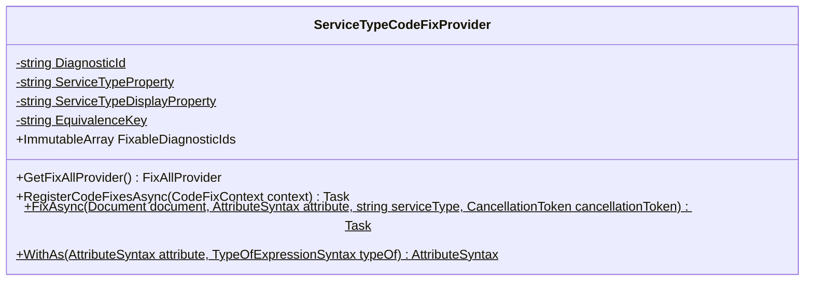

<div id="FakeItEasySupportAttribute-class-diagram"></div>

##### `FakeItEasySupportAttribute` class diagram


<div id="MoqSupportAttribute-class-diagram"></div>

##### `MoqSupportAttribute` class diagram

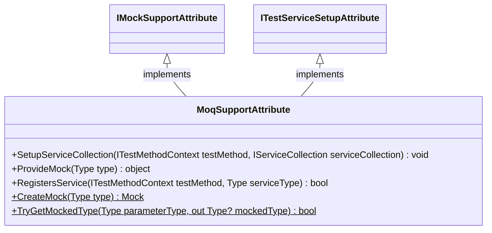

<div id="NSubstituteSupportAttribute-class-diagram"></div>

##### `NSubstituteSupportAttribute` class diagram

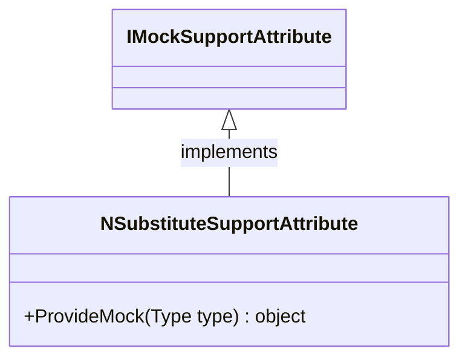

<div id="IModuleTestDataAttribute-class-diagram"></div>

##### `IModuleTestDataAttribute` class diagram

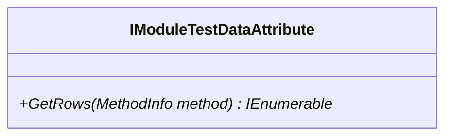

<div id="ModuleTestAttribute-class-diagram"></div>

##### `ModuleTestAttribute` class diagram

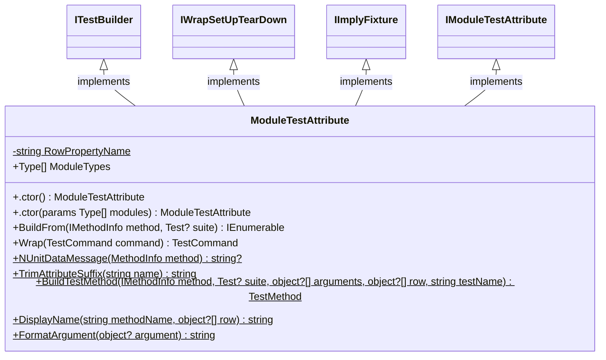

<div id="ModuleTestCaseAttribute-class-diagram"></div>

##### `ModuleTestCaseAttribute` class diagram

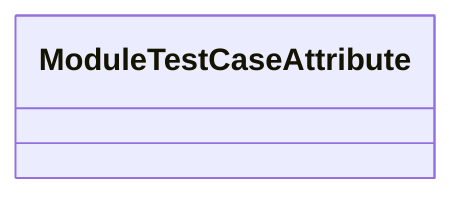

<div id="INUnitTestMethodContext-class-diagram"></div>

##### `INUnitTestMethodContext` class diagram

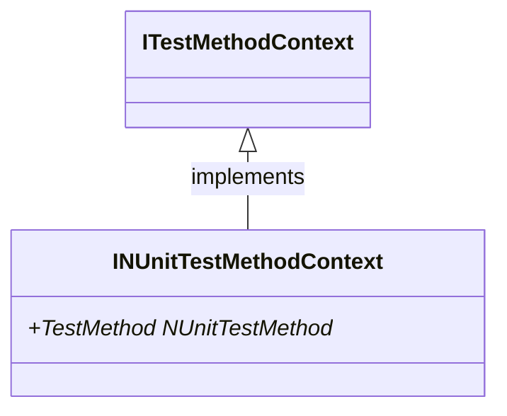

<div id="ITestCaseInfo-class-diagram"></div>

##### `ITestCaseInfo` class diagram

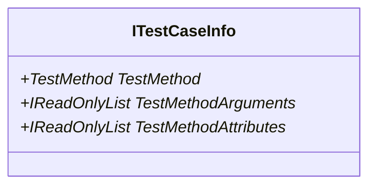

<div id="ModuleTestCommand-class-diagram"></div>

##### `ModuleTestCommand` class diagram

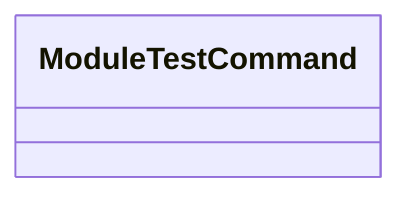

<div id="NUnitCurrentTestProvider-class-diagram"></div>

##### `NUnitCurrentTestProvider` class diagram

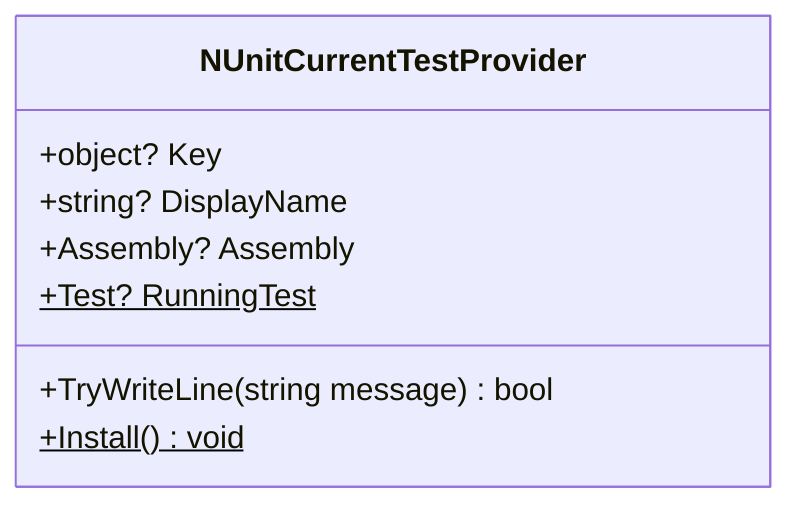

<div id="NUnitTestMethodContext-class-diagram"></div>

##### `NUnitTestMethodContext` class diagram

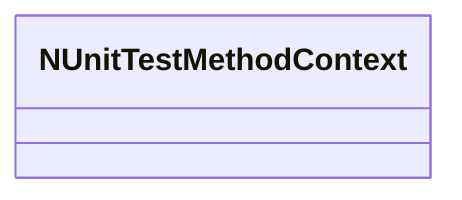

<div id="TestCaseInfo-class-diagram"></div>

##### `TestCaseInfo` class diagram

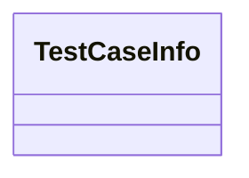

<div id="BaseServiceAttribute-class-diagram"></div>

##### `BaseServiceAttribute` class diagram

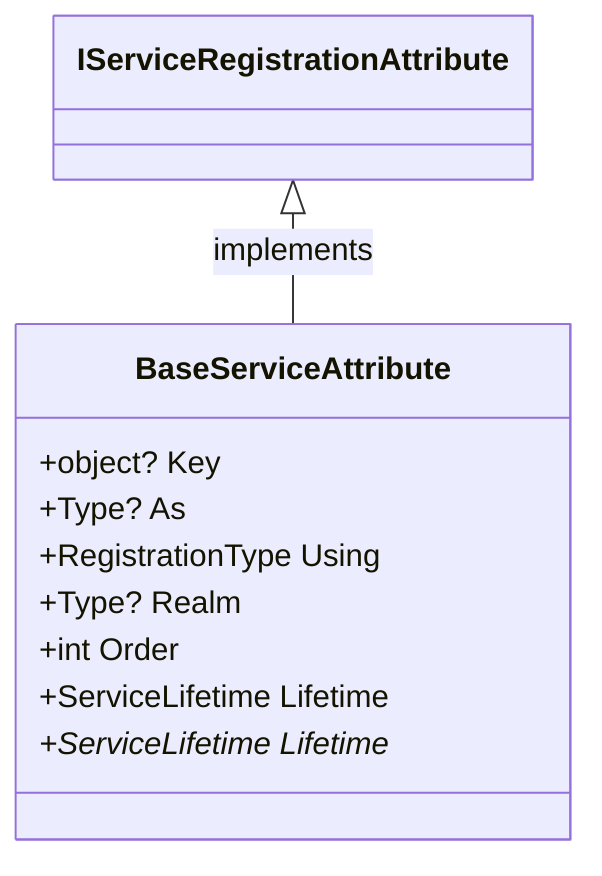

<div id="CrossWireServiceAttribute-class-diagram"></div>

##### `CrossWireServiceAttribute` class diagram

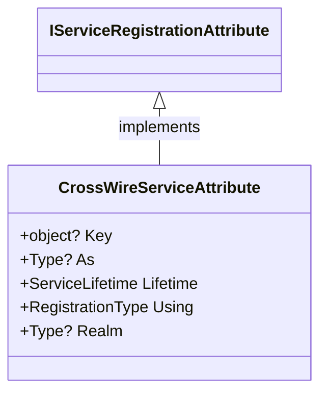

<div id="DecorateAttribute-class-diagram"></div>

##### `DecorateAttribute` class diagram

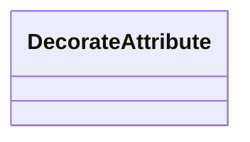

<div id="DecoratorAttribute-class-diagram"></div>

##### `DecoratorAttribute` class diagram

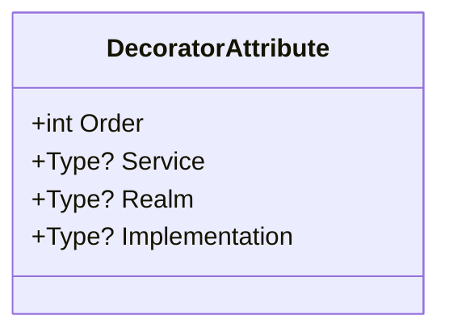

<div id="DependencyModuleAttribute-class-diagram"></div>

##### `DependencyModuleAttribute` class diagram

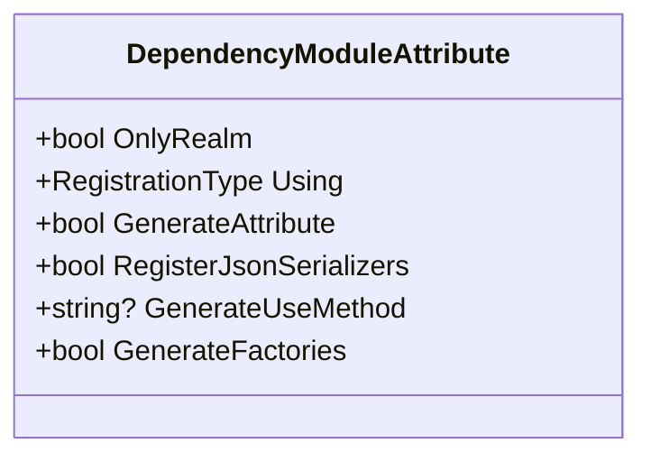

<div id="IfEnvironmentAttribute-class-diagram"></div>

##### `IfEnvironmentAttribute` class diagram

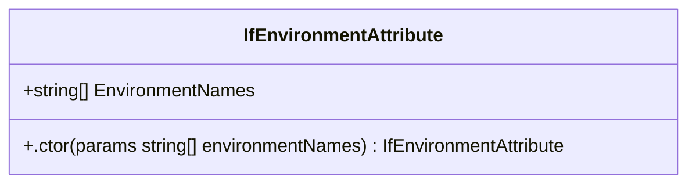

<div id="IfEnvironmentValueAttribute-class-diagram"></div>

##### `IfEnvironmentValueAttribute` class diagram

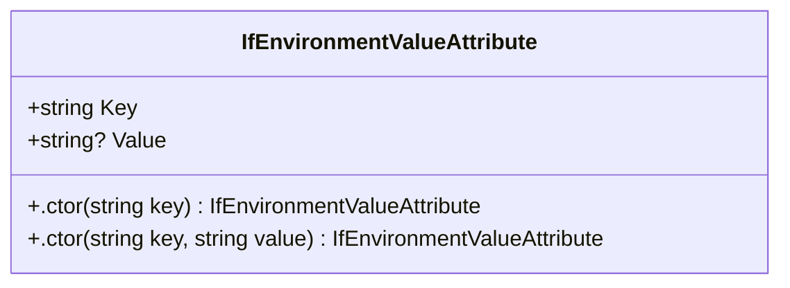

<div id="IfNotEnvironmentAttribute-class-diagram"></div>

##### `IfNotEnvironmentAttribute` class diagram

```mermaid
classDiagram
class IfNotEnvironmentAttribute{
    +string[] EnvironmentNames
    +.ctor(params string[] environmentNames) IfNotEnvironmentAttribute
}

```

<div id="IfNotEnvironmentValueAttribute-class-diagram"></div>

##### `IfNotEnvironmentValueAttribute` class diagram

```mermaid
classDiagram
class IfNotEnvironmentValueAttribute{
    +string Key
    +string? Value
    +.ctor(string key) IfNotEnvironmentValueAttribute
    +.ctor(string key, string value) IfNotEnvironmentValueAttribute
}

```

<div id="InterceptAttribute-class-diagram"></div>

##### `InterceptAttribute` class diagram

```mermaid
classDiagram
class InterceptAttribute{
}

```

<div id="InterceptedMembers-class-diagram"></div>

##### `InterceptedMembers` class diagram

```mermaid
classDiagram
class InterceptedMembers{
    -Methods$
    -Properties$
    -Indexers$
    -Events$
    -All$
}

```

<div id="IServiceRegistrationAttribute-class-diagram"></div>

##### `IServiceRegistrationAttribute` class diagram

```mermaid
classDiagram
class IServiceRegistrationAttribute{
    +object? Key
    +Type? As
    +ServiceLifetime Lifetime
    +RegistrationType Using
}

```

<div id="RegistrationType-class-diagram"></div>

##### `RegistrationType` class diagram

```mermaid
classDiagram
class RegistrationType{
    -Add$
    -Try$
    -TryEnumerable$
    -Replace$
}

```

<div id="ScopedServiceAttribute-class-diagram"></div>

##### `ScopedServiceAttribute` class diagram

```mermaid
classDiagram
class ScopedServiceAttribute{
    +ServiceLifetime Lifetime
}

```

<div id="SingletonServiceAttribute-class-diagram"></div>

##### `SingletonServiceAttribute` class diagram

```mermaid
classDiagram
class SingletonServiceAttribute{
    +ServiceLifetime Lifetime
}

```

<div id="TransientServiceAttribute-class-diagram"></div>

##### `TransientServiceAttribute` class diagram

```mermaid
classDiagram
class TransientServiceAttribute{
    +ServiceLifetime Lifetime
}

```

<div id="IConventionDefinitions-class-diagram"></div>

##### `IConventionDefinitions` class diagram

```mermaid
classDiagram
class IConventionDefinitions{
    +RegisterAll<TService>()* IConventionRegistration
    +RegisterAll(Type serviceType)* IConventionRegistration
    +RegisterAll()* IConventionRegistration
}

```

<div id="IConventionModule-class-diagram"></div>

##### `IConventionModule` class diagram

```mermaid
classDiagram
class IConventionModule{
    +Conventions(IConventionDefinitions conventions)* void
}

```

<div id="IConventionRegistration-class-diagram"></div>

##### `IConventionRegistration` class diagram

```mermaid
classDiagram
class IConventionRegistration{
    +AsSingleton()* IConventionRegistration
    +AsScoped()* IConventionRegistration
    +AsTransient()* IConventionRegistration
    +IncludeBaseClasses()* IConventionRegistration
    +AsSelf()* IConventionRegistration
    +AlsoAsSelf()* IConventionRegistration
    +AsSelfWithInterfaces()* IConventionRegistration
    +InNamespaceOf<TMarker>()* IConventionRegistration
    +InNamespaces(params string[] namespaces)* IConventionRegistration
    +InExactNamespaces(params string[] namespaces)* IConventionRegistration
    +NotInNamespaceOf<TMarker>()* IConventionRegistration
    +NotInNamespaces(params string[] namespaces)* IConventionRegistration
    +Using(RegistrationType registrationType)* IConventionRegistration
    +WithKey(object key)* IConventionRegistration
    +WithAttribute<TAttribute>()* IConventionRegistration
    +WithoutAttribute<TAttribute>()* IConventionRegistration
    +WithName(params string[] patterns)* IConventionRegistration
    +WithoutName(params string[] patterns)* IConventionRegistration
    +IfEnvironment(params string[] environmentNames)* IConventionRegistration
    +IfNotEnvironment(params string[] environmentNames)* IConventionRegistration
    +IfEnvironmentValue(string key)* IConventionRegistration
    +IfEnvironmentValue(string key, string value)* IConventionRegistration
    +IfNotEnvironmentValue(string key)* IConventionRegistration
    +IfNotEnvironmentValue(string key, string value)* IConventionRegistration
    +As<TService>()* IConventionRegistration
    +InAssemblyOf<TMarker>()* IConventionRegistration
    +AsMatchingInterface()* IConventionRegistration
}

```

<div id="FeatureApplicator&lt;TFeature&gt;-class-diagram"></div>

##### `FeatureApplicator<TFeature>` class diagram

```mermaid
classDiagram
class FeatureApplicator<TFeature>{
}

```

<div id="IDependencyModuleApplicatorProvider-class-diagram"></div>

##### `IDependencyModuleApplicatorProvider` class diagram

```mermaid
classDiagram
class IDependencyModuleApplicatorProvider{
    +FeatureApplicators() IEnumerable<IFeatureApplicator>
}

```

<div id="IDependencyModuleFeature&lt;TFeature&gt;-class-diagram"></div>

##### `IDependencyModuleFeature<TFeature>` class diagram

```mermaid
classDiagram
class IDependencyModuleFeature<TFeature>{
    +int Order
    +HandleFeature(IServiceCollection collection, IEnumerable<TFeature> feature)* void
}

```

<div id="IFeatureApplicator-class-diagram"></div>

##### `IFeatureApplicator` class diagram

```mermaid
classDiagram
class IFeatureApplicator{
    +int Order*
    +Apply(IServiceCollection serviceCollection, IReadOnlyList<IDependencyModule> modules)* void
}

```

<div id="DecoratorHelper-class-diagram"></div>

##### `DecoratorHelper` class diagram

```mermaid
classDiagram
class DecoratorHelper{
    -ConditionalWeakTable<ServiceDescriptor, HashSet<Type>> Applied$
    -ConditionalWeakTable<ServiceDescriptor, Type> OriginImplementation$
    +InterceptOpenGeneric(IServiceCollection services, Type serviceType, Type implementationType, Type wrapperType)$ void
    +ImplementationOf(ServiceDescriptor descriptor)$ Type?
    +Decorate(IServiceCollection services, Type serviceType, Func<IServiceProvider, object, object> decoratorFactory)$ void
    +Decorate<TService>(IServiceCollection services, Type decoratorIdentity, Func<IServiceProvider, TService, TService> decoratorFactory)$ void
    +Decorate<TService>(IServiceCollection services, Type decoratorIdentity, Func<IServiceProvider, TService, TService> decoratorFactory, Type? implementationType)$ void
    +AlreadyApplied(ServiceDescriptor descriptor, Type? decoratorIdentity)$ bool
    +RecordApplied(ServiceDescriptor original, ServiceDescriptor replacement, Type? decoratorIdentity)$ void
    +OriginImplementationOf(ServiceDescriptor descriptor)$ Type?
    +ReturnTypeOf(Delegate? factory)$ Type?
    +RecordOrigin(ServiceDescriptor original, ServiceDescriptor replacement)$ void
    +Decorate(IServiceCollection services, Type serviceType, Func<IServiceProvider, object, object> decoratorFactory, Type? decoratorType, Type? decoratorIdentity, Type? implementationType = null)$ void
    +CaptureInner(IServiceCollection services, ServiceDescriptor descriptor, int ordinal)$ Func<IServiceProvider, object?, object>
    +Displace(IServiceCollection services, Type serviceType, Type implementationType, int ordinal, ServiceLifetime lifetime)$ DisplacedImplementationKey
    +GuardOpenGenericRegistration(ServiceDescriptor descriptor, Type? decoratorType)$ void
    +Matches(Type registeredServiceType, Type decoratedServiceType)$ bool
}

```

<div id="DecoratorRegistration-class-diagram"></div>

##### `DecoratorRegistration` class diagram

```mermaid
classDiagram
class DecoratorRegistration{
}

```

<div id="DependencyRegistry&lt;T&gt;-class-diagram"></div>

##### `DependencyRegistry<T>` class diagram

```mermaid
classDiagram
class DependencyRegistry<T>{
    -object SyncLock$
    -List<EnvironmentRegistryFunc>? RegistryFuncs$
    -List<DecoratorRegistration>? Decorators$
    -List<IDependencyModule>? Modules$
    +Add(RegistryFunc registryFunc)$ int
    +Add(EnvironmentRegistryFunc registryFunc)$ int
    +Add<TInstance>(Func<IServiceProvider, TInstance> provider, ServiceLifetime lifetime = null)$ int
    +Add<TInstance>(Type implementationType, ServiceLifetime lifetime = null, object? serviceKey = null)$ int
    +AddDecorator(RegistryFunc registryFunc, int order = 0)$ int
    +AddDecorator(EnvironmentRegistryFunc registryFunc, int order = 0)$ int
    +AddModule(params IDependencyModule[] modules)$ int
    +LoadModules(IServiceCollection serviceCollection, params IDependencyModule[] dependencyModules)$ void
    +ApplyServices(IServiceCollection serviceCollection)$ void
    +ApplyServices(IServiceCollection serviceCollection, IModuleEnvironment environment)$ void
    +ApplyDecorators(IServiceCollection serviceCollection)$ void
    +FindOrCreateEnvironment(IServiceCollection serviceCollection)$ IModuleEnvironment
    +SortByOrder(List<DecoratorRegistration> list)$ void
    +ResolveEnvironment(IServiceCollection serviceCollection)$ IModuleEnvironment
    +ApplyDecorators(IServiceCollection serviceCollection, IModuleEnvironment environment)$ void
    +GetDecorators()$ IReadOnlyList<DecoratorRegistration>
    +GetModules(params object[] modules)$ IEnumerable<object>
    +CombineWithAddedModules(List<IDependencyModule> registered, object[] modules)$ IEnumerable<object>
    +ApplyDecorators(IServiceCollection serviceCollection, IReadOnlyList<IDependencyModule> modules)$ void
    +ApplyServices(IServiceCollection serviceCollection, IReadOnlyList<IDependencyModule> modules)$ void
    +RefuseUnusableEnvironment(ServiceDescriptor descriptor)$ void
    +FindModuleEnvironment(IServiceCollection serviceCollection)$ IModuleEnvironment?
    +ApplyFeatures(IServiceCollection serviceCollection, IReadOnlyList<IDependencyModule> modules)$ void
    +GetAllModules(IDependencyModule[] dependencyModules)$ IReadOnlyList<IDependencyModule>
    +InternalGetModules(IDependencyModule dependencyModule, List<IDependencyModule> allDependencyModules)$ void
    +AlreadySeen(List<IDependencyModule> modules, IDependencyModule candidate)$ bool
}

```

<div id="DecoratorHelper.DisplacedImplementationKey-class-diagram"></div>

##### `DecoratorHelper.DisplacedImplementationKey` class diagram

```mermaid
classDiagram
class DisplacedImplementationKey{
    -Type _serviceType
    -Type _implementationType
    -int _ordinal
    +.ctor(Type serviceType, Type implementationType, int ordinal) DisplacedImplementationKey
    +Equals(DisplacedImplementationKey? other) bool
    +Equals(object? obj) bool
    +GetHashCode() int
    +ToString() string
}

```

<div id="EnvironmentConditions-class-diagram"></div>

##### `EnvironmentConditions` class diagram

```mermaid
classDiagram
class EnvironmentConditions{
    +NameIs(IModuleEnvironment environment, params string[] names)$ bool
    +HasValue(IModuleEnvironment environment, string key)$ bool
    +ValueIs(IModuleEnvironment environment, string key, string value)$ bool
}

```

<div id="EnvironmentRegistryFunc-class-diagram"></div>

##### `EnvironmentRegistryFunc` class diagram

```mermaid
classDiagram
class EnvironmentRegistryFunc{
}

```

<div id="RegistryFunc-class-diagram"></div>

##### `RegistryFunc` class diagram

```mermaid
classDiagram
class RegistryFunc{
}

```

<div id="AsyncInvocationContext&lt;TResult&gt;-class-diagram"></div>

##### `AsyncInvocationContext<TResult>` class diagram

```mermaid
classDiagram
class AsyncInvocationContext<TResult>{
    -AsyncInvocationState<TResult> _state
    -int _stage
    +CallerInfo Caller
    +IArguments Arguments
    +InvocationContext(AsyncInvocationState<TResult> state, int stage) void
    +ProceedAsync() ValueTask<TResult>
}

```

<div id="AsyncInvocationState&lt;TResult&gt;-class-diagram"></div>

##### `AsyncInvocationState<TResult>` class diagram

```mermaid
classDiagram
class AsyncInvocationState<TResult>{
    +Invoke(int stage)* ValueTask<TResult>
}

```

<div id="CallerInfo-class-diagram"></div>

##### `CallerInfo` class diagram

```mermaid
classDiagram
class CallerInfo{
}

```

<div id="IArguments-class-diagram"></div>

##### `IArguments` class diagram

```mermaid
classDiagram
class IArguments{
    +int Count*
    +object? this[int index]*
    +NameAt(int index)* string
}

```

<div id="IAsyncEnumerableInterceptor-class-diagram"></div>

##### `IAsyncEnumerableInterceptor` class diagram

```mermaid
classDiagram
class IAsyncEnumerableInterceptor{
    +InterceptStream<TItem>(StreamInvocationContext<TItem> context)* IAsyncEnumerable<TItem>
}

```

<div id="IAsyncInterceptor-class-diagram"></div>

##### `IAsyncInterceptor` class diagram

```mermaid
classDiagram
class IAsyncInterceptor{
    +InterceptAsync<TResult>(AsyncInvocationContext<TResult> context)* ValueTask<TResult>
}

```

<div id="IInterceptor-class-diagram"></div>

##### `IInterceptor` class diagram

```mermaid
classDiagram
class IInterceptor{
    +Intercept<TResult>(InvocationContext<TResult> context)* TResult
}

```

<div id="InvocationContext&lt;TResult&gt;-class-diagram"></div>

##### `InvocationContext<TResult>` class diagram

```mermaid
classDiagram
class InvocationContext<TResult>{
    -InvocationState<TResult> _state
    -int _stage
    +CallerInfo Caller
    +IArguments Arguments
    +ationContext(InvocationState<TResult> state, int stage) void
    +Proceed() TResult
}

```

<div id="InvocationState-class-diagram"></div>

##### `InvocationState` class diagram

```mermaid
classDiagram
IArguments <|-- InvocationState : implements
class InvocationState{
    +CallerInfo Caller*
    +int Count*
    +object? this[int index]*
    +NameAt(int index)* string
}

```

<div id="InvocationState&lt;TResult&gt;-class-diagram"></div>

##### `InvocationState<TResult>` class diagram

```mermaid
classDiagram
class InvocationState<TResult>{
    +Invoke(int stage)* TResult
}

```

<div id="NoResult-class-diagram"></div>

##### `NoResult` class diagram

```mermaid
classDiagram
class NoResult{
    +ToString() string
}

```

<div id="StreamInvocationContext&lt;TItem&gt;-class-diagram"></div>

##### `StreamInvocationContext<TItem>` class diagram

```mermaid
classDiagram
class StreamInvocationContext<TItem>{
    -StreamInvocationState<TItem> _state
    -int _stage
    +CallerInfo Caller
    +IArguments Arguments
    +mInvocationContext(StreamInvocationState<TItem> state, int stage) void
    +Proceed() IAsyncEnumerable<TItem>
}

```

<div id="StreamInvocationState&lt;TItem&gt;-class-diagram"></div>

##### `StreamInvocationState<TItem>` class diagram

```mermaid
classDiagram
class StreamInvocationState<TItem>{
    +Invoke(int stage)* IAsyncEnumerable<TItem>
}

```

<div id="IDependencyModule-class-diagram"></div>

##### `IDependencyModule` class diagram

```mermaid
classDiagram
class IDependencyModule{
    +bool LoadModule
    +PopulateServiceCollection(IServiceCollection serviceCollection)* void
    +GetModules() IEnumerable<IDependencyModule>
    +InternalGetModules() IEnumerable<object>
    +InternalApplyServices(IServiceCollection serviceCollection) void
    +InternalApplyServices(IServiceCollection serviceCollection, IModuleEnvironment environment) void
    +InternalApplyDecorators(IServiceCollection serviceCollection) void
    +InternalGetDecorators() IEnumerable<DecoratorRegistration>
}

```

<div id="IDependencyModuleProvider-class-diagram"></div>

##### `IDependencyModuleProvider` class diagram

```mermaid
classDiagram
class IDependencyModuleProvider{
    +GetModule()* IDependencyModule
}

```

<div id="IEnvironmentServiceCollectionConfiguration-class-diagram"></div>

##### `IEnvironmentServiceCollectionConfiguration` class diagram

```mermaid
classDiagram
class IEnvironmentServiceCollectionConfiguration{
    +ConfigureServices(IServiceCollection services, IModuleEnvironment environment)* void
}

```

<div id="IModuleEnvironment-class-diagram"></div>

##### `IModuleEnvironment` class diagram

```mermaid
classDiagram
class IModuleEnvironment{
    +string EnvironmentName*
    +Value(string name)* string?
}

```

<div id="IModuleEnvironmentProvider-class-diagram"></div>

##### `IModuleEnvironmentProvider` class diagram

```mermaid
classDiagram
class IModuleEnvironmentProvider{
    +ProvideEnvironment(MethodInfo testMethod)* IModuleEnvironment?
}

```

<div id="IServiceCollectionConfiguration-class-diagram"></div>

##### `IServiceCollectionConfiguration` class diagram

```mermaid
classDiagram
class IServiceCollectionConfiguration{
    +ConfigureServices(IServiceCollection services)* void
    +ConfigureDecorators(IServiceCollection services) void
}

```

<div id="ModuleEnvironment.EmptyModuleEnvironment-class-diagram"></div>

##### `ModuleEnvironment.EmptyModuleEnvironment` class diagram

```mermaid
classDiagram
IModuleEnvironment <|-- EmptyModuleEnvironment : implements
class EmptyModuleEnvironment{
    +string EnvironmentName
    +Value(string name) string?
}

```

<div id="ModuleEnvironment-class-diagram"></div>

##### `ModuleEnvironment` class diagram

```mermaid
classDiagram
IModuleEnvironment <|-- ModuleEnvironment : implements
IEnumerable~KeyValuePair~ <|-- ModuleEnvironment : implements
class ModuleEnvironment{
    -Dictionary<string, string?> _values
    -bool _fallBackToEnvironmentVariables
    -Dictionary<string, string?>? _processValues
    +string EnvironmentName
    +IModuleEnvironment None$
    +.ctor(string environmentName, IReadOnlyDictionary<string, string?>? values = null) ModuleEnvironment
    +.ctor(bool fallBackToEnvironmentVariables, string environmentName, IReadOnlyDictionary<string, string?>? values = null) ModuleEnvironment
    +Value(string name) string?
    +Add(string key, string? value) void
    +GetEnumerator() IEnumerator<KeyValuePair<string, string?>>
    +GetEnumerator() IEnumerator
    +CreateDefault()$ IModuleEnvironment
}

```

<div id="ModuleEnvironment.ProcessModuleEnvironment-class-diagram"></div>

##### `ModuleEnvironment.ProcessModuleEnvironment` class diagram

```mermaid
classDiagram
IModuleEnvironment <|-- ProcessModuleEnvironment : implements
class ProcessModuleEnvironment{
    -Dictionary<string, string?>? _values
    +string EnvironmentName
    +Value(string name) string?
}

```

<div id="ModuleEnvironment.ProcessValueCache-class-diagram"></div>

##### `ModuleEnvironment.ProcessValueCache` class diagram

```mermaid
classDiagram
class ProcessValueCache{
    +Read(ref Dictionary<string, string?>? cache, string name)$ string?
}

```

<div id="ServiceCollectionExtensions-class-diagram"></div>

##### `ServiceCollectionExtensions` class diagram

```mermaid
classDiagram
class ServiceCollectionExtensions{
    +AddModule<T>(IServiceCollection services)$ IServiceCollection
    +AddModule(IServiceCollection services, IDependencyModule module)$ IServiceCollection
    +AddModules(IServiceCollection services, params IDependencyModule[] modules)$ IServiceCollection
    +AddModules(IServiceCollection services, IModuleEnvironment? environment, params IDependencyModule[] modules)$ IServiceCollection
}

```

<div id="DependencyFlags-class-diagram"></div>

##### `DependencyFlags` class diagram

```mermaid
classDiagram
IEquatable~DependencyFlags~ <|-- DependencyFlags : implements
class DependencyFlags{
    +bool OnlyRealm
    +RegistrationType? RegistrationType
    +bool? GenerateAttribute
    +bool? GenerateFactories
    +bool? RegisterGenerator
    +string? UseMethod
    +.ctor(bool OnlyRealm, RegistrationType? RegistrationType, bool? GenerateAttribute, bool? GenerateFactories, bool? RegisterGenerator, string? UseMethod) DependencyFlags
}

```

<div id="IsExternalInit-class-diagram"></div>

##### `IsExternalInit` class diagram

```mermaid
classDiagram
class IsExternalInit{
}

```

<div id="KnownTypes.DependencyModules.Attributes-class-diagram"></div>

##### `KnownTypes.DependencyModules.Attributes` class diagram

```mermaid
classDiagram
class DependencyModules.Attributes{
    -string Attributes.Namespace$
    -ITypeDefinition Attributes.DependencyModuleAttribute$
    -ITypeDefinition Attributes.TransientServiceAttribute$
    -ITypeDefinition Attributes.ScopedServiceAttribute$
    -ITypeDefinition Attributes.SingletonServiceAttribute$
    -ITypeDefinition Attributes.DecoratorAttribute$
    -ITypeDefinition Attributes.DecorateAttribute$
    -ITypeDefinition Attributes.InterceptAttribute$
    -ITypeDefinition Attributes.CrossWireServiceAttribute$
}

```

<div id="BaseAttributeSourceGenerator&lt;T&gt;-class-diagram"></div>

##### `BaseAttributeSourceGenerator<T>` class diagram

```mermaid
classDiagram
IDependencyModuleSourceGenerator <|-- BaseAttributeSourceGenerator<T> : implements
class BaseAttributeSourceGenerator<T>{
    +string LoggerName
    +T IgnoredModel*
    +SetupGenerator(IncrementalGeneratorInitializationContext context, IncrementalValuesProvider<(ModuleEntryPointModel Left, DependencyModuleConfigurationModel Right)> incrementalValueProvider) void
    +CollectModels(IncrementalGeneratorInitializationContext context, ITypeDefinition[] attributeTypes) IncrementalValueProvider<ImmutableArray<T>>
    +WrapGenerateSourceOutput(SourceProductionContext context, (ImmutableArray<(ModuleEntryPointModel Left, DependencyModuleConfigurationModel Right)> Left, ImmutableArray<T> Right) data) void
    +WrapReportDiagnostics(SourceProductionContext context, ((ImmutableArray<(ModuleEntryPointModel Left, DependencyModuleConfigurationModel Right)> Left, ImmutableArray<T> Right) Left, Compilation Right) data) void
    +ReportDiagnostics(SourceProductionContext context, (ImmutableArray<(ModuleEntryPointModel Left, DependencyModuleConfigurationModel Right)> Left, ImmutableArray<T> Right) data, SyntaxTreeLookup lookup, FileLogger logger) void
    +AttributeTypes()* IEnumerable<ITypeDefinition>
    +GenerateSourceOutput(SourceProductionContext arg1, (ImmutableArray<(ModuleEntryPointModel Left, DependencyModuleConfigurationModel Right)> Left, ImmutableArray<T> Right) valueTuple, FileLogger logger)* void
    +GetComparer()* IEqualityComparer<T>
    +GenerateAttributeModel(GeneratorAttributeSyntaxContext arg1, CancellationToken arg2)* T
}

```

<div id="BaseAttributeWithConfigSourceGenerator&lt;TModel, TConfig&gt;-class-diagram"></div>

##### `BaseAttributeWithConfigSourceGenerator<TModel, TConfig>` class diagram

```mermaid
classDiagram
IDependencyModuleSourceGenerator <|-- BaseAttributeWithConfigSourceGenerator<TModel, TConfig> : implements
class BaseAttributeWithConfigSourceGenerator<TModel, TConfig>{
    +SetupGenerator(IncrementalGeneratorInitializationContext context, IncrementalValuesProvider<(ModuleEntryPointModel Left, DependencyModuleConfigurationModel Right)> incrementalValueProvider) void
    +AttributeTypes()* IEnumerable<ITypeDefinition>
    +GenerateSourceOutput(SourceProductionContext arg1, (((ModuleEntryPointModel Left, DependencyModuleConfigurationModel Right) Left, TConfig Right) Left, ImmutableArray<TModel> Right) arg2)* void
    +GenerateConfigAttributeModel(AnalyzerConfigOptionsProvider arg1, CancellationToken arg2)* TConfig
    +GetComparer()* IEqualityComparer<TModel>
    +GenerateAttributeModel(GeneratorSyntaxContext arg1, CancellationToken arg2)* TModel
    +GetConfigComparer()* IEqualityComparer<TConfig>
}

```

<div id="BaseSourceGenerator-class-diagram"></div>

##### `BaseSourceGenerator` class diagram

```mermaid
classDiagram
class BaseSourceGenerator{
    +bool ShouldAutoApproveCompilationUnit
    +Initialize(IncrementalGeneratorInitializationContext context) void
    +AttributeSourceGenerators()* IEnumerable<IDependencyModuleSourceGenerator>
    +ModuleAttributeTypes() ITypeDefinition[]
    +CreateConfigurationValueProvider(IncrementalGeneratorInitializationContext context)$ IncrementalValueProvider<DependencyModuleConfigurationModel>
    +TryGetBoolean(AnalyzerConfigOptionsProvider options, string propertyName, out bool value)$ bool
    +SetupRootGenerator(IncrementalGeneratorInitializationContext context, IncrementalValueProvider<ImmutableArray<(ModuleEntryPointModel Left, DependencyModuleConfigurationModel Right)>> valuesProvider) void
    +TriggersOnDefaultModuleAttribute() bool
    +CreateSourceValueProvider(IncrementalGeneratorInitializationContext context) IncrementalValuesProvider<ModuleEntryPointModel>
    +GenerateEntryPointModel(GeneratorSyntaxContext context, CancellationToken cancellation) ModuleEntryPointModel
    +GetClassEntryPointModel(GeneratorSyntaxContext context, CancellationToken cancellation, TypeDeclarationSyntax typeDeclarationSyntax) ModuleEntryPointModel
    +GetCompilationUnitSyntaxEntry(GeneratorSyntaxContext context, CancellationToken cancellation) ModuleEntryPointModel
    +GetEqualityFeatures(GeneratorSyntaxContext context, TypeDeclarationSyntax typeDeclarationSyntax, CancellationToken cancellation)$ ModuleEntryPointFeatures
}

```

<div id="CollectionSyntaxDeclaration-class-diagram"></div>

##### `CollectionSyntaxDeclaration` class diagram

```mermaid
classDiagram
class CollectionSyntaxDeclaration{
    -List<object> _items
    +Add(object item) void
    +WriteComponentOutput(IOutputContext outputContext) void
    +Equals(object? obj) bool
    +GetHashCode() int
}

```

<div id="DecoratorFileWriter-class-diagram"></div>

##### `DecoratorFileWriter` class diagram

```mermaid
classDiagram
class DecoratorFileWriter{
    -string ProviderParameterName$
    -string InnerParameterName$
    +Write(ModuleEntryPointModel entryPointModel, DependencyModuleConfigurationModel configurationModel, IReadOnlyList<DecoratorModel> decorators, string uniqueId = "") string
    +WriteDecorator(ModuleEntryPointModel entryPointModel, ClassDefinition classDefinition, DecoratorModel decorator, int index, DependencyModuleConfigurationModel configurationModel, string uniqueId)$ void
    +Decoration(DecoratorModel decorator, string servicesName, ITypeDefinition serviceType, ITypeDefinition decoratorType)$ IOutputComponent
    +ToCamel(string value)$ string
    +WriteRegistration(ModuleEntryPointModel entryPointModel, ClassDefinition classDefinition, DecoratorModel decorator, int index, string methodName, string uniqueId)$ void
}

```

<div id="DependencyFileWriter-class-diagram"></div>

##### `DependencyFileWriter` class diagram

```mermaid
classDiagram
class DependencyFileWriter{
    -FileLogger _logger
    -HashSet<ITypeDefinition> _interceptedServiceTypes
    +.ctor(FileLogger logger) DependencyFileWriter
    +.ctor(FileLogger logger, bool coverageAttributeOnMethod) DependencyFileWriter
    +Write(ModuleEntryPointModel entryPointModel, DependencyModuleConfigurationModel configurationModel, IEnumerable<ServiceModel> serviceModels, string uniqueId) string
    +GenerateClass(ModuleEntryPointModel entryPointModel, DependencyModuleConfigurationModel configurationModel, IEnumerable<ServiceModel> serviceModels, CSharpFileDefinition csharpFile, string uniqueId) void
    +CreateInvokeStatement(ModuleEntryPointModel entryPointModel, string methodName, ClassDefinition classDefinition, string uniqueId) void
    +GenerateDependencyMethod(ModuleEntryPointModel entryPointModel, DependencyModuleConfigurationModel configurationModel, IEnumerable<ServiceModel> serviceModels, ClassDefinition classDefinition, string uniqueId) string
    +BuildCondition(IReadOnlyList<EnvironmentConditionModel> conditions, string environmentParameter)$ string
    +CrossWireRegisterImplementation(DependencyModuleConfigurationModel configurationModel, ModuleEntryPointModel entryPointModel, ClassDefinition classDefinition, BaseBlockDefinition block, ParameterDefinition services, ServiceModel serviceModel, string uniqueId) void
    +ShouldGenerateFactory(ServiceModel serviceModel, ModuleEntryPointModel entryPointModel, DependencyModuleConfigurationModel configurationModel) bool
    +IsInterceptedServiceType(ServiceModel serviceModel) bool
    +InterceptedServiceTypes(IEnumerable<ServiceModel> serviceModels)$ HashSet<ITypeDefinition>
    +GenerateNewFactory(ServiceModel serviceModel, ServiceRegistrationModel registrationModel)$ object
    +TypedFactory(ITypeDefinition implementationType, ServiceRegistrationModel registrationModel, IOutputComponent factory)$ IOutputComponent
    +HandleTryEnumerableAndReplaceRegistrationType(DependencyModuleConfigurationModel configurationModel, ModuleEntryPointModel entryPointModel, ClassDefinition classDefinition, RegistrationType registrationType, ServiceRegistrationModel registrationModel, ServiceModel serviceModel, BaseBlockDefinition block, ParameterDefinition services, string uniqueId) void
    +HandleTryAndAddRegistrationTypes(DependencyModuleConfigurationModel configurationModel, ModuleEntryPointModel entryPointModel, ClassDefinition classDefinition, StringBuilder stringBuilder, RegistrationType registrationType, ServiceRegistrationModel registrationModel, ServiceModel serviceModel, BaseBlockDefinition block, ParameterDefinition services, string uniqueId) void
    +AddCrossWireParameter(ServiceModel serviceModel, ServiceRegistrationModel registrationModel, List<object> parameters)$ void
    +AddFactoryParameter(ServiceModel serviceModel, ServiceRegistrationModel registrationModel, ClassDefinition classDefinition, List<object> parameters, string uniqueId)$ void
    +GenerateGlueFactory(ServiceModel serviceModel, ServiceFactoryModel factory, ClassDefinition classDefinition, string uniqueId)$ MethodDefinition
    +GetArgumentsForParameterList(ParameterDefinition serviceProvider, IReadOnlyList<ParameterInfoModel> parameterList)$ object[]
    +GetRegistrationType(ModuleEntryPointModel entryPointModel, DependencyModuleConfigurationModel configurationModel, ServiceRegistrationModel registrationModel)$ RegistrationType
    +GetSortedServiceModels(IEnumerable<ServiceModel> serviceModels, DependencyModuleConfigurationModel configurationModel) List<ServiceModel>
    +OrderOf(ServiceModel serviceModel)$ int
    +IsConditional(ServiceModel serviceModel)$ bool
    +ActsOnExistingRegistration(ServiceModel serviceModel, DependencyModuleConfigurationModel configurationModel)$ bool
}

```

<div id="KnownTypes.Microsoft.DependencyInjection-class-diagram"></div>

##### `KnownTypes.Microsoft.DependencyInjection` class diagram

```mermaid
classDiagram
class Microsoft.DependencyInjection{
    -string DependencyInjection.Namespace$
    -ITypeDefinition DependencyInjection.IServiceCollection$
    -ITypeDefinition DependencyInjection.IServiceProvider$
    -ITypeDefinition DependencyInjection.ServiceDescriptor$
    -ITypeDefinition DependencyInjection.FromKeyedServicesAttribute$
    -ITypeDefinition DependencyInjection.ServiceCollectionDescriptorExtensions$
}

```

<div id="DependencyModuleDiagnostics-class-diagram"></div>

##### `DependencyModuleDiagnostics` class diagram

```mermaid
classDiagram
class DependencyModuleDiagnostics{
    -string Category$
    -DiagnosticDescriptor GeneratorFailure$
    -DiagnosticDescriptor ServiceCannotBeConstructed$
    -DiagnosticDescriptor FactoryMethodCannotBeCalled$
    -DiagnosticDescriptor ModuleMustBePartial$
    -DiagnosticDescriptor ModuleCannotBeNested$
    -DiagnosticDescriptor MockAndTestExportOnOneMethod$
    -DiagnosticDescriptor InterceptionAppliedByNoModule$
    -DiagnosticDescriptor AssemblyModuleAttributeNotComposed$
    -DiagnosticDescriptor ModuleWithPropertiesShouldImplementEquals$
    -DiagnosticDescriptor AmbiguousConventionMatch$
    -DiagnosticDescriptor ConventionMatchedNothing$
    -DiagnosticDescriptor ConventionMatchNotConstructable$
    -DiagnosticDescriptor AmbiguousDecoratorOrder$
    -DiagnosticDescriptor CannotIntercept$
    -DiagnosticDescriptor ConventionCannotBeRead$
    -DiagnosticDescriptor ExposedByConvention$
    -DiagnosticDescriptor RegisteredConditionally$
    -DiagnosticDescriptor EmptyEnvironmentCondition$
    -DiagnosticDescriptor InterceptorCannotServeMembers$
    -DiagnosticDescriptor OpenGenericCannotBeDecorated$
    -DiagnosticDescriptor DecoratorIgnored$
    -DiagnosticDescriptor ServiceTypeNotNamed$
    -DiagnosticDescriptor CrossWireCannotBeGeneric$
    -DiagnosticDescriptor CrossWireInheritedInterfaces$
    -DiagnosticDescriptor ModuleAttributeNamespaceNotImported$
    +GeneratorFailureFrom(Exception exception)$ Diagnostic
}

```

<div id="KnownTypes.DependencyModules-class-diagram"></div>

##### `KnownTypes.DependencyModules` class diagram

```mermaid
classDiagram
class DependencyModules{
}

```

<div id="DependencyModuleWriter-class-diagram"></div>

##### `DependencyModuleWriter` class diagram

```mermaid
classDiagram
class DependencyModuleWriter{
    -bool _generateAttribute
    +.ctor(bool generateAttribute) DependencyModuleWriter
    +Register(IncrementalGeneratorInitializationContext context, IncrementalValueProvider<ImmutableArray<(ModuleEntryPointModel Left, DependencyModuleConfigurationModel Right)>> valuesProvider, bool generateAttribute)$ void
    +GenerateSource(SourceProductionContext context, ImmutableArray<(ModuleEntryPointModel Left, DependencyModuleConfigurationModel Right)> allEntryPoints) void
    +GenerateModules(SourceProductionContext context, ImmutableArray<(ModuleEntryPointModel Left, DependencyModuleConfigurationModel Right)> allEntryPoints, FileLogger logger) void
    +WithDelegateTarget(ModuleEntryPointModel entryPointModel, IList<ModuleEntryPointModel> entryPointList)$ ModuleEntryPointModel
    +ProcessEntryPoint(SourceProductionContext context, ModuleEntryPointModel entryPointModel, DependencyModuleConfigurationModel configurationModel) void
    +GenerateAttribute(ModuleEntryPointModel moduleEntryPoint, CSharpFileDefinition csharpFile) void
    +GenerateUseMethod(ModuleEntryPointModel entryPointModel, DependencyModuleConfigurationModel configurationModel, CSharpFileDefinition csharpFile) void
    +GenerateModuleClass(ModuleEntryPointModel model, CSharpFileDefinition csharpFile) void
    +FeatureMethod(ClassDefinition classDefinition, ModuleEntryPointModel model) void
    +HashMethod(ClassDefinition classDefinition, ModuleEntryPointModel model) void
    +GetStableHashCode(string str)$ int
    +EqualMethod(ClassDefinition classDefinition, ModuleEntryPointModel model) void
    +InternalGetDecoratorsMethod(ClassDefinition classDefinition, ModuleEntryPointModel model) void
    +InternalGetModulesMethod(ClassDefinition classDefinition, ModuleEntryPointModel model) void
    +FilterAttributes(IReadOnlyList<AttributeModel> modelAttributeModels) List<AttributeModel>
    +InternalApplyServicesMethod(ClassDefinition classDefinition, ModuleEntryPointModel model) void
    +ApplyServicesOverload(ClassDefinition classDefinition, ITypeDefinition closedType, bool withEnvironment)$ void
    +PopulateServiceCollectionMethod(ClassDefinition classDefinition, ModuleEntryPointModel model) void
    +SetupStaticConstructor(ClassDefinition classDefinition) void
    +HideFromIntelliSense(MethodDefinition method)$ void
}

```

<div id="KnownTypes.DependencyModules.Features-class-diagram"></div>

##### `KnownTypes.DependencyModules.Features` class diagram

```mermaid
classDiagram
class DependencyModules.Features{
    -string Features.Namespace$
    -ITypeDefinition Features.IFeatureApplicator$
    -ITypeDefinition Features.IDependencyModuleApplicatorProvider$
    -ITypeDefinition Features.FeatureApplicator$
}

```

<div id="KnownTypes.DependencyModules.Helpers-class-diagram"></div>

##### `KnownTypes.DependencyModules.Helpers` class diagram

```mermaid
classDiagram
class DependencyModules.Helpers{
    -string Helpers.Namespace$
    -ITypeDefinition Helpers.DecoratorHelper$
    -ITypeDefinition Helpers.DecoratorRegistration$
    -ITypeDefinition Helpers.EnvironmentConditions$
}

```

<div id="IDependencyModuleSourceGenerator-class-diagram"></div>

##### `IDependencyModuleSourceGenerator` class diagram

```mermaid
classDiagram
class IDependencyModuleSourceGenerator{
    +SetupGenerator(IncrementalGeneratorInitializationContext context, IncrementalValuesProvider<(ModuleEntryPointModel Left, DependencyModuleConfigurationModel Right)> incrementalValueProvider)* void
}

```

<div id="KnownTypes.DependencyModules.Interception-class-diagram"></div>

##### `KnownTypes.DependencyModules.Interception` class diagram

```mermaid
classDiagram
class DependencyModules.Interception{
    -string Interception.Namespace$
    -ITypeDefinition Interception.CallerInfo$
    -ITypeDefinition Interception.NoResult$
    +InvocationState(ITypeDefinition result)$ ITypeDefinition
    +AsyncInvocationState(ITypeDefinition result)$ ITypeDefinition
    +StreamInvocationState(ITypeDefinition item)$ ITypeDefinition
    +InvocationContext(ITypeDefinition result)$ ITypeDefinition
    +AsyncInvocationContext(ITypeDefinition result)$ ITypeDefinition
    +StreamInvocationContext(ITypeDefinition item)$ ITypeDefinition
    +Close(string name, ITypeDefinition argument)$ ITypeDefinition
}

```

<div id="InterceptorFileWriter-class-diagram"></div>

##### `InterceptorFileWriter` class diagram

```mermaid
classDiagram
class InterceptorFileWriter{
    -string InnerField$
    +Write(InterceptorModel model, string wrapperName, string namespaceName, DependencyModuleConfigurationModel configurationModel) string
    +InnerType(InterceptorModel model)$ ITypeDefinition
    +Closed(ITypeDefinition type, IReadOnlyList<TypeParameterModel> typeParameters)$ ITypeDefinition
    +SelfType(InterceptorModel model, string wrapperName, string namespaceName)$ ITypeDefinition
    +WriteConstraints(InterceptedMemberModel member, Func<string, ConstraintDefinition> addConstraint)$ void
    +WriteConstraint(ConstraintDefinition constraint, TypeParameterModel typeParameter)$ void
    +WriteFields(ClassDefinition wrapper, InterceptorModel model)$ void
    +WriteConstructor(ClassDefinition wrapper, InterceptorModel model)$ void
    +WriteDeclaration(ClassDefinition wrapper, InterceptorModel model, InterceptedDeclarationModel declaration)$ void
    +WriteProperty(ClassDefinition wrapper, InterceptorModel model, InterceptedDeclarationModel declaration)$ void
    +WriteIndexer(ClassDefinition wrapper, InterceptorModel model, InterceptedDeclarationModel declaration)$ void
    +WriteEvent(ClassDefinition wrapper, InterceptorModel model, InterceptedDeclarationModel declaration)$ void
    +WriteAccessorBody(PropertyMethodDefinition accessor, InterceptorModel model, InterceptedMemberModel member, int index)$ void
    +WritePassThrough(BaseBlockDefinition block, InterceptedMemberModel member)$ void
    +WriteForwardingMethod(ClassDefinition wrapper, InterceptorModel model, InterceptedMemberModel member, int index)$ void
    +WriteState(ClassDefinition wrapper, InterceptorModel model, InterceptedMemberModel member, int index, string wrapperName, string namespaceName)$ void
    +WriteStateFields(ClassDefinition state, InterceptedMemberModel member, ITypeDefinition selfType)$ void
    +WriteStateConstructor(ClassDefinition state, InterceptedMemberModel member, int index, ITypeDefinition selfType)$ void
    +WriteCallerAndCount(ClassDefinition state, InterceptedMemberModel member, int index)$ void
    +WriteArgumentsIndexer(ClassDefinition state, InterceptedMemberModel member)$ void
    +WriteNameAt(ClassDefinition state, InterceptedMemberModel member)$ void
    +WriteInvoke(ClassDefinition state, InterceptorModel model, InterceptedMemberModel member, string wrapperName)$ void
    +InnerCall(InterceptedMemberModel member, string? passThroughTarget = null)$ string
    +IsIntercepted(InterceptorModel model, InterceptedMemberModel member)$ bool
    +StateName(int index)$ string
    +ClosedStateName(InterceptedMemberModel member, int index)$ string
    +InterceptorField(int index)$ string
    +CallerField(int index)$ string
    +ArgumentField(int index)$ string
}

```

<div id="InterceptorRegistrationWriter-class-diagram"></div>

##### `InterceptorRegistrationWriter` class diagram

```mermaid
classDiagram
class InterceptorRegistrationWriter{
    +Write(ModuleEntryPointModel entryPointModel, DependencyModuleConfigurationModel configurationModel, IReadOnlyList<InterceptorModel> models) string
    +Unbound(ITypeDefinition type, int arity)$ ITypeDefinition
    +WriteInterceptor(ModuleEntryPointModel entryPointModel, ClassDefinition classDefinition, InterceptorModel model, int index, DependencyModuleConfigurationModel configurationModel)$ void
    +TryAddMethodFor(ServiceLifestyle lifestyle)$ string
}

```

<div id="KnownTypes.DependencyModules.Interfaces-class-diagram"></div>

##### `KnownTypes.DependencyModules.Interfaces` class diagram

```mermaid
classDiagram
class DependencyModules.Interfaces{
    -string Interfaces.Namespace$
    -ITypeDefinition Interfaces.IDependencyModule$
    -ITypeDefinition Interfaces.IDependencyModuleProvider$
    -ITypeDefinition Interfaces.IModuleEnvironment$
}

```

<div id="KnownTypes-class-diagram"></div>

##### `KnownTypes` class diagram

```mermaid
classDiagram
class KnownTypes{
}

```

<div id="KnownTypes.Microsoft-class-diagram"></div>

##### `KnownTypes.Microsoft` class diagram

```mermaid
classDiagram
class Microsoft{
}

```

<div id="ModuleAttributeWriter-class-diagram"></div>

##### `ModuleAttributeWriter` class diagram

```mermaid
classDiagram
class ModuleAttributeWriter{
    +CustomImplementation(IConstructContainer container, ClassDefinition attributeClass, ModuleEntryPointModel model) void
}

```

<div id="ModuleEntryPointDiagnostics-class-diagram"></div>

##### `ModuleEntryPointDiagnostics` class diagram

```mermaid
classDiagram
class ModuleEntryPointDiagnostics{
    +IsNotPartial(ModuleEntryPointModel model)$ bool
    +IsNestedInType(ModuleEntryPointModel model)$ bool
    +ReliesOnGeneratedEquality(ModuleEntryPointModel model)$ bool
    +Report(SourceProductionContext context, (ImmutableArray<(ModuleEntryPointModel Left, DependencyModuleConfigurationModel Right)> Models, Compilation Compilation) input)$ void
    +Report(SourceProductionContext context, DiagnosticDescriptor descriptor, ModuleEntryPointModel entryPointModel, SyntaxTreeLookup lookup)$ void
}

```

<div id="KnownTypes.System-class-diagram"></div>

##### `KnownTypes.System` class diagram

```mermaid
classDiagram
class System{
    -ITypeDefinition ArgumentOutOfRangeException$
    +ValueTask(ITypeDefinition result)$ ITypeDefinition
    +AsyncEnumerable(ITypeDefinition item)$ ITypeDefinition
}

```

<div id="KnownTypes.DependencyModules.Testing-class-diagram"></div>

##### `KnownTypes.DependencyModules.Testing` class diagram

```mermaid
classDiagram
class DependencyModules.Testing{
    -string Testing.Namespace$
    -ITypeDefinition Testing.MockAttribute$
    -ITypeDefinition Testing.TestExportAttribute$
}

```

<div id="KnownTypes.Microsoft.TextJson-class-diagram"></div>

##### `KnownTypes.Microsoft.TextJson` class diagram

```mermaid
classDiagram
class Microsoft.TextJson{
    -string TextJson.Namespace$
    -ITypeDefinition TextJson.JsonSourceGenerationOptionsAttribute$
    -ITypeDefinition TextJson.IJsonTypeInfoResolver$
}

```

<div id="AccessModifier-class-diagram"></div>

##### `AccessModifier` class diagram

```mermaid
classDiagram
class AccessModifier{
    -PublicModifier$
    -PrivateModifier$
    -ProtectedModifier$
    -InternalModifier$
}

```

<div id="AccessorForm-class-diagram"></div>

##### `AccessorForm` class diagram

```mermaid
classDiagram
class AccessorForm{
    -Method$
    -PropertyGet$
    -PropertySet$
    -IndexerGet$
    -IndexerSet$
    -EventAdd$
    -EventRemove$
}

```

<div id="AttributeArgumentValue-class-diagram"></div>

##### `AttributeArgumentValue` class diagram

```mermaid
classDiagram
IEquatable~AttributeArgumentValue~ <|-- AttributeArgumentValue : implements
class AttributeArgumentValue{
    +string Name
    +object? Value
    +.ctor(string Name, object? Value) AttributeArgumentValue
    +Equals(AttributeArgumentValue? other) bool
    +GetHashCode() int
}

```

<div id="AttributeClassInfo-class-diagram"></div>

##### `AttributeClassInfo` class diagram

```mermaid
classDiagram
IEquatable~AttributeClassInfo~ <|-- AttributeClassInfo : implements
class AttributeClassInfo{
    +ConstructorInfoModel ConstructorInfo
    +IReadOnlyList<PropertyInfoModel> Properties
    +.ctor(ConstructorInfoModel ConstructorInfo, IReadOnlyList<PropertyInfoModel> Properties) AttributeClassInfo
}

```

<div id="AttributeModel-class-diagram"></div>

##### `AttributeModel` class diagram

```mermaid
classDiagram
IEquatable~AttributeModel~ <|-- AttributeModel : implements
class AttributeModel{
    +ITypeDefinition TypeDefinition
    +IReadOnlyList<AttributeArgumentValue> Arguments
    +IReadOnlyList<AttributeArgumentValue> Properties
    +IReadOnlyList<ITypeDefinition> ImplementedInterfaces
    +.ctor(ITypeDefinition TypeDefinition, IReadOnlyList<AttributeArgumentValue> Arguments, IReadOnlyList<AttributeArgumentValue> Properties, IReadOnlyList<ITypeDefinition> ImplementedInterfaces) AttributeModel
    +Equals(AttributeModel? other) bool
    +GetHashCode() int
    +GetArguments() IList<IOutputComponent>
    +PropertyValues() IList<IOutputComponent>
}

```

<div id="ConstructorInfoModel-class-diagram"></div>

##### `ConstructorInfoModel` class diagram

```mermaid
classDiagram
IEquatable~ConstructorInfoModel~ <|-- ConstructorInfoModel : implements
class ConstructorInfoModel{
    +IReadOnlyList<ParameterInfoModel> Parameters
    +.ctor(IReadOnlyList<ParameterInfoModel> Parameters) ConstructorInfoModel
    +Equals(ConstructorInfoModel? other) bool
    +GetHashCode() int
}

```

<div id="DeclarationKind-class-diagram"></div>

##### `DeclarationKind` class diagram

```mermaid
classDiagram
class DeclarationKind{
    -Method$
    -Property$
    -Indexer$
    -Event$
}

```

<div id="DecoratorModel-class-diagram"></div>

##### `DecoratorModel` class diagram

```mermaid
classDiagram
IEquatable~DecoratorModel~ <|-- DecoratorModel : implements
class DecoratorModel{
    -DecoratorModel Ignore$
    +ITypeDefinition ServiceType
    +ITypeDefinition DecoratorType
    +int Order
    +ITypeDefinition? Realm
    +IReadOnlyList<EnvironmentConditionModel>? Conditions
    +ConstructorInfoModel? Constructor
    +int InnerParameterIndex
    +bool TypeParametersMatchService
    +ITypeDefinition? Implementation
    +LocationModel? Location
    +string? IgnoredReason
    +bool CanMonomorphise
    +bool IsOpenGeneric
    +bool HasUnboundServiceType
    +bool IsIgnored
    +.ctor(ITypeDefinition ServiceType, ITypeDefinition DecoratorType, int Order, ITypeDefinition? Realm, IReadOnlyList<EnvironmentConditionModel>? Conditions = null, ConstructorInfoModel? Constructor = null, int InnerParameterIndex = null, bool TypeParametersMatchService = true, ITypeDefinition? Implementation = null, LocationModel? Location = null, string? IgnoredReason = null) DecoratorModel
}

```

<div id="DecoratorModelComparer-class-diagram"></div>

##### `DecoratorModelComparer` class diagram

```mermaid
classDiagram
class DecoratorModelComparer{
    +Equals(DecoratorModel? x, DecoratorModel? y) bool
    +ConditionsEqual(IReadOnlyList<EnvironmentConditionModel>? x, IReadOnlyList<EnvironmentConditionModel>? y)$ bool
    +GetHashCode(DecoratorModel obj) int
}

```

<div id="DependencyModuleConfigurationModel-class-diagram"></div>

##### `DependencyModuleConfigurationModel` class diagram

```mermaid
classDiagram
IEquatable~DependencyModuleConfigurationModel~ <|-- DependencyModuleConfigurationModel : implements
class DependencyModuleConfigurationModel{
    +RegistrationType RegistrationType
    +bool RegisterSourceGenerator
    +string RootNamespace
    +string ProjectDir
    +bool AutoGenerateEntry
    +string LogOutputFolder
    +LogOutputLevel LogOutputLevel
    +bool GenerateFactories
    +bool ExcludeGeneratedCodeFromCoverage
    +BraceStyle GeneratedCodeStyle
    +.ctor(RegistrationType RegistrationType, bool RegisterSourceGenerator, string RootNamespace, string ProjectDir, bool AutoGenerateEntry, string LogOutputFolder, LogOutputLevel LogOutputLevel, bool GenerateFactories, bool ExcludeGeneratedCodeFromCoverage = true, BraceStyle GeneratedCodeStyle = null) DependencyModuleConfigurationModel
}

```

<div id="DependencyModuleConfigurationModelComparer-class-diagram"></div>

##### `DependencyModuleConfigurationModelComparer` class diagram

```mermaid
classDiagram
class DependencyModuleConfigurationModelComparer{
    +Equals(DependencyModuleConfigurationModel? x, DependencyModuleConfigurationModel? y) bool
    +GetHashCode(DependencyModuleConfigurationModel obj) int
}

```

<div id="DiagnosticReporter-class-diagram"></div>

##### `DiagnosticReporter` class diagram

```mermaid
classDiagram
class DiagnosticReporter{
    -Action<Diagnostic>? _sink
    -SyntaxTreeLookup _lookup
    -DiagnosticReporter Silent$
    +bool IsSilent
    +.ctor(Action<Diagnostic>? sink, SyntaxTreeLookup lookup) DiagnosticReporter
    +Report(DiagnosticDescriptor descriptor, LocationModel? location, params object?[] messageArgs) void
    +Report(DiagnosticDescriptor descriptor, Location location, params object?[] messageArgs) void
    +LocationFor(LocationModel? location) Location
}

```

<div id="EnvironmentConditionKind-class-diagram"></div>

##### `EnvironmentConditionKind` class diagram

```mermaid
classDiagram
class EnvironmentConditionKind{
    -Name$
    -Value$
}

```

<div id="EnvironmentConditionModel-class-diagram"></div>

##### `EnvironmentConditionModel` class diagram

```mermaid
classDiagram
IEquatable~EnvironmentConditionModel~ <|-- EnvironmentConditionModel : implements
class EnvironmentConditionModel{
    +EnvironmentConditionKind Kind
    +bool Negate
    +string? Key
    +IReadOnlyList<string> Values
    +.ctor(EnvironmentConditionKind Kind, bool Negate, string? Key, IReadOnlyList<string> Values) EnvironmentConditionModel
    +Equals(EnvironmentConditionModel? other) bool
    +GetHashCode() int
}

```

<div id="FactoryOutputDelegate-class-diagram"></div>

##### `FactoryOutputDelegate` class diagram

```mermaid
classDiagram
class FactoryOutputDelegate{
}

```

<div id="IClassModel-class-diagram"></div>

##### `IClassModel` class diagram

```mermaid
classDiagram
class IClassModel{
    +ITypeDefinition ClassType*
    +IReadOnlyList<ParameterInfoModel> Parameters*
    +IReadOnlyList<PropertyInfoModel> PropertyInfoModels*
    +IReadOnlyList<AttributeModel> AttributeModels*
}

```

<div id="InterceptedDeclarationModel-class-diagram"></div>

##### `InterceptedDeclarationModel` class diagram

```mermaid
classDiagram
IEquatable~InterceptedDeclarationModel~ <|-- InterceptedDeclarationModel : implements
class InterceptedDeclarationModel{
    +DeclarationKind Kind
    +string Identifier
    +ITypeDefinition? Type
    +IReadOnlyList<InterceptedParameterModel> Indices
    +int First
    +int Second
    +.ctor(DeclarationKind Kind, string Identifier, ITypeDefinition? Type, IReadOnlyList<InterceptedParameterModel> Indices, int First, int Second) InterceptedDeclarationModel
    +Equals(InterceptedDeclarationModel? other) bool
    +GetHashCode() int
}

```

<div id="InterceptedMemberKinds-class-diagram"></div>

##### `InterceptedMemberKinds` class diagram

```mermaid
classDiagram
class InterceptedMemberKinds{
    -None$
    -Methods$
    -Properties$
    -Indexers$
    -Events$
    -All$
}

```

<div id="InterceptedMemberModel-class-diagram"></div>

##### `InterceptedMemberModel` class diagram

```mermaid
classDiagram
IEquatable~InterceptedMemberModel~ <|-- InterceptedMemberModel : implements
class InterceptedMemberModel{
    +string Name
    +string Identifier
    +AccessorForm Form
    +ITypeDefinition? ReturnType
    +ITypeDefinition ResultType
    +IReadOnlyList<InterceptedParameterModel> Parameters
    +IReadOnlyList<TypeParameterModel> TypeParameters
    +ReturnShape ReturnShape
    +bool Excluded
    +InterceptorKind Kind
    +.ctor(string Name, string Identifier, AccessorForm Form, ITypeDefinition? ReturnType, ITypeDefinition ResultType, IReadOnlyList<InterceptedParameterModel> Parameters, IReadOnlyList<TypeParameterModel> TypeParameters, ReturnShape ReturnShape, bool Excluded = false) InterceptedMemberModel
    +Equals(InterceptedMemberModel? other) bool
    +GetHashCode() int
}

```

<div id="InterceptedParameterModel-class-diagram"></div>

##### `InterceptedParameterModel` class diagram

```mermaid
classDiagram
IEquatable~InterceptedParameterModel~ <|-- InterceptedParameterModel : implements
class InterceptedParameterModel{
    +string Name
    +string Identifier
    +ITypeDefinition Type
    +string? DefaultValue
    +bool IsParams
    +.ctor(string Name, string Identifier, ITypeDefinition Type, string? DefaultValue, bool IsParams = false) InterceptedParameterModel
}

```

<div id="InterceptionRefusal-class-diagram"></div>

##### `InterceptionRefusal` class diagram

```mermaid
classDiagram
IEquatable~InterceptionRefusal~ <|-- InterceptionRefusal : implements
class InterceptionRefusal{
    +string Message
    +.ctor(string Message) InterceptionRefusal
}

```

<div id="InterceptorKind-class-diagram"></div>

##### `InterceptorKind` class diagram

```mermaid
classDiagram
class InterceptorKind{
    -Sync$
    -Async$
    -Stream$
}

```

<div id="InterceptorModel-class-diagram"></div>

##### `InterceptorModel` class diagram

```mermaid
classDiagram
IEquatable~InterceptorModel~ <|-- InterceptorModel : implements
class InterceptorModel{
    -InterceptorModel Ignore$
    +ITypeDefinition ServiceType
    +ITypeDefinition ImplementationType
    +IReadOnlyList<InterceptorTypeModel> Interceptors
    +IReadOnlyList<InterceptedMemberModel> Members
    +IReadOnlyList<InterceptedDeclarationModel> Declarations
    +int Order
    +InterceptionRefusal? Refusal
    +IReadOnlyList<TypeParameterModel>? TypeParameters
    +ITypeDefinition? Realm
    +LocationModel? Location
    +bool IsOpenGeneric
    +bool IsIgnored
    +.ctor(ITypeDefinition ServiceType, ITypeDefinition ImplementationType, IReadOnlyList<InterceptorTypeModel> Interceptors, IReadOnlyList<InterceptedMemberModel> Members, IReadOnlyList<InterceptedDeclarationModel> Declarations, int Order, InterceptionRefusal? Refusal = null, IReadOnlyList<TypeParameterModel>? TypeParameters = null, ITypeDefinition? Realm = null, LocationModel? Location = null) InterceptorModel
    +Refused(string message, LocationModel? location = null)$ InterceptorModel
}

```

<div id="InterceptorModelComparer-class-diagram"></div>

##### `InterceptorModelComparer` class diagram

```mermaid
classDiagram
class InterceptorModelComparer{
    +Equals(InterceptorModel? x, InterceptorModel? y) bool
    +GetHashCode(InterceptorModel obj) int
}

```

<div id="InterceptorTypeModel-class-diagram"></div>

##### `InterceptorTypeModel` class diagram

```mermaid
classDiagram
IEquatable~InterceptorTypeModel~ <|-- InterceptorTypeModel : implements
class InterceptorTypeModel{
    +ITypeDefinition Type
    +bool Sync
    +bool Async
    +bool Stream
    +ServiceLifestyle Lifestyle
    +.ctor(ITypeDefinition Type, bool Sync, bool Async, bool Stream, ServiceLifestyle Lifestyle = ServiceLifestyle.Singleton) InterceptorTypeModel
    +CanServe(InterceptorKind kind) bool
}

```

<div id="LocationModel-class-diagram"></div>

##### `LocationModel` class diagram

```mermaid
classDiagram
IEquatable~LocationModel~ <|-- LocationModel : implements
class LocationModel{
    -LocationModel None$
    +string FilePath
    +int SpanStart
    +int SpanLength
    +int StartLine
    +int StartCharacter
    +int EndLine
    +int EndCharacter
    +.ctor(string FilePath, int SpanStart, int SpanLength, int StartLine, int StartCharacter, int EndLine, int EndCharacter) LocationModel
    +ToLocation() Location
    +ToLocation(SyntaxTreeLookup lookup) Location
    +From(SyntaxNode node)$ LocationModel
    +NarrowToName(SyntaxNode node)$ SyntaxNodeOrToken
    +From(SyntaxNodeOrToken nodeOrToken)$ LocationModel
    +ToLocationOrNone() Location
    +ToLocationOrNone(SyntaxTreeLookup lookup) Location
}

```

<div id="LogOutputLevel-class-diagram"></div>

##### `LogOutputLevel` class diagram

```mermaid
classDiagram
class LogOutputLevel{
    -Debug$
    -Info$
    -Warning$
    -Error$
    -Fatal$
}

```

<div id="MethodInfoModel-class-diagram"></div>

##### `MethodInfoModel` class diagram

```mermaid
classDiagram
IEquatable~MethodInfoModel~ <|-- MethodInfoModel : implements
class MethodInfoModel{
    +AccessModifier AccessModifier
    +string MethodName
    +ITypeDefinition ReturnType
    +IReadOnlyList<ParameterInfoModel> Parameters
    +IReadOnlyList<ITypeDefinition> GenericArguments
    +.ctor(AccessModifier AccessModifier, string MethodName, ITypeDefinition ReturnType, IReadOnlyList<ParameterInfoModel> Parameters, IReadOnlyList<ITypeDefinition> GenericArguments) MethodInfoModel
}

```

<div id="ModelEquality-class-diagram"></div>

##### `ModelEquality` class diagram

```mermaid
classDiagram
class ModelEquality{
    +ListEquals<T>(IReadOnlyList<T>? x, IReadOnlyList<T>? y)$ bool
    +ListHashCode<T>(IReadOnlyList<T>? list)$ int
    +ValueEquals(object? x, object? y)$ bool
    +ValueHashCode(object? value)$ int
}

```

<div id="ModuleEntryPointFeatures-class-diagram"></div>

##### `ModuleEntryPointFeatures` class diagram

```mermaid
classDiagram
class ModuleEntryPointFeatures{
    -None$
    -AutoGenerateModule$
    -OnlyRealm$
    -ShouldImplementEquals$
    -IsRecord$
    -NotPartial$
    -NestedInType$
    -ShouldImplementGetHashCode$
    -DeclaresTypedEquals$
}

```

<div id="ModuleEntryPointModel-class-diagram"></div>

##### `ModuleEntryPointModel` class diagram

```mermaid
classDiagram
IClassModel <|-- ModuleEntryPointModel : implements
IEquatable~ModuleEntryPointModel~ <|-- ModuleEntryPointModel : implements
class ModuleEntryPointModel{
    +ModuleEntryPointFeatures ModuleFeatures
    +string FileLocation
    +LocationModel Location
    +ITypeDefinition EntryPointType
    +RegistrationType? RegistrationType
    +bool? GenerateAttribute
    +bool? RegisterJsonSerializers
    +string? UseMethod
    +bool? GenerateFactories
    +IReadOnlyList<ParameterInfoModel> Parameters
    +IReadOnlyList<PropertyInfoModel> PropertyInfoModels
    +IReadOnlyList<AttributeModel> AttributeModels
    +IReadOnlyList<ITypeDefinition> AdditionalModules
    +IReadOnlyList<ITypeDefinition> Features
    +ITypeDefinition ClassType
    +.ctor(ModuleEntryPointFeatures ModuleFeatures, string FileLocation, LocationModel Location, ITypeDefinition EntryPointType, RegistrationType? RegistrationType, bool? GenerateAttribute, bool? RegisterJsonSerializers, string? UseMethod, bool? GenerateFactories, IReadOnlyList<ParameterInfoModel> Parameters, IReadOnlyList<PropertyInfoModel> PropertyInfoModels, IReadOnlyList<AttributeModel> AttributeModels, IReadOnlyList<ITypeDefinition> AdditionalModules, IReadOnlyList<ITypeDefinition> Features) ModuleEntryPointModel
}

```

<div id="ModuleEntryPointModelComparer-class-diagram"></div>

##### `ModuleEntryPointModelComparer` class diagram

```mermaid
classDiagram
class ModuleEntryPointModelComparer{
    +Equals(ModuleEntryPointModel? x, ModuleEntryPointModel? y) bool
    +GetHashCode(ModuleEntryPointModel obj) int
    +GetListHashCode<T>(IEnumerable<T> list, int hashSeed) int
}

```

<div id="ModuleEntryPointModelExtensions-class-diagram"></div>

##### `ModuleEntryPointModelExtensions` class diagram

```mermaid
classDiagram
class ModuleEntryPointModelExtensions{
    +UniqueId(ModuleEntryPointModel model)$ string
}

```

<div id="ParameterInfoModel-class-diagram"></div>

##### `ParameterInfoModel` class diagram

```mermaid
classDiagram
IEquatable~ParameterInfoModel~ <|-- ParameterInfoModel : implements
class ParameterInfoModel{
    +string ParameterName
    +ITypeDefinition ParameterType
    +object? DefaultValue
    +IReadOnlyList<AttributeModel> Attributes
    +.ctor(string ParameterName, ITypeDefinition ParameterType, object? DefaultValue, IReadOnlyList<AttributeModel> Attributes) ParameterInfoModel
    +Equals(ParameterInfoModel? other) bool
    +GetHashCode() int
}

```

<div id="PropertyInfoModel-class-diagram"></div>

##### `PropertyInfoModel` class diagram

```mermaid
classDiagram
IEquatable~PropertyInfoModel~ <|-- PropertyInfoModel : implements
class PropertyInfoModel{
    +ITypeDefinition PropertyType
    +string PropertyName
    +bool IsReadOnly
    +bool IsStatic
    +bool IsVisibleToAttribute
    +bool IsModuleParameter
    +.ctor(ITypeDefinition PropertyType, string PropertyName, bool IsReadOnly, bool IsStatic, bool IsVisibleToAttribute) PropertyInfoModel
}

```

<div id="RegistrationFeature-class-diagram"></div>

##### `RegistrationFeature` class diagram

```mermaid
classDiagram
class RegistrationFeature{
    -None$
    -AutoRegisterSourceGenerator$
    -AbstractImplementation$
    -StaticImplementation$
    -Intercepted$
    -FactoryMethodNotStatic$
    -FactoryMethodInaccessible$
    -CrossWireInheritedInterfaces$
    -FactoryReturnsClass$
}

```

<div id="RegistrationType-class-diagram"></div>

##### `RegistrationType` class diagram

```mermaid
classDiagram
class RegistrationType{
    -Add$
    -Try$
    -TryEnumerable$
    -Replace$
}

```

<div id="ReturnShape-class-diagram"></div>

##### `ReturnShape` class diagram

```mermaid
classDiagram
class ReturnShape{
    -Void$
    -Value$
    -Task$
    -TaskOfValue$
    -ValueTask$
    -ValueTaskOfValue$
    -AsyncEnumerable$
}

```

<div id="ServiceFactoryModel-class-diagram"></div>

##### `ServiceFactoryModel` class diagram

```mermaid
classDiagram
IEquatable~ServiceFactoryModel~ <|-- ServiceFactoryModel : implements
class ServiceFactoryModel{
    +ITypeDefinition TypeDefinition
    +string MethodName
    +IReadOnlyList<ParameterInfoModel> Parameters
    +.ctor(ITypeDefinition TypeDefinition, string MethodName, IReadOnlyList<ParameterInfoModel> Parameters) ServiceFactoryModel
    +Equals(ServiceFactoryModel? other) bool
    +GetHashCode() int
}

```

<div id="ServiceLifestyle-class-diagram"></div>

##### `ServiceLifestyle` class diagram

```mermaid
classDiagram
class ServiceLifestyle{
    -Transient$
    -Scoped$
    -Singleton$
}

```

<div id="ServiceModel-class-diagram"></div>

##### `ServiceModel` class diagram

```mermaid
classDiagram
IEquatable~ServiceModel~ <|-- ServiceModel : implements
class ServiceModel{
    -ServiceModel Ignore$
    +ITypeDefinition ImplementationType
    +ConstructorInfoModel? Constructor
    +ServiceFactoryModel? Factory
    +FactoryOutputDelegate? FactoryOutput
    +IReadOnlyList<ServiceRegistrationModel> Registrations
    +RegistrationFeature Features
    +IReadOnlyList<EnvironmentConditionModel>? Conditions
    +LocationModel? Location
    +.ctor(ITypeDefinition ImplementationType, ConstructorInfoModel? Constructor, ServiceFactoryModel? Factory, FactoryOutputDelegate? FactoryOutput, IReadOnlyList<ServiceRegistrationModel> Registrations, RegistrationFeature Features, IReadOnlyList<EnvironmentConditionModel>? Conditions = null, LocationModel? Location = null) ServiceModel
}

```

<div id="ServiceModelComparer-class-diagram"></div>

##### `ServiceModelComparer` class diagram

```mermaid
classDiagram
class ServiceModelComparer{
    +Equals(ServiceModel? x, ServiceModel? y) bool
    +CompareConstructor(ConstructorInfoModel? xConstructor, ConstructorInfoModel? yConstructor) bool
    +CompareFactoryOutput(FactoryOutputDelegate? xFactoryOutput, FactoryOutputDelegate? yFactoryOutput) bool
    +CompareConditions(IReadOnlyList<EnvironmentConditionModel>? xConditions, IReadOnlyList<EnvironmentConditionModel>? yConditions) bool
    +CompareFactory(ServiceFactoryModel? xFactory, ServiceFactoryModel? yFactory) bool
    +GetHashCode(ServiceModel obj) int
    +CompareRegistrations(IReadOnlyList<ServiceRegistrationModel> xRegistrations, IReadOnlyList<ServiceRegistrationModel> yRegistrations) bool
    +CompareRegistration(ServiceRegistrationModel x, ServiceRegistrationModel y) bool
    +CompareNamespaces(IReadOnlyList<string>? xNamespaces, IReadOnlyList<string>? yNamespaces) bool
}

```

<div id="ServiceRegistrationModel-class-diagram"></div>

##### `ServiceRegistrationModel` class diagram

```mermaid
classDiagram
IEquatable~ServiceRegistrationModel~ <|-- ServiceRegistrationModel : implements
class ServiceRegistrationModel{
    +ITypeDefinition ServiceType
    +ServiceLifestyle Lifestyle
    +RegistrationType? RegistrationType
    +ITypeDefinition? Realm
    +object? Key
    +bool? CrossWire
    +IReadOnlyList<string>? Namespaces
    +int Order
    +.ctor(ITypeDefinition ServiceType, ServiceLifestyle Lifestyle, RegistrationType? RegistrationType = null, ITypeDefinition? Realm = null, object? Key = null, bool? CrossWire = false, IReadOnlyList<string>? Namespaces = null, int Order = 0) ServiceRegistrationModel
}

```

<div id="SyntaxTreeLookup-class-diagram"></div>

##### `SyntaxTreeLookup` class diagram

```mermaid
classDiagram
class SyntaxTreeLookup{
    -Compilation? _compilation
    -Dictionary<string, SyntaxTree>? _byPath
    -SyntaxTreeLookup None$
    +.ctor(Compilation? compilation) SyntaxTreeLookup
    +Find(string filePath) SyntaxTree?
}

```

<div id="TypeParameterModel-class-diagram"></div>

##### `TypeParameterModel` class diagram

```mermaid
classDiagram
IEquatable~TypeParameterModel~ <|-- TypeParameterModel : implements
class TypeParameterModel{
    +string Name
    +string? Primary
    +IReadOnlyList<ITypeDefinition> ConstraintTypes
    +bool DefaultConstructor
    +.ctor(string Name, string? Primary, IReadOnlyList<ITypeDefinition> ConstraintTypes, bool DefaultConstructor) TypeParameterModel
    +Equals(TypeParameterModel? other) bool
    +GetHashCode() int
}

```

<div id="AttributeModelCollector-class-diagram"></div>

##### `AttributeModelCollector` class diagram

```mermaid
classDiagram
class AttributeModelCollector{
    +Collect<TModel>(IncrementalGeneratorInitializationContext context, ITypeDefinition[] attributeTypes, Func<GeneratorAttributeSyntaxContext, CancellationToken, TModel> generate, IEqualityComparer<TModel> comparer, TModel ignored)$ IncrementalValueProvider<ImmutableArray<TModel>>
    +Owned<TModel>(GeneratorAttributeSyntaxContext context, CancellationToken cancellation, ITypeDefinition[] attributeTypes, ITypeDefinition owner, Func<GeneratorAttributeSyntaxContext, CancellationToken, TModel> generate, TModel ignored)$ TModel
    +IsPresent(ImmutableArray<AttributeData> present, ITypeDefinition candidate)$ bool
    +NamespaceOf(INamedTypeSymbol symbol)$ string
    +MetadataName(ITypeDefinition attributeType)$ string
}

```

<div id="AttributeModelHelper-class-diagram"></div>

##### `AttributeModelHelper` class diagram

```mermaid
classDiagram
class AttributeModelHelper{
    +GetAttributeModels(SyntaxTransformContext context, SyntaxNode node, CancellationToken cancellationToken, Func<AttributeSyntax, bool>? filter = null)$ IReadOnlyList<AttributeModel>
    +GetAttributeClassInfo(SyntaxTransformContext context, CancellationToken cancellationToken)$ AttributeClassInfo
    +IsVisibleToAttribute(SyntaxTokenList modifiers)$ bool
    +GetAttributes(SyntaxTransformContext context, SyntaxList<AttributeListSyntax> attributeListSyntax, CancellationToken cancellationToken, Func<AttributeSyntax, bool>? filter = null)$ IEnumerable<AttributeModel>
    +GetAttribute(SyntaxTransformContext context, AttributeSyntax attribute)$ AttributeModel?
    +InternalAttributeModel(SyntaxTransformContext context, AttributeSyntax attribute, TypeInfo operation)$ AttributeModel
    +GetOperationValue(SyntaxTransformContext context, IOperation operationValue)$ object?
    +GetOperationValue(SyntaxTransformContext context, SyntaxNode syntaxNode)$ object
    +GetInterfaces(SyntaxTransformContext context, AttributeSyntax attribute)$ IReadOnlyList<ITypeDefinition>
    +IsUnboundGeneric(TypeSyntax type)$ bool
}

```

<div id="AttributeTypeMatcher-class-diagram"></div>

##### `AttributeTypeMatcher` class diagram

```mermaid
classDiagram
class AttributeTypeMatcher{
    +Matches(SemanticModel semanticModel, AttributeSyntax attributeSyntax, ITypeDefinition attributeType, CancellationToken cancellationToken)$ bool
    +Resolve(SemanticModel semanticModel, AttributeSyntax attributeSyntax, CancellationToken cancellationToken)$ INamedTypeSymbol?
    +MatchesAsWritten(AttributeSyntax attributeSyntax, ITypeDefinition attributeType)$ bool
    +NamespaceOf(INamedTypeSymbol symbol)$ string
}

```

<div id="BaseAttributeWriter&lt;T&gt;-class-diagram"></div>

##### `BaseAttributeWriter<T>` class diagram

```mermaid
classDiagram
class BaseAttributeWriter<T>{
    +CreateAttributeClass(IConstructContainer container, T model) void
    +AddClassTraits(ClassDefinition attributeClass)$ void
    +CustomImplementation(IConstructContainer container, ClassDefinition attributeClass, T model) void
    +ConstructClassDefinition(IConstructContainer container, T model)$ ClassDefinition
    +CreateProperties(IConstructContainer container, ClassDefinition attributeClass, T model) void
    +CreateConstructor(IConstructContainer container, ClassDefinition attributeClass, T model) void
}

```

<div id="BaseMethodHelper-class-diagram"></div>

##### `BaseMethodHelper` class diagram

```mermaid
classDiagram
class BaseMethodHelper{
    +GetMethodParameters(BaseMethodDeclarationSyntax methodDeclarationSyntax, SyntaxTransformContext context, CancellationToken cancellationToken)$ IReadOnlyList<ParameterInfoModel>
    +GetParameters(ParameterListSyntax? parameterList, SyntaxTransformContext context, CancellationToken cancellationToken)$ IReadOnlyList<ParameterInfoModel>
}

```

<div id="BaseSyntaxSelector-class-diagram"></div>

##### `BaseSyntaxSelector` class diagram

```mermaid
classDiagram
class BaseSyntaxSelector{
    -string _attributeString$
    -List<string> _names
    +bool AutoApproveCompilationUnit
    +string ApproveFilter
    +.ctor(params ITypeDefinition[] attributes) BaseSyntaxSelector
    +GetAttributeStrings(ITypeDefinition[] attributes) List<string>
    +LastSegment(string attributeName)$ string
    +TestForTypes(SyntaxNode node, CancellationToken token)* bool
    +Where(SyntaxNode node, CancellationToken token) bool
    +IsAutoApprove(CompilationUnitSyntax compilationUnitSyntax) bool
    +ProcessAttributeList(SyntaxList<AttributeListSyntax> attributeLists) bool
}

```

<div id="ConstantArgumentReader-class-diagram"></div>

##### `ConstantArgumentReader` class diagram

```mermaid
classDiagram
class ConstantArgumentReader{
    +ReadInt(SyntaxTransformContext context, ExpressionSyntax expression)$ int?
    +ReadBool(SyntaxTransformContext context, ExpressionSyntax expression)$ bool?
    +ReadString(SyntaxTransformContext context, ExpressionSyntax expression)$ string?
    +ReadRegistrationType(SyntaxTransformContext context, ExpressionSyntax expression)$ RegistrationType?
    +ReadLifetime(SyntaxTransformContext context, ExpressionSyntax expression)$ ServiceLifestyle?
    +ReadMemberKinds(SyntaxTransformContext context, ExpressionSyntax expression)$ InterceptedMemberKinds?
}

```

<div id="ConstructorArgumentWriter-class-diagram"></div>

##### `ConstructorArgumentWriter` class diagram

```mermaid
classDiagram
class ConstructorArgumentWriter{
    +Arguments(ParameterDefinition serviceProvider, IReadOnlyList<ParameterInfoModel> parameters)$ object[]
    +Arguments(ParameterDefinition serviceProvider, IReadOnlyList<ParameterInfoModel> parameters, int suppliedIndex, object? supplied)$ object[]
    +Argument(ParameterDefinition serviceProvider, ParameterInfoModel parameter)$ object
}

```

<div id="DecoratorConstraintChecker-class-diagram"></div>

##### `DecoratorConstraintChecker` class diagram

```mermaid
classDiagram
class DecoratorConstraintChecker{
    -Dictionary<string, string> Aliases$
    +CanClose(Compilation compilation, ITypeDefinition decoratorType, GenericTypeDefinition closedService)$ bool
    +Satisfies(ITypeParameterSymbol parameter, INamedTypeSymbol argument)$ bool
    +Implements(INamedTypeSymbol argument, ITypeSymbol constraint)$ bool
    +Resolve(Compilation compilation, ITypeDefinition type)$ INamedTypeSymbol?
}

```

<div id="DecoratorExpansion-class-diagram"></div>

##### `DecoratorExpansion` class diagram

```mermaid
classDiagram
class DecoratorExpansion{
    +Expand(IReadOnlyList<DecoratorModel> decorators, IReadOnlyList<ITypeDefinition> registeredServiceTypes, out IReadOnlyList<DecoratorModel> refusedForOpenGenericRegistration, bool includeNonGeneric = true, Func<ITypeDefinition, GenericTypeDefinition, bool>? canClose = null)$ IReadOnlyList<DecoratorModel>
    +NamesAnOpenGenericRegistration(DecoratorModel decorator, IReadOnlyList<ITypeDefinition> registeredServiceTypes)$ bool
    +ClosesTheSameGeneric(ITypeDefinition registered, ITypeDefinition decorated)$ bool
}

```

<div id="DecoratorModelUtility-class-diagram"></div>

##### `DecoratorModelUtility` class diagram

```mermaid
classDiagram
class DecoratorModelUtility{
    +GetDecoratorModel(SyntaxTransformContext context, CancellationToken cancellationToken)$ DecoratorModel?
    +Ignored(ITypeDefinition decoratorType, TypeDeclarationSyntax typeDeclarationSyntax, string reason)$ DecoratorModel
    +IndexOfInnerParameter(ConstructorInfoModel? constructor, ITypeDefinition serviceType)$ int
    +TypeParametersMatchService(TypeDeclarationSyntax typeDeclarationSyntax, ITypeDefinition serviceType)$ bool
    +GetModuleDeclaredDecorators(ModuleEntryPointModel entryPointModel)$ IEnumerable<DecoratorModel>
    +InferDecoratedService(TypeDeclarationSyntax typeDeclarationSyntax, SyntaxTransformContext context, IReadOnlyList<ITypeDefinition> implemented)$ ITypeDefinition?
    +GetConstructorParameterTypes(TypeDeclarationSyntax typeDeclarationSyntax, SyntaxTransformContext context)$ IEnumerable<ITypeDefinition>
    +GetImplementedTypes(TypeDeclarationSyntax typeDeclarationSyntax, SyntaxTransformContext context, CancellationToken cancellationToken)$ IReadOnlyList<ITypeDefinition>
    +ToUnboundGeneric(ITypeDefinition type)$ ITypeDefinition
    +GetDeclaredType(TypeDeclarationSyntax typeDeclarationSyntax, SyntaxTransformContext context)$ ITypeDefinition
    +GetTypeOfArgument(AttributeArgumentSyntax argument, SyntaxTransformContext context)$ ITypeDefinition?
    +FindAttribute(TypeDeclarationSyntax typeDeclarationSyntax, string name)$ AttributeSyntax?
}

```

<div id="DecoratorTypeUtility-class-diagram"></div>

##### `DecoratorTypeUtility` class diagram

```mermaid
classDiagram
class DecoratorTypeUtility{
    +Close(DecoratorModel decorator, GenericTypeDefinition closedService)$ DecoratorModel?
    +TypeParameterNames(DecoratorModel decorator)$ IReadOnlyList<string>?
    +CloseDecorator(ITypeDefinition decoratorType, IReadOnlyList<ITypeDefinition> typeArguments)$ ITypeDefinition
    +Substitute(ITypeDefinition type, Dictionary<string, ITypeDefinition> substitutions)$ ITypeDefinition
}

```

<div id="EntryModelUtil-class-diagram"></div>

##### `EntryModelUtil` class diagram

```mermaid
classDiagram
class EntryModelUtil{
    +DelegateTargetFor(ModuleEntryPointModel entryPointModel, IEnumerable<ModuleEntryPointModel> allEntryPoints)$ ITypeDefinition?
    +RegistrationTargets(IList<ModuleEntryPointModel> entryPoints)$ IList<ModuleEntryPointModel>
    +FullName(ModuleEntryPointModel model)$ string
    +ApplyRecordDeclaration(string output, ModuleEntryPointModel entryPointModel)$ string
    +GenerateFileName(ModuleEntryPointModel entryPointModel, string uniquePortion)$ string
    +EnsureNamespace(ModuleEntryPointModel entryPointModel, DependencyModuleConfigurationModel configurationModel)$ ModuleEntryPointModel
    +ts, DependencyModuleConfigurationModel configurationModel) EntryModelUtil.ConsolidateEntryPointModels(ImmutableArray<(ModuleEntryPointModel Left, DependencyModuleConfigurationModel Right)> entryPointList)$ (IList<ModuleEntryPointModel>
    +ConsolidateEntryPointModelGrouping(IGrouping<string, ModuleEntryPointModel> grouping, DependencyModuleConfigurationModel configurationModel)$ ModuleEntryPointModel
    +WithProgramModules(ModuleEntryPointModel declared, IEnumerable<ModuleEntryPointModel> grouping, DependencyModuleConfigurationModel configurationModel)$ ModuleEntryPointModel
}

```

<div id="EnvironmentConditionUtility-class-diagram"></div>

##### `EnvironmentConditionUtility` class diagram

```mermaid
classDiagram
class EnvironmentConditionUtility{
    -string IfEnvironment$
    -string IfNotEnvironment$
    -string IfEnvironmentValue$
    -string IfNotEnvironmentValue$
    +GetConditions(SyntaxTransformContext context, SyntaxNode node, CancellationToken cancellationToken)$ IReadOnlyList<EnvironmentConditionModel>?
    +GetConditions(ISymbol symbol)$ IReadOnlyList<EnvironmentConditionModel>?
    +Subject(EnvironmentConditionModel condition)$ string
    +ReportEmpty(DiagnosticReporter report, FileLogger logger, string typeName, IReadOnlyList<EnvironmentConditionModel>? conditions, LocationModel? location)$ void
    +ReadCondition(SyntaxTransformContext context, AttributeSyntax attribute)$ EnvironmentConditionModel?
    +IsConditionAttribute(ITypeSymbol attributeType)$ bool
    +BuildCondition(string attributeName, IReadOnlyList<string> arguments)$ EnvironmentConditionModel?
    +ReadStringArguments(SyntaxTransformContext context, AttributeSyntax attribute)$ IReadOnlyList<string>
    +ReadStringArguments(AttributeData attribute)$ IReadOnlyList<string>
    +IsEmpty(EnvironmentConditionModel condition)$ bool
    +Describe(EnvironmentConditionModel condition)$ string
}

```

<div id="EnvironmentConditionWriter-class-diagram"></div>

##### `EnvironmentConditionWriter` class diagram

```mermaid
classDiagram
class EnvironmentConditionWriter{
    -string ConditionsType$
    +BuildCondition(IReadOnlyList<EnvironmentConditionModel> conditions, string environmentParameter)$ string
    +QuoteAll(IReadOnlyList<string> values)$ string
}

```

<div id="FileLogger-class-diagram"></div>

##### `FileLogger` class diagram

```mermaid
classDiagram
class FileLogger{
    -string _loggerName
    -string _outputFolder
    -StringBuilder? _sb
    +Wrap(string loggerName, DependencyModuleConfigurationModel configurationModel, Action<FileLogger> logger, Action<Exception>? reportFailure = null)$ void
    +Wrap(string loggerName, DependencyModuleConfigurationModel configurationModel, SourceProductionContext context, Action<FileLogger> logger)$ void
    +.ctor(DependencyModuleConfigurationModel configurationModel, string loggerName) FileLogger
    +Info(string message) void
    +Info(string message, object data) void
    +Error(string message) void
    +Error(string message, object data) void
    +WriteLog(string level, string message, object? data = null) void
    +Dispose() void
}

```

<div id="GeneratedCodeCoverage-class-diagram"></div>

##### `GeneratedCodeCoverage` class diagram

```mermaid
classDiagram
class GeneratedCodeCoverage{
    -ITypeDefinition ExcludeFromCodeCoverage$
    +ExcludeMembers(CSharpFileDefinition file, DependencyModuleConfigurationModel configurationModel)$ void
}

```

<div id="InterceptedMemberReader-class-diagram"></div>

##### `InterceptedMemberReader` class diagram

```mermaid
classDiagram
class InterceptedMemberReader{
    +Read(INamedTypeSymbol serviceType, out IReadOnlyList<InterceptedMemberModel> members, out IReadOnlyList<InterceptedDeclarationModel> declarations, out string? unsupported)$ bool
    +ReadMethod(IMethodSymbol method, List<InterceptedMemberModel> members, List<InterceptedDeclarationModel> declarations, out string? unsupported)$ bool
    +ReadProperty(IPropertySymbol property, List<InterceptedMemberModel> members, List<InterceptedDeclarationModel> declarations, out string? unsupported)$ bool
    +ReadEvent(IEventSymbol @event, List<InterceptedMemberModel> members, List<InterceptedDeclarationModel> declarations, out string? unsupported)$ bool
    +EventAccessor(string name, string eventName, AccessorForm form, ITypeDefinition handlerType)$ InterceptedMemberModel
    +EnumerateMembers(INamedTypeSymbol serviceType)$ IEnumerable<ISymbol>
    +ReadParameters(IReadOnlyList<IParameterSymbol> declared, string memberName, out string? unsupported)$ IReadOnlyList<InterceptedParameterModel>?
    +RenderDefaultValue(IParameterSymbol parameter)$ string?
    +ReadTypeParameters(IMethodSymbol method)$ IReadOnlyList<TypeParameterModel>
    +EscapeIdentifier(string name)$ string
    +GetReturnShape(ITypeSymbol returnType)$ ReturnShape
    +GetResultType(ITypeSymbol returnType, ReturnShape shape)$ ITypeDefinition
}

```

<div id="InterceptorModelUtility-class-diagram"></div>

##### `InterceptorModelUtility` class diagram

```mermaid
classDiagram
class InterceptorModelUtility{
    -string InterceptionNamespace$
    -ITypeDefinition[] ServiceAttributeTypes$
    +GetInterceptorModel(SyntaxTransformContext context, CancellationToken cancellationToken)$ InterceptorModel
    +RegistrationRealm(TypeDeclarationSyntax typeDeclarationSyntax, SyntaxTransformContext context, CancellationToken cancellationToken)$ ITypeDefinition?
    +IsServiceAttribute(AttributeSyntax attribute, SyntaxTransformContext context, CancellationToken cancellationToken)$ bool
    +ReadMemberKinds(AttributeSyntax attribute, SyntaxTransformContext context)$ InterceptedMemberKinds
    +ApplyMemberKinds(IReadOnlyList<InterceptedMemberModel> members, IReadOnlyList<InterceptedDeclarationModel> declarations, InterceptedMemberKinds kinds)$ IReadOnlyList<InterceptedMemberModel>
    +KindOf(DeclarationKind kind)$ InterceptedMemberKinds
    +Refuse(string? reason, SyntaxTransformContext context)$ InterceptorModel
    +ReadInterceptorType(INamedTypeSymbol symbol, ServiceLifestyle lifestyle)$ InterceptorTypeModel
    +AnyMemberIsIntercepted(IReadOnlyList<InterceptorTypeModel> interceptors, IReadOnlyList<InterceptedMemberModel> members)$ bool
    +ReadAttribute(AttributeSyntax attribute, SyntaxTransformContext context, CancellationToken cancellationToken, List<(INamedTypeSymbol Symbol, ServiceLifestyle Lifestyle)> interceptors, ref int order, ref INamedTypeSymbol? explicitService, ref INamedTypeSymbol? realm)$ void
    +ReadLifetime(AttributeSyntax attribute, SyntaxTransformContext context)$ ServiceLifestyle
    +ResolveType(TypeOfExpressionSyntax typeOf, SyntaxTransformContext context, CancellationToken cancellationToken)$ INamedTypeSymbol?
    +ResolveServiceInterface(INamedTypeSymbol implementation, INamedTypeSymbol? explicitService, out string? unsupported)$ INamedTypeSymbol?
    +DeclaredInterfaces(INamedTypeSymbol implementation)$ ImmutableArray<INamedTypeSymbol>
    +TypeParameterModels(INamedTypeSymbol symbol)$ IReadOnlyList<TypeParameterModel>
    +ToTypeDefinition(INamedTypeSymbol symbol)$ ITypeDefinition
    +FindAttributes(TypeDeclarationSyntax typeDeclarationSyntax, SemanticModel semanticModel, CancellationToken cancellationToken)$ List<AttributeSyntax>
}

```

<div id="ITypeDefinitionExtensions-class-diagram"></div>

##### `ITypeDefinitionExtensions` class diagram

```mermaid
classDiagram
class ITypeDefinitionExtensions{
    +ToUnboundGeneric(ITypeDefinition type)$ ITypeDefinition
    +GetFileNameHint(ITypeDefinition typeDefinition, string rootNamespace, string uniquePart)$ string
}

```

<div id="ModuleDecoratorResolver-class-diagram"></div>

##### `ModuleDecoratorResolver` class diagram

```mermaid
classDiagram
class ModuleDecoratorResolver{
    +Resolve(ModuleEntryPointModel entryPointModel, Compilation compilation, CancellationToken cancellationToken)$ IReadOnlyList<Resolution>
    +Resolve(DecoratorModel decorator, Compilation compilation)$ Resolution
    +IndexOfInner(ConstructorInfoModel constructor, ITypeDefinition serviceType)$ int
    +Find(Compilation compilation, ITypeDefinition type)$ INamedTypeSymbol?
}

```

<div id="ModuleDecoratorResolver.Resolution-class-diagram"></div>

##### `ModuleDecoratorResolver.Resolution` class diagram

```mermaid
classDiagram
IEquatable~Resolution~ <|-- Resolution : implements
class Resolution{
    +DecoratorModel Model
    +string? Reason
    +.ctor(DecoratorModel Model, string? Reason) Resolution
}

```

<div id="ServiceModelUtility-class-diagram"></div>

##### `ServiceModelUtility` class diagram

```mermaid
classDiagram
class ServiceModelUtility{
    -ITypeDefinition _crossWireService$
    -ITypeDefinition _serializerService$
    -ITypeDefinition[] _attributeTypes$
    +LifestyleOf(ITypeDefinition attributeType)$ ServiceLifestyle
    +GetServiceModel(SyntaxTransformContext context, CancellationToken cancellationToken)$ ServiceModel?
    +MethodDeclarationServiceModel(SyntaxTransformContext context, MethodDeclarationSyntax methodDeclarationSyntax, CancellationToken cancellationToken)$ ServiceModel?
    +FactoryMethodFeatures(SyntaxTransformContext context, MethodDeclarationSyntax methodDeclarationSyntax, CancellationToken cancellationToken)$ RegistrationFeature
    +GetFactoryModel(SyntaxTransformContext context, MethodDeclarationSyntax methodDeclarationSyntax, CancellationToken cancellationToken)$ ServiceFactoryModel?
    +GetConstructionFeatures(SyntaxTransformContext context, CancellationToken cancellationToken)$ RegistrationFeature
    +IsIntercepted(TypeDeclarationSyntax typeDeclarationSyntax, SyntaxTransformContext context, CancellationToken cancellationToken)$ bool
    +GetClassDeclarationServiceModel(SyntaxTransformContext context, CancellationToken cancellationToken)$ ServiceModel?
    +GetConstructorInfo(SyntaxTransformContext context, SyntaxNode node, CancellationToken cancellationToken, bool callableOnly = false)$ ConstructorInfoModel?
    +FactoryOutput(ServiceModel servicemodel, ServiceRegistrationModel registrationmodel)$ IOutputComponent?
    +GetClassDefinition(SyntaxTransformContext context)$ ITypeDefinition?
    +GetTypeDeclarationDefinition(TypeDeclarationSyntax typeDeclarationSyntax)$ ITypeDefinition
    +GetDeclaredName(TypeDeclarationSyntax typeDeclarationSyntax)$ string
    +GetRegistrations(SyntaxTransformContext context, ITypeDefinition classDefinition, IReadOnlyList<AttributeModel> attributes, CancellationToken cancellationToken)$ List<ServiceRegistrationModel>
    +GetCrossWiredService(SyntaxTransformContext context, AttributeSyntax attributeSyntax, ITypeDefinition classDefinition)$ IEnumerable<ServiceRegistrationModel>
    +CrossWiredImplementation(SyntaxTransformContext context)$ INamedTypeSymbol?
    +CrossWiresOnlyInheritedInterfaces(SyntaxTransformContext context, CancellationToken cancellationToken)$ bool
    +GetServiceRegistration(SyntaxTransformContext context, AttributeSyntax attributeSyntax, ITypeDefinition classDefinition, ITypeDefinition attributeType)$ ServiceRegistrationModel
    +GetServiceTypeFromClass(SyntaxTransformContext context, ITypeDefinition classDefinition)$ ITypeDefinition
}

```

<div id="ServiceTypeInference-class-diagram"></div>

##### `ServiceTypeInference` class diagram

```mermaid
classDiagram
class ServiceTypeInference{
    -HashSet<string> _capabilityInterfaces$
    +GetServiceType(ITypeDefinition implementation, IEnumerable<INamedTypeSymbol> baseListTypes)$ ITypeDefinition
    +BaseListSymbols(TypeDeclarationSyntax typeDeclarationSyntax, SemanticModel semanticModel)$ IEnumerable<INamedTypeSymbol>
    +GetBaseTypeRegistration(IEnumerable<INamedTypeSymbol> baseListTypes)$ ITypeDefinition?
    +GetBaseInterface(INamedTypeSymbol baseTypeSymbol)$ ITypeDefinition?
    +SkipInterface(ITypeDefinition interfaceType)$ bool
    +ReplaceGenericParametersForRegistration(ITypeDefinition registration)$ ITypeDefinition
}

```

<div id="SymbolConstructorReader-class-diagram"></div>

##### `SymbolConstructorReader` class diagram

```mermaid
classDiagram
class SymbolConstructorReader{
    -string ActivatorUtilitiesConstructor$
    -string FromKeyedServices$
    +Read(INamedTypeSymbol type)$ ConstructorInfoModel?
    +Choose(INamedTypeSymbol type)$ IMethodSymbol?
    +Parameters(IMethodSymbol constructor)$ IReadOnlyList<ParameterInfoModel>
    +TypeOf(IParameterSymbol parameter)$ ITypeDefinition
    +Attributes(IParameterSymbol parameter)$ IReadOnlyList<AttributeModel>
}

```

<div id="SyntaxNodeExtensions-class-diagram"></div>

##### `SyntaxNodeExtensions` class diagram

```mermaid
classDiagram
class SyntaxNodeExtensions{
    +GetNamespace(BaseTypeDeclarationSyntax syntax)$ string
    +WalkNamespaceNodes(BaseNamespaceDeclarationSyntax? namespaceNode)$ string
    +GetTypeDefinition(TypeDeclarationSyntax typeDeclarationSyntax)$ ITypeDefinition
    +GetAttribute(SyntaxNode node, string attributeName, string ns = "")$ AttributeSyntax?
    +GetAttributes(SyntaxNode node, string attributeName, string ns = "")$ IEnumerable<AttributeSyntax>
    +IsAttributed(SyntaxNode node, string attributeName, string ns = "")$ bool
    +IsAttributed(SyntaxNode node, ITypeDefinition typeDefinition)$ bool
}

```

<div id="SyntaxSelector&lt;T&gt;-class-diagram"></div>

##### `SyntaxSelector<T>` class diagram

```mermaid
classDiagram
class SyntaxSelector<T>{
    +xSelector(params ITypeDefinition[] attributes) void
    +TestForTypes(SyntaxNode node, CancellationToken token) bool
}

```

<div id="SyntaxSelector&lt;T1, T2, T3&gt;-class-diagram"></div>

##### `SyntaxSelector<T1, T2, T3>` class diagram

```mermaid
classDiagram
class SyntaxSelector<T1, T2, T3>{
    +xSelector(params ITypeDefinition[] attributes) void
    +TestForTypes(SyntaxNode node, CancellationToken token) bool
}

```

<div id="SyntaxSelector&lt;T1, T2&gt;-class-diagram"></div>

##### `SyntaxSelector<T1, T2>` class diagram

```mermaid
classDiagram
class SyntaxSelector<T1, T2>{
    +xSelector(params ITypeDefinition[] attributes) void
    +TestForTypes(SyntaxNode node, CancellationToken token) bool
}

```

<div id="SyntaxTransformContext-class-diagram"></div>

##### `SyntaxTransformContext` class diagram

```mermaid
classDiagram
class SyntaxTransformContext{
    +SyntaxNode Node
    +SemanticModel SemanticModel
    +.ctor(SyntaxNode node, SemanticModel semanticModel) SyntaxTransformContext
    +GeneratedCodeCanUse(ISymbol symbol) bool
    +mContext(GeneratorSyntaxContext context)$ SyntaxTransformContext.implicit
    +mContext(GeneratorAttributeSyntaxContext context)$ SyntaxTransformContext.implicit
}

```

<div id="TypeParameterReader-class-diagram"></div>

##### `TypeParameterReader` class diagram

```mermaid
classDiagram
class TypeParameterReader{
    +Read(ITypeParameterSymbol parameter)$ TypeParameterModel
}

```

<div id="TypeSyntaxExtensions-class-diagram"></div>

##### `TypeSyntaxExtensions` class diagram

```mermaid
classDiagram
class TypeSyntaxExtensions{
    +GetTypeDefinition(SyntaxNode typeSyntax, SyntaxTransformContext generatorSyntaxContext)$ ITypeDefinition?
    +GetTypeDefinition(MemberAccessExpressionSyntax syntax, SyntaxTransformContext generatorSyntaxContext)$ ITypeDefinition?
    +GetFullName(INamespaceSymbol? namespaceSymbol)$ string
    +GetTypeDefinition(ITypeSymbol typeSymbol)$ ITypeDefinition
    +GetTypeSymbolKind(ITypeSymbol typeSymbol)$ TypeDefinitionEnum
    +GetTypeName(ITypeSymbol typeSymbol)$ string
    +GetTypeDefinitionFromSymbolInfo(SymbolInfo symbolInfo)$ ITypeDefinition?
    +GetTypeDefinitionFromNamedSymbol(INamedTypeSymbol? namedTypeSymbol)$ ITypeDefinition?
    +InternalGetTypeDefinitionFromNamedSymbol(INamedTypeSymbol namedTypeSymbol)$ ITypeDefinition
    +GetTypeDefinitionFromType(ITypeSymbol typeSymbol)$ ITypeDefinition
    +IsKnownType(string name)$ bool
}

```

<div id="UsageAttributeComponent-class-diagram"></div>

##### `UsageAttributeComponent` class diagram

```mermaid
classDiagram
class UsageAttributeComponent{
    -string _usage
    +.ctor(string usage) UsageAttributeComponent
    +WriteComponentOutput(IOutputContext outputContext) void
}

```

<div id="DependencyFlags-class-diagram"></div>

##### `DependencyFlags` class diagram

```mermaid
classDiagram
IEquatable~DependencyFlags~ <|-- DependencyFlags : implements
class DependencyFlags{
    +bool OnlyRealm
    +RegistrationType? RegistrationType
    +bool? GenerateAttribute
    +bool? GenerateFactories
    +bool? RegisterGenerator
    +string? UseMethod
    +.ctor(bool OnlyRealm, RegistrationType? RegistrationType, bool? GenerateAttribute, bool? GenerateFactories, bool? RegisterGenerator, string? UseMethod) DependencyFlags
}

```

<div id="IsExternalInit-class-diagram"></div>

##### `IsExternalInit` class diagram

```mermaid
classDiagram
class IsExternalInit{
}

```

<div id="ConventionContractSource-class-diagram"></div>

##### `ConventionContractSource` class diagram

```mermaid
classDiagram
class ConventionContractSource{
    -string Namespace$
    -string ConventionModule$
    -string ConventionMethod$
}

```

<div id="ConventionGenerator-class-diagram"></div>

##### `ConventionGenerator` class diagram

```mermaid
classDiagram
IDependencyModuleSourceGenerator <|-- ConventionGenerator : implements
class ConventionGenerator{
    -string LoggerName$
    +SetupGenerator(IncrementalGeneratorInitializationContext context, IncrementalValuesProvider<(ModuleEntryPointModel Left, DependencyModuleConfigurationModel Right)> incrementalValueProvider) void
    +GenerateSourceOutput(SourceProductionContext context, ((((((ImmutableArray<(ModuleEntryPointModel Left, DependencyModuleConfigurationModel Right)> Left, ImmutableArray<ConventionModuleModel> Right) Left, ImmutableArray<ConventionCandidateModel> Right) Left, EquatableList<ConventionCandidateModel> Right) Left, ImmutableArray<DecoratorModel> Right) Left, ImmutableArray<ServiceModel> Right) Left, ModuleDecorators Right) data) void
    +ReportDiagnostics(SourceProductionContext context, (((((((ImmutableArray<(ModuleEntryPointModel Left, DependencyModuleConfigurationModel Right)> Left, ImmutableArray<ConventionModuleModel> Right) Left, ImmutableArray<ConventionCandidateModel> Right) Left, EquatableList<ConventionCandidateModel> Right) Left, ImmutableArray<DecoratorModel> Right) Left, ImmutableArray<ServiceModel> Right) Left, ModuleDecorators Right) Left, Compilation Right) data) void
    +Generate(SourceProductionContext context, ImmutableArray<(ModuleEntryPointModel Left, DependencyModuleConfigurationModel Right)> entryPoints, ImmutableArray<ConventionModuleModel> conventionModules, IReadOnlyList<ConventionCandidateModel> candidates, ImmutableArray<DecoratorModel> decorators, ImmutableArray<ServiceModel> attributeServices, ModuleDecorators moduleDecorators, DiagnosticReporter report, bool emit, FileLogger logger) void
    +GenerateForModule(SourceProductionContext context, ModuleEntryPointModel entryPointModel, DependencyModuleConfigurationModel configurationModel, ConventionModuleModel? conventionModule, IReadOnlyList<ConventionCandidateModel> candidates, ImmutableArray<DecoratorModel> decorators, ImmutableArray<ServiceModel> attributeServices, ModuleDecorators moduleDecorators, DiagnosticReporter report, bool emit, FileLogger logger) void
    +ServiceTypes(ImmutableArray<ServiceModel> attributeServices, IReadOnlyList<ServiceModel> conventionServices)$ IReadOnlyList<ITypeDefinition>
    +WriteDecorators(SourceProductionContext context, ModuleEntryPointModel entryPointModel, DependencyModuleConfigurationModel configurationModel, IReadOnlyList<ITypeDefinition> registeredServiceTypes, ImmutableArray<DecoratorModel> declared, ModuleDecorators moduleDecorators, DiagnosticReporter report, bool emit, FileLogger logger)$ void
    +CollectDecorators(DiagnosticReporter report, ModuleEntryPointModel entryPointModel, ImmutableArray<DecoratorModel> declared, ModuleDecorators moduleDecorators, FileLogger logger)$ IReadOnlyList<DecoratorModel>
    +ReportIgnoredDecorators(DiagnosticReporter report, ImmutableArray<DecoratorModel> decorators, FileLogger logger)$ void
    +ReportOpenGenericDecoration(DiagnosticReporter report, IReadOnlyList<DecoratorModel> refused, FileLogger logger)$ void
    +ReportAmbiguousOrdering(DiagnosticReporter report, IReadOnlyList<DecoratorModel> decorators, FileLogger logger)$ void
    +ReportUnclaimedModules(DiagnosticReporter report, ImmutableArray<ConventionModuleModel> conventionModules, HashSet<ConventionModuleModel> claimed, FileLogger logger)$ void
}

```

<div id="ModuleDecorators-class-diagram"></div>

##### `ModuleDecorators` class diagram

```mermaid
classDiagram
IEquatable~ModuleDecorators~ <|-- ModuleDecorators : implements
class ModuleDecorators{
    +EquatableList<ResolvedModuleDecorator> Resolved
    +Compilation Compilation
    +.ctor(EquatableList<ResolvedModuleDecorator> Resolved, Compilation Compilation) ModuleDecorators
    +Equals(ModuleDecorators? other) bool
    +GetHashCode() int
}

```

<div id="ResolvedModuleDecorator-class-diagram"></div>

##### `ResolvedModuleDecorator` class diagram

```mermaid
classDiagram
IEquatable~ResolvedModuleDecorator~ <|-- ResolvedModuleDecorator : implements
class ResolvedModuleDecorator{
    +ITypeDefinition ModuleType
    +DecoratorModel Model
    +string? Reason
    +.ctor(ITypeDefinition ModuleType, DecoratorModel Model, string? Reason) ResolvedModuleDecorator
}

```

<div id="KnownTypes.DependencyModules.Attributes-class-diagram"></div>

##### `KnownTypes.DependencyModules.Attributes` class diagram

```mermaid
classDiagram
class DependencyModules.Attributes{
    -string Attributes.Namespace$
    -ITypeDefinition Attributes.DependencyModuleAttribute$
    -ITypeDefinition Attributes.TransientServiceAttribute$
    -ITypeDefinition Attributes.ScopedServiceAttribute$
    -ITypeDefinition Attributes.SingletonServiceAttribute$
    -ITypeDefinition Attributes.DecoratorAttribute$
    -ITypeDefinition Attributes.DecorateAttribute$
    -ITypeDefinition Attributes.InterceptAttribute$
    -ITypeDefinition Attributes.CrossWireServiceAttribute$
}

```

<div id="BaseAttributeSourceGenerator&lt;T&gt;-class-diagram"></div>

##### `BaseAttributeSourceGenerator<T>` class diagram

```mermaid
classDiagram
IDependencyModuleSourceGenerator <|-- BaseAttributeSourceGenerator<T> : implements
class BaseAttributeSourceGenerator<T>{
    +string LoggerName
    +T IgnoredModel*
    +SetupGenerator(IncrementalGeneratorInitializationContext context, IncrementalValuesProvider<(ModuleEntryPointModel Left, DependencyModuleConfigurationModel Right)> incrementalValueProvider) void
    +CollectModels(IncrementalGeneratorInitializationContext context, ITypeDefinition[] attributeTypes) IncrementalValueProvider<ImmutableArray<T>>
    +WrapGenerateSourceOutput(SourceProductionContext context, (ImmutableArray<(ModuleEntryPointModel Left, DependencyModuleConfigurationModel Right)> Left, ImmutableArray<T> Right) data) void
    +WrapReportDiagnostics(SourceProductionContext context, ((ImmutableArray<(ModuleEntryPointModel Left, DependencyModuleConfigurationModel Right)> Left, ImmutableArray<T> Right) Left, Compilation Right) data) void
    +ReportDiagnostics(SourceProductionContext context, (ImmutableArray<(ModuleEntryPointModel Left, DependencyModuleConfigurationModel Right)> Left, ImmutableArray<T> Right) data, SyntaxTreeLookup lookup, FileLogger logger) void
    +AttributeTypes()* IEnumerable<ITypeDefinition>
    +GenerateSourceOutput(SourceProductionContext arg1, (ImmutableArray<(ModuleEntryPointModel Left, DependencyModuleConfigurationModel Right)> Left, ImmutableArray<T> Right) valueTuple, FileLogger logger)* void
    +GetComparer()* IEqualityComparer<T>
    +GenerateAttributeModel(GeneratorAttributeSyntaxContext arg1, CancellationToken arg2)* T
}

```

<div id="BaseAttributeWithConfigSourceGenerator&lt;TModel, TConfig&gt;-class-diagram"></div>

##### `BaseAttributeWithConfigSourceGenerator<TModel, TConfig>` class diagram

```mermaid
classDiagram
IDependencyModuleSourceGenerator <|-- BaseAttributeWithConfigSourceGenerator<TModel, TConfig> : implements
class BaseAttributeWithConfigSourceGenerator<TModel, TConfig>{
    +SetupGenerator(IncrementalGeneratorInitializationContext context, IncrementalValuesProvider<(ModuleEntryPointModel Left, DependencyModuleConfigurationModel Right)> incrementalValueProvider) void
    +AttributeTypes()* IEnumerable<ITypeDefinition>
    +GenerateSourceOutput(SourceProductionContext arg1, (((ModuleEntryPointModel Left, DependencyModuleConfigurationModel Right) Left, TConfig Right) Left, ImmutableArray<TModel> Right) arg2)* void
    +GenerateConfigAttributeModel(AnalyzerConfigOptionsProvider arg1, CancellationToken arg2)* TConfig
    +GetComparer()* IEqualityComparer<TModel>
    +GenerateAttributeModel(GeneratorSyntaxContext arg1, CancellationToken arg2)* TModel
    +GetConfigComparer()* IEqualityComparer<TConfig>
}

```

<div id="BaseSourceGenerator-class-diagram"></div>

##### `BaseSourceGenerator` class diagram

```mermaid
classDiagram
class BaseSourceGenerator{
    +bool ShouldAutoApproveCompilationUnit
    +Initialize(IncrementalGeneratorInitializationContext context) void
    +AttributeSourceGenerators()* IEnumerable<IDependencyModuleSourceGenerator>
    +ModuleAttributeTypes() ITypeDefinition[]
    +CreateConfigurationValueProvider(IncrementalGeneratorInitializationContext context)$ IncrementalValueProvider<DependencyModuleConfigurationModel>
    +TryGetBoolean(AnalyzerConfigOptionsProvider options, string propertyName, out bool value)$ bool
    +SetupRootGenerator(IncrementalGeneratorInitializationContext context, IncrementalValueProvider<ImmutableArray<(ModuleEntryPointModel Left, DependencyModuleConfigurationModel Right)>> valuesProvider) void
    +TriggersOnDefaultModuleAttribute() bool
    +CreateSourceValueProvider(IncrementalGeneratorInitializationContext context) IncrementalValuesProvider<ModuleEntryPointModel>
    +GenerateEntryPointModel(GeneratorSyntaxContext context, CancellationToken cancellation) ModuleEntryPointModel
    +GetClassEntryPointModel(GeneratorSyntaxContext context, CancellationToken cancellation, TypeDeclarationSyntax typeDeclarationSyntax) ModuleEntryPointModel
    +GetCompilationUnitSyntaxEntry(GeneratorSyntaxContext context, CancellationToken cancellation) ModuleEntryPointModel
    +GetEqualityFeatures(GeneratorSyntaxContext context, TypeDeclarationSyntax typeDeclarationSyntax, CancellationToken cancellation)$ ModuleEntryPointFeatures
}

```

<div id="CollectionSyntaxDeclaration-class-diagram"></div>

##### `CollectionSyntaxDeclaration` class diagram

```mermaid
classDiagram
class CollectionSyntaxDeclaration{
    -List<object> _items
    +Add(object item) void
    +WriteComponentOutput(IOutputContext outputContext) void
    +Equals(object? obj) bool
    +GetHashCode() int
}

```

<div id="DecoratorFileWriter-class-diagram"></div>

##### `DecoratorFileWriter` class diagram

```mermaid
classDiagram
class DecoratorFileWriter{
    -string ProviderParameterName$
    -string InnerParameterName$
    +Write(ModuleEntryPointModel entryPointModel, DependencyModuleConfigurationModel configurationModel, IReadOnlyList<DecoratorModel> decorators, string uniqueId = "") string
    +WriteDecorator(ModuleEntryPointModel entryPointModel, ClassDefinition classDefinition, DecoratorModel decorator, int index, DependencyModuleConfigurationModel configurationModel, string uniqueId)$ void
    +Decoration(DecoratorModel decorator, string servicesName, ITypeDefinition serviceType, ITypeDefinition decoratorType)$ IOutputComponent
    +ToCamel(string value)$ string
    +WriteRegistration(ModuleEntryPointModel entryPointModel, ClassDefinition classDefinition, DecoratorModel decorator, int index, string methodName, string uniqueId)$ void
}

```

<div id="DependencyFileWriter-class-diagram"></div>

##### `DependencyFileWriter` class diagram

```mermaid
classDiagram
class DependencyFileWriter{
    -FileLogger _logger
    -HashSet<ITypeDefinition> _interceptedServiceTypes
    +.ctor(FileLogger logger) DependencyFileWriter
    +.ctor(FileLogger logger, bool coverageAttributeOnMethod) DependencyFileWriter
    +Write(ModuleEntryPointModel entryPointModel, DependencyModuleConfigurationModel configurationModel, IEnumerable<ServiceModel> serviceModels, string uniqueId) string
    +GenerateClass(ModuleEntryPointModel entryPointModel, DependencyModuleConfigurationModel configurationModel, IEnumerable<ServiceModel> serviceModels, CSharpFileDefinition csharpFile, string uniqueId) void
    +CreateInvokeStatement(ModuleEntryPointModel entryPointModel, string methodName, ClassDefinition classDefinition, string uniqueId) void
    +GenerateDependencyMethod(ModuleEntryPointModel entryPointModel, DependencyModuleConfigurationModel configurationModel, IEnumerable<ServiceModel> serviceModels, ClassDefinition classDefinition, string uniqueId) string
    +BuildCondition(IReadOnlyList<EnvironmentConditionModel> conditions, string environmentParameter)$ string
    +CrossWireRegisterImplementation(DependencyModuleConfigurationModel configurationModel, ModuleEntryPointModel entryPointModel, ClassDefinition classDefinition, BaseBlockDefinition block, ParameterDefinition services, ServiceModel serviceModel, string uniqueId) void
    +ShouldGenerateFactory(ServiceModel serviceModel, ModuleEntryPointModel entryPointModel, DependencyModuleConfigurationModel configurationModel) bool
    +IsInterceptedServiceType(ServiceModel serviceModel) bool
    +InterceptedServiceTypes(IEnumerable<ServiceModel> serviceModels)$ HashSet<ITypeDefinition>
    +GenerateNewFactory(ServiceModel serviceModel, ServiceRegistrationModel registrationModel)$ object
    +TypedFactory(ITypeDefinition implementationType, ServiceRegistrationModel registrationModel, IOutputComponent factory)$ IOutputComponent
    +HandleTryEnumerableAndReplaceRegistrationType(DependencyModuleConfigurationModel configurationModel, ModuleEntryPointModel entryPointModel, ClassDefinition classDefinition, RegistrationType registrationType, ServiceRegistrationModel registrationModel, ServiceModel serviceModel, BaseBlockDefinition block, ParameterDefinition services, string uniqueId) void
    +HandleTryAndAddRegistrationTypes(DependencyModuleConfigurationModel configurationModel, ModuleEntryPointModel entryPointModel, ClassDefinition classDefinition, StringBuilder stringBuilder, RegistrationType registrationType, ServiceRegistrationModel registrationModel, ServiceModel serviceModel, BaseBlockDefinition block, ParameterDefinition services, string uniqueId) void
    +AddCrossWireParameter(ServiceModel serviceModel, ServiceRegistrationModel registrationModel, List<object> parameters)$ void
    +AddFactoryParameter(ServiceModel serviceModel, ServiceRegistrationModel registrationModel, ClassDefinition classDefinition, List<object> parameters, string uniqueId)$ void
    +GenerateGlueFactory(ServiceModel serviceModel, ServiceFactoryModel factory, ClassDefinition classDefinition, string uniqueId)$ MethodDefinition
    +GetArgumentsForParameterList(ParameterDefinition serviceProvider, IReadOnlyList<ParameterInfoModel> parameterList)$ object[]
    +GetRegistrationType(ModuleEntryPointModel entryPointModel, DependencyModuleConfigurationModel configurationModel, ServiceRegistrationModel registrationModel)$ RegistrationType
    +GetSortedServiceModels(IEnumerable<ServiceModel> serviceModels, DependencyModuleConfigurationModel configurationModel) List<ServiceModel>
    +OrderOf(ServiceModel serviceModel)$ int
    +IsConditional(ServiceModel serviceModel)$ bool
    +ActsOnExistingRegistration(ServiceModel serviceModel, DependencyModuleConfigurationModel configurationModel)$ bool
}

```

<div id="KnownTypes.Microsoft.DependencyInjection-class-diagram"></div>

##### `KnownTypes.Microsoft.DependencyInjection` class diagram

```mermaid
classDiagram
class Microsoft.DependencyInjection{
    -string DependencyInjection.Namespace$
    -ITypeDefinition DependencyInjection.IServiceCollection$
    -ITypeDefinition DependencyInjection.IServiceProvider$
    -ITypeDefinition DependencyInjection.ServiceDescriptor$
    -ITypeDefinition DependencyInjection.FromKeyedServicesAttribute$
    -ITypeDefinition DependencyInjection.ServiceCollectionDescriptorExtensions$
}

```

<div id="DependencyModuleDiagnostics-class-diagram"></div>

##### `DependencyModuleDiagnostics` class diagram

```mermaid
classDiagram
class DependencyModuleDiagnostics{
    -string Category$
    -DiagnosticDescriptor GeneratorFailure$
    -DiagnosticDescriptor ServiceCannotBeConstructed$
    -DiagnosticDescriptor FactoryMethodCannotBeCalled$
    -DiagnosticDescriptor ModuleMustBePartial$
    -DiagnosticDescriptor ModuleCannotBeNested$
    -DiagnosticDescriptor MockAndTestExportOnOneMethod$
    -DiagnosticDescriptor InterceptionAppliedByNoModule$
    -DiagnosticDescriptor AssemblyModuleAttributeNotComposed$
    -DiagnosticDescriptor ModuleWithPropertiesShouldImplementEquals$
    -DiagnosticDescriptor AmbiguousConventionMatch$
    -DiagnosticDescriptor ConventionMatchedNothing$
    -DiagnosticDescriptor ConventionMatchNotConstructable$
    -DiagnosticDescriptor AmbiguousDecoratorOrder$
    -DiagnosticDescriptor CannotIntercept$
    -DiagnosticDescriptor ConventionCannotBeRead$
    -DiagnosticDescriptor ExposedByConvention$
    -DiagnosticDescriptor RegisteredConditionally$
    -DiagnosticDescriptor EmptyEnvironmentCondition$
    -DiagnosticDescriptor InterceptorCannotServeMembers$
    -DiagnosticDescriptor OpenGenericCannotBeDecorated$
    -DiagnosticDescriptor DecoratorIgnored$
    -DiagnosticDescriptor ServiceTypeNotNamed$
    -DiagnosticDescriptor CrossWireCannotBeGeneric$
    -DiagnosticDescriptor CrossWireInheritedInterfaces$
    -DiagnosticDescriptor ModuleAttributeNamespaceNotImported$
    +GeneratorFailureFrom(Exception exception)$ Diagnostic
}

```

<div id="KnownTypes.DependencyModules-class-diagram"></div>

##### `KnownTypes.DependencyModules` class diagram

```mermaid
classDiagram
class DependencyModules{
}

```

<div id="DependencyModuleWriter-class-diagram"></div>

##### `DependencyModuleWriter` class diagram

```mermaid
classDiagram
class DependencyModuleWriter{
    -bool _generateAttribute
    +.ctor(bool generateAttribute) DependencyModuleWriter
    +Register(IncrementalGeneratorInitializationContext context, IncrementalValueProvider<ImmutableArray<(ModuleEntryPointModel Left, DependencyModuleConfigurationModel Right)>> valuesProvider, bool generateAttribute)$ void
    +GenerateSource(SourceProductionContext context, ImmutableArray<(ModuleEntryPointModel Left, DependencyModuleConfigurationModel Right)> allEntryPoints) void
    +GenerateModules(SourceProductionContext context, ImmutableArray<(ModuleEntryPointModel Left, DependencyModuleConfigurationModel Right)> allEntryPoints, FileLogger logger) void
    +WithDelegateTarget(ModuleEntryPointModel entryPointModel, IList<ModuleEntryPointModel> entryPointList)$ ModuleEntryPointModel
    +ProcessEntryPoint(SourceProductionContext context, ModuleEntryPointModel entryPointModel, DependencyModuleConfigurationModel configurationModel) void
    +GenerateAttribute(ModuleEntryPointModel moduleEntryPoint, CSharpFileDefinition csharpFile) void
    +GenerateUseMethod(ModuleEntryPointModel entryPointModel, DependencyModuleConfigurationModel configurationModel, CSharpFileDefinition csharpFile) void
    +GenerateModuleClass(ModuleEntryPointModel model, CSharpFileDefinition csharpFile) void
    +FeatureMethod(ClassDefinition classDefinition, ModuleEntryPointModel model) void
    +HashMethod(ClassDefinition classDefinition, ModuleEntryPointModel model) void
    +GetStableHashCode(string str)$ int
    +EqualMethod(ClassDefinition classDefinition, ModuleEntryPointModel model) void
    +InternalGetDecoratorsMethod(ClassDefinition classDefinition, ModuleEntryPointModel model) void
    +InternalGetModulesMethod(ClassDefinition classDefinition, ModuleEntryPointModel model) void
    +FilterAttributes(IReadOnlyList<AttributeModel> modelAttributeModels) List<AttributeModel>
    +InternalApplyServicesMethod(ClassDefinition classDefinition, ModuleEntryPointModel model) void
    +ApplyServicesOverload(ClassDefinition classDefinition, ITypeDefinition closedType, bool withEnvironment)$ void
    +PopulateServiceCollectionMethod(ClassDefinition classDefinition, ModuleEntryPointModel model) void
    +SetupStaticConstructor(ClassDefinition classDefinition) void
    +HideFromIntelliSense(MethodDefinition method)$ void
}

```

<div id="KnownTypes.DependencyModules.Features-class-diagram"></div>

##### `KnownTypes.DependencyModules.Features` class diagram

```mermaid
classDiagram
class DependencyModules.Features{
    -string Features.Namespace$
    -ITypeDefinition Features.IFeatureApplicator$
    -ITypeDefinition Features.IDependencyModuleApplicatorProvider$
    -ITypeDefinition Features.FeatureApplicator$
}

```

<div id="KnownTypes.DependencyModules.Helpers-class-diagram"></div>

##### `KnownTypes.DependencyModules.Helpers` class diagram

```mermaid
classDiagram
class DependencyModules.Helpers{
    -string Helpers.Namespace$
    -ITypeDefinition Helpers.DecoratorHelper$
    -ITypeDefinition Helpers.DecoratorRegistration$
    -ITypeDefinition Helpers.EnvironmentConditions$
}

```

<div id="IDependencyModuleSourceGenerator-class-diagram"></div>

##### `IDependencyModuleSourceGenerator` class diagram

```mermaid
classDiagram
class IDependencyModuleSourceGenerator{
    +SetupGenerator(IncrementalGeneratorInitializationContext context, IncrementalValuesProvider<(ModuleEntryPointModel Left, DependencyModuleConfigurationModel Right)> incrementalValueProvider)* void
}

```

<div id="KnownTypes.DependencyModules.Interception-class-diagram"></div>

##### `KnownTypes.DependencyModules.Interception` class diagram

```mermaid
classDiagram
class DependencyModules.Interception{
    -string Interception.Namespace$
    -ITypeDefinition Interception.CallerInfo$
    -ITypeDefinition Interception.NoResult$
    +InvocationState(ITypeDefinition result)$ ITypeDefinition
    +AsyncInvocationState(ITypeDefinition result)$ ITypeDefinition
    +StreamInvocationState(ITypeDefinition item)$ ITypeDefinition
    +InvocationContext(ITypeDefinition result)$ ITypeDefinition
    +AsyncInvocationContext(ITypeDefinition result)$ ITypeDefinition
    +StreamInvocationContext(ITypeDefinition item)$ ITypeDefinition
    +Close(string name, ITypeDefinition argument)$ ITypeDefinition
}

```

<div id="InterceptorFileWriter-class-diagram"></div>

##### `InterceptorFileWriter` class diagram

```mermaid
classDiagram
class InterceptorFileWriter{
    -string InnerField$
    +Write(InterceptorModel model, string wrapperName, string namespaceName, DependencyModuleConfigurationModel configurationModel) string
    +InnerType(InterceptorModel model)$ ITypeDefinition
    +Closed(ITypeDefinition type, IReadOnlyList<TypeParameterModel> typeParameters)$ ITypeDefinition
    +SelfType(InterceptorModel model, string wrapperName, string namespaceName)$ ITypeDefinition
    +WriteConstraints(InterceptedMemberModel member, Func<string, ConstraintDefinition> addConstraint)$ void
    +WriteConstraint(ConstraintDefinition constraint, TypeParameterModel typeParameter)$ void
    +WriteFields(ClassDefinition wrapper, InterceptorModel model)$ void
    +WriteConstructor(ClassDefinition wrapper, InterceptorModel model)$ void
    +WriteDeclaration(ClassDefinition wrapper, InterceptorModel model, InterceptedDeclarationModel declaration)$ void
    +WriteProperty(ClassDefinition wrapper, InterceptorModel model, InterceptedDeclarationModel declaration)$ void
    +WriteIndexer(ClassDefinition wrapper, InterceptorModel model, InterceptedDeclarationModel declaration)$ void
    +WriteEvent(ClassDefinition wrapper, InterceptorModel model, InterceptedDeclarationModel declaration)$ void
    +WriteAccessorBody(PropertyMethodDefinition accessor, InterceptorModel model, InterceptedMemberModel member, int index)$ void
    +WritePassThrough(BaseBlockDefinition block, InterceptedMemberModel member)$ void
    +WriteForwardingMethod(ClassDefinition wrapper, InterceptorModel model, InterceptedMemberModel member, int index)$ void
    +WriteState(ClassDefinition wrapper, InterceptorModel model, InterceptedMemberModel member, int index, string wrapperName, string namespaceName)$ void
    +WriteStateFields(ClassDefinition state, InterceptedMemberModel member, ITypeDefinition selfType)$ void
    +WriteStateConstructor(ClassDefinition state, InterceptedMemberModel member, int index, ITypeDefinition selfType)$ void
    +WriteCallerAndCount(ClassDefinition state, InterceptedMemberModel member, int index)$ void
    +WriteArgumentsIndexer(ClassDefinition state, InterceptedMemberModel member)$ void
    +WriteNameAt(ClassDefinition state, InterceptedMemberModel member)$ void
    +WriteInvoke(ClassDefinition state, InterceptorModel model, InterceptedMemberModel member, string wrapperName)$ void
    +InnerCall(InterceptedMemberModel member, string? passThroughTarget = null)$ string
    +IsIntercepted(InterceptorModel model, InterceptedMemberModel member)$ bool
    +StateName(int index)$ string
    +ClosedStateName(InterceptedMemberModel member, int index)$ string
    +InterceptorField(int index)$ string
    +CallerField(int index)$ string
    +ArgumentField(int index)$ string
}

```

<div id="InterceptorRegistrationWriter-class-diagram"></div>

##### `InterceptorRegistrationWriter` class diagram

```mermaid
classDiagram
class InterceptorRegistrationWriter{
    +Write(ModuleEntryPointModel entryPointModel, DependencyModuleConfigurationModel configurationModel, IReadOnlyList<InterceptorModel> models) string
    +Unbound(ITypeDefinition type, int arity)$ ITypeDefinition
    +WriteInterceptor(ModuleEntryPointModel entryPointModel, ClassDefinition classDefinition, InterceptorModel model, int index, DependencyModuleConfigurationModel configurationModel)$ void
    +TryAddMethodFor(ServiceLifestyle lifestyle)$ string
}

```

<div id="KnownTypes.DependencyModules.Interfaces-class-diagram"></div>

##### `KnownTypes.DependencyModules.Interfaces` class diagram

```mermaid
classDiagram
class DependencyModules.Interfaces{
    -string Interfaces.Namespace$
    -ITypeDefinition Interfaces.IDependencyModule$
    -ITypeDefinition Interfaces.IDependencyModuleProvider$
    -ITypeDefinition Interfaces.IModuleEnvironment$
}

```

<div id="KnownTypes-class-diagram"></div>

##### `KnownTypes` class diagram

```mermaid
classDiagram
class KnownTypes{
}

```

<div id="KnownTypes.Microsoft-class-diagram"></div>

##### `KnownTypes.Microsoft` class diagram

```mermaid
classDiagram
class Microsoft{
}

```

<div id="ModuleAttributeWriter-class-diagram"></div>

##### `ModuleAttributeWriter` class diagram

```mermaid
classDiagram
class ModuleAttributeWriter{
    +CustomImplementation(IConstructContainer container, ClassDefinition attributeClass, ModuleEntryPointModel model) void
}

```

<div id="ModuleEntryPointDiagnostics-class-diagram"></div>

##### `ModuleEntryPointDiagnostics` class diagram

```mermaid
classDiagram
class ModuleEntryPointDiagnostics{
    +IsNotPartial(ModuleEntryPointModel model)$ bool
    +IsNestedInType(ModuleEntryPointModel model)$ bool
    +ReliesOnGeneratedEquality(ModuleEntryPointModel model)$ bool
    +Report(SourceProductionContext context, (ImmutableArray<(ModuleEntryPointModel Left, DependencyModuleConfigurationModel Right)> Models, Compilation Compilation) input)$ void
    +Report(SourceProductionContext context, DiagnosticDescriptor descriptor, ModuleEntryPointModel entryPointModel, SyntaxTreeLookup lookup)$ void
}

```

<div id="KnownTypes.System-class-diagram"></div>

##### `KnownTypes.System` class diagram

```mermaid
classDiagram
class System{
    -ITypeDefinition ArgumentOutOfRangeException$
    +ValueTask(ITypeDefinition result)$ ITypeDefinition
    +AsyncEnumerable(ITypeDefinition item)$ ITypeDefinition
}

```

<div id="KnownTypes.DependencyModules.Testing-class-diagram"></div>

##### `KnownTypes.DependencyModules.Testing` class diagram

```mermaid
classDiagram
class DependencyModules.Testing{
    -string Testing.Namespace$
    -ITypeDefinition Testing.MockAttribute$
    -ITypeDefinition Testing.TestExportAttribute$
}

```

<div id="KnownTypes.Microsoft.TextJson-class-diagram"></div>

##### `KnownTypes.Microsoft.TextJson` class diagram

```mermaid
classDiagram
class Microsoft.TextJson{
    -string TextJson.Namespace$
    -ITypeDefinition TextJson.JsonSourceGenerationOptionsAttribute$
    -ITypeDefinition TextJson.IJsonTypeInfoResolver$
}

```

<div id="AttributeFilterModel-class-diagram"></div>

##### `AttributeFilterModel` class diagram

```mermaid
classDiagram
IEquatable~AttributeFilterModel~ <|-- AttributeFilterModel : implements
class AttributeFilterModel{
    +string TypeKey
    +bool Exclude
    +.ctor(string TypeKey, bool Exclude) AttributeFilterModel
}

```

<div id="ConstructorAccess-class-diagram"></div>

##### `ConstructorAccess` class diagram

```mermaid
classDiagram
class ConstructorAccess{
    -None$
    -Assembly$
    -Public$
}

```

<div id="ConventionCandidateModel-class-diagram"></div>

##### `ConventionCandidateModel` class diagram

```mermaid
classDiagram
IEquatable~ConventionCandidateModel~ <|-- ConventionCandidateModel : implements
class ConventionCandidateModel{
    -ConventionCandidateModel Ignore$
    +ITypeDefinition ImplementationType
    +IReadOnlyList<ImplementedInterfaceModel> DeclaredInterfaces
    +IReadOnlyList<ImplementedInterfaceModel> BaseClassInterfaces
    +ConstructorInfoModel? Constructor
    +ConstructorAccess ConstructorAccess
    +LocationModel Location
    +IReadOnlyList<EnvironmentConditionModel>? Conditions
    +IReadOnlyList<string>? AttributeTypeKeys
    +string? AssemblyName
    +bool IsIgnored
    +.ctor(ITypeDefinition ImplementationType, IReadOnlyList<ImplementedInterfaceModel> DeclaredInterfaces, IReadOnlyList<ImplementedInterfaceModel> BaseClassInterfaces, ConstructorInfoModel? Constructor, ConstructorAccess ConstructorAccess, LocationModel Location, IReadOnlyList<EnvironmentConditionModel>? Conditions = null, IReadOnlyList<string>? AttributeTypeKeys = null, string? AssemblyName = null) ConventionCandidateModel
    +InterfacesInReach(bool includeBaseClasses) IEnumerable<ImplementedInterfaceModel>
    +Equals(ConventionCandidateModel? other) bool
    +CompareConstructor(ConstructorInfoModel? x, ConstructorInfoModel? y)$ bool
    +GetHashCode() int
}

```

<div id="ConventionModel-class-diagram"></div>

##### `ConventionModel` class diagram

```mermaid
classDiagram
IEquatable~ConventionModel~ <|-- ConventionModel : implements
class ConventionModel{
    +ITypeDefinition? ServiceType
    +string? DefinitionKey
    +bool IsOpenGeneric
    +ServiceLifestyle? Lifestyle
    +bool IncludeBaseClasses
    +LocationModel Location
    +ConventionRegisterAs RegisterAs
    +IReadOnlyList<NamespaceFilterModel>? NamespaceFilters
    +RegistrationType? RegistrationType
    +object? Key
    +IReadOnlyList<string>? KeyNamespaces
    +IReadOnlyList<AttributeFilterModel>? AttributeFilters
    +IReadOnlyList<NameFilterModel>? NameFilters
    +ITypeDefinition? ExplicitServiceType
    +string? AssemblyName
    +IReadOnlyList<EnvironmentConditionModel>? Conditions
    +string DisplayName
    +.ctor(ITypeDefinition? ServiceType, string? DefinitionKey, bool IsOpenGeneric, ServiceLifestyle? Lifestyle, bool IncludeBaseClasses, LocationModel Location, ConventionRegisterAs RegisterAs = ConventionRegisterAs.Interfaces, IReadOnlyList<NamespaceFilterModel>? NamespaceFilters = null, RegistrationType? RegistrationType = null, object? Key = null, IReadOnlyList<string>? KeyNamespaces = null, IReadOnlyList<AttributeFilterModel>? AttributeFilters = null, IReadOnlyList<NameFilterModel>? NameFilters = null, ITypeDefinition? ExplicitServiceType = null, string? AssemblyName = null, IReadOnlyList<EnvironmentConditionModel>? Conditions = null) ConventionModel
    +AttributesMatch(IReadOnlyList<string>? candidateAttributes) bool
    +NamespaceMatches(string? candidateNamespace) bool
    +Equals(ConventionModel? other) bool
    +GetHashCode() int
}

```

<div id="ConventionModuleModel-class-diagram"></div>

##### `ConventionModuleModel` class diagram

```mermaid
classDiagram
IEquatable~ConventionModuleModel~ <|-- ConventionModuleModel : implements
class ConventionModuleModel{
    -ConventionModuleModel Ignore$
    +ITypeDefinition ModuleType
    +IReadOnlyList<ConventionModel> Conventions
    +IReadOnlyList<UnreadableStatementModel> Unreadable
    +LocationModel? Location
    +bool IsIgnored
    +.ctor(ITypeDefinition ModuleType, IReadOnlyList<ConventionModel> Conventions, IReadOnlyList<UnreadableStatementModel> Unreadable, LocationModel? Location = null) ConventionModuleModel
    +Equals(ConventionModuleModel? other) bool
    +GetHashCode() int
}

```

<div id="ConventionRegisterAs-class-diagram"></div>

##### `ConventionRegisterAs` class diagram

```mermaid
classDiagram
class ConventionRegisterAs{
    -Interfaces$
    -Self$
    -SelfAndInterfaces$
    -AlsoSelf$
    -Explicit$
    -MatchingInterface$
}

```

<div id="ConventionTypeKey-class-diagram"></div>

##### `ConventionTypeKey` class diagram

```mermaid
classDiagram
class ConventionTypeKey{
    +For(ITypeDefinition type)$ string
}

```

<div id="EquatableList&lt;T&gt;-class-diagram"></div>

##### `EquatableList<T>` class diagram

```mermaid
classDiagram
class EquatableList<T>{
    -IReadOnlyList<T> _items
    +int Count
    +T this[int index]
    +ableList(IReadOnlyList<T> items) void
    +GetEnumerator() IEnumerator<T>
    +GetEnumerator() IEnumerator
    +Equals(object? obj) bool
    +GetHashCode() int
}

```

<div id="ImplementedInterfaceModel-class-diagram"></div>

##### `ImplementedInterfaceModel` class diagram

```mermaid
classDiagram
IEquatable~ImplementedInterfaceModel~ <|-- ImplementedInterfaceModel : implements
class ImplementedInterfaceModel{
    +ITypeDefinition InterfaceType
    +string DefinitionKey
    +string? ViaTypeName
    +.ctor(ITypeDefinition InterfaceType, string DefinitionKey, string? ViaTypeName) ImplementedInterfaceModel
}

```

<div id="NameFilterModel-class-diagram"></div>

##### `NameFilterModel` class diagram

```mermaid
classDiagram
IEquatable~NameFilterModel~ <|-- NameFilterModel : implements
class NameFilterModel{
    +string Pattern
    +bool Exclude
    +bool IsQualified
    +.ctor(string Pattern, bool Exclude) NameFilterModel
}

```

<div id="NamespaceFilterModel-class-diagram"></div>

##### `NamespaceFilterModel` class diagram

```mermaid
classDiagram
IEquatable~NamespaceFilterModel~ <|-- NamespaceFilterModel : implements
class NamespaceFilterModel{
    +string Namespace
    +bool Exact
    +bool Exclude
    +.ctor(string Namespace, bool Exact, bool Exclude) NamespaceFilterModel
    +Covers(string? candidateNamespace) bool
}

```

<div id="UnreadableStatementModel-class-diagram"></div>

##### `UnreadableStatementModel` class diagram

```mermaid
classDiagram
IEquatable~UnreadableStatementModel~ <|-- UnreadableStatementModel : implements
class UnreadableStatementModel{
    +string Text
    +string Reason
    +LocationModel Location
    +.ctor(string Text, string Reason, LocationModel Location) UnreadableStatementModel
}

```

<div id="AccessModifier-class-diagram"></div>

##### `AccessModifier` class diagram

```mermaid
classDiagram
class AccessModifier{
    -PublicModifier$
    -PrivateModifier$
    -ProtectedModifier$
    -InternalModifier$
}

```

<div id="AccessorForm-class-diagram"></div>

##### `AccessorForm` class diagram

```mermaid
classDiagram
class AccessorForm{
    -Method$
    -PropertyGet$
    -PropertySet$
    -IndexerGet$
    -IndexerSet$
    -EventAdd$
    -EventRemove$
}

```

<div id="AttributeArgumentValue-class-diagram"></div>

##### `AttributeArgumentValue` class diagram

```mermaid
classDiagram
IEquatable~AttributeArgumentValue~ <|-- AttributeArgumentValue : implements
class AttributeArgumentValue{
    +string Name
    +object? Value
    +.ctor(string Name, object? Value) AttributeArgumentValue
    +Equals(AttributeArgumentValue? other) bool
    +GetHashCode() int
}

```

<div id="AttributeClassInfo-class-diagram"></div>

##### `AttributeClassInfo` class diagram

```mermaid
classDiagram
IEquatable~AttributeClassInfo~ <|-- AttributeClassInfo : implements
class AttributeClassInfo{
    +ConstructorInfoModel ConstructorInfo
    +IReadOnlyList<PropertyInfoModel> Properties
    +.ctor(ConstructorInfoModel ConstructorInfo, IReadOnlyList<PropertyInfoModel> Properties) AttributeClassInfo
}

```

<div id="AttributeModel-class-diagram"></div>

##### `AttributeModel` class diagram

```mermaid
classDiagram
IEquatable~AttributeModel~ <|-- AttributeModel : implements
class AttributeModel{
    +ITypeDefinition TypeDefinition
    +IReadOnlyList<AttributeArgumentValue> Arguments
    +IReadOnlyList<AttributeArgumentValue> Properties
    +IReadOnlyList<ITypeDefinition> ImplementedInterfaces
    +.ctor(ITypeDefinition TypeDefinition, IReadOnlyList<AttributeArgumentValue> Arguments, IReadOnlyList<AttributeArgumentValue> Properties, IReadOnlyList<ITypeDefinition> ImplementedInterfaces) AttributeModel
    +Equals(AttributeModel? other) bool
    +GetHashCode() int
    +GetArguments() IList<IOutputComponent>
    +PropertyValues() IList<IOutputComponent>
}

```

<div id="ConstructorInfoModel-class-diagram"></div>

##### `ConstructorInfoModel` class diagram

```mermaid
classDiagram
IEquatable~ConstructorInfoModel~ <|-- ConstructorInfoModel : implements
class ConstructorInfoModel{
    +IReadOnlyList<ParameterInfoModel> Parameters
    +.ctor(IReadOnlyList<ParameterInfoModel> Parameters) ConstructorInfoModel
    +Equals(ConstructorInfoModel? other) bool
    +GetHashCode() int
}

```

<div id="DeclarationKind-class-diagram"></div>

##### `DeclarationKind` class diagram

```mermaid
classDiagram
class DeclarationKind{
    -Method$
    -Property$
    -Indexer$
    -Event$
}

```

<div id="DecoratorModel-class-diagram"></div>

##### `DecoratorModel` class diagram

```mermaid
classDiagram
IEquatable~DecoratorModel~ <|-- DecoratorModel : implements
class DecoratorModel{
    -DecoratorModel Ignore$
    +ITypeDefinition ServiceType
    +ITypeDefinition DecoratorType
    +int Order
    +ITypeDefinition? Realm
    +IReadOnlyList<EnvironmentConditionModel>? Conditions
    +ConstructorInfoModel? Constructor
    +int InnerParameterIndex
    +bool TypeParametersMatchService
    +ITypeDefinition? Implementation
    +LocationModel? Location
    +string? IgnoredReason
    +bool CanMonomorphise
    +bool IsOpenGeneric
    +bool HasUnboundServiceType
    +bool IsIgnored
    +.ctor(ITypeDefinition ServiceType, ITypeDefinition DecoratorType, int Order, ITypeDefinition? Realm, IReadOnlyList<EnvironmentConditionModel>? Conditions = null, ConstructorInfoModel? Constructor = null, int InnerParameterIndex = null, bool TypeParametersMatchService = true, ITypeDefinition? Implementation = null, LocationModel? Location = null, string? IgnoredReason = null) DecoratorModel
}

```

<div id="DecoratorModelComparer-class-diagram"></div>

##### `DecoratorModelComparer` class diagram

```mermaid
classDiagram
class DecoratorModelComparer{
    +Equals(DecoratorModel? x, DecoratorModel? y) bool
    +ConditionsEqual(IReadOnlyList<EnvironmentConditionModel>? x, IReadOnlyList<EnvironmentConditionModel>? y)$ bool
    +GetHashCode(DecoratorModel obj) int
}

```

<div id="DependencyModuleConfigurationModel-class-diagram"></div>

##### `DependencyModuleConfigurationModel` class diagram

```mermaid
classDiagram
IEquatable~DependencyModuleConfigurationModel~ <|-- DependencyModuleConfigurationModel : implements
class DependencyModuleConfigurationModel{
    +RegistrationType RegistrationType
    +bool RegisterSourceGenerator
    +string RootNamespace
    +string ProjectDir
    +bool AutoGenerateEntry
    +string LogOutputFolder
    +LogOutputLevel LogOutputLevel
    +bool GenerateFactories
    +bool ExcludeGeneratedCodeFromCoverage
    +BraceStyle GeneratedCodeStyle
    +.ctor(RegistrationType RegistrationType, bool RegisterSourceGenerator, string RootNamespace, string ProjectDir, bool AutoGenerateEntry, string LogOutputFolder, LogOutputLevel LogOutputLevel, bool GenerateFactories, bool ExcludeGeneratedCodeFromCoverage = true, BraceStyle GeneratedCodeStyle = null) DependencyModuleConfigurationModel
}

```

<div id="DependencyModuleConfigurationModelComparer-class-diagram"></div>

##### `DependencyModuleConfigurationModelComparer` class diagram

```mermaid
classDiagram
class DependencyModuleConfigurationModelComparer{
    +Equals(DependencyModuleConfigurationModel? x, DependencyModuleConfigurationModel? y) bool
    +GetHashCode(DependencyModuleConfigurationModel obj) int
}

```

<div id="DiagnosticReporter-class-diagram"></div>

##### `DiagnosticReporter` class diagram

```mermaid
classDiagram
class DiagnosticReporter{
    -Action<Diagnostic>? _sink
    -SyntaxTreeLookup _lookup
    -DiagnosticReporter Silent$
    +bool IsSilent
    +.ctor(Action<Diagnostic>? sink, SyntaxTreeLookup lookup) DiagnosticReporter
    +Report(DiagnosticDescriptor descriptor, LocationModel? location, params object?[] messageArgs) void
    +Report(DiagnosticDescriptor descriptor, Location location, params object?[] messageArgs) void
    +LocationFor(LocationModel? location) Location
}

```

<div id="EnvironmentConditionKind-class-diagram"></div>

##### `EnvironmentConditionKind` class diagram

```mermaid
classDiagram
class EnvironmentConditionKind{
    -Name$
    -Value$
}

```

<div id="EnvironmentConditionModel-class-diagram"></div>

##### `EnvironmentConditionModel` class diagram

```mermaid
classDiagram
IEquatable~EnvironmentConditionModel~ <|-- EnvironmentConditionModel : implements
class EnvironmentConditionModel{
    +EnvironmentConditionKind Kind
    +bool Negate
    +string? Key
    +IReadOnlyList<string> Values
    +.ctor(EnvironmentConditionKind Kind, bool Negate, string? Key, IReadOnlyList<string> Values) EnvironmentConditionModel
    +Equals(EnvironmentConditionModel? other) bool
    +GetHashCode() int
}

```

<div id="FactoryOutputDelegate-class-diagram"></div>

##### `FactoryOutputDelegate` class diagram

```mermaid
classDiagram
class FactoryOutputDelegate{
}

```

<div id="IClassModel-class-diagram"></div>

##### `IClassModel` class diagram

```mermaid
classDiagram
class IClassModel{
    +ITypeDefinition ClassType*
    +IReadOnlyList<ParameterInfoModel> Parameters*
    +IReadOnlyList<PropertyInfoModel> PropertyInfoModels*
    +IReadOnlyList<AttributeModel> AttributeModels*
}

```

<div id="InterceptedDeclarationModel-class-diagram"></div>

##### `InterceptedDeclarationModel` class diagram

```mermaid
classDiagram
IEquatable~InterceptedDeclarationModel~ <|-- InterceptedDeclarationModel : implements
class InterceptedDeclarationModel{
    +DeclarationKind Kind
    +string Identifier
    +ITypeDefinition? Type
    +IReadOnlyList<InterceptedParameterModel> Indices
    +int First
    +int Second
    +.ctor(DeclarationKind Kind, string Identifier, ITypeDefinition? Type, IReadOnlyList<InterceptedParameterModel> Indices, int First, int Second) InterceptedDeclarationModel
    +Equals(InterceptedDeclarationModel? other) bool
    +GetHashCode() int
}

```

<div id="InterceptedMemberKinds-class-diagram"></div>

##### `InterceptedMemberKinds` class diagram

```mermaid
classDiagram
class InterceptedMemberKinds{
    -None$
    -Methods$
    -Properties$
    -Indexers$
    -Events$
    -All$
}

```

<div id="InterceptedMemberModel-class-diagram"></div>

##### `InterceptedMemberModel` class diagram

```mermaid
classDiagram
IEquatable~InterceptedMemberModel~ <|-- InterceptedMemberModel : implements
class InterceptedMemberModel{
    +string Name
    +string Identifier
    +AccessorForm Form
    +ITypeDefinition? ReturnType
    +ITypeDefinition ResultType
    +IReadOnlyList<InterceptedParameterModel> Parameters
    +IReadOnlyList<TypeParameterModel> TypeParameters
    +ReturnShape ReturnShape
    +bool Excluded
    +InterceptorKind Kind
    +.ctor(string Name, string Identifier, AccessorForm Form, ITypeDefinition? ReturnType, ITypeDefinition ResultType, IReadOnlyList<InterceptedParameterModel> Parameters, IReadOnlyList<TypeParameterModel> TypeParameters, ReturnShape ReturnShape, bool Excluded = false) InterceptedMemberModel
    +Equals(InterceptedMemberModel? other) bool
    +GetHashCode() int
}

```

<div id="InterceptedParameterModel-class-diagram"></div>

##### `InterceptedParameterModel` class diagram

```mermaid
classDiagram
IEquatable~InterceptedParameterModel~ <|-- InterceptedParameterModel : implements
class InterceptedParameterModel{
    +string Name
    +string Identifier
    +ITypeDefinition Type
    +string? DefaultValue
    +bool IsParams
    +.ctor(string Name, string Identifier, ITypeDefinition Type, string? DefaultValue, bool IsParams = false) InterceptedParameterModel
}

```

<div id="InterceptionRefusal-class-diagram"></div>

##### `InterceptionRefusal` class diagram

```mermaid
classDiagram
IEquatable~InterceptionRefusal~ <|-- InterceptionRefusal : implements
class InterceptionRefusal{
    +string Message
    +.ctor(string Message) InterceptionRefusal
}

```

<div id="InterceptorKind-class-diagram"></div>

##### `InterceptorKind` class diagram

```mermaid
classDiagram
class InterceptorKind{
    -Sync$
    -Async$
    -Stream$
}

```

<div id="InterceptorModel-class-diagram"></div>

##### `InterceptorModel` class diagram

```mermaid
classDiagram
IEquatable~InterceptorModel~ <|-- InterceptorModel : implements
class InterceptorModel{
    -InterceptorModel Ignore$
    +ITypeDefinition ServiceType
    +ITypeDefinition ImplementationType
    +IReadOnlyList<InterceptorTypeModel> Interceptors
    +IReadOnlyList<InterceptedMemberModel> Members
    +IReadOnlyList<InterceptedDeclarationModel> Declarations
    +int Order
    +InterceptionRefusal? Refusal
    +IReadOnlyList<TypeParameterModel>? TypeParameters
    +ITypeDefinition? Realm
    +LocationModel? Location
    +bool IsOpenGeneric
    +bool IsIgnored
    +.ctor(ITypeDefinition ServiceType, ITypeDefinition ImplementationType, IReadOnlyList<InterceptorTypeModel> Interceptors, IReadOnlyList<InterceptedMemberModel> Members, IReadOnlyList<InterceptedDeclarationModel> Declarations, int Order, InterceptionRefusal? Refusal = null, IReadOnlyList<TypeParameterModel>? TypeParameters = null, ITypeDefinition? Realm = null, LocationModel? Location = null) InterceptorModel
    +Refused(string message, LocationModel? location = null)$ InterceptorModel
}

```

<div id="InterceptorModelComparer-class-diagram"></div>

##### `InterceptorModelComparer` class diagram

```mermaid
classDiagram
class InterceptorModelComparer{
    +Equals(InterceptorModel? x, InterceptorModel? y) bool
    +GetHashCode(InterceptorModel obj) int
}

```

<div id="InterceptorTypeModel-class-diagram"></div>

##### `InterceptorTypeModel` class diagram

```mermaid
classDiagram
IEquatable~InterceptorTypeModel~ <|-- InterceptorTypeModel : implements
class InterceptorTypeModel{
    +ITypeDefinition Type
    +bool Sync
    +bool Async
    +bool Stream
    +ServiceLifestyle Lifestyle
    +.ctor(ITypeDefinition Type, bool Sync, bool Async, bool Stream, ServiceLifestyle Lifestyle = ServiceLifestyle.Singleton) InterceptorTypeModel
    +CanServe(InterceptorKind kind) bool
}

```

<div id="LocationModel-class-diagram"></div>

##### `LocationModel` class diagram

```mermaid
classDiagram
IEquatable~LocationModel~ <|-- LocationModel : implements
class LocationModel{
    -LocationModel None$
    +string FilePath
    +int SpanStart
    +int SpanLength
    +int StartLine
    +int StartCharacter
    +int EndLine
    +int EndCharacter
    +.ctor(string FilePath, int SpanStart, int SpanLength, int StartLine, int StartCharacter, int EndLine, int EndCharacter) LocationModel
    +ToLocation() Location
    +ToLocation(SyntaxTreeLookup lookup) Location
    +From(SyntaxNode node)$ LocationModel
    +NarrowToName(SyntaxNode node)$ SyntaxNodeOrToken
    +From(SyntaxNodeOrToken nodeOrToken)$ LocationModel
    +ToLocationOrNone() Location
    +ToLocationOrNone(SyntaxTreeLookup lookup) Location
}

```

<div id="LogOutputLevel-class-diagram"></div>

##### `LogOutputLevel` class diagram

```mermaid
classDiagram
class LogOutputLevel{
    -Debug$
    -Info$
    -Warning$
    -Error$
    -Fatal$
}

```

<div id="MethodInfoModel-class-diagram"></div>

##### `MethodInfoModel` class diagram

```mermaid
classDiagram
IEquatable~MethodInfoModel~ <|-- MethodInfoModel : implements
class MethodInfoModel{
    +AccessModifier AccessModifier
    +string MethodName
    +ITypeDefinition ReturnType
    +IReadOnlyList<ParameterInfoModel> Parameters
    +IReadOnlyList<ITypeDefinition> GenericArguments
    +.ctor(AccessModifier AccessModifier, string MethodName, ITypeDefinition ReturnType, IReadOnlyList<ParameterInfoModel> Parameters, IReadOnlyList<ITypeDefinition> GenericArguments) MethodInfoModel
}

```

<div id="ModelEquality-class-diagram"></div>

##### `ModelEquality` class diagram

```mermaid
classDiagram
class ModelEquality{
    +ListEquals<T>(IReadOnlyList<T>? x, IReadOnlyList<T>? y)$ bool
    +ListHashCode<T>(IReadOnlyList<T>? list)$ int
    +ValueEquals(object? x, object? y)$ bool
    +ValueHashCode(object? value)$ int
}

```

<div id="ModuleEntryPointFeatures-class-diagram"></div>

##### `ModuleEntryPointFeatures` class diagram

```mermaid
classDiagram
class ModuleEntryPointFeatures{
    -None$
    -AutoGenerateModule$
    -OnlyRealm$
    -ShouldImplementEquals$
    -IsRecord$
    -NotPartial$
    -NestedInType$
    -ShouldImplementGetHashCode$
    -DeclaresTypedEquals$
}

```

<div id="ModuleEntryPointModel-class-diagram"></div>

##### `ModuleEntryPointModel` class diagram

```mermaid
classDiagram
IClassModel <|-- ModuleEntryPointModel : implements
IEquatable~ModuleEntryPointModel~ <|-- ModuleEntryPointModel : implements
class ModuleEntryPointModel{
    +ModuleEntryPointFeatures ModuleFeatures
    +string FileLocation
    +LocationModel Location
    +ITypeDefinition EntryPointType
    +RegistrationType? RegistrationType
    +bool? GenerateAttribute
    +bool? RegisterJsonSerializers
    +string? UseMethod
    +bool? GenerateFactories
    +IReadOnlyList<ParameterInfoModel> Parameters
    +IReadOnlyList<PropertyInfoModel> PropertyInfoModels
    +IReadOnlyList<AttributeModel> AttributeModels
    +IReadOnlyList<ITypeDefinition> AdditionalModules
    +IReadOnlyList<ITypeDefinition> Features
    +ITypeDefinition ClassType
    +.ctor(ModuleEntryPointFeatures ModuleFeatures, string FileLocation, LocationModel Location, ITypeDefinition EntryPointType, RegistrationType? RegistrationType, bool? GenerateAttribute, bool? RegisterJsonSerializers, string? UseMethod, bool? GenerateFactories, IReadOnlyList<ParameterInfoModel> Parameters, IReadOnlyList<PropertyInfoModel> PropertyInfoModels, IReadOnlyList<AttributeModel> AttributeModels, IReadOnlyList<ITypeDefinition> AdditionalModules, IReadOnlyList<ITypeDefinition> Features) ModuleEntryPointModel
}

```

<div id="ModuleEntryPointModelComparer-class-diagram"></div>

##### `ModuleEntryPointModelComparer` class diagram

```mermaid
classDiagram
class ModuleEntryPointModelComparer{
    +Equals(ModuleEntryPointModel? x, ModuleEntryPointModel? y) bool
    +GetHashCode(ModuleEntryPointModel obj) int
    +GetListHashCode<T>(IEnumerable<T> list, int hashSeed) int
}

```

<div id="ModuleEntryPointModelExtensions-class-diagram"></div>

##### `ModuleEntryPointModelExtensions` class diagram

```mermaid
classDiagram
class ModuleEntryPointModelExtensions{
    +UniqueId(ModuleEntryPointModel model)$ string
}

```

<div id="ParameterInfoModel-class-diagram"></div>

##### `ParameterInfoModel` class diagram

```mermaid
classDiagram
IEquatable~ParameterInfoModel~ <|-- ParameterInfoModel : implements
class ParameterInfoModel{
    +string ParameterName
    +ITypeDefinition ParameterType
    +object? DefaultValue
    +IReadOnlyList<AttributeModel> Attributes
    +.ctor(string ParameterName, ITypeDefinition ParameterType, object? DefaultValue, IReadOnlyList<AttributeModel> Attributes) ParameterInfoModel
    +Equals(ParameterInfoModel? other) bool
    +GetHashCode() int
}

```

<div id="PropertyInfoModel-class-diagram"></div>

##### `PropertyInfoModel` class diagram

```mermaid
classDiagram
IEquatable~PropertyInfoModel~ <|-- PropertyInfoModel : implements
class PropertyInfoModel{
    +ITypeDefinition PropertyType
    +string PropertyName
    +bool IsReadOnly
    +bool IsStatic
    +bool IsVisibleToAttribute
    +bool IsModuleParameter
    +.ctor(ITypeDefinition PropertyType, string PropertyName, bool IsReadOnly, bool IsStatic, bool IsVisibleToAttribute) PropertyInfoModel
}

```

<div id="RegistrationFeature-class-diagram"></div>

##### `RegistrationFeature` class diagram

```mermaid
classDiagram
class RegistrationFeature{
    -None$
    -AutoRegisterSourceGenerator$
    -AbstractImplementation$
    -StaticImplementation$
    -Intercepted$
    -FactoryMethodNotStatic$
    -FactoryMethodInaccessible$
    -CrossWireInheritedInterfaces$
    -FactoryReturnsClass$
}

```

<div id="RegistrationType-class-diagram"></div>

##### `RegistrationType` class diagram

```mermaid
classDiagram
class RegistrationType{
    -Add$
    -Try$
    -TryEnumerable$
    -Replace$
}

```

<div id="ReturnShape-class-diagram"></div>

##### `ReturnShape` class diagram

```mermaid
classDiagram
class ReturnShape{
    -Void$
    -Value$
    -Task$
    -TaskOfValue$
    -ValueTask$
    -ValueTaskOfValue$
    -AsyncEnumerable$
}

```

<div id="ServiceFactoryModel-class-diagram"></div>

##### `ServiceFactoryModel` class diagram

```mermaid
classDiagram
IEquatable~ServiceFactoryModel~ <|-- ServiceFactoryModel : implements
class ServiceFactoryModel{
    +ITypeDefinition TypeDefinition
    +string MethodName
    +IReadOnlyList<ParameterInfoModel> Parameters
    +.ctor(ITypeDefinition TypeDefinition, string MethodName, IReadOnlyList<ParameterInfoModel> Parameters) ServiceFactoryModel
    +Equals(ServiceFactoryModel? other) bool
    +GetHashCode() int
}

```

<div id="ServiceLifestyle-class-diagram"></div>

##### `ServiceLifestyle` class diagram

```mermaid
classDiagram
class ServiceLifestyle{
    -Transient$
    -Scoped$
    -Singleton$
}

```

<div id="ServiceModel-class-diagram"></div>

##### `ServiceModel` class diagram

```mermaid
classDiagram
IEquatable~ServiceModel~ <|-- ServiceModel : implements
class ServiceModel{
    -ServiceModel Ignore$
    +ITypeDefinition ImplementationType
    +ConstructorInfoModel? Constructor
    +ServiceFactoryModel? Factory
    +FactoryOutputDelegate? FactoryOutput
    +IReadOnlyList<ServiceRegistrationModel> Registrations
    +RegistrationFeature Features
    +IReadOnlyList<EnvironmentConditionModel>? Conditions
    +LocationModel? Location
    +.ctor(ITypeDefinition ImplementationType, ConstructorInfoModel? Constructor, ServiceFactoryModel? Factory, FactoryOutputDelegate? FactoryOutput, IReadOnlyList<ServiceRegistrationModel> Registrations, RegistrationFeature Features, IReadOnlyList<EnvironmentConditionModel>? Conditions = null, LocationModel? Location = null) ServiceModel
}

```

<div id="ServiceModelComparer-class-diagram"></div>

##### `ServiceModelComparer` class diagram

```mermaid
classDiagram
class ServiceModelComparer{
    +Equals(ServiceModel? x, ServiceModel? y) bool
    +CompareConstructor(ConstructorInfoModel? xConstructor, ConstructorInfoModel? yConstructor) bool
    +CompareFactoryOutput(FactoryOutputDelegate? xFactoryOutput, FactoryOutputDelegate? yFactoryOutput) bool
    +CompareConditions(IReadOnlyList<EnvironmentConditionModel>? xConditions, IReadOnlyList<EnvironmentConditionModel>? yConditions) bool
    +CompareFactory(ServiceFactoryModel? xFactory, ServiceFactoryModel? yFactory) bool
    +GetHashCode(ServiceModel obj) int
    +CompareRegistrations(IReadOnlyList<ServiceRegistrationModel> xRegistrations, IReadOnlyList<ServiceRegistrationModel> yRegistrations) bool
    +CompareRegistration(ServiceRegistrationModel x, ServiceRegistrationModel y) bool
    +CompareNamespaces(IReadOnlyList<string>? xNamespaces, IReadOnlyList<string>? yNamespaces) bool
}

```

<div id="ServiceRegistrationModel-class-diagram"></div>

##### `ServiceRegistrationModel` class diagram

```mermaid
classDiagram
IEquatable~ServiceRegistrationModel~ <|-- ServiceRegistrationModel : implements
class ServiceRegistrationModel{
    +ITypeDefinition ServiceType
    +ServiceLifestyle Lifestyle
    +RegistrationType? RegistrationType
    +ITypeDefinition? Realm
    +object? Key
    +bool? CrossWire
    +IReadOnlyList<string>? Namespaces
    +int Order
    +.ctor(ITypeDefinition ServiceType, ServiceLifestyle Lifestyle, RegistrationType? RegistrationType = null, ITypeDefinition? Realm = null, object? Key = null, bool? CrossWire = false, IReadOnlyList<string>? Namespaces = null, int Order = 0) ServiceRegistrationModel
}

```

<div id="SyntaxTreeLookup-class-diagram"></div>

##### `SyntaxTreeLookup` class diagram

```mermaid
classDiagram
class SyntaxTreeLookup{
    -Compilation? _compilation
    -Dictionary<string, SyntaxTree>? _byPath
    -SyntaxTreeLookup None$
    +.ctor(Compilation? compilation) SyntaxTreeLookup
    +Find(string filePath) SyntaxTree?
}

```

<div id="TypeParameterModel-class-diagram"></div>

##### `TypeParameterModel` class diagram

```mermaid
classDiagram
IEquatable~TypeParameterModel~ <|-- TypeParameterModel : implements
class TypeParameterModel{
    +string Name
    +string? Primary
    +IReadOnlyList<ITypeDefinition> ConstraintTypes
    +bool DefaultConstructor
    +.ctor(string Name, string? Primary, IReadOnlyList<ITypeDefinition> ConstraintTypes, bool DefaultConstructor) TypeParameterModel
    +Equals(TypeParameterModel? other) bool
    +GetHashCode() int
}

```

<div id="AssemblyModuleAttributeDiagnostics-class-diagram"></div>

##### `AssemblyModuleAttributeDiagnostics` class diagram

```mermaid
classDiagram
class AssemblyModuleAttributeDiagnostics{
    +Collect(IncrementalGeneratorInitializationContext context)$ IncrementalValueProvider<ImmutableArray<UnitModel>>
    +Read(GeneratorSyntaxContext context, CancellationToken cancellation)$ UnitModel
    +Report(SourceProductionContext context, ((ImmutableArray<(ModuleEntryPointModel Left, DependencyModuleConfigurationModel Right)> Modules, ImmutableArray<UnitModel> Units) Left, Compilation Right) data)$ void
    +IsOutsideEntryPoint(string filePath, string? entryPointFile)$ bool
    +ReportNotComposed(SourceProductionContext context, Usage usage, string entryPointFile)$ void
    +IsLocalModule(HashSet<string> modulesByFullName, string qualifier, string name)$ bool
    +LocalModuleNamespace(Dictionary<string, string> modulesByName, string name)$ string?
}

```

<div id="Finding-class-diagram"></div>

##### `Finding` class diagram

```mermaid
classDiagram
IEquatable~Finding~ <|-- Finding : implements
class Finding{
    +string MethodName
    +string ServiceName
    +LocationModel Location
    +.ctor(string MethodName, string ServiceName, LocationModel Location) Finding
}

```

<div id="InterceptorSourceGenerator-class-diagram"></div>

##### `InterceptorSourceGenerator` class diagram

```mermaid
classDiagram
class InterceptorSourceGenerator{
    -IEqualityComparer<InterceptorModel> _comparer
    -ITypeDefinition[] _attributeTypes$
    +string LoggerName
    +InterceptorModel IgnoredModel
    +AttributeTypes() IEnumerable<ITypeDefinition>
    +GetComparer() IEqualityComparer<InterceptorModel>
    +GenerateAttributeModel(GeneratorAttributeSyntaxContext context, CancellationToken cancellationToken) InterceptorModel
    +GenerateSourceOutput(SourceProductionContext context, (ImmutableArray<(ModuleEntryPointModel Left, DependencyModuleConfigurationModel Right)> Left, ImmutableArray<InterceptorModel> Right) inputData, FileLogger logger) void
    +ForModule(IReadOnlyList<InterceptorModel> models, ModuleEntryPointModel entryPointModel)$ IReadOnlyList<InterceptorModel>
    +Usable(ImmutableArray<InterceptorModel> models)$ IReadOnlyList<InterceptorModel>
    +ServesAnyMember(InterceptorModel model)$ bool
    +ReportDiagnostics(SourceProductionContext context, (ImmutableArray<(ModuleEntryPointModel Left, DependencyModuleConfigurationModel Right)> Left, ImmutableArray<InterceptorModel> Right) data, SyntaxTreeLookup lookup, FileLogger logger) void
    +ReportUnappliedInterceptions(SourceProductionContext context, ImmutableArray<(ModuleEntryPointModel Left, DependencyModuleConfigurationModel Right)> entryPoints, IReadOnlyList<InterceptorModel> usable, SyntaxTreeLookup lookup, FileLogger logger)$ void
    +ReportUnservedMembers(SourceProductionContext context, InterceptorModel model, SyntaxTreeLookup lookup, FileLogger logger)$ void
    +InterfaceFor(InterceptorKind kind)$ string
    +DescriptionFor(InterceptorKind kind)$ string
}

```

<div id="ReferencedModuleLookup-class-diagram"></div>

##### `ReferencedModuleLookup` class diagram

```mermaid
classDiagram
class ReferencedModuleLookup{
    -string ProviderInterface$
    -Compilation? _compilation
    -INamedTypeSymbol? _providerInterface
    -Dictionary<string, string>? _byName
    +.ctor(Compilation? compilation) ReferencedModuleLookup
    +FindImported(string name, IEnumerable<string> candidateNamespaces) string?
    +FindAnywhere(string name) string?
    +AttributeNames(string name)$ IEnumerable<string>
    +IsModuleAttribute(INamedTypeSymbol symbol) bool
    +BuildIndex() Dictionary<string, string>
    +Walk(INamespaceSymbol namespaceSymbol, Dictionary<string, string> index) void
}

```

<div id="ServiceSourceGenerator-class-diagram"></div>

##### `ServiceSourceGenerator` class diagram

```mermaid
classDiagram
class ServiceSourceGenerator{
    -ITypeDefinition[] _skipTypes$
    -ITypeDefinition[] _attributeTypes$
    -IEqualityComparer<ServiceModel> _serviceEqualityComparer
    +ServiceModel IgnoredModel
    +AttributeTypes() IEnumerable<ITypeDefinition>
    +GenerateSourceOutput(SourceProductionContext context, (ImmutableArray<(ModuleEntryPointModel Left, DependencyModuleConfigurationModel Right)> Left, ImmutableArray<ServiceModel> Right) inputData, FileLogger logger) void
    +GenerateSourceOutput(SourceProductionContext context, ModuleEntryPointModel entryPointModel, DependencyModuleConfigurationModel configurationModel, ImmutableArray<ServiceModel> serviceModels, FileLogger logger) void
    +LogDiscovery((ImmutableArray<(ModuleEntryPointModel Left, DependencyModuleConfigurationModel Right)> Left, ImmutableArray<ServiceModel> Right) inputData, FileLogger logger)$ void
    +Registerable(ImmutableArray<ServiceModel> serviceModels)$ ImmutableArray<ServiceModel>
    +IsDropped(ServiceModel serviceModel)$ bool
    +UncallableFactoryReason(ServiceModel serviceModel)$ string?
    +UnconstructableReason(ServiceModel serviceModel)$ string
    +IsCrossWiredGeneric(ServiceModel serviceModel)$ bool
    +ReportDiagnostics(SourceProductionContext context, (ImmutableArray<(ModuleEntryPointModel Left, DependencyModuleConfigurationModel Right)> Left, ImmutableArray<ServiceModel> Right) data, SyntaxTreeLookup lookup, FileLogger logger) void
    +ReportEnvironmentConditions(SourceProductionContext context, ImmutableArray<ServiceModel> serviceModels, SyntaxTreeLookup lookup, FileLogger logger)$ void
    +IsUnconstructable(ServiceModel serviceModel)$ bool
    +GetComparer() IEqualityComparer<ServiceModel>
    +GenerateAttributeModel(GeneratorAttributeSyntaxContext context, CancellationToken cancellationToken) ServiceModel
}

```

<div id="ServiceTypeAnalyzer-class-diagram"></div>

##### `ServiceTypeAnalyzer` class diagram

```mermaid
classDiagram
class ServiceTypeAnalyzer{
    -string ServiceTypeProperty$
    -string ServiceTypeDisplayProperty$
    -ITypeDefinition[] _attributeTypes$
    +ImmutableArray<DiagnosticDescriptor> SupportedDiagnostics
    +Initialize(AnalysisContext context) void
    +Analyze(SyntaxNodeAnalysisContext context, ImmutableArray<INamedTypeSymbol> attributeTypes)$ void
    +Report(SyntaxNodeAnalysisContext context, MemberDeclarationSyntax member, AttributeSyntax attribute, bool hasInvalidAs)$ void
    +InferredServiceType(MemberDeclarationSyntax member, SemanticModel semanticModel)$ ITypeDefinition?
    +WritableServiceType(AttributeSyntax attribute, ITypeDefinition serviceType, SemanticModel semanticModel)$ string?
    +ContainsTypeParameter(ITypeDefinition type)$ bool
    +MemberName(MemberDeclarationSyntax member)$ string
}

```

<div id="SourceGenerator-class-diagram"></div>

##### `SourceGenerator` class diagram

```mermaid
classDiagram
class SourceGenerator{
    +AttributeSourceGenerators() IEnumerable<IDependencyModuleSourceGenerator>
    +SetupRootGenerator(IncrementalGeneratorInitializationContext context, IncrementalValueProvider<ImmutableArray<(ModuleEntryPointModel Left, DependencyModuleConfigurationModel Right)>> valuesProvider) void
}

```

<div id="TestAttributeDiagnostics-class-diagram"></div>

##### `TestAttributeDiagnostics` class diagram

```mermaid
classDiagram
class TestAttributeDiagnostics{
    +Setup(IncrementalGeneratorInitializationContext context)$ void
    +.ctor() TestAttributeDiagnostics
    +.ctor() TestAttributeDiagnostics
    +.ctor(CompilationProvider ) TestAttributeDiagnostics
    +.ctor(productionContext , (Left, Right) ) TestAttributeDiagnostics
}

```

<div id="AssemblyModuleAttributeDiagnostics.UnitModel-class-diagram"></div>

##### `AssemblyModuleAttributeDiagnostics.UnitModel` class diagram

```mermaid
classDiagram
class UnitModel{
    +string FilePath
    +ImmutableArray<Usage> Usages
    +ImmutableArray<string> FileUsings
    +ImmutableArray<string> GlobalUsings
    +.ctor(string filePath, ImmutableArray<Usage> usages, ImmutableArray<string> fileUsings, ImmutableArray<string> globalUsings) UnitModel
    +Equals(UnitModel? other) bool
    +Equals(object? obj) bool
    +GetHashCode() int
}

```

<div id="AssemblyModuleAttributeDiagnostics.Usage-class-diagram"></div>

##### `AssemblyModuleAttributeDiagnostics.Usage` class diagram

```mermaid
classDiagram
class Usage{
    +string Name
    +string? Qualifier
    +Location Location
    +.ctor(string name, string? qualifier, Location location) Usage
    +Equals(Usage? other) bool
    +Equals(object? obj) bool
    +GetHashCode() int
}

```

<div id="ConventionCandidateCache-class-diagram"></div>

##### `ConventionCandidateCache` class diagram

```mermaid
classDiagram
class ConventionCandidateCache{
    -ConditionalWeakTable<SyntaxNode, Entry> Entries$
    +GetOrAdd(SyntaxTransformContext context, CancellationToken cancellationToken)$ ConventionCandidateModel
}

```

<div id="ConventionCandidateUtility-class-diagram"></div>

##### `ConventionCandidateUtility` class diagram

```mermaid
classDiagram
class ConventionCandidateUtility{
    -string[] ServiceAttributeNames$
    +IsCandidate(SyntaxNode node, CancellationToken cancellationToken)$ bool
    +HasServiceAttribute(TypeDeclarationSyntax typeDeclaration)$ bool
    +GetCandidateModel(SyntaxTransformContext context, CancellationToken cancellationToken)$ ConventionCandidateModel
    +CollectAttributeKeys(SyntaxTransformContext context, TypeDeclarationSyntax typeDeclaration, CancellationToken cancellationToken)$ IReadOnlyList<string>?
    +CollectInterfaces(INamedTypeSymbol symbol, TypeDeclarationSyntax typeDeclaration, SyntaxTransformContext context, List<ImplementedInterfaceModel> declared, List<ImplementedInterfaceModel> viaBaseClass, CancellationToken cancellationToken)$ void
    +Add(List<ImplementedInterfaceModel> target, HashSet<ITypeDefinition> seen, INamedTypeSymbol implementation, INamedTypeSymbol interfaceSymbol, string? viaTypeName)$ void
    +RegistrationFormOf(INamedTypeSymbol interfaceSymbol, INamedTypeSymbol implementation)$ ITypeDefinition?
    +ContainsTypeParameter(INamedTypeSymbol symbol)$ bool
    +OpenFormOf(ITypeDefinition definition)$ ITypeDefinition
    +ImplementationTypeOf(INamedTypeSymbol symbol)$ ITypeDefinition
    +DeclaredConstructorAccess(TypeDeclarationSyntax typeDeclaration)$ ConstructorAccess
    +ConstructorAccessOf(INamedTypeSymbol symbol)$ ConstructorAccess
}

```

<div id="ConventionMatcher-class-diagram"></div>

##### `ConventionMatcher` class diagram

```mermaid
classDiagram
class ConventionMatcher{
    -string InterceptAttributeKey$
    +Match(ModuleEntryPointModel entryPointModel, ConventionModuleModel conventionModule, IReadOnlyList<ConventionCandidateModel> candidates, bool generatesFactories, DiagnosticReporter report, FileLogger logger)$ IReadOnlyList<ServiceModel>
    +IsGenericCrossWire(ConventionRegistrationMatch match, IReadOnlyList<ServiceRegistrationModel> registrations)$ bool
    +ReportGenericCrossWire(ConventionRegistrationMatch match, string moduleName, DiagnosticReporter report, FileLogger logger)$ void
    +CollectMatches(ConventionModel convention, IReadOnlyList<ConventionCandidateModel> candidates, string moduleName, bool generatesFactories, List<ConventionRegistrationMatch> matches, DiagnosticReporter report, FileLogger logger)$ void
    +AdviceForEmptyMatch(ConventionModel convention, string serviceName)$ string
    +CompileNameFilters(ConventionModel convention)$ List<(Regex Pattern, bool Qualified, bool Exclude)>?
    +NameMatches(List<(Regex Pattern, bool Qualified, bool Exclude)>? filters, ITypeDefinition implementation)$ bool
    +AllMatchingInterfaces(ConventionModel convention, ConventionCandidateModel candidate)$ List<ImplementedInterfaceModel>
    +MergePartialDeclarations(IReadOnlyList<ConventionCandidateModel> candidates)$ IReadOnlyList<ConventionCandidateModel>
    +MergeParts(List<ConventionCandidateModel> parts)$ ConventionCandidateModel
    +GreediestConstructor(List<ConventionCandidateModel> parts)$ ConstructorInfoModel?
    +RemoveAmbiguous(List<PendingRegistration> pending, string moduleName, DiagnosticReporter report, FileLogger logger)$ List<PendingRegistration>
    +RegistrationKey(ConventionRegistrationMatch match)$ (ITypeDefinition Implementation, ITypeDefinition Service)
    +LocationOf(ConventionRegistrationMatch match)$ LocationModel
    +IsFrameworkInterface(ITypeDefinition interfaceType)$ bool
    +MatchingInterfaceOf(ConventionRegistrationMatch match)$ ITypeDefinition?
    +ServiceTypeNameOf(ConventionRegistrationMatch match)$ string
    +ReportExposure(IReadOnlyList<PendingRegistration> usable, string moduleName, DiagnosticReporter report)$ void
    +BuildServiceModels(IReadOnlyList<PendingRegistration> usable, FileLogger logger)$ IReadOnlyList<ServiceModel>
    +InterceptionFeature(ConventionCandidateModel candidate)$ RegistrationFeature
    +MergeConditions(ConventionRegistrationMatch match)$ IReadOnlyList<EnvironmentConditionModel>?
    +GroupKey(ITypeDefinition implementation, IReadOnlyList<EnvironmentConditionModel>? conditions)$ string
    +BuildRegistrations(ConventionRegistrationMatch match, ModuleEntryPointModel entryPointModel)$ IReadOnlyList<ServiceRegistrationModel>
}

```

<div id="ConventionMatcher.ConventionModelGroup-class-diagram"></div>

##### `ConventionMatcher.ConventionModelGroup` class diagram

```mermaid
classDiagram
IEquatable~ConventionModelGroup~ <|-- ConventionModelGroup : implements
class ConventionModelGroup{
    +ConventionRegistrationMatch Match
    +IReadOnlyList<EnvironmentConditionModel>? Conditions
    +string Key
    +.ctor(ConventionRegistrationMatch Match, IReadOnlyList<EnvironmentConditionModel>? Conditions, string Key) ConventionModelGroup
}

```

<div id="ConventionModelUtility-class-diagram"></div>

##### `ConventionModelUtility` class diagram

```mermaid
classDiagram
class ConventionModelUtility{
    -string RegisterAll$
    -string IncludeBaseClasses$
    -string UsingCall$
    -string WithAttributeCall$
    -string WithoutAttributeCall$
    -string WithNameCall$
    -string WithoutNameCall$
    -string AsCall$
    -string AsMatchingInterfaceCall$
    -string InAssemblyOfCall$
    -string WithKeyCall$
    -Dictionary<string, (EnvironmentConditionKind Kind, bool Negate)> ConditionCalls$
    -Dictionary<string, ServiceLifestyle> LifetimeCalls$
    -Dictionary<string, ConventionRegisterAs> RegisterAsCalls$
    -Dictionary<string, (bool Exact, bool Exclude)> NamespaceCalls$
    +IsConventionModuleCandidate(SyntaxNode node, CancellationToken cancellationToken)$ bool
    +GetConventionModuleModel(SyntaxTransformContext context, CancellationToken cancellationToken)$ ConventionModuleModel
    +ReadStatement(SyntaxTransformContext context, StatementSyntax statement, string parameterName, List<ConventionModel> conventions, List<UnreadableStatementModel> unreadable)$ void
    +UnwrapChain(InvocationExpressionSyntax invocation, string parameterName)$ List<InvocationExpressionSyntax>?
    +BuildConvention(SyntaxTransformContext context, StatementSyntax statement, List<InvocationExpressionSyntax> chain, out string? reason)$ ConventionModel?
    +ReadPatterns(SyntaxTransformContext context, InvocationExpressionSyntax call, out ArgumentSyntax? unreadable)$ IReadOnlyList<string>
    +NotConstant(string callName, ArgumentSyntax argument)$ string
    +MarkerAssemblyNameOf(SyntaxTransformContext context, InvocationExpressionSyntax call)$ string?
    +SingleTypeArgumentOf(SyntaxTransformContext context, InvocationExpressionSyntax call)$ ITypeDefinition?
    +ReadNamespaceFilters(SyntaxTransformContext context, InvocationExpressionSyntax call, (bool Exact, bool Exclude) form)$ List<NamespaceFilterModel>?
    +ReadServiceType(SyntaxTransformContext context, InvocationExpressionSyntax invocation, out bool isOpenGeneric)$ ITypeDefinition?
    +IsUnboundGeneric(TypeSyntax type)$ bool
    +Refuse(StatementSyntax statement, string reason)$ UnreadableStatementModel
    +Summarise(StatementSyntax statement)$ string
    +FindConventionsMethod(TypeDeclarationSyntax typeDeclaration)$ MethodDeclarationSyntax?
    +ImplementsConventionModule(SyntaxTransformContext context, TypeDeclarationSyntax typeDeclaration)$ bool
    +MethodNameOf(InvocationExpressionSyntax invocation)$ string
    +SimpleNameOf(TypeSyntax type)$ string
}

```

<div id="ConventionRegistrationMatch-class-diagram"></div>

##### `ConventionRegistrationMatch` class diagram

```mermaid
classDiagram
IEquatable~ConventionRegistrationMatch~ <|-- ConventionRegistrationMatch : implements
class ConventionRegistrationMatch{
    +ConventionModel Convention
    +ConventionCandidateModel Candidate
    +ImplementedInterfaceModel? Interface
    +.ctor(ConventionModel Convention, ConventionCandidateModel Candidate, ImplementedInterfaceModel? Interface) ConventionRegistrationMatch
}

```

<div id="DeclarationStamp-class-diagram"></div>

##### `DeclarationStamp` class diagram

```mermaid
classDiagram
class DeclarationStamp{
    -ConditionalWeakTable<SyntaxTree, StampBox> PerTree$
    -ConditionalWeakTable<Compilation, StampBox> PerCompilation$
    +Of(Compilation compilation)$ long
    +TreeStamp(SyntaxTree tree)$ long
    +MemberSignature(MemberDeclarationSyntax member)$ ulong
    +Hash(string? text)$ ulong
    +Mix(ulong hash, ulong value)$ ulong
}

```

<div id="ConventionCandidateCache.Entry-class-diagram"></div>

##### `ConventionCandidateCache.Entry` class diagram

```mermaid
classDiagram
class Entry{
    +long Stamp
    +ConventionCandidateModel Model
    +.ctor(long stamp, ConventionCandidateModel model) Entry
}

```

<div id="MetadataCandidateUtility-class-diagram"></div>

##### `MetadataCandidateUtility` class diagram

```mermaid
classDiagram
class MetadataCandidateUtility{
    -string[] ExcludedAttributeNames$
    +Collect(IReadOnlyList<ConventionModuleModel> conventionModules, Compilation compilation, CancellationToken cancellationToken)$ IReadOnlyList<ConventionCandidateModel>
    +CollectFromNamespace(INamespaceSymbol namespaceSymbol, string assemblyName, List<ConventionCandidateModel> candidates, CancellationToken cancellationToken)$ void
    +IsCandidate(INamedTypeSymbol type)$ bool
    +DeclaresRegistration(INamedTypeSymbol type)$ bool
    +BuildCandidate(INamedTypeSymbol type, string assemblyName)$ ConventionCandidateModel
    +Add(List<ImplementedInterfaceModel> target, HashSet<ITypeDefinition> seen, INamedTypeSymbol interfaceSymbol, string? viaTypeName)$ void
    +GreediestConstructor(INamedTypeSymbol type)$ ConstructorInfoModel?
    +AttributeKeysOf(INamedTypeSymbol type)$ IReadOnlyList<string>?
}

```

<div id="PendingRegistration-class-diagram"></div>

##### `PendingRegistration` class diagram

```mermaid
classDiagram
IEquatable~PendingRegistration~ <|-- PendingRegistration : implements
class PendingRegistration{
    +ConventionRegistrationMatch Match
    +ServiceRegistrationModel Registration
    +.ctor(ConventionRegistrationMatch Match, ServiceRegistrationModel Registration) PendingRegistration
}

```

<div id="DeclarationStamp.StampBox-class-diagram"></div>

##### `DeclarationStamp.StampBox` class diagram

```mermaid
classDiagram
class StampBox{
    +long Value
    +.ctor(long value) StampBox
}

```

<div id="AttributeModelCollector-class-diagram"></div>

##### `AttributeModelCollector` class diagram

```mermaid
classDiagram
class AttributeModelCollector{
    +Collect<TModel>(IncrementalGeneratorInitializationContext context, ITypeDefinition[] attributeTypes, Func<GeneratorAttributeSyntaxContext, CancellationToken, TModel> generate, IEqualityComparer<TModel> comparer, TModel ignored)$ IncrementalValueProvider<ImmutableArray<TModel>>
    +Owned<TModel>(GeneratorAttributeSyntaxContext context, CancellationToken cancellation, ITypeDefinition[] attributeTypes, ITypeDefinition owner, Func<GeneratorAttributeSyntaxContext, CancellationToken, TModel> generate, TModel ignored)$ TModel
    +IsPresent(ImmutableArray<AttributeData> present, ITypeDefinition candidate)$ bool
    +NamespaceOf(INamedTypeSymbol symbol)$ string
    +MetadataName(ITypeDefinition attributeType)$ string
}

```

<div id="AttributeModelHelper-class-diagram"></div>

##### `AttributeModelHelper` class diagram

```mermaid
classDiagram
class AttributeModelHelper{
    +GetAttributeModels(SyntaxTransformContext context, SyntaxNode node, CancellationToken cancellationToken, Func<AttributeSyntax, bool>? filter = null)$ IReadOnlyList<AttributeModel>
    +GetAttributeClassInfo(SyntaxTransformContext context, CancellationToken cancellationToken)$ AttributeClassInfo
    +IsVisibleToAttribute(SyntaxTokenList modifiers)$ bool
    +GetAttributes(SyntaxTransformContext context, SyntaxList<AttributeListSyntax> attributeListSyntax, CancellationToken cancellationToken, Func<AttributeSyntax, bool>? filter = null)$ IEnumerable<AttributeModel>
    +GetAttribute(SyntaxTransformContext context, AttributeSyntax attribute)$ AttributeModel?
    +InternalAttributeModel(SyntaxTransformContext context, AttributeSyntax attribute, TypeInfo operation)$ AttributeModel
    +GetOperationValue(SyntaxTransformContext context, IOperation operationValue)$ object?
    +GetOperationValue(SyntaxTransformContext context, SyntaxNode syntaxNode)$ object
    +GetInterfaces(SyntaxTransformContext context, AttributeSyntax attribute)$ IReadOnlyList<ITypeDefinition>
    +IsUnboundGeneric(TypeSyntax type)$ bool
}

```

<div id="AttributeTypeMatcher-class-diagram"></div>

##### `AttributeTypeMatcher` class diagram

```mermaid
classDiagram
class AttributeTypeMatcher{
    +Matches(SemanticModel semanticModel, AttributeSyntax attributeSyntax, ITypeDefinition attributeType, CancellationToken cancellationToken)$ bool
    +Resolve(SemanticModel semanticModel, AttributeSyntax attributeSyntax, CancellationToken cancellationToken)$ INamedTypeSymbol?
    +MatchesAsWritten(AttributeSyntax attributeSyntax, ITypeDefinition attributeType)$ bool
    +NamespaceOf(INamedTypeSymbol symbol)$ string
}

```

<div id="BaseAttributeWriter&lt;T&gt;-class-diagram"></div>

##### `BaseAttributeWriter<T>` class diagram

```mermaid
classDiagram
class BaseAttributeWriter<T>{
    +CreateAttributeClass(IConstructContainer container, T model) void
    +AddClassTraits(ClassDefinition attributeClass)$ void
    +CustomImplementation(IConstructContainer container, ClassDefinition attributeClass, T model) void
    +ConstructClassDefinition(IConstructContainer container, T model)$ ClassDefinition
    +CreateProperties(IConstructContainer container, ClassDefinition attributeClass, T model) void
    +CreateConstructor(IConstructContainer container, ClassDefinition attributeClass, T model) void
}

```

<div id="BaseMethodHelper-class-diagram"></div>

##### `BaseMethodHelper` class diagram

```mermaid
classDiagram
class BaseMethodHelper{
    +GetMethodParameters(BaseMethodDeclarationSyntax methodDeclarationSyntax, SyntaxTransformContext context, CancellationToken cancellationToken)$ IReadOnlyList<ParameterInfoModel>
    +GetParameters(ParameterListSyntax? parameterList, SyntaxTransformContext context, CancellationToken cancellationToken)$ IReadOnlyList<ParameterInfoModel>
}

```

<div id="BaseSyntaxSelector-class-diagram"></div>

##### `BaseSyntaxSelector` class diagram

```mermaid
classDiagram
class BaseSyntaxSelector{
    -string _attributeString$
    -List<string> _names
    +bool AutoApproveCompilationUnit
    +string ApproveFilter
    +.ctor(params ITypeDefinition[] attributes) BaseSyntaxSelector
    +GetAttributeStrings(ITypeDefinition[] attributes) List<string>
    +LastSegment(string attributeName)$ string
    +TestForTypes(SyntaxNode node, CancellationToken token)* bool
    +Where(SyntaxNode node, CancellationToken token) bool
    +IsAutoApprove(CompilationUnitSyntax compilationUnitSyntax) bool
    +ProcessAttributeList(SyntaxList<AttributeListSyntax> attributeLists) bool
}

```

<div id="ConstantArgumentReader-class-diagram"></div>

##### `ConstantArgumentReader` class diagram

```mermaid
classDiagram
class ConstantArgumentReader{
    +ReadInt(SyntaxTransformContext context, ExpressionSyntax expression)$ int?
    +ReadBool(SyntaxTransformContext context, ExpressionSyntax expression)$ bool?
    +ReadString(SyntaxTransformContext context, ExpressionSyntax expression)$ string?
    +ReadRegistrationType(SyntaxTransformContext context, ExpressionSyntax expression)$ RegistrationType?
    +ReadLifetime(SyntaxTransformContext context, ExpressionSyntax expression)$ ServiceLifestyle?
    +ReadMemberKinds(SyntaxTransformContext context, ExpressionSyntax expression)$ InterceptedMemberKinds?
}

```

<div id="ConstructorArgumentWriter-class-diagram"></div>

##### `ConstructorArgumentWriter` class diagram

```mermaid
classDiagram
class ConstructorArgumentWriter{
    +Arguments(ParameterDefinition serviceProvider, IReadOnlyList<ParameterInfoModel> parameters)$ object[]
    +Arguments(ParameterDefinition serviceProvider, IReadOnlyList<ParameterInfoModel> parameters, int suppliedIndex, object? supplied)$ object[]
    +Argument(ParameterDefinition serviceProvider, ParameterInfoModel parameter)$ object
}

```

<div id="DecoratorConstraintChecker-class-diagram"></div>

##### `DecoratorConstraintChecker` class diagram

```mermaid
classDiagram
class DecoratorConstraintChecker{
    -Dictionary<string, string> Aliases$
    +CanClose(Compilation compilation, ITypeDefinition decoratorType, GenericTypeDefinition closedService)$ bool
    +Satisfies(ITypeParameterSymbol parameter, INamedTypeSymbol argument)$ bool
    +Implements(INamedTypeSymbol argument, ITypeSymbol constraint)$ bool
    +Resolve(Compilation compilation, ITypeDefinition type)$ INamedTypeSymbol?
}

```

<div id="DecoratorExpansion-class-diagram"></div>

##### `DecoratorExpansion` class diagram

```mermaid
classDiagram
class DecoratorExpansion{
    +Expand(IReadOnlyList<DecoratorModel> decorators, IReadOnlyList<ITypeDefinition> registeredServiceTypes, out IReadOnlyList<DecoratorModel> refusedForOpenGenericRegistration, bool includeNonGeneric = true, Func<ITypeDefinition, GenericTypeDefinition, bool>? canClose = null)$ IReadOnlyList<DecoratorModel>
    +NamesAnOpenGenericRegistration(DecoratorModel decorator, IReadOnlyList<ITypeDefinition> registeredServiceTypes)$ bool
    +ClosesTheSameGeneric(ITypeDefinition registered, ITypeDefinition decorated)$ bool
}

```

<div id="DecoratorModelUtility-class-diagram"></div>

##### `DecoratorModelUtility` class diagram

```mermaid
classDiagram
class DecoratorModelUtility{
    +GetDecoratorModel(SyntaxTransformContext context, CancellationToken cancellationToken)$ DecoratorModel?
    +Ignored(ITypeDefinition decoratorType, TypeDeclarationSyntax typeDeclarationSyntax, string reason)$ DecoratorModel
    +IndexOfInnerParameter(ConstructorInfoModel? constructor, ITypeDefinition serviceType)$ int
    +TypeParametersMatchService(TypeDeclarationSyntax typeDeclarationSyntax, ITypeDefinition serviceType)$ bool
    +GetModuleDeclaredDecorators(ModuleEntryPointModel entryPointModel)$ IEnumerable<DecoratorModel>
    +InferDecoratedService(TypeDeclarationSyntax typeDeclarationSyntax, SyntaxTransformContext context, IReadOnlyList<ITypeDefinition> implemented)$ ITypeDefinition?
    +GetConstructorParameterTypes(TypeDeclarationSyntax typeDeclarationSyntax, SyntaxTransformContext context)$ IEnumerable<ITypeDefinition>
    +GetImplementedTypes(TypeDeclarationSyntax typeDeclarationSyntax, SyntaxTransformContext context, CancellationToken cancellationToken)$ IReadOnlyList<ITypeDefinition>
    +ToUnboundGeneric(ITypeDefinition type)$ ITypeDefinition
    +GetDeclaredType(TypeDeclarationSyntax typeDeclarationSyntax, SyntaxTransformContext context)$ ITypeDefinition
    +GetTypeOfArgument(AttributeArgumentSyntax argument, SyntaxTransformContext context)$ ITypeDefinition?
    +FindAttribute(TypeDeclarationSyntax typeDeclarationSyntax, string name)$ AttributeSyntax?
}

```

<div id="DecoratorTypeUtility-class-diagram"></div>

##### `DecoratorTypeUtility` class diagram

```mermaid
classDiagram
class DecoratorTypeUtility{
    +Close(DecoratorModel decorator, GenericTypeDefinition closedService)$ DecoratorModel?
    +TypeParameterNames(DecoratorModel decorator)$ IReadOnlyList<string>?
    +CloseDecorator(ITypeDefinition decoratorType, IReadOnlyList<ITypeDefinition> typeArguments)$ ITypeDefinition
    +Substitute(ITypeDefinition type, Dictionary<string, ITypeDefinition> substitutions)$ ITypeDefinition
}

```

<div id="EntryModelUtil-class-diagram"></div>

##### `EntryModelUtil` class diagram

```mermaid
classDiagram
class EntryModelUtil{
    +DelegateTargetFor(ModuleEntryPointModel entryPointModel, IEnumerable<ModuleEntryPointModel> allEntryPoints)$ ITypeDefinition?
    +RegistrationTargets(IList<ModuleEntryPointModel> entryPoints)$ IList<ModuleEntryPointModel>
    +FullName(ModuleEntryPointModel model)$ string
    +ApplyRecordDeclaration(string output, ModuleEntryPointModel entryPointModel)$ string
    +GenerateFileName(ModuleEntryPointModel entryPointModel, string uniquePortion)$ string
    +EnsureNamespace(ModuleEntryPointModel entryPointModel, DependencyModuleConfigurationModel configurationModel)$ ModuleEntryPointModel
    +ts, DependencyModuleConfigurationModel configurationModel) EntryModelUtil.ConsolidateEntryPointModels(ImmutableArray<(ModuleEntryPointModel Left, DependencyModuleConfigurationModel Right)> entryPointList)$ (IList<ModuleEntryPointModel>
    +ConsolidateEntryPointModelGrouping(IGrouping<string, ModuleEntryPointModel> grouping, DependencyModuleConfigurationModel configurationModel)$ ModuleEntryPointModel
    +WithProgramModules(ModuleEntryPointModel declared, IEnumerable<ModuleEntryPointModel> grouping, DependencyModuleConfigurationModel configurationModel)$ ModuleEntryPointModel
}

```

<div id="EnvironmentConditionUtility-class-diagram"></div>

##### `EnvironmentConditionUtility` class diagram

```mermaid
classDiagram
class EnvironmentConditionUtility{
    -string IfEnvironment$
    -string IfNotEnvironment$
    -string IfEnvironmentValue$
    -string IfNotEnvironmentValue$
    +GetConditions(SyntaxTransformContext context, SyntaxNode node, CancellationToken cancellationToken)$ IReadOnlyList<EnvironmentConditionModel>?
    +GetConditions(ISymbol symbol)$ IReadOnlyList<EnvironmentConditionModel>?
    +Subject(EnvironmentConditionModel condition)$ string
    +ReportEmpty(DiagnosticReporter report, FileLogger logger, string typeName, IReadOnlyList<EnvironmentConditionModel>? conditions, LocationModel? location)$ void
    +ReadCondition(SyntaxTransformContext context, AttributeSyntax attribute)$ EnvironmentConditionModel?
    +IsConditionAttribute(ITypeSymbol attributeType)$ bool
    +BuildCondition(string attributeName, IReadOnlyList<string> arguments)$ EnvironmentConditionModel?
    +ReadStringArguments(SyntaxTransformContext context, AttributeSyntax attribute)$ IReadOnlyList<string>
    +ReadStringArguments(AttributeData attribute)$ IReadOnlyList<string>
    +IsEmpty(EnvironmentConditionModel condition)$ bool
    +Describe(EnvironmentConditionModel condition)$ string
}

```

<div id="EnvironmentConditionWriter-class-diagram"></div>

##### `EnvironmentConditionWriter` class diagram

```mermaid
classDiagram
class EnvironmentConditionWriter{
    -string ConditionsType$
    +BuildCondition(IReadOnlyList<EnvironmentConditionModel> conditions, string environmentParameter)$ string
    +QuoteAll(IReadOnlyList<string> values)$ string
}

```

<div id="FileLogger-class-diagram"></div>

##### `FileLogger` class diagram

```mermaid
classDiagram
class FileLogger{
    -string _loggerName
    -string _outputFolder
    -StringBuilder? _sb
    +Wrap(string loggerName, DependencyModuleConfigurationModel configurationModel, Action<FileLogger> logger, Action<Exception>? reportFailure = null)$ void
    +Wrap(string loggerName, DependencyModuleConfigurationModel configurationModel, SourceProductionContext context, Action<FileLogger> logger)$ void
    +.ctor(DependencyModuleConfigurationModel configurationModel, string loggerName) FileLogger
    +Info(string message) void
    +Info(string message, object data) void
    +Error(string message) void
    +Error(string message, object data) void
    +WriteLog(string level, string message, object? data = null) void
    +Dispose() void
}

```

<div id="GeneratedCodeCoverage-class-diagram"></div>

##### `GeneratedCodeCoverage` class diagram

```mermaid
classDiagram
class GeneratedCodeCoverage{
    -ITypeDefinition ExcludeFromCodeCoverage$
    +ExcludeMembers(CSharpFileDefinition file, DependencyModuleConfigurationModel configurationModel)$ void
}

```

<div id="InterceptedMemberReader-class-diagram"></div>

##### `InterceptedMemberReader` class diagram

```mermaid
classDiagram
class InterceptedMemberReader{
    +Read(INamedTypeSymbol serviceType, out IReadOnlyList<InterceptedMemberModel> members, out IReadOnlyList<InterceptedDeclarationModel> declarations, out string? unsupported)$ bool
    +ReadMethod(IMethodSymbol method, List<InterceptedMemberModel> members, List<InterceptedDeclarationModel> declarations, out string? unsupported)$ bool
    +ReadProperty(IPropertySymbol property, List<InterceptedMemberModel> members, List<InterceptedDeclarationModel> declarations, out string? unsupported)$ bool
    +ReadEvent(IEventSymbol @event, List<InterceptedMemberModel> members, List<InterceptedDeclarationModel> declarations, out string? unsupported)$ bool
    +EventAccessor(string name, string eventName, AccessorForm form, ITypeDefinition handlerType)$ InterceptedMemberModel
    +EnumerateMembers(INamedTypeSymbol serviceType)$ IEnumerable<ISymbol>
    +ReadParameters(IReadOnlyList<IParameterSymbol> declared, string memberName, out string? unsupported)$ IReadOnlyList<InterceptedParameterModel>?
    +RenderDefaultValue(IParameterSymbol parameter)$ string?
    +ReadTypeParameters(IMethodSymbol method)$ IReadOnlyList<TypeParameterModel>
    +EscapeIdentifier(string name)$ string
    +GetReturnShape(ITypeSymbol returnType)$ ReturnShape
    +GetResultType(ITypeSymbol returnType, ReturnShape shape)$ ITypeDefinition
}

```

<div id="InterceptorModelUtility-class-diagram"></div>

##### `InterceptorModelUtility` class diagram

```mermaid
classDiagram
class InterceptorModelUtility{
    -string InterceptionNamespace$
    -ITypeDefinition[] ServiceAttributeTypes$
    +GetInterceptorModel(SyntaxTransformContext context, CancellationToken cancellationToken)$ InterceptorModel
    +RegistrationRealm(TypeDeclarationSyntax typeDeclarationSyntax, SyntaxTransformContext context, CancellationToken cancellationToken)$ ITypeDefinition?
    +IsServiceAttribute(AttributeSyntax attribute, SyntaxTransformContext context, CancellationToken cancellationToken)$ bool
    +ReadMemberKinds(AttributeSyntax attribute, SyntaxTransformContext context)$ InterceptedMemberKinds
    +ApplyMemberKinds(IReadOnlyList<InterceptedMemberModel> members, IReadOnlyList<InterceptedDeclarationModel> declarations, InterceptedMemberKinds kinds)$ IReadOnlyList<InterceptedMemberModel>
    +KindOf(DeclarationKind kind)$ InterceptedMemberKinds
    +Refuse(string? reason, SyntaxTransformContext context)$ InterceptorModel
    +ReadInterceptorType(INamedTypeSymbol symbol, ServiceLifestyle lifestyle)$ InterceptorTypeModel
    +AnyMemberIsIntercepted(IReadOnlyList<InterceptorTypeModel> interceptors, IReadOnlyList<InterceptedMemberModel> members)$ bool
    +ReadAttribute(AttributeSyntax attribute, SyntaxTransformContext context, CancellationToken cancellationToken, List<(INamedTypeSymbol Symbol, ServiceLifestyle Lifestyle)> interceptors, ref int order, ref INamedTypeSymbol? explicitService, ref INamedTypeSymbol? realm)$ void
    +ReadLifetime(AttributeSyntax attribute, SyntaxTransformContext context)$ ServiceLifestyle
    +ResolveType(TypeOfExpressionSyntax typeOf, SyntaxTransformContext context, CancellationToken cancellationToken)$ INamedTypeSymbol?
    +ResolveServiceInterface(INamedTypeSymbol implementation, INamedTypeSymbol? explicitService, out string? unsupported)$ INamedTypeSymbol?
    +DeclaredInterfaces(INamedTypeSymbol implementation)$ ImmutableArray<INamedTypeSymbol>
    +TypeParameterModels(INamedTypeSymbol symbol)$ IReadOnlyList<TypeParameterModel>
    +ToTypeDefinition(INamedTypeSymbol symbol)$ ITypeDefinition
    +FindAttributes(TypeDeclarationSyntax typeDeclarationSyntax, SemanticModel semanticModel, CancellationToken cancellationToken)$ List<AttributeSyntax>
}

```

<div id="ITypeDefinitionExtensions-class-diagram"></div>

##### `ITypeDefinitionExtensions` class diagram

```mermaid
classDiagram
class ITypeDefinitionExtensions{
    +ToUnboundGeneric(ITypeDefinition type)$ ITypeDefinition
    +GetFileNameHint(ITypeDefinition typeDefinition, string rootNamespace, string uniquePart)$ string
}

```

<div id="ModuleDecoratorResolver-class-diagram"></div>

##### `ModuleDecoratorResolver` class diagram

```mermaid
classDiagram
class ModuleDecoratorResolver{
    +Resolve(ModuleEntryPointModel entryPointModel, Compilation compilation, CancellationToken cancellationToken)$ IReadOnlyList<Resolution>
    +Resolve(DecoratorModel decorator, Compilation compilation)$ Resolution
    +IndexOfInner(ConstructorInfoModel constructor, ITypeDefinition serviceType)$ int
    +Find(Compilation compilation, ITypeDefinition type)$ INamedTypeSymbol?
}

```

<div id="ModuleDecoratorResolver.Resolution-class-diagram"></div>

##### `ModuleDecoratorResolver.Resolution` class diagram

```mermaid
classDiagram
IEquatable~Resolution~ <|-- Resolution : implements
class Resolution{
    +DecoratorModel Model
    +string? Reason
    +.ctor(DecoratorModel Model, string? Reason) Resolution
}

```

<div id="ServiceModelUtility-class-diagram"></div>

##### `ServiceModelUtility` class diagram

```mermaid
classDiagram
class ServiceModelUtility{
    -ITypeDefinition _crossWireService$
    -ITypeDefinition _serializerService$
    -ITypeDefinition[] _attributeTypes$
    +LifestyleOf(ITypeDefinition attributeType)$ ServiceLifestyle
    +GetServiceModel(SyntaxTransformContext context, CancellationToken cancellationToken)$ ServiceModel?
    +MethodDeclarationServiceModel(SyntaxTransformContext context, MethodDeclarationSyntax methodDeclarationSyntax, CancellationToken cancellationToken)$ ServiceModel?
    +FactoryMethodFeatures(SyntaxTransformContext context, MethodDeclarationSyntax methodDeclarationSyntax, CancellationToken cancellationToken)$ RegistrationFeature
    +GetFactoryModel(SyntaxTransformContext context, MethodDeclarationSyntax methodDeclarationSyntax, CancellationToken cancellationToken)$ ServiceFactoryModel?
    +GetConstructionFeatures(SyntaxTransformContext context, CancellationToken cancellationToken)$ RegistrationFeature
    +IsIntercepted(TypeDeclarationSyntax typeDeclarationSyntax, SyntaxTransformContext context, CancellationToken cancellationToken)$ bool
    +GetClassDeclarationServiceModel(SyntaxTransformContext context, CancellationToken cancellationToken)$ ServiceModel?
    +GetConstructorInfo(SyntaxTransformContext context, SyntaxNode node, CancellationToken cancellationToken, bool callableOnly = false)$ ConstructorInfoModel?
    +FactoryOutput(ServiceModel servicemodel, ServiceRegistrationModel registrationmodel)$ IOutputComponent?
    +GetClassDefinition(SyntaxTransformContext context)$ ITypeDefinition?
    +GetTypeDeclarationDefinition(TypeDeclarationSyntax typeDeclarationSyntax)$ ITypeDefinition
    +GetDeclaredName(TypeDeclarationSyntax typeDeclarationSyntax)$ string
    +GetRegistrations(SyntaxTransformContext context, ITypeDefinition classDefinition, IReadOnlyList<AttributeModel> attributes, CancellationToken cancellationToken)$ List<ServiceRegistrationModel>
    +GetCrossWiredService(SyntaxTransformContext context, AttributeSyntax attributeSyntax, ITypeDefinition classDefinition)$ IEnumerable<ServiceRegistrationModel>
    +CrossWiredImplementation(SyntaxTransformContext context)$ INamedTypeSymbol?
    +CrossWiresOnlyInheritedInterfaces(SyntaxTransformContext context, CancellationToken cancellationToken)$ bool
    +GetServiceRegistration(SyntaxTransformContext context, AttributeSyntax attributeSyntax, ITypeDefinition classDefinition, ITypeDefinition attributeType)$ ServiceRegistrationModel
    +GetServiceTypeFromClass(SyntaxTransformContext context, ITypeDefinition classDefinition)$ ITypeDefinition
}

```

<div id="ServiceTypeInference-class-diagram"></div>

##### `ServiceTypeInference` class diagram

```mermaid
classDiagram
class ServiceTypeInference{
    -HashSet<string> _capabilityInterfaces$
    +GetServiceType(ITypeDefinition implementation, IEnumerable<INamedTypeSymbol> baseListTypes)$ ITypeDefinition
    +BaseListSymbols(TypeDeclarationSyntax typeDeclarationSyntax, SemanticModel semanticModel)$ IEnumerable<INamedTypeSymbol>
    +GetBaseTypeRegistration(IEnumerable<INamedTypeSymbol> baseListTypes)$ ITypeDefinition?
    +GetBaseInterface(INamedTypeSymbol baseTypeSymbol)$ ITypeDefinition?
    +SkipInterface(ITypeDefinition interfaceType)$ bool
    +ReplaceGenericParametersForRegistration(ITypeDefinition registration)$ ITypeDefinition
}

```

<div id="SymbolConstructorReader-class-diagram"></div>

##### `SymbolConstructorReader` class diagram

```mermaid
classDiagram
class SymbolConstructorReader{
    -string ActivatorUtilitiesConstructor$
    -string FromKeyedServices$
    +Read(INamedTypeSymbol type)$ ConstructorInfoModel?
    +Choose(INamedTypeSymbol type)$ IMethodSymbol?
    +Parameters(IMethodSymbol constructor)$ IReadOnlyList<ParameterInfoModel>
    +TypeOf(IParameterSymbol parameter)$ ITypeDefinition
    +Attributes(IParameterSymbol parameter)$ IReadOnlyList<AttributeModel>
}

```

<div id="SyntaxNodeExtensions-class-diagram"></div>

##### `SyntaxNodeExtensions` class diagram

```mermaid
classDiagram
class SyntaxNodeExtensions{
    +GetNamespace(BaseTypeDeclarationSyntax syntax)$ string
    +WalkNamespaceNodes(BaseNamespaceDeclarationSyntax? namespaceNode)$ string
    +GetTypeDefinition(TypeDeclarationSyntax typeDeclarationSyntax)$ ITypeDefinition
    +GetAttribute(SyntaxNode node, string attributeName, string ns = "")$ AttributeSyntax?
    +GetAttributes(SyntaxNode node, string attributeName, string ns = "")$ IEnumerable<AttributeSyntax>
    +IsAttributed(SyntaxNode node, string attributeName, string ns = "")$ bool
    +IsAttributed(SyntaxNode node, ITypeDefinition typeDefinition)$ bool
}

```

<div id="SyntaxSelector&lt;T&gt;-class-diagram"></div>

##### `SyntaxSelector<T>` class diagram

```mermaid
classDiagram
class SyntaxSelector<T>{
    +xSelector(params ITypeDefinition[] attributes) void
    +TestForTypes(SyntaxNode node, CancellationToken token) bool
}

```

<div id="SyntaxSelector&lt;T1, T2, T3&gt;-class-diagram"></div>

##### `SyntaxSelector<T1, T2, T3>` class diagram

```mermaid
classDiagram
class SyntaxSelector<T1, T2, T3>{
    +xSelector(params ITypeDefinition[] attributes) void
    +TestForTypes(SyntaxNode node, CancellationToken token) bool
}

```

<div id="SyntaxSelector&lt;T1, T2&gt;-class-diagram"></div>

##### `SyntaxSelector<T1, T2>` class diagram

```mermaid
classDiagram
class SyntaxSelector<T1, T2>{
    +xSelector(params ITypeDefinition[] attributes) void
    +TestForTypes(SyntaxNode node, CancellationToken token) bool
}

```

<div id="SyntaxTransformContext-class-diagram"></div>

##### `SyntaxTransformContext` class diagram

```mermaid
classDiagram
class SyntaxTransformContext{
    +SyntaxNode Node
    +SemanticModel SemanticModel
    +.ctor(SyntaxNode node, SemanticModel semanticModel) SyntaxTransformContext
    +GeneratedCodeCanUse(ISymbol symbol) bool
    +mContext(GeneratorSyntaxContext context)$ SyntaxTransformContext.implicit
    +mContext(GeneratorAttributeSyntaxContext context)$ SyntaxTransformContext.implicit
}

```

<div id="TypeParameterReader-class-diagram"></div>

##### `TypeParameterReader` class diagram

```mermaid
classDiagram
class TypeParameterReader{
    +Read(ITypeParameterSymbol parameter)$ TypeParameterModel
}

```

<div id="TypeSyntaxExtensions-class-diagram"></div>

##### `TypeSyntaxExtensions` class diagram

```mermaid
classDiagram
class TypeSyntaxExtensions{
    +GetTypeDefinition(SyntaxNode typeSyntax, SyntaxTransformContext generatorSyntaxContext)$ ITypeDefinition?
    +GetTypeDefinition(MemberAccessExpressionSyntax syntax, SyntaxTransformContext generatorSyntaxContext)$ ITypeDefinition?
    +GetFullName(INamespaceSymbol? namespaceSymbol)$ string
    +GetTypeDefinition(ITypeSymbol typeSymbol)$ ITypeDefinition
    +GetTypeSymbolKind(ITypeSymbol typeSymbol)$ TypeDefinitionEnum
    +GetTypeName(ITypeSymbol typeSymbol)$ string
    +GetTypeDefinitionFromSymbolInfo(SymbolInfo symbolInfo)$ ITypeDefinition?
    +GetTypeDefinitionFromNamedSymbol(INamedTypeSymbol? namedTypeSymbol)$ ITypeDefinition?
    +InternalGetTypeDefinitionFromNamedSymbol(INamedTypeSymbol namedTypeSymbol)$ ITypeDefinition
    +GetTypeDefinitionFromType(ITypeSymbol typeSymbol)$ ITypeDefinition
    +IsKnownType(string name)$ bool
}

```

<div id="UsageAttributeComponent-class-diagram"></div>

##### `UsageAttributeComponent` class diagram

```mermaid
classDiagram
class UsageAttributeComponent{
    -string _usage
    +.ctor(string usage) UsageAttributeComponent
    +WriteComponentOutput(IOutputContext outputContext) void
}

```

<div id="InjectValuesAttribute-class-diagram"></div>

##### `InjectValuesAttribute` class diagram

```mermaid
classDiagram
class InjectValuesAttribute{
}

```

<div id="MockAttribute-class-diagram"></div>

##### `MockAttribute` class diagram

```mermaid
classDiagram
ITestParameterValueProvider <|-- MockAttribute : implements
ISharedTestRegistration <|-- MockAttribute : implements
class MockAttribute{
    +SetupServiceCollection(ITestMethodContext testMethod, IServiceCollection serviceCollection, ParameterInfo parameter) void
    +GetParameterValueAsync(ITestMethodContext testMethod, IServiceProvider serviceProvider, ParameterInfo parameter) Task<object?>
    +ServiceKeyOf(ParameterInfo parameter)$ object?
}

```

<div id="SharedAttribute-class-diagram"></div>

##### `SharedAttribute` class diagram

```mermaid
classDiagram
ISharedTestRegistration <|-- SharedAttribute : implements
class SharedAttribute{
}

```

<div id="TestExportAttribute-class-diagram"></div>

##### `TestExportAttribute` class diagram

```mermaid
classDiagram
ITestServiceSetupAttribute <|-- TestExportAttribute : implements
ISharedTestRegistration <|-- TestExportAttribute : implements
class TestExportAttribute{
    +Type Service
    +Type? Implementation
    +ServiceLifetime Lifetime
    +bool Shared
    +IReadOnlyList<Type> SharedServices
    +.ctor(Type service) TestExportAttribute
    +SetupServiceCollection(ITestMethodContext testMethod, IServiceCollection serviceCollection) void
}

```

<div id="AttributeUtility-class-diagram"></div>

##### `AttributeUtility` class diagram

```mermaid
classDiagram
class AttributeUtility{
    +GetTestAttribute<T>(MethodInfo methodInfo)$ T?
    +GetTestAttribute<T>(ParameterInfo parameterInfo)$ T?
    +GetTestAttributes<T>(MethodInfo methodInfo)$ IEnumerable<T>
    +GetTestAttributes<T>(ParameterInfo parameterInfo)$ IEnumerable<T>
    +GetOrderedCustomAttributes(Assembly assembly)$ IEnumerable<Attribute>
    +GetOrderedCustomAttributes(Type type)$ IEnumerable<Attribute>
    +GetOrderedCustomAttributes(MemberInfo? memberInfo)$ IEnumerable<Attribute>
    +GetOrderedCustomAttributes(ParameterInfo? parameterInfo)$ IEnumerable<Attribute>
    +Compare(Attribute? x, Attribute? y) int
}

```

<div id="TestContainerSource.Composition-class-diagram"></div>

##### `TestContainerSource.Composition` class diagram

```mermaid
classDiagram
IEquatable~Composition~ <|-- Composition : implements
class Composition{
    +IServiceCollection Services
    +IServiceProvider Pinned
    +IReadOnlyCollection<Type> PinnedServices
    +IReadOnlyCollection<Type> NamedServices
    +Func<IServiceCollection, IServiceProvider> Build
    +Func<IServiceProvider, ValueTask> Start
    +Action<IServiceProvider> Track
    +.ctor(IServiceCollection Services, IServiceProvider Pinned, IReadOnlyCollection<Type> PinnedServices, IReadOnlyCollection<Type> NamedServices, Func<IServiceCollection, IServiceProvider> Build, Func<IServiceProvider, ValueTask> Start, Action<IServiceProvider> Track) Composition
}

```

<div id="CurrentTest-class-diagram"></div>

##### `CurrentTest` class diagram

```mermaid
classDiagram
class CurrentTest{
    +ICurrentTestProvider? Provider$
    +object? Key$
    +string? DisplayName$
    +Assembly? Assembly$
    +TryWriteLine(string message)$ bool
}

```

<div id="SharedRegistrations-class-diagram"></div>

##### `SharedRegistrations` class diagram

```mermaid
classDiagram
class SharedRegistrations{
    -Type[] NeverPinned$
    +Collect(MethodInfo method, IEnumerable<Attribute> knownAttributes)$ IReadOnlyCollection<Type>
    +CollectNamed(MethodInfo method, IEnumerable<Attribute> knownAttributes)$ IReadOnlyCollection<Type>
    +Pins(MethodInfo method, IEnumerable<Attribute> knownAttributes)$ (HashSet<Type> Pinned, HashSet<Type> Named)
}

```

<div id="AttributeUtility.SortCustomAttribute-class-diagram"></div>

##### `AttributeUtility.SortCustomAttribute` class diagram

```mermaid
classDiagram
class SortCustomAttribute{
}

```

<div id="TestContainerSource-class-diagram"></div>

##### `TestContainerSource` class diagram

```mermaid
classDiagram
ITestContainerSource <|-- TestContainerSource : implements
class TestContainerSource{
    -object _gate
    -Composition? _composition
    -IServiceCollection? _template
    +Initialize(IServiceCollection services, IServiceProvider pinned, IReadOnlyCollection<Type> pinnedServices, Func<IServiceCollection, IServiceProvider> build, Func<IServiceProvider, ValueTask> start, Action<IServiceProvider> track) void
    +Initialize(IServiceCollection services, IServiceProvider pinned, IReadOnlyCollection<Type> pinnedServices, IReadOnlyCollection<Type> namedServices, Func<IServiceCollection, IServiceProvider> build, Func<IServiceProvider, ValueTask> start, Action<IServiceProvider> track) void
    +CreateAsync() ValueTask<IServiceProvider>
    +Template(Composition composition) IServiceCollection
    +BuildTemplate(Composition composition)$ IServiceCollection
    +Resolve(Composition composition)$ Dictionary<Type, object[]>
}

```

<div id="TestOutputLoggerProvider.TestOutputLogger-class-diagram"></div>

##### `TestOutputLoggerProvider.TestOutputLogger` class diagram

```mermaid
classDiagram
class TestOutputLogger{
}

```

<div id="TestOutputLoggerProvider-class-diagram"></div>

##### `TestOutputLoggerProvider` class diagram

```mermaid
classDiagram
class TestOutputLoggerProvider{
    -ICurrentTestProvider? _currentTest
    -ConcurrentDictionary<string, TestOutputLogger> _loggers
    +.ctor() TestOutputLoggerProvider
    +.ctor(ICurrentTestProvider currentTest) TestOutputLoggerProvider
    +CreateLogger(string categoryName) ILogger
    +Dispose() void
    +Write(string entry) void
    +BeginScope<TState>(TState state) IDisposable?
    +IsEnabled(LogLevel logLevel) bool
    +Log<TState>(LogLevel logLevel, EventId eventId, TState state, Exception? exception, Func<TState, Exception?, string> formatter) void
    +LevelName(LogLevel logLevel)$ string
}

```

<div id="TestParameterResolver-class-diagram"></div>

##### `TestParameterResolver` class diagram

```mermaid
classDiagram
class TestParameterResolver{
    -ITestMethodContext _testMethod
    -Dictionary<ParameterInfo, List<ITestParameterValueProvider>> _valueProviders
    -bool _setupRan
    +.ctor(ITestMethodContext testMethod) TestParameterResolver
    +SetupServiceCollection(IServiceCollection serviceCollection) void
    +ResolveArgumentsAsync(IServiceProvider serviceProvider, object?[] data) Task<object?[]>
    +ResolveFromParameterProviders(ParameterInfo parameterInfo, IServiceProvider serviceProvider) Task<object?>
    +ResolveFromContainer(ParameterInfo parameterInfo, IServiceProvider serviceProvider) object?
    +ConstructValueFromType(ParameterInfo parameterInfo, IServiceProvider serviceProvider)$ object?
}

```

<div id="ICurrentTestProvider-class-diagram"></div>

##### `ICurrentTestProvider` class diagram

```mermaid
classDiagram
class ICurrentTestProvider{
    +object? Key*
    +string? DisplayName*
    +Assembly? Assembly*
    +TryWriteLine(string message)* bool
}

```

<div id="IInjectValueAttribute-class-diagram"></div>

##### `IInjectValueAttribute` class diagram

```mermaid
classDiagram
class IInjectValueAttribute{
    +ProvideValue(IServiceProvider serviceProvider, ParameterInfo parameter)* object[]
}

```

<div id="IMockSupportAttribute-class-diagram"></div>

##### `IMockSupportAttribute` class diagram

```mermaid
classDiagram
class IMockSupportAttribute{
    +ProvideMock(Type type)* object
    +RegistersService(ITestMethodContext testMethod, Type serviceType) bool
}

```

<div id="IModuleTestAttribute-class-diagram"></div>

##### `IModuleTestAttribute` class diagram

```mermaid
classDiagram
class IModuleTestAttribute{
    +Type[] ModuleTypes*
}

```

<div id="IOrderedAttribute-class-diagram"></div>

##### `IOrderedAttribute` class diagram

```mermaid
classDiagram
class IOrderedAttribute{
    +int Order
}

```

<div id="IServiceProviderBuilderAttribute-class-diagram"></div>

##### `IServiceProviderBuilderAttribute` class diagram

```mermaid
classDiagram
class IServiceProviderBuilderAttribute{
    +BuildServiceProvider(ITestMethodContext testMethod, IServiceCollection serviceCollection)* IServiceProvider
}

```

<div id="ISharedTestRegistration-class-diagram"></div>

##### `ISharedTestRegistration` class diagram

```mermaid
classDiagram
class ISharedTestRegistration{
    +bool Shared
    +IReadOnlyList<Type> SharedServices
    +IsolatedServices(MethodInfo testMethod) IReadOnlyList<Type>
}

```

<div id="ITestContainerSource-class-diagram"></div>

##### `ITestContainerSource` class diagram

```mermaid
classDiagram
class ITestContainerSource{
    +CreateAsync()* ValueTask<IServiceProvider>
}

```

<div id="ITestMethodContext-class-diagram"></div>

##### `ITestMethodContext` class diagram

```mermaid
classDiagram
class ITestMethodContext{
    +MethodInfo Method*
    +IReadOnlyList<Attribute> Attributes*
}

```

<div id="ITestParameterValueProvider-class-diagram"></div>

##### `ITestParameterValueProvider` class diagram

```mermaid
classDiagram
class ITestParameterValueProvider{
    +SetupServiceCollection(ITestMethodContext testMethod, IServiceCollection serviceCollection, ParameterInfo parameter)* void
    +GetParameterValueAsync(ITestMethodContext testMethod, IServiceProvider serviceProvider, ParameterInfo parameter)* Task<object?>
}

```

<div id="ITestServiceSetupAttribute-class-diagram"></div>

##### `ITestServiceSetupAttribute` class diagram

```mermaid
classDiagram
class ITestServiceSetupAttribute{
    +SetupServiceCollection(ITestMethodContext testMethod, IServiceCollection serviceCollection)* void
}

```

<div id="ITestStartupAttribute-class-diagram"></div>

##### `ITestStartupAttribute` class diagram

```mermaid
classDiagram
class ITestStartupAttribute{
    +StartupAsync(ITestMethodContext testMethod, IServiceProvider serviceProvider)* Task
}

```

<div id="ModuleTestAttribute-class-diagram"></div>

##### `ModuleTestAttribute` class diagram

```mermaid
classDiagram
IModuleTestAttribute <|-- ModuleTestAttribute : implements
class ModuleTestAttribute{
    +Type[] ModuleTypes
    +.ctor() ModuleTestAttribute
    +.ctor(string? sourceFilePath = null, int sourceLineNumber = null) ModuleTestAttribute
    +.ctor(Type module, string? sourceFilePath = null, int sourceLineNumber = null) ModuleTestAttribute
    +.ctor(params Type[] modules) ModuleTestAttribute
}

```

<div id="ITestCaseInfo-class-diagram"></div>

##### `ITestCaseInfo` class diagram

```mermaid
classDiagram
class ITestCaseInfo{
    +IXunitTestMethod TestMethod*
    +IReadOnlyList<object?> TestMethodArguments*
    +IReadOnlyList<Attribute> TestMethodAttributes*
}

```

<div id="IXunitTestMethodContext-class-diagram"></div>

##### `IXunitTestMethodContext` class diagram

```mermaid
classDiagram
ITestMethodContext <|-- IXunitTestMethodContext : implements
class IXunitTestMethodContext{
    +IXunitTestMethod XunitTestMethod*
}

```

<div id="ModuleTestCase-class-diagram"></div>

##### `ModuleTestCase` class diagram

```mermaid
classDiagram
ISelfExecutingXunitTestCase <|-- ModuleTestCase : implements
class ModuleTestCase{
    -List<IServiceProvider> _providers
    +.ctor() ModuleTestCase
    +.ctor() ModuleTestCase
    +.ctor(IXunitTestMethod testMethod, string testCaseDisplayName, string uniqueID, bool @explicit, Type[]? skipExceptions = null, string? skipReason = null, Type? skipType = null, string? skipUnless = null, string? skipWhen = null, Dictionary<string, HashSet<string>>? traits = null, object?[]? testMethodArguments = null, string? sourceFilePath = null, int? sourceLineNumber = null, int? timeout = null) ModuleTestCase
    +PreInvoke() void
    +SetupServiceCollection() Task<StartupValues>
    +StartAsync(ITestMethodContext context, Attribute[] knownAttributes, IServiceProvider provider)$ ValueTask
    +SetupTestCaseInfo(ServiceCollection serviceCollection, Attribute[] knownAttributes) void
    +BuildServiceProvider(ITestMethodContext context, IServiceCollection serviceCollection, Attribute[] knownAttributes) IServiceProvider
    +SetupServiceSetupAttributes(ITestMethodContext context, IServiceCollection serviceCollection, Attribute[] knownAttributes) void
    +SeedEnvironment(IServiceCollection serviceCollection, Attribute[] knownAttributes) void
    +SetupModules(ServiceCollection serviceCollection, IEnumerable<Attribute> knownAttributes) void
    +DisposeProviders() ValueTask
    +CreateTests() ValueTask<IReadOnlyCollection<IXunitTest>>
    +SupplyReflectedType(IDataAttribute[] dataAttributes) void
    +UnitTestFromDataAttributes(IDataAttribute[] dataAttributes) Task<IReadOnlyCollection<IXunitTest>>
    +DescribeAttributes(IDataAttribute[] dataAttributes)$ string
    +TrimAttributeSuffix(string name)$ string
    +GetRowDisplayName(ITheoryDataRow theoryDataRow, object?[] data) string
    +UnitTestWithNoDataAttributes() Task<IReadOnlyCollection<IXunitTest>>
    +ResolveArguments(object?[] data, StartupValues startupValues)$ Task<object?[]>
    +Run(ExplicitOption explicitOption, IMessageBus messageBus, object?[] constructorArguments, ExceptionAggregator aggregator, CancellationTokenSource cancellationTokenSource) ValueTask<RunSummary>
    +CreateTest(string? skipReason, Type? skipType, string? skipUnless, string? skipWhen, string testDisplayName, int testIndex, IReadOnlyDictionary<string, IReadOnlyCollection<string>> traits, int timeout, object?[] testMethodArguments, ITheoryDataRow? row, IDataAttribute? dataAttribute) XunitTest
}

```

<div id="ModuleTestDiscoverer-class-diagram"></div>

##### `ModuleTestDiscoverer` class diagram

```mermaid
classDiagram
class ModuleTestDiscoverer{
    +Discover(ITestFrameworkDiscoveryOptions discoveryOptions, IXunitTestMethod testMethod, IFactAttribute factAttribute) ValueTask<IReadOnlyCollection<IXunitTestCase>>
}

```

<div id="ModuleTestCase.StartupValues-class-diagram"></div>

##### `ModuleTestCase.StartupValues` class diagram

```mermaid
classDiagram
IEquatable~StartupValues~ <|-- StartupValues : implements
class StartupValues{
    +IServiceProvider ServiceProvider
    +TestParameterResolver Resolver
    +.ctor(IServiceProvider ServiceProvider, TestParameterResolver Resolver) StartupValues
}

```

<div id="TestCaseInfo-class-diagram"></div>

##### `TestCaseInfo` class diagram

```mermaid
classDiagram
class TestCaseInfo{
}

```

<div id="TraitDictionaryExtensions-class-diagram"></div>

##### `TraitDictionaryExtensions` class diagram

```mermaid
classDiagram
class TraitDictionaryExtensions{
    +ToReadOnlyTraits(Dictionary<string, HashSet<string>> traits)$ IReadOnlyDictionary<string, IReadOnlyCollection<string>>
    +ToWritableTraits(IReadOnlyDictionary<string, IReadOnlyCollection<string>> traits, IEqualityComparer<string> comparer)$ Dictionary<string, HashSet<string>>
}

```

<div id="XunitCurrentTestProvider-class-diagram"></div>

##### `XunitCurrentTestProvider` class diagram

```mermaid
classDiagram
class XunitCurrentTestProvider{
    +object? Key
    +string? DisplayName
    +Assembly? Assembly
    +TryWriteLine(string message) bool
    +Install()$ void
}

```

<div id="XunitTestMethodContext-class-diagram"></div>

##### `XunitTestMethodContext` class diagram

```mermaid
classDiagram
class XunitTestMethodContext{
}

```

<div id="ModuleTestAttribute-class-diagram"></div>

##### `ModuleTestAttribute` class diagram

```mermaid
classDiagram
IModuleTestAttribute <|-- ModuleTestAttribute : implements
class ModuleTestAttribute{
    +Type[] ModuleTypes
    +.ctor() ModuleTestAttribute
    +.ctor(string? sourceFilePath = null, int sourceLineNumber = null) ModuleTestAttribute
    +.ctor(Type module, string? sourceFilePath = null, int sourceLineNumber = null) ModuleTestAttribute
    +.ctor(params Type[] modules) ModuleTestAttribute
}

```

<div id="ITestCaseInfo-class-diagram"></div>

##### `ITestCaseInfo` class diagram

```mermaid
classDiagram
class ITestCaseInfo{
    +IXunitTestMethod TestMethod*
    +IReadOnlyList<object?> TestMethodArguments*
    +IReadOnlyList<Attribute> TestMethodAttributes*
}

```

<div id="IXunitTestMethodContext-class-diagram"></div>

##### `IXunitTestMethodContext` class diagram

```mermaid
classDiagram
ITestMethodContext <|-- IXunitTestMethodContext : implements
class IXunitTestMethodContext{
    +IXunitTestMethod XunitTestMethod*
}

```

<div id="ModuleTestCase-class-diagram"></div>

##### `ModuleTestCase` class diagram

```mermaid
classDiagram
ISelfExecutingXunitTestCase <|-- ModuleTestCase : implements
class ModuleTestCase{
    -List<IServiceProvider> _providers
    +.ctor() ModuleTestCase
    +.ctor() ModuleTestCase
    +.ctor(IXunitTestMethod testMethod, string testCaseDisplayName, string uniqueID, bool @explicit, Type[]? skipExceptions = null, string? skipReason = null, Type? skipType = null, string? skipUnless = null, string? skipWhen = null, Dictionary<string, HashSet<string>>? traits = null, object?[]? testMethodArguments = null, string? sourceFilePath = null, int? sourceLineNumber = null, int? timeout = null) ModuleTestCase
    +PreInvoke() void
    +SetupServiceCollection() Task<StartupValues>
    +StartAsync(ITestMethodContext context, Attribute[] knownAttributes, IServiceProvider provider)$ ValueTask
    +SetupTestCaseInfo(ServiceCollection serviceCollection, Attribute[] knownAttributes) void
    +BuildServiceProvider(ITestMethodContext context, IServiceCollection serviceCollection, Attribute[] knownAttributes) IServiceProvider
    +SetupServiceSetupAttributes(ITestMethodContext context, IServiceCollection serviceCollection, Attribute[] knownAttributes) void
    +SeedEnvironment(IServiceCollection serviceCollection, Attribute[] knownAttributes) void
    +SetupModules(ServiceCollection serviceCollection, IEnumerable<Attribute> knownAttributes) void
    +DisposeProviders() ValueTask
    +CreateTests() ValueTask<IReadOnlyCollection<IXunitTest>>
    +SupplyReflectedType(IDataAttribute[] dataAttributes) void
    +UnitTestFromDataAttributes(IDataAttribute[] dataAttributes) Task<IReadOnlyCollection<IXunitTest>>
    +DescribeAttributes(IDataAttribute[] dataAttributes)$ string
    +TrimAttributeSuffix(string name)$ string
    +GetRowDisplayName(ITheoryDataRow theoryDataRow, object?[] data) string
    +UnitTestWithNoDataAttributes() Task<IReadOnlyCollection<IXunitTest>>
    +ResolveArguments(object?[] data, StartupValues startupValues)$ Task<object?[]>
    +Run(ExplicitOption explicitOption, IMessageBus messageBus, object?[] constructorArguments, ExceptionAggregator aggregator, CancellationTokenSource cancellationTokenSource) ValueTask<RunSummary>
    +CreateTest(string? skipReason, Type? skipType, string? skipUnless, string? skipWhen, string testDisplayName, int testIndex, IReadOnlyDictionary<string, IReadOnlyCollection<string>> traits, int timeout, object?[] testMethodArguments, ITheoryDataRow? row, IDataAttribute? dataAttribute) XunitTest
}

```

<div id="ModuleTestDiscoverer-class-diagram"></div>

##### `ModuleTestDiscoverer` class diagram

```mermaid
classDiagram
class ModuleTestDiscoverer{
    +Discover(ITestFrameworkDiscoveryOptions discoveryOptions, IXunitTestMethod testMethod, IFactAttribute factAttribute) ValueTask<IReadOnlyCollection<IXunitTestCase>>
}

```

<div id="ModuleTestCase.StartupValues-class-diagram"></div>

##### `ModuleTestCase.StartupValues` class diagram

```mermaid
classDiagram
IEquatable~StartupValues~ <|-- StartupValues : implements
class StartupValues{
    +IServiceProvider ServiceProvider
    +TestParameterResolver Resolver
    +.ctor(IServiceProvider ServiceProvider, TestParameterResolver Resolver) StartupValues
}

```

<div id="TestCaseInfo-class-diagram"></div>

##### `TestCaseInfo` class diagram

```mermaid
classDiagram
class TestCaseInfo{
}

```

<div id="TraitDictionaryExtensions-class-diagram"></div>

##### `TraitDictionaryExtensions` class diagram

```mermaid
classDiagram
class TraitDictionaryExtensions{
    +ToReadOnlyTraits(Dictionary<string, HashSet<string>> traits)$ IReadOnlyDictionary<string, IReadOnlyCollection<string>>
    +ToWritableTraits(IReadOnlyDictionary<string, IReadOnlyCollection<string>> traits, IEqualityComparer<string> comparer)$ Dictionary<string, HashSet<string>>
}

```

<div id="XunitCurrentTestProvider-class-diagram"></div>

##### `XunitCurrentTestProvider` class diagram

```mermaid
classDiagram
class XunitCurrentTestProvider{
    +object? Key
    +string? DisplayName
    +Assembly? Assembly
    +TryWriteLine(string message) bool
    +Install()$ void
}

```

<div id="XunitTestMethodContext-class-diagram"></div>

##### `XunitTestMethodContext` class diagram

```mermaid
classDiagram
class XunitTestMethodContext{
}

```

*This file is maintained by a bot.*

<!-- markdownlint-restore -->
